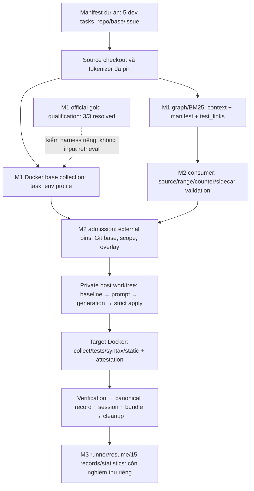
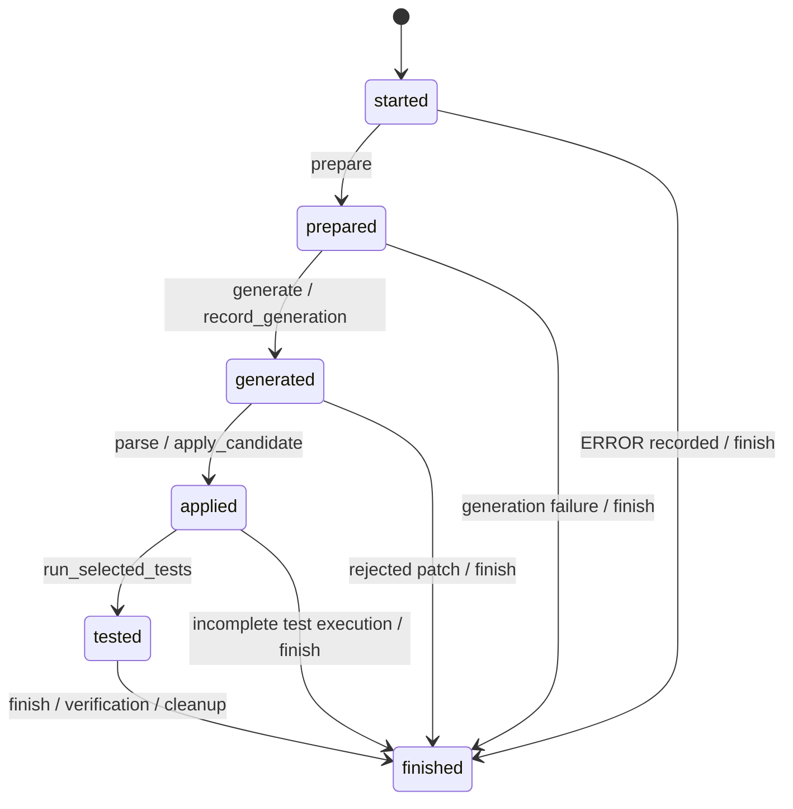

# Báo cáo tổng hợp và giải thích triển khai M1, M2 — Week 9

> Repository: `D:/Project/CAPSTONES/VGAR` · Ngày tổng hợp: **24/10/2026**.
> Baseline/HEAD vẫn là `525f9936a3c0abe5ea056c532c1f889ce84627a7`, branch `main`.
> Nguồn yêu cầu: `D:/Project/CAPSTONES/New_task/VGAR_W9_W16_Deliverables.md`, v2.
> Phạm vi: **M1-W9-1…6 và M2-W9-0…4**, code hiện hành, saved evidence và bàn giao M3.

## Mục lục

1. [Kết luận và cách đọc số liệu](#1-kết-luận-và-cách-đọc-số-liệu)
2. [Kiến trúc, dữ liệu và ranh giới oracle](#2-kiến-trúc-dữ-liệu-và-ranh-giới-oracle)
3. [M1: yêu cầu, phương pháp và kết quả từng task](#3-m1-yêu-cầu-phương-pháp-và-kết-quả-từng-task)
4. [M2: yêu cầu, phương pháp và kết quả từng task](#4-m2-yêu-cầu-phương-pháp-và-kết-quả-từng-task)
5. [Môi trường và inventory thay đổi](#5-môi-trường-và-inventory-thay-đổi)
6. [Hướng dẫn tự đọc evidence, chạy và test](#6-hướng-dẫn-tự-đọc-evidence-chạy-và-test)
7. [Kế hoạch bàn giao M3](#7-kế-hoạch-bàn-giao-m3)
8. [Các lỗi quan trọng và bài học kiểm chứng](#8-các-lỗi-quan-trọng-và-bài-học-kiểm-chứng)
9. [Tài liệu và paper tham khảo](#9-tài-liệu-và-paper-tham-khảo)
10. [Phụ lục inventory đầy đủ](#10-phụ-lục-inventory-đầy-đủ)

## 1. Kết luận và cách đọc số liệu

**M1 hoàn thành kỹ thuật 6/6 task; M2 hoàn thành kỹ thuật 5/5 task.** Có thể đánh
Done phạm vi triển khai kỹ thuật của hai thành viên theo gate từng task. Điều này
chưa chứng minh mọi PR/review/merge/board đã hoàn tất hoặc cổng chung Week 9 của
cả nhóm đã đóng. Không có commit/push mới được thực hiện trong các lượt bàn giao.

Báo cáo này được tạo bằng đọc code, tài liệu, checkpoint, JSON/JUnit/raw reports
đã lưu và đối chiếu độc lập M1/M2. **Không chạy lại pytest, model, Docker hoặc gold
để tạo báo cáo.** Các số PASS dưới đây là kết quả thực của những lần chạy được
chỉ rõ, không phải kết quả vừa tái lập trong phiên viết tài liệu.

### 1.1. Ma trận toàn bộ task

| Task | Yêu cầu/gate trọng tâm | Trạng thái và số liệu đã xác minh |
|---|---|---|
| M1-W9-1 | ImpactReport/schema; review M2/M3 và merge sớm theo plan gốc | **Done theo nghiệm thu được người dùng điều chỉnh**: 45 schema PASS; 167 selected PASS/2 deselected; Codex review theo ủy quyền, miễn M3 riêng task này; chưa chứng minh merge đúng hai ngày đầu |
| M1-W9-2 | diff_to_nodes: sửa/thêm/xóa hàm; không làm mất unmapped | **Done kỹ thuật**: 28 mapping tests trong selected 205 PASS/1 SKIP/2 deselected |
| M1-W9-3 | 5 task × graph/BM25, cùng định dạng/tokenizer/budget8000; consumer validate | **Done kỹ thuật**: 10/10 validated và accepted bundles, 5 task finalized PASS; final selected 391 PASS/1 SKIP/2 deselected |
| M1-W9-4 | Gold patch 2–3 task được official harness chấm resolved | **Done kỹ thuật**: 3/3 RESOLVED, canonical QUALIFIED; Linux wrapper 49 PASS, selected 467 PASS/1 SKIP |
| M1-W9-5 | Môi trường repo@commit; 5 collection thành công **hoặc** lý do loại | **Done kỹ thuật**: đủ5 profiles, 3 COLLECTED/2 EXCLUDED; unit 45 PASS, selected 320 PASS |
| M1-W9-6 | Shared bundle fixture cho M2/M3, load_handoff PASS | **Done kỹ thuật**: 40 tests mới trong final selected 226 PASS; fixture consumer và recipe Qwen riêng PASS |
| M2-W9-0 | Giao diện runner↔session được M3 duyệt | **Done interface**: review M3 đã ghi nhận/xử lý22/10; không đủ chứng cứ về lịch ngày1 |
| M2-W9-1 | Required checks A0/A1 tests-only; A2 đủ bốn checks | **Done kỹ thuật**: 28 policy PASS; selected 48 PASS |
| M2-W9-2 | Baseline-delta, optional static đúng policy; lỗi cũ được phép, lỗi mới fail | **Done kỹ thuật**: 60 logic PASS; selected 122 PASS/2 deselected, gồm3 native scenarios |
| M2-W9-3 | Manifest admission, pin base/env; task pilot chạy không registry; hash sai bị chặn | **Done kỹ thuật**: Xarray scripted/A0 qua toàn bộ Docker run_repair PASS; final317 PASS;14 operations/audit/cleanup PASS |
| M2-W9-4 | Arm/variant/policy provenance xuyên session/evidence, không regression W78 | **Done kỹ thuật**: full W78/W9 tại gate riêng285 PASS; bộ hiện hành sau admission317 PASS |

Nguồn trạng thái hiện hành: [M1](status/m1.md), [M2](status/m2.md),
[bảng checkpoint11task](status/week9_m1_m2.md). Các đoạn BLOCKED/NOT_RUN/“chưa có
bridge” trong nhật ký ngày trước được giữ nguyên làm lịch sử; không dùng chúng
để thay trạng thái hiện hành. [Ngoại lệ review M1-W9-1](reviews/2026-10-23-m1-w9-1-close-review.md)
không áp dụng cho task khác. Review agent không được gọi là chữ ký M3.

### 1.2. Những chữ PASS/Done cần hiểu đúng

| Khái niệm | Ý nghĩa thực tế | Không được suy ra |
|---|---|---|
| Schema/consumer PASS | DTO/sidecar/range/hash/counter hợp lệ ở boundary đã kiểm | Test target đã chạy hoặc issue đã sửa |
| Baseline PASS trong engine | Đã tái hiện failure cần sửa, collection và baseline đủ điều kiện | Code trước patch chạy toàn bộ tests PASS |
| COLLECTED | Pytest collection hợp lệ, có node IDs và không collection error | Các test body đều PASS |
| EXCLUDED | Lý do loại phù hợp schema và lưu đủ evidence | Có thể bỏ task khỏi manifest/denominator tùy ý |
| Official RESOLVED | Các tập tests bắt buộc theo official grader đáp ứng điều kiện | Mọi dòng raw pytest đều PASS, hoặc model VGAR đã giải task |
| Fake/scripted run_repair PASS | Plumbing, apply, target tests, verification và cleanup hoạt động với patch định trước | Model tự tìm patch hoặc graph tốt hơn BM25 |
| complete=true | Record đã được finalize; có thể PASS/FAIL/ERROR | Success |
| Done kỹ thuật | Gate riêng của task đã có bằng chứng | Reviewed/Merged hoặc cả Week9 hoàn tất |

Các nhóm tests chồng nhau: không cộng45+167,40+226,285+317 thành tổng tests độc lập.
317 là **suite M2 W78/W9**, không phải full repository suite hay benchmark score.
Các skips/deselections của receipts M1 cũ vẫn tồn tại trong lịch sử.

## 2. Kiến trúc, dữ liệu và ranh giới oracle

### 2.1. Luồng đã triển khai và luồng còn phải bàn giao



B-1 được gỡ bằng đường admission opt-in, **không xóa native trusted-fixture guard**.
B-2/B-3 được gỡ bằng policy và static delta. B-4 có môi trường/profile thực với
exclusions được ghi rõ; không phải mọi task đã runnable. ImpactReport ở Week9
mới phục vụ changed/unmapped contract và diff mapping; reverse impact/risk Week10
không được tự coi đã implement.

### 2.2. Population và pins

Dataset: `princeton-nlp/SWE-bench_Verified`, revision
`c104f840cc67f8b6eec6f759ebc8b2693d585d4a`.
Parquet SHA256: `a45b1fe4e2f0c8390b2b2938ac83e92ed5979000856808f3679c07812e9e6dcd`.
Manifest: [configs/m1/w9_pilot_manifest.json](../configs/m1/w9_pilot_manifest.json),
canonical hash `sha256:98984466d59da122d4798d436359275030f79e1190936d7d9a6f9a0a58458425`.

**“dev” là split do dự án tạo**, không phải khẳng định official dataset có split
dev tương ứng. `split_of(instance_id)` dùng tám hex đầu SHA256, modulo100; <40
là dev, còn lại held-out. Pipeline chuẩn bị đọc các rows/columns từ cached
Parquet; selection chỉ xét dev sau bước validate và lọc split, rồi yêu cầu
ít nhất hai production-source Python paths thay đổi trong developer patch.
Tasks được sort trong từng repo và round-robin theo repo đã sort.

| Task / repo | Base commit | Profile hash | Image ID/digest đã quan sát |
|---|---|---|---|
| `astropy__astropy-13398`<br>astropy/astropy | `6500928dc0e57be8f06d1162eacc3ba5e2eff692` | [sha256:8424f76408614e7b588ee52a81ea2295eec89080113f6c0027b4f1af0a966abb](../results/m1/w9/m1-w9-5/collection-runs/w95-3178eb33a42b414d81656b21b64cc2e2/astropy__astropy-13398/task_env.json) | `sha256:4d7e922ae3b796147f85b37861f6dec5463001a964bd941ed6933109245fe69f` |
| `django__django-11138`<br>django/django | `c84b91b7603e488f7171fdff8f08368ef3d6b856` | [sha256:0b5baaabb3ecb3050ccf72360059ff091e436c5cdf6fc658798174104d46b5a2](../results/m1/w9/m1-w9-5/collection-runs/w95-3178eb33a42b414d81656b21b64cc2e2/django__django-11138/task_env.json) | `sha256:811f9bf0ca067b334b574cd3589cdc989b350b2a24b68e1ddcd288fbb97d61f4` |
| `matplotlib__matplotlib-14623`<br>matplotlib/matplotlib | `d65c9ca20ddf81ef91199e6d819f9d3506ef477c` | [sha256:b4669fe7188eaccb3b5cc7cc7b327c27f5d266fb641b053b39ec3b2b432f391b](../results/m1/w9/m1-w9-5/collection-runs/w95-3178eb33a42b414d81656b21b64cc2e2/matplotlib__matplotlib-14623/task_env.json) | `sha256:52cdd8ac0f4a8b05f40507d500680ec613092186310cbaf7895d1554e9d654dc` |
| `pydata__xarray-3305`<br>pydata/xarray | `69c7e01e5167a3137c285cb50d1978252bb8bcbf` | [sha256:028f8acc40abd29b2851b77fbf13dc4409aa06118bcd52005020535b4296f4b7](../results/m1/w9/m1-w9-5/collection-runs/w95-3178eb33a42b414d81656b21b64cc2e2/pydata__xarray-3305/task_env.json) | `sha256:0e234daddf9a42b85a77ba0436f3fcbad90759921c978b127dff90d55cba0f89` |
| `pylint-dev__pylint-4551`<br>pylint-dev/pylint | `99589b08de8c5a2c6cc61e13a37420a868c80599` | [sha256:84bd1891fc1c1b0e25519addab24e0cbfa1e9e14bc7329f07b6a7b183f7c7e83](../results/m1/w9/m1-w9-5/collection-runs/w95-3178eb33a42b414d81656b21b64cc2e2/pylint-dev__pylint-4551/task_env.json) | `sha256:f0f898ca4ef3fec27a985b1c2c6ca6ed3cb8fbf5be393e0bb6caf4aaf1512c8c` |

Immutable env_ref đầy đủ ở profile: docker://swebench/sweb.eval.x86_64.<task-repo-encoding>@sha256:<digest>; image tags không thay digest/imageID/daemon attestation.

Tokenizer production: `Qwen/Qwen3-4B-Instruct-2507`, revision
`cdbee75f17c01a7cc42f958dc650907174af0554`. Manifest cũ được tái sử dụng tại
[artifacts/m1/tokenizer-acceptance/tokenizer_manifest.json](../artifacts/m1/tokenizer-acceptance/tokenizer_manifest.json).
Bốn assets `tokenizer.json`, `tokenizer_config.json`, `vocab.json`, `merges.txt`
được kiểm size/hash; loader dùng tokenizers major.minor0.22, observed0.22.2.
Đếm snippet với `add_special_tokens=False`, không padding/truncation, không cần
model weights. Budget8000 là tổng tokens snippets, không phải full chat.

### 2.3. Oracle được tiếp cận ở đâu?

| Stage | Dữ liệu thực sự tiếp cận | Ranh giới được giữ |
|---|---|---|
| Chuẩn bị population W9-3 | Loader đọc toàn Parquet; developer patch của dev tasks được parse để lọc multi-file eligibility | Đây là gold-informed population selection, phải công khai; không gọi toàn dự án “chưa từng đọc gold” |
| Projection/retrieval W9-3 | Chỉ instance_id/repo/base_commit/problem_statement/query_hash/split; ranking/context dùng issue+source | Không đưa developer patch, test_patch, F2P/P2P hoặc hints vào retrieval |
| Gold validation W9-4 | Gold patch/test oracle có chủ đích trong evaluation inputs riêng | Chỉ dùng kiểm official harness, không chảy ngược vào retrieval/model context |
| Base collection W9-5 | Base source và pytest discovery/config của repo | Không áp gold/test patch, không sửa deps/warnings để ép PASS |
| M2 admission smoke | Test độc lập viết từ MCVE trong public issue, scripted candidate, baseline feedback | Không dùng benchmark F2P/P2P/test_patch/gold/hints cho smoke; không phải đánh giá model mù |

Không chạy model/held-out benchmark trong những nghiệm thu này. Việc loader đọc
cached rows khác với việc chạy đánh giá held-out; không suy “held-out đã chạy”
hoặc “không hề đọc bytes dataset ngoài dev” từ cách chia split trên.

## 3. M1: yêu cầu, phương pháp và kết quả từng task

### 3.1. M1-W9-1 — ImpactReport/schema

**Yêu cầu.** Contract thống nhất changed/impacted/unmapped/risk/limits và ba loại
identity graph/source/patch; gate gốc yêu cầu review và merge sớm. Người dùng
đã điều chỉnh review cho riêng W9-1: Codex review theo vai M2, miễn M3. Không có
bằng chứng merge đúng hai ngày đầu; chưa commit/merge.

**Triển khai.** [contracts/impact.py](../src/vgar/contracts/impact.py) dùng Pydantic
strict, extra-forbid, kiểm bool/int và trạng thái available. `ImpactReport` chứa
repo/revision/graph_version, graph/source/patch hash; changed node/path/range/basis/
supporting spans; unmapped có reason; giới hạn mapping. `graph_hash` là canonical
JSON của document, `source_hash` là canonical dictionary Python path→raw-byte hash,
`patch_hash` là hash nguyên bytes diff UTF-8. Không đánh đồng hash ba đối tượng.

Ở Week9, `impacted` và `risk` giữ NOT_COMPUTED; feature unavailable có value=null,
không biến thành risk0 hoặc chứng minh không có impact. Limits mặc định256 KiB,
5 files,500changed-lines; unsupported add/delete/rename file được công khai.
COMPLETE có nghĩa xử lý hết input trong scope, vẫn có thể có unmapped có lý do.

API: `ImpactReport.model_validate(payload)`, `canonical_json()`,
`ImpactReport.model_validate_json(...)`. Schema tự nó không chứng thực source thực,
không apply patch và không chạy tests.

**Files chính.** Tạo contract/schema docs, mở rộng tests/test_impact.py; thêm
review handoff và close-review; cập nhật status/PROGRESS. Xem inventory ở §10.

**Kết quả.** RED ban đầu38 setupERROR do module chưa có; strict available=0 có
RED→GREEN. Cuối45 schemaPASS, selected 167 PASS/2 deselected; Ruff 0.16.5 PASS.
Hai tests W78 cần tokenizer từng bị deselect ở thời điểm đó; full suite không
được suy là đã chạy. Đợt close-review giữ nguyên source/tests bytes.
Evidence: [delivery_check](../results/m1/w9/m1-w9-1/20261023-close-review/delivery_check.json).

### 3.2. M1-W9-2 — diff_to_nodes

**Yêu cầu.** Map thay đổi sửa/thêm/xóa hàm về baseline graph; không làm mất hunk
không map được. Thêm/xóa hàm **trong file tồn tại** khác với thêm/xóa file.

**Thuật toán hiện hành.** [graph/impact.py](../src/vgar/graph/impact.py):

1. Validate graph, Python snapshot, byte ranges/hashes của mọi symbol.
2. Tái sử dụng `repair.patch.parse_unified_diff` và `_bind` để kiểm exact hunks,
   offsets và EOF; bước này chỉ đọc source, không apply patch.
3. Tách changed blocks, bỏ context-only lines; replacement/deletion dựa các dòng
   baseline thật thay đổi. Insertion chỉ map khi boundary strictly inside symbol.
4. Chọn baseline Function/Method/Class có range nhỏ nhất; nested symbol không
   đánh dấu mọi ancestor. Equal-size candidates thành ambiguous, không đoán.
5. Merge evidence và giữ unmapped có reason; kiểm lại source/graph không drift.

Supporting span giữ full changed-block coordinates, có thể hỗ trợ nhiều nodes
và unmapped cùng lúc. Không cộng span counts của mọi entries để tính patch size.
Xóa nguyên hàm vẫn giữ node baseline. Decorator ngoài range của builder có thể
unmapped; không tự mở rộng graph semantics để đoán. Link/junction, stale hashes,
coordinates sai, empty symbol range kể cả untouched, malformed/unsupported diff
đều bị từ chối; không trả COMPLETE giả.

```python
report = diff_to_nodes(raw_diff, document, source_repo,
                       patch_policy=PatchPolicy(allowed_paths, protected_paths))
```

`patch_policy` là keyword bắt buộc. Parser/apply implementation cũ được tái sử dụng,
không sửa parser để vượt gate. Tạo fixtures app.py/other.py; bổ sung tests/schema
integration. Kết quả205 PASS/1 SKIP/2 deselected, gồm45 schema+28 mapping+10 parser+
122 selected W9/W78. SKIP là symlink filesystem thật do quyền Windows; không gọi
đã kiểm link thật thành công. Review tìm empty-range guard ở untouched node;
RED1 FAIL/1 PASS→GREEN2 PASS rồi selected suite đạt.
Evidence: [delivery](../results/m1/w9/m1-w9-2/20261023-mapping/delivery_check.json).

### 3.3. M1-W9-3 — paired graph/BM25 export

**Yêu cầu.** Cùng năm task, mỗi task hai arm; đủ context.json/context_manifest.json/
test_links.json; cùng tokenizer/budget8000; consumer M2 thực validate PASS.

**Cách làm.** Graph builder/retriever/overlay và BM25 core cũ được tái sử dụng.
Graph arm dùng static resolver; không gọi SCIP/LSP/Jedi hoặc thêm thuật toán
ranking mới. Bounded retriever giữ config/features/omissions; defaults đã ghi
max_hops2,max_candidates100,min_edge_confidence0.6. BM25 corpus là path+qualified
symbol+exact source node range, k1=1.2,b=0.75, lexical ranking không dùng graph edges.
BM25 core dùng positive Robertson IDF; adapter mới đếm snippets bằng tokenizer thật,
không dùng estimator bytes÷4 trong legacy packing helper.

Shared eligibility loại empty/whitespace-only snippets cho cả hai arm. Packing
bỏ overlapping ranges và item vượt budget; giữ diagnostics ranked/omissions
ngoài sidecars. BM25 anchor_ids rỗng, graph_distance0 và rationale lexical rõ;
confidence1 có nghĩa exact-source binding, không phải xác suất relevance.
`graph/handoff.py` thêm opt-in issue-only test hints, không thay default cũ.

| Task | Graph items/tokens | BM25 items/tokens | Fallback files chung | Wall/task(s) |
|---|---:|---:|---:|---:|
| Astropy13398 |15/7994|9/7999|415|155.243|
| Django11138 |22/7995|9/7999|1717|199.850|
| Matplotlib14623 |29/7993|5/8000|92|91.506|
| Xarray3305 |47/7970|8/7999|43|37.386|
| Pylint4551 |55/7617|4/8000|700|30.791|

Run cuối [20261023T071017Z-4ab71bbef7a0](../artifacts/m1/w9/bundles/20261023T071017Z-4ab71bbef7a0/run_record.json):
10validated/10accepted,5 tasks source finalizedPASS;514.7866314 s. Mỗi arm có ba
sidecars và repair-context.txt; producer/consumer giữ source/counter identities.
Fallback files chỉ là candidates, chưa phải collected tests. Timings gồm shared
build/packing/checks, không so trực tiếp như isolated retrieval latency.

Run trước graph5 PASS/BM255 ERROR vì empty source, accepted0; sau fix shared filter
chạy lại đủ5×2 arm, không ghép PASS của hai campaigns. Final391 PASS/1 SKIP/
2 deselected,69.13 s, [post_filter_regression](../results/m1/w9/m1-w9-3/20261023-export/post_filter_regression.json).
Không nhầm với388 PASS trong run final_regression cũ.

**Giới hạn.** 8000 snippet tokens không đảm bảo full prompt cap6000; không chạy model,
không chứng minh graph tốt hơn BM25, không đánh giá retrieval quality bằng10 bundles.

### 3.4. M1-W9-4 — official harness/gold qualification

**Yêu cầu.** Gold patch2–3 task được official grader chấm resolved và giữ reports/logs
ngoài Git. Implementation cố định ba task đầu; cần ít nhất2/3resolved cùng các
integrity/cleanup gates. Không được viết lại official F2P/P2P grading.

**Cách làm.** SWE-bench4.1.0 tại commit
`726c5461e2ef52d83cf1ea2107870a8bb3328d57`; wrapper chuẩn bị evaluation dataset/
predictions có gold/test oracle riêng. Linux amd64 WSL, controller/harness venvs
riêng; CLI/SDK dùng cùng explicit Unix Docker endpoint, pinned image identities,
1worker, fresh run/container IDs. Official timeout1800 s, parent process3600 s;
owned process groups/containers cleanup có bound. Trước/sau kiểm source/modules,
inputs/images/daemon; infrastructure hoặc cleanup lỗi không thành RESOLVED.
Nguồn upstream: [harness đúng commit](https://github.com/SWE-bench/SWE-bench/tree/726c5461e2ef52d83cf1ea2107870a8bb3328d57).

Campaign cuối **20261024T081750218758Z-3af0d2d105bc: QUALIFIED,3/3 RESOLVED**,213.537830049 s.

| Task | F2P success/failure | P2P success/failure | Wall(s) |
|---|---:|---:|---:|
| Astropy13398 |4/0|68/0|93.083|
| Django11138 |1/0|73/0|30.799|
| Matplotlib14623 |1/0|400/0|84.610|

Raw pytest Astropy còn1failed/72passed/3skipped; Matplotlib179failed/402passed/
73skipped. Các failures này không thuộc required sets làm official verdict fail;
không khẳng định toàn bộ raw pytest PASS. Xem [acceptance report](m1_w9_4_acceptance_report.md)
và [checkpoint cuối](../results/m1/w9/m1-w9-4/20261023-local-qualification/checkpoint_gold_final_07.json).

Campaign trước canonical UNMET/3 ERROR dù raw3resolved: wrapper tìm sai thư mục
logs/evaluation trong khi pin dùng **logs/run_evaluation**. Fix qua RED1 FAIL→
Linux wrapper 49 PASS; selected 467 PASS/1 SKIP. Lint có E741 cũ tại test file; scoped
exclusionPASS, không gọi full lint sạch. Cả lỗi và raw reports đều được giữ.

Docker từng bị startup/socket errors và image cache thiếu. Sau user Quit bình
thường, một lần start đưa daemon lên lại; chuẩn bị lại đúng pinned images khi
được cho phép. Không chứng minh root cause socket/cache đã sửa triệt để; không
reset/prune/đổi settings/RAM/swap/WSL restart. Cache reclaim bounded W9-4 dùng2/3,
khác approval W9-5 dùng1/6. **Quota gold đã hết2/2 campaigns,6/6 attempts: không chạy
thêm API thực thi hoặc --execute trong hướng dẫn mặc định.**

### 3.5. M1-W9-5 — task environment profiles và base collection

**Yêu cầu.** Gỡ B-4 bằng môi trường repo@commit và profile; đủ5 task collect thành
công **hoặc** có lý do loại. Vì vậy3 COLLECTED/2 EXCLUDED đạt gate kỹ thuật, không
đồng nghĩa5runnable. Không đổi population để che failures.

**Cách làm.** Dùng chính official immutable images. Fresh owned container,
networknone/capdropALL/no-new-privileges/no host mount. Kiểm repo root/base object
rồi reset exact base **chỉ trong container mới**, vì official images có thể ở
setup commit. Probe stdlib/pytest Python 3.5+, timeout300 s,8 MiB mỗi stream; không
chạy test body, không cài thêm pytest/deps hoặc suppress warnings để ép success.
Collection dùng `@pytest-default` để tôn trọng repo pytest config; không nạp mọi
fallback source file vì chúng có negative/data fixtures cố ý không import được.

| Task | Kết quả | Node IDs | Exit | Python/pytest |
|---|---|---:|---:|---|
| Astropy | EXCLUDED:COLLECTION_FAILED |23146partial|2|3.9.20/7.4.0|
| Django | EXCLUDED:PYTEST_UNAVAILABLE |0|null|3.6.13/không có|
| Matplotlib | COLLECTED |7892|0|3.8.20/8.3.4|
| Xarray | COLLECTED |8713|0|3.10.15/7.4.0|
| Pylint | COLLECTED |1429|0|3.9.20/6.2.5|

Astropy có2collection errors do NumPy DeprecationWarning khi import
`astropy/convolution/tests/test_convolve_kernels.py`. Infrastructure/source/
cleanup failure là ERROR, không bị đổi thành exclusion hợp lệ.

`vgar-task-env-v1` gồm task_id/repo/base_commit/env_ref/image_id/daemon_id,
Python/cwd/runtime, scope/hash, fixed test/collection argv, visibility
base_only_no_oracle, source before/after và collection/report/profile hash.
Source identity chứa HEAD,clean,tracked Python inventory hash/count; before=after.
Các hashes là consistency, không chữ ký authentication.

Run [w95-3178eb33a42b414d81656b21b64cc2e2](../results/m1/w9/m1-w9-5/collection-runs/w95-3178eb33a42b414d81656b21b64cc2e2/run_record.json):
đủ5profiles/raw records, independent audit/source/cleanupPASS. Unit45 PASS,
selected 320 PASS/35.80 s, lintPASS. Run đầu lỗi Astropy setup commit được giữ;
fix reset-before-probe có RED2 FAIL→GREEN. M2 bridge hiện đã có ở W9-3, là bước
nghiệm thu khác, không làm hai exclusions tự biến thành runnable.

### 3.6. M1-W9-6 — shared fixture cho M2/M3

Fixture [tests/fixtures/w9_bundle](../tests/fixtures/w9_bundle/README.md) có source
3 files copy nguyên bytes từ W78 lúc bootstrap, còn lỗi login whitespace. Task
trusted_fixture=false, không thêm registry, không chạy sửa source fixture.
Recipe không overwrite/overlap; rebuild deterministic; `.gitattributes` giữ bytes
qua Git Windows. Canonical3 items/178Unicode characters, nhãn fixture-only:characters;
recipe Qwen riêng3 items/40 snippet tokens, không dùng chung cách đếm.

Helper kiểm task/profile/eight file hashes/counter; consumer thực kiểm source/
range/sidecars rồi render. Consumer không transport-bind task_id trong sidecars;
helper thêm consistency, không biến thành chữ ký chống sửa đồng thời mọi anchors.
Giới hạn coverage_verified/collection_verified giữ false.

40tests mới nằm trong final226 selectedPASS/52.54 s,0 skip; Ruff 0.13.3 PASS, khác pin
0.17 qualification. Minor deferred là test task_id tamper cùng rehash profile.
Không dùng fixture này với native run_repair bằng cách tự bật trusted flag; M3
có thể phát triển consumer/fake orchestration với nó, hoặc dùng native fixture
đã được registry phê duyệt cho engine smoke. [Closing receipt](../results/m1/w9/m1-w9-6/20261023-fixture/close_checks.json).

## 4. M2: yêu cầu, phương pháp và kết quả từng task

### 4.1. M2-W9-0 — runner↔repair session interface

**Yêu cầu.** M3 biết gọi gì, nhận record gì, quản lý error/resume thế nào. M3 review
đã được ghi nhận và feedback xử lý22/10. Nguồn review không ghi ngày/hash chính
phiên bản được đọc, nên không khẳng định đủ lịch “ngày1”. Xem [receipt M3](reviews/2026-10-22-m2-w9-0-m3-review-resolution.md).
Task này là tài liệu/interface, không tự tạo runner hoặc thay đổi public DTO.

API hiện hành sau cả W9-3/W9-4:

```text
run_repair(task, policy, generator, executor, output_root, *,
           m1_counter, tokenizer, profile=None, temp_root=None,
           keep_workspace=False, supersedes_run_id=None,
           rerun_reason=None, feedback=None, deadline=None,
           experiment=None, admission=None)
```

Trả `repair.evidence.RunHandle`, không phải dict/exit code. `executor` vẫn phải là
None; engine tự dựng executor gắn private lease. Mỗi call nhiều nhất một generation;
prepare lỗi thì không generation. M3 sở hữu batch/retry/aggregation, không để
engine tự đổi số attempts hoặc fallback model khi lỗi.



`_step` có thể trả None sau khi ghi outcome, không phải success. `finish` gọi lại
lần hai bị từ chối. `complete=true` bao gồm terminal FAIL/ERROR. Recommendation
thường PASS→ACCEPT,FAIL→REVISE,ERROR→REJECT; runner phải đọc canonical status/reason/
nested evidence thay vì chỉ thấy bundle tồn tại.

**Resume không phải read-only.** `RepairSession.load(run_dir)` kiểm JSON hai phía,
experiment/admission rồi gọi load_run, và load_run ghi record. Muốn thống kê dùng
`json.loads(run_record.json)` trực tiếp. Không resume archive đã cleanup lease như
một session còn sống. Thời hạn caller là absolute `time.monotonic()` deadline,
không phải “số giây”; session persist deadline_utc để dựng lại remaining time.

**Ctrl+C/timeout.** observe bắt BaseException để ghi rồi rethrow, nhưng _step và
generation boundary có thể bắt lại KeyboardInterrupt thành ERROR. M3 phải đọc
error_detail.type/stage/nested command, không chỉ dùng outer exceptKeyboardInterrupt.
Canonical timeout có thể là ERROR/VERIFICATION_INCOMPLETE trong khi DTO test reason
là TEST_TIMEOUT. Thiếu field timed_out không đồng nghĩa false. Timeout truyền cho
custom generator không tự chứng minh backend có hard cancellation.

M3 thông báo runner.lock exclusive là hướng resume; chưa audit implementation
runner local. Lock phải bao mọi writers/recovery, xác minh child/container cũ không
còn hoạt động xung đột trước relaunch. Giữ terminal failures; retry là attempt mới,
có supersedes_run_id/rerun_reason. Trường hợp lỗi trước có handle hoặc publish lỗi
cần ledger/record infrastructure của runner, không giả evidence bundle đã tồn tại.

### 4.2. M2-W9-1 — VariantPolicy

[policy.py](../src/vgar/repair/policy.py) và ba config variants tạo required-check
policy độc lập retrieval mapping. Strict/frozen/extra-forbid/revalidate instances;
không fallback A0 khi policy sai. Duplicate/unknown checks và policy_hash tự khai
trong config bị từ chối. Hash là canonical effective definition gồm defaults,
không filename/model/budget/environment. Check arrays được canonicalize.

| Variant | Required | Recorded |
|---|---|---|
| A0 | tests | tests,syntax,mypy,ruff |
| A1 | tests | tests,syntax,mypy,ruff |
| A2 | tests,syntax,mypy,ruff | tests,syntax,mypy,ruff |

Ba file shipped đều **arm=null**; đề xuất A0=BM25,A1/A2=graph chưa tự thành phê
chuẩn mapping nhóm. Khi caller bind arm cụ thể, effective policy/hash đổi.
Các config-null hashes để đối chiếu:

- A0: `sha256:bca5f7b7f208f217ce72373305e8325922ed6a43ebe378305920bc50ebfacbbf`.
- A1: `sha256:2b29abdb298d364685edf0236556cb648eb61d7cb5160d2380783a3a894bef00`.
- A2: `sha256:2f7c85d1124c77b5f5c67160e8acc644e64cf638d9bdcc10bbab4eb768be55ca`.

APIs: `load_variant(path)`, `policy_hash(policy)`, `required_checks(policy)`.
RED27 FAIL/1 PASS→28 PASS; selected 48 PASS. Đợt nghiệm thu22/10 kiểm lại28/48 PASS và
lintPASS. Gate policy không bị thêm điều kiện “đợi runner/model/arm mapping”.
Evidence [close-policy](../results/m2/w9/m2-w9-1/20261022-close-policy/delivery_check.json).

### 4.3. M2-W9-2 — baseline-delta và policy verification

**Vấn đề.** B-2 buộc baseline sạch mypy/Ruff tuyệt đối làm repo có debt cũ không
qualify; B-3 buộc static cho cả A0/A1 khiến tests-only không đúng định nghĩa.

**Cách sửa.** `static_diagnostics.py` parse Ruff JSON array và mypy JSON-lines về
Diagnostic(tool,path,line,column,code,severity,message). Report bind scope/hash,
config hash, interpreter, observed tool version, execution status, raw output hash/
reason. Malformed, timeout, truncation, stderr bất thường, out-of-scope diagnostic,
exit/status không khớp đều không được coi COMPLETE. Mypy column kiểm `type is int`
trước khi +1 để tránh bool thành0/1.

Comparator dùng SequenceMatcher(autojunk=False), chỉ map các unchanged lines xuất
hiện duy nhất ở cả hai snapshots; file>10000lines không có proven line map.
Identity gồm tool/path/code/severity/message/column và mapped line. Multiset
one-to-one giữ multiplicity; cùng số lượng diagnostics không che được lỗi mới thay
lỗi cũ. Delta giữ introduced/resolved/persisting/unmatched. Introduced error/warning
FAIL; execution/binding drift ERROR; ambiguous mapping bị xử lý bảo thủ.

Baseline cần collection hợp lệ, required selectors thật sự collected, ít nhất
một required case thật FAIL, các required outcomes PASS/FAIL, không test ERROR.
W9 required static chỉ cần execution COMPLETE, không đòi raw static PASS. A0/A1
cho phép optional tool errors nhưng vẫn ghi nguyên raw status/report; không nới
source/config/scope/interpreter/tool-version guards. Post yêu cầu required tests
PASS và các baseline-PASS cases không regress; missing/incomplete là ERROR.

```python
capture_baseline(task, lease, executor, policy, variant=variant)
run_static_checks(lease, targets, policy, executor, variant=variant)
complete_verification(partial, task, lease, applied, baseline,
                      executor, policy, variant=variant)
```

Cần dùng cùng variant ở baseline/post. `variant=None` giữ legacy strict W78;
variant mất/đổi là ERROR. Raw status, delta và required-check/final verdict tách
biệt. TimeoutError được rethrow trước OSError, nên optional tool không nuốt global
deadline. `session.observe` giữ outer before/after guard.

**Kết quả.** Column regression RED2 FAIL/7 PASS→GREEN9 PASS; close60 logicPASS,
selected 122 PASS/2 deselected. Ba native scenarios đều testPASS nhưng expected verdict
khác nhau: A2 giữ debt cũ→PASS;A0 thêm debt→PASS với static recorded-not-required;
A2 thêm debt→FAIL. Post tests cả ba đều2 PASS, patch là fixture/scripted, không model.
Tools giai đoạn đầu Python 3.13/mypy 1.20.2/Ruff 0.16.5 là observed compatibility,
không giả pin dự án2.4.0/0.17.0. Source hiện tại đã có target-syntax Docker ở W9-3,
thay giới hạn native-only của bản W9-2 lịch sử.
Evidence [close-delta](../results/m2/w9/m2-w9-2/20261022-close-delta/delivery_check.json).

### 4.4. M2-W9-4 — arm/variant/policy provenance

Triển khai W9-4 trước W9-3 theo lệnh riêng của người dùng; đánh số task không phải
thứ tự triển khai. Mục đích bind experiment mà vẫn giữ public DTO và legacy path.

`RepairExperiment={variant_policy,arm,expected_hashes?}` strict/frozen; explicit
arm bm25/graph, policy arm null được bind trên effective copy; conflict bị từ chối.
Expected hashes nếu có phải đủ đúng ba sidecar names, SHA256 lowercase. Consumer
`load_handoff(...,arm=...,expected_hashes=...)` kiểm raw hashes, gọi consumer M1 thực,
lưu actual hashes và recheck unchanged. **Arm là caller-declared provenance**, không
chứng minh bundle thực được retrieve bằng thuật toán nào.

Session/canonical cùng `experiment_required=true` và cùng snapshot:

```text
experiment:
  variant_id, arm, policy_hash, variant_policy,
  expected_hashes, bundle_hashes
```

bundle_hashes lúc đầu null, sau consumer là actual hashes. Bundle giữ cùng snapshot
ở metadata.experiment. Baseline PASS yêu cầu policy hash hai phía khớp; mất cả hai
profile nhưng còn marker, mất/sai baseline hash hoặc context hash drift bị từ chối
trước reload write. Record legacy không marker/profile vẫn load. Đây là consistency,
không chống attacker viết lại mọi anchors/expected pins cùng lúc.

Generic `repair/evidence.py`/`contracts/evidence.py` **không cần sửa** để nhét field
mới: metadata hiện hữu được dùng. `repair_server.get_task_context(...,experiment=...)`
có opt-in, các MCP steps sau reload session. **MCP start chưa có admission input**;
không dùng evidence này để nói runner M3 real SWE-bench qua MCP đã tích hợp.

W9-4 review tìm missing-both-profile/baseline-hash Important, có RED→GREEN rồi
focused6 PASS. Full lần đầu278 PASS/1 FAIL do .pth source mapping sai; người dùng duyệt
sửa đúng một .pth về VGAR/src, không cài deps. Final full 285 PASS,419.629 s,0 skip/
exclusion;11 terminal fake records giữ raw artifacts. Latest full 317 PASS sau W9-3
là suite mới, không sửa hoặc cộng chồng evidence285 cũ.
Evidence [closing checks](../results/m2/w9/m2-w9-4/20261023-implementation/closing_checks.json).

### 4.5. M2-W9-3 — SWE-bench admission và Docker bridge

**Yêu cầu.** Bỏ giới hạn chỉ-fixture cho đường SWE-bench, pin base/profile; pilot
qua run_repair không registry, hash sai vẫn bị chặn. Không đơn giản set
trusted_fixture=true, xóa guard hoặc gửi arbitrary external executor.

**Admission.** `RepairPolicy(runtime='docker_admitted')`, explicit experiment và
`admission=admit_task(...)`; native default vẫn `native_trusted_fixtures`.

```text
admit_task(task, manifest_path, profile_path, *,
           expected_manifest_hash, expected_profile_hash,
           bundle_hashes, source_roots, overlay=None,
           docker_host='unix:///var/run/docker.sock')
```

Caller đưa **pins được phê duyệt độc lập**; tự hash input vừa nhận không tự tạo
phê duyệt/authentication. Task repo/base/toàn issue text phải khớp manifest năm dev
tasks. Chỉ COLLECTED profile; kiểm immutable env/task/profile hash. HEAD đúng base,
raw file bytes khớp Git blob của exact tree, không tin index/filter/clean status;
Python inventory còn khớp profile M1. Links/submodules/untracked discrepancies bị
chặn. Sau review, host reads và target reset/identity dùng `--no-replace-objects`
để replacement refs không giả tree khi HEAD vẫn giữ hash cũ.

Source roots sorted/nonempty. Allowed paths bằng **toàn bộ production Python
inventory dưới roots**, loại test/tests/testing/test_/conftest; không chọn editable
paths từ gold. protected không chồng allowed. Overlay chỉ file test mới
`tests/vgar_w9_repro_*.py`, protected, absent base, nonempty≤64 KiB/file, hash/persist.
Cần failing selectors/fallback scope rõ, ngoài editable source. Handoff thêm failing
selectors vẫn phải khớp admitted task hash; không âm thầm đổi input sau admission.

Snapshot hiện hành:

```text
schema=vgar-repair-admission-v1
visibility=issue_reproduction_no_benchmark_oracle
manifest_path, profile_path, expected_manifest_hash, expected_profile_hash
 task_hash, inventory, inventory_hash, source_roots
 overlay, overlay_hash, bundle_hashes, docker_host, admission_hash
```

State/record cùng admission_required=true và snapshot; bundle metadata.admission
cùng giá trị. Save kiểm structural để source drift vẫn ghi ERROR/cleanup được;
load/execution revalidate inputs/source đầy đủ trước ghi/chạy. Paths absolute theo
máy, không tự relocate profile/task khi chuyển Windows↔WSL.

**Private host và target.** Git/apply giữ trên host lease. `.gitattributes` được
hỗ trợ ở admitted branch bằng info/attributes precedence cao tắt text/filter/
ident/working-tree-encoding, rồi attest raw bytes; native guard cũ không bị nới.
Mỗi target command tạo container mới, pin image digest/imageID/daemonID/Linux amd64,
name+operation+admission labels riêng; networknone,capdropALL,no-new-privileges,
pids256; không bind mount host/socket, không pull/install VGAR/Torch/tools hoặc
native fallback. Target stdlib driver Python 3.6+ reset base **trước copy candidate**,
kiểm Python/pytest/base, chỉ nhận archive regular files đúng danh sách/path/hash,
không traversal/link/duplicate; attest expected bytes trước/sau.

Fixed pytest/mypy/Ruff argv của engine được map vào target Python
`/opt/miniconda3/envs/testbed/bin/python`, cwd `/testbed`; reporter độc lập copy từ
plugin M2 xuất node IDs/outcomes/JUnit và raw streams. Syntax cũng dùng target
interpreter. Chỉ reports theo paths cố định được copy về, không copy target source
về host. Host original và protected private bytes kiểm lại; candidate chỉ khác
trong allowed source paths.

Operation bị clip command/global deadline; mỗi Docker CLI step tối đa60 s, cleanup
có budget riêng≤30 s, verify name/image/labels trước rm và kiểm không còn owned
container. Incomplete/truncated/timed_out hoặc cleanup ERROR ngăn PASS. keep_workspace
chỉ giữ host lease, không giữ container. Đây là isolation/consistency, không
cryptographic attestation chống target cố ý forge reporter trong cùng container.

**Pilot final.** Run **20261024T104018047265Z-61c601678725**,wrapper elapsed638.903 s, wrapper/canonical
PASS,complete=true,original_source_unchanged=true. Xarray3305/A0 với explicit bm25
label; dùng `vgar.models.generator.FakeGenerator`, patch định trước, V11 nguyên
bản; allowed scope36production files xarray/core. Independent MCVE keep_attrs từ
issue và false-control; không benchmark test/gold oracle.

| Case | Baseline | Sau patch |
|---|---|---|
| keep_attrs=True giữ units=K | FAIL | PASS |
| keep_attrs=False bỏ attrs | PASS | PASS |

Handoff integration source-only đủ dòng2827–2878, identity/ranges/hashes riêng,
consumer thật validate, whitespace counter. Không là paired retrieval bundle hay
Qwen token qualification. Baseline/verification PASS; selection COMPLETE không có
field status trong engine cũ. Syntax targetPASS; mypy/Ruff thiếu module rawFAIL,
structuredERROR và optional A0, **không qualification A2**.

Independent audit14 operations/14cleanupPASS, cuối không owned containers; session/
canonical/bundle admission+experiment và frozen source khớp. Wrong profile pin bị
reject trước Docker; tests còn kiểm manifest/bundle/source/task mismatches. R1
replacement-tree review tái hiện2 FAIL→2 PASS; final **317 PASS**(285 old+32 new),371.876 s,
0 FAIL/ERROR/SKIP/exclusion. Không Critical/Important còn mở; không re-review hoặc
giả human/team approval. [Checkpoint](../results/m2/w9/m2-w9-3/20261024-docker-admission/checkpoint_final.json),
[audit final](../results/m2/w9/m2-w9-3/20261024-docker-admission/independent_audit_05.json).

## 5. Môi trường và inventory thay đổi

### 5.1. Môi trường thực đã dùng, không phải yêu cầu phải cài lại

| Thành phần | Identity/đường dẫn đã quan sát | Vai trò/giới hạn |
|---|---|---|
| Windows Python kiểm gate cuối | `D:/Project/CAPSTONES/environments/vgar-week78-cuda/Scripts/python.exe`; Python 3.11.6,pytest8.4.2 | Full M2 W78/W9 và M1 selected; cần assets/tools có sẵn |
| Tokenizer/export runtime | Pydantic2.14.0,tree-sitter0.25.2,tree-sitter-python0.25.0,tokenizers0.22.2,pyarrow23.0.1 theo versions receipt | Không suy từ docs dùng .venv3.13 cũ sang environment này |
| WSL distro | VGAR-Harness-W9, Ubuntu24.04.5/Python 3.12 | Linux control, Docker CLI; không phải Python target của từng repo |
| Controller venv | `/home/vgar/w9/venvs/controller/bin/python` | M1 wrapper/base collection, M2 Docker smoke; không cần model weights |
| Harness venv | `/home/vgar/w9/venvs/harness/bin/python` | SWE-bench4.1.0,docker SDK7.1.0,ghapi1.1.1; source `/home/vgar/w9/swebench` đúng pin |
| Docker | Desktop4.48/Engine28.5.1 Linux amd64 theo receipts; endpoint Unix socket | Báo cáo không probe daemon online hiện tại hoặc tự start Docker |
| Storage | Docker data `D:/DockerDesktopWSL`, distro/harness ở vùng D đã provision | Không reset/prune/đổi storage để tạo báo cáo |

Một thay đổi environment ngoài Git được user duyệt trong W9-4 M2:
`D:/Project/CAPSTONES/environments/vgar-week78-cuda/Lib/site-packages/vgar_week78_source.pth`
trỏ `D:/Project/CAPSTONES/VGAR/src` để subprocess import đúng module. Backup/hashes/
probe ở [environment_mapping_after](../results/m2/w9/m2-w9-4/20261023-implementation/environment_mapping_after.json).
Không phải sửa repo pyproject hoặc cài lại dependencies. Runtime pins ở pyproject
mypy 2.4.0/Ruff 0.17.0 không được gọi qualified chỉ vì các compatibility runs dùng
mypy 1.20.2/Ruff 0.16.5 hoặc Ruff 0.13.3 PASS.

### 5.2. Files/folders: cách quy trách nhiệm

Inventory ở §10 liệt kê **mọi file Git-visible mới/sửa hiện còn** so với baseline
đầu W9, kèm task owner. Snapshot có97 new+11tracked-modified=108 files; bao gồm docs
status tổng hợp sau implementation. Bản báo cáo này tạo sau snapshot, được tính
riêng. Không quy tài liệu kiến trúc có sẵn của người dùng cho Week9.

Folder không có version riêng trong Git: “folder liên quan” nghĩa có output bên
trong, không khẳng định một empty directory chưa từng tồn tại trước đó. Files
như tests/test_impact.py là mới so với HEAD nhưng được sửa nhiều lần trong task 1/2;
không nhầm creation so với HEAD với “modified_existing” trong snapshot sau RED.

Các thành phần **reused/giữ nguyên source** trong W9 gồm repair/patch.py, generic
repair/evidence.py, contracts/evidence.py, pytest_plugin.py/test_runner.py,
trusted_fixtures.json, graph builder/retriever/BM25 core và W78 fixtures. File
workspace.py có thay đổi đúng W9-3 nên không nằm nhóm “hoàn toàn unchanged”.
Không sửa pyproject.toml/Task Status.md hoặc tự triển khai runner/M3 CI/Week10.

### 5.3. Outputs lớn/ignored và thứ phải chuyển ngoài Git

- `artifacts/m1/w9/bundles/`: các paired export runs, graph documents, sidecars,
  diagnostics, stdout/stderr và run index, gồm cả run lỗi trước đó.
- `results/m1/w9/m1-w9-*/`: schema/mapping/export/wrapper/collection/fixture tests,
  raw receipts/JUnit/versions/reviews/checkpoints, gold runs, runtime profiles.
- `results/m2/w9/m2-w9-*/`: policy/delta/provenance/admission tests, native/fake
  runs, baseline/post evidence, source snapshots/probe archives, cleanup và audit.
- `data/w9/repositories/<task_id>/`: năm full Git checkouts làm input tại base,
  không phải mã VGAR do nhóm viết; prepared-source logs nằm cạnh checkout.
- Tokenizer assets ignored ở `artifacts/m1/tokenizers/Qwen3-4B-Instruct-2507/<revision>/`;
  manifest gốc tái sử dụng; không tải weights trong các task M1/M2 này.
- Cached Parquet gốc nằm ngoài repo VGAR tại
  `D:/Project/CAPSTONES/M2_week_5_6/data/downloads/<dataset_revision>/test-00000-of-00001.parquet`.
- Private seed/worktrees và containers tạm được tạo rồi cleanup; receipt là bằng
  chứng còn lại. Không giả có thể bàn giao một temp workspace đã bị xóa.

Raw outputs không commit. Clone repo chỉ có source/config/docs/fixtures được đưa
vào Git sau này, không tự có ignored dataset/checkouts/tokenizer/runtime/evidence.
Cần handoff package và hashes riêng. Appendix §10 có cả retained artifact index;
không trình bày tar snapshot của third-party source thành code mới của VGAR.

## 6. Hướng dẫn tự đọc evidence, chạy và test

Các lệnh trong mục này **chưa được chạy trong phiên viết báo cáo**. Chọn đúng lớp
kiểm tra; không cần chạy chồng mọi nhóm và full suite. Dùng output mới mỗi lần,
không ghi đè saved receipts hoặc sửa input canonical. Đường dẫn Windows/WSL là
máy đã nghiệm thu, không bảo đảm tồn tại trên máy M3 khác.

### 6.1. Đọc kết quả đã có — không rerun experiment

Trong PowerShell:

```powershell
Set-Location 'D:\Project\CAPSTONES\VGAR'
$repo = (Get-Location).Path
$py = 'D:\Project\CAPSTONES\environments\vgar-week78-cuda\Scripts\python.exe'
if (-not (Test-Path -LiteralPath $py)) { throw 'Thiếu interpreter đã chỉ định; chọn environment phù hợp trước.' }

$gold = Get-Content -Raw -Encoding utf8 'results/m1/w9/m1-w9-4/20261023-local-qualification/checkpoint_gold_final_07.json' | ConvertFrom-Json
$envs = Get-Content -Raw -Encoding utf8 'results/m1/w9/m1-w9-5/20261024-docker-only/checkpoint_final.json' | ConvertFrom-Json
$repair = Get-Content -Raw -Encoding utf8 'results/m2/w9/m2-w9-3/20261024-docker-admission/checkpoint_final.json' | ConvertFrom-Json
$gold | Select-Object task,state,resolved_count,campaigns_used,real_attempts_used
$envs | Select-Object task,state,collected,excluded,all_five_retained
$repair | Select-Object task,status,technical_complete,final_tests,owned_containers
```

Kỳ vọng gold QUALIFIED/3resolved/quota2campaigns6 attempts; environment3/2 và giữ5;
repair checkpointPASS/317tests/không owned containers. Đây là đọc receipts lịch sử,
không probe Docker hiện tại. Đọc thêm run_record của paired bundles và final repair
bằng ConvertFrom-Json. **Không dùng RepairSession.load để thống kê** vì hàm đó ghi
lại record. Xem raw report/JUnit/command.json khi canonical và wrapper khác nhau.

### 6.2. Chuẩn bị shell cho offline tests

```powershell
$env:PYTHONPATH = (Join-Path $repo 'src')
$env:PYTHONUTF8 = '1'
$env:PYTHONIOENCODING = 'utf-8'
$env:PYTHONDONTWRITEBYTECODE = '1'
$env:PYTEST_DISABLE_PLUGIN_AUTOLOAD = '1'
$env:HF_HUB_OFFLINE = '1'
$env:TRANSFORMERS_OFFLINE = '1'

& $py -B -c "import sys, importlib.metadata as m; import vgar.repair.pytest_plugin as p; print(sys.executable); print(sys.version); print(p.__file__); print({k:m.version(k) for k in ['pytest','pydantic','tree-sitter','tree-sitter-python','tokenizers','pyarrow']})"
if ($LASTEXITCODE -ne 0) { throw 'Preflight Python/import/dependencies lỗi.' }
```

Probe import plugin phải trỏ checkout VGAR hiện tại. Subprocess target fixture cũng
cần import đúng source; PYTHONPATH của pytest parent không tự thay bằng chứng .pth
mapping đúng cho mọi subprocess. Không sửa .pth/cài dependency tùy ý chỉ để lệnh
PASS; nếu machine khác, provision/ghi versions có kiểm soát trước khi qualification.
Một số docs cũ dùng CAPSTONES/.venv Python 3.13; không sao chép nhầm path đó thay
interpreter3.11 đã dùng gate cuối.

Tạo fresh results/temp paths, tránh pytest temp ACL trên C và tránh basetemp đã có
(vì pytest có thể cleanup basetemp):

```powershell
$tag = (Get-Date -Format 'yyyyMMddTHHmmss') + '-' + [guid]::NewGuid().ToString('N')
$out = Join-Path $repo ('results/manual/week9/' + $tag)
New-Item -ItemType Directory -Path $out -ErrorAction Stop | Out-Null

function Invoke-W9Test {
    param([string]$Name, [string[]]$Targets, [string[]]$Extra = @())
    $temp = 'D:\vgar-week9-' + $tag + '-' + $Name
    if (Test-Path -LiteralPath $temp) { throw 'Basetemp đã tồn tại; tạo tag mới.' }
    $junit = Join-Path $out ($Name + '.junit.xml')
    $log = Join-Path $out ($Name + '.log')
    & $py -B -m pytest @Targets @Extra -q -p no:cacheprovider "--basetemp=$temp" "--junitxml=$junit" 2>&1 | Tee-Object -FilePath $log
    $exitCode = $LASTEXITCODE
    if ($exitCode -ne 0) { throw ('Test group lỗi: ' + $Name + ', exit=' + $exitCode) }
}
```

Tên groups dưới đây khác nhau để không tái sử dụng temp. `$Extra` cho phép chọn
-k trong cùng file. Đây là convenience wrapper để lưu log/JUnit, không thay raw
canonical engine record. Shell session mới giúp không rò env test vào công việc khác.

### 6.3. Chạy/test từng task M1

```powershell
# W9-1/2: schema và mapping; source fixture không bị patch thật bởi mapper.
Invoke-W9Test -Name 'impact-schema' -Targets @('tests/test_impact.py') -Extra @('-k','schema')
Invoke-W9Test -Name 'impact-mapping' -Targets @('tests/test_impact.py') -Extra @('-k','diff_to_nodes')

# W9-3: lexical adapter, paired exporter/controller/source-hash contracts.
Invoke-W9Test -Name 'paired-bundles' -Targets @('tests/test_w9_bm25_handoff.py','tests/test_w9_pilot_bundles.py')

# W9-4: wrapper/report/ownership logic; không chạy gold experiment.
Invoke-W9Test -Name 'official-wrapper' -Targets @('tests/test_official_harness.py')

# W9-5: profile/controller/probe logic với fixtures/fakes, không collection5repos thật.
Invoke-W9Test -Name 'task-env-unit' -Targets @('tests/test_task_env.py')

# W9-6: recipe/consumer portable fixture, không model hoặc sửa login.
Invoke-W9Test -Name 'shared-fixture' -Targets @('tests/test_w9_bundle.py')
```

Lịch sử riêng từng gate là45 schema/28 mapping/49Linux wrapper/45 task-env/40fixture
new tests. Không cam kết mọi command Windows ở trên có đúng số tests của run
Linux/selected lịch sử; platform skips và tập chọn khác nhau phải đọc JUnit thực.

Ví dụ API mapping tự chạy từ repo root, chỉ đọc fixtures và in JSON:

```python
from pathlib import Path
from vgar.graph.builder import PythonGraphBuilder
from vgar.graph.impact import diff_to_nodes
from vgar.repair.patch import PatchPolicy

root = Path('tests/fixtures/m1_w9_impact')
document = PythonGraphBuilder(repo_key='report/impact-demo',
    repository_revision='fixture-v1').build(root)
diff = '--- a/app.py\n+++ b/app.py\n@@ -5 +5 @@\n-    return value + 1\n+    return value + 3\n'
result = diff_to_nodes(diff, document, root,
    patch_policy=PatchPolicy(('app.py', 'other.py'), ()))
print(result.canonical_json())
```

Kỳ vọng changed chứa first, impacted/risk NOT_COMPUTED; không có file source được
sửa. Không dùng ví dụ này để gọi full impact/risk scoring đã tồn tại.

Validate shared fixture và rebuild vào output mới:

```powershell
& $py -B scripts/build_w9_bundle_fixture.py --validate-root tests/fixtures/w9_bundle
if ($LASTEXITCODE -ne 0) { throw 'Canonical fixture không hợp lệ.' }

$fixtureCopy = Join-Path $out 'fixture-characters'
& $py -B scripts/build_w9_bundle_fixture.py --output-root $fixtureCopy
if ($LASTEXITCODE -ne 0) { throw 'Build fixture lỗi.' }
& $py -B scripts/build_w9_bundle_fixture.py --validate-root $fixtureCopy

# Qwen recipe là output/counter profile RIÊNG, yêu cầu đúng cached assets.
$qwenCopy = Join-Path $out 'fixture-qwen'
& $py -B scripts/build_w9_bundle_fixture.py --output-root $qwenCopy --tokenizer-manifest artifacts/m1/tokenizer-acceptance/tokenizer_manifest.json
if ($LASTEXITCODE -ne 0) { throw 'Qwen fixture lỗi hoặc thiếu assets.' }
& $py -B scripts/build_w9_bundle_fixture.py --validate-root $qwenCopy --tokenizer-manifest artifacts/m1/tokenizer-acceptance/tokenizer_manifest.json
```

Characters output kỳ vọng3 items/178characters; Qwen3 items/40 snippet tokens với
đúng source/asset pins. Chuyển counter giữa hai fixtures mà không chọn manifest
đúng phải bị từ chối. Không chạy native run_repair trên shared fixture bằng cách
bỏ guard hoặc thêm tùy tiện vào trusted_fixtures.json.

### 6.4. Đọc lại/re-export paired bundles

Ưu tiên đọc run index/audit hiện có. Nếu chủ động muốn tái lập export, cần đúng
five source checkouts/base, manifest/profile/tokenizer assets và output mới.
Lệnh chỉ export, không chạy target pytest/model/harness:

```powershell
$bundleOut = Join-Path $out 'paired-exports'
& $py -B scripts/export_w9_pilot_bundles.py `
  --manifest configs/m1/w9_pilot_manifest.json `
  --profile configs/m1/w9_bundle_profile.json `
  --tokenizer-manifest artifacts/m1/tokenizer-acceptance/tokenizer_manifest.json `
  --sources-root data/w9/repositories `
  --output-root $bundleOut
if ($LASTEXITCODE -ne 0) { throw 'Export incomplete; giữ mọi task records để chẩn đoán.' }
```

Script tự sinh run directory mới; expected10validated/10accepted và5 tasks
source_unchanged. Kiểm cả worker finalization, không chỉ file sidecar tồn tại.
Budget8000 ở cả hai arm, không dùng optional --worker/--directory nội bộ để sửa
run cũ. Trên máy chưa có inputs, `scripts/prepare_w9_pilot_inputs.py` cần
--dataset-cache và --tokenizer-cache; chỉ thêm --prepare-sources khi chủ động cho
phép init/fetch/checkouts. Bước này có thể ghi/copy assets, gọi Git network và
đọc gold patch để population eligibility; không phải read-only retrieval audit.
Không chạy bước chuẩn bị để ghi đè source checkout khác SHA hoặc nonempty dir.

### 6.5. Chạy/test từng task M2 và regression đầy đủ

```powershell
Invoke-W9Test -Name 'policy' -Targets @('tests/m2/w910/test_policy.py')
Invoke-W9Test -Name 'static-delta' -Targets @('tests/m2/w910/test_static_diagnostics.py','tests/m2/w910/test_baseline_delta.py')
Invoke-W9Test -Name 'native-delta' -Targets @('tests/m2/w910/test_w9_native_delta.py')
Invoke-W9Test -Name 'provenance' -Targets @('tests/m2/w910/test_context_arm.py','tests/m2/w910/test_variant_provenance.py','tests/m2/w910/test_runner_contract.py')
Invoke-W9Test -Name 'admission' -Targets @('tests/m2/w910/test_admission.py','tests/m2/w910/test_docker_admission.py')

# Có thể chọn full group NÀY thay vì chạy lại các subsets ở trên.
Invoke-W9Test -Name 'full-m2-w78-w9' -Targets @('tests/m2/w78','tests/m2/w910')
```

Expected historical current full 317 PASS,0 skip/exclusion; nếu code/deps khác phải
báo actual result, không sửa count/assertion để khớp báo cáo. Tests admission dùng
fake transport/unit fixtures, không phải real Docker pilot. Native-delta chạy tools
trên private fixtures; tokenizer-dependent W78 cần đúng assets/source import.
Không chạy `pytest` toàn repo rồi gọi đó là cùng317gate; phạm vi khác có thể gọi
HF/agent integrations. M2-W9-0 không có một pytest riêng chứng minh human approval;
receipt review là nguồn phê duyệt, runner_contract kiểm tính tương thích kỹ thuật.

Lint tham khảo, không --fix trên dirty workspace:

```powershell
& $py -B -m ruff check --no-cache src/vgar/repair/admission.py src/vgar/repair/docker_executor.py src/vgar/repair/docker_probe.py tests/m2/w910/test_admission.py tests/m2/w910/test_docker_admission.py
& $py -B -m ruff check --no-cache --select E9,F src/vgar/repair/contracts.py src/vgar/repair/pipeline.py src/vgar/repair/session.py src/vgar/repair/static_checks.py src/vgar/repair/verification.py src/vgar/repair/workspace.py
```

Đây là scope lint cuối của W9-3, không phải full repo lint sạch. Harness test file
có E741 cũ đã ghi; không tự giấu lỗi đó khi đưa số liệu cho M3.

### 6.6. Docker base collection — preflight trước, execute riêng

Public skeletons [w9_harness_profile](../configs/m1/w9_harness_profile.json) và
[w9_task_env_profile](../configs/m1/w9_task_env_profile.json) còn UNQUALIFIED;
không dùng chúng để nói máy mới READY. Runtime local đã dùng là
`results/m1/w9/m1-w9-5/20261024-docker-only/qualified-runtime-02.json`.
Profile env của từng task là task_env.json trong **collection run**, không phải
runtime controller JSON. Hai loại JSON này không hoán đổi cho admission.

Trong WSL distro đã provision, Bash:

```bash
cd /mnt/d/Project/CAPSTONES/VGAR
export PYTHONPATH="$PWD/src"
export PYTHONDONTWRITEBYTECODE=1
PY=/home/vgar/w9/venvs/controller/bin/python
RUNTIME=results/m1/w9/m1-w9-5/20261024-docker-only/qualified-runtime-02.json
NEW_OUT="results/manual/week9/env-$(date -u +%Y%m%dT%H%M%S)-$$"

# Mặc định preflight: tạo receipts, không tạo collection containers/pull images.
"$PY" -B scripts/prepare_task_env.py --runtime "$RUNTIME" --output-root "$NEW_OUT/preflight"
```

Sau khi tự đọc preflight, nếu chủ động chạy collection mới:

```bash
"$PY" -B scripts/prepare_task_env.py --runtime "$RUNTIME" --output-root "$NEW_OUT/collection" --execute
```

Lệnh execute tạo fresh containers và collection5 task; không model/gold. Không thêm
--prepare-images nếu không định pull pinned images còn thiếu. Scripts kiểm RAM
Windows/Linux≥4 GiB, diskC≥10 GiB/D≥20 GiB cùng platform/SDK/CLI/image identities.
Nếu gate fail, giữ ERROR/NOT_RUN và giải quyết có kiểm soát; không tự hạ gate,
prune/reset, đổi memory/swap hoặc suppress warnings. Fresh collection có thể vẫn
3 COLLECTED/2 EXCLUDED; không đổi expected population để ép5 PASS.

### 6.7. Official gold harness — đọc/audit, không chạy thêm campaign

Saved raw final: `results/m1/w9/m1-w9-4/gold-runs/20261024T081750218758Z-3af0d2d105bc/`.
Qualified local profile: `results/m1/w9/m1-w9-4/runtime/qualified-profile.json`.
Shell entrypoint gọi Python module official, không start/install Docker.
Muốn kiểm help/preflight riêng, từ WSL:

```bash
cd /mnt/d/Project/CAPSTONES/VGAR
export VGAR_HARNESS_PYTHON=/home/vgar/w9/venvs/controller/bin/python
bash scripts/run_official_harness.sh --help
bash scripts/run_official_harness.sh \
  --profile results/m1/w9/m1-w9-4/runtime/qualified-profile.json \
  --output-root "results/manual/week9/gold-preflight-$(date -u +%Y%m%dT%H%M%S)-$$"
```

Preflight vẫn ghi metadata/probe receipts, không đánh giá gold nếu không --execute.
**Không thêm --execute; không gọi run_gold_validation()**: API đó thực thi gold và
quota hiện đã hết. Việc chạy campaign khác cần quyết định/quota mới, runID mới và
đóng băng inputs; không sửa/xóa hai campaigns cũ. Người dùng đọc raw grader report,
required F2P/P2P và wrapper status để phân biệt canonical UNMET do path bug với raw
resolved; saved report audit không được ghi đè receipts để “sửa lịch sử”.

### 6.8. Tái lập Docker admission smoke M2-W9-3

Đây là thao tác runtime thật, tốn khoảng10 phút ở máy đã dùng, khác unit tests.
Cần nhận ignored handoff package, nguồn đúngbase, task profiles, immutable images,
Docker daemon đúngidentity và WSL/controller sẵn có; không tự cài hoặc pull.
Helper lịch sử `results/m2/w9/m2-w9-3/20261024-docker-admission/run_smoke.py`
không phải production CLI, chứa `/mnt/d/...` paths và integration-only counter.
Không chạy `prepare_line_smoke.py` vào fixed directory đã tồn tại; không dùng suffix05.

Từ PowerShell, chọn suffix mới:

```powershell
$suffix = 'manual-' + [guid]::NewGuid().ToString('N')
wsl.exe --distribution VGAR-Harness-W9 --user root --exec env `
  PYTHONPATH=/mnt/d/Project/CAPSTONES/VGAR/src PYTHONDONTWRITEBYTECODE=1 `
  PYTEST_DISABLE_PLUGIN_AUTOLOAD=1 /home/vgar/w9/venvs/controller/bin/python -B `
  /mnt/d/Project/CAPSTONES/VGAR/results/m2/w9/m2-w9-3/20261024-docker-admission/run_smoke.py $suffix
if ($LASTEXITCODE -ne 0) { throw 'Smoke ERROR; đọc canonical/stage/raw receipts trước khi kết luận.' }
```

Helper tạo negative-pin/smoke-summary/admission/smoke-runs/private theo suffix mới.
Expected baselineFAIL/PASS→postPASS/PASS,14target operations vàcleanupPASS, A0 static
errors optional. Không gọi output đó là benchmark repair mới bởi model.
Trên máy khác, daemon/path/profile identity phải requalify và có approved pins mới;
không sửa những fields trong profile cũ rồi tự chấp nhận self-hash.

Production API mẫu khi M3 tự viết caller (chạy bằng Linux controller phù hợp):

```python
import json
import uuid
from pathlib import Path
from vgar.models.generator import FakeGenerator
from vgar.repair.admission import admit_task
from vgar.repair.contracts import RepairPolicy, RepairTask
from vgar.repair.pipeline import run_repair

base = Path('results/m2/w9/m2-w9-3/20261024-docker-admission')
config = json.loads((base/'smoke-inputs-lines/config.json').read_text(encoding='utf-8'))
task = RepairTask.model_validate(config['task'])
# Các expected pins này phải thuộc package đã được bên nhận đối chiếu/phê duyệt.
kwargs = {key: config[key] for key in (
    'expected_manifest_hash', 'expected_profile_hash', 'bundle_hashes',
    'source_roots', 'overlay')}
admission = admit_task(task, config['manifest_path'], config['profile_path'], **kwargs)

class Counter:
    counter_label = 'integration-only:whitespace'
    def __call__(self, text):
        return len(text.split())

class Tokenizer:
    label = 'integration-only:whitespace; not model tokens'
    def apply_chat_template(self, messages, *, tokenize, add_generation_prompt):
        text = '\n'.join(m['role'] + ':' + m['content'] for m in messages) + '\nassistant:'
        return text.split() if tokenize else text

output = Path('results/manual/week9')/('admission-' + uuid.uuid4().hex)
patch = (base/'smoke-inputs-lines/candidate.diff').read_text(encoding='utf-8')
run = run_repair(task, RepairPolicy(runtime='docker_admitted'),
    FakeGenerator(patch), None, output/'runs', m1_counter=Counter(), tokenizer=Tokenizer(),
    temp_root=output/'private', admission=admission,
    experiment={'variant_policy': {'variant_id': 'A0', 'required_checks': ['tests']},
                'arm': 'bm25', 'expected_hashes': config['bundle_hashes']})
print(run.directory, run.record['status'], run.record['complete'])
```

Đoạn này tái dùng **test/candidate integration package** lịch sử, không phát sinh
patch bằng LLM, không nhập developer gold patch vào prompt. Thay Counter/Tokenizer
bằng backend production chỉ sau protocol/model qualification; không giả whitespace
units là Qwen tokens. Không truyền VariantPolicy thay RepairPolicy; variant đi qua
experiment. Không đưa executor tùy ý vào call. MCP-start chưa nhận admission nên
caller real SWE-bench hiện ưu tiên direct API/persisted sessions, không CLI/MCP giả.

## 7. Kế hoạch bàn giao M3

Đây là kế hoạch tiếp nối để M3 nghiệm thu integration, không phải thao tác đã được
báo cáo này tự thực hiện. M1/M2 giữ Done kỹ thuật; phần còn lại có owner/input/gate
rõ để không lặp lại các task đã hoàn thành.

### 7.1. Package giao nhận

| Package | Nội dung phải giao | Bên nhận kiểm |
|---|---|---|
| Source/config/docs | Toàn bộ files §10.1, các entrypoints và fixed artifacts của11 task | Commit/PR hoặc bản giao cố định, code hashes, review ownership; không nhận chỉ screenshots |
| Manifest/tokenizer | Five-task manifest, dataset revision/parquet hash, tokenizer manifest +4assets/revision | Không tráo split, query policy hoặc counter; không mặc định clone đã có assets |
| Paired bundles | Final run20261023T071017Z-4ab71bbef7a0 và index, mỗi5 task đủ2 arm×3sidecars +diagnostics | Consumer thật PASS, source_digest/counter/budget8000 và expected sidecar hashes khớp |
| Task source |5checkouts đúng repo/base, original clean Python inventory | Không chuyển source đang có applied patch hoặc nhầm setup commit của image |
| Environment |5task_env.json trong final collection run, runtime config local và immutable image refs/IDs | Giữ3 COLLECTED/2 EXCLUDED; profile hash, daemon/path/runtime phù hợp máy nhận |
| Engine contract | Interface/session APIs, variant definitions, experiment/admission snapshots và test cases | Caller dùng đúng RepairPolicy/VariantPolicy; extractor hiểu nested fields/status |
| Evidence | Checkpoint mỗi task, gold reports, baseline/post, raw stdout/stderr/JUnit, reviews, source preservation | Giữ cả failures/ERROR, phân biệt official resolved, optional static và fake results |
| Smoke package | Source-only full-line handoff, protected issue test, scripted candidate/helper/audit | Chỉ integration recipe; không nhập vào model benchmark như task solution tự sinh |

Phần Git-visible chưa được commit/push theo lệnh hiện tại; package phải bao gồm
cả untracked deliverable files, không chỉ diff tracked. Không đưa raw results,
third-party checkouts, model/tokenizer binaries hoặc Docker data vào PR chỉ để
“đủ file”. Giữ manifests/hashes và chuyển ignored artifacts riêng có index.
Trên máy mới phải qualify environment/daemon/path đúng quy trình; không chỉnh
profile cũ bằng self-hash rồi gọi là cùng experiment.

### 7.2. Trình tự tích hợp đề xuất

| Bước | Owner chính/phối hợp | Việc cần làm | Điều kiện kết thúc |
|---|---|---|---|
| H0 Nhận package | M3; M1/M2 hỗ trợ | Đối chiếu pins, inventory,11receipts; chạy consumer/CI fake trước | Không thiếu files; boundary tests PASS, biết đúng scope Done |
| H1 Chốt protocol | M3 cùng M1/M2 | Chốt D1 arm mapping; D4 oracle; D5 packing; D6 scope; D7 model/runtime/budget; population/exclusions | Có văn bản/version/hash rõ, không tự diễn giải arm=null thành mapping đã duyệt |
| H2 Runner bằng fake | M3 | Manifest×variant scheduling, exclusive reservation/lock, atomic ledger, retries, infra-failure record | Ngắt/restart không chạy trùng terminal task; giữ FAIL/ERROR và provenance |
| H3 Nối engine thật | M3+M2 | Direct run_repair/session admission, source scope/test overlay/counter đúng; xử lý pre-handle exceptions | Một task đủ full loop bằng scripted generation và own cleanup; không bỏ guard |
| H4 Qualify real runtime | M3+M1/M2 | Paired contexts fit full prompt, model/backend/assets/budgets; tools A2 trong environment có pin | Required checks thực chạy đủ cho từng arm; đổi profile/config phải có amendment, không ad-hoc install |
| H5 Pilot | M3 | Chạy population đã freeze cho A0/A1/A2, đo thời gian task/phase, tokens/generation và VRAM peak |15 records theo protocol đã thống nhất, cả thất bại/timeout, không bỏ mẫu sau thấy kết quả |
| H6 Đóng cổng nhóm | M3 và chủ reviewer | CI/branch protection/CODEOWNERS/board, review/merge cần thiết; tổng hợp status M3 | Có evidence các cổng Week9, không chỉ11 task M1/M2 Done |

W9-5 cho phép2 exclusions nhưng không tự giải quyết requirement15pilot records.
M3 cần chốt cách giữ denominator và ledger cho các scheduled combinations không
thể execute, hoặc chọn population thay thế được phê duyệt **trước** freeze/run.
Không biến environment exclusion thành model failure/pass, không tự bịa terminal
engine record, không âm thầm thay hai task để đạt5runnable. Nếu cần environment
mới, qualify/đặt hash/ref mới, giữ exclusions/profiles cũ và áp cùng protocol giữa
arms. Report không tự phê duyệt việc giảm5→3 hoặc sửa manifest.

### 7.3. Decisions còn phải chốt

- **D1:** Required-check sets đã có; retrieval mapping A0=BM25/A1/A2=graph còn là
  đề xuất. Caller explicit arm là input, không phải algorithm authentication.
- **D4:** Chọn independent reproduction hoặc oracle-assisted development pilot;
  nếu dùng F2P/P2P/test_patch/baseline feedback phải mô tả visibility đúng stage.
  Gold-informed population selection đã được công khai, không che nó bằng nhãn
  “issue-only” của downstream retrieval.
- **D5:** Paired snippets8000 không tự fit full-chat6000. Xuất thêm repair-compatible
  context chung packing policy/counter cho hai arm hoặc duyệt amendment budget;
  không cắt/sửa payload tại chỗ mà giữ manifest/hash cũ. V11 cần complete source
  lines; symbol range start-column>0 đã có failure thực, phải thiết kế packing phù hợp.
- **D6:** Source/static scope xuất từ inventory/protocol chung, không gold-derived;
  roots/allowed/protected/overlay hash phải đóng băng, cùng quyền sửa giữa arms.
- **D7:** Real model/profile/tokenizer/VRAM/generation timeout/global budget cần
  qualification riêng. Mypy/Ruff thiếu module ở Xarray A0 smoke không là A2 READY.
  Không cài thêm tool sau khi pin rồi báo vẫn cùng environment.

Không dùng các decisions integration này để mở lại W9-1 policy hoặc W9-2verifier
đã đạt gate riêng. Ghi thay đổi protocol thành experiment identity/version mới.

### 7.4. Record contract M3 phải tiêu thụ

| Mục | Đọc ở đâu/cách dùng |
|---|---|
| Task identity | canonical task_id và task.repo_key/revision/source paths; revision là manifest base |
| Variant | record.experiment.variant_id; không mặc định có top-level variant_id |
| Provenance | experiment.arm/policy_hash/variant_policy/expected_hashes/bundle_hashes; bundle metadata.experiment cùng snapshot |
| Admission/env | record.admission pins/inventory/overlay/paths/hash; profile cụ thể bind task/base/env; bundle metadata.admission |
| Mode và counter | mode=fake/real, model/profile nếu có; prompt tokenizer_label và token_measurement; whitespace/characters không phải model tokens |
| Baseline | stages.baseline.status, required_ids, failed_cases, tests.outcomes, collection, raw/static reports |
| Patch/test | candidate/applied artifacts, changed_files, selection.complete, verification.tests/outcomes/commands |
| Static | raw status, report.execution_status, policy_checks.required/delta; rawFAIL có thể optional trong A0/A1 |
| Outcome | complete,status,reason,error_detail; DTO/recommendation chỉ là projection, không thay canonical |
| Timing | duration_ms/command durations monotonic, stage times; không so host UTC chênh thành performance |
| Cleanup | original_source_unchanged, cleanup diagnostics, docker_cleanup, container ownership/remaining resources |
| Integrity | bundle.metadata.canonical_sha256 với canonical bytes, sidecar/profile/source hashes và source_fingerprint |

Một số stage như selection có complete nhưng không status; aggregator phải dùng
schema/case tương ứng, không indexing cứng stage['status'] cho mọi stage. Một
wrapper hậu xử lý lỗi có thể khác engine terminal status; giữ cả hai và phân loại
INFRA/aggregation issue, không sửa record đã publish để khớp exit code mong muốn.
Lỗi input/admission trước begin_run có thể raise trước khi có RunHandle; runner
cần lưu launch/validation failure ở ledger của chính nó.

Để resume: acquire exclusive runner lock, đọc plain JSON để xác định terminal /
owned pending state, xác minh child/container và lease trước recovery. Chỉ invoke
RepairSession.load cho session phù hợp còn nguyên source/profile và lease; hàm
này revalidates rồi ghi file. Không relaunch chỉ vì PID mất, không duplicate terminal
record. Parent bị giết cứng không được suy cleanup đã chạy chỉ từ finally trong code.

### 7.5. Test bàn giao tối thiểu

1. Consumer validate cả hai arm trên đúng5 tasks và fixture portable, wrong hash/
   source/counter bị reject; không chạy model chỉ để kiểm transport.
2. Policy đúng required sets; A2 old debt qualify/new debtFAIL; A0 static recorded.
3. Session reload giữa steps giữ experiment/admission/baseline binding; mất profile
   hoặc tamper bị chặn trước write; legacy vẫn chạy.
4. Admission negative pin/source/tree replacement fail trước target execution;
   protected overlay/source drift không được accepted.
5. Actual direct Docker smoke có command/runtime/snapshot/node outcomes/JUnit,
   timeout/output/cleanup fail-closed, original source preserved.
6. M3 runner fake: interrupted/resume/terminal dedupe, lock conflict, pre-handle
   failure, publish failure và retry-new-attempt đều có record/evidence.
7. Trước model pilot, image A2 có đủ required tools/versions/config scope; contexts
   fit **actual full chat tokenizer**, model/VRAM budget qualified; dùng cùng
   experimental protocol giữa arms. Sau đó mới15 records/time/VRAM và cổng nhóm.

Các items6–7 là phần nghiệm thu tiếp nối, chưa có PASS mới từ báo cáo này.
Không đổi full 317tests thành “M3 CI/runner/model integration PASS”.

## 8. Các lỗi quan trọng và bài học kiểm chứng

| Task/lượt | Failure/điểm dễ hiểu sai | Xử lý/ý nghĩa evidence |
|---|---|---|
| M1-W9-1 | LiteralFalse/available=0 có thể nhận nhầm numeric bool | Strict validation/regression; không biến unavailable thành risk0 |
| M1-W9-2 | Untouched symbol empty range chưa bị kiểm; opaque node IDs bị test đoán sai | Kiểm toàn snapshot; RED→GREEN; node ID coi opaque, không string-guess |
| M1-W9-3 | Graph5 PASS/BM255 ERROR do empty/whitespace source | Shared filter cho hai arms, chạy đủ population mới; final10accepted, không trộn campaigns |
| M1-W9-4 setup | Docker socket/startup, RAM/cache/image identity blockers | Dừng ở guard, reuse phần đã qualify; normal Quit/start và exact pins khi được duyệt; chưa chứng minh root cause toàn bộ |
| M1-W9-4 campaign1 | Raw3resolved nhưng wrapper sai logs/evaluation | Đúng pin dùng logs/run_evaluation; RED1→Linux49 PASS; campaign2QUALIFIED3/3; giữ campaign1 ERROR |
| M1-W9-5 | Official image ở setup commit, không đúng base | Root/object check rồi reset trong fresh owned container trước probe; RED2→GREEN; không reset sau M2 apply |
| M1-W9-5 scope | Fallback files chứa negative/data fixtures | Dùng pytest default discovery, giữ paired hints binding; không import toàn fallbacklist |
| M1-W9-5 exclusions | Astropy warnings-errors, Django thiếupytest | Giữ EXCLUDED và nguyên pins/denominator; không suppress/install để ép5 PASS |
| M1-W9-6 | CRLF fixture bị test giả địnhLF | Kiểm bytes, sửa assertion giả định; .gitattributes bảo toàn source, không normalize cho qua |
| M2-W9-2 | bool column, tuple/list JSON roundtrip, TimeoutError bị optional OSError bắt | Regression/normalization đúng boundary và rethrow deadline; không nuốt timeout |
| M2-W9-4 | Missing-both-profile/baseline-hash làm mất binding; .pth source sai | Important fixes RED→GREEN; user duyệt đúng mapping .pth; full 285 PASS, không cài lại deps |
| M2-W9-3 source drift | Save revalidate source quá sớm làm khó ghi error/finalization | Structural save; full load/execution validation; drift regression RED1/1→focused30 PASS |
| M2 smoke02 | V11 yêu cầu đủ source lines, method range bắt đầu cột4 | BaselinePASS nhưng promptERROR; giữ source/cleanupPASS; không tăng cap/default |
| M2 smoke03 | Giả định V9 tồn tại nhưng checkout chỉ đăng kýV11 | Preflight chặn trước Docker; final dùngV11 + source-only handoff đủ dòng |
| M2 smoke04 | CanonicalPASS nhưng summary dùng selection['status'] không có | Raw wrapperERROR sau publish giữ nguyên; recovery summary/audit riêng; helper sửa trước final05 |
| M2-W9-3 reviewR1 | Git replace tree thay config nhưng HEAD/Python inventory vẫn trông đúng | RED2 FAIL→GREEN2 PASS; --no-replace-objects host reads/target reset+identity; final full 317 PASS |

Trạng thái chuẩn cần cả code+pin+raw evidence+canonical+cleanup; một exit code hoặc
“file tồn tại” không đủ. Dùng elapsed durations monotonic; một số receipts host/WSL
có UTC không đơn điệu, không suy cross-host chronology/performance bằng trừ UTC.
638.903 s của scripted Docker loop gồm copying/hashing/14 containers, không phải
model latency;213.538 s gold run và514.787 s export cũng không thay số đo model pilot.
Chưa có model VRAM peak từ các nghiệm thu M1/M2. Nếu pilot thật vượt30 phút/task,
plan yêu cầu quyết định cắtN hoặc thuê máy trước Week10; báo cáo không tự phê duyệt
thay tài nguyên/population hoặc suy “fake<30 phút nên model chắc đủ”.

## 9. Tài liệu và paper tham khảo

### 9.1. Nguồn nội bộ đã dùng để tái dựng công việc

Nguồn quyết định ưu tiên: plan W9–16 v2, source hiện hành, saved receipts/checkpoints
cuối, rồi task reports có ngày. Tài liệu kế hoạch ghi “dự kiến/chưa triển khai” hoặc
report lịch sử không thay trạng thái đã chốt sau đó. Các file/JSON trọng tâm:

- [ImpactReport schema](impact_report_schema.md), [diff mapping](m1_w9_2_diff_to_nodes.md).
- [Paired export design](m1_w9_3_dual_arm_bundles.md), [acceptance10bundles](m1_w9_3_acceptance_report.md).
- [Harness API](m1_w9_harness.md), [gold acceptance](m1_w9_4_acceptance_report.md),
  [Docker startup diagnosis](m1_w9_4_docker_startup_diagnosis_20261024.md).
- [Task environment](m1_w9_5_task_env.md), [shared fixture](m1_w9_6_shared_fixture.md).
- [Runner interface](repair_runner_interface.md), [decisions D1–D8](m2_w9_decisions.md),
  [policy](m2_w9_1_policy.md), [baseline-delta](m2_w9_2_baseline_delta.md),
  [admission](m2_w9_3_admission.md), [provenance](m2_w9_4_variant_provenance.md).
- [Review M3 W9-0](reviews/2026-10-22-m2-w9-0-m3-review-resolution.md),
  [review admission R1](reviews/2026-10-24-m2-w9-3-admission-review.md).
- Full per-task checkpoint paths và raw roots nằm ở §10; giữ failures, không sửa
  các checkpoint cũ có câu stop/blocked để viết lại lịch sử.

### 9.2. Nguồn ngoài được lịch sử task/plan dẫn

Các links được kiểm lại khi tổng hợp. Chúng hỗ trợ lý thuyết/interface; version
web hiện tại không thay runtime pin hoặc chứng minh tool đó đã chạy trên máy.
Không gán thiết kế multiset/unique-line map của VGAR cho một paper không được đọc.

| Nguồn | Sử dụng/căn cứ lịch sử | Mức khẳng định |
|---|---|---|
| [SWE-bench: Can Language Models Resolve Real-World GitHub Issues?](https://arxiv.org/abs/2310.06770), Carlos E. Jimenez, John Yang, Alexander Wettig, Shunyu Yao, Kexin Pei, Ofir Press, Karthik Narasimhan; arXiv2023/ICLR2024 | Plan M1 §16: nền tảng benchmark issue+repo→patch→tests | Đã xác minh title/authors/abstract; không tuyên bố đọc toàn paper hoặc dùng score của paper làm kết quả VGAR |
| [Official Evaluation Guide](https://www.swebench.com/SWE-bench/guides/evaluation/) | Plan M1: predictions/evaluation/grading/logs | Căn cứ evaluation bằng patch+tests trong container; project vẫn dùng source pin riêng |
| [SWE-bench README đúng commit](https://github.com/SWE-bench/SWE-bench/blob/726c5461e2ef52d83cf1ea2107870a8bb3328d57/README.md) | Harness setup/local qualification | Không dùng latest upstream thay pin4.1.0 |
| [run_evaluation.py đúng pin](https://github.com/SWE-bench/SWE-bench/blob/726c5461e2ef52d83cf1ea2107870a8bb3328d57/swebench/harness/run_evaluation.py), [utils.py](https://github.com/SWE-bench/SWE-bench/blob/726c5461e2ef52d83cf1ea2107870a8bb3328d57/swebench/harness/utils.py), [grading.py](https://github.com/SWE-bench/SWE-bench/blob/726c5461e2ef52d83cf1ea2107870a8bb3328d57/swebench/harness/grading.py) | Offline wrapper/local pin inspection | API/report/ownership behavior đối chiếu source chính thức, không tự viết grader thay upstream |
| [Git diff-format](https://git-scm.com/docs/diff-format) | Plan M1: patch headers/hunks/operations | Là định dạng tham khảo; parser VGAR cố ý hẹp hơn Git, không tự hỗ trợ mọi operation |
| [mypy CLI](https://mypy.readthedocs.io/en/stable/command_line.html) và [official JSON formatter source](https://raw.githubusercontent.com/python/mypy/master/mypy/error_formatter.py) | W9-2 Reference: JSON-lines/field names/explicit config | Docs đang là2.4.0/master; không giả observed1.20.2 là cùng pin/source revision |
| [Ruff configuration](https://docs.astral.sh/ruff/configuration/) | W9-2 Reference: output/config/CLI controls | Explicit tool-owned config; docs web không chứng minh runtime0.17.0 qualified |
| [Microsoft WSL basic commands](https://learn.microsoft.com/en-us/windows/wsl/basic-commands) | Plan local qualification | Tham chiếu thao tác distro; báo cáo không hướng dẫn chạy reset/unregister hoặc tự đổi settings |
| [Docker Desktop WSL backend](https://docs.docker.com/desktop/features/wsl/) | Plan local qualification | Tham chiếu integration/backend; không suy root cause socket chỉ từ hướng dẫn chung |

### 9.3. Đối chiếu bổ sung trong lần tổng hợp

[Git replacement references](https://git-scm.com/docs/git-replace) mô tả replacement
refs được dùng mặc định và có thể tắt bằng global --no-replace-objects. Đây là nguồn
chính thức được kiểm lại để giải thích fixR1; không gọi nó là paper dùng xây thuật
toán mapping. Qwen asset provenance URLs nằm trong tokenizer manifest đúngrevision.
BM25 core có công thức IDF trong source, nhưng không có evidence task đã đọc một
BM25/RAG paper cụ thể; không thêm danh sách paper nổi tiếng rồi gọi là nguồn đã dùng.

## 10. Phụ lục inventory đầy đủ

### 10.1. Mọi file Git-visible mới/sửa hiện còn của Week9

Quy ước N=mới so với HEAD đầu W9, M=tracked đã sửa; không phải staged/committed.
Danh sách được sinh từ Git metadata, đối chiếu snapshot đầu W9 có sẵn để loại tài
liệu kiến trúc của người dùng. Tệp báo cáo hiện tại là output riêng sau inventory.
Task mapping theo source/delivery receipts; một file có thể phục vụ nhiều task.

| Loại | File | Task liên quan | Vai trò |
|---|---|---|---|
| M | [.gitignore](../.gitignore) | M1-W9-3 | repo metadata/checkpoint journal |
| M | [PROGRESS.md](../PROGRESS.md) | M1/M2: mọi task và tổng hợp | repo metadata/checkpoint journal |
| M | [src/vgar/graph/handoff.py](../src/vgar/graph/handoff.py) | M1-W9-3 | production implementation/adapter |
| M | [src/vgar/mcp/servers/repair_server.py](../src/vgar/mcp/servers/repair_server.py) | M2-W9-4 | production implementation/adapter |
| M | [src/vgar/repair/context_adapter.py](../src/vgar/repair/context_adapter.py) | M2-W9-4 | production implementation/adapter |
| M | [src/vgar/repair/contracts.py](../src/vgar/repair/contracts.py) | M2-W9-3 | production implementation/adapter |
| M | [src/vgar/repair/pipeline.py](../src/vgar/repair/pipeline.py) | M2-W9-4/3 | production implementation/adapter |
| M | [src/vgar/repair/session.py](../src/vgar/repair/session.py) | M2-W9-4/3 | production implementation/adapter |
| M | [src/vgar/repair/static_checks.py](../src/vgar/repair/static_checks.py) | M2-W9-2/3 | production implementation/adapter |
| M | [src/vgar/repair/verification.py](../src/vgar/repair/verification.py) | M2-W9-2/3 | production implementation/adapter |
| M | [src/vgar/repair/workspace.py](../src/vgar/repair/workspace.py) | M2-W9-3 | production implementation/adapter |
| N | [configs/m1/w9_bundle_profile.json](../configs/m1/w9_bundle_profile.json) | M1-W9-3 | manifest/config/protocol |
| N | [configs/m1/w9_harness_profile.json](../configs/m1/w9_harness_profile.json) | M1-W9-4 | manifest/config/protocol |
| N | [configs/m1/w9_pilot_manifest.json](../configs/m1/w9_pilot_manifest.json) | M1-W9-3 | manifest/config/protocol |
| N | [configs/m1/w9_task_env_profile.json](../configs/m1/w9_task_env_profile.json) | M1-W9-5 | manifest/config/protocol |
| N | [configs/m2/variants/A0.json](../configs/m2/variants/A0.json) | M2-W9-1 | manifest/config/protocol |
| N | [configs/m2/variants/A1.json](../configs/m2/variants/A1.json) | M2-W9-1 | manifest/config/protocol |
| N | [configs/m2/variants/A2.json](../configs/m2/variants/A2.json) | M2-W9-1 | manifest/config/protocol |
| N | [docs/impact_report_schema.md](../docs/impact_report_schema.md) | M1-W9-1 | tài liệu/review/plan/status |
| N | [docs/m1_w9_2_diff_to_nodes.md](../docs/m1_w9_2_diff_to_nodes.md) | M1-W9-2 | tài liệu/review/plan/status |
| N | [docs/m1_w9_3_acceptance_report.md](../docs/m1_w9_3_acceptance_report.md) | M1-W9-3 | tài liệu/review/plan/status |
| N | [docs/m1_w9_3_dual_arm_bundles.md](../docs/m1_w9_3_dual_arm_bundles.md) | M1-W9-3 | tài liệu/review/plan/status |
| N | [docs/m1_w9_4_acceptance_report.md](../docs/m1_w9_4_acceptance_report.md) | M1-W9-4 | tài liệu/review/plan/status |
| N | [docs/m1_w9_4_docker_startup_diagnosis_20261024.md](../docs/m1_w9_4_docker_startup_diagnosis_20261024.md) | M1-W9-4 | tài liệu/review/plan/status |
| N | [docs/m1_w9_4_local_qualification_checkpoint.md](../docs/m1_w9_4_local_qualification_checkpoint.md) | M1-W9-4 | tài liệu/review/plan/status |
| N | [docs/m1_w9_5_task_env.md](../docs/m1_w9_5_task_env.md) | M1-W9-5 | tài liệu/review/plan/status |
| N | [docs/m1_w9_6_shared_fixture.md](../docs/m1_w9_6_shared_fixture.md) | M1-W9-6 | tài liệu/review/plan/status |
| N | [docs/m1_w9_harness.md](../docs/m1_w9_harness.md) | M1-W9-4 | tài liệu/review/plan/status |
| N | [docs/m2_w9_1_policy.md](../docs/m2_w9_1_policy.md) | M2-W9-1 | tài liệu/review/plan/status |
| N | [docs/m2_w9_2_baseline_delta.md](../docs/m2_w9_2_baseline_delta.md) | M2-W9-2 | tài liệu/review/plan/status |
| N | [docs/m2_w9_3_admission.md](../docs/m2_w9_3_admission.md) | M2-W9-3 | tài liệu/review/plan/status |
| N | [docs/m2_w9_4_variant_provenance.md](../docs/m2_w9_4_variant_provenance.md) | M2-W9-4 | tài liệu/review/plan/status |
| N | [docs/m2_w9_decisions.md](../docs/m2_w9_decisions.md) | M2-W9-0/1/2/3/4 | tài liệu/review/plan/status |
| N | [docs/repair_runner_interface.md](../docs/repair_runner_interface.md) | M2-W9-0/1/2/3/4 | tài liệu/review/plan/status |
| N | [docs/reviews/2026-10-22-m2-w9-0-m3-review-resolution.md](../docs/reviews/2026-10-22-m2-w9-0-m3-review-resolution.md) | M2-W9-0 | tài liệu/review/plan/status |
| N | [docs/reviews/2026-10-23-m1-w9-1-close-review.md](../docs/reviews/2026-10-23-m1-w9-1-close-review.md) | M1-W9-1 | tài liệu/review/plan/status |
| N | [docs/reviews/2026-10-23-m1-w9-1-review-handoff.md](../docs/reviews/2026-10-23-m1-w9-1-review-handoff.md) | M1-W9-1 | tài liệu/review/plan/status |
| N | [docs/reviews/2026-10-23-m1-w9-4-offline-review.md](../docs/reviews/2026-10-23-m1-w9-4-offline-review.md) | M1-W9-4 | tài liệu/review/plan/status |
| N | [docs/reviews/2026-10-23-m1-w9-6-fixture-review.md](../docs/reviews/2026-10-23-m1-w9-6-fixture-review.md) | M1-W9-6 | tài liệu/review/plan/status |
| N | [docs/reviews/2026-10-23-m2-w9-4-provenance-review.md](../docs/reviews/2026-10-23-m2-w9-4-provenance-review.md) | M2-W9-4 | tài liệu/review/plan/status |
| N | [docs/reviews/2026-10-24-m1-w9-4-local-gold-review.md](../docs/reviews/2026-10-24-m1-w9-4-local-gold-review.md) | M1-W9-4 | tài liệu/review/plan/status |
| N | [docs/reviews/2026-10-24-m1-w9-5-docker-review.md](../docs/reviews/2026-10-24-m1-w9-5-docker-review.md) | M1-W9-5 | tài liệu/review/plan/status |
| N | [docs/reviews/2026-10-24-m2-w9-3-admission-review.md](../docs/reviews/2026-10-24-m2-w9-3-admission-review.md) | M2-W9-3 | tài liệu/review/plan/status |
| N | [docs/reviews/review_M2-W9-0_M3_original.md](../docs/reviews/review_M2-W9-0_M3_original.md) | M2-W9-0 | tài liệu/review/plan/status |
| N | [docs/status/m1.md](../docs/status/m1.md) | M1/M2: trạng thái/tổng hợp | tài liệu/review/plan/status |
| N | [docs/status/m2.md](../docs/status/m2.md) | M1/M2: trạng thái/tổng hợp | tài liệu/review/plan/status |
| N | [docs/status/week9_m1_m2.md](../docs/status/week9_m1_m2.md) | M1/M2: trạng thái/tổng hợp | tài liệu/review/plan/status |
| N | [docs/superpowers/plans/2026-10-23-m1-w9-4-local-gold-qualification.md](../docs/superpowers/plans/2026-10-23-m1-w9-4-local-gold-qualification.md) | M1-W9-4 | tài liệu/review/plan/status |
| N | [docs/superpowers/plans/2026-10-23-m1-w9-4-official-harness-offline.md](../docs/superpowers/plans/2026-10-23-m1-w9-4-official-harness-offline.md) | M1-W9-4 | tài liệu/review/plan/status |
| N | [docs/superpowers/plans/2026-10-23-m1-w9-6-shared-bundle-fixture.md](../docs/superpowers/plans/2026-10-23-m1-w9-6-shared-bundle-fixture.md) | M1-W9-6 | tài liệu/review/plan/status |
| N | [docs/superpowers/plans/2026-10-23-m2-w9-4-variant-provenance.md](../docs/superpowers/plans/2026-10-23-m2-w9-4-variant-provenance.md) | M2-W9-4 | tài liệu/review/plan/status |
| N | [docs/superpowers/plans/2026-10-24-m1-w9-5-docker-only.md](../docs/superpowers/plans/2026-10-24-m1-w9-5-docker-only.md) | M1-W9-5 | tài liệu/review/plan/status |
| N | [docs/superpowers/plans/2026-10-24-m2-w9-3-docker-admission.md](../docs/superpowers/plans/2026-10-24-m2-w9-3-docker-admission.md) | M2-W9-3 | tài liệu/review/plan/status |
| N | [scripts/build_w9_bundle_fixture.py](../scripts/build_w9_bundle_fixture.py) | M1-W9-6 | entrypoint/recipe/controller |
| N | [scripts/export_w9_pilot_bundles.py](../scripts/export_w9_pilot_bundles.py) | M1-W9-3 | entrypoint/recipe/controller |
| N | [scripts/prepare_task_env.py](../scripts/prepare_task_env.py) | M1-W9-5 | entrypoint/recipe/controller |
| N | [scripts/prepare_w9_pilot_inputs.py](../scripts/prepare_w9_pilot_inputs.py) | M1-W9-3 | entrypoint/recipe/controller |
| N | [scripts/run_official_harness.sh](../scripts/run_official_harness.sh) | M1-W9-4 | entrypoint/recipe/controller |
| N | [src/vgar/contracts/impact.py](../src/vgar/contracts/impact.py) | M1-W9-1 | production implementation/adapter |
| N | [src/vgar/evaluation/harness/__init__.py](../src/vgar/evaluation/harness/__init__.py) | M1-W9-4 | production implementation/adapter |
| N | [src/vgar/evaluation/harness/collection_probe.py](../src/vgar/evaluation/harness/collection_probe.py) | M1-W9-5 | production implementation/adapter |
| N | [src/vgar/evaluation/harness/gold_inputs.py](../src/vgar/evaluation/harness/gold_inputs.py) | M1-W9-4 | production implementation/adapter |
| N | [src/vgar/evaluation/harness/official.py](../src/vgar/evaluation/harness/official.py) | M1-W9-4 | production implementation/adapter |
| N | [src/vgar/evaluation/harness/reports.py](../src/vgar/evaluation/harness/reports.py) | M1-W9-4 | production implementation/adapter |
| N | [src/vgar/evaluation/harness/task_env.py](../src/vgar/evaluation/harness/task_env.py) | M1-W9-5 | production implementation/adapter |
| N | [src/vgar/evaluation/retrieval/bm25_handoff.py](../src/vgar/evaluation/retrieval/bm25_handoff.py) | M1-W9-3 | production implementation/adapter |
| N | [src/vgar/evaluation/retrieval/pilot_export.py](../src/vgar/evaluation/retrieval/pilot_export.py) | M1-W9-3 | production implementation/adapter |
| N | [src/vgar/evaluation/retrieval/pilot_manifest.py](../src/vgar/evaluation/retrieval/pilot_manifest.py) | M1-W9-3 | production implementation/adapter |
| N | [src/vgar/graph/impact.py](../src/vgar/graph/impact.py) | M1-W9-2 | production implementation/adapter |
| N | [src/vgar/repair/admission.py](../src/vgar/repair/admission.py) | M2-W9-3 | production implementation/adapter |
| N | [src/vgar/repair/docker_executor.py](../src/vgar/repair/docker_executor.py) | M2-W9-3 | production implementation/adapter |
| N | [src/vgar/repair/docker_probe.py](../src/vgar/repair/docker_probe.py) | M2-W9-3 | production implementation/adapter |
| N | [src/vgar/repair/experiment.py](../src/vgar/repair/experiment.py) | M2-W9-4 | production implementation/adapter |
| N | [src/vgar/repair/policy.py](../src/vgar/repair/policy.py) | M2-W9-1 | production implementation/adapter |
| N | [src/vgar/repair/static_diagnostics.py](../src/vgar/repair/static_diagnostics.py) | M2-W9-2 | production implementation/adapter |
| N | [tests/fixtures/m1_w9_impact/app.py](../tests/fixtures/m1_w9_impact/app.py) | M1-W9-2 | fixture source/data/sidecars |
| N | [tests/fixtures/m1_w9_impact/other.py](../tests/fixtures/m1_w9_impact/other.py) | M1-W9-2 | fixture source/data/sidecars |
| N | [tests/fixtures/m2_w9/diagnostics/mypy.jsonl](../tests/fixtures/m2_w9/diagnostics/mypy.jsonl) | M2-W9-2 | fixture source/data/sidecars |
| N | [tests/fixtures/m2_w9/diagnostics/ruff.json](../tests/fixtures/m2_w9/diagnostics/ruff.json) | M2-W9-2 | fixture source/data/sidecars |
| N | [tests/fixtures/m2_w9/static_debt/app.py](../tests/fixtures/m2_w9/static_debt/app.py) | M2-W9-2 | fixture source/data/sidecars |
| N | [tests/fixtures/m2_w9/static_debt/tests/test_app.py](../tests/fixtures/m2_w9/static_debt/tests/test_app.py) | M2-W9-2 | fixture source/data/sidecars |
| N | [tests/fixtures/w9_bundle/.gitattributes](../tests/fixtures/w9_bundle/.gitattributes) | M1-W9-6 | fixture source/data/sidecars |
| N | [tests/fixtures/w9_bundle/README.md](../tests/fixtures/w9_bundle/README.md) | M1-W9-6 | fixture source/data/sidecars |
| N | [tests/fixtures/w9_bundle/bundle/context.json](../tests/fixtures/w9_bundle/bundle/context.json) | M1-W9-6 | fixture source/data/sidecars |
| N | [tests/fixtures/w9_bundle/bundle/context_manifest.json](../tests/fixtures/w9_bundle/bundle/context_manifest.json) | M1-W9-6 | fixture source/data/sidecars |
| N | [tests/fixtures/w9_bundle/bundle/repair-context.txt](../tests/fixtures/w9_bundle/bundle/repair-context.txt) | M1-W9-6 | fixture source/data/sidecars |
| N | [tests/fixtures/w9_bundle/bundle/test_links.json](../tests/fixtures/w9_bundle/bundle/test_links.json) | M1-W9-6 | fixture source/data/sidecars |
| N | [tests/fixtures/w9_bundle/fixture_profile.json](../tests/fixtures/w9_bundle/fixture_profile.json) | M1-W9-6 | fixture source/data/sidecars |
| N | [tests/fixtures/w9_bundle/repo/auth.py](../tests/fixtures/w9_bundle/repo/auth.py) | M1-W9-6 | fixture source/data/sidecars |
| N | [tests/fixtures/w9_bundle/repo/pytest.ini](../tests/fixtures/w9_bundle/repo/pytest.ini) | M1-W9-6 | fixture source/data/sidecars |
| N | [tests/fixtures/w9_bundle/repo/tests/test_auth.py](../tests/fixtures/w9_bundle/repo/tests/test_auth.py) | M1-W9-6 | fixture source/data/sidecars |
| N | [tests/fixtures/w9_bundle/task.json](../tests/fixtures/w9_bundle/task.json) | M1-W9-6 | fixture source/data/sidecars |
| N | [tests/m2/w910/conftest.py](../tests/m2/w910/conftest.py) | M2-W9-4 | tests/support |
| N | [tests/m2/w910/test_admission.py](../tests/m2/w910/test_admission.py) | M2-W9-3 | tests/support |
| N | [tests/m2/w910/test_baseline_delta.py](../tests/m2/w910/test_baseline_delta.py) | M2-W9-2 | tests/support |
| N | [tests/m2/w910/test_context_arm.py](../tests/m2/w910/test_context_arm.py) | M2-W9-4 | tests/support |
| N | [tests/m2/w910/test_docker_admission.py](../tests/m2/w910/test_docker_admission.py) | M2-W9-3 | tests/support |
| N | [tests/m2/w910/test_policy.py](../tests/m2/w910/test_policy.py) | M2-W9-1 | tests/support |
| N | [tests/m2/w910/test_runner_contract.py](../tests/m2/w910/test_runner_contract.py) | M2-W9-4 | tests/support |
| N | [tests/m2/w910/test_static_diagnostics.py](../tests/m2/w910/test_static_diagnostics.py) | M2-W9-2 | tests/support |
| N | [tests/m2/w910/test_variant_provenance.py](../tests/m2/w910/test_variant_provenance.py) | M2-W9-4 | tests/support |
| N | [tests/m2/w910/test_w9_native_delta.py](../tests/m2/w910/test_w9_native_delta.py) | M2-W9-2 | tests/support |
| N | [tests/test_impact.py](../tests/test_impact.py) | M1-W9-1/2 | tests/support |
| N | [tests/test_official_harness.py](../tests/test_official_harness.py) | M1-W9-4 | tests/support |
| N | [tests/test_task_env.py](../tests/test_task_env.py) | M1-W9-5 | tests/support |
| N | [tests/test_w9_bm25_handoff.py](../tests/test_w9_bm25_handoff.py) | M1-W9-3 | tests/support |
| N | [tests/test_w9_bundle.py](../tests/test_w9_bundle.py) | M1-W9-6 | tests/support |
| N | [tests/test_w9_pilot_bundles.py](../tests/test_w9_pilot_bundles.py) | M1-W9-3 | tests/support |

Tổng97N+11M; 108paths duy nhất. Bản báo cáo này là thêm1 file sau snapshot.

### 10.2. Folder outputs và checkpoint gốc theo task

| Task | Root evidence | Checkpoint/receipt cuối |
|---|---|---|
| M1-W9-1 | `results/m1/w9/m1-w9-1/` | [receipt](../results/m1/w9/m1-w9-1/20261023-close-review/delivery_check.json) |
| M1-W9-2 | `results/m1/w9/m1-w9-2/` | [receipt](../results/m1/w9/m1-w9-2/20261023-mapping/delivery_check.json) |
| M1-W9-3 | `results/m1/w9/m1-w9-3/` | [receipt](../results/m1/w9/m1-w9-3/20261023-export/pilot_audit.json) |
| M1-W9-4 | `results/m1/w9/m1-w9-4/` | [receipt](../results/m1/w9/m1-w9-4/20261023-local-qualification/checkpoint_gold_final_07.json) |
| M1-W9-5 | `results/m1/w9/m1-w9-5/` | [receipt](../results/m1/w9/m1-w9-5/20261024-docker-only/checkpoint_final.json) |
| M1-W9-6 | `results/m1/w9/m1-w9-6/` | [receipt](../results/m1/w9/m1-w9-6/20261023-fixture/close_checks.json) |
| M2-W9-0 | `results/m2/w9/m2-w9-0/` | [receipt](../results/m2/w9/m2-w9-0/20261022-close-interface/delivery_check_final.json) |
| M2-W9-1 | `results/m2/w9/m2-w9-1/` | [receipt](../results/m2/w9/m2-w9-1/20261022-close-policy/delivery_check.json) |
| M2-W9-2 | `results/m2/w9/m2-w9-2/` | [receipt](../results/m2/w9/m2-w9-2/20261022-close-delta/delivery_check.json) |
| M2-W9-3 | `results/m2/w9/m2-w9-3/` | [receipt](../results/m2/w9/m2-w9-3/20261024-docker-admission/checkpoint_final.json) |
| M2-W9-4 | `results/m2/w9/m2-w9-4/` | [receipt](../results/m2/w9/m2-w9-4/20261023-implementation/closing_checks.json) |


Đây là roots dùng giữ cả failures/RED/GREEN/reviews/raw reports. Các folders con
code chính gồm configs/m1,configs/m2/variants,src/vgar/evaluation/harness,
src/vgar/evaluation/retrieval,src/vgar/graph,src/vgar/contracts,src/vgar/repair,
src/vgar/mcp/servers,tests/fixtures/{m1_w9_impact,m2_w9,w9_bundle},tests/m2/w910,
docs/status,docs/reviews,docs/superpowers/plans. Không tuyên bố toàn bộ nội dung
của các folders có sẵn này là mới viết Week9.

### 10.3. Thống kê và index toàn bộ retained evidence/artifact files trong roots Week9

| Root ignored | Số regular files retained | Bytes hiện có |
|---|---:|---:|
| `results/m1/w9/m1-w9-1/` | 46 | 510826 |
| `results/m1/w9/m1-w9-2/` | 334 | 1375811 |
| `results/m1/w9/m1-w9-3/` | 38 | 539920 |
| `results/m1/w9/m1-w9-4/` | 1260 | 7198341 |
| `results/m1/w9/m1-w9-5/` | 887 | 33376417 |
| `results/m1/w9/m1-w9-6/` | 86 | 503749 |
| `results/m2/w9/m2-w9-0/` | 19 | 399122 |
| `results/m2/w9/m2-w9-1/` | 29 | 302440 |
| `results/m2/w9/m2-w9-2/` | 51 | 708492 |
| `results/m2/w9/m2-w9-3/` | 1034 | 241390470 |
| `results/m2/w9/m2-w9-4/` | 189 | 1740359 |
| `artifacts/m1/w9/bundles/` | 161 | 1863022391 |

Tổng 4134 files (không cache/__pycache__/.git); số bytes là stat inventory, không performance hay chi phí model.


Index dưới đây liệt kê **từng regular file hiện còn** trong12 roots nêu trên, ở thời
điểm viết báo cáo; đường dẫn tương đối với root của mỗi nhóm. Không đọc lại/hashing
mọi nội dung tar/log lớn trong lần tổng hợp này. Hash attestation riêng của từng run
nằm ở task receipts; path/size inventory không tự thay chứng minh integrity đó.
Loại __pycache__ và Git-internal caches khỏi deliverable index. Đường dẫn có trong
index không nghĩa file đó được phép commit; phần lớn phải giữ ignored/transfer riêng.

<details>
<summary><code>results/m1/w9/m1-w9-1/</code> — 46 files</summary>

```text
20261023-close-review/after.json
20261023-close-review/before.json
20261023-close-review/check_delivery.py
20261023-close-review/delivery.json
20261023-close-review/delivery.stderr.log
20261023-close-review/delivery.stdout.log
20261023-close-review/delivery_check.json
20261023-close-review/lint.json
20261023-close-review/lint.stderr.log
20261023-close-review/lint.stdout.log
20261023-close-review/record.py
20261023-close-review/regression.json
20261023-close-review/regression.junit.xml
20261023-close-review/regression.stderr.log
20261023-close-review/regression.stdout.log
20261023-close-review/schema.json
20261023-close-review/schema.junit.xml
20261023-close-review/schema.stderr.log
20261023-close-review/schema.stdout.log
20261023-contract/REPORT.md
20261023-contract/after.json
20261023-contract/after_final.json
20261023-contract/before.json
20261023-contract/delivery.json
20261023-contract/delivery_check.json
20261023-contract/delivery_final.json
20261023-contract/delivery_final_command.json
20261023-contract/final_regression.json
20261023-contract/final_regression.junit.xml
20261023-contract/green.json
20261023-contract/green.junit.xml
20261023-contract/independent_review.md
20261023-contract/lint.json
20261023-contract/lint_final.json
20261023-contract/lint_green.json
20261023-contract/record.py
20261023-contract/red.json
20261023-contract/red.junit.xml
20261023-contract/regression.json
20261023-contract/regression.junit.xml
20261023-contract/schema_final.json
20261023-contract/schema_final.junit.xml
20261023-contract/strict_green.json
20261023-contract/strict_red.json
20261023-contract/verify_delivery.py
20261023-contract/versions.json
```

</details>

<details>
<summary><code>results/m1/w9/m1-w9-2/</code> — 334 files</summary>

```text
20261023-mapping/after.json
20261023-mapping/before.json
20261023-mapping/check_delivery.py
20261023-mapping/delivery.json
20261023-mapping/delivery_check.json
20261023-mapping/final_regression.json
20261023-mapping/final_regression.junit.xml
20261023-mapping/final_regression/0db71223e7ac4451a1eb2ed741a1b3f2/graph.json
20261023-mapping/final_regression/0db71223e7ac4451a1eb2ed741a1b3f2/input.diff
20261023-mapping/final_regression/0db71223e7ac4451a1eb2ed741a1b3f2/mapping.json
20261023-mapping/final_regression/0f9922e2d44a4f63a96c4a17a17a9c47/graph.json
20261023-mapping/final_regression/0f9922e2d44a4f63a96c4a17a17a9c47/input.diff
20261023-mapping/final_regression/0f9922e2d44a4f63a96c4a17a17a9c47/mapping.json
20261023-mapping/final_regression/28bfcdc162584a1f830ed382c0a93197/graph.json
20261023-mapping/final_regression/28bfcdc162584a1f830ed382c0a93197/input.diff
20261023-mapping/final_regression/28bfcdc162584a1f830ed382c0a93197/mapping.json
20261023-mapping/final_regression/2b319508654a47d7838cfac690054ee6/graph.json
20261023-mapping/final_regression/2b319508654a47d7838cfac690054ee6/input.diff
20261023-mapping/final_regression/2b319508654a47d7838cfac690054ee6/mapping.json
20261023-mapping/final_regression/2f638519e68f4adfb41b824db3fcef3b/graph.json
20261023-mapping/final_regression/2f638519e68f4adfb41b824db3fcef3b/input.diff
20261023-mapping/final_regression/2f638519e68f4adfb41b824db3fcef3b/mapping.json
20261023-mapping/final_regression/440cf46c19874739b7aabf2fb918860a/exception.json
20261023-mapping/final_regression/440cf46c19874739b7aabf2fb918860a/graph.json
20261023-mapping/final_regression/440cf46c19874739b7aabf2fb918860a/input.diff
20261023-mapping/final_regression/65986029414a414c9af0f91a60784e69/graph.json
20261023-mapping/final_regression/65986029414a414c9af0f91a60784e69/input.diff
20261023-mapping/final_regression/65986029414a414c9af0f91a60784e69/mapping.json
20261023-mapping/final_regression/75d1c0ead4ca4dc9aec63082fd812a6f/exception.json
20261023-mapping/final_regression/75d1c0ead4ca4dc9aec63082fd812a6f/graph.json
20261023-mapping/final_regression/75d1c0ead4ca4dc9aec63082fd812a6f/input.diff
20261023-mapping/final_regression/75fa01a0084b437abf7aa4dae8401d1c/exception.json
20261023-mapping/final_regression/75fa01a0084b437abf7aa4dae8401d1c/graph.json
20261023-mapping/final_regression/75fa01a0084b437abf7aa4dae8401d1c/input.diff
20261023-mapping/final_regression/7e28e19ca7ad448c8aec6c483bcc5e84/exception.json
20261023-mapping/final_regression/7e28e19ca7ad448c8aec6c483bcc5e84/graph.json
20261023-mapping/final_regression/7e28e19ca7ad448c8aec6c483bcc5e84/input.diff
20261023-mapping/final_regression/7fc420aef011462d95754823f430f361/exception.json
20261023-mapping/final_regression/7fc420aef011462d95754823f430f361/graph.json
20261023-mapping/final_regression/7fc420aef011462d95754823f430f361/input.diff
20261023-mapping/final_regression/80694646f8a84a2b8ebf67ead914d626/exception.json
20261023-mapping/final_regression/80694646f8a84a2b8ebf67ead914d626/graph.json
20261023-mapping/final_regression/80694646f8a84a2b8ebf67ead914d626/input.diff
20261023-mapping/final_regression/8094852483cd432f8e3402f3505e9fe7/exception.json
20261023-mapping/final_regression/8094852483cd432f8e3402f3505e9fe7/graph.json
20261023-mapping/final_regression/8094852483cd432f8e3402f3505e9fe7/input.diff
20261023-mapping/final_regression/80e678f357e94d11a9c94a7e2349dc0f/graph.json
20261023-mapping/final_regression/80e678f357e94d11a9c94a7e2349dc0f/input.diff
20261023-mapping/final_regression/80e678f357e94d11a9c94a7e2349dc0f/mapping.json
20261023-mapping/final_regression/8a0753dae9034714a290014e5e98dd67/exception.json
20261023-mapping/final_regression/8a0753dae9034714a290014e5e98dd67/graph.json
20261023-mapping/final_regression/8a0753dae9034714a290014e5e98dd67/input.diff
20261023-mapping/final_regression/8c4464826684401fbc533b2f95bdbf10/exception.json
20261023-mapping/final_regression/8c4464826684401fbc533b2f95bdbf10/graph.json
20261023-mapping/final_regression/8c4464826684401fbc533b2f95bdbf10/input.diff
20261023-mapping/final_regression/a1fe91050a2c430aa81c8ef892c880fa/exception.json
20261023-mapping/final_regression/a1fe91050a2c430aa81c8ef892c880fa/graph.json
20261023-mapping/final_regression/a1fe91050a2c430aa81c8ef892c880fa/input.diff
20261023-mapping/final_regression/ab76e54c2bdb4d6ba0ff26a419d4890d/exception.json
20261023-mapping/final_regression/ab76e54c2bdb4d6ba0ff26a419d4890d/graph.json
20261023-mapping/final_regression/ab76e54c2bdb4d6ba0ff26a419d4890d/input.diff
20261023-mapping/final_regression/b2e5a10055f74ec9b04fefe47d7fa9b9/graph.json
20261023-mapping/final_regression/b2e5a10055f74ec9b04fefe47d7fa9b9/input.diff
20261023-mapping/final_regression/b2e5a10055f74ec9b04fefe47d7fa9b9/mapping.json
20261023-mapping/final_regression/b5e938cb1cd2439a88101ba4ebe5e1ca/graph.json
20261023-mapping/final_regression/b5e938cb1cd2439a88101ba4ebe5e1ca/input.diff
20261023-mapping/final_regression/b5e938cb1cd2439a88101ba4ebe5e1ca/mapping.json
20261023-mapping/final_regression/bb847a9275234feab05a65217b29387f/exception.json
20261023-mapping/final_regression/bb847a9275234feab05a65217b29387f/graph.json
20261023-mapping/final_regression/bb847a9275234feab05a65217b29387f/input.diff
20261023-mapping/final_regression/cf5c028829a54157b0e84b9a2652c5ba/graph.json
20261023-mapping/final_regression/cf5c028829a54157b0e84b9a2652c5ba/input.diff
20261023-mapping/final_regression/cf5c028829a54157b0e84b9a2652c5ba/mapping.json
20261023-mapping/final_regression/e6b61e6c50a745e3a9b3ee1f8200d649/exception.json
20261023-mapping/final_regression/e6b61e6c50a745e3a9b3ee1f8200d649/graph.json
20261023-mapping/final_regression/e6b61e6c50a745e3a9b3ee1f8200d649/input.diff
20261023-mapping/final_regression/e768a31d9e554d9fb5e143894b7eaa36/graph.json
20261023-mapping/final_regression/e768a31d9e554d9fb5e143894b7eaa36/input.diff
20261023-mapping/final_regression/e768a31d9e554d9fb5e143894b7eaa36/mapping.json
20261023-mapping/final_regression/e9e9883f055a4db6bc070275699c11a7/graph.json
20261023-mapping/final_regression/e9e9883f055a4db6bc070275699c11a7/input.diff
20261023-mapping/final_regression/e9e9883f055a4db6bc070275699c11a7/mapping.json
20261023-mapping/final_regression/ef793b72030c419bb39decd3d6bbe098/graph.json
20261023-mapping/final_regression/ef793b72030c419bb39decd3d6bbe098/input.diff
20261023-mapping/final_regression/ef793b72030c419bb39decd3d6bbe098/mapping.json
20261023-mapping/final_regression/f0e456a91ffd49bfa7c36176eae434a6/graph.json
20261023-mapping/final_regression/f0e456a91ffd49bfa7c36176eae434a6/input.diff
20261023-mapping/final_regression/f0e456a91ffd49bfa7c36176eae434a6/mapping.json
20261023-mapping/final_regression/f5d2f7a1c5474da4a7ec89c90bedfe12/exception.json
20261023-mapping/final_regression/f5d2f7a1c5474da4a7ec89c90bedfe12/graph.json
20261023-mapping/final_regression/f5d2f7a1c5474da4a7ec89c90bedfe12/input.diff
20261023-mapping/green.json
20261023-mapping/green.junit.xml
20261023-mapping/green/0733f802fa894dbc9f478545b4056701/exception.json
20261023-mapping/green/0733f802fa894dbc9f478545b4056701/graph.json
20261023-mapping/green/0733f802fa894dbc9f478545b4056701/input.diff
20261023-mapping/green/16a0854890004e0294ff62c8afb9b06c/graph.json
20261023-mapping/green/16a0854890004e0294ff62c8afb9b06c/input.diff
20261023-mapping/green/16a0854890004e0294ff62c8afb9b06c/mapping.json
20261023-mapping/green/20cbf4aec5904330b06d501469616f92/graph.json
20261023-mapping/green/20cbf4aec5904330b06d501469616f92/input.diff
20261023-mapping/green/20cbf4aec5904330b06d501469616f92/mapping.json
20261023-mapping/green/25db819f07874ee19bfc78822e3b4a33/graph.json
20261023-mapping/green/25db819f07874ee19bfc78822e3b4a33/input.diff
20261023-mapping/green/25db819f07874ee19bfc78822e3b4a33/mapping.json
20261023-mapping/green/3e3b43611cb6457f92a2abd67be61aed/graph.json
20261023-mapping/green/3e3b43611cb6457f92a2abd67be61aed/input.diff
20261023-mapping/green/3e3b43611cb6457f92a2abd67be61aed/mapping.json
20261023-mapping/green/5733f2a2657e4020b4d1d4e93e62c63d/exception.json
20261023-mapping/green/5733f2a2657e4020b4d1d4e93e62c63d/graph.json
20261023-mapping/green/5733f2a2657e4020b4d1d4e93e62c63d/input.diff
20261023-mapping/green/5c4bb5c8f49742dca7b15d40ee80685c/graph.json
20261023-mapping/green/5c4bb5c8f49742dca7b15d40ee80685c/input.diff
20261023-mapping/green/5c4bb5c8f49742dca7b15d40ee80685c/mapping.json
20261023-mapping/green/64882ce6ca114a8e96af2c82434dd16f/graph.json
20261023-mapping/green/64882ce6ca114a8e96af2c82434dd16f/input.diff
20261023-mapping/green/64882ce6ca114a8e96af2c82434dd16f/mapping.json
20261023-mapping/green/6ec83b07846e445dbfb05ee886e32576/exception.json
20261023-mapping/green/6ec83b07846e445dbfb05ee886e32576/graph.json
20261023-mapping/green/6ec83b07846e445dbfb05ee886e32576/input.diff
20261023-mapping/green/76dd3cb9ecb040e68265ab584878b24c/exception.json
20261023-mapping/green/76dd3cb9ecb040e68265ab584878b24c/graph.json
20261023-mapping/green/76dd3cb9ecb040e68265ab584878b24c/input.diff
20261023-mapping/green/890bcc33d0b8442abc71d52ffe39d8e1/exception.json
20261023-mapping/green/890bcc33d0b8442abc71d52ffe39d8e1/graph.json
20261023-mapping/green/890bcc33d0b8442abc71d52ffe39d8e1/input.diff
20261023-mapping/green/899639e5335a4436ad5b116cb08bc64b/graph.json
20261023-mapping/green/899639e5335a4436ad5b116cb08bc64b/input.diff
20261023-mapping/green/899639e5335a4436ad5b116cb08bc64b/mapping.json
20261023-mapping/green/a0834f3019bf49edaf7c515ff94634fe/graph.json
20261023-mapping/green/a0834f3019bf49edaf7c515ff94634fe/input.diff
20261023-mapping/green/a0834f3019bf49edaf7c515ff94634fe/mapping.json
20261023-mapping/green/a15ed65f7f5348c59fc82f782a5e9c6f/graph.json
20261023-mapping/green/a15ed65f7f5348c59fc82f782a5e9c6f/input.diff
20261023-mapping/green/a15ed65f7f5348c59fc82f782a5e9c6f/mapping.json
20261023-mapping/green/a58e819badc041f4b8f200a91fdb2dae/exception.json
20261023-mapping/green/a58e819badc041f4b8f200a91fdb2dae/graph.json
20261023-mapping/green/a58e819badc041f4b8f200a91fdb2dae/input.diff
20261023-mapping/green/b35eee86c986464c9dce26bfbbde98fc/graph.json
20261023-mapping/green/b35eee86c986464c9dce26bfbbde98fc/input.diff
20261023-mapping/green/b35eee86c986464c9dce26bfbbde98fc/mapping.json
20261023-mapping/green/bec21d757f8f47ed90323b12a1a5d227/exception.json
20261023-mapping/green/bec21d757f8f47ed90323b12a1a5d227/graph.json
20261023-mapping/green/bec21d757f8f47ed90323b12a1a5d227/input.diff
20261023-mapping/green/c16423857fa947be908a8c24a73e9beb/graph.json
20261023-mapping/green/c16423857fa947be908a8c24a73e9beb/input.diff
20261023-mapping/green/c16423857fa947be908a8c24a73e9beb/mapping.json
20261023-mapping/green/df7eda054610497f9504d26c0ae31233/exception.json
20261023-mapping/green/df7eda054610497f9504d26c0ae31233/graph.json
20261023-mapping/green/df7eda054610497f9504d26c0ae31233/input.diff
20261023-mapping/green/e6ce717e8366433cb516d5e723458166/exception.json
20261023-mapping/green/e6ce717e8366433cb516d5e723458166/graph.json
20261023-mapping/green/e6ce717e8366433cb516d5e723458166/input.diff
20261023-mapping/green/ea0c659b2bf14fc6a4ba37bb78c0febd/exception.json
20261023-mapping/green/ea0c659b2bf14fc6a4ba37bb78c0febd/graph.json
20261023-mapping/green/ea0c659b2bf14fc6a4ba37bb78c0febd/input.diff
20261023-mapping/green/f6d557bcb4094d41a4902a81fd8d33ff/exception.json
20261023-mapping/green/f6d557bcb4094d41a4902a81fd8d33ff/graph.json
20261023-mapping/green/f6d557bcb4094d41a4902a81fd8d33ff/input.diff
20261023-mapping/green2.json
20261023-mapping/green2.junit.xml
20261023-mapping/green2/07558fc0d9024e7f9ad07d1a4da8b937/exception.json
20261023-mapping/green2/07558fc0d9024e7f9ad07d1a4da8b937/graph.json
20261023-mapping/green2/07558fc0d9024e7f9ad07d1a4da8b937/input.diff
20261023-mapping/green2/0dff101dd278410c8b2d42803d860460/graph.json
20261023-mapping/green2/0dff101dd278410c8b2d42803d860460/input.diff
20261023-mapping/green2/0dff101dd278410c8b2d42803d860460/mapping.json
20261023-mapping/green2/118043ee6e9f4687a90988f9a05037f3/exception.json
20261023-mapping/green2/118043ee6e9f4687a90988f9a05037f3/graph.json
20261023-mapping/green2/118043ee6e9f4687a90988f9a05037f3/input.diff
20261023-mapping/green2/250c2dda7d4649bda503b6cac7266ae8/graph.json
20261023-mapping/green2/250c2dda7d4649bda503b6cac7266ae8/input.diff
20261023-mapping/green2/250c2dda7d4649bda503b6cac7266ae8/mapping.json
20261023-mapping/green2/29662811788e4a8aaedbe688d86b1017/exception.json
20261023-mapping/green2/29662811788e4a8aaedbe688d86b1017/graph.json
20261023-mapping/green2/29662811788e4a8aaedbe688d86b1017/input.diff
20261023-mapping/green2/3648fca25b2148c9b34d6cf99f742f53/graph.json
20261023-mapping/green2/3648fca25b2148c9b34d6cf99f742f53/input.diff
20261023-mapping/green2/3648fca25b2148c9b34d6cf99f742f53/mapping.json
20261023-mapping/green2/4188d951f0e04e5bbe5436db7c35ee64/graph.json
20261023-mapping/green2/4188d951f0e04e5bbe5436db7c35ee64/input.diff
20261023-mapping/green2/4188d951f0e04e5bbe5436db7c35ee64/mapping.json
20261023-mapping/green2/49193e3f297e46439b69c456ac47442e/exception.json
20261023-mapping/green2/49193e3f297e46439b69c456ac47442e/graph.json
20261023-mapping/green2/49193e3f297e46439b69c456ac47442e/input.diff
20261023-mapping/green2/5e70515bcb6242178d90b2286307731f/exception.json
20261023-mapping/green2/5e70515bcb6242178d90b2286307731f/graph.json
20261023-mapping/green2/5e70515bcb6242178d90b2286307731f/input.diff
20261023-mapping/green2/6a2477ca2b584854871eb814ba2ff433/exception.json
20261023-mapping/green2/6a2477ca2b584854871eb814ba2ff433/graph.json
20261023-mapping/green2/6a2477ca2b584854871eb814ba2ff433/input.diff
20261023-mapping/green2/8401d4e3e3244e85b3f2b7eeec35fb0f/graph.json
20261023-mapping/green2/8401d4e3e3244e85b3f2b7eeec35fb0f/input.diff
20261023-mapping/green2/8401d4e3e3244e85b3f2b7eeec35fb0f/mapping.json
20261023-mapping/green2/844f6f74442442c697c915a962db4216/graph.json
20261023-mapping/green2/844f6f74442442c697c915a962db4216/input.diff
20261023-mapping/green2/844f6f74442442c697c915a962db4216/mapping.json
20261023-mapping/green2/8effdd8d138b45aba68c6e2bccf4a741/graph.json
20261023-mapping/green2/8effdd8d138b45aba68c6e2bccf4a741/input.diff
20261023-mapping/green2/8effdd8d138b45aba68c6e2bccf4a741/mapping.json
20261023-mapping/green2/9aaebb5464cc477eb955a03b2545806f/graph.json
20261023-mapping/green2/9aaebb5464cc477eb955a03b2545806f/input.diff
20261023-mapping/green2/9aaebb5464cc477eb955a03b2545806f/mapping.json
20261023-mapping/green2/9af7fa3a6a4e403aa66d13b06376b1eb/exception.json
20261023-mapping/green2/9af7fa3a6a4e403aa66d13b06376b1eb/graph.json
20261023-mapping/green2/9af7fa3a6a4e403aa66d13b06376b1eb/input.diff
20261023-mapping/green2/9d2c509ca479497ca19f86a294891fcd/graph.json
20261023-mapping/green2/9d2c509ca479497ca19f86a294891fcd/input.diff
20261023-mapping/green2/9d2c509ca479497ca19f86a294891fcd/mapping.json
20261023-mapping/green2/9db5b5d8140d43ef9f2d489d5b0d6c83/exception.json
20261023-mapping/green2/9db5b5d8140d43ef9f2d489d5b0d6c83/graph.json
20261023-mapping/green2/9db5b5d8140d43ef9f2d489d5b0d6c83/input.diff
20261023-mapping/green2/a8f287087bf342c8aa219081333d6c68/graph.json
20261023-mapping/green2/a8f287087bf342c8aa219081333d6c68/input.diff
20261023-mapping/green2/a8f287087bf342c8aa219081333d6c68/mapping.json
20261023-mapping/green2/af4fe4889fa24d00a31565ab2a54d31b/exception.json
20261023-mapping/green2/af4fe4889fa24d00a31565ab2a54d31b/graph.json
20261023-mapping/green2/af4fe4889fa24d00a31565ab2a54d31b/input.diff
20261023-mapping/green2/b4fc22b737d24d76bf30d57b5d84315b/exception.json
20261023-mapping/green2/b4fc22b737d24d76bf30d57b5d84315b/graph.json
20261023-mapping/green2/b4fc22b737d24d76bf30d57b5d84315b/input.diff
20261023-mapping/green2/ca21f9e29b644faa843ec596cadd4e00/graph.json
20261023-mapping/green2/ca21f9e29b644faa843ec596cadd4e00/input.diff
20261023-mapping/green2/ca21f9e29b644faa843ec596cadd4e00/mapping.json
20261023-mapping/green2/d04bbd2244054b4d8b2787f78ee13205/graph.json
20261023-mapping/green2/d04bbd2244054b4d8b2787f78ee13205/input.diff
20261023-mapping/green2/d04bbd2244054b4d8b2787f78ee13205/mapping.json
20261023-mapping/green2/d85384b946d84a99ba79e9b481a8d4af/graph.json
20261023-mapping/green2/d85384b946d84a99ba79e9b481a8d4af/input.diff
20261023-mapping/green2/d85384b946d84a99ba79e9b481a8d4af/mapping.json
20261023-mapping/green2/efa2db41041046e0b22541812ed670fe/exception.json
20261023-mapping/green2/efa2db41041046e0b22541812ed670fe/graph.json
20261023-mapping/green2/efa2db41041046e0b22541812ed670fe/input.diff
20261023-mapping/green2/f17f2a469d57492fa47e99ae240bd505/exception.json
20261023-mapping/green2/f17f2a469d57492fa47e99ae240bd505/graph.json
20261023-mapping/green2/f17f2a469d57492fa47e99ae240bd505/input.diff
20261023-mapping/independent_review.md
20261023-mapping/lint.json
20261023-mapping/lint_final.json
20261023-mapping/lint_green.json
20261023-mapping/record.py
20261023-mapping/red.json
20261023-mapping/red.junit.xml
20261023-mapping/regression.json
20261023-mapping/regression.junit.xml
20261023-mapping/regression/039e2758adf8455c8e3e2e9c09eb3063/exception.json
20261023-mapping/regression/039e2758adf8455c8e3e2e9c09eb3063/graph.json
20261023-mapping/regression/039e2758adf8455c8e3e2e9c09eb3063/input.diff
20261023-mapping/regression/0e71d83d58e449c9898e6b3a254a3981/exception.json
20261023-mapping/regression/0e71d83d58e449c9898e6b3a254a3981/graph.json
20261023-mapping/regression/0e71d83d58e449c9898e6b3a254a3981/input.diff
20261023-mapping/regression/12eab72f32c24bf6ba6a8d0739d60c0a/exception.json
20261023-mapping/regression/12eab72f32c24bf6ba6a8d0739d60c0a/graph.json
20261023-mapping/regression/12eab72f32c24bf6ba6a8d0739d60c0a/input.diff
20261023-mapping/regression/1bb564d1277a4ab48da1d41dfed43155/graph.json
20261023-mapping/regression/1bb564d1277a4ab48da1d41dfed43155/input.diff
20261023-mapping/regression/1bb564d1277a4ab48da1d41dfed43155/mapping.json
20261023-mapping/regression/1cde57049196462a862748b1729c2f61/exception.json
20261023-mapping/regression/1cde57049196462a862748b1729c2f61/graph.json
20261023-mapping/regression/1cde57049196462a862748b1729c2f61/input.diff
20261023-mapping/regression/24cffdcb807d4f06b87acbc8f007d649/exception.json
20261023-mapping/regression/24cffdcb807d4f06b87acbc8f007d649/graph.json
20261023-mapping/regression/24cffdcb807d4f06b87acbc8f007d649/input.diff
20261023-mapping/regression/365b71db094a414cb2c5ef15d572418b/graph.json
20261023-mapping/regression/365b71db094a414cb2c5ef15d572418b/input.diff
20261023-mapping/regression/365b71db094a414cb2c5ef15d572418b/mapping.json
20261023-mapping/regression/6d1ac324f76c4200a56b36373f84481c/graph.json
20261023-mapping/regression/6d1ac324f76c4200a56b36373f84481c/input.diff
20261023-mapping/regression/6d1ac324f76c4200a56b36373f84481c/mapping.json
20261023-mapping/regression/7432aa32898247528b363bfe13b1ca4f/graph.json
20261023-mapping/regression/7432aa32898247528b363bfe13b1ca4f/input.diff
20261023-mapping/regression/7432aa32898247528b363bfe13b1ca4f/mapping.json
20261023-mapping/regression/769f134705334a249ac7676e99af12dc/exception.json
20261023-mapping/regression/769f134705334a249ac7676e99af12dc/graph.json
20261023-mapping/regression/769f134705334a249ac7676e99af12dc/input.diff
20261023-mapping/regression/77cf81971a454065b0e6404c6cd1e139/graph.json
20261023-mapping/regression/77cf81971a454065b0e6404c6cd1e139/input.diff
20261023-mapping/regression/77cf81971a454065b0e6404c6cd1e139/mapping.json
20261023-mapping/regression/7a302718d95c46c2a5830b31042a65b1/graph.json
20261023-mapping/regression/7a302718d95c46c2a5830b31042a65b1/input.diff
20261023-mapping/regression/7a302718d95c46c2a5830b31042a65b1/mapping.json
20261023-mapping/regression/7d1de0a61f574e70b469c43190ee2c61/graph.json
20261023-mapping/regression/7d1de0a61f574e70b469c43190ee2c61/input.diff
20261023-mapping/regression/7d1de0a61f574e70b469c43190ee2c61/mapping.json
20261023-mapping/regression/7e3ae20e457b454d93abdde01a22a3f5/exception.json
20261023-mapping/regression/7e3ae20e457b454d93abdde01a22a3f5/graph.json
20261023-mapping/regression/7e3ae20e457b454d93abdde01a22a3f5/input.diff
20261023-mapping/regression/80b049c061f149ea92830877873c66ef/graph.json
20261023-mapping/regression/80b049c061f149ea92830877873c66ef/input.diff
20261023-mapping/regression/80b049c061f149ea92830877873c66ef/mapping.json
20261023-mapping/regression/8e9ccc447d28457f83623226fe24f626/exception.json
20261023-mapping/regression/8e9ccc447d28457f83623226fe24f626/graph.json
20261023-mapping/regression/8e9ccc447d28457f83623226fe24f626/input.diff
20261023-mapping/regression/9ce48a078b3f4411b05952880f6f7fa1/exception.json
20261023-mapping/regression/9ce48a078b3f4411b05952880f6f7fa1/graph.json
20261023-mapping/regression/9ce48a078b3f4411b05952880f6f7fa1/input.diff
20261023-mapping/regression/a0219b183dee4207a7ee4fd56c6c19ae/graph.json
20261023-mapping/regression/a0219b183dee4207a7ee4fd56c6c19ae/input.diff
20261023-mapping/regression/a0219b183dee4207a7ee4fd56c6c19ae/mapping.json
20261023-mapping/regression/a173fd2acdea4cfca5607bf2159a2bbe/exception.json
20261023-mapping/regression/a173fd2acdea4cfca5607bf2159a2bbe/graph.json
20261023-mapping/regression/a173fd2acdea4cfca5607bf2159a2bbe/input.diff
20261023-mapping/regression/a89e7e498cbe4f4f8998c2a2073e3129/exception.json
20261023-mapping/regression/a89e7e498cbe4f4f8998c2a2073e3129/graph.json
20261023-mapping/regression/a89e7e498cbe4f4f8998c2a2073e3129/input.diff
20261023-mapping/regression/b656bc520cb84a6b81b41525e73ecd95/graph.json
20261023-mapping/regression/b656bc520cb84a6b81b41525e73ecd95/input.diff
20261023-mapping/regression/b656bc520cb84a6b81b41525e73ecd95/mapping.json
20261023-mapping/regression/bbe5d41dea9e4c1ebe16b5a7d251c70d/exception.json
20261023-mapping/regression/bbe5d41dea9e4c1ebe16b5a7d251c70d/graph.json
20261023-mapping/regression/bbe5d41dea9e4c1ebe16b5a7d251c70d/input.diff
20261023-mapping/regression/d4f7be4a67a24f219c0dc33e321958ec/graph.json
20261023-mapping/regression/d4f7be4a67a24f219c0dc33e321958ec/input.diff
20261023-mapping/regression/d4f7be4a67a24f219c0dc33e321958ec/mapping.json
20261023-mapping/regression/dbe138efd9d145ac95de33f61ce18e95/graph.json
20261023-mapping/regression/dbe138efd9d145ac95de33f61ce18e95/input.diff
20261023-mapping/regression/dbe138efd9d145ac95de33f61ce18e95/mapping.json
20261023-mapping/regression/f6d195eb430245d19a3d0088823297cb/graph.json
20261023-mapping/regression/f6d195eb430245d19a3d0088823297cb/input.diff
20261023-mapping/regression/f6d195eb430245d19a3d0088823297cb/mapping.json
20261023-mapping/strict_green.json
20261023-mapping/strict_green/7ac8a1619a6746c8b68e9cb61f61a240/exception.json
20261023-mapping/strict_green/7ac8a1619a6746c8b68e9cb61f61a240/graph.json
20261023-mapping/strict_green/7ac8a1619a6746c8b68e9cb61f61a240/input.diff
20261023-mapping/strict_green/d0ed61aff1da422fb312449b0eb2424a/exception.json
20261023-mapping/strict_green/d0ed61aff1da422fb312449b0eb2424a/graph.json
20261023-mapping/strict_green/d0ed61aff1da422fb312449b0eb2424a/input.diff
20261023-mapping/strict_red.json
20261023-mapping/strict_red/c795ef727c2446798b7e58edd8e316c9/graph.json
20261023-mapping/strict_red/c795ef727c2446798b7e58edd8e316c9/input.diff
20261023-mapping/strict_red/c795ef727c2446798b7e58edd8e316c9/mapping.json
20261023-mapping/strict_red/f734ece213fe4495965070125a5088f9/exception.json
20261023-mapping/strict_red/f734ece213fe4495965070125a5088f9/graph.json
20261023-mapping/strict_red/f734ece213fe4495965070125a5088f9/input.diff
```

</details>

<details>
<summary><code>results/m1/w9/m1-w9-3/</code> — 38 files</summary>

```text
20261023-export/RUNNING.md
20261023-export/after.json
20261023-export/audit_run.py
20261023-export/before.json
20261023-export/before_real2.json
20261023-export/close_verification.json
20261023-export/close_verification.py
20261023-export/controller_green.json
20261023-export/controller_red.json
20261023-export/empty_source_green.json
20261023-export/empty_source_green.junit.xml
20261023-export/empty_source_red.json
20261023-export/final_after_close.json
20261023-export/final_regression.json
20261023-export/final_regression.junit.xml
20261023-export/green.json
20261023-export/green.junit.xml
20261023-export/green2.json
20261023-export/green2.junit.xml
20261023-export/lint.json
20261023-export/lint_final.json
20261023-export/lint_green.json
20261023-export/pilot_audit.json
20261023-export/pilot_audit_command.json
20261023-export/post_filter_lint.json
20261023-export/post_filter_lint_green.json
20261023-export/post_filter_regression.json
20261023-export/post_filter_regression.junit.xml
20261023-export/prepare_verified.json
20261023-export/record.py
20261023-export/red.json
20261023-export/red.junit.xml
20261023-export/regression.json
20261023-export/regression.junit.xml
20261023-export/review_green.json
20261023-export/review_red.json
20261023-export/shared_empty_red.json
20261023-export/versions.json
```

</details>

<details>
<summary><code>results/m1/w9/m1-w9-4/</code> — 1260 files</summary>

```text
20261023-local-qualification/after.json
20261023-local-qualification/afunix_control_03.py
20261023-local-qualification/afunix_control_probe_03.json
20261023-local-qualification/afunix_control_probe_03.start.json
20261023-local-qualification/afunix_control_probe_03.stderr.bin
20261023-local-qualification/afunix_control_probe_03.stderr.log
20261023-local-qualification/afunix_control_probe_03.stdout.bin
20261023-local-qualification/afunix_control_probe_03.stdout.log
20261023-local-qualification/afunix_driver_config_03.json
20261023-local-qualification/afunix_driver_config_03.start.json
20261023-local-qualification/afunix_driver_config_03.stderr.bin
20261023-local-qualification/afunix_driver_config_03.stderr.log
20261023-local-qualification/afunix_driver_config_03.stdout.bin
20261023-local-qualification/afunix_driver_config_03.stdout.log
20261023-local-qualification/afunix_driver_state_03.json
20261023-local-qualification/afunix_driver_state_03.start.json
20261023-local-qualification/afunix_driver_state_03.stderr.bin
20261023-local-qualification/afunix_driver_state_03.stderr.log
20261023-local-qualification/afunix_driver_state_03.stdout.bin
20261023-local-qualification/afunix_driver_state_03.stdout.log
20261023-local-qualification/audit_gold_07.py
20261023-local-qualification/before.json
20261023-local-qualification/before_gold_06.json
20261023-local-qualification/before_gold_07.json
20261023-local-qualification/cache-reclaim-06-1.reservation.json
20261023-local-qualification/cache-reclaim-06-1.result.json
20261023-local-qualification/cache-reclaim-06-2.reservation.json
20261023-local-qualification/cache-reclaim-06-2.result.json
20261023-local-qualification/cache_inventory_05.json
20261023-local-qualification/cache_inventory_05.start.json
20261023-local-qualification/cache_inventory_05.stderr.bin
20261023-local-qualification/cache_inventory_05.stderr.log
20261023-local-qualification/cache_inventory_05.stdout.bin
20261023-local-qualification/cache_inventory_05.stdout.log
20261023-local-qualification/checkpoint.json
20261023-local-qualification/checkpoint_docker_diagnosis_03.json
20261023-local-qualification/checkpoint_gold_candidate_07.json
20261023-local-qualification/checkpoint_gold_final_07.json
20261023-local-qualification/checkpoint_resume_01.json
20261023-local-qualification/checkpoint_resume_02.json
20261023-local-qualification/checkpoint_resume_04.json
20261023-local-qualification/checkpoint_resume_05.json
20261023-local-qualification/close_diagnosis_03.json
20261023-local-qualification/close_diagnosis_03.py
20261023-local-qualification/close_diagnosis_validation_03.json
20261023-local-qualification/close_diagnosis_validation_03.start.json
20261023-local-qualification/close_diagnosis_validation_03.stderr.bin
20261023-local-qualification/close_diagnosis_validation_03.stderr.log
20261023-local-qualification/close_diagnosis_validation_03.stdout.bin
20261023-local-qualification/close_diagnosis_validation_03.stdout.log
20261023-local-qualification/close_docs_07.py
20261023-local-qualification/close_resume_02.json
20261023-local-qualification/close_resume_02.py
20261023-local-qualification/close_resume_validation_02.json
20261023-local-qualification/close_resume_validation_02.start.json
20261023-local-qualification/close_resume_validation_02.stderr.bin
20261023-local-qualification/close_resume_validation_02.stderr.log
20261023-local-qualification/close_resume_validation_02.stdout.bin
20261023-local-qualification/close_resume_validation_02.stdout.log
20261023-local-qualification/delivery_final_07.json
20261023-local-qualification/delivery_final_receipt_07.json
20261023-local-qualification/delivery_final_receipt_07.start.json
20261023-local-qualification/delivery_final_receipt_07.stderr.bin
20261023-local-qualification/delivery_final_receipt_07.stderr.log
20261023-local-qualification/delivery_final_receipt_07.stdout.bin
20261023-local-qualification/delivery_final_receipt_07.stdout.log
20261023-local-qualification/delivery_pre_review_07.json
20261023-local-qualification/delivery_pre_review_receipt_07.json
20261023-local-qualification/delivery_pre_review_receipt_07.start.json
20261023-local-qualification/delivery_pre_review_receipt_07.stderr.bin
20261023-local-qualification/delivery_pre_review_receipt_07.stderr.log
20261023-local-qualification/delivery_pre_review_receipt_07.stdout.bin
20261023-local-qualification/delivery_pre_review_receipt_07.stdout.log
20261023-local-qualification/desktop_status_02.json
20261023-local-qualification/desktop_status_02.start.json
20261023-local-qualification/desktop_status_02.stderr.bin
20261023-local-qualification/desktop_status_02.stderr.log
20261023-local-qualification/desktop_status_02.stdout.bin
20261023-local-qualification/desktop_status_02.stdout.log
20261023-local-qualification/distro_after.json
20261023-local-qualification/distro_after.start.json
20261023-local-qualification/distro_after.stderr.bin
20261023-local-qualification/distro_after.stderr.log
20261023-local-qualification/distro_after.stdout.bin
20261023-local-qualification/distro_after.stdout.log
20261023-local-qualification/docker_acl_readonly_03.json
20261023-local-qualification/docker_acl_readonly_03.start.json
20261023-local-qualification/docker_acl_readonly_03.stderr.bin
20261023-local-qualification/docker_acl_readonly_03.stderr.log
20261023-local-qualification/docker_acl_readonly_03.stdout.bin
20261023-local-qualification/docker_acl_readonly_03.stdout.log
20261023-local-qualification/docker_boot_diagnostics_02.json
20261023-local-qualification/docker_boot_diagnostics_02.start.json
20261023-local-qualification/docker_boot_diagnostics_02.stderr.bin
20261023-local-qualification/docker_boot_diagnostics_02.stderr.log
20261023-local-qualification/docker_boot_diagnostics_02.stdout.bin
20261023-local-qualification/docker_boot_diagnostics_02.stdout.log
20261023-local-qualification/docker_cli_capabilities.json
20261023-local-qualification/docker_cli_capabilities.start.json
20261023-local-qualification/docker_cli_capabilities.stderr.bin
20261023-local-qualification/docker_cli_capabilities.stderr.log
20261023-local-qualification/docker_cli_capabilities.stdout.bin
20261023-local-qualification/docker_cli_capabilities.stdout.log
20261023-local-qualification/docker_data_metadata_03.json
20261023-local-qualification/docker_data_metadata_03.start.json
20261023-local-qualification/docker_data_metadata_03.stderr.bin
20261023-local-qualification/docker_data_metadata_03.stderr.log
20261023-local-qualification/docker_data_metadata_03.stdout.bin
20261023-local-qualification/docker_data_metadata_03.stdout.log
20261023-local-qualification/docker_diag_after_03.json
20261023-local-qualification/docker_diag_before_03.json
20261023-local-qualification/docker_native_readonly_03.json
20261023-local-qualification/docker_native_readonly_03.py
20261023-local-qualification/docker_native_readonly_03.start.json
20261023-local-qualification/docker_native_readonly_03.stderr.bin
20261023-local-qualification/docker_native_readonly_03.stderr.log
20261023-local-qualification/docker_native_readonly_03.stdout.bin
20261023-local-qualification/docker_native_readonly_03.stdout.log
20261023-local-qualification/docker_parent_acl_readonly_03.json
20261023-local-qualification/docker_parent_acl_readonly_03.start.json
20261023-local-qualification/docker_parent_acl_readonly_03.stderr.bin
20261023-local-qualification/docker_parent_acl_readonly_03.stderr.log
20261023-local-qualification/docker_parent_acl_readonly_03.stdout.bin
20261023-local-qualification/docker_parent_acl_readonly_03.stdout.log
20261023-local-qualification/docker_reparse_readonly_03.json
20261023-local-qualification/docker_reparse_readonly_03.start.json
20261023-local-qualification/docker_reparse_readonly_03.stderr.bin
20261023-local-qualification/docker_reparse_readonly_03.stderr.log
20261023-local-qualification/docker_reparse_readonly_03.stdout.bin
20261023-local-qualification/docker_reparse_readonly_03.stdout.log
20261023-local-qualification/docker_safe_stop_04.json
20261023-local-qualification/docker_safe_stop_04.start.json
20261023-local-qualification/docker_safe_stop_04.stderr.bin
20261023-local-qualification/docker_safe_stop_04.stderr.log
20261023-local-qualification/docker_safe_stop_04.stdout.bin
20261023-local-qualification/docker_safe_stop_04.stdout.log
20261023-local-qualification/docker_server_05.json
20261023-local-qualification/docker_server_05.start.json
20261023-local-qualification/docker_server_05.stderr.bin
20261023-local-qualification/docker_server_05.stderr.log
20261023-local-qualification/docker_server_05.stdout.bin
20261023-local-qualification/docker_server_05.stdout.log
20261023-local-qualification/docker_server_after.json
20261023-local-qualification/docker_server_after.start.json
20261023-local-qualification/docker_server_after.stderr.bin
20261023-local-qualification/docker_server_after.stderr.log
20261023-local-qualification/docker_server_after.stdout.bin
20261023-local-qualification/docker_server_after.stdout.log
20261023-local-qualification/docker_server_resume_02.json
20261023-local-qualification/docker_server_resume_02.start.json
20261023-local-qualification/docker_server_resume_02.stderr.bin
20261023-local-qualification/docker_server_resume_02.stderr.log
20261023-local-qualification/docker_server_resume_02.stdout.bin
20261023-local-qualification/docker_server_resume_02.stdout.log
20261023-local-qualification/docker_sibling_reparse_03.json
20261023-local-qualification/docker_sibling_reparse_03.start.json
20261023-local-qualification/docker_sibling_reparse_03.stderr.bin
20261023-local-qualification/docker_sibling_reparse_03.stderr.log
20261023-local-qualification/docker_sibling_reparse_03.stdout.bin
20261023-local-qualification/docker_sibling_reparse_03.stdout.log
20261023-local-qualification/docker_socket_readonly_03.json
20261023-local-qualification/docker_socket_readonly_03.ps1
20261023-local-qualification/docker_socket_readonly_03.start.json
20261023-local-qualification/docker_socket_readonly_03.stderr.bin
20261023-local-qualification/docker_socket_readonly_03.stderr.log
20261023-local-qualification/docker_socket_readonly_03.stdout.bin
20261023-local-qualification/docker_socket_readonly_03.stdout.log
20261023-local-qualification/docker_start.json
20261023-local-qualification/docker_start.start.json
20261023-local-qualification/docker_start.stderr.bin
20261023-local-qualification/docker_start.stderr.log
20261023-local-qualification/docker_start.stdout.bin
20261023-local-qualification/docker_start.stdout.log
20261023-local-qualification/docker_start_02.json
20261023-local-qualification/docker_start_02.start.json
20261023-local-qualification/docker_start_02.stderr.bin
20261023-local-qualification/docker_start_02.stderr.log
20261023-local-qualification/docker_start_02.stdout.bin
20261023-local-qualification/docker_start_02.stdout.log
20261023-local-qualification/docker_start_05.json
20261023-local-qualification/docker_start_05.start.json
20261023-local-qualification/docker_start_05.stderr.bin
20261023-local-qualification/docker_start_05.stderr.log
20261023-local-qualification/docker_start_05.stdout.bin
20261023-local-qualification/docker_start_05.stdout.log
20261023-local-qualification/docker_start_help.json
20261023-local-qualification/docker_start_help.start.json
20261023-local-qualification/docker_start_help.stderr.bin
20261023-local-qualification/docker_start_help.stderr.log
20261023-local-qualification/docker_start_help.stdout.bin
20261023-local-qualification/docker_start_help.stdout.log
20261023-local-qualification/docs_before_close_07/0-PROGRESS.md.before
20261023-local-qualification/docs_before_close_07/1-m1.md.before
20261023-local-qualification/docs_before_close_07/2-m1_w9_4_local_qualification_checkpoint.md.before
20261023-local-qualification/docs_before_close_07/3-m1_w9_harness.md.before
20261023-local-qualification/docs_before_close_07/4-2026-10-23-m1-w9-4-local-gold-qualification.md.before
20261023-local-qualification/final_regression_06.json
20261023-local-qualification/final_regression_06.start.json
20261023-local-qualification/final_regression_06.stderr.bin
20261023-local-qualification/final_regression_06.stderr.log
20261023-local-qualification/final_regression_06.stdout.bin
20261023-local-qualification/final_regression_06.stdout.log
20261023-local-qualification/final_review_07.json
20261023-local-qualification/gold_06_control/before-gold-host.json
20261023-local-qualification/gold_06_control/before-gold-host.stderr.log
20261023-local-qualification/gold_06_control/before-gold-host.stdout.log
20261023-local-qualification/gold_06_control/before-gold-linux.json
20261023-local-qualification/gold_06_control/before-preflight-host.json
20261023-local-qualification/gold_06_control/before-preflight-host.stderr.log
20261023-local-qualification/gold_06_control/before-preflight-host.stdout.log
20261023-local-qualification/gold_06_control/before-preflight-linux.json
20261023-local-qualification/gold_06_control/failure.json
20261023-local-qualification/gold_06_control/gold-reservation.json
20261023-local-qualification/gold_06_control/gold-summary.json
20261023-local-qualification/gold_06_control/preflight-summary.json
20261023-local-qualification/gold_07_control/before-gold-host.json
20261023-local-qualification/gold_07_control/before-gold-host.stderr.log
20261023-local-qualification/gold_07_control/before-gold-host.stdout.log
20261023-local-qualification/gold_07_control/before-gold-linux.json
20261023-local-qualification/gold_07_control/before-preflight-host.json
20261023-local-qualification/gold_07_control/before-preflight-host.stderr.log
20261023-local-qualification/gold_07_control/before-preflight-host.stdout.log
20261023-local-qualification/gold_07_control/before-preflight-linux.json
20261023-local-qualification/gold_07_control/gold-reservation.json
20261023-local-qualification/gold_07_control/gold-summary.json
20261023-local-qualification/gold_07_control/preflight-summary.json
20261023-local-qualification/gold_campaign_06.json
20261023-local-qualification/gold_campaign_06.start.json
20261023-local-qualification/gold_campaign_06.stderr.bin
20261023-local-qualification/gold_campaign_06.stderr.log
20261023-local-qualification/gold_campaign_06.stdout.bin
20261023-local-qualification/gold_campaign_06.stdout.log
20261023-local-qualification/gold_campaign_07.json
20261023-local-qualification/gold_campaign_07.start.json
20261023-local-qualification/gold_campaign_07.stderr.bin
20261023-local-qualification/gold_campaign_07.stderr.log
20261023-local-qualification/gold_campaign_07.stdout.bin
20261023-local-qualification/gold_campaign_07.stdout.log
20261023-local-qualification/harness-constraints.txt
20261023-local-qualification/harness_cli_help_02.json
20261023-local-qualification/harness_cli_help_02.start.json
20261023-local-qualification/harness_cli_help_02.stderr.bin
20261023-local-qualification/harness_cli_help_02.stderr.log
20261023-local-qualification/harness_cli_help_02.stdout.bin
20261023-local-qualification/harness_cli_help_02.stdout.log
20261023-local-qualification/image_astropy_01.json
20261023-local-qualification/image_astropy_01.start.json
20261023-local-qualification/image_astropy_01.stderr.bin
20261023-local-qualification/image_astropy_01.stderr.log
20261023-local-qualification/image_astropy_01.stdout.bin
20261023-local-qualification/image_astropy_01.stdout.log
20261023-local-qualification/image_django_01.json
20261023-local-qualification/image_django_01.start.json
20261023-local-qualification/image_django_01.stderr.bin
20261023-local-qualification/image_django_01.stderr.log
20261023-local-qualification/image_django_01.stdout.bin
20261023-local-qualification/image_django_01.stdout.log
20261023-local-qualification/image_matplotlib_01.json
20261023-local-qualification/image_matplotlib_01.start.json
20261023-local-qualification/image_matplotlib_01.stderr.bin
20261023-local-qualification/image_matplotlib_01.stderr.log
20261023-local-qualification/image_matplotlib_01.stdout.bin
20261023-local-qualification/image_matplotlib_01.stdout.log
20261023-local-qualification/independent_gold_audit_07.json
20261023-local-qualification/independent_gold_audit_07.start.json
20261023-local-qualification/independent_gold_audit_07.stderr.bin
20261023-local-qualification/independent_gold_audit_07.stderr.log
20261023-local-qualification/independent_gold_audit_07.stdout.bin
20261023-local-qualification/independent_gold_audit_07.stdout.log
20261023-local-qualification/install_python.sh
20261023-local-qualification/install_python_01.json
20261023-local-qualification/install_python_01.start.json
20261023-local-qualification/install_python_01.stderr.bin
20261023-local-qualification/install_python_01.stderr.log
20261023-local-qualification/install_python_01.stdout.bin
20261023-local-qualification/install_python_01.stdout.log
20261023-local-qualification/install_python_02.json
20261023-local-qualification/install_python_02.start.json
20261023-local-qualification/install_python_02.stderr.bin
20261023-local-qualification/install_python_02.stderr.log
20261023-local-qualification/install_python_02.stdout.bin
20261023-local-qualification/install_python_02.stdout.log
20261023-local-qualification/install_resume_02.sh
20261023-local-qualification/integration_config_02.json
20261023-local-qualification/integration_config_02.start.json
20261023-local-qualification/integration_config_02.stderr.bin
20261023-local-qualification/integration_config_02.stderr.log
20261023-local-qualification/integration_config_02.stdout.bin
20261023-local-qualification/integration_config_02.stdout.log
20261023-local-qualification/lint_06.json
20261023-local-qualification/lint_06.start.json
20261023-local-qualification/lint_06.stderr.bin
20261023-local-qualification/lint_06.stderr.log
20261023-local-qualification/lint_06.stdout.bin
20261023-local-qualification/lint_06.stdout.log
20261023-local-qualification/lint_changed_scope_06.json
20261023-local-qualification/lint_changed_scope_06.start.json
20261023-local-qualification/lint_changed_scope_06.stderr.bin
20261023-local-qualification/lint_changed_scope_06.stderr.log
20261023-local-qualification/lint_changed_scope_06.stdout.bin
20261023-local-qualification/lint_changed_scope_06.stdout.log
20261023-local-qualification/linux_memory_after_astropy_06.json
20261023-local-qualification/linux_memory_after_astropy_06.start.json
20261023-local-qualification/linux_memory_after_astropy_06.stderr.bin
20261023-local-qualification/linux_memory_after_astropy_06.stderr.log
20261023-local-qualification/linux_memory_after_astropy_06.stdout.bin
20261023-local-qualification/linux_memory_after_astropy_06.stdout.log
20261023-local-qualification/linux_probe.json
20261023-local-qualification/linux_probe.sh
20261023-local-qualification/linux_probe.start.json
20261023-local-qualification/linux_probe.stderr.bin
20261023-local-qualification/linux_probe.stderr.log
20261023-local-qualification/linux_probe.stdout.bin
20261023-local-qualification/linux_probe.stdout.log
20261023-local-qualification/linux_probe_05.json
20261023-local-qualification/linux_probe_05.start.json
20261023-local-qualification/linux_probe_05.stderr.bin
20261023-local-qualification/linux_probe_05.stderr.log
20261023-local-qualification/linux_probe_05.stdout.bin
20261023-local-qualification/linux_probe_05.stdout.log
20261023-local-qualification/linux_probe_resume_01.json
20261023-local-qualification/linux_probe_resume_01.start.json
20261023-local-qualification/linux_probe_resume_01.stderr.bin
20261023-local-qualification/linux_probe_resume_01.stderr.log
20261023-local-qualification/linux_probe_resume_01.stdout.bin
20261023-local-qualification/linux_probe_resume_01.stdout.log
20261023-local-qualification/linux_probe_resume_02.json
20261023-local-qualification/linux_probe_resume_02.start.json
20261023-local-qualification/linux_probe_resume_02.stderr.bin
20261023-local-qualification/linux_probe_resume_02.stderr.log
20261023-local-qualification/linux_probe_resume_02.stdout.bin
20261023-local-qualification/linux_probe_resume_02.stdout.log
20261023-local-qualification/linux_process_smoke_02.py
20261023-local-qualification/linux_process_smoke_02/owned_timeout.json
20261023-local-qualification/linux_process_smoke_02/owned_timeout.stderr.log
20261023-local-qualification/linux_process_smoke_02/owned_timeout.stdout.log
20261023-local-qualification/linux_process_smoke_02/result.json
20261023-local-qualification/linux_qa_02.json
20261023-local-qualification/linux_qa_02.sh
20261023-local-qualification/linux_qa_02.start.json
20261023-local-qualification/linux_qa_02.stderr.bin
20261023-local-qualification/linux_qa_02.stderr.log
20261023-local-qualification/linux_qa_02.stdout.bin
20261023-local-qualification/linux_qa_02.stdout.log
20261023-local-qualification/linux_wrapper_02.junit.xml
20261023-local-qualification/path_fix_06/green_linux.junit.xml
20261023-local-qualification/path_fix_06/lint_baseline_comparison.json
20261023-local-qualification/path_fix_06/official.py.before
20261023-local-qualification/path_fix_06/red.junit.xml
20261023-local-qualification/path_fix_06/red_linux.junit.xml
20261023-local-qualification/path_fix_06/regression.junit.xml
20261023-local-qualification/path_fix_06/test_official_harness.py.before
20261023-local-qualification/path_green_linux_06.json
20261023-local-qualification/path_green_linux_06.start.json
20261023-local-qualification/path_green_linux_06.stderr.bin
20261023-local-qualification/path_green_linux_06.stderr.log
20261023-local-qualification/path_green_linux_06.stdout.bin
20261023-local-qualification/path_green_linux_06.stdout.log
20261023-local-qualification/path_red_06.json
20261023-local-qualification/path_red_06.start.json
20261023-local-qualification/path_red_06.stderr.bin
20261023-local-qualification/path_red_06.stderr.log
20261023-local-qualification/path_red_06.stdout.bin
20261023-local-qualification/path_red_06.stdout.log
20261023-local-qualification/path_red_linux_06.json
20261023-local-qualification/path_red_linux_06.start.json
20261023-local-qualification/path_red_linux_06.stderr.bin
20261023-local-qualification/path_red_linux_06.stderr.log
20261023-local-qualification/path_red_linux_06.stdout.bin
20261023-local-qualification/path_red_linux_06.stdout.log
20261023-local-qualification/pinned_log_contract_06.json
20261023-local-qualification/pinned_log_contract_06.start.json
20261023-local-qualification/pinned_log_contract_06.stderr.bin
20261023-local-qualification/pinned_log_contract_06.stderr.log
20261023-local-qualification/pinned_log_contract_06.stdout.bin
20261023-local-qualification/pinned_log_contract_06.stdout.log
20261023-local-qualification/prepare_image.sh
20261023-local-qualification/progress_resume_06.md
20261023-local-qualification/provision_inventory_01.json
20261023-local-qualification/provision_inventory_01.start.json
20261023-local-qualification/provision_inventory_01.stderr.bin
20261023-local-qualification/provision_inventory_01.stderr.log
20261023-local-qualification/provision_inventory_01.stdout.bin
20261023-local-qualification/provision_inventory_01.stdout.log
20261023-local-qualification/provision_linux.sh
20261023-local-qualification/provision_linux_01.json
20261023-local-qualification/provision_linux_01.start.json
20261023-local-qualification/provision_linux_01.stderr.bin
20261023-local-qualification/provision_linux_01.stderr.log
20261023-local-qualification/provision_linux_01.stdout.bin
20261023-local-qualification/provision_linux_01.stdout.log
20261023-local-qualification/qualify_runtime_05.py
20261023-local-qualification/qualify_runtime_06.py
20261023-local-qualification/qualify_runtime_07.py
20261023-local-qualification/quarantine_runtime_05.json
20261023-local-qualification/quarantine_runtime_05.ps1
20261023-local-qualification/quarantine_runtime_05.start.json
20261023-local-qualification/quarantine_runtime_05.stderr.bin
20261023-local-qualification/quarantine_runtime_05.stderr.log
20261023-local-qualification/quarantine_runtime_05.stdout.bin
20261023-local-qualification/quarantine_runtime_05.stdout.log
20261023-local-qualification/record.py
20261023-local-qualification/resource_after_astropy_06.json
20261023-local-qualification/resource_after_astropy_06.start.json
20261023-local-qualification/resource_after_astropy_06.stderr.bin
20261023-local-qualification/resource_after_astropy_06.stderr.log
20261023-local-qualification/resource_after_astropy_06.stdout.bin
20261023-local-qualification/resource_after_astropy_06.stdout.log
20261023-local-qualification/resource_after_boot.json
20261023-local-qualification/resource_after_boot.start.json
20261023-local-qualification/resource_after_boot.stderr.bin
20261023-local-qualification/resource_after_boot.stderr.log
20261023-local-qualification/resource_after_boot.stdout.bin
20261023-local-qualification/resource_after_boot.stdout.log
20261023-local-qualification/resource_after_boot_02.json
20261023-local-qualification/resource_after_boot_02.start.json
20261023-local-qualification/resource_after_boot_02.stderr.bin
20261023-local-qualification/resource_after_boot_02.stderr.log
20261023-local-qualification/resource_after_boot_02.stdout.bin
20261023-local-qualification/resource_after_boot_02.stdout.log
20261023-local-qualification/resource_after_install_02.json
20261023-local-qualification/resource_after_install_02.start.json
20261023-local-qualification/resource_after_install_02.stderr.bin
20261023-local-qualification/resource_after_install_02.stderr.log
20261023-local-qualification/resource_after_install_02.stdout.bin
20261023-local-qualification/resource_after_install_02.stdout.log
20261023-local-qualification/resource_after_two_images_01.json
20261023-local-qualification/resource_after_two_images_01.start.json
20261023-local-qualification/resource_after_two_images_01.stderr.bin
20261023-local-qualification/resource_after_two_images_01.stderr.log
20261023-local-qualification/resource_after_two_images_01.stdout.bin
20261023-local-qualification/resource_after_two_images_01.stdout.log
20261023-local-qualification/resource_before.json
20261023-local-qualification/resource_before.start.json
20261023-local-qualification/resource_before.stderr.bin
20261023-local-qualification/resource_before.stderr.log
20261023-local-qualification/resource_before.stdout.bin
20261023-local-qualification/resource_before.stdout.log
20261023-local-qualification/resource_before_04.json
20261023-local-qualification/resource_before_04.start.json
20261023-local-qualification/resource_before_04.stderr.bin
20261023-local-qualification/resource_before_04.stderr.log
20261023-local-qualification/resource_before_04.stdout.bin
20261023-local-qualification/resource_before_04.stdout.log
20261023-local-qualification/resource_before_images_01.json
20261023-local-qualification/resource_before_images_01.start.json
20261023-local-qualification/resource_before_images_01.stderr.bin
20261023-local-qualification/resource_before_images_01.stderr.log
20261023-local-qualification/resource_before_images_01.stdout.bin
20261023-local-qualification/resource_before_images_01.stdout.log
20261023-local-qualification/resource_during_install_02.json
20261023-local-qualification/resource_during_install_02.start.json
20261023-local-qualification/resource_during_install_02.stderr.bin
20261023-local-qualification/resource_during_install_02.stderr.log
20261023-local-qualification/resource_during_install_02.stdout.bin
20261023-local-qualification/resource_during_install_02.stdout.log
20261023-local-qualification/resource_gate.ps1
20261023-local-qualification/resource_pre_start_05.json
20261023-local-qualification/resource_pre_start_05.start.json
20261023-local-qualification/resource_pre_start_05.stderr.bin
20261023-local-qualification/resource_pre_start_05.stderr.log
20261023-local-qualification/resource_pre_start_05.stdout.bin
20261023-local-qualification/resource_pre_start_05.stdout.log
20261023-local-qualification/resource_resume_01.json
20261023-local-qualification/resource_resume_01.start.json
20261023-local-qualification/resource_resume_01.stderr.bin
20261023-local-qualification/resource_resume_01.stderr.log
20261023-local-qualification/resource_resume_01.stdout.bin
20261023-local-qualification/resource_resume_01.stdout.log
20261023-local-qualification/resource_resume_02.json
20261023-local-qualification/resource_resume_02.start.json
20261023-local-qualification/resource_resume_02.stderr.bin
20261023-local-qualification/resource_resume_02.stderr.log
20261023-local-qualification/resource_resume_02.stdout.bin
20261023-local-qualification/resource_resume_02.stdout.log
20261023-local-qualification/resource_resume_02_host.json
20261023-local-qualification/resource_resume_02_host.start.json
20261023-local-qualification/resource_resume_02_host.stderr.bin
20261023-local-qualification/resource_resume_02_host.stderr.log
20261023-local-qualification/resource_resume_02_host.stdout.bin
20261023-local-qualification/resource_resume_02_host.stdout.log
20261023-local-qualification/resume_after_01.json
20261023-local-qualification/resume_after_02.json
20261023-local-qualification/resume_after_runtime_05.json
20261023-local-qualification/resume_after_stop_04.json
20261023-local-qualification/resume_before_02.json
20261023-local-qualification/resume_before_04.json
20261023-local-qualification/resume_before_05.json
20261023-local-qualification/resume_before_06.json
20261023-local-qualification/run_gold_06.py
20261023-local-qualification/run_gold_07.py
20261023-local-qualification/runtime_05/controller-pip-check.json
20261023-local-qualification/runtime_05/controller-pip-check.stderr.log
20261023-local-qualification/runtime_05/controller-pip-check.stdout.log
20261023-local-qualification/runtime_05/failure.json
20261023-local-qualification/runtime_05/harness-pip-check.json
20261023-local-qualification/runtime_05/harness-pip-check.stderr.log
20261023-local-qualification/runtime_05/harness-pip-check.stdout.log
20261023-local-qualification/runtime_05/image-0.json
20261023-local-qualification/runtime_05/image-0.stderr.log
20261023-local-qualification/runtime_05/image-0.stdout.log
20261023-local-qualification/runtime_05/initial-gate-host.json
20261023-local-qualification/runtime_05/initial-gate-host.stderr.log
20261023-local-qualification/runtime_05/initial-gate-host.stdout.log
20261023-local-qualification/runtime_05/initial-gate-linux.json
20261023-local-qualification/runtime_05/source-clean.json
20261023-local-qualification/runtime_05/source-clean.stderr.log
20261023-local-qualification/runtime_05/source-clean.stdout.log
20261023-local-qualification/runtime_05/source-head.json
20261023-local-qualification/runtime_05/source-head.stderr.log
20261023-local-qualification/runtime_05/source-head.stdout.log
20261023-local-qualification/runtime_06/before-image-0-host.json
20261023-local-qualification/runtime_06/before-image-0-host.stderr.log
20261023-local-qualification/runtime_06/before-image-0-host.stdout.log
20261023-local-qualification/runtime_06/before-image-0-linux.json
20261023-local-qualification/runtime_06/before-image-1-host.json
20261023-local-qualification/runtime_06/before-image-1-host.stderr.log
20261023-local-qualification/runtime_06/before-image-1-host.stdout.log
20261023-local-qualification/runtime_06/controller-pip-check.json
20261023-local-qualification/runtime_06/controller-pip-check.stderr.log
20261023-local-qualification/runtime_06/controller-pip-check.stdout.log
20261023-local-qualification/runtime_06/failure.json
20261023-local-qualification/runtime_06/harness-pip-check.json
20261023-local-qualification/runtime_06/harness-pip-check.stderr.log
20261023-local-qualification/runtime_06/harness-pip-check.stdout.log
20261023-local-qualification/runtime_06/image-0.json
20261023-local-qualification/runtime_06/image-0.stderr.log
20261023-local-qualification/runtime_06/image-0.stdout.log
20261023-local-qualification/runtime_06/initial-gate-host.json
20261023-local-qualification/runtime_06/initial-gate-host.stderr.log
20261023-local-qualification/runtime_06/initial-gate-host.stdout.log
20261023-local-qualification/runtime_06/initial-gate-linux.json
20261023-local-qualification/runtime_06/prepare-image-0.json
20261023-local-qualification/runtime_06/prepare-image-0.stderr.log
20261023-local-qualification/runtime_06/prepare-image-0.stdout.log
20261023-local-qualification/runtime_06/source-clean.json
20261023-local-qualification/runtime_06/source-clean.stderr.log
20261023-local-qualification/runtime_06/source-clean.stdout.log
20261023-local-qualification/runtime_06/source-head.json
20261023-local-qualification/runtime_06/source-head.stderr.log
20261023-local-qualification/runtime_06/source-head.stdout.log
20261023-local-qualification/runtime_07/before-image-0-host.json
20261023-local-qualification/runtime_07/before-image-0-host.stderr.log
20261023-local-qualification/runtime_07/before-image-0-host.stdout.log
20261023-local-qualification/runtime_07/before-image-0-linux.json
20261023-local-qualification/runtime_07/before-image-1-host.json
20261023-local-qualification/runtime_07/before-image-1-host.stderr.log
20261023-local-qualification/runtime_07/before-image-1-host.stdout.log
20261023-local-qualification/runtime_07/before-image-1-linux.json
20261023-local-qualification/runtime_07/before-image-2-host.json
20261023-local-qualification/runtime_07/before-image-2-host.stderr.log
20261023-local-qualification/runtime_07/before-image-2-host.stdout.log
20261023-local-qualification/runtime_07/before-image-2-linux.json
20261023-local-qualification/runtime_07/container-smoke/cleanup-final.json
20261023-local-qualification/runtime_07/container-smoke/cleanup-final.stderr.log
20261023-local-qualification/runtime_07/container-smoke/cleanup-final.stdout.log
20261023-local-qualification/runtime_07/container-smoke/cleanup-inspect.json
20261023-local-qualification/runtime_07/container-smoke/cleanup-inspect.stderr.log
20261023-local-qualification/runtime_07/container-smoke/cleanup-inspect.stdout.log
20261023-local-qualification/runtime_07/container-smoke/cleanup-list.json
20261023-local-qualification/runtime_07/container-smoke/cleanup-list.stderr.log
20261023-local-qualification/runtime_07/container-smoke/cleanup-list.stdout.log
20261023-local-qualification/runtime_07/container-smoke/cleanup-remove.json
20261023-local-qualification/runtime_07/container-smoke/cleanup-remove.stderr.log
20261023-local-qualification/runtime_07/container-smoke/cleanup-remove.stdout.log
20261023-local-qualification/runtime_07/container-smoke/result.json
20261023-local-qualification/runtime_07/containers-after.json
20261023-local-qualification/runtime_07/containers-after.stderr.log
20261023-local-qualification/runtime_07/containers-after.stdout.log
20261023-local-qualification/runtime_07/containers-before.json
20261023-local-qualification/runtime_07/containers-before.stderr.log
20261023-local-qualification/runtime_07/containers-before.stdout.log
20261023-local-qualification/runtime_07/controller-pip-check.json
20261023-local-qualification/runtime_07/controller-pip-check.stderr.log
20261023-local-qualification/runtime_07/controller-pip-check.stdout.log
20261023-local-qualification/runtime_07/final-gate-host-after-reclaim-0.json
20261023-local-qualification/runtime_07/final-gate-host-after-reclaim-0.stderr.log
20261023-local-qualification/runtime_07/final-gate-host-after-reclaim-0.stdout.log
20261023-local-qualification/runtime_07/final-gate-host-after-reclaim-1.json
20261023-local-qualification/runtime_07/final-gate-host-after-reclaim-1.stderr.log
20261023-local-qualification/runtime_07/final-gate-host-after-reclaim-1.stdout.log
20261023-local-qualification/runtime_07/final-gate-host-after-reclaim-2.json
20261023-local-qualification/runtime_07/final-gate-host-after-reclaim-2.stderr.log
20261023-local-qualification/runtime_07/final-gate-host-after-reclaim-2.stdout.log
20261023-local-qualification/runtime_07/final-gate-host-after-reclaim-3.json
20261023-local-qualification/runtime_07/final-gate-host-after-reclaim-3.stderr.log
20261023-local-qualification/runtime_07/final-gate-host-after-reclaim-3.stdout.log
20261023-local-qualification/runtime_07/final-gate-host-after-reclaim-4.json
20261023-local-qualification/runtime_07/final-gate-host-after-reclaim-4.stderr.log
20261023-local-qualification/runtime_07/final-gate-host-after-reclaim-4.stdout.log
20261023-local-qualification/runtime_07/final-gate-host-after-reclaim-5.json
20261023-local-qualification/runtime_07/final-gate-host-after-reclaim-5.stderr.log
20261023-local-qualification/runtime_07/final-gate-host-after-reclaim-5.stdout.log
20261023-local-qualification/runtime_07/final-gate-host-after-reclaim-6.json
20261023-local-qualification/runtime_07/final-gate-host-after-reclaim-6.stderr.log
20261023-local-qualification/runtime_07/final-gate-host-after-reclaim-6.stdout.log
20261023-local-qualification/runtime_07/final-gate-host-after-reclaim-7.json
20261023-local-qualification/runtime_07/final-gate-host-after-reclaim-7.stderr.log
20261023-local-qualification/runtime_07/final-gate-host-after-reclaim-7.stdout.log
20261023-local-qualification/runtime_07/final-gate-host-after-reclaim-8.json
20261023-local-qualification/runtime_07/final-gate-host-after-reclaim-8.stderr.log
20261023-local-qualification/runtime_07/final-gate-host-after-reclaim-8.stdout.log
20261023-local-qualification/runtime_07/final-gate-host.json
20261023-local-qualification/runtime_07/final-gate-host.stderr.log
20261023-local-qualification/runtime_07/final-gate-host.stdout.log
20261023-local-qualification/runtime_07/final-gate-linux.json
20261023-local-qualification/runtime_07/final-gate-reclaim-no-running-containers.json
20261023-local-qualification/runtime_07/final-gate-reclaim-no-running-containers.stderr.log
20261023-local-qualification/runtime_07/final-gate-reclaim-no-running-containers.stdout.log
20261023-local-qualification/runtime_07/final-gate-reclaim-sync.json
20261023-local-qualification/runtime_07/final-gate-reclaim-sync.stderr.log
20261023-local-qualification/runtime_07/final-gate-reclaim-sync.stdout.log
20261023-local-qualification/runtime_07/harness-pip-check.json
20261023-local-qualification/runtime_07/harness-pip-check.stderr.log
20261023-local-qualification/runtime_07/harness-pip-check.stdout.log
20261023-local-qualification/runtime_07/image-0.json
20261023-local-qualification/runtime_07/image-0.stderr.log
20261023-local-qualification/runtime_07/image-0.stdout.log
20261023-local-qualification/runtime_07/image-1.json
20261023-local-qualification/runtime_07/image-1.stderr.log
20261023-local-qualification/runtime_07/image-1.stdout.log
20261023-local-qualification/runtime_07/image-2.json
20261023-local-qualification/runtime_07/image-2.stderr.log
20261023-local-qualification/runtime_07/image-2.stdout.log
20261023-local-qualification/runtime_07/initial-gate-host-after-reclaim-0.json
20261023-local-qualification/runtime_07/initial-gate-host-after-reclaim-0.stderr.log
20261023-local-qualification/runtime_07/initial-gate-host-after-reclaim-0.stdout.log
20261023-local-qualification/runtime_07/initial-gate-host-after-reclaim-1.json
20261023-local-qualification/runtime_07/initial-gate-host-after-reclaim-1.stderr.log
20261023-local-qualification/runtime_07/initial-gate-host-after-reclaim-1.stdout.log
20261023-local-qualification/runtime_07/initial-gate-host-after-reclaim-2.json
20261023-local-qualification/runtime_07/initial-gate-host-after-reclaim-2.stderr.log
20261023-local-qualification/runtime_07/initial-gate-host-after-reclaim-2.stdout.log
20261023-local-qualification/runtime_07/initial-gate-host-after-reclaim-3.json
20261023-local-qualification/runtime_07/initial-gate-host-after-reclaim-3.stderr.log
20261023-local-qualification/runtime_07/initial-gate-host-after-reclaim-3.stdout.log
20261023-local-qualification/runtime_07/initial-gate-host-after-reclaim-4.json
20261023-local-qualification/runtime_07/initial-gate-host-after-reclaim-4.stderr.log
20261023-local-qualification/runtime_07/initial-gate-host-after-reclaim-4.stdout.log
20261023-local-qualification/runtime_07/initial-gate-host.json
20261023-local-qualification/runtime_07/initial-gate-host.stderr.log
20261023-local-qualification/runtime_07/initial-gate-host.stdout.log
20261023-local-qualification/runtime_07/initial-gate-linux.json
20261023-local-qualification/runtime_07/initial-gate-reclaim-no-running-containers.json
20261023-local-qualification/runtime_07/initial-gate-reclaim-no-running-containers.stderr.log
20261023-local-qualification/runtime_07/initial-gate-reclaim-no-running-containers.stdout.log
20261023-local-qualification/runtime_07/initial-gate-reclaim-sync.json
20261023-local-qualification/runtime_07/initial-gate-reclaim-sync.stderr.log
20261023-local-qualification/runtime_07/initial-gate-reclaim-sync.stdout.log
20261023-local-qualification/runtime_07/preflight/docker-info.json
20261023-local-qualification/runtime_07/preflight/docker-info.stderr.log
20261023-local-qualification/runtime_07/preflight/docker-info.stdout.log
20261023-local-qualification/runtime_07/preflight/harness-clean.json
20261023-local-qualification/runtime_07/preflight/harness-clean.stderr.log
20261023-local-qualification/runtime_07/preflight/harness-clean.stdout.log
20261023-local-qualification/runtime_07/preflight/harness-head.json
20261023-local-qualification/runtime_07/preflight/harness-head.stderr.log
20261023-local-qualification/runtime_07/preflight/harness-head.stdout.log
20261023-local-qualification/runtime_07/preflight/image-0.json
20261023-local-qualification/runtime_07/preflight/image-0.stderr.log
20261023-local-qualification/runtime_07/preflight/image-0.stdout.log
20261023-local-qualification/runtime_07/preflight/image-1.json
20261023-local-qualification/runtime_07/preflight/image-1.stderr.log
20261023-local-qualification/runtime_07/preflight/image-1.stdout.log
20261023-local-qualification/runtime_07/preflight/image-2.json
20261023-local-qualification/runtime_07/preflight/image-2.stderr.log
20261023-local-qualification/runtime_07/preflight/image-2.stdout.log
20261023-local-qualification/runtime_07/preflight/runtime-help.json
20261023-local-qualification/runtime_07/preflight/runtime-help.stderr.log
20261023-local-qualification/runtime_07/preflight/runtime-help.stdout.log
20261023-local-qualification/runtime_07/preflight/runtime-module.json
20261023-local-qualification/runtime_07/preflight/runtime-module.stderr.log
20261023-local-qualification/runtime_07/preflight/runtime-module.stdout.log
20261023-local-qualification/runtime_07/preflight/sdk-daemon.json
20261023-local-qualification/runtime_07/preflight/sdk-daemon.stderr.log
20261023-local-qualification/runtime_07/preflight/sdk-daemon.stdout.log
20261023-local-qualification/runtime_07/prepare-image-0.json
20261023-local-qualification/runtime_07/prepare-image-0.stderr.log
20261023-local-qualification/runtime_07/prepare-image-0.stdout.log
20261023-local-qualification/runtime_07/prepare-image-1.json
20261023-local-qualification/runtime_07/prepare-image-1.stderr.log
20261023-local-qualification/runtime_07/prepare-image-1.stdout.log
20261023-local-qualification/runtime_07/prepare-image-2.json
20261023-local-qualification/runtime_07/prepare-image-2.stderr.log
20261023-local-qualification/runtime_07/prepare-image-2.stdout.log
20261023-local-qualification/runtime_07/readiness.json
20261023-local-qualification/runtime_07/result.json
20261023-local-qualification/runtime_07/smoke-absence.json
20261023-local-qualification/runtime_07/smoke-absence.stderr.log
20261023-local-qualification/runtime_07/smoke-absence.stdout.log
20261023-local-qualification/runtime_07/smoke-create.json
20261023-local-qualification/runtime_07/smoke-create.stderr.log
20261023-local-qualification/runtime_07/smoke-create.stdout.log
20261023-local-qualification/runtime_07/smoke-running.json
20261023-local-qualification/runtime_07/smoke-running.stderr.log
20261023-local-qualification/runtime_07/smoke-running.stdout.log
20261023-local-qualification/runtime_07/smoke-start.json
20261023-local-qualification/runtime_07/smoke-start.stderr.log
20261023-local-qualification/runtime_07/smoke-start.stdout.log
20261023-local-qualification/runtime_07/source-clean.json
20261023-local-qualification/runtime_07/source-clean.stderr.log
20261023-local-qualification/runtime_07/source-clean.stdout.log
20261023-local-qualification/runtime_07/source-head.json
20261023-local-qualification/runtime_07/source-head.stderr.log
20261023-local-qualification/runtime_07/source-head.stdout.log
20261023-local-qualification/runtime_empty_after_quit_05.json
20261023-local-qualification/runtime_empty_after_quit_05.start.json
20261023-local-qualification/runtime_empty_after_quit_05.stderr.bin
20261023-local-qualification/runtime_empty_after_quit_05.stderr.log
20261023-local-qualification/runtime_empty_after_quit_05.stdout.bin
20261023-local-qualification/runtime_empty_after_quit_05.stdout.log
20261023-local-qualification/runtime_inventory_02.json
20261023-local-qualification/runtime_inventory_02.sh
20261023-local-qualification/runtime_inventory_02.start.json
20261023-local-qualification/runtime_inventory_02.stderr.bin
20261023-local-qualification/runtime_inventory_02.stderr.log
20261023-local-qualification/runtime_inventory_02.stdout.bin
20261023-local-qualification/runtime_inventory_02.stdout.log
20261023-local-qualification/runtime_progress_01.json
20261023-local-qualification/runtime_progress_01.start.json
20261023-local-qualification/runtime_progress_01.stderr.bin
20261023-local-qualification/runtime_progress_01.stderr.log
20261023-local-qualification/runtime_progress_01.stdout.bin
20261023-local-qualification/runtime_progress_01.stdout.log
20261023-local-qualification/runtime_qualification_05.json
20261023-local-qualification/runtime_qualification_05.start.json
20261023-local-qualification/runtime_qualification_05.stderr.bin
20261023-local-qualification/runtime_qualification_05.stderr.log
20261023-local-qualification/runtime_qualification_05.stdout.bin
20261023-local-qualification/runtime_qualification_05.stdout.log
20261023-local-qualification/runtime_qualification_06.json
20261023-local-qualification/runtime_qualification_06.start.json
20261023-local-qualification/runtime_qualification_06.stderr.bin
20261023-local-qualification/runtime_qualification_06.stderr.log
20261023-local-qualification/runtime_qualification_06.stdout.bin
20261023-local-qualification/runtime_qualification_06.stdout.log
20261023-local-qualification/runtime_qualification_07.json
20261023-local-qualification/runtime_qualification_07.start.json
20261023-local-qualification/runtime_qualification_07.stderr.bin
20261023-local-qualification/runtime_qualification_07.stderr.log
20261023-local-qualification/runtime_qualification_07.stdout.bin
20261023-local-qualification/runtime_qualification_07.stdout.log
20261023-local-qualification/stop_owned_install.py
20261023-local-qualification/stop_owned_install_01.json
20261023-local-qualification/stop_owned_install_01.start.json
20261023-local-qualification/stop_owned_install_01.stderr.bin
20261023-local-qualification/stop_owned_install_01.stderr.log
20261023-local-qualification/stop_owned_install_01.stdout.bin
20261023-local-qualification/stop_owned_install_01.stdout.log
20261023-local-qualification/verify_delivery_07.py
20261023-local-qualification/verify_resume_stop.py
20261023-local-qualification/verify_resume_stop_01.json
20261023-local-qualification/verify_resume_stop_01.start.json
20261023-local-qualification/verify_resume_stop_01.stderr.bin
20261023-local-qualification/verify_resume_stop_01.stderr.log
20261023-local-qualification/verify_resume_stop_01.stdout.bin
20261023-local-qualification/verify_resume_stop_01.stdout.log
20261023-local-qualification/verify_stop.json
20261023-local-qualification/verify_stop.py
20261023-local-qualification/verify_stop.start.json
20261023-local-qualification/verify_stop.stderr.bin
20261023-local-qualification/verify_stop.stderr.log
20261023-local-qualification/verify_stop.stdout.bin
20261023-local-qualification/verify_stop.stdout.log
20261023-local-qualification/windows_build_03.json
20261023-local-qualification/windows_build_03.start.json
20261023-local-qualification/windows_build_03.stderr.bin
20261023-local-qualification/windows_build_03.stderr.log
20261023-local-qualification/windows_build_03.stdout.bin
20261023-local-qualification/windows_build_03.stdout.log
20261023-local-qualification/winsock_c_control_05.py
20261023-local-qualification/winsock_c_control_probe_05.json
20261023-local-qualification/winsock_c_control_probe_05.start.json
20261023-local-qualification/winsock_c_control_probe_05.stderr.bin
20261023-local-qualification/winsock_c_control_probe_05.stderr.log
20261023-local-qualification/winsock_c_control_probe_05.stdout.bin
20261023-local-qualification/winsock_c_control_probe_05.stdout.log
20261023-local-qualification/winsock_c_control_result_05.json
20261023-local-qualification/winsock_control_04.py
20261023-local-qualification/winsock_control_probe_04.json
20261023-local-qualification/winsock_control_probe_04.start.json
20261023-local-qualification/winsock_control_probe_04.stderr.bin
20261023-local-qualification/winsock_control_probe_04.stderr.log
20261023-local-qualification/winsock_control_probe_04.stdout.bin
20261023-local-qualification/winsock_control_probe_04.stdout.log
20261023-local-qualification/winsock_control_result_04.json
20261023-local-qualification/wsl_before.json
20261023-local-qualification/wsl_before.start.json
20261023-local-qualification/wsl_before.stderr.bin
20261023-local-qualification/wsl_before.stderr.log
20261023-local-qualification/wsl_before.stdout.bin
20261023-local-qualification/wsl_before.stdout.log
20261023-local-qualification/wsl_install.json
20261023-local-qualification/wsl_install.start.json
20261023-local-qualification/wsl_install.stderr.bin
20261023-local-qualification/wsl_install.stderr.log
20261023-local-qualification/wsl_install.stdout.bin
20261023-local-qualification/wsl_install.stdout.log
20261023-local-qualification/wsl_resume_02.json
20261023-local-qualification/wsl_resume_02.start.json
20261023-local-qualification/wsl_resume_02.stderr.bin
20261023-local-qualification/wsl_resume_02.stderr.log
20261023-local-qualification/wsl_resume_02.stdout.bin
20261023-local-qualification/wsl_resume_02.stdout.log
20261023-local-qualification/wsl_resume_02_host.json
20261023-local-qualification/wsl_resume_02_host.start.json
20261023-local-qualification/wsl_resume_02_host.stderr.bin
20261023-local-qualification/wsl_resume_02_host.stderr.log
20261023-local-qualification/wsl_resume_02_host.stdout.bin
20261023-local-qualification/wsl_resume_02_host.stdout.log
20261023-offline/actual_preflight.json
20261023-offline/actual_preflight_final.json
20261023-offline/after.json
20261023-offline/after_code.json
20261023-offline/bash_help.json
20261023-offline/bash_syntax.json
20261023-offline/before.json
20261023-offline/close_checks.json
20261023-offline/close_checks.py
20261023-offline/controller_red.json
20261023-offline/controller_red.junit.xml
20261023-offline/final_after_close.json
20261023-offline/final_regression.json
20261023-offline/final_regression.junit.xml
20261023-offline/green.json
20261023-offline/green.junit.xml
20261023-offline/green2.json
20261023-offline/green2.junit.xml
20261023-offline/lint.json
20261023-offline/lint_final.json
20261023-offline/record.py
20261023-offline/red.json
20261023-offline/red.junit.xml
20261023-offline/regression.json
20261023-offline/regression.junit.xml
20261023-offline/review_green.json
20261023-offline/review_green.junit.xml
20261023-offline/review_red.json
20261023-offline/review_red.junit.xml
20261023-offline/ruff_version.json
20261023-offline/runtime_red.json
20261023-offline/runtime_red.junit.xml
20261023-offline/versions.json
20261023-offline/versions.py
20261023-offline/versions_verified.json
gold-runs/20261024T080530283089Z-8b6443653c6d/astropy__astropy-13398/cleanup-list.json
gold-runs/20261024T080530283089Z-8b6443653c6d/astropy__astropy-13398/cleanup-list.stderr.log
gold-runs/20261024T080530283089Z-8b6443653c6d/astropy__astropy-13398/cleanup-list.stdout.log
gold-runs/20261024T080530283089Z-8b6443653c6d/astropy__astropy-13398/harness.json
gold-runs/20261024T080530283089Z-8b6443653c6d/astropy__astropy-13398/harness.stderr.log
gold-runs/20261024T080530283089Z-8b6443653c6d/astropy__astropy-13398/harness.stdout.log
gold-runs/20261024T080530283089Z-8b6443653c6d/astropy__astropy-13398/logs/run_evaluation/vgw9-a4e2b3c12c0e47ae8a6ff522f7ec39f7/vgar-w9-gold/astropy__astropy-13398/eval.sh
gold-runs/20261024T080530283089Z-8b6443653c6d/astropy__astropy-13398/logs/run_evaluation/vgw9-a4e2b3c12c0e47ae8a6ff522f7ec39f7/vgar-w9-gold/astropy__astropy-13398/patch.diff
gold-runs/20261024T080530283089Z-8b6443653c6d/astropy__astropy-13398/logs/run_evaluation/vgw9-a4e2b3c12c0e47ae8a6ff522f7ec39f7/vgar-w9-gold/astropy__astropy-13398/report.json
gold-runs/20261024T080530283089Z-8b6443653c6d/astropy__astropy-13398/logs/run_evaluation/vgw9-a4e2b3c12c0e47ae8a6ff522f7ec39f7/vgar-w9-gold/astropy__astropy-13398/run_instance.log
gold-runs/20261024T080530283089Z-8b6443653c6d/astropy__astropy-13398/logs/run_evaluation/vgw9-a4e2b3c12c0e47ae8a6ff522f7ec39f7/vgar-w9-gold/astropy__astropy-13398/test_output.txt
gold-runs/20261024T080530283089Z-8b6443653c6d/astropy__astropy-13398/ownership-before.json
gold-runs/20261024T080530283089Z-8b6443653c6d/astropy__astropy-13398/ownership-before.stderr.log
gold-runs/20261024T080530283089Z-8b6443653c6d/astropy__astropy-13398/ownership-before.stdout.log
gold-runs/20261024T080530283089Z-8b6443653c6d/astropy__astropy-13398/record.json
gold-runs/20261024T080530283089Z-8b6443653c6d/astropy__astropy-13398/runtime-after/docker-info.json
gold-runs/20261024T080530283089Z-8b6443653c6d/astropy__astropy-13398/runtime-after/docker-info.stderr.log
gold-runs/20261024T080530283089Z-8b6443653c6d/astropy__astropy-13398/runtime-after/docker-info.stdout.log
gold-runs/20261024T080530283089Z-8b6443653c6d/astropy__astropy-13398/runtime-after/harness-clean.json
gold-runs/20261024T080530283089Z-8b6443653c6d/astropy__astropy-13398/runtime-after/harness-clean.stderr.log
gold-runs/20261024T080530283089Z-8b6443653c6d/astropy__astropy-13398/runtime-after/harness-clean.stdout.log
gold-runs/20261024T080530283089Z-8b6443653c6d/astropy__astropy-13398/runtime-after/harness-head.json
gold-runs/20261024T080530283089Z-8b6443653c6d/astropy__astropy-13398/runtime-after/harness-head.stderr.log
gold-runs/20261024T080530283089Z-8b6443653c6d/astropy__astropy-13398/runtime-after/harness-head.stdout.log
gold-runs/20261024T080530283089Z-8b6443653c6d/astropy__astropy-13398/runtime-after/image-0.json
gold-runs/20261024T080530283089Z-8b6443653c6d/astropy__astropy-13398/runtime-after/image-0.stderr.log
gold-runs/20261024T080530283089Z-8b6443653c6d/astropy__astropy-13398/runtime-after/image-0.stdout.log
gold-runs/20261024T080530283089Z-8b6443653c6d/astropy__astropy-13398/runtime-after/image-1.json
gold-runs/20261024T080530283089Z-8b6443653c6d/astropy__astropy-13398/runtime-after/image-1.stderr.log
gold-runs/20261024T080530283089Z-8b6443653c6d/astropy__astropy-13398/runtime-after/image-1.stdout.log
gold-runs/20261024T080530283089Z-8b6443653c6d/astropy__astropy-13398/runtime-after/image-2.json
gold-runs/20261024T080530283089Z-8b6443653c6d/astropy__astropy-13398/runtime-after/image-2.stderr.log
gold-runs/20261024T080530283089Z-8b6443653c6d/astropy__astropy-13398/runtime-after/image-2.stdout.log
gold-runs/20261024T080530283089Z-8b6443653c6d/astropy__astropy-13398/runtime-after/runtime-help.json
gold-runs/20261024T080530283089Z-8b6443653c6d/astropy__astropy-13398/runtime-after/runtime-help.stderr.log
gold-runs/20261024T080530283089Z-8b6443653c6d/astropy__astropy-13398/runtime-after/runtime-help.stdout.log
gold-runs/20261024T080530283089Z-8b6443653c6d/astropy__astropy-13398/runtime-after/runtime-module.json
gold-runs/20261024T080530283089Z-8b6443653c6d/astropy__astropy-13398/runtime-after/runtime-module.stderr.log
gold-runs/20261024T080530283089Z-8b6443653c6d/astropy__astropy-13398/runtime-after/runtime-module.stdout.log
gold-runs/20261024T080530283089Z-8b6443653c6d/astropy__astropy-13398/runtime-after/sdk-daemon.json
gold-runs/20261024T080530283089Z-8b6443653c6d/astropy__astropy-13398/runtime-after/sdk-daemon.stderr.log
gold-runs/20261024T080530283089Z-8b6443653c6d/astropy__astropy-13398/runtime-after/sdk-daemon.stdout.log
gold-runs/20261024T080530283089Z-8b6443653c6d/astropy__astropy-13398/vgar-w9-gold.vgw9-a4e2b3c12c0e47ae8a6ff522f7ec39f7.json
gold-runs/20261024T080530283089Z-8b6443653c6d/django__django-11138/cleanup-list.json
gold-runs/20261024T080530283089Z-8b6443653c6d/django__django-11138/cleanup-list.stderr.log
gold-runs/20261024T080530283089Z-8b6443653c6d/django__django-11138/cleanup-list.stdout.log
gold-runs/20261024T080530283089Z-8b6443653c6d/django__django-11138/harness.json
gold-runs/20261024T080530283089Z-8b6443653c6d/django__django-11138/harness.stderr.log
gold-runs/20261024T080530283089Z-8b6443653c6d/django__django-11138/harness.stdout.log
gold-runs/20261024T080530283089Z-8b6443653c6d/django__django-11138/logs/run_evaluation/vgw9-78d7dc29cac5425eab239de56efbddd1/vgar-w9-gold/django__django-11138/eval.sh
gold-runs/20261024T080530283089Z-8b6443653c6d/django__django-11138/logs/run_evaluation/vgw9-78d7dc29cac5425eab239de56efbddd1/vgar-w9-gold/django__django-11138/patch.diff
gold-runs/20261024T080530283089Z-8b6443653c6d/django__django-11138/logs/run_evaluation/vgw9-78d7dc29cac5425eab239de56efbddd1/vgar-w9-gold/django__django-11138/report.json
gold-runs/20261024T080530283089Z-8b6443653c6d/django__django-11138/logs/run_evaluation/vgw9-78d7dc29cac5425eab239de56efbddd1/vgar-w9-gold/django__django-11138/run_instance.log
gold-runs/20261024T080530283089Z-8b6443653c6d/django__django-11138/logs/run_evaluation/vgw9-78d7dc29cac5425eab239de56efbddd1/vgar-w9-gold/django__django-11138/test_output.txt
gold-runs/20261024T080530283089Z-8b6443653c6d/django__django-11138/ownership-before.json
gold-runs/20261024T080530283089Z-8b6443653c6d/django__django-11138/ownership-before.stderr.log
gold-runs/20261024T080530283089Z-8b6443653c6d/django__django-11138/ownership-before.stdout.log
gold-runs/20261024T080530283089Z-8b6443653c6d/django__django-11138/record.json
gold-runs/20261024T080530283089Z-8b6443653c6d/django__django-11138/runtime-after/docker-info.json
gold-runs/20261024T080530283089Z-8b6443653c6d/django__django-11138/runtime-after/docker-info.stderr.log
gold-runs/20261024T080530283089Z-8b6443653c6d/django__django-11138/runtime-after/docker-info.stdout.log
gold-runs/20261024T080530283089Z-8b6443653c6d/django__django-11138/runtime-after/harness-clean.json
gold-runs/20261024T080530283089Z-8b6443653c6d/django__django-11138/runtime-after/harness-clean.stderr.log
gold-runs/20261024T080530283089Z-8b6443653c6d/django__django-11138/runtime-after/harness-clean.stdout.log
gold-runs/20261024T080530283089Z-8b6443653c6d/django__django-11138/runtime-after/harness-head.json
gold-runs/20261024T080530283089Z-8b6443653c6d/django__django-11138/runtime-after/harness-head.stderr.log
gold-runs/20261024T080530283089Z-8b6443653c6d/django__django-11138/runtime-after/harness-head.stdout.log
gold-runs/20261024T080530283089Z-8b6443653c6d/django__django-11138/runtime-after/image-0.json
gold-runs/20261024T080530283089Z-8b6443653c6d/django__django-11138/runtime-after/image-0.stderr.log
gold-runs/20261024T080530283089Z-8b6443653c6d/django__django-11138/runtime-after/image-0.stdout.log
gold-runs/20261024T080530283089Z-8b6443653c6d/django__django-11138/runtime-after/image-1.json
gold-runs/20261024T080530283089Z-8b6443653c6d/django__django-11138/runtime-after/image-1.stderr.log
gold-runs/20261024T080530283089Z-8b6443653c6d/django__django-11138/runtime-after/image-1.stdout.log
gold-runs/20261024T080530283089Z-8b6443653c6d/django__django-11138/runtime-after/image-2.json
gold-runs/20261024T080530283089Z-8b6443653c6d/django__django-11138/runtime-after/image-2.stderr.log
gold-runs/20261024T080530283089Z-8b6443653c6d/django__django-11138/runtime-after/image-2.stdout.log
gold-runs/20261024T080530283089Z-8b6443653c6d/django__django-11138/runtime-after/runtime-help.json
gold-runs/20261024T080530283089Z-8b6443653c6d/django__django-11138/runtime-after/runtime-help.stderr.log
gold-runs/20261024T080530283089Z-8b6443653c6d/django__django-11138/runtime-after/runtime-help.stdout.log
gold-runs/20261024T080530283089Z-8b6443653c6d/django__django-11138/runtime-after/runtime-module.json
gold-runs/20261024T080530283089Z-8b6443653c6d/django__django-11138/runtime-after/runtime-module.stderr.log
gold-runs/20261024T080530283089Z-8b6443653c6d/django__django-11138/runtime-after/runtime-module.stdout.log
gold-runs/20261024T080530283089Z-8b6443653c6d/django__django-11138/runtime-after/sdk-daemon.json
gold-runs/20261024T080530283089Z-8b6443653c6d/django__django-11138/runtime-after/sdk-daemon.stderr.log
gold-runs/20261024T080530283089Z-8b6443653c6d/django__django-11138/runtime-after/sdk-daemon.stdout.log
gold-runs/20261024T080530283089Z-8b6443653c6d/django__django-11138/vgar-w9-gold.vgw9-78d7dc29cac5425eab239de56efbddd1.json
gold-runs/20261024T080530283089Z-8b6443653c6d/inputs/dataset.json
gold-runs/20261024T080530283089Z-8b6443653c6d/inputs/inputs.json
gold-runs/20261024T080530283089Z-8b6443653c6d/inputs/predictions.jsonl
gold-runs/20261024T080530283089Z-8b6443653c6d/matplotlib__matplotlib-14623/cleanup-list.json
gold-runs/20261024T080530283089Z-8b6443653c6d/matplotlib__matplotlib-14623/cleanup-list.stderr.log
gold-runs/20261024T080530283089Z-8b6443653c6d/matplotlib__matplotlib-14623/cleanup-list.stdout.log
gold-runs/20261024T080530283089Z-8b6443653c6d/matplotlib__matplotlib-14623/harness.json
gold-runs/20261024T080530283089Z-8b6443653c6d/matplotlib__matplotlib-14623/harness.stderr.log
gold-runs/20261024T080530283089Z-8b6443653c6d/matplotlib__matplotlib-14623/harness.stdout.log
gold-runs/20261024T080530283089Z-8b6443653c6d/matplotlib__matplotlib-14623/logs/run_evaluation/vgw9-89f1a32c43754cc383647701ffa965bc/vgar-w9-gold/matplotlib__matplotlib-14623/eval.sh
gold-runs/20261024T080530283089Z-8b6443653c6d/matplotlib__matplotlib-14623/logs/run_evaluation/vgw9-89f1a32c43754cc383647701ffa965bc/vgar-w9-gold/matplotlib__matplotlib-14623/patch.diff
gold-runs/20261024T080530283089Z-8b6443653c6d/matplotlib__matplotlib-14623/logs/run_evaluation/vgw9-89f1a32c43754cc383647701ffa965bc/vgar-w9-gold/matplotlib__matplotlib-14623/report.json
gold-runs/20261024T080530283089Z-8b6443653c6d/matplotlib__matplotlib-14623/logs/run_evaluation/vgw9-89f1a32c43754cc383647701ffa965bc/vgar-w9-gold/matplotlib__matplotlib-14623/run_instance.log
gold-runs/20261024T080530283089Z-8b6443653c6d/matplotlib__matplotlib-14623/logs/run_evaluation/vgw9-89f1a32c43754cc383647701ffa965bc/vgar-w9-gold/matplotlib__matplotlib-14623/test_output.txt
gold-runs/20261024T080530283089Z-8b6443653c6d/matplotlib__matplotlib-14623/ownership-before.json
gold-runs/20261024T080530283089Z-8b6443653c6d/matplotlib__matplotlib-14623/ownership-before.stderr.log
gold-runs/20261024T080530283089Z-8b6443653c6d/matplotlib__matplotlib-14623/ownership-before.stdout.log
gold-runs/20261024T080530283089Z-8b6443653c6d/matplotlib__matplotlib-14623/record.json
gold-runs/20261024T080530283089Z-8b6443653c6d/matplotlib__matplotlib-14623/runtime-after/docker-info.json
gold-runs/20261024T080530283089Z-8b6443653c6d/matplotlib__matplotlib-14623/runtime-after/docker-info.stderr.log
gold-runs/20261024T080530283089Z-8b6443653c6d/matplotlib__matplotlib-14623/runtime-after/docker-info.stdout.log
gold-runs/20261024T080530283089Z-8b6443653c6d/matplotlib__matplotlib-14623/runtime-after/harness-clean.json
gold-runs/20261024T080530283089Z-8b6443653c6d/matplotlib__matplotlib-14623/runtime-after/harness-clean.stderr.log
gold-runs/20261024T080530283089Z-8b6443653c6d/matplotlib__matplotlib-14623/runtime-after/harness-clean.stdout.log
gold-runs/20261024T080530283089Z-8b6443653c6d/matplotlib__matplotlib-14623/runtime-after/harness-head.json
gold-runs/20261024T080530283089Z-8b6443653c6d/matplotlib__matplotlib-14623/runtime-after/harness-head.stderr.log
gold-runs/20261024T080530283089Z-8b6443653c6d/matplotlib__matplotlib-14623/runtime-after/harness-head.stdout.log
gold-runs/20261024T080530283089Z-8b6443653c6d/matplotlib__matplotlib-14623/runtime-after/image-0.json
gold-runs/20261024T080530283089Z-8b6443653c6d/matplotlib__matplotlib-14623/runtime-after/image-0.stderr.log
gold-runs/20261024T080530283089Z-8b6443653c6d/matplotlib__matplotlib-14623/runtime-after/image-0.stdout.log
gold-runs/20261024T080530283089Z-8b6443653c6d/matplotlib__matplotlib-14623/runtime-after/image-1.json
gold-runs/20261024T080530283089Z-8b6443653c6d/matplotlib__matplotlib-14623/runtime-after/image-1.stderr.log
gold-runs/20261024T080530283089Z-8b6443653c6d/matplotlib__matplotlib-14623/runtime-after/image-1.stdout.log
gold-runs/20261024T080530283089Z-8b6443653c6d/matplotlib__matplotlib-14623/runtime-after/image-2.json
gold-runs/20261024T080530283089Z-8b6443653c6d/matplotlib__matplotlib-14623/runtime-after/image-2.stderr.log
gold-runs/20261024T080530283089Z-8b6443653c6d/matplotlib__matplotlib-14623/runtime-after/image-2.stdout.log
gold-runs/20261024T080530283089Z-8b6443653c6d/matplotlib__matplotlib-14623/runtime-after/runtime-help.json
gold-runs/20261024T080530283089Z-8b6443653c6d/matplotlib__matplotlib-14623/runtime-after/runtime-help.stderr.log
gold-runs/20261024T080530283089Z-8b6443653c6d/matplotlib__matplotlib-14623/runtime-after/runtime-help.stdout.log
gold-runs/20261024T080530283089Z-8b6443653c6d/matplotlib__matplotlib-14623/runtime-after/runtime-module.json
gold-runs/20261024T080530283089Z-8b6443653c6d/matplotlib__matplotlib-14623/runtime-after/runtime-module.stderr.log
gold-runs/20261024T080530283089Z-8b6443653c6d/matplotlib__matplotlib-14623/runtime-after/runtime-module.stdout.log
gold-runs/20261024T080530283089Z-8b6443653c6d/matplotlib__matplotlib-14623/runtime-after/sdk-daemon.json
gold-runs/20261024T080530283089Z-8b6443653c6d/matplotlib__matplotlib-14623/runtime-after/sdk-daemon.stderr.log
gold-runs/20261024T080530283089Z-8b6443653c6d/matplotlib__matplotlib-14623/runtime-after/sdk-daemon.stdout.log
gold-runs/20261024T080530283089Z-8b6443653c6d/matplotlib__matplotlib-14623/vgar-w9-gold.vgw9-89f1a32c43754cc383647701ffa965bc.json
gold-runs/20261024T080530283089Z-8b6443653c6d/preflight.json
gold-runs/20261024T080530283089Z-8b6443653c6d/preflight/docker-info.json
gold-runs/20261024T080530283089Z-8b6443653c6d/preflight/docker-info.stderr.log
gold-runs/20261024T080530283089Z-8b6443653c6d/preflight/docker-info.stdout.log
gold-runs/20261024T080530283089Z-8b6443653c6d/preflight/harness-clean.json
gold-runs/20261024T080530283089Z-8b6443653c6d/preflight/harness-clean.stderr.log
gold-runs/20261024T080530283089Z-8b6443653c6d/preflight/harness-clean.stdout.log
gold-runs/20261024T080530283089Z-8b6443653c6d/preflight/harness-head.json
gold-runs/20261024T080530283089Z-8b6443653c6d/preflight/harness-head.stderr.log
gold-runs/20261024T080530283089Z-8b6443653c6d/preflight/harness-head.stdout.log
gold-runs/20261024T080530283089Z-8b6443653c6d/preflight/image-0.json
gold-runs/20261024T080530283089Z-8b6443653c6d/preflight/image-0.stderr.log
gold-runs/20261024T080530283089Z-8b6443653c6d/preflight/image-0.stdout.log
gold-runs/20261024T080530283089Z-8b6443653c6d/preflight/image-1.json
gold-runs/20261024T080530283089Z-8b6443653c6d/preflight/image-1.stderr.log
gold-runs/20261024T080530283089Z-8b6443653c6d/preflight/image-1.stdout.log
gold-runs/20261024T080530283089Z-8b6443653c6d/preflight/image-2.json
gold-runs/20261024T080530283089Z-8b6443653c6d/preflight/image-2.stderr.log
gold-runs/20261024T080530283089Z-8b6443653c6d/preflight/image-2.stdout.log
gold-runs/20261024T080530283089Z-8b6443653c6d/preflight/runtime-help.json
gold-runs/20261024T080530283089Z-8b6443653c6d/preflight/runtime-help.stderr.log
gold-runs/20261024T080530283089Z-8b6443653c6d/preflight/runtime-help.stdout.log
gold-runs/20261024T080530283089Z-8b6443653c6d/preflight/runtime-module.json
gold-runs/20261024T080530283089Z-8b6443653c6d/preflight/runtime-module.stderr.log
gold-runs/20261024T080530283089Z-8b6443653c6d/preflight/runtime-module.stdout.log
gold-runs/20261024T080530283089Z-8b6443653c6d/preflight/sdk-daemon.json
gold-runs/20261024T080530283089Z-8b6443653c6d/preflight/sdk-daemon.stderr.log
gold-runs/20261024T080530283089Z-8b6443653c6d/preflight/sdk-daemon.stdout.log
gold-runs/20261024T080530283089Z-8b6443653c6d/profile.json
gold-runs/20261024T080530283089Z-8b6443653c6d/reservation.json
gold-runs/20261024T080530283089Z-8b6443653c6d/run_record.json
gold-runs/20261024T081750218758Z-3af0d2d105bc/astropy__astropy-13398/cleanup-list.json
gold-runs/20261024T081750218758Z-3af0d2d105bc/astropy__astropy-13398/cleanup-list.stderr.log
gold-runs/20261024T081750218758Z-3af0d2d105bc/astropy__astropy-13398/cleanup-list.stdout.log
gold-runs/20261024T081750218758Z-3af0d2d105bc/astropy__astropy-13398/harness.json
gold-runs/20261024T081750218758Z-3af0d2d105bc/astropy__astropy-13398/harness.stderr.log
gold-runs/20261024T081750218758Z-3af0d2d105bc/astropy__astropy-13398/harness.stdout.log
gold-runs/20261024T081750218758Z-3af0d2d105bc/astropy__astropy-13398/logs/run_evaluation/vgw9-f7bfe9cba29d4bd9bb1a709efa8fe00b/vgar-w9-gold/astropy__astropy-13398/eval.sh
gold-runs/20261024T081750218758Z-3af0d2d105bc/astropy__astropy-13398/logs/run_evaluation/vgw9-f7bfe9cba29d4bd9bb1a709efa8fe00b/vgar-w9-gold/astropy__astropy-13398/patch.diff
gold-runs/20261024T081750218758Z-3af0d2d105bc/astropy__astropy-13398/logs/run_evaluation/vgw9-f7bfe9cba29d4bd9bb1a709efa8fe00b/vgar-w9-gold/astropy__astropy-13398/report.json
gold-runs/20261024T081750218758Z-3af0d2d105bc/astropy__astropy-13398/logs/run_evaluation/vgw9-f7bfe9cba29d4bd9bb1a709efa8fe00b/vgar-w9-gold/astropy__astropy-13398/run_instance.log
gold-runs/20261024T081750218758Z-3af0d2d105bc/astropy__astropy-13398/logs/run_evaluation/vgw9-f7bfe9cba29d4bd9bb1a709efa8fe00b/vgar-w9-gold/astropy__astropy-13398/test_output.txt
gold-runs/20261024T081750218758Z-3af0d2d105bc/astropy__astropy-13398/ownership-before.json
gold-runs/20261024T081750218758Z-3af0d2d105bc/astropy__astropy-13398/ownership-before.stderr.log
gold-runs/20261024T081750218758Z-3af0d2d105bc/astropy__astropy-13398/ownership-before.stdout.log
gold-runs/20261024T081750218758Z-3af0d2d105bc/astropy__astropy-13398/record.json
gold-runs/20261024T081750218758Z-3af0d2d105bc/astropy__astropy-13398/runtime-after/docker-info.json
gold-runs/20261024T081750218758Z-3af0d2d105bc/astropy__astropy-13398/runtime-after/docker-info.stderr.log
gold-runs/20261024T081750218758Z-3af0d2d105bc/astropy__astropy-13398/runtime-after/docker-info.stdout.log
gold-runs/20261024T081750218758Z-3af0d2d105bc/astropy__astropy-13398/runtime-after/harness-clean.json
gold-runs/20261024T081750218758Z-3af0d2d105bc/astropy__astropy-13398/runtime-after/harness-clean.stderr.log
gold-runs/20261024T081750218758Z-3af0d2d105bc/astropy__astropy-13398/runtime-after/harness-clean.stdout.log
gold-runs/20261024T081750218758Z-3af0d2d105bc/astropy__astropy-13398/runtime-after/harness-head.json
gold-runs/20261024T081750218758Z-3af0d2d105bc/astropy__astropy-13398/runtime-after/harness-head.stderr.log
gold-runs/20261024T081750218758Z-3af0d2d105bc/astropy__astropy-13398/runtime-after/harness-head.stdout.log
gold-runs/20261024T081750218758Z-3af0d2d105bc/astropy__astropy-13398/runtime-after/image-0.json
gold-runs/20261024T081750218758Z-3af0d2d105bc/astropy__astropy-13398/runtime-after/image-0.stderr.log
gold-runs/20261024T081750218758Z-3af0d2d105bc/astropy__astropy-13398/runtime-after/image-0.stdout.log
gold-runs/20261024T081750218758Z-3af0d2d105bc/astropy__astropy-13398/runtime-after/image-1.json
gold-runs/20261024T081750218758Z-3af0d2d105bc/astropy__astropy-13398/runtime-after/image-1.stderr.log
gold-runs/20261024T081750218758Z-3af0d2d105bc/astropy__astropy-13398/runtime-after/image-1.stdout.log
gold-runs/20261024T081750218758Z-3af0d2d105bc/astropy__astropy-13398/runtime-after/image-2.json
gold-runs/20261024T081750218758Z-3af0d2d105bc/astropy__astropy-13398/runtime-after/image-2.stderr.log
gold-runs/20261024T081750218758Z-3af0d2d105bc/astropy__astropy-13398/runtime-after/image-2.stdout.log
gold-runs/20261024T081750218758Z-3af0d2d105bc/astropy__astropy-13398/runtime-after/runtime-help.json
gold-runs/20261024T081750218758Z-3af0d2d105bc/astropy__astropy-13398/runtime-after/runtime-help.stderr.log
gold-runs/20261024T081750218758Z-3af0d2d105bc/astropy__astropy-13398/runtime-after/runtime-help.stdout.log
gold-runs/20261024T081750218758Z-3af0d2d105bc/astropy__astropy-13398/runtime-after/runtime-module.json
gold-runs/20261024T081750218758Z-3af0d2d105bc/astropy__astropy-13398/runtime-after/runtime-module.stderr.log
gold-runs/20261024T081750218758Z-3af0d2d105bc/astropy__astropy-13398/runtime-after/runtime-module.stdout.log
gold-runs/20261024T081750218758Z-3af0d2d105bc/astropy__astropy-13398/runtime-after/sdk-daemon.json
gold-runs/20261024T081750218758Z-3af0d2d105bc/astropy__astropy-13398/runtime-after/sdk-daemon.stderr.log
gold-runs/20261024T081750218758Z-3af0d2d105bc/astropy__astropy-13398/runtime-after/sdk-daemon.stdout.log
gold-runs/20261024T081750218758Z-3af0d2d105bc/astropy__astropy-13398/vgar-w9-gold.vgw9-f7bfe9cba29d4bd9bb1a709efa8fe00b.json
gold-runs/20261024T081750218758Z-3af0d2d105bc/django__django-11138/cleanup-list.json
gold-runs/20261024T081750218758Z-3af0d2d105bc/django__django-11138/cleanup-list.stderr.log
gold-runs/20261024T081750218758Z-3af0d2d105bc/django__django-11138/cleanup-list.stdout.log
gold-runs/20261024T081750218758Z-3af0d2d105bc/django__django-11138/harness.json
gold-runs/20261024T081750218758Z-3af0d2d105bc/django__django-11138/harness.stderr.log
gold-runs/20261024T081750218758Z-3af0d2d105bc/django__django-11138/harness.stdout.log
gold-runs/20261024T081750218758Z-3af0d2d105bc/django__django-11138/logs/run_evaluation/vgw9-d73bf5e0922c4c90a7b2a6d1fcb613a9/vgar-w9-gold/django__django-11138/eval.sh
gold-runs/20261024T081750218758Z-3af0d2d105bc/django__django-11138/logs/run_evaluation/vgw9-d73bf5e0922c4c90a7b2a6d1fcb613a9/vgar-w9-gold/django__django-11138/patch.diff
gold-runs/20261024T081750218758Z-3af0d2d105bc/django__django-11138/logs/run_evaluation/vgw9-d73bf5e0922c4c90a7b2a6d1fcb613a9/vgar-w9-gold/django__django-11138/report.json
gold-runs/20261024T081750218758Z-3af0d2d105bc/django__django-11138/logs/run_evaluation/vgw9-d73bf5e0922c4c90a7b2a6d1fcb613a9/vgar-w9-gold/django__django-11138/run_instance.log
gold-runs/20261024T081750218758Z-3af0d2d105bc/django__django-11138/logs/run_evaluation/vgw9-d73bf5e0922c4c90a7b2a6d1fcb613a9/vgar-w9-gold/django__django-11138/test_output.txt
gold-runs/20261024T081750218758Z-3af0d2d105bc/django__django-11138/ownership-before.json
gold-runs/20261024T081750218758Z-3af0d2d105bc/django__django-11138/ownership-before.stderr.log
gold-runs/20261024T081750218758Z-3af0d2d105bc/django__django-11138/ownership-before.stdout.log
gold-runs/20261024T081750218758Z-3af0d2d105bc/django__django-11138/record.json
gold-runs/20261024T081750218758Z-3af0d2d105bc/django__django-11138/runtime-after/docker-info.json
gold-runs/20261024T081750218758Z-3af0d2d105bc/django__django-11138/runtime-after/docker-info.stderr.log
gold-runs/20261024T081750218758Z-3af0d2d105bc/django__django-11138/runtime-after/docker-info.stdout.log
gold-runs/20261024T081750218758Z-3af0d2d105bc/django__django-11138/runtime-after/harness-clean.json
gold-runs/20261024T081750218758Z-3af0d2d105bc/django__django-11138/runtime-after/harness-clean.stderr.log
gold-runs/20261024T081750218758Z-3af0d2d105bc/django__django-11138/runtime-after/harness-clean.stdout.log
gold-runs/20261024T081750218758Z-3af0d2d105bc/django__django-11138/runtime-after/harness-head.json
gold-runs/20261024T081750218758Z-3af0d2d105bc/django__django-11138/runtime-after/harness-head.stderr.log
gold-runs/20261024T081750218758Z-3af0d2d105bc/django__django-11138/runtime-after/harness-head.stdout.log
gold-runs/20261024T081750218758Z-3af0d2d105bc/django__django-11138/runtime-after/image-0.json
gold-runs/20261024T081750218758Z-3af0d2d105bc/django__django-11138/runtime-after/image-0.stderr.log
gold-runs/20261024T081750218758Z-3af0d2d105bc/django__django-11138/runtime-after/image-0.stdout.log
gold-runs/20261024T081750218758Z-3af0d2d105bc/django__django-11138/runtime-after/image-1.json
gold-runs/20261024T081750218758Z-3af0d2d105bc/django__django-11138/runtime-after/image-1.stderr.log
gold-runs/20261024T081750218758Z-3af0d2d105bc/django__django-11138/runtime-after/image-1.stdout.log
gold-runs/20261024T081750218758Z-3af0d2d105bc/django__django-11138/runtime-after/image-2.json
gold-runs/20261024T081750218758Z-3af0d2d105bc/django__django-11138/runtime-after/image-2.stderr.log
gold-runs/20261024T081750218758Z-3af0d2d105bc/django__django-11138/runtime-after/image-2.stdout.log
gold-runs/20261024T081750218758Z-3af0d2d105bc/django__django-11138/runtime-after/runtime-help.json
gold-runs/20261024T081750218758Z-3af0d2d105bc/django__django-11138/runtime-after/runtime-help.stderr.log
gold-runs/20261024T081750218758Z-3af0d2d105bc/django__django-11138/runtime-after/runtime-help.stdout.log
gold-runs/20261024T081750218758Z-3af0d2d105bc/django__django-11138/runtime-after/runtime-module.json
gold-runs/20261024T081750218758Z-3af0d2d105bc/django__django-11138/runtime-after/runtime-module.stderr.log
gold-runs/20261024T081750218758Z-3af0d2d105bc/django__django-11138/runtime-after/runtime-module.stdout.log
gold-runs/20261024T081750218758Z-3af0d2d105bc/django__django-11138/runtime-after/sdk-daemon.json
gold-runs/20261024T081750218758Z-3af0d2d105bc/django__django-11138/runtime-after/sdk-daemon.stderr.log
gold-runs/20261024T081750218758Z-3af0d2d105bc/django__django-11138/runtime-after/sdk-daemon.stdout.log
gold-runs/20261024T081750218758Z-3af0d2d105bc/django__django-11138/vgar-w9-gold.vgw9-d73bf5e0922c4c90a7b2a6d1fcb613a9.json
gold-runs/20261024T081750218758Z-3af0d2d105bc/inputs/dataset.json
gold-runs/20261024T081750218758Z-3af0d2d105bc/inputs/inputs.json
gold-runs/20261024T081750218758Z-3af0d2d105bc/inputs/predictions.jsonl
gold-runs/20261024T081750218758Z-3af0d2d105bc/matplotlib__matplotlib-14623/cleanup-list.json
gold-runs/20261024T081750218758Z-3af0d2d105bc/matplotlib__matplotlib-14623/cleanup-list.stderr.log
gold-runs/20261024T081750218758Z-3af0d2d105bc/matplotlib__matplotlib-14623/cleanup-list.stdout.log
gold-runs/20261024T081750218758Z-3af0d2d105bc/matplotlib__matplotlib-14623/harness.json
gold-runs/20261024T081750218758Z-3af0d2d105bc/matplotlib__matplotlib-14623/harness.stderr.log
gold-runs/20261024T081750218758Z-3af0d2d105bc/matplotlib__matplotlib-14623/harness.stdout.log
gold-runs/20261024T081750218758Z-3af0d2d105bc/matplotlib__matplotlib-14623/logs/run_evaluation/vgw9-15a7b5bf50a8487b8e7abe65627f2598/vgar-w9-gold/matplotlib__matplotlib-14623/eval.sh
gold-runs/20261024T081750218758Z-3af0d2d105bc/matplotlib__matplotlib-14623/logs/run_evaluation/vgw9-15a7b5bf50a8487b8e7abe65627f2598/vgar-w9-gold/matplotlib__matplotlib-14623/patch.diff
gold-runs/20261024T081750218758Z-3af0d2d105bc/matplotlib__matplotlib-14623/logs/run_evaluation/vgw9-15a7b5bf50a8487b8e7abe65627f2598/vgar-w9-gold/matplotlib__matplotlib-14623/report.json
gold-runs/20261024T081750218758Z-3af0d2d105bc/matplotlib__matplotlib-14623/logs/run_evaluation/vgw9-15a7b5bf50a8487b8e7abe65627f2598/vgar-w9-gold/matplotlib__matplotlib-14623/run_instance.log
gold-runs/20261024T081750218758Z-3af0d2d105bc/matplotlib__matplotlib-14623/logs/run_evaluation/vgw9-15a7b5bf50a8487b8e7abe65627f2598/vgar-w9-gold/matplotlib__matplotlib-14623/test_output.txt
gold-runs/20261024T081750218758Z-3af0d2d105bc/matplotlib__matplotlib-14623/ownership-before.json
gold-runs/20261024T081750218758Z-3af0d2d105bc/matplotlib__matplotlib-14623/ownership-before.stderr.log
gold-runs/20261024T081750218758Z-3af0d2d105bc/matplotlib__matplotlib-14623/ownership-before.stdout.log
gold-runs/20261024T081750218758Z-3af0d2d105bc/matplotlib__matplotlib-14623/record.json
gold-runs/20261024T081750218758Z-3af0d2d105bc/matplotlib__matplotlib-14623/runtime-after/docker-info.json
gold-runs/20261024T081750218758Z-3af0d2d105bc/matplotlib__matplotlib-14623/runtime-after/docker-info.stderr.log
gold-runs/20261024T081750218758Z-3af0d2d105bc/matplotlib__matplotlib-14623/runtime-after/docker-info.stdout.log
gold-runs/20261024T081750218758Z-3af0d2d105bc/matplotlib__matplotlib-14623/runtime-after/harness-clean.json
gold-runs/20261024T081750218758Z-3af0d2d105bc/matplotlib__matplotlib-14623/runtime-after/harness-clean.stderr.log
gold-runs/20261024T081750218758Z-3af0d2d105bc/matplotlib__matplotlib-14623/runtime-after/harness-clean.stdout.log
gold-runs/20261024T081750218758Z-3af0d2d105bc/matplotlib__matplotlib-14623/runtime-after/harness-head.json
gold-runs/20261024T081750218758Z-3af0d2d105bc/matplotlib__matplotlib-14623/runtime-after/harness-head.stderr.log
gold-runs/20261024T081750218758Z-3af0d2d105bc/matplotlib__matplotlib-14623/runtime-after/harness-head.stdout.log
gold-runs/20261024T081750218758Z-3af0d2d105bc/matplotlib__matplotlib-14623/runtime-after/image-0.json
gold-runs/20261024T081750218758Z-3af0d2d105bc/matplotlib__matplotlib-14623/runtime-after/image-0.stderr.log
gold-runs/20261024T081750218758Z-3af0d2d105bc/matplotlib__matplotlib-14623/runtime-after/image-0.stdout.log
gold-runs/20261024T081750218758Z-3af0d2d105bc/matplotlib__matplotlib-14623/runtime-after/image-1.json
gold-runs/20261024T081750218758Z-3af0d2d105bc/matplotlib__matplotlib-14623/runtime-after/image-1.stderr.log
gold-runs/20261024T081750218758Z-3af0d2d105bc/matplotlib__matplotlib-14623/runtime-after/image-1.stdout.log
gold-runs/20261024T081750218758Z-3af0d2d105bc/matplotlib__matplotlib-14623/runtime-after/image-2.json
gold-runs/20261024T081750218758Z-3af0d2d105bc/matplotlib__matplotlib-14623/runtime-after/image-2.stderr.log
gold-runs/20261024T081750218758Z-3af0d2d105bc/matplotlib__matplotlib-14623/runtime-after/image-2.stdout.log
gold-runs/20261024T081750218758Z-3af0d2d105bc/matplotlib__matplotlib-14623/runtime-after/runtime-help.json
gold-runs/20261024T081750218758Z-3af0d2d105bc/matplotlib__matplotlib-14623/runtime-after/runtime-help.stderr.log
gold-runs/20261024T081750218758Z-3af0d2d105bc/matplotlib__matplotlib-14623/runtime-after/runtime-help.stdout.log
gold-runs/20261024T081750218758Z-3af0d2d105bc/matplotlib__matplotlib-14623/runtime-after/runtime-module.json
gold-runs/20261024T081750218758Z-3af0d2d105bc/matplotlib__matplotlib-14623/runtime-after/runtime-module.stderr.log
gold-runs/20261024T081750218758Z-3af0d2d105bc/matplotlib__matplotlib-14623/runtime-after/runtime-module.stdout.log
gold-runs/20261024T081750218758Z-3af0d2d105bc/matplotlib__matplotlib-14623/runtime-after/sdk-daemon.json
gold-runs/20261024T081750218758Z-3af0d2d105bc/matplotlib__matplotlib-14623/runtime-after/sdk-daemon.stderr.log
gold-runs/20261024T081750218758Z-3af0d2d105bc/matplotlib__matplotlib-14623/runtime-after/sdk-daemon.stdout.log
gold-runs/20261024T081750218758Z-3af0d2d105bc/matplotlib__matplotlib-14623/vgar-w9-gold.vgw9-15a7b5bf50a8487b8e7abe65627f2598.json
gold-runs/20261024T081750218758Z-3af0d2d105bc/preflight.json
gold-runs/20261024T081750218758Z-3af0d2d105bc/preflight/docker-info.json
gold-runs/20261024T081750218758Z-3af0d2d105bc/preflight/docker-info.stderr.log
gold-runs/20261024T081750218758Z-3af0d2d105bc/preflight/docker-info.stdout.log
gold-runs/20261024T081750218758Z-3af0d2d105bc/preflight/harness-clean.json
gold-runs/20261024T081750218758Z-3af0d2d105bc/preflight/harness-clean.stderr.log
gold-runs/20261024T081750218758Z-3af0d2d105bc/preflight/harness-clean.stdout.log
gold-runs/20261024T081750218758Z-3af0d2d105bc/preflight/harness-head.json
gold-runs/20261024T081750218758Z-3af0d2d105bc/preflight/harness-head.stderr.log
gold-runs/20261024T081750218758Z-3af0d2d105bc/preflight/harness-head.stdout.log
gold-runs/20261024T081750218758Z-3af0d2d105bc/preflight/image-0.json
gold-runs/20261024T081750218758Z-3af0d2d105bc/preflight/image-0.stderr.log
gold-runs/20261024T081750218758Z-3af0d2d105bc/preflight/image-0.stdout.log
gold-runs/20261024T081750218758Z-3af0d2d105bc/preflight/image-1.json
gold-runs/20261024T081750218758Z-3af0d2d105bc/preflight/image-1.stderr.log
gold-runs/20261024T081750218758Z-3af0d2d105bc/preflight/image-1.stdout.log
gold-runs/20261024T081750218758Z-3af0d2d105bc/preflight/image-2.json
gold-runs/20261024T081750218758Z-3af0d2d105bc/preflight/image-2.stderr.log
gold-runs/20261024T081750218758Z-3af0d2d105bc/preflight/image-2.stdout.log
gold-runs/20261024T081750218758Z-3af0d2d105bc/preflight/runtime-help.json
gold-runs/20261024T081750218758Z-3af0d2d105bc/preflight/runtime-help.stderr.log
gold-runs/20261024T081750218758Z-3af0d2d105bc/preflight/runtime-help.stdout.log
gold-runs/20261024T081750218758Z-3af0d2d105bc/preflight/runtime-module.json
gold-runs/20261024T081750218758Z-3af0d2d105bc/preflight/runtime-module.stderr.log
gold-runs/20261024T081750218758Z-3af0d2d105bc/preflight/runtime-module.stdout.log
gold-runs/20261024T081750218758Z-3af0d2d105bc/preflight/sdk-daemon.json
gold-runs/20261024T081750218758Z-3af0d2d105bc/preflight/sdk-daemon.stderr.log
gold-runs/20261024T081750218758Z-3af0d2d105bc/preflight/sdk-daemon.stdout.log
gold-runs/20261024T081750218758Z-3af0d2d105bc/profile.json
gold-runs/20261024T081750218758Z-3af0d2d105bc/reservation.json
gold-runs/20261024T081750218758Z-3af0d2d105bc/run_record.json
preflight-runs/20261023T113350409071Z-3ad6e39d3077/inputs/dataset.json
preflight-runs/20261023T113350409071Z-3ad6e39d3077/inputs/inputs.json
preflight-runs/20261023T113350409071Z-3ad6e39d3077/inputs/predictions.jsonl
preflight-runs/20261023T113350409071Z-3ad6e39d3077/preflight.json
preflight-runs/20261023T113350409071Z-3ad6e39d3077/profile.json
preflight-runs/20261023T113350409071Z-3ad6e39d3077/reservation.json
preflight-runs/20261023T113350409071Z-3ad6e39d3077/run_record.json
preflight-runs/20261023T114337054050Z-46467d0ae8ea/inputs/dataset.json
preflight-runs/20261023T114337054050Z-46467d0ae8ea/inputs/inputs.json
preflight-runs/20261023T114337054050Z-46467d0ae8ea/inputs/predictions.jsonl
preflight-runs/20261023T114337054050Z-46467d0ae8ea/preflight.json
preflight-runs/20261023T114337054050Z-46467d0ae8ea/profile.json
preflight-runs/20261023T114337054050Z-46467d0ae8ea/reservation.json
preflight-runs/20261023T114337054050Z-46467d0ae8ea/run_record.json
ready-preflight-runs/20261024T080523397448Z-4dc92450fb15/astropy__astropy-13398/record.json
ready-preflight-runs/20261024T080523397448Z-4dc92450fb15/django__django-11138/record.json
ready-preflight-runs/20261024T080523397448Z-4dc92450fb15/inputs/dataset.json
ready-preflight-runs/20261024T080523397448Z-4dc92450fb15/inputs/inputs.json
ready-preflight-runs/20261024T080523397448Z-4dc92450fb15/inputs/predictions.jsonl
ready-preflight-runs/20261024T080523397448Z-4dc92450fb15/matplotlib__matplotlib-14623/record.json
ready-preflight-runs/20261024T080523397448Z-4dc92450fb15/preflight.json
ready-preflight-runs/20261024T080523397448Z-4dc92450fb15/preflight/docker-info.json
ready-preflight-runs/20261024T080523397448Z-4dc92450fb15/preflight/docker-info.stderr.log
ready-preflight-runs/20261024T080523397448Z-4dc92450fb15/preflight/docker-info.stdout.log
ready-preflight-runs/20261024T080523397448Z-4dc92450fb15/preflight/harness-clean.json
ready-preflight-runs/20261024T080523397448Z-4dc92450fb15/preflight/harness-clean.stderr.log
ready-preflight-runs/20261024T080523397448Z-4dc92450fb15/preflight/harness-clean.stdout.log
ready-preflight-runs/20261024T080523397448Z-4dc92450fb15/preflight/harness-head.json
ready-preflight-runs/20261024T080523397448Z-4dc92450fb15/preflight/harness-head.stderr.log
ready-preflight-runs/20261024T080523397448Z-4dc92450fb15/preflight/harness-head.stdout.log
ready-preflight-runs/20261024T080523397448Z-4dc92450fb15/preflight/image-0.json
ready-preflight-runs/20261024T080523397448Z-4dc92450fb15/preflight/image-0.stderr.log
ready-preflight-runs/20261024T080523397448Z-4dc92450fb15/preflight/image-0.stdout.log
ready-preflight-runs/20261024T080523397448Z-4dc92450fb15/preflight/image-1.json
ready-preflight-runs/20261024T080523397448Z-4dc92450fb15/preflight/image-1.stderr.log
ready-preflight-runs/20261024T080523397448Z-4dc92450fb15/preflight/image-1.stdout.log
ready-preflight-runs/20261024T080523397448Z-4dc92450fb15/preflight/image-2.json
ready-preflight-runs/20261024T080523397448Z-4dc92450fb15/preflight/image-2.stderr.log
ready-preflight-runs/20261024T080523397448Z-4dc92450fb15/preflight/image-2.stdout.log
ready-preflight-runs/20261024T080523397448Z-4dc92450fb15/preflight/runtime-help.json
ready-preflight-runs/20261024T080523397448Z-4dc92450fb15/preflight/runtime-help.stderr.log
ready-preflight-runs/20261024T080523397448Z-4dc92450fb15/preflight/runtime-help.stdout.log
ready-preflight-runs/20261024T080523397448Z-4dc92450fb15/preflight/runtime-module.json
ready-preflight-runs/20261024T080523397448Z-4dc92450fb15/preflight/runtime-module.stderr.log
ready-preflight-runs/20261024T080523397448Z-4dc92450fb15/preflight/runtime-module.stdout.log
ready-preflight-runs/20261024T080523397448Z-4dc92450fb15/preflight/sdk-daemon.json
ready-preflight-runs/20261024T080523397448Z-4dc92450fb15/preflight/sdk-daemon.stderr.log
ready-preflight-runs/20261024T080523397448Z-4dc92450fb15/preflight/sdk-daemon.stdout.log
ready-preflight-runs/20261024T080523397448Z-4dc92450fb15/profile.json
ready-preflight-runs/20261024T080523397448Z-4dc92450fb15/reservation.json
ready-preflight-runs/20261024T080523397448Z-4dc92450fb15/run_record.json
ready-preflight-runs/20261024T081743752595Z-4ee53609b411/astropy__astropy-13398/record.json
ready-preflight-runs/20261024T081743752595Z-4ee53609b411/django__django-11138/record.json
ready-preflight-runs/20261024T081743752595Z-4ee53609b411/inputs/dataset.json
ready-preflight-runs/20261024T081743752595Z-4ee53609b411/inputs/inputs.json
ready-preflight-runs/20261024T081743752595Z-4ee53609b411/inputs/predictions.jsonl
ready-preflight-runs/20261024T081743752595Z-4ee53609b411/matplotlib__matplotlib-14623/record.json
ready-preflight-runs/20261024T081743752595Z-4ee53609b411/preflight.json
ready-preflight-runs/20261024T081743752595Z-4ee53609b411/preflight/docker-info.json
ready-preflight-runs/20261024T081743752595Z-4ee53609b411/preflight/docker-info.stderr.log
ready-preflight-runs/20261024T081743752595Z-4ee53609b411/preflight/docker-info.stdout.log
ready-preflight-runs/20261024T081743752595Z-4ee53609b411/preflight/harness-clean.json
ready-preflight-runs/20261024T081743752595Z-4ee53609b411/preflight/harness-clean.stderr.log
ready-preflight-runs/20261024T081743752595Z-4ee53609b411/preflight/harness-clean.stdout.log
ready-preflight-runs/20261024T081743752595Z-4ee53609b411/preflight/harness-head.json
ready-preflight-runs/20261024T081743752595Z-4ee53609b411/preflight/harness-head.stderr.log
ready-preflight-runs/20261024T081743752595Z-4ee53609b411/preflight/harness-head.stdout.log
ready-preflight-runs/20261024T081743752595Z-4ee53609b411/preflight/image-0.json
ready-preflight-runs/20261024T081743752595Z-4ee53609b411/preflight/image-0.stderr.log
ready-preflight-runs/20261024T081743752595Z-4ee53609b411/preflight/image-0.stdout.log
ready-preflight-runs/20261024T081743752595Z-4ee53609b411/preflight/image-1.json
ready-preflight-runs/20261024T081743752595Z-4ee53609b411/preflight/image-1.stderr.log
ready-preflight-runs/20261024T081743752595Z-4ee53609b411/preflight/image-1.stdout.log
ready-preflight-runs/20261024T081743752595Z-4ee53609b411/preflight/image-2.json
ready-preflight-runs/20261024T081743752595Z-4ee53609b411/preflight/image-2.stderr.log
ready-preflight-runs/20261024T081743752595Z-4ee53609b411/preflight/image-2.stdout.log
ready-preflight-runs/20261024T081743752595Z-4ee53609b411/preflight/runtime-help.json
ready-preflight-runs/20261024T081743752595Z-4ee53609b411/preflight/runtime-help.stderr.log
ready-preflight-runs/20261024T081743752595Z-4ee53609b411/preflight/runtime-help.stdout.log
ready-preflight-runs/20261024T081743752595Z-4ee53609b411/preflight/runtime-module.json
ready-preflight-runs/20261024T081743752595Z-4ee53609b411/preflight/runtime-module.stderr.log
ready-preflight-runs/20261024T081743752595Z-4ee53609b411/preflight/runtime-module.stdout.log
ready-preflight-runs/20261024T081743752595Z-4ee53609b411/preflight/sdk-daemon.json
ready-preflight-runs/20261024T081743752595Z-4ee53609b411/preflight/sdk-daemon.stderr.log
ready-preflight-runs/20261024T081743752595Z-4ee53609b411/preflight/sdk-daemon.stdout.log
ready-preflight-runs/20261024T081743752595Z-4ee53609b411/profile.json
ready-preflight-runs/20261024T081743752595Z-4ee53609b411/reservation.json
ready-preflight-runs/20261024T081743752595Z-4ee53609b411/run_record.json
runtime/qualified-profile.json
```

</details>

<details>
<summary><code>results/m1/w9/m1-w9-5/</code> — 887 files</summary>

```text
20261024-docker-only/audit_collection.py
20261024-docker-only/base-diagnostic/absent.json
20261024-docker-only/base-diagnostic/absent.stderr.log
20261024-docker-only/base-diagnostic/absent.stdout.log
20261024-docker-only/base-diagnostic/cleanup.json
20261024-docker-only/base-diagnostic/cleanup/cleanup-final.json
20261024-docker-only/base-diagnostic/cleanup/cleanup-final.stderr.log
20261024-docker-only/base-diagnostic/cleanup/cleanup-final.stdout.log
20261024-docker-only/base-diagnostic/cleanup/cleanup-inspect.json
20261024-docker-only/base-diagnostic/cleanup/cleanup-inspect.stderr.log
20261024-docker-only/base-diagnostic/cleanup/cleanup-inspect.stdout.log
20261024-docker-only/base-diagnostic/cleanup/cleanup-list.json
20261024-docker-only/base-diagnostic/cleanup/cleanup-list.stderr.log
20261024-docker-only/base-diagnostic/cleanup/cleanup-list.stdout.log
20261024-docker-only/base-diagnostic/cleanup/cleanup-remove.json
20261024-docker-only/base-diagnostic/cleanup/cleanup-remove.stderr.log
20261024-docker-only/base-diagnostic/cleanup/cleanup-remove.stdout.log
20261024-docker-only/base-diagnostic/create.json
20261024-docker-only/base-diagnostic/create.stderr.log
20261024-docker-only/base-diagnostic/create.stdout.log
20261024-docker-only/base-diagnostic/git-0.json
20261024-docker-only/base-diagnostic/git-0.stderr.log
20261024-docker-only/base-diagnostic/git-0.stdout.log
20261024-docker-only/base-diagnostic/git-1.json
20261024-docker-only/base-diagnostic/git-1.stderr.log
20261024-docker-only/base-diagnostic/git-1.stdout.log
20261024-docker-only/base-diagnostic/git-2.json
20261024-docker-only/base-diagnostic/git-2.stderr.log
20261024-docker-only/base-diagnostic/git-2.stdout.log
20261024-docker-only/base-diagnostic/git-3.json
20261024-docker-only/base-diagnostic/git-3.stderr.log
20261024-docker-only/base-diagnostic/git-3.stdout.log
20261024-docker-only/base-diagnostic/git-4.json
20261024-docker-only/base-diagnostic/git-4.stderr.log
20261024-docker-only/base-diagnostic/git-4.stdout.log
20261024-docker-only/base-diagnostic/identity.json
20261024-docker-only/base-diagnostic/identity.stderr.log
20261024-docker-only/base-diagnostic/identity.stdout.log
20261024-docker-only/base-diagnostic/result.json
20261024-docker-only/base-diagnostic/start.json
20261024-docker-only/base-diagnostic/start.stderr.log
20261024-docker-only/base-diagnostic/start.stdout.log
20261024-docker-only/base_diagnostic_receipt.json
20261024-docker-only/base_diagnostic_receipt.start.json
20261024-docker-only/base_diagnostic_receipt.stderr.bin
20261024-docker-only/base_diagnostic_receipt.stderr.log
20261024-docker-only/base_diagnostic_receipt.stdout.bin
20261024-docker-only/base_diagnostic_receipt.stdout.log
20261024-docker-only/base_prepare_green.json
20261024-docker-only/base_prepare_green.junit.xml
20261024-docker-only/base_prepare_green.start.json
20261024-docker-only/base_prepare_green.stderr.bin
20261024-docker-only/base_prepare_green.stderr.log
20261024-docker-only/base_prepare_green.stdout.bin
20261024-docker-only/base_prepare_green.stdout.log
20261024-docker-only/base_prepare_red.json
20261024-docker-only/base_prepare_red.junit.xml
20261024-docker-only/base_prepare_red.start.json
20261024-docker-only/base_prepare_red.stderr.bin
20261024-docker-only/base_prepare_red.stderr.log
20261024-docker-only/base_prepare_red.stdout.bin
20261024-docker-only/base_prepare_red.stdout.log
20261024-docker-only/before.json
20261024-docker-only/before_collection.json
20261024-docker-only/before_collection_02.json
20261024-docker-only/cache-1/no-running-containers.json
20261024-docker-only/cache-1/no-running-containers.stderr.log
20261024-docker-only/cache-1/no-running-containers.stdout.log
20261024-docker-only/cache-1/sync.json
20261024-docker-only/cache-1/sync.stderr.log
20261024-docker-only/cache-1/sync.stdout.log
20261024-docker-only/checkpoint.json
20261024-docker-only/checkpoint_candidate.json
20261024-docker-only/checkpoint_collection_02_start.json
20261024-docker-only/checkpoint_final.json
20261024-docker-only/close_delivery.py
20261024-docker-only/collection_reservation.json
20261024-docker-only/collection_reservation_02.json
20261024-docker-only/collection_run.json
20261024-docker-only/collection_run.start.json
20261024-docker-only/collection_run.stderr.bin
20261024-docker-only/collection_run.stderr.log
20261024-docker-only/collection_run.stdout.bin
20261024-docker-only/collection_run.stdout.log
20261024-docker-only/collection_run_02.json
20261024-docker-only/collection_run_02.start.json
20261024-docker-only/collection_run_02.stderr.bin
20261024-docker-only/collection_run_02.stderr.log
20261024-docker-only/collection_run_02.stdout.bin
20261024-docker-only/collection_run_02.stdout.log
20261024-docker-only/collection_summary.json
20261024-docker-only/collection_summary_02.json
20261024-docker-only/contract_probe_green.json
20261024-docker-only/contract_probe_green.junit.xml
20261024-docker-only/contract_probe_green.start.json
20261024-docker-only/contract_probe_green.stderr.bin
20261024-docker-only/contract_probe_green.stderr.log
20261024-docker-only/contract_probe_green.stdout.bin
20261024-docker-only/contract_probe_green.stdout.log
20261024-docker-only/contract_probe_red.json
20261024-docker-only/contract_probe_red.junit.xml
20261024-docker-only/contract_probe_red.start.json
20261024-docker-only/contract_probe_red.stderr.bin
20261024-docker-only/contract_probe_red.stderr.log
20261024-docker-only/contract_probe_red.stdout.bin
20261024-docker-only/contract_probe_red.stdout.log
20261024-docker-only/delivery_final.json
20261024-docker-only/delivery_final_receipt.json
20261024-docker-only/delivery_final_receipt.start.json
20261024-docker-only/delivery_final_receipt.stderr.bin
20261024-docker-only/delivery_final_receipt.stderr.log
20261024-docker-only/delivery_final_receipt.stdout.bin
20261024-docker-only/delivery_final_receipt.stdout.log
20261024-docker-only/diagnose_base.py
20261024-docker-only/discovery_green.json
20261024-docker-only/discovery_green.junit.xml
20261024-docker-only/discovery_green.start.json
20261024-docker-only/discovery_green.stderr.bin
20261024-docker-only/discovery_green.stderr.log
20261024-docker-only/discovery_green.stdout.bin
20261024-docker-only/discovery_green.stdout.log
20261024-docker-only/discovery_red.json
20261024-docker-only/discovery_red.junit.xml
20261024-docker-only/discovery_red.start.json
20261024-docker-only/discovery_red.stderr.bin
20261024-docker-only/discovery_red.stderr.log
20261024-docker-only/discovery_red.stdout.bin
20261024-docker-only/discovery_red.stdout.log
20261024-docker-only/docker_green.json
20261024-docker-only/docker_green.junit.xml
20261024-docker-only/docker_green.start.json
20261024-docker-only/docker_green.stderr.bin
20261024-docker-only/docker_green.stderr.log
20261024-docker-only/docker_green.stdout.bin
20261024-docker-only/docker_green.stdout.log
20261024-docker-only/docker_red.json
20261024-docker-only/docker_red.junit.xml
20261024-docker-only/docker_red.start.json
20261024-docker-only/docker_red.stderr.bin
20261024-docker-only/docker_red.stderr.log
20261024-docker-only/docker_red.stdout.bin
20261024-docker-only/docker_red.stdout.log
20261024-docker-only/document_encoding_fix.json
20261024-docker-only/documents_before_encoding_fix/PROGRESS.md.before
20261024-docker-only/documents_before_encoding_fix/m1.md.before
20261024-docker-only/documents_before_encoding_fix/m1_w9_5_task_env.md.before
20261024-docker-only/final_review.json
20261024-docker-only/fix_document_encoding.py
20261024-docker-only/full_green.json
20261024-docker-only/full_green.junit.xml
20261024-docker-only/full_green.start.json
20261024-docker-only/full_green.stderr.bin
20261024-docker-only/full_green.stderr.log
20261024-docker-only/full_green.stdout.bin
20261024-docker-only/full_green.stdout.log
20261024-docker-only/image_preflight_final.json
20261024-docker-only/image_preparation.json
20261024-docker-only/image_preparation.start.json
20261024-docker-only/image_preparation.stderr.bin
20261024-docker-only/image_preparation.stderr.log
20261024-docker-only/image_preparation.stdout.bin
20261024-docker-only/image_preparation.stdout.log
20261024-docker-only/image_preparation_resume.json
20261024-docker-only/image_preparation_resume.start.json
20261024-docker-only/image_preparation_resume.stderr.bin
20261024-docker-only/image_preparation_resume.stderr.log
20261024-docker-only/image_preparation_resume.stdout.bin
20261024-docker-only/image_preparation_resume.stdout.log
20261024-docker-only/independent_audit.json
20261024-docker-only/independent_audit_receipt.json
20261024-docker-only/independent_audit_receipt.start.json
20261024-docker-only/independent_audit_receipt.stderr.bin
20261024-docker-only/independent_audit_receipt.stderr.log
20261024-docker-only/independent_audit_receipt.stdout.bin
20261024-docker-only/independent_audit_receipt.stdout.log
20261024-docker-only/lint.json
20261024-docker-only/lint.start.json
20261024-docker-only/lint.stderr.bin
20261024-docker-only/lint.stderr.log
20261024-docker-only/lint.stdout.bin
20261024-docker-only/lint.stdout.log
20261024-docker-only/lint_base_fix.json
20261024-docker-only/lint_base_fix.start.json
20261024-docker-only/lint_base_fix.stderr.bin
20261024-docker-only/lint_base_fix.stderr.log
20261024-docker-only/lint_base_fix.stdout.bin
20261024-docker-only/lint_base_fix.stdout.log
20261024-docker-only/lint_final_candidate.json
20261024-docker-only/lint_final_candidate.start.json
20261024-docker-only/lint_final_candidate.stderr.bin
20261024-docker-only/lint_final_candidate.stderr.log
20261024-docker-only/lint_final_candidate.stdout.bin
20261024-docker-only/lint_final_candidate.stdout.log
20261024-docker-only/output_bound_red.json
20261024-docker-only/output_bound_red.junit.xml
20261024-docker-only/output_bound_red.start.json
20261024-docker-only/output_bound_red.stderr.bin
20261024-docker-only/output_bound_red.stderr.log
20261024-docker-only/output_bound_red.stdout.bin
20261024-docker-only/output_bound_red.stdout.log
20261024-docker-only/pinned-runtime.json
20261024-docker-only/probe_syntax_compatibility.json
20261024-docker-only/progress.md
20261024-docker-only/qualified-runtime-02.json
20261024-docker-only/qualified-runtime.json
20261024-docker-only/record.py
20261024-docker-only/regression.json
20261024-docker-only/regression.junit.xml
20261024-docker-only/regression.start.json
20261024-docker-only/regression.stderr.bin
20261024-docker-only/regression.stderr.log
20261024-docker-only/regression.stdout.bin
20261024-docker-only/regression.stdout.log
20261024-docker-only/regression_base_fix.json
20261024-docker-only/regression_base_fix.junit.xml
20261024-docker-only/regression_base_fix.start.json
20261024-docker-only/regression_base_fix.stderr.bin
20261024-docker-only/regression_base_fix.stderr.log
20261024-docker-only/regression_base_fix.stdout.bin
20261024-docker-only/regression_base_fix.stdout.log
20261024-docker-only/regression_final_candidate.json
20261024-docker-only/regression_final_candidate.junit.xml
20261024-docker-only/regression_final_candidate.start.json
20261024-docker-only/regression_final_candidate.stderr.bin
20261024-docker-only/regression_final_candidate.stderr.log
20261024-docker-only/regression_final_candidate.stdout.bin
20261024-docker-only/regression_final_candidate.stdout.log
20261024-docker-only/regression_frozen.json
20261024-docker-only/regression_frozen.junit.xml
20261024-docker-only/regression_frozen.start.json
20261024-docker-only/regression_frozen.stderr.bin
20261024-docker-only/regression_frozen.stderr.log
20261024-docker-only/regression_frozen.stdout.bin
20261024-docker-only/regression_frozen.stdout.log
20261024-docker-only/resolve_pylint_image.json
20261024-docker-only/resolve_pylint_image.start.json
20261024-docker-only/resolve_pylint_image.stderr.bin
20261024-docker-only/resolve_pylint_image.stderr.log
20261024-docker-only/resolve_pylint_image.stdout.bin
20261024-docker-only/resolve_pylint_image.stdout.log
20261024-docker-only/resolve_xarray_image.json
20261024-docker-only/resolve_xarray_image.start.json
20261024-docker-only/resolve_xarray_image.stderr.bin
20261024-docker-only/resolve_xarray_image.stderr.log
20261024-docker-only/resolve_xarray_image.stdout.bin
20261024-docker-only/resolve_xarray_image.stdout.log
20261024-docker-only/run_local.py
20261024-docker-only/run_local_02.py
20261024-docker-only/semantic_green.json
20261024-docker-only/semantic_green.junit.xml
20261024-docker-only/semantic_green.start.json
20261024-docker-only/semantic_green.stderr.bin
20261024-docker-only/semantic_green.stderr.log
20261024-docker-only/semantic_green.stdout.bin
20261024-docker-only/semantic_green.stdout.log
20261024-docker-only/semantic_red.json
20261024-docker-only/semantic_red.junit.xml
20261024-docker-only/semantic_red.start.json
20261024-docker-only/semantic_red.stderr.bin
20261024-docker-only/semantic_red.stderr.log
20261024-docker-only/semantic_red.stdout.bin
20261024-docker-only/semantic_red.stdout.log
20261024-docker-only/upstream_base_preparation.json
20261024-docker-only/upstream_base_preparation.start.json
20261024-docker-only/upstream_base_preparation.stderr.bin
20261024-docker-only/upstream_base_preparation.stderr.log
20261024-docker-only/upstream_base_preparation.stdout.bin
20261024-docker-only/upstream_base_preparation.stdout.log
20261024-docker-only/upstream_source_setup_details.json
20261024-docker-only/upstream_source_setup_details.start.json
20261024-docker-only/upstream_source_setup_details.stderr.bin
20261024-docker-only/upstream_source_setup_details.stderr.log
20261024-docker-only/upstream_source_setup_details.stdout.bin
20261024-docker-only/upstream_source_setup_details.stdout.log
20261024-docker-only/w95-cache-1.applied.json
20261024-docker-only/w95-cache-1.reservation.json
collection-runs/w95-3178eb33a42b414d81656b21b64cc2e2/astropy__astropy-13398/after/daemon.json
collection-runs/w95-3178eb33a42b414d81656b21b64cc2e2/astropy__astropy-13398/after/daemon.stderr.log
collection-runs/w95-3178eb33a42b414d81656b21b64cc2e2/astropy__astropy-13398/after/daemon.stdout.log
collection-runs/w95-3178eb33a42b414d81656b21b64cc2e2/astropy__astropy-13398/after/image.json
collection-runs/w95-3178eb33a42b414d81656b21b64cc2e2/astropy__astropy-13398/after/image.stderr.log
collection-runs/w95-3178eb33a42b414d81656b21b64cc2e2/astropy__astropy-13398/after/image.stdout.log
collection-runs/w95-3178eb33a42b414d81656b21b64cc2e2/astropy__astropy-13398/base-head-after.json
collection-runs/w95-3178eb33a42b414d81656b21b64cc2e2/astropy__astropy-13398/base-head-after.stderr.log
collection-runs/w95-3178eb33a42b414d81656b21b64cc2e2/astropy__astropy-13398/base-head-after.stdout.log
collection-runs/w95-3178eb33a42b414d81656b21b64cc2e2/astropy__astropy-13398/base-head-before.json
collection-runs/w95-3178eb33a42b414d81656b21b64cc2e2/astropy__astropy-13398/base-head-before.stderr.log
collection-runs/w95-3178eb33a42b414d81656b21b64cc2e2/astropy__astropy-13398/base-head-before.stdout.log
collection-runs/w95-3178eb33a42b414d81656b21b64cc2e2/astropy__astropy-13398/base-object.json
collection-runs/w95-3178eb33a42b414d81656b21b64cc2e2/astropy__astropy-13398/base-object.stderr.log
collection-runs/w95-3178eb33a42b414d81656b21b64cc2e2/astropy__astropy-13398/base-object.stdout.log
collection-runs/w95-3178eb33a42b414d81656b21b64cc2e2/astropy__astropy-13398/base-reset.json
collection-runs/w95-3178eb33a42b414d81656b21b64cc2e2/astropy__astropy-13398/base-reset.stderr.log
collection-runs/w95-3178eb33a42b414d81656b21b64cc2e2/astropy__astropy-13398/base-reset.stdout.log
collection-runs/w95-3178eb33a42b414d81656b21b64cc2e2/astropy__astropy-13398/base-toplevel.json
collection-runs/w95-3178eb33a42b414d81656b21b64cc2e2/astropy__astropy-13398/base-toplevel.stderr.log
collection-runs/w95-3178eb33a42b414d81656b21b64cc2e2/astropy__astropy-13398/base-toplevel.stdout.log
collection-runs/w95-3178eb33a42b414d81656b21b64cc2e2/astropy__astropy-13398/before/daemon.json
collection-runs/w95-3178eb33a42b414d81656b21b64cc2e2/astropy__astropy-13398/before/daemon.stderr.log
collection-runs/w95-3178eb33a42b414d81656b21b64cc2e2/astropy__astropy-13398/before/daemon.stdout.log
collection-runs/w95-3178eb33a42b414d81656b21b64cc2e2/astropy__astropy-13398/before/image.json
collection-runs/w95-3178eb33a42b414d81656b21b64cc2e2/astropy__astropy-13398/before/image.stderr.log
collection-runs/w95-3178eb33a42b414d81656b21b64cc2e2/astropy__astropy-13398/before/image.stdout.log
collection-runs/w95-3178eb33a42b414d81656b21b64cc2e2/astropy__astropy-13398/cleanup/cleanup-final.json
collection-runs/w95-3178eb33a42b414d81656b21b64cc2e2/astropy__astropy-13398/cleanup/cleanup-final.stderr.log
collection-runs/w95-3178eb33a42b414d81656b21b64cc2e2/astropy__astropy-13398/cleanup/cleanup-final.stdout.log
collection-runs/w95-3178eb33a42b414d81656b21b64cc2e2/astropy__astropy-13398/cleanup/cleanup-inspect.json
collection-runs/w95-3178eb33a42b414d81656b21b64cc2e2/astropy__astropy-13398/cleanup/cleanup-inspect.stderr.log
collection-runs/w95-3178eb33a42b414d81656b21b64cc2e2/astropy__astropy-13398/cleanup/cleanup-inspect.stdout.log
collection-runs/w95-3178eb33a42b414d81656b21b64cc2e2/astropy__astropy-13398/cleanup/cleanup-list.json
collection-runs/w95-3178eb33a42b414d81656b21b64cc2e2/astropy__astropy-13398/cleanup/cleanup-list.stderr.log
collection-runs/w95-3178eb33a42b414d81656b21b64cc2e2/astropy__astropy-13398/cleanup/cleanup-list.stdout.log
collection-runs/w95-3178eb33a42b414d81656b21b64cc2e2/astropy__astropy-13398/cleanup/cleanup-remove.json
collection-runs/w95-3178eb33a42b414d81656b21b64cc2e2/astropy__astropy-13398/cleanup/cleanup-remove.stderr.log
collection-runs/w95-3178eb33a42b414d81656b21b64cc2e2/astropy__astropy-13398/cleanup/cleanup-remove.stdout.log
collection-runs/w95-3178eb33a42b414d81656b21b64cc2e2/astropy__astropy-13398/collection.json
collection-runs/w95-3178eb33a42b414d81656b21b64cc2e2/astropy__astropy-13398/collection.stderr.log
collection-runs/w95-3178eb33a42b414d81656b21b64cc2e2/astropy__astropy-13398/collection.stdout.log
collection-runs/w95-3178eb33a42b414d81656b21b64cc2e2/astropy__astropy-13398/container-create.json
collection-runs/w95-3178eb33a42b414d81656b21b64cc2e2/astropy__astropy-13398/container-create.stderr.log
collection-runs/w95-3178eb33a42b414d81656b21b64cc2e2/astropy__astropy-13398/container-create.stdout.log
collection-runs/w95-3178eb33a42b414d81656b21b64cc2e2/astropy__astropy-13398/container-inspect.json
collection-runs/w95-3178eb33a42b414d81656b21b64cc2e2/astropy__astropy-13398/container-inspect.stderr.log
collection-runs/w95-3178eb33a42b414d81656b21b64cc2e2/astropy__astropy-13398/container-inspect.stdout.log
collection-runs/w95-3178eb33a42b414d81656b21b64cc2e2/astropy__astropy-13398/container-start.json
collection-runs/w95-3178eb33a42b414d81656b21b64cc2e2/astropy__astropy-13398/container-start.stderr.log
collection-runs/w95-3178eb33a42b414d81656b21b64cc2e2/astropy__astropy-13398/container-start.stdout.log
collection-runs/w95-3178eb33a42b414d81656b21b64cc2e2/astropy__astropy-13398/copy-input.json
collection-runs/w95-3178eb33a42b414d81656b21b64cc2e2/astropy__astropy-13398/copy-input.stderr.log
collection-runs/w95-3178eb33a42b414d81656b21b64cc2e2/astropy__astropy-13398/copy-input.stdout.log
collection-runs/w95-3178eb33a42b414d81656b21b64cc2e2/astropy__astropy-13398/copy-probe.json
collection-runs/w95-3178eb33a42b414d81656b21b64cc2e2/astropy__astropy-13398/copy-probe.stderr.log
collection-runs/w95-3178eb33a42b414d81656b21b64cc2e2/astropy__astropy-13398/copy-probe.stdout.log
collection-runs/w95-3178eb33a42b414d81656b21b64cc2e2/astropy__astropy-13398/copy-result.json
collection-runs/w95-3178eb33a42b414d81656b21b64cc2e2/astropy__astropy-13398/copy-result.stderr.log
collection-runs/w95-3178eb33a42b414d81656b21b64cc2e2/astropy__astropy-13398/copy-result.stdout.log
collection-runs/w95-3178eb33a42b414d81656b21b64cc2e2/astropy__astropy-13398/ownership-before.json
collection-runs/w95-3178eb33a42b414d81656b21b64cc2e2/astropy__astropy-13398/ownership-before.stderr.log
collection-runs/w95-3178eb33a42b414d81656b21b64cc2e2/astropy__astropy-13398/ownership-before.stdout.log
collection-runs/w95-3178eb33a42b414d81656b21b64cc2e2/astropy__astropy-13398/probe-input.json
collection-runs/w95-3178eb33a42b414d81656b21b64cc2e2/astropy__astropy-13398/probe-result.json
collection-runs/w95-3178eb33a42b414d81656b21b64cc2e2/astropy__astropy-13398/record.json
collection-runs/w95-3178eb33a42b414d81656b21b64cc2e2/astropy__astropy-13398/task_env.json
collection-runs/w95-3178eb33a42b414d81656b21b64cc2e2/collection-resources-0/before/resources.json
collection-runs/w95-3178eb33a42b414d81656b21b64cc2e2/collection-resources-0/before/windows-memory.json
collection-runs/w95-3178eb33a42b414d81656b21b64cc2e2/collection-resources-0/before/windows-memory.stderr.log
collection-runs/w95-3178eb33a42b414d81656b21b64cc2e2/collection-resources-0/before/windows-memory.stdout.log
collection-runs/w95-3178eb33a42b414d81656b21b64cc2e2/collection-resources-1/before/resources.json
collection-runs/w95-3178eb33a42b414d81656b21b64cc2e2/collection-resources-1/before/windows-memory.json
collection-runs/w95-3178eb33a42b414d81656b21b64cc2e2/collection-resources-1/before/windows-memory.stderr.log
collection-runs/w95-3178eb33a42b414d81656b21b64cc2e2/collection-resources-1/before/windows-memory.stdout.log
collection-runs/w95-3178eb33a42b414d81656b21b64cc2e2/collection-resources-2/before/resources.json
collection-runs/w95-3178eb33a42b414d81656b21b64cc2e2/collection-resources-2/before/windows-memory.json
collection-runs/w95-3178eb33a42b414d81656b21b64cc2e2/collection-resources-2/before/windows-memory.stderr.log
collection-runs/w95-3178eb33a42b414d81656b21b64cc2e2/collection-resources-2/before/windows-memory.stdout.log
collection-runs/w95-3178eb33a42b414d81656b21b64cc2e2/collection-resources-3/before/resources.json
collection-runs/w95-3178eb33a42b414d81656b21b64cc2e2/collection-resources-3/before/windows-memory.json
collection-runs/w95-3178eb33a42b414d81656b21b64cc2e2/collection-resources-3/before/windows-memory.stderr.log
collection-runs/w95-3178eb33a42b414d81656b21b64cc2e2/collection-resources-3/before/windows-memory.stdout.log
collection-runs/w95-3178eb33a42b414d81656b21b64cc2e2/collection-resources-4/before/resources.json
collection-runs/w95-3178eb33a42b414d81656b21b64cc2e2/collection-resources-4/before/windows-memory.json
collection-runs/w95-3178eb33a42b414d81656b21b64cc2e2/collection-resources-4/before/windows-memory.stderr.log
collection-runs/w95-3178eb33a42b414d81656b21b64cc2e2/collection-resources-4/before/windows-memory.stdout.log
collection-runs/w95-3178eb33a42b414d81656b21b64cc2e2/django__django-11138/after/daemon.json
collection-runs/w95-3178eb33a42b414d81656b21b64cc2e2/django__django-11138/after/daemon.stderr.log
collection-runs/w95-3178eb33a42b414d81656b21b64cc2e2/django__django-11138/after/daemon.stdout.log
collection-runs/w95-3178eb33a42b414d81656b21b64cc2e2/django__django-11138/after/image.json
collection-runs/w95-3178eb33a42b414d81656b21b64cc2e2/django__django-11138/after/image.stderr.log
collection-runs/w95-3178eb33a42b414d81656b21b64cc2e2/django__django-11138/after/image.stdout.log
collection-runs/w95-3178eb33a42b414d81656b21b64cc2e2/django__django-11138/base-head-after.json
collection-runs/w95-3178eb33a42b414d81656b21b64cc2e2/django__django-11138/base-head-after.stderr.log
collection-runs/w95-3178eb33a42b414d81656b21b64cc2e2/django__django-11138/base-head-after.stdout.log
collection-runs/w95-3178eb33a42b414d81656b21b64cc2e2/django__django-11138/base-head-before.json
collection-runs/w95-3178eb33a42b414d81656b21b64cc2e2/django__django-11138/base-head-before.stderr.log
collection-runs/w95-3178eb33a42b414d81656b21b64cc2e2/django__django-11138/base-head-before.stdout.log
collection-runs/w95-3178eb33a42b414d81656b21b64cc2e2/django__django-11138/base-object.json
collection-runs/w95-3178eb33a42b414d81656b21b64cc2e2/django__django-11138/base-object.stderr.log
collection-runs/w95-3178eb33a42b414d81656b21b64cc2e2/django__django-11138/base-object.stdout.log
collection-runs/w95-3178eb33a42b414d81656b21b64cc2e2/django__django-11138/base-reset.json
collection-runs/w95-3178eb33a42b414d81656b21b64cc2e2/django__django-11138/base-reset.stderr.log
collection-runs/w95-3178eb33a42b414d81656b21b64cc2e2/django__django-11138/base-reset.stdout.log
collection-runs/w95-3178eb33a42b414d81656b21b64cc2e2/django__django-11138/base-toplevel.json
collection-runs/w95-3178eb33a42b414d81656b21b64cc2e2/django__django-11138/base-toplevel.stderr.log
collection-runs/w95-3178eb33a42b414d81656b21b64cc2e2/django__django-11138/base-toplevel.stdout.log
collection-runs/w95-3178eb33a42b414d81656b21b64cc2e2/django__django-11138/before/daemon.json
collection-runs/w95-3178eb33a42b414d81656b21b64cc2e2/django__django-11138/before/daemon.stderr.log
collection-runs/w95-3178eb33a42b414d81656b21b64cc2e2/django__django-11138/before/daemon.stdout.log
collection-runs/w95-3178eb33a42b414d81656b21b64cc2e2/django__django-11138/before/image.json
collection-runs/w95-3178eb33a42b414d81656b21b64cc2e2/django__django-11138/before/image.stderr.log
collection-runs/w95-3178eb33a42b414d81656b21b64cc2e2/django__django-11138/before/image.stdout.log
collection-runs/w95-3178eb33a42b414d81656b21b64cc2e2/django__django-11138/cleanup/cleanup-final.json
collection-runs/w95-3178eb33a42b414d81656b21b64cc2e2/django__django-11138/cleanup/cleanup-final.stderr.log
collection-runs/w95-3178eb33a42b414d81656b21b64cc2e2/django__django-11138/cleanup/cleanup-final.stdout.log
collection-runs/w95-3178eb33a42b414d81656b21b64cc2e2/django__django-11138/cleanup/cleanup-inspect.json
collection-runs/w95-3178eb33a42b414d81656b21b64cc2e2/django__django-11138/cleanup/cleanup-inspect.stderr.log
collection-runs/w95-3178eb33a42b414d81656b21b64cc2e2/django__django-11138/cleanup/cleanup-inspect.stdout.log
collection-runs/w95-3178eb33a42b414d81656b21b64cc2e2/django__django-11138/cleanup/cleanup-list.json
collection-runs/w95-3178eb33a42b414d81656b21b64cc2e2/django__django-11138/cleanup/cleanup-list.stderr.log
collection-runs/w95-3178eb33a42b414d81656b21b64cc2e2/django__django-11138/cleanup/cleanup-list.stdout.log
collection-runs/w95-3178eb33a42b414d81656b21b64cc2e2/django__django-11138/cleanup/cleanup-remove.json
collection-runs/w95-3178eb33a42b414d81656b21b64cc2e2/django__django-11138/cleanup/cleanup-remove.stderr.log
collection-runs/w95-3178eb33a42b414d81656b21b64cc2e2/django__django-11138/cleanup/cleanup-remove.stdout.log
collection-runs/w95-3178eb33a42b414d81656b21b64cc2e2/django__django-11138/collection.json
collection-runs/w95-3178eb33a42b414d81656b21b64cc2e2/django__django-11138/collection.stderr.log
collection-runs/w95-3178eb33a42b414d81656b21b64cc2e2/django__django-11138/collection.stdout.log
collection-runs/w95-3178eb33a42b414d81656b21b64cc2e2/django__django-11138/container-create.json
collection-runs/w95-3178eb33a42b414d81656b21b64cc2e2/django__django-11138/container-create.stderr.log
collection-runs/w95-3178eb33a42b414d81656b21b64cc2e2/django__django-11138/container-create.stdout.log
collection-runs/w95-3178eb33a42b414d81656b21b64cc2e2/django__django-11138/container-inspect.json
collection-runs/w95-3178eb33a42b414d81656b21b64cc2e2/django__django-11138/container-inspect.stderr.log
collection-runs/w95-3178eb33a42b414d81656b21b64cc2e2/django__django-11138/container-inspect.stdout.log
collection-runs/w95-3178eb33a42b414d81656b21b64cc2e2/django__django-11138/container-start.json
collection-runs/w95-3178eb33a42b414d81656b21b64cc2e2/django__django-11138/container-start.stderr.log
collection-runs/w95-3178eb33a42b414d81656b21b64cc2e2/django__django-11138/container-start.stdout.log
collection-runs/w95-3178eb33a42b414d81656b21b64cc2e2/django__django-11138/copy-input.json
collection-runs/w95-3178eb33a42b414d81656b21b64cc2e2/django__django-11138/copy-input.stderr.log
collection-runs/w95-3178eb33a42b414d81656b21b64cc2e2/django__django-11138/copy-input.stdout.log
collection-runs/w95-3178eb33a42b414d81656b21b64cc2e2/django__django-11138/copy-probe.json
collection-runs/w95-3178eb33a42b414d81656b21b64cc2e2/django__django-11138/copy-probe.stderr.log
collection-runs/w95-3178eb33a42b414d81656b21b64cc2e2/django__django-11138/copy-probe.stdout.log
collection-runs/w95-3178eb33a42b414d81656b21b64cc2e2/django__django-11138/copy-result.json
collection-runs/w95-3178eb33a42b414d81656b21b64cc2e2/django__django-11138/copy-result.stderr.log
collection-runs/w95-3178eb33a42b414d81656b21b64cc2e2/django__django-11138/copy-result.stdout.log
collection-runs/w95-3178eb33a42b414d81656b21b64cc2e2/django__django-11138/ownership-before.json
collection-runs/w95-3178eb33a42b414d81656b21b64cc2e2/django__django-11138/ownership-before.stderr.log
collection-runs/w95-3178eb33a42b414d81656b21b64cc2e2/django__django-11138/ownership-before.stdout.log
collection-runs/w95-3178eb33a42b414d81656b21b64cc2e2/django__django-11138/probe-input.json
collection-runs/w95-3178eb33a42b414d81656b21b64cc2e2/django__django-11138/probe-result.json
collection-runs/w95-3178eb33a42b414d81656b21b64cc2e2/django__django-11138/record.json
collection-runs/w95-3178eb33a42b414d81656b21b64cc2e2/django__django-11138/task_env.json
collection-runs/w95-3178eb33a42b414d81656b21b64cc2e2/frozen-image-0/image.json
collection-runs/w95-3178eb33a42b414d81656b21b64cc2e2/frozen-image-0/image.stderr.log
collection-runs/w95-3178eb33a42b414d81656b21b64cc2e2/frozen-image-0/image.stdout.log
collection-runs/w95-3178eb33a42b414d81656b21b64cc2e2/frozen-image-1/image.json
collection-runs/w95-3178eb33a42b414d81656b21b64cc2e2/frozen-image-1/image.stderr.log
collection-runs/w95-3178eb33a42b414d81656b21b64cc2e2/frozen-image-1/image.stdout.log
collection-runs/w95-3178eb33a42b414d81656b21b64cc2e2/frozen-image-2/image.json
collection-runs/w95-3178eb33a42b414d81656b21b64cc2e2/frozen-image-2/image.stderr.log
collection-runs/w95-3178eb33a42b414d81656b21b64cc2e2/frozen-image-2/image.stdout.log
collection-runs/w95-3178eb33a42b414d81656b21b64cc2e2/frozen-image-3/image.json
collection-runs/w95-3178eb33a42b414d81656b21b64cc2e2/frozen-image-3/image.stderr.log
collection-runs/w95-3178eb33a42b414d81656b21b64cc2e2/frozen-image-3/image.stdout.log
collection-runs/w95-3178eb33a42b414d81656b21b64cc2e2/frozen-image-4/image.json
collection-runs/w95-3178eb33a42b414d81656b21b64cc2e2/frozen-image-4/image.stderr.log
collection-runs/w95-3178eb33a42b414d81656b21b64cc2e2/frozen-image-4/image.stdout.log
collection-runs/w95-3178eb33a42b414d81656b21b64cc2e2/frozen-images.json
collection-runs/w95-3178eb33a42b414d81656b21b64cc2e2/initial-daemon/daemon.json
collection-runs/w95-3178eb33a42b414d81656b21b64cc2e2/initial-daemon/daemon.stderr.log
collection-runs/w95-3178eb33a42b414d81656b21b64cc2e2/initial-daemon/daemon.stdout.log
collection-runs/w95-3178eb33a42b414d81656b21b64cc2e2/initial-resources/before/resources.json
collection-runs/w95-3178eb33a42b414d81656b21b64cc2e2/initial-resources/before/windows-memory.json
collection-runs/w95-3178eb33a42b414d81656b21b64cc2e2/initial-resources/before/windows-memory.stderr.log
collection-runs/w95-3178eb33a42b414d81656b21b64cc2e2/initial-resources/before/windows-memory.stdout.log
collection-runs/w95-3178eb33a42b414d81656b21b64cc2e2/matplotlib__matplotlib-14623/after/daemon.json
collection-runs/w95-3178eb33a42b414d81656b21b64cc2e2/matplotlib__matplotlib-14623/after/daemon.stderr.log
collection-runs/w95-3178eb33a42b414d81656b21b64cc2e2/matplotlib__matplotlib-14623/after/daemon.stdout.log
collection-runs/w95-3178eb33a42b414d81656b21b64cc2e2/matplotlib__matplotlib-14623/after/image.json
collection-runs/w95-3178eb33a42b414d81656b21b64cc2e2/matplotlib__matplotlib-14623/after/image.stderr.log
collection-runs/w95-3178eb33a42b414d81656b21b64cc2e2/matplotlib__matplotlib-14623/after/image.stdout.log
collection-runs/w95-3178eb33a42b414d81656b21b64cc2e2/matplotlib__matplotlib-14623/base-head-after.json
collection-runs/w95-3178eb33a42b414d81656b21b64cc2e2/matplotlib__matplotlib-14623/base-head-after.stderr.log
collection-runs/w95-3178eb33a42b414d81656b21b64cc2e2/matplotlib__matplotlib-14623/base-head-after.stdout.log
collection-runs/w95-3178eb33a42b414d81656b21b64cc2e2/matplotlib__matplotlib-14623/base-head-before.json
collection-runs/w95-3178eb33a42b414d81656b21b64cc2e2/matplotlib__matplotlib-14623/base-head-before.stderr.log
collection-runs/w95-3178eb33a42b414d81656b21b64cc2e2/matplotlib__matplotlib-14623/base-head-before.stdout.log
collection-runs/w95-3178eb33a42b414d81656b21b64cc2e2/matplotlib__matplotlib-14623/base-object.json
collection-runs/w95-3178eb33a42b414d81656b21b64cc2e2/matplotlib__matplotlib-14623/base-object.stderr.log
collection-runs/w95-3178eb33a42b414d81656b21b64cc2e2/matplotlib__matplotlib-14623/base-object.stdout.log
collection-runs/w95-3178eb33a42b414d81656b21b64cc2e2/matplotlib__matplotlib-14623/base-reset.json
collection-runs/w95-3178eb33a42b414d81656b21b64cc2e2/matplotlib__matplotlib-14623/base-reset.stderr.log
collection-runs/w95-3178eb33a42b414d81656b21b64cc2e2/matplotlib__matplotlib-14623/base-reset.stdout.log
collection-runs/w95-3178eb33a42b414d81656b21b64cc2e2/matplotlib__matplotlib-14623/base-toplevel.json
collection-runs/w95-3178eb33a42b414d81656b21b64cc2e2/matplotlib__matplotlib-14623/base-toplevel.stderr.log
collection-runs/w95-3178eb33a42b414d81656b21b64cc2e2/matplotlib__matplotlib-14623/base-toplevel.stdout.log
collection-runs/w95-3178eb33a42b414d81656b21b64cc2e2/matplotlib__matplotlib-14623/before/daemon.json
collection-runs/w95-3178eb33a42b414d81656b21b64cc2e2/matplotlib__matplotlib-14623/before/daemon.stderr.log
collection-runs/w95-3178eb33a42b414d81656b21b64cc2e2/matplotlib__matplotlib-14623/before/daemon.stdout.log
collection-runs/w95-3178eb33a42b414d81656b21b64cc2e2/matplotlib__matplotlib-14623/before/image.json
collection-runs/w95-3178eb33a42b414d81656b21b64cc2e2/matplotlib__matplotlib-14623/before/image.stderr.log
collection-runs/w95-3178eb33a42b414d81656b21b64cc2e2/matplotlib__matplotlib-14623/before/image.stdout.log
collection-runs/w95-3178eb33a42b414d81656b21b64cc2e2/matplotlib__matplotlib-14623/cleanup/cleanup-final.json
collection-runs/w95-3178eb33a42b414d81656b21b64cc2e2/matplotlib__matplotlib-14623/cleanup/cleanup-final.stderr.log
collection-runs/w95-3178eb33a42b414d81656b21b64cc2e2/matplotlib__matplotlib-14623/cleanup/cleanup-final.stdout.log
collection-runs/w95-3178eb33a42b414d81656b21b64cc2e2/matplotlib__matplotlib-14623/cleanup/cleanup-inspect.json
collection-runs/w95-3178eb33a42b414d81656b21b64cc2e2/matplotlib__matplotlib-14623/cleanup/cleanup-inspect.stderr.log
collection-runs/w95-3178eb33a42b414d81656b21b64cc2e2/matplotlib__matplotlib-14623/cleanup/cleanup-inspect.stdout.log
collection-runs/w95-3178eb33a42b414d81656b21b64cc2e2/matplotlib__matplotlib-14623/cleanup/cleanup-list.json
collection-runs/w95-3178eb33a42b414d81656b21b64cc2e2/matplotlib__matplotlib-14623/cleanup/cleanup-list.stderr.log
collection-runs/w95-3178eb33a42b414d81656b21b64cc2e2/matplotlib__matplotlib-14623/cleanup/cleanup-list.stdout.log
collection-runs/w95-3178eb33a42b414d81656b21b64cc2e2/matplotlib__matplotlib-14623/cleanup/cleanup-remove.json
collection-runs/w95-3178eb33a42b414d81656b21b64cc2e2/matplotlib__matplotlib-14623/cleanup/cleanup-remove.stderr.log
collection-runs/w95-3178eb33a42b414d81656b21b64cc2e2/matplotlib__matplotlib-14623/cleanup/cleanup-remove.stdout.log
collection-runs/w95-3178eb33a42b414d81656b21b64cc2e2/matplotlib__matplotlib-14623/collection.json
collection-runs/w95-3178eb33a42b414d81656b21b64cc2e2/matplotlib__matplotlib-14623/collection.stderr.log
collection-runs/w95-3178eb33a42b414d81656b21b64cc2e2/matplotlib__matplotlib-14623/collection.stdout.log
collection-runs/w95-3178eb33a42b414d81656b21b64cc2e2/matplotlib__matplotlib-14623/container-create.json
collection-runs/w95-3178eb33a42b414d81656b21b64cc2e2/matplotlib__matplotlib-14623/container-create.stderr.log
collection-runs/w95-3178eb33a42b414d81656b21b64cc2e2/matplotlib__matplotlib-14623/container-create.stdout.log
collection-runs/w95-3178eb33a42b414d81656b21b64cc2e2/matplotlib__matplotlib-14623/container-inspect.json
collection-runs/w95-3178eb33a42b414d81656b21b64cc2e2/matplotlib__matplotlib-14623/container-inspect.stderr.log
collection-runs/w95-3178eb33a42b414d81656b21b64cc2e2/matplotlib__matplotlib-14623/container-inspect.stdout.log
collection-runs/w95-3178eb33a42b414d81656b21b64cc2e2/matplotlib__matplotlib-14623/container-start.json
collection-runs/w95-3178eb33a42b414d81656b21b64cc2e2/matplotlib__matplotlib-14623/container-start.stderr.log
collection-runs/w95-3178eb33a42b414d81656b21b64cc2e2/matplotlib__matplotlib-14623/container-start.stdout.log
collection-runs/w95-3178eb33a42b414d81656b21b64cc2e2/matplotlib__matplotlib-14623/copy-input.json
collection-runs/w95-3178eb33a42b414d81656b21b64cc2e2/matplotlib__matplotlib-14623/copy-input.stderr.log
collection-runs/w95-3178eb33a42b414d81656b21b64cc2e2/matplotlib__matplotlib-14623/copy-input.stdout.log
collection-runs/w95-3178eb33a42b414d81656b21b64cc2e2/matplotlib__matplotlib-14623/copy-probe.json
collection-runs/w95-3178eb33a42b414d81656b21b64cc2e2/matplotlib__matplotlib-14623/copy-probe.stderr.log
collection-runs/w95-3178eb33a42b414d81656b21b64cc2e2/matplotlib__matplotlib-14623/copy-probe.stdout.log
collection-runs/w95-3178eb33a42b414d81656b21b64cc2e2/matplotlib__matplotlib-14623/copy-result.json
collection-runs/w95-3178eb33a42b414d81656b21b64cc2e2/matplotlib__matplotlib-14623/copy-result.stderr.log
collection-runs/w95-3178eb33a42b414d81656b21b64cc2e2/matplotlib__matplotlib-14623/copy-result.stdout.log
collection-runs/w95-3178eb33a42b414d81656b21b64cc2e2/matplotlib__matplotlib-14623/ownership-before.json
collection-runs/w95-3178eb33a42b414d81656b21b64cc2e2/matplotlib__matplotlib-14623/ownership-before.stderr.log
collection-runs/w95-3178eb33a42b414d81656b21b64cc2e2/matplotlib__matplotlib-14623/ownership-before.stdout.log
collection-runs/w95-3178eb33a42b414d81656b21b64cc2e2/matplotlib__matplotlib-14623/probe-input.json
collection-runs/w95-3178eb33a42b414d81656b21b64cc2e2/matplotlib__matplotlib-14623/probe-result.json
collection-runs/w95-3178eb33a42b414d81656b21b64cc2e2/matplotlib__matplotlib-14623/record.json
collection-runs/w95-3178eb33a42b414d81656b21b64cc2e2/matplotlib__matplotlib-14623/task_env.json
collection-runs/w95-3178eb33a42b414d81656b21b64cc2e2/pydata__xarray-3305/after/daemon.json
collection-runs/w95-3178eb33a42b414d81656b21b64cc2e2/pydata__xarray-3305/after/daemon.stderr.log
collection-runs/w95-3178eb33a42b414d81656b21b64cc2e2/pydata__xarray-3305/after/daemon.stdout.log
collection-runs/w95-3178eb33a42b414d81656b21b64cc2e2/pydata__xarray-3305/after/image.json
collection-runs/w95-3178eb33a42b414d81656b21b64cc2e2/pydata__xarray-3305/after/image.stderr.log
collection-runs/w95-3178eb33a42b414d81656b21b64cc2e2/pydata__xarray-3305/after/image.stdout.log
collection-runs/w95-3178eb33a42b414d81656b21b64cc2e2/pydata__xarray-3305/base-head-after.json
collection-runs/w95-3178eb33a42b414d81656b21b64cc2e2/pydata__xarray-3305/base-head-after.stderr.log
collection-runs/w95-3178eb33a42b414d81656b21b64cc2e2/pydata__xarray-3305/base-head-after.stdout.log
collection-runs/w95-3178eb33a42b414d81656b21b64cc2e2/pydata__xarray-3305/base-head-before.json
collection-runs/w95-3178eb33a42b414d81656b21b64cc2e2/pydata__xarray-3305/base-head-before.stderr.log
collection-runs/w95-3178eb33a42b414d81656b21b64cc2e2/pydata__xarray-3305/base-head-before.stdout.log
collection-runs/w95-3178eb33a42b414d81656b21b64cc2e2/pydata__xarray-3305/base-object.json
collection-runs/w95-3178eb33a42b414d81656b21b64cc2e2/pydata__xarray-3305/base-object.stderr.log
collection-runs/w95-3178eb33a42b414d81656b21b64cc2e2/pydata__xarray-3305/base-object.stdout.log
collection-runs/w95-3178eb33a42b414d81656b21b64cc2e2/pydata__xarray-3305/base-reset.json
collection-runs/w95-3178eb33a42b414d81656b21b64cc2e2/pydata__xarray-3305/base-reset.stderr.log
collection-runs/w95-3178eb33a42b414d81656b21b64cc2e2/pydata__xarray-3305/base-reset.stdout.log
collection-runs/w95-3178eb33a42b414d81656b21b64cc2e2/pydata__xarray-3305/base-toplevel.json
collection-runs/w95-3178eb33a42b414d81656b21b64cc2e2/pydata__xarray-3305/base-toplevel.stderr.log
collection-runs/w95-3178eb33a42b414d81656b21b64cc2e2/pydata__xarray-3305/base-toplevel.stdout.log
collection-runs/w95-3178eb33a42b414d81656b21b64cc2e2/pydata__xarray-3305/before/daemon.json
collection-runs/w95-3178eb33a42b414d81656b21b64cc2e2/pydata__xarray-3305/before/daemon.stderr.log
collection-runs/w95-3178eb33a42b414d81656b21b64cc2e2/pydata__xarray-3305/before/daemon.stdout.log
collection-runs/w95-3178eb33a42b414d81656b21b64cc2e2/pydata__xarray-3305/before/image.json
collection-runs/w95-3178eb33a42b414d81656b21b64cc2e2/pydata__xarray-3305/before/image.stderr.log
collection-runs/w95-3178eb33a42b414d81656b21b64cc2e2/pydata__xarray-3305/before/image.stdout.log
collection-runs/w95-3178eb33a42b414d81656b21b64cc2e2/pydata__xarray-3305/cleanup/cleanup-final.json
collection-runs/w95-3178eb33a42b414d81656b21b64cc2e2/pydata__xarray-3305/cleanup/cleanup-final.stderr.log
collection-runs/w95-3178eb33a42b414d81656b21b64cc2e2/pydata__xarray-3305/cleanup/cleanup-final.stdout.log
collection-runs/w95-3178eb33a42b414d81656b21b64cc2e2/pydata__xarray-3305/cleanup/cleanup-inspect.json
collection-runs/w95-3178eb33a42b414d81656b21b64cc2e2/pydata__xarray-3305/cleanup/cleanup-inspect.stderr.log
collection-runs/w95-3178eb33a42b414d81656b21b64cc2e2/pydata__xarray-3305/cleanup/cleanup-inspect.stdout.log
collection-runs/w95-3178eb33a42b414d81656b21b64cc2e2/pydata__xarray-3305/cleanup/cleanup-list.json
collection-runs/w95-3178eb33a42b414d81656b21b64cc2e2/pydata__xarray-3305/cleanup/cleanup-list.stderr.log
collection-runs/w95-3178eb33a42b414d81656b21b64cc2e2/pydata__xarray-3305/cleanup/cleanup-list.stdout.log
collection-runs/w95-3178eb33a42b414d81656b21b64cc2e2/pydata__xarray-3305/cleanup/cleanup-remove.json
collection-runs/w95-3178eb33a42b414d81656b21b64cc2e2/pydata__xarray-3305/cleanup/cleanup-remove.stderr.log
collection-runs/w95-3178eb33a42b414d81656b21b64cc2e2/pydata__xarray-3305/cleanup/cleanup-remove.stdout.log
collection-runs/w95-3178eb33a42b414d81656b21b64cc2e2/pydata__xarray-3305/collection.json
collection-runs/w95-3178eb33a42b414d81656b21b64cc2e2/pydata__xarray-3305/collection.stderr.log
collection-runs/w95-3178eb33a42b414d81656b21b64cc2e2/pydata__xarray-3305/collection.stdout.log
collection-runs/w95-3178eb33a42b414d81656b21b64cc2e2/pydata__xarray-3305/container-create.json
collection-runs/w95-3178eb33a42b414d81656b21b64cc2e2/pydata__xarray-3305/container-create.stderr.log
collection-runs/w95-3178eb33a42b414d81656b21b64cc2e2/pydata__xarray-3305/container-create.stdout.log
collection-runs/w95-3178eb33a42b414d81656b21b64cc2e2/pydata__xarray-3305/container-inspect.json
collection-runs/w95-3178eb33a42b414d81656b21b64cc2e2/pydata__xarray-3305/container-inspect.stderr.log
collection-runs/w95-3178eb33a42b414d81656b21b64cc2e2/pydata__xarray-3305/container-inspect.stdout.log
collection-runs/w95-3178eb33a42b414d81656b21b64cc2e2/pydata__xarray-3305/container-start.json
collection-runs/w95-3178eb33a42b414d81656b21b64cc2e2/pydata__xarray-3305/container-start.stderr.log
collection-runs/w95-3178eb33a42b414d81656b21b64cc2e2/pydata__xarray-3305/container-start.stdout.log
collection-runs/w95-3178eb33a42b414d81656b21b64cc2e2/pydata__xarray-3305/copy-input.json
collection-runs/w95-3178eb33a42b414d81656b21b64cc2e2/pydata__xarray-3305/copy-input.stderr.log
collection-runs/w95-3178eb33a42b414d81656b21b64cc2e2/pydata__xarray-3305/copy-input.stdout.log
collection-runs/w95-3178eb33a42b414d81656b21b64cc2e2/pydata__xarray-3305/copy-probe.json
collection-runs/w95-3178eb33a42b414d81656b21b64cc2e2/pydata__xarray-3305/copy-probe.stderr.log
collection-runs/w95-3178eb33a42b414d81656b21b64cc2e2/pydata__xarray-3305/copy-probe.stdout.log
collection-runs/w95-3178eb33a42b414d81656b21b64cc2e2/pydata__xarray-3305/copy-result.json
collection-runs/w95-3178eb33a42b414d81656b21b64cc2e2/pydata__xarray-3305/copy-result.stderr.log
collection-runs/w95-3178eb33a42b414d81656b21b64cc2e2/pydata__xarray-3305/copy-result.stdout.log
collection-runs/w95-3178eb33a42b414d81656b21b64cc2e2/pydata__xarray-3305/ownership-before.json
collection-runs/w95-3178eb33a42b414d81656b21b64cc2e2/pydata__xarray-3305/ownership-before.stderr.log
collection-runs/w95-3178eb33a42b414d81656b21b64cc2e2/pydata__xarray-3305/ownership-before.stdout.log
collection-runs/w95-3178eb33a42b414d81656b21b64cc2e2/pydata__xarray-3305/probe-input.json
collection-runs/w95-3178eb33a42b414d81656b21b64cc2e2/pydata__xarray-3305/probe-result.json
collection-runs/w95-3178eb33a42b414d81656b21b64cc2e2/pydata__xarray-3305/record.json
collection-runs/w95-3178eb33a42b414d81656b21b64cc2e2/pydata__xarray-3305/task_env.json
collection-runs/w95-3178eb33a42b414d81656b21b64cc2e2/pylint-dev__pylint-4551/after/daemon.json
collection-runs/w95-3178eb33a42b414d81656b21b64cc2e2/pylint-dev__pylint-4551/after/daemon.stderr.log
collection-runs/w95-3178eb33a42b414d81656b21b64cc2e2/pylint-dev__pylint-4551/after/daemon.stdout.log
collection-runs/w95-3178eb33a42b414d81656b21b64cc2e2/pylint-dev__pylint-4551/after/image.json
collection-runs/w95-3178eb33a42b414d81656b21b64cc2e2/pylint-dev__pylint-4551/after/image.stderr.log
collection-runs/w95-3178eb33a42b414d81656b21b64cc2e2/pylint-dev__pylint-4551/after/image.stdout.log
collection-runs/w95-3178eb33a42b414d81656b21b64cc2e2/pylint-dev__pylint-4551/base-head-after.json
collection-runs/w95-3178eb33a42b414d81656b21b64cc2e2/pylint-dev__pylint-4551/base-head-after.stderr.log
collection-runs/w95-3178eb33a42b414d81656b21b64cc2e2/pylint-dev__pylint-4551/base-head-after.stdout.log
collection-runs/w95-3178eb33a42b414d81656b21b64cc2e2/pylint-dev__pylint-4551/base-head-before.json
collection-runs/w95-3178eb33a42b414d81656b21b64cc2e2/pylint-dev__pylint-4551/base-head-before.stderr.log
collection-runs/w95-3178eb33a42b414d81656b21b64cc2e2/pylint-dev__pylint-4551/base-head-before.stdout.log
collection-runs/w95-3178eb33a42b414d81656b21b64cc2e2/pylint-dev__pylint-4551/base-object.json
collection-runs/w95-3178eb33a42b414d81656b21b64cc2e2/pylint-dev__pylint-4551/base-object.stderr.log
collection-runs/w95-3178eb33a42b414d81656b21b64cc2e2/pylint-dev__pylint-4551/base-object.stdout.log
collection-runs/w95-3178eb33a42b414d81656b21b64cc2e2/pylint-dev__pylint-4551/base-reset.json
collection-runs/w95-3178eb33a42b414d81656b21b64cc2e2/pylint-dev__pylint-4551/base-reset.stderr.log
collection-runs/w95-3178eb33a42b414d81656b21b64cc2e2/pylint-dev__pylint-4551/base-reset.stdout.log
collection-runs/w95-3178eb33a42b414d81656b21b64cc2e2/pylint-dev__pylint-4551/base-toplevel.json
collection-runs/w95-3178eb33a42b414d81656b21b64cc2e2/pylint-dev__pylint-4551/base-toplevel.stderr.log
collection-runs/w95-3178eb33a42b414d81656b21b64cc2e2/pylint-dev__pylint-4551/base-toplevel.stdout.log
collection-runs/w95-3178eb33a42b414d81656b21b64cc2e2/pylint-dev__pylint-4551/before/daemon.json
collection-runs/w95-3178eb33a42b414d81656b21b64cc2e2/pylint-dev__pylint-4551/before/daemon.stderr.log
collection-runs/w95-3178eb33a42b414d81656b21b64cc2e2/pylint-dev__pylint-4551/before/daemon.stdout.log
collection-runs/w95-3178eb33a42b414d81656b21b64cc2e2/pylint-dev__pylint-4551/before/image.json
collection-runs/w95-3178eb33a42b414d81656b21b64cc2e2/pylint-dev__pylint-4551/before/image.stderr.log
collection-runs/w95-3178eb33a42b414d81656b21b64cc2e2/pylint-dev__pylint-4551/before/image.stdout.log
collection-runs/w95-3178eb33a42b414d81656b21b64cc2e2/pylint-dev__pylint-4551/cleanup/cleanup-final.json
collection-runs/w95-3178eb33a42b414d81656b21b64cc2e2/pylint-dev__pylint-4551/cleanup/cleanup-final.stderr.log
collection-runs/w95-3178eb33a42b414d81656b21b64cc2e2/pylint-dev__pylint-4551/cleanup/cleanup-final.stdout.log
collection-runs/w95-3178eb33a42b414d81656b21b64cc2e2/pylint-dev__pylint-4551/cleanup/cleanup-inspect.json
collection-runs/w95-3178eb33a42b414d81656b21b64cc2e2/pylint-dev__pylint-4551/cleanup/cleanup-inspect.stderr.log
collection-runs/w95-3178eb33a42b414d81656b21b64cc2e2/pylint-dev__pylint-4551/cleanup/cleanup-inspect.stdout.log
collection-runs/w95-3178eb33a42b414d81656b21b64cc2e2/pylint-dev__pylint-4551/cleanup/cleanup-list.json
collection-runs/w95-3178eb33a42b414d81656b21b64cc2e2/pylint-dev__pylint-4551/cleanup/cleanup-list.stderr.log
collection-runs/w95-3178eb33a42b414d81656b21b64cc2e2/pylint-dev__pylint-4551/cleanup/cleanup-list.stdout.log
collection-runs/w95-3178eb33a42b414d81656b21b64cc2e2/pylint-dev__pylint-4551/cleanup/cleanup-remove.json
collection-runs/w95-3178eb33a42b414d81656b21b64cc2e2/pylint-dev__pylint-4551/cleanup/cleanup-remove.stderr.log
collection-runs/w95-3178eb33a42b414d81656b21b64cc2e2/pylint-dev__pylint-4551/cleanup/cleanup-remove.stdout.log
collection-runs/w95-3178eb33a42b414d81656b21b64cc2e2/pylint-dev__pylint-4551/collection.json
collection-runs/w95-3178eb33a42b414d81656b21b64cc2e2/pylint-dev__pylint-4551/collection.stderr.log
collection-runs/w95-3178eb33a42b414d81656b21b64cc2e2/pylint-dev__pylint-4551/collection.stdout.log
collection-runs/w95-3178eb33a42b414d81656b21b64cc2e2/pylint-dev__pylint-4551/container-create.json
collection-runs/w95-3178eb33a42b414d81656b21b64cc2e2/pylint-dev__pylint-4551/container-create.stderr.log
collection-runs/w95-3178eb33a42b414d81656b21b64cc2e2/pylint-dev__pylint-4551/container-create.stdout.log
collection-runs/w95-3178eb33a42b414d81656b21b64cc2e2/pylint-dev__pylint-4551/container-inspect.json
collection-runs/w95-3178eb33a42b414d81656b21b64cc2e2/pylint-dev__pylint-4551/container-inspect.stderr.log
collection-runs/w95-3178eb33a42b414d81656b21b64cc2e2/pylint-dev__pylint-4551/container-inspect.stdout.log
collection-runs/w95-3178eb33a42b414d81656b21b64cc2e2/pylint-dev__pylint-4551/container-start.json
collection-runs/w95-3178eb33a42b414d81656b21b64cc2e2/pylint-dev__pylint-4551/container-start.stderr.log
collection-runs/w95-3178eb33a42b414d81656b21b64cc2e2/pylint-dev__pylint-4551/container-start.stdout.log
collection-runs/w95-3178eb33a42b414d81656b21b64cc2e2/pylint-dev__pylint-4551/copy-input.json
collection-runs/w95-3178eb33a42b414d81656b21b64cc2e2/pylint-dev__pylint-4551/copy-input.stderr.log
collection-runs/w95-3178eb33a42b414d81656b21b64cc2e2/pylint-dev__pylint-4551/copy-input.stdout.log
collection-runs/w95-3178eb33a42b414d81656b21b64cc2e2/pylint-dev__pylint-4551/copy-probe.json
collection-runs/w95-3178eb33a42b414d81656b21b64cc2e2/pylint-dev__pylint-4551/copy-probe.stderr.log
collection-runs/w95-3178eb33a42b414d81656b21b64cc2e2/pylint-dev__pylint-4551/copy-probe.stdout.log
collection-runs/w95-3178eb33a42b414d81656b21b64cc2e2/pylint-dev__pylint-4551/copy-result.json
collection-runs/w95-3178eb33a42b414d81656b21b64cc2e2/pylint-dev__pylint-4551/copy-result.stderr.log
collection-runs/w95-3178eb33a42b414d81656b21b64cc2e2/pylint-dev__pylint-4551/copy-result.stdout.log
collection-runs/w95-3178eb33a42b414d81656b21b64cc2e2/pylint-dev__pylint-4551/ownership-before.json
collection-runs/w95-3178eb33a42b414d81656b21b64cc2e2/pylint-dev__pylint-4551/ownership-before.stderr.log
collection-runs/w95-3178eb33a42b414d81656b21b64cc2e2/pylint-dev__pylint-4551/ownership-before.stdout.log
collection-runs/w95-3178eb33a42b414d81656b21b64cc2e2/pylint-dev__pylint-4551/probe-input.json
collection-runs/w95-3178eb33a42b414d81656b21b64cc2e2/pylint-dev__pylint-4551/probe-result.json
collection-runs/w95-3178eb33a42b414d81656b21b64cc2e2/pylint-dev__pylint-4551/record.json
collection-runs/w95-3178eb33a42b414d81656b21b64cc2e2/pylint-dev__pylint-4551/task_env.json
collection-runs/w95-3178eb33a42b414d81656b21b64cc2e2/run_record.json
collection-runs/w95-3178eb33a42b414d81656b21b64cc2e2/runtime-input.json
collection-runs/w95-3178eb33a42b414d81656b21b64cc2e2/sdk-daemon.json
collection-runs/w95-3178eb33a42b414d81656b21b64cc2e2/sdk-daemon.stderr.log
collection-runs/w95-3178eb33a42b414d81656b21b64cc2e2/sdk-daemon.stdout.log
collection-runs/w95-52ab71e3ab1b49cd861f8803588aa750/astropy__astropy-13398/after/daemon.json
collection-runs/w95-52ab71e3ab1b49cd861f8803588aa750/astropy__astropy-13398/after/daemon.stderr.log
collection-runs/w95-52ab71e3ab1b49cd861f8803588aa750/astropy__astropy-13398/after/daemon.stdout.log
collection-runs/w95-52ab71e3ab1b49cd861f8803588aa750/astropy__astropy-13398/after/image.json
collection-runs/w95-52ab71e3ab1b49cd861f8803588aa750/astropy__astropy-13398/after/image.stderr.log
collection-runs/w95-52ab71e3ab1b49cd861f8803588aa750/astropy__astropy-13398/after/image.stdout.log
collection-runs/w95-52ab71e3ab1b49cd861f8803588aa750/astropy__astropy-13398/before/daemon.json
collection-runs/w95-52ab71e3ab1b49cd861f8803588aa750/astropy__astropy-13398/before/daemon.stderr.log
collection-runs/w95-52ab71e3ab1b49cd861f8803588aa750/astropy__astropy-13398/before/daemon.stdout.log
collection-runs/w95-52ab71e3ab1b49cd861f8803588aa750/astropy__astropy-13398/before/image.json
collection-runs/w95-52ab71e3ab1b49cd861f8803588aa750/astropy__astropy-13398/before/image.stderr.log
collection-runs/w95-52ab71e3ab1b49cd861f8803588aa750/astropy__astropy-13398/before/image.stdout.log
collection-runs/w95-52ab71e3ab1b49cd861f8803588aa750/astropy__astropy-13398/cleanup/cleanup-final.json
collection-runs/w95-52ab71e3ab1b49cd861f8803588aa750/astropy__astropy-13398/cleanup/cleanup-final.stderr.log
collection-runs/w95-52ab71e3ab1b49cd861f8803588aa750/astropy__astropy-13398/cleanup/cleanup-final.stdout.log
collection-runs/w95-52ab71e3ab1b49cd861f8803588aa750/astropy__astropy-13398/cleanup/cleanup-inspect.json
collection-runs/w95-52ab71e3ab1b49cd861f8803588aa750/astropy__astropy-13398/cleanup/cleanup-inspect.stderr.log
collection-runs/w95-52ab71e3ab1b49cd861f8803588aa750/astropy__astropy-13398/cleanup/cleanup-inspect.stdout.log
collection-runs/w95-52ab71e3ab1b49cd861f8803588aa750/astropy__astropy-13398/cleanup/cleanup-list.json
collection-runs/w95-52ab71e3ab1b49cd861f8803588aa750/astropy__astropy-13398/cleanup/cleanup-list.stderr.log
collection-runs/w95-52ab71e3ab1b49cd861f8803588aa750/astropy__astropy-13398/cleanup/cleanup-list.stdout.log
collection-runs/w95-52ab71e3ab1b49cd861f8803588aa750/astropy__astropy-13398/cleanup/cleanup-remove.json
collection-runs/w95-52ab71e3ab1b49cd861f8803588aa750/astropy__astropy-13398/cleanup/cleanup-remove.stderr.log
collection-runs/w95-52ab71e3ab1b49cd861f8803588aa750/astropy__astropy-13398/cleanup/cleanup-remove.stdout.log
collection-runs/w95-52ab71e3ab1b49cd861f8803588aa750/astropy__astropy-13398/collection.json
collection-runs/w95-52ab71e3ab1b49cd861f8803588aa750/astropy__astropy-13398/collection.stderr.log
collection-runs/w95-52ab71e3ab1b49cd861f8803588aa750/astropy__astropy-13398/collection.stdout.log
collection-runs/w95-52ab71e3ab1b49cd861f8803588aa750/astropy__astropy-13398/container-create.json
collection-runs/w95-52ab71e3ab1b49cd861f8803588aa750/astropy__astropy-13398/container-create.stderr.log
collection-runs/w95-52ab71e3ab1b49cd861f8803588aa750/astropy__astropy-13398/container-create.stdout.log
collection-runs/w95-52ab71e3ab1b49cd861f8803588aa750/astropy__astropy-13398/container-inspect.json
collection-runs/w95-52ab71e3ab1b49cd861f8803588aa750/astropy__astropy-13398/container-inspect.stderr.log
collection-runs/w95-52ab71e3ab1b49cd861f8803588aa750/astropy__astropy-13398/container-inspect.stdout.log
collection-runs/w95-52ab71e3ab1b49cd861f8803588aa750/astropy__astropy-13398/container-start.json
collection-runs/w95-52ab71e3ab1b49cd861f8803588aa750/astropy__astropy-13398/container-start.stderr.log
collection-runs/w95-52ab71e3ab1b49cd861f8803588aa750/astropy__astropy-13398/container-start.stdout.log
collection-runs/w95-52ab71e3ab1b49cd861f8803588aa750/astropy__astropy-13398/copy-input.json
collection-runs/w95-52ab71e3ab1b49cd861f8803588aa750/astropy__astropy-13398/copy-input.stderr.log
collection-runs/w95-52ab71e3ab1b49cd861f8803588aa750/astropy__astropy-13398/copy-input.stdout.log
collection-runs/w95-52ab71e3ab1b49cd861f8803588aa750/astropy__astropy-13398/copy-probe.json
collection-runs/w95-52ab71e3ab1b49cd861f8803588aa750/astropy__astropy-13398/copy-probe.stderr.log
collection-runs/w95-52ab71e3ab1b49cd861f8803588aa750/astropy__astropy-13398/copy-probe.stdout.log
collection-runs/w95-52ab71e3ab1b49cd861f8803588aa750/astropy__astropy-13398/copy-result.json
collection-runs/w95-52ab71e3ab1b49cd861f8803588aa750/astropy__astropy-13398/copy-result.stderr.log
collection-runs/w95-52ab71e3ab1b49cd861f8803588aa750/astropy__astropy-13398/copy-result.stdout.log
collection-runs/w95-52ab71e3ab1b49cd861f8803588aa750/astropy__astropy-13398/ownership-before.json
collection-runs/w95-52ab71e3ab1b49cd861f8803588aa750/astropy__astropy-13398/ownership-before.stderr.log
collection-runs/w95-52ab71e3ab1b49cd861f8803588aa750/astropy__astropy-13398/ownership-before.stdout.log
collection-runs/w95-52ab71e3ab1b49cd861f8803588aa750/astropy__astropy-13398/probe-input.json
collection-runs/w95-52ab71e3ab1b49cd861f8803588aa750/astropy__astropy-13398/probe-result.json
collection-runs/w95-52ab71e3ab1b49cd861f8803588aa750/astropy__astropy-13398/record.json
collection-runs/w95-52ab71e3ab1b49cd861f8803588aa750/collection-resources-0/before/resources.json
collection-runs/w95-52ab71e3ab1b49cd861f8803588aa750/collection-resources-0/before/windows-memory.json
collection-runs/w95-52ab71e3ab1b49cd861f8803588aa750/collection-resources-0/before/windows-memory.stderr.log
collection-runs/w95-52ab71e3ab1b49cd861f8803588aa750/collection-resources-0/before/windows-memory.stdout.log
collection-runs/w95-52ab71e3ab1b49cd861f8803588aa750/frozen-image-0/image.json
collection-runs/w95-52ab71e3ab1b49cd861f8803588aa750/frozen-image-0/image.stderr.log
collection-runs/w95-52ab71e3ab1b49cd861f8803588aa750/frozen-image-0/image.stdout.log
collection-runs/w95-52ab71e3ab1b49cd861f8803588aa750/frozen-image-1/image.json
collection-runs/w95-52ab71e3ab1b49cd861f8803588aa750/frozen-image-1/image.stderr.log
collection-runs/w95-52ab71e3ab1b49cd861f8803588aa750/frozen-image-1/image.stdout.log
collection-runs/w95-52ab71e3ab1b49cd861f8803588aa750/frozen-image-2/image.json
collection-runs/w95-52ab71e3ab1b49cd861f8803588aa750/frozen-image-2/image.stderr.log
collection-runs/w95-52ab71e3ab1b49cd861f8803588aa750/frozen-image-2/image.stdout.log
collection-runs/w95-52ab71e3ab1b49cd861f8803588aa750/frozen-image-3/image.json
collection-runs/w95-52ab71e3ab1b49cd861f8803588aa750/frozen-image-3/image.stderr.log
collection-runs/w95-52ab71e3ab1b49cd861f8803588aa750/frozen-image-3/image.stdout.log
collection-runs/w95-52ab71e3ab1b49cd861f8803588aa750/frozen-image-4/image.json
collection-runs/w95-52ab71e3ab1b49cd861f8803588aa750/frozen-image-4/image.stderr.log
collection-runs/w95-52ab71e3ab1b49cd861f8803588aa750/frozen-image-4/image.stdout.log
collection-runs/w95-52ab71e3ab1b49cd861f8803588aa750/frozen-images.json
collection-runs/w95-52ab71e3ab1b49cd861f8803588aa750/initial-daemon/daemon.json
collection-runs/w95-52ab71e3ab1b49cd861f8803588aa750/initial-daemon/daemon.stderr.log
collection-runs/w95-52ab71e3ab1b49cd861f8803588aa750/initial-daemon/daemon.stdout.log
collection-runs/w95-52ab71e3ab1b49cd861f8803588aa750/initial-resources/before/resources.json
collection-runs/w95-52ab71e3ab1b49cd861f8803588aa750/initial-resources/before/windows-memory.json
collection-runs/w95-52ab71e3ab1b49cd861f8803588aa750/initial-resources/before/windows-memory.stderr.log
collection-runs/w95-52ab71e3ab1b49cd861f8803588aa750/initial-resources/before/windows-memory.stdout.log
collection-runs/w95-52ab71e3ab1b49cd861f8803588aa750/run_record.json
collection-runs/w95-52ab71e3ab1b49cd861f8803588aa750/runtime-input.json
collection-runs/w95-52ab71e3ab1b49cd861f8803588aa750/sdk-daemon.json
collection-runs/w95-52ab71e3ab1b49cd861f8803588aa750/sdk-daemon.stderr.log
collection-runs/w95-52ab71e3ab1b49cd861f8803588aa750/sdk-daemon.stdout.log
image-preflight-runs/w95-033ddebf974945bd87c5b8610e73235e/cached-image-0.json
image-preflight-runs/w95-033ddebf974945bd87c5b8610e73235e/cached-image-0.stderr.log
image-preflight-runs/w95-033ddebf974945bd87c5b8610e73235e/cached-image-0.stdout.log
image-preflight-runs/w95-033ddebf974945bd87c5b8610e73235e/cached-image-1.json
image-preflight-runs/w95-033ddebf974945bd87c5b8610e73235e/cached-image-1.stderr.log
image-preflight-runs/w95-033ddebf974945bd87c5b8610e73235e/cached-image-1.stdout.log
image-preflight-runs/w95-033ddebf974945bd87c5b8610e73235e/cached-image-2.json
image-preflight-runs/w95-033ddebf974945bd87c5b8610e73235e/cached-image-2.stderr.log
image-preflight-runs/w95-033ddebf974945bd87c5b8610e73235e/cached-image-2.stdout.log
image-preflight-runs/w95-033ddebf974945bd87c5b8610e73235e/cached-image-3.json
image-preflight-runs/w95-033ddebf974945bd87c5b8610e73235e/cached-image-3.stderr.log
image-preflight-runs/w95-033ddebf974945bd87c5b8610e73235e/cached-image-3.stdout.log
image-preflight-runs/w95-033ddebf974945bd87c5b8610e73235e/cached-image-4.json
image-preflight-runs/w95-033ddebf974945bd87c5b8610e73235e/cached-image-4.stderr.log
image-preflight-runs/w95-033ddebf974945bd87c5b8610e73235e/cached-image-4.stdout.log
image-preflight-runs/w95-033ddebf974945bd87c5b8610e73235e/frozen-image-0/image.json
image-preflight-runs/w95-033ddebf974945bd87c5b8610e73235e/frozen-image-0/image.stderr.log
image-preflight-runs/w95-033ddebf974945bd87c5b8610e73235e/frozen-image-0/image.stdout.log
image-preflight-runs/w95-033ddebf974945bd87c5b8610e73235e/frozen-image-1/image.json
image-preflight-runs/w95-033ddebf974945bd87c5b8610e73235e/frozen-image-1/image.stderr.log
image-preflight-runs/w95-033ddebf974945bd87c5b8610e73235e/frozen-image-1/image.stdout.log
image-preflight-runs/w95-033ddebf974945bd87c5b8610e73235e/frozen-image-2/image.json
image-preflight-runs/w95-033ddebf974945bd87c5b8610e73235e/frozen-image-2/image.stderr.log
image-preflight-runs/w95-033ddebf974945bd87c5b8610e73235e/frozen-image-2/image.stdout.log
image-preflight-runs/w95-033ddebf974945bd87c5b8610e73235e/frozen-image-3/image.json
image-preflight-runs/w95-033ddebf974945bd87c5b8610e73235e/frozen-image-3/image.stderr.log
image-preflight-runs/w95-033ddebf974945bd87c5b8610e73235e/frozen-image-3/image.stdout.log
image-preflight-runs/w95-033ddebf974945bd87c5b8610e73235e/frozen-image-4/image.json
image-preflight-runs/w95-033ddebf974945bd87c5b8610e73235e/frozen-image-4/image.stderr.log
image-preflight-runs/w95-033ddebf974945bd87c5b8610e73235e/frozen-image-4/image.stdout.log
image-preflight-runs/w95-033ddebf974945bd87c5b8610e73235e/frozen-images.json
image-preflight-runs/w95-033ddebf974945bd87c5b8610e73235e/image-resources-0/before/resources.json
image-preflight-runs/w95-033ddebf974945bd87c5b8610e73235e/image-resources-0/before/windows-memory.json
image-preflight-runs/w95-033ddebf974945bd87c5b8610e73235e/image-resources-0/before/windows-memory.stderr.log
image-preflight-runs/w95-033ddebf974945bd87c5b8610e73235e/image-resources-0/before/windows-memory.stdout.log
image-preflight-runs/w95-033ddebf974945bd87c5b8610e73235e/image-resources-1/before/resources.json
image-preflight-runs/w95-033ddebf974945bd87c5b8610e73235e/image-resources-1/before/windows-memory.json
image-preflight-runs/w95-033ddebf974945bd87c5b8610e73235e/image-resources-1/before/windows-memory.stderr.log
image-preflight-runs/w95-033ddebf974945bd87c5b8610e73235e/image-resources-1/before/windows-memory.stdout.log
image-preflight-runs/w95-033ddebf974945bd87c5b8610e73235e/image-resources-2/before/resources.json
image-preflight-runs/w95-033ddebf974945bd87c5b8610e73235e/image-resources-2/before/windows-memory.json
image-preflight-runs/w95-033ddebf974945bd87c5b8610e73235e/image-resources-2/before/windows-memory.stderr.log
image-preflight-runs/w95-033ddebf974945bd87c5b8610e73235e/image-resources-2/before/windows-memory.stdout.log
image-preflight-runs/w95-033ddebf974945bd87c5b8610e73235e/image-resources-3/before/resources.json
image-preflight-runs/w95-033ddebf974945bd87c5b8610e73235e/image-resources-3/before/windows-memory.json
image-preflight-runs/w95-033ddebf974945bd87c5b8610e73235e/image-resources-3/before/windows-memory.stderr.log
image-preflight-runs/w95-033ddebf974945bd87c5b8610e73235e/image-resources-3/before/windows-memory.stdout.log
image-preflight-runs/w95-033ddebf974945bd87c5b8610e73235e/image-resources-4/before/resources.json
image-preflight-runs/w95-033ddebf974945bd87c5b8610e73235e/image-resources-4/before/windows-memory.json
image-preflight-runs/w95-033ddebf974945bd87c5b8610e73235e/image-resources-4/before/windows-memory.stderr.log
image-preflight-runs/w95-033ddebf974945bd87c5b8610e73235e/image-resources-4/before/windows-memory.stdout.log
image-preflight-runs/w95-033ddebf974945bd87c5b8610e73235e/initial-daemon/daemon.json
image-preflight-runs/w95-033ddebf974945bd87c5b8610e73235e/initial-daemon/daemon.stderr.log
image-preflight-runs/w95-033ddebf974945bd87c5b8610e73235e/initial-daemon/daemon.stdout.log
image-preflight-runs/w95-033ddebf974945bd87c5b8610e73235e/initial-resources/after-reclaim-0/resources.json
image-preflight-runs/w95-033ddebf974945bd87c5b8610e73235e/initial-resources/after-reclaim-0/windows-memory.json
image-preflight-runs/w95-033ddebf974945bd87c5b8610e73235e/initial-resources/after-reclaim-0/windows-memory.stderr.log
image-preflight-runs/w95-033ddebf974945bd87c5b8610e73235e/initial-resources/after-reclaim-0/windows-memory.stdout.log
image-preflight-runs/w95-033ddebf974945bd87c5b8610e73235e/initial-resources/after-reclaim-1/resources.json
image-preflight-runs/w95-033ddebf974945bd87c5b8610e73235e/initial-resources/after-reclaim-1/windows-memory.json
image-preflight-runs/w95-033ddebf974945bd87c5b8610e73235e/initial-resources/after-reclaim-1/windows-memory.stderr.log
image-preflight-runs/w95-033ddebf974945bd87c5b8610e73235e/initial-resources/after-reclaim-1/windows-memory.stdout.log
image-preflight-runs/w95-033ddebf974945bd87c5b8610e73235e/initial-resources/after-reclaim-2/resources.json
image-preflight-runs/w95-033ddebf974945bd87c5b8610e73235e/initial-resources/after-reclaim-2/windows-memory.json
image-preflight-runs/w95-033ddebf974945bd87c5b8610e73235e/initial-resources/after-reclaim-2/windows-memory.stderr.log
image-preflight-runs/w95-033ddebf974945bd87c5b8610e73235e/initial-resources/after-reclaim-2/windows-memory.stdout.log
image-preflight-runs/w95-033ddebf974945bd87c5b8610e73235e/initial-resources/after-reclaim-3/resources.json
image-preflight-runs/w95-033ddebf974945bd87c5b8610e73235e/initial-resources/after-reclaim-3/windows-memory.json
image-preflight-runs/w95-033ddebf974945bd87c5b8610e73235e/initial-resources/after-reclaim-3/windows-memory.stderr.log
image-preflight-runs/w95-033ddebf974945bd87c5b8610e73235e/initial-resources/after-reclaim-3/windows-memory.stdout.log
image-preflight-runs/w95-033ddebf974945bd87c5b8610e73235e/initial-resources/after-reclaim-4/resources.json
image-preflight-runs/w95-033ddebf974945bd87c5b8610e73235e/initial-resources/after-reclaim-4/windows-memory.json
image-preflight-runs/w95-033ddebf974945bd87c5b8610e73235e/initial-resources/after-reclaim-4/windows-memory.stderr.log
image-preflight-runs/w95-033ddebf974945bd87c5b8610e73235e/initial-resources/after-reclaim-4/windows-memory.stdout.log
image-preflight-runs/w95-033ddebf974945bd87c5b8610e73235e/initial-resources/before/resources.json
image-preflight-runs/w95-033ddebf974945bd87c5b8610e73235e/initial-resources/before/windows-memory.json
image-preflight-runs/w95-033ddebf974945bd87c5b8610e73235e/initial-resources/before/windows-memory.stderr.log
image-preflight-runs/w95-033ddebf974945bd87c5b8610e73235e/initial-resources/before/windows-memory.stdout.log
image-preflight-runs/w95-033ddebf974945bd87c5b8610e73235e/pull-image-4.json
image-preflight-runs/w95-033ddebf974945bd87c5b8610e73235e/pull-image-4.stderr.log
image-preflight-runs/w95-033ddebf974945bd87c5b8610e73235e/pull-image-4.stdout.log
image-preflight-runs/w95-033ddebf974945bd87c5b8610e73235e/run_record.json
image-preflight-runs/w95-033ddebf974945bd87c5b8610e73235e/runtime-input.json
image-preflight-runs/w95-033ddebf974945bd87c5b8610e73235e/sdk-daemon.json
image-preflight-runs/w95-033ddebf974945bd87c5b8610e73235e/sdk-daemon.stderr.log
image-preflight-runs/w95-033ddebf974945bd87c5b8610e73235e/sdk-daemon.stdout.log
image-preflight-runs/w95-f0de40cea3fe4f808c65bd496692c321/cached-image-0.json
image-preflight-runs/w95-f0de40cea3fe4f808c65bd496692c321/cached-image-0.stderr.log
image-preflight-runs/w95-f0de40cea3fe4f808c65bd496692c321/cached-image-0.stdout.log
image-preflight-runs/w95-f0de40cea3fe4f808c65bd496692c321/cached-image-1.json
image-preflight-runs/w95-f0de40cea3fe4f808c65bd496692c321/cached-image-1.stderr.log
image-preflight-runs/w95-f0de40cea3fe4f808c65bd496692c321/cached-image-1.stdout.log
image-preflight-runs/w95-f0de40cea3fe4f808c65bd496692c321/cached-image-2.json
image-preflight-runs/w95-f0de40cea3fe4f808c65bd496692c321/cached-image-2.stderr.log
image-preflight-runs/w95-f0de40cea3fe4f808c65bd496692c321/cached-image-2.stdout.log
image-preflight-runs/w95-f0de40cea3fe4f808c65bd496692c321/cached-image-3.json
image-preflight-runs/w95-f0de40cea3fe4f808c65bd496692c321/cached-image-3.stderr.log
image-preflight-runs/w95-f0de40cea3fe4f808c65bd496692c321/cached-image-3.stdout.log
image-preflight-runs/w95-f0de40cea3fe4f808c65bd496692c321/frozen-image-0/image.json
image-preflight-runs/w95-f0de40cea3fe4f808c65bd496692c321/frozen-image-0/image.stderr.log
image-preflight-runs/w95-f0de40cea3fe4f808c65bd496692c321/frozen-image-0/image.stdout.log
image-preflight-runs/w95-f0de40cea3fe4f808c65bd496692c321/frozen-image-1/image.json
image-preflight-runs/w95-f0de40cea3fe4f808c65bd496692c321/frozen-image-1/image.stderr.log
image-preflight-runs/w95-f0de40cea3fe4f808c65bd496692c321/frozen-image-1/image.stdout.log
image-preflight-runs/w95-f0de40cea3fe4f808c65bd496692c321/frozen-image-2/image.json
image-preflight-runs/w95-f0de40cea3fe4f808c65bd496692c321/frozen-image-2/image.stderr.log
image-preflight-runs/w95-f0de40cea3fe4f808c65bd496692c321/frozen-image-2/image.stdout.log
image-preflight-runs/w95-f0de40cea3fe4f808c65bd496692c321/frozen-image-3/image.json
image-preflight-runs/w95-f0de40cea3fe4f808c65bd496692c321/frozen-image-3/image.stderr.log
image-preflight-runs/w95-f0de40cea3fe4f808c65bd496692c321/frozen-image-3/image.stdout.log
image-preflight-runs/w95-f0de40cea3fe4f808c65bd496692c321/image-resources-0/resources.json
image-preflight-runs/w95-f0de40cea3fe4f808c65bd496692c321/image-resources-0/windows-memory.json
image-preflight-runs/w95-f0de40cea3fe4f808c65bd496692c321/image-resources-0/windows-memory.stderr.log
image-preflight-runs/w95-f0de40cea3fe4f808c65bd496692c321/image-resources-0/windows-memory.stdout.log
image-preflight-runs/w95-f0de40cea3fe4f808c65bd496692c321/image-resources-1/resources.json
image-preflight-runs/w95-f0de40cea3fe4f808c65bd496692c321/image-resources-1/windows-memory.json
image-preflight-runs/w95-f0de40cea3fe4f808c65bd496692c321/image-resources-1/windows-memory.stderr.log
image-preflight-runs/w95-f0de40cea3fe4f808c65bd496692c321/image-resources-1/windows-memory.stdout.log
image-preflight-runs/w95-f0de40cea3fe4f808c65bd496692c321/image-resources-2/resources.json
image-preflight-runs/w95-f0de40cea3fe4f808c65bd496692c321/image-resources-2/windows-memory.json
image-preflight-runs/w95-f0de40cea3fe4f808c65bd496692c321/image-resources-2/windows-memory.stderr.log
image-preflight-runs/w95-f0de40cea3fe4f808c65bd496692c321/image-resources-2/windows-memory.stdout.log
image-preflight-runs/w95-f0de40cea3fe4f808c65bd496692c321/image-resources-3/resources.json
image-preflight-runs/w95-f0de40cea3fe4f808c65bd496692c321/image-resources-3/windows-memory.json
image-preflight-runs/w95-f0de40cea3fe4f808c65bd496692c321/image-resources-3/windows-memory.stderr.log
image-preflight-runs/w95-f0de40cea3fe4f808c65bd496692c321/image-resources-3/windows-memory.stdout.log
image-preflight-runs/w95-f0de40cea3fe4f808c65bd496692c321/image-resources-4/resources.json
image-preflight-runs/w95-f0de40cea3fe4f808c65bd496692c321/image-resources-4/windows-memory.json
image-preflight-runs/w95-f0de40cea3fe4f808c65bd496692c321/image-resources-4/windows-memory.stderr.log
image-preflight-runs/w95-f0de40cea3fe4f808c65bd496692c321/image-resources-4/windows-memory.stdout.log
image-preflight-runs/w95-f0de40cea3fe4f808c65bd496692c321/initial-daemon/daemon.json
image-preflight-runs/w95-f0de40cea3fe4f808c65bd496692c321/initial-daemon/daemon.stderr.log
image-preflight-runs/w95-f0de40cea3fe4f808c65bd496692c321/initial-daemon/daemon.stdout.log
image-preflight-runs/w95-f0de40cea3fe4f808c65bd496692c321/initial-resources/resources.json
image-preflight-runs/w95-f0de40cea3fe4f808c65bd496692c321/initial-resources/windows-memory.json
image-preflight-runs/w95-f0de40cea3fe4f808c65bd496692c321/initial-resources/windows-memory.stderr.log
image-preflight-runs/w95-f0de40cea3fe4f808c65bd496692c321/initial-resources/windows-memory.stdout.log
image-preflight-runs/w95-f0de40cea3fe4f808c65bd496692c321/pull-image-3.json
image-preflight-runs/w95-f0de40cea3fe4f808c65bd496692c321/pull-image-3.stderr.log
image-preflight-runs/w95-f0de40cea3fe4f808c65bd496692c321/pull-image-3.stdout.log
image-preflight-runs/w95-f0de40cea3fe4f808c65bd496692c321/run_record.json
image-preflight-runs/w95-f0de40cea3fe4f808c65bd496692c321/runtime-input.json
image-preflight-runs/w95-f0de40cea3fe4f808c65bd496692c321/sdk-daemon.json
image-preflight-runs/w95-f0de40cea3fe4f808c65bd496692c321/sdk-daemon.stderr.log
image-preflight-runs/w95-f0de40cea3fe4f808c65bd496692c321/sdk-daemon.stdout.log
```

</details>

<details>
<summary><code>results/m1/w9/m1-w9-6/</code> — 86 files</summary>

```text
20261023-fixture/after.json
20261023-fixture/after_implementation.json
20261023-fixture/before.json
20261023-fixture/build_canonical.json
20261023-fixture/build_canonical.start.json
20261023-fixture/build_canonical.stderr.log
20261023-fixture/build_canonical.stdout.log
20261023-fixture/checkpoint.json
20261023-fixture/close_checks.json
20261023-fixture/close_checks.py
20261023-fixture/close_checks.start.json
20261023-fixture/close_checks.stderr.log
20261023-fixture/close_checks.stdout.log
20261023-fixture/final_after.json
20261023-fixture/final_preservation.json
20261023-fixture/final_preservation.start.json
20261023-fixture/final_preservation.stderr.log
20261023-fixture/final_preservation.stdout.log
20261023-fixture/final_verification.json
20261023-fixture/final_verification.junit.xml
20261023-fixture/final_verification.start.json
20261023-fixture/final_verification.stderr.log
20261023-fixture/final_verification.stdout.log
20261023-fixture/fixture_suite.json
20261023-fixture/fixture_suite.junit.xml
20261023-fixture/fixture_suite.start.json
20261023-fixture/fixture_suite.stderr.log
20261023-fixture/fixture_suite.stdout.log
20261023-fixture/green_before_bootstrap.json
20261023-fixture/green_before_bootstrap.junit.xml
20261023-fixture/green_before_bootstrap.start.json
20261023-fixture/green_before_bootstrap.stderr.log
20261023-fixture/green_before_bootstrap.stdout.log
20261023-fixture/green_precanonical.json
20261023-fixture/green_precanonical.junit.xml
20261023-fixture/green_precanonical.start.json
20261023-fixture/green_precanonical.stderr.log
20261023-fixture/green_precanonical.stdout.log
20261023-fixture/lint.json
20261023-fixture/lint.start.json
20261023-fixture/lint.stderr.log
20261023-fixture/lint.stdout.log
20261023-fixture/progress.md
20261023-fixture/qwen-output/.gitattributes
20261023-fixture/qwen-output/README.md
20261023-fixture/qwen-output/bundle/context.json
20261023-fixture/qwen-output/bundle/context_manifest.json
20261023-fixture/qwen-output/bundle/repair-context.txt
20261023-fixture/qwen-output/bundle/test_links.json
20261023-fixture/qwen-output/fixture_profile.json
20261023-fixture/qwen-output/repo/auth.py
20261023-fixture/qwen-output/repo/pytest.ini
20261023-fixture/qwen-output/repo/tests/test_auth.py
20261023-fixture/qwen-output/task.json
20261023-fixture/qwen_recipe.json
20261023-fixture/qwen_recipe.start.json
20261023-fixture/qwen_recipe.stderr.log
20261023-fixture/qwen_recipe.stdout.log
20261023-fixture/record.py
20261023-fixture/red.json
20261023-fixture/red.junit.xml
20261023-fixture/red.start.json
20261023-fixture/red.stderr.log
20261023-fixture/red.stdout.log
20261023-fixture/red_cli.json
20261023-fixture/red_cli.junit.xml
20261023-fixture/red_cli.start.json
20261023-fixture/red_cli.stderr.log
20261023-fixture/red_cli.stdout.log
20261023-fixture/selected_regression.json
20261023-fixture/selected_regression.junit.xml
20261023-fixture/selected_regression.start.json
20261023-fixture/selected_regression.stderr.log
20261023-fixture/selected_regression.stdout.log
20261023-fixture/validate_canonical.json
20261023-fixture/validate_canonical.start.json
20261023-fixture/validate_canonical.stderr.log
20261023-fixture/validate_canonical.stdout.log
20261023-fixture/validate_qwen.json
20261023-fixture/validate_qwen.start.json
20261023-fixture/validate_qwen.stderr.log
20261023-fixture/validate_qwen.stdout.log
20261023-fixture/versions.json
20261023-fixture/versions.start.json
20261023-fixture/versions.stderr.log
20261023-fixture/versions.stdout.log
```

</details>

<details>
<summary><code>results/m2/w9/m2-w9-0/</code> — 19 files</summary>

```text
20261021/baseline_status.json
20261021/capture_preflight.py
20261021/check_delivery.py
20261021/delivery_check.json
20261021/preflight.json
20261021/preflight_command.json
20261021/review_receipt.md
20261021/source_before.json
20261022-close-interface/after.json
20261022-close-interface/after_final.json
20261022-close-interface/before.json
20261022-close-interface/check_delivery.py
20261022-close-interface/delivery_check.json
20261022-close-interface/delivery_check_final.json
20261022-close-interface/independent_review.md
20261022-close-interface/qa_command.json
20261022-close-interface/qa_final_command.json
20261022-close-interface/record_close.py
20261022-close-interface/record_qa.py
```

</details>

<details>
<summary><code>results/m2/w9/m2-w9-1/</code> — 29 files</summary>

```text
20261021/before.json
20261021/check_preservation.py
20261021/emit_policy_hashes.py
20261021/full_suite_status.json
20261021/green.json
20261021/green.junit.xml
20261021/lint.json
20261021/lint_green.json
20261021/policy_hashes.json
20261021/policy_hashes_file.json
20261021/preservation.json
20261021/record_task.py
20261021/red.json
20261021/red_full.json
20261021/regression.json
20261021/regression.junit.xml
20261021/review_receipt.md
20261022-close-policy/after.json
20261022-close-policy/before.json
20261022-close-policy/check_delivery.py
20261022-close-policy/delivery_check.json
20261022-close-policy/lint.json
20261022-close-policy/policy.json
20261022-close-policy/policy.junit.xml
20261022-close-policy/policy_hashes.json
20261022-close-policy/record_close.py
20261022-close-policy/regression.json
20261022-close-policy/regression.junit.xml
20261022-close-policy/review_receipt.md
```

</details>

<details>
<summary><code>results/m2/w9/m2-w9-2/</code> — 51 files</summary>

```text
20261021/baseline.junit.xml
20261021/baseline_green.json
20261021/baseline_red.json
20261021/before.json
20261021/check_delivery.py
20261021/delivery_check.json
20261021/diagnostics.junit.xml
20261021/diagnostics_green.json
20261021/diagnostics_red.json
20261021/full_suite_status.json
20261021/guard-fixed.junit.xml
20261021/guard.junit.xml
20261021/guard_fixed.json
20261021/guard_green.json
20261021/guard_red.json
20261021/lint.json
20261021/lint_modified.json
20261021/lint_new.json
20261021/native.json
20261021/native.junit.xml
20261021/native/A0-True-2839c10417ed4dd8a7c0cb83423b296e.json
20261021/native/A0-True-4d97feb0995b456cb048881ad6c2e2e6.json
20261021/native/A2-False-3c01576e12b644c29019edc9d3605c3c.json
20261021/native/A2-False-99e2b6dba0814557a44aa0f6efe9eebc.json
20261021/native/A2-True-9a7be8740a7d4202bd97fd55aaa538ee.json
20261021/native/A2-True-a0496ba29a574423b9465bc4cbf0f926.json
20261021/record_task.py
20261021/regression.json
20261021/regression.junit.xml
20261021/review_receipt.md
20261021/serialization_green.json
20261021/serialization_red.json
20261022-close-delta/after.json
20261022-close-delta/before.json
20261022-close-delta/check_delivery.py
20261022-close-delta/column_green.json
20261022-close-delta/column_green.junit.xml
20261022-close-delta/column_red.json
20261022-close-delta/column_red.junit.xml
20261022-close-delta/delivery_check.json
20261022-close-delta/lint_modified.json
20261022-close-delta/lint_new.json
20261022-close-delta/logic.json
20261022-close-delta/logic.junit.xml
20261022-close-delta/native/A0-True-2313a8515f9747a596f83480e027a0fb.json
20261022-close-delta/native/A2-False-06d55e55a3544c1da248f04bc2a1d4fa.json
20261022-close-delta/native/A2-True-333ff14b94384eeb887318d01d740c3e.json
20261022-close-delta/record_close.py
20261022-close-delta/regression.json
20261022-close-delta/regression.junit.xml
20261022-close-delta/review_receipt.md
```

</details>

<details>
<summary><code>results/m2/w9/m2-w9-3/</code> — 1034 files</summary>

```text
20261024-docker-admission/admission-02.json
20261024-docker-admission/admission-04.json
20261024-docker-admission/admission-05.json
20261024-docker-admission/admission_green_01.json
20261024-docker-admission/admission_green_01.junit.xml
20261024-docker-admission/admission_green_01.start.json
20261024-docker-admission/admission_green_01.stderr.bin
20261024-docker-admission/admission_green_01.stderr.log
20261024-docker-admission/admission_green_01.stdout.bin
20261024-docker-admission/admission_green_01.stdout.log
20261024-docker-admission/admission_red.json
20261024-docker-admission/admission_red.junit.xml
20261024-docker-admission/admission_red.start.json
20261024-docker-admission/admission_red.stderr.bin
20261024-docker-admission/admission_red.stderr.log
20261024-docker-admission/admission_red.stdout.bin
20261024-docker-admission/admission_red.stdout.log
20261024-docker-admission/audit_smoke.py
20261024-docker-admission/audit_smoke_05.py
20261024-docker-admission/before.json
20261024-docker-admission/bridge_green_01.json
20261024-docker-admission/bridge_green_01.junit.xml
20261024-docker-admission/bridge_green_01.start.json
20261024-docker-admission/bridge_green_01.stderr.bin
20261024-docker-admission/bridge_green_01.stderr.log
20261024-docker-admission/bridge_green_01.stdout.bin
20261024-docker-admission/bridge_green_01.stdout.log
20261024-docker-admission/bridge_red.json
20261024-docker-admission/bridge_red.junit.xml
20261024-docker-admission/bridge_red.start.json
20261024-docker-admission/bridge_red.stderr.bin
20261024-docker-admission/bridge_red.stderr.log
20261024-docker-admission/bridge_red.stdout.bin
20261024-docker-admission/bridge_red.stdout.log
20261024-docker-admission/checkpoint_final.json
20261024-docker-admission/closing_checks.py
20261024-docker-admission/closing_checks_final.json
20261024-docker-admission/closing_checks_final.start.json
20261024-docker-admission/closing_checks_final.stderr.bin
20261024-docker-admission/closing_checks_final.stderr.log
20261024-docker-admission/closing_checks_final.stdout.bin
20261024-docker-admission/closing_checks_final.stdout.log
20261024-docker-admission/containers_final.json
20261024-docker-admission/containers_final.start.json
20261024-docker-admission/containers_final.stderr.bin
20261024-docker-admission/containers_final.stderr.log
20261024-docker-admission/containers_final.stdout.bin
20261024-docker-admission/containers_final.stdout.log
20261024-docker-admission/docker_smoke_01.json
20261024-docker-admission/docker_smoke_01.start.json
20261024-docker-admission/docker_smoke_01.stderr.bin
20261024-docker-admission/docker_smoke_01.stderr.log
20261024-docker-admission/docker_smoke_01.stdout.bin
20261024-docker-admission/docker_smoke_01.stdout.log
20261024-docker-admission/docker_smoke_02.json
20261024-docker-admission/docker_smoke_02.start.json
20261024-docker-admission/docker_smoke_02.stderr.bin
20261024-docker-admission/docker_smoke_02.stderr.log
20261024-docker-admission/docker_smoke_02.stdout.bin
20261024-docker-admission/docker_smoke_02.stdout.log
20261024-docker-admission/docker_smoke_03.json
20261024-docker-admission/docker_smoke_03.start.json
20261024-docker-admission/docker_smoke_03.stderr.bin
20261024-docker-admission/docker_smoke_03.stderr.log
20261024-docker-admission/docker_smoke_03.stdout.bin
20261024-docker-admission/docker_smoke_03.stdout.log
20261024-docker-admission/docker_smoke_04.json
20261024-docker-admission/docker_smoke_04.start.json
20261024-docker-admission/docker_smoke_04.stderr.bin
20261024-docker-admission/docker_smoke_04.stderr.log
20261024-docker-admission/docker_smoke_04.stdout.bin
20261024-docker-admission/docker_smoke_04.stdout.log
20261024-docker-admission/docker_smoke_05.json
20261024-docker-admission/docker_smoke_05.start.json
20261024-docker-admission/docker_smoke_05.stderr.bin
20261024-docker-admission/docker_smoke_05.stderr.log
20261024-docker-admission/docker_smoke_05.stdout.bin
20261024-docker-admission/docker_smoke_05.stdout.log
20261024-docker-admission/drift_green.json
20261024-docker-admission/drift_green.junit.xml
20261024-docker-admission/drift_green.start.json
20261024-docker-admission/drift_green.stderr.bin
20261024-docker-admission/drift_green.stderr.log
20261024-docker-admission/drift_green.stdout.bin
20261024-docker-admission/drift_green.stdout.log
20261024-docker-admission/drift_red.json
20261024-docker-admission/drift_red.junit.xml
20261024-docker-admission/drift_red.start.json
20261024-docker-admission/drift_red.stderr.bin
20261024-docker-admission/drift_red.stderr.log
20261024-docker-admission/drift_red.stdout.bin
20261024-docker-admission/drift_red.stdout.log
20261024-docker-admission/fix_drift.py
20261024-docker-admission/fix_evidence_stage_summary.py
20261024-docker-admission/fix_review_r1.py
20261024-docker-admission/format_tests.py
20261024-docker-admission/frozen_source_03.json
20261024-docker-admission/frozen_source_05.json
20261024-docker-admission/full_w78_w9_01.json
20261024-docker-admission/full_w78_w9_01.junit.xml
20261024-docker-admission/full_w78_w9_01.start.json
20261024-docker-admission/full_w78_w9_01.stderr.bin
20261024-docker-admission/full_w78_w9_01.stderr.log
20261024-docker-admission/full_w78_w9_01.stdout.bin
20261024-docker-admission/full_w78_w9_01.stdout.log
20261024-docker-admission/full_w78_w9_final.json
20261024-docker-admission/full_w78_w9_final.junit.xml
20261024-docker-admission/full_w78_w9_final.start.json
20261024-docker-admission/full_w78_w9_final.stderr.bin
20261024-docker-admission/full_w78_w9_final.stderr.log
20261024-docker-admission/full_w78_w9_final.stdout.bin
20261024-docker-admission/full_w78_w9_final.stdout.log
20261024-docker-admission/implement_admission.py
20261024-docker-admission/implement_bridge.py
20261024-docker-admission/independent_audit.json
20261024-docker-admission/independent_audit_04_receipt.json
20261024-docker-admission/independent_audit_04_receipt.start.json
20261024-docker-admission/independent_audit_04_receipt.stderr.bin
20261024-docker-admission/independent_audit_04_receipt.stderr.log
20261024-docker-admission/independent_audit_04_receipt.stdout.bin
20261024-docker-admission/independent_audit_04_receipt.stdout.log
20261024-docker-admission/independent_audit_05.json
20261024-docker-admission/independent_audit_05_receipt.json
20261024-docker-admission/independent_audit_05_receipt.start.json
20261024-docker-admission/independent_audit_05_receipt.stderr.bin
20261024-docker-admission/independent_audit_05_receipt.stderr.log
20261024-docker-admission/independent_audit_05_receipt.stdout.bin
20261024-docker-admission/independent_audit_05_receipt.stdout.log
20261024-docker-admission/lint_final_modified.json
20261024-docker-admission/lint_final_modified.start.json
20261024-docker-admission/lint_final_modified.stderr.bin
20261024-docker-admission/lint_final_modified.stderr.log
20261024-docker-admission/lint_final_modified.stdout.bin
20261024-docker-admission/lint_final_modified.stdout.log
20261024-docker-admission/lint_final_new.json
20261024-docker-admission/lint_final_new.start.json
20261024-docker-admission/lint_final_new.stderr.bin
20261024-docker-admission/lint_final_new.stderr.log
20261024-docker-admission/lint_final_new.stdout.bin
20261024-docker-admission/lint_final_new.stdout.log
20261024-docker-admission/lint_modified_01.json
20261024-docker-admission/lint_modified_01.start.json
20261024-docker-admission/lint_modified_01.stderr.bin
20261024-docker-admission/lint_modified_01.stderr.log
20261024-docker-admission/lint_modified_01.stdout.bin
20261024-docker-admission/lint_modified_01.stdout.log
20261024-docker-admission/lint_new_01.json
20261024-docker-admission/lint_new_01.start.json
20261024-docker-admission/lint_new_01.stderr.bin
20261024-docker-admission/lint_new_01.stderr.log
20261024-docker-admission/lint_new_01.stdout.bin
20261024-docker-admission/lint_new_01.stdout.log
20261024-docker-admission/lint_new_02.json
20261024-docker-admission/lint_new_02.start.json
20261024-docker-admission/lint_new_02.stderr.bin
20261024-docker-admission/lint_new_02.stderr.log
20261024-docker-admission/lint_new_02.stdout.bin
20261024-docker-admission/lint_new_02.stdout.log
20261024-docker-admission/negative-pin-02.json
20261024-docker-admission/negative-pin-04.json
20261024-docker-admission/negative-pin-05.json
20261024-docker-admission/prepare_audit.py
20261024-docker-admission/prepare_closing.py
20261024-docker-admission/prepare_line_smoke.json
20261024-docker-admission/prepare_line_smoke.py
20261024-docker-admission/prepare_line_smoke.start.json
20261024-docker-admission/prepare_line_smoke.stderr.bin
20261024-docker-admission/prepare_line_smoke.stderr.log
20261024-docker-admission/prepare_line_smoke.stdout.bin
20261024-docker-admission/prepare_line_smoke.stdout.log
20261024-docker-admission/prepare_smoke.json
20261024-docker-admission/prepare_smoke.py
20261024-docker-admission/prepare_smoke.start.json
20261024-docker-admission/prepare_smoke.stderr.bin
20261024-docker-admission/prepare_smoke.stderr.log
20261024-docker-admission/prepare_smoke.stdout.bin
20261024-docker-admission/prepare_smoke.stdout.log
20261024-docker-admission/prepare_smoke_02.json
20261024-docker-admission/prepare_smoke_02.start.json
20261024-docker-admission/prepare_smoke_02.stderr.bin
20261024-docker-admission/prepare_smoke_02.stderr.log
20261024-docker-admission/prepare_smoke_02.stdout.bin
20261024-docker-admission/prepare_smoke_02.stdout.log
20261024-docker-admission/prepare_smoke_03.py
20261024-docker-admission/private-02/.cleanup-records/m2-w78-wyo3nvrw.json
20261024-docker-admission/private-04/.cleanup-records/m2-w78-2wqa_p5s.json
20261024-docker-admission/private-05/.cleanup-records/m2-w78-9hycckkk.json
20261024-docker-admission/progress.md
20261024-docker-admission/prompt-preflight-04.json
20261024-docker-admission/prompt-preflight-05.json
20261024-docker-admission/record.py
20261024-docker-admission/recover_summary_04.py
20261024-docker-admission/review_r1_green.json
20261024-docker-admission/review_r1_green.junit.xml
20261024-docker-admission/review_r1_green.start.json
20261024-docker-admission/review_r1_green.stderr.bin
20261024-docker-admission/review_r1_green.stderr.log
20261024-docker-admission/review_r1_green.stdout.bin
20261024-docker-admission/review_r1_green.stdout.log
20261024-docker-admission/review_r1_red.json
20261024-docker-admission/review_r1_red.junit.xml
20261024-docker-admission/review_r1_red.start.json
20261024-docker-admission/review_r1_red.stderr.bin
20261024-docker-admission/review_r1_red.stderr.log
20261024-docker-admission/review_r1_red.stdout.bin
20261024-docker-admission/review_r1_red.stdout.log
20261024-docker-admission/run_smoke.py
20261024-docker-admission/runtime_preflight.json
20261024-docker-admission/runtime_preflight.start.json
20261024-docker-admission/runtime_preflight.stderr.bin
20261024-docker-admission/runtime_preflight.stderr.log
20261024-docker-admission/runtime_preflight.stdout.bin
20261024-docker-admission/runtime_preflight.stdout.log
20261024-docker-admission/smoke-inputs-lines/bundle/context.json
20261024-docker-admission/smoke-inputs-lines/bundle/context_manifest.json
20261024-docker-admission/smoke-inputs-lines/bundle/repair-context.txt
20261024-docker-admission/smoke-inputs-lines/bundle/test_links.json
20261024-docker-admission/smoke-inputs-lines/candidate.diff
20261024-docker-admission/smoke-inputs-lines/config.json
20261024-docker-admission/smoke-inputs-lines/recipe.json
20261024-docker-admission/smoke-inputs/bundle/context.json
20261024-docker-admission/smoke-inputs/bundle/context_manifest.json
20261024-docker-admission/smoke-inputs/bundle/repair-context.txt
20261024-docker-admission/smoke-inputs/bundle/test_links.json
20261024-docker-admission/smoke-inputs/candidate.diff
20261024-docker-admission/smoke-inputs/config.json
20261024-docker-admission/smoke-runs-02/20261024T101019331880Z-94ec4781e5bb/REPORT.md
20261024-docker-admission/smoke-runs-02/20261024T101019331880Z-94ec4781e5bb/docker/2683f587bc564851b0964467410d1412/cleanup.json
20261024-docker-admission/smoke-runs-02/20261024T101019331880Z-94ec4781e5bb/docker/2683f587bc564851b0964467410d1412/cli-000.json
20261024-docker-admission/smoke-runs-02/20261024T101019331880Z-94ec4781e5bb/docker/2683f587bc564851b0964467410d1412/cli-001.json
20261024-docker-admission/smoke-runs-02/20261024T101019331880Z-94ec4781e5bb/docker/2683f587bc564851b0964467410d1412/cli-002.json
20261024-docker-admission/smoke-runs-02/20261024T101019331880Z-94ec4781e5bb/docker/2683f587bc564851b0964467410d1412/cli-003.json
20261024-docker-admission/smoke-runs-02/20261024T101019331880Z-94ec4781e5bb/docker/2683f587bc564851b0964467410d1412/cli-004.json
20261024-docker-admission/smoke-runs-02/20261024T101019331880Z-94ec4781e5bb/docker/2683f587bc564851b0964467410d1412/cli-005.json
20261024-docker-admission/smoke-runs-02/20261024T101019331880Z-94ec4781e5bb/docker/2683f587bc564851b0964467410d1412/cli-006.json
20261024-docker-admission/smoke-runs-02/20261024T101019331880Z-94ec4781e5bb/docker/2683f587bc564851b0964467410d1412/cli-007.json
20261024-docker-admission/smoke-runs-02/20261024T101019331880Z-94ec4781e5bb/docker/2683f587bc564851b0964467410d1412/cli-008.json
20261024-docker-admission/smoke-runs-02/20261024T101019331880Z-94ec4781e5bb/docker/2683f587bc564851b0964467410d1412/cli-009.json
20261024-docker-admission/smoke-runs-02/20261024T101019331880Z-94ec4781e5bb/docker/2683f587bc564851b0964467410d1412/cli-010.json
20261024-docker-admission/smoke-runs-02/20261024T101019331880Z-94ec4781e5bb/docker/2683f587bc564851b0964467410d1412/cli-011.json
20261024-docker-admission/smoke-runs-02/20261024T101019331880Z-94ec4781e5bb/docker/2683f587bc564851b0964467410d1412/command.json
20261024-docker-admission/smoke-runs-02/20261024T101019331880Z-94ec4781e5bb/docker/2683f587bc564851b0964467410d1412/control/config.json
20261024-docker-admission/smoke-runs-02/20261024T101019331880Z-94ec4781e5bb/docker/2683f587bc564851b0964467410d1412/control/docker_probe.py
20261024-docker-admission/smoke-runs-02/20261024T101019331880Z-94ec4781e5bb/docker/2683f587bc564851b0964467410d1412/control/mypy.ini
20261024-docker-admission/smoke-runs-02/20261024T101019331880Z-94ec4781e5bb/docker/2683f587bc564851b0964467410d1412/control/ruff.toml
20261024-docker-admission/smoke-runs-02/20261024T101019331880Z-94ec4781e5bb/docker/2683f587bc564851b0964467410d1412/control/snapshot.tar
20261024-docker-admission/smoke-runs-02/20261024T101019331880Z-94ec4781e5bb/docker/2683f587bc564851b0964467410d1412/control/vgar_pytest_reporter.py
20261024-docker-admission/smoke-runs-02/20261024T101019331880Z-94ec4781e5bb/docker/2683f587bc564851b0964467410d1412/target_result.json
20261024-docker-admission/smoke-runs-02/20261024T101019331880Z-94ec4781e5bb/docker/2bde11cc304f467eb5ecaf57f993b1f7/cleanup.json
20261024-docker-admission/smoke-runs-02/20261024T101019331880Z-94ec4781e5bb/docker/2bde11cc304f467eb5ecaf57f993b1f7/cli-000.json
20261024-docker-admission/smoke-runs-02/20261024T101019331880Z-94ec4781e5bb/docker/2bde11cc304f467eb5ecaf57f993b1f7/cli-001.json
20261024-docker-admission/smoke-runs-02/20261024T101019331880Z-94ec4781e5bb/docker/2bde11cc304f467eb5ecaf57f993b1f7/cli-002.json
20261024-docker-admission/smoke-runs-02/20261024T101019331880Z-94ec4781e5bb/docker/2bde11cc304f467eb5ecaf57f993b1f7/cli-003.json
20261024-docker-admission/smoke-runs-02/20261024T101019331880Z-94ec4781e5bb/docker/2bde11cc304f467eb5ecaf57f993b1f7/cli-004.json
20261024-docker-admission/smoke-runs-02/20261024T101019331880Z-94ec4781e5bb/docker/2bde11cc304f467eb5ecaf57f993b1f7/cli-005.json
20261024-docker-admission/smoke-runs-02/20261024T101019331880Z-94ec4781e5bb/docker/2bde11cc304f467eb5ecaf57f993b1f7/cli-006.json
20261024-docker-admission/smoke-runs-02/20261024T101019331880Z-94ec4781e5bb/docker/2bde11cc304f467eb5ecaf57f993b1f7/cli-007.json
20261024-docker-admission/smoke-runs-02/20261024T101019331880Z-94ec4781e5bb/docker/2bde11cc304f467eb5ecaf57f993b1f7/cli-008.json
20261024-docker-admission/smoke-runs-02/20261024T101019331880Z-94ec4781e5bb/docker/2bde11cc304f467eb5ecaf57f993b1f7/cli-009.json
20261024-docker-admission/smoke-runs-02/20261024T101019331880Z-94ec4781e5bb/docker/2bde11cc304f467eb5ecaf57f993b1f7/cli-010.json
20261024-docker-admission/smoke-runs-02/20261024T101019331880Z-94ec4781e5bb/docker/2bde11cc304f467eb5ecaf57f993b1f7/cli-011.json
20261024-docker-admission/smoke-runs-02/20261024T101019331880Z-94ec4781e5bb/docker/2bde11cc304f467eb5ecaf57f993b1f7/command.json
20261024-docker-admission/smoke-runs-02/20261024T101019331880Z-94ec4781e5bb/docker/2bde11cc304f467eb5ecaf57f993b1f7/control/config.json
20261024-docker-admission/smoke-runs-02/20261024T101019331880Z-94ec4781e5bb/docker/2bde11cc304f467eb5ecaf57f993b1f7/control/docker_probe.py
20261024-docker-admission/smoke-runs-02/20261024T101019331880Z-94ec4781e5bb/docker/2bde11cc304f467eb5ecaf57f993b1f7/control/mypy.ini
20261024-docker-admission/smoke-runs-02/20261024T101019331880Z-94ec4781e5bb/docker/2bde11cc304f467eb5ecaf57f993b1f7/control/ruff.toml
20261024-docker-admission/smoke-runs-02/20261024T101019331880Z-94ec4781e5bb/docker/2bde11cc304f467eb5ecaf57f993b1f7/control/snapshot.tar
20261024-docker-admission/smoke-runs-02/20261024T101019331880Z-94ec4781e5bb/docker/2bde11cc304f467eb5ecaf57f993b1f7/control/vgar_pytest_reporter.py
20261024-docker-admission/smoke-runs-02/20261024T101019331880Z-94ec4781e5bb/docker/2bde11cc304f467eb5ecaf57f993b1f7/target_result.json
20261024-docker-admission/smoke-runs-02/20261024T101019331880Z-94ec4781e5bb/docker/2c6b775a80884cb5925a4dae7ecd8bb4/cleanup.json
20261024-docker-admission/smoke-runs-02/20261024T101019331880Z-94ec4781e5bb/docker/2c6b775a80884cb5925a4dae7ecd8bb4/cli-000.json
20261024-docker-admission/smoke-runs-02/20261024T101019331880Z-94ec4781e5bb/docker/2c6b775a80884cb5925a4dae7ecd8bb4/cli-001.json
20261024-docker-admission/smoke-runs-02/20261024T101019331880Z-94ec4781e5bb/docker/2c6b775a80884cb5925a4dae7ecd8bb4/cli-002.json
20261024-docker-admission/smoke-runs-02/20261024T101019331880Z-94ec4781e5bb/docker/2c6b775a80884cb5925a4dae7ecd8bb4/cli-003.json
20261024-docker-admission/smoke-runs-02/20261024T101019331880Z-94ec4781e5bb/docker/2c6b775a80884cb5925a4dae7ecd8bb4/cli-004.json
20261024-docker-admission/smoke-runs-02/20261024T101019331880Z-94ec4781e5bb/docker/2c6b775a80884cb5925a4dae7ecd8bb4/cli-005.json
20261024-docker-admission/smoke-runs-02/20261024T101019331880Z-94ec4781e5bb/docker/2c6b775a80884cb5925a4dae7ecd8bb4/cli-006.json
20261024-docker-admission/smoke-runs-02/20261024T101019331880Z-94ec4781e5bb/docker/2c6b775a80884cb5925a4dae7ecd8bb4/cli-007.json
20261024-docker-admission/smoke-runs-02/20261024T101019331880Z-94ec4781e5bb/docker/2c6b775a80884cb5925a4dae7ecd8bb4/cli-008.json
20261024-docker-admission/smoke-runs-02/20261024T101019331880Z-94ec4781e5bb/docker/2c6b775a80884cb5925a4dae7ecd8bb4/cli-009.json
20261024-docker-admission/smoke-runs-02/20261024T101019331880Z-94ec4781e5bb/docker/2c6b775a80884cb5925a4dae7ecd8bb4/cli-010.json
20261024-docker-admission/smoke-runs-02/20261024T101019331880Z-94ec4781e5bb/docker/2c6b775a80884cb5925a4dae7ecd8bb4/cli-011.json
20261024-docker-admission/smoke-runs-02/20261024T101019331880Z-94ec4781e5bb/docker/2c6b775a80884cb5925a4dae7ecd8bb4/command.json
20261024-docker-admission/smoke-runs-02/20261024T101019331880Z-94ec4781e5bb/docker/2c6b775a80884cb5925a4dae7ecd8bb4/control/config.json
20261024-docker-admission/smoke-runs-02/20261024T101019331880Z-94ec4781e5bb/docker/2c6b775a80884cb5925a4dae7ecd8bb4/control/docker_probe.py
20261024-docker-admission/smoke-runs-02/20261024T101019331880Z-94ec4781e5bb/docker/2c6b775a80884cb5925a4dae7ecd8bb4/control/mypy.ini
20261024-docker-admission/smoke-runs-02/20261024T101019331880Z-94ec4781e5bb/docker/2c6b775a80884cb5925a4dae7ecd8bb4/control/ruff.toml
20261024-docker-admission/smoke-runs-02/20261024T101019331880Z-94ec4781e5bb/docker/2c6b775a80884cb5925a4dae7ecd8bb4/control/snapshot.tar
20261024-docker-admission/smoke-runs-02/20261024T101019331880Z-94ec4781e5bb/docker/2c6b775a80884cb5925a4dae7ecd8bb4/control/vgar_pytest_reporter.py
20261024-docker-admission/smoke-runs-02/20261024T101019331880Z-94ec4781e5bb/docker/2c6b775a80884cb5925a4dae7ecd8bb4/target_result.json
20261024-docker-admission/smoke-runs-02/20261024T101019331880Z-94ec4781e5bb/docker/67a266b0fd1f4727a5e5b15f7ee7f3a0/cleanup.json
20261024-docker-admission/smoke-runs-02/20261024T101019331880Z-94ec4781e5bb/docker/67a266b0fd1f4727a5e5b15f7ee7f3a0/cli-000.json
20261024-docker-admission/smoke-runs-02/20261024T101019331880Z-94ec4781e5bb/docker/67a266b0fd1f4727a5e5b15f7ee7f3a0/cli-001.json
20261024-docker-admission/smoke-runs-02/20261024T101019331880Z-94ec4781e5bb/docker/67a266b0fd1f4727a5e5b15f7ee7f3a0/cli-002.json
20261024-docker-admission/smoke-runs-02/20261024T101019331880Z-94ec4781e5bb/docker/67a266b0fd1f4727a5e5b15f7ee7f3a0/cli-003.json
20261024-docker-admission/smoke-runs-02/20261024T101019331880Z-94ec4781e5bb/docker/67a266b0fd1f4727a5e5b15f7ee7f3a0/cli-004.json
20261024-docker-admission/smoke-runs-02/20261024T101019331880Z-94ec4781e5bb/docker/67a266b0fd1f4727a5e5b15f7ee7f3a0/cli-005.json
20261024-docker-admission/smoke-runs-02/20261024T101019331880Z-94ec4781e5bb/docker/67a266b0fd1f4727a5e5b15f7ee7f3a0/cli-006.json
20261024-docker-admission/smoke-runs-02/20261024T101019331880Z-94ec4781e5bb/docker/67a266b0fd1f4727a5e5b15f7ee7f3a0/cli-007.json
20261024-docker-admission/smoke-runs-02/20261024T101019331880Z-94ec4781e5bb/docker/67a266b0fd1f4727a5e5b15f7ee7f3a0/cli-008.json
20261024-docker-admission/smoke-runs-02/20261024T101019331880Z-94ec4781e5bb/docker/67a266b0fd1f4727a5e5b15f7ee7f3a0/cli-009.json
20261024-docker-admission/smoke-runs-02/20261024T101019331880Z-94ec4781e5bb/docker/67a266b0fd1f4727a5e5b15f7ee7f3a0/cli-010.json
20261024-docker-admission/smoke-runs-02/20261024T101019331880Z-94ec4781e5bb/docker/67a266b0fd1f4727a5e5b15f7ee7f3a0/cli-011.json
20261024-docker-admission/smoke-runs-02/20261024T101019331880Z-94ec4781e5bb/docker/67a266b0fd1f4727a5e5b15f7ee7f3a0/command.json
20261024-docker-admission/smoke-runs-02/20261024T101019331880Z-94ec4781e5bb/docker/67a266b0fd1f4727a5e5b15f7ee7f3a0/control/config.json
20261024-docker-admission/smoke-runs-02/20261024T101019331880Z-94ec4781e5bb/docker/67a266b0fd1f4727a5e5b15f7ee7f3a0/control/docker_probe.py
20261024-docker-admission/smoke-runs-02/20261024T101019331880Z-94ec4781e5bb/docker/67a266b0fd1f4727a5e5b15f7ee7f3a0/control/mypy.ini
20261024-docker-admission/smoke-runs-02/20261024T101019331880Z-94ec4781e5bb/docker/67a266b0fd1f4727a5e5b15f7ee7f3a0/control/ruff.toml
20261024-docker-admission/smoke-runs-02/20261024T101019331880Z-94ec4781e5bb/docker/67a266b0fd1f4727a5e5b15f7ee7f3a0/control/snapshot.tar
20261024-docker-admission/smoke-runs-02/20261024T101019331880Z-94ec4781e5bb/docker/67a266b0fd1f4727a5e5b15f7ee7f3a0/control/vgar_pytest_reporter.py
20261024-docker-admission/smoke-runs-02/20261024T101019331880Z-94ec4781e5bb/docker/67a266b0fd1f4727a5e5b15f7ee7f3a0/target_result.json
20261024-docker-admission/smoke-runs-02/20261024T101019331880Z-94ec4781e5bb/docker/6a4bf2395a154fe8b4efe80df09b3432/cleanup.json
20261024-docker-admission/smoke-runs-02/20261024T101019331880Z-94ec4781e5bb/docker/6a4bf2395a154fe8b4efe80df09b3432/cli-000.json
20261024-docker-admission/smoke-runs-02/20261024T101019331880Z-94ec4781e5bb/docker/6a4bf2395a154fe8b4efe80df09b3432/cli-001.json
20261024-docker-admission/smoke-runs-02/20261024T101019331880Z-94ec4781e5bb/docker/6a4bf2395a154fe8b4efe80df09b3432/cli-002.json
20261024-docker-admission/smoke-runs-02/20261024T101019331880Z-94ec4781e5bb/docker/6a4bf2395a154fe8b4efe80df09b3432/cli-003.json
20261024-docker-admission/smoke-runs-02/20261024T101019331880Z-94ec4781e5bb/docker/6a4bf2395a154fe8b4efe80df09b3432/cli-004.json
20261024-docker-admission/smoke-runs-02/20261024T101019331880Z-94ec4781e5bb/docker/6a4bf2395a154fe8b4efe80df09b3432/cli-005.json
20261024-docker-admission/smoke-runs-02/20261024T101019331880Z-94ec4781e5bb/docker/6a4bf2395a154fe8b4efe80df09b3432/cli-006.json
20261024-docker-admission/smoke-runs-02/20261024T101019331880Z-94ec4781e5bb/docker/6a4bf2395a154fe8b4efe80df09b3432/cli-007.json
20261024-docker-admission/smoke-runs-02/20261024T101019331880Z-94ec4781e5bb/docker/6a4bf2395a154fe8b4efe80df09b3432/cli-008.json
20261024-docker-admission/smoke-runs-02/20261024T101019331880Z-94ec4781e5bb/docker/6a4bf2395a154fe8b4efe80df09b3432/cli-009.json
20261024-docker-admission/smoke-runs-02/20261024T101019331880Z-94ec4781e5bb/docker/6a4bf2395a154fe8b4efe80df09b3432/cli-010.json
20261024-docker-admission/smoke-runs-02/20261024T101019331880Z-94ec4781e5bb/docker/6a4bf2395a154fe8b4efe80df09b3432/cli-011.json
20261024-docker-admission/smoke-runs-02/20261024T101019331880Z-94ec4781e5bb/docker/6a4bf2395a154fe8b4efe80df09b3432/command.json
20261024-docker-admission/smoke-runs-02/20261024T101019331880Z-94ec4781e5bb/docker/6a4bf2395a154fe8b4efe80df09b3432/control/config.json
20261024-docker-admission/smoke-runs-02/20261024T101019331880Z-94ec4781e5bb/docker/6a4bf2395a154fe8b4efe80df09b3432/control/docker_probe.py
20261024-docker-admission/smoke-runs-02/20261024T101019331880Z-94ec4781e5bb/docker/6a4bf2395a154fe8b4efe80df09b3432/control/mypy.ini
20261024-docker-admission/smoke-runs-02/20261024T101019331880Z-94ec4781e5bb/docker/6a4bf2395a154fe8b4efe80df09b3432/control/ruff.toml
20261024-docker-admission/smoke-runs-02/20261024T101019331880Z-94ec4781e5bb/docker/6a4bf2395a154fe8b4efe80df09b3432/control/snapshot.tar
20261024-docker-admission/smoke-runs-02/20261024T101019331880Z-94ec4781e5bb/docker/6a4bf2395a154fe8b4efe80df09b3432/control/vgar_pytest_reporter.py
20261024-docker-admission/smoke-runs-02/20261024T101019331880Z-94ec4781e5bb/docker/6a4bf2395a154fe8b4efe80df09b3432/target_result.json
20261024-docker-admission/smoke-runs-02/20261024T101019331880Z-94ec4781e5bb/docker/a587215da1db4b81bd21124ade7c5cf6/cleanup.json
20261024-docker-admission/smoke-runs-02/20261024T101019331880Z-94ec4781e5bb/docker/a587215da1db4b81bd21124ade7c5cf6/cli-000.json
20261024-docker-admission/smoke-runs-02/20261024T101019331880Z-94ec4781e5bb/docker/a587215da1db4b81bd21124ade7c5cf6/cli-001.json
20261024-docker-admission/smoke-runs-02/20261024T101019331880Z-94ec4781e5bb/docker/a587215da1db4b81bd21124ade7c5cf6/cli-002.json
20261024-docker-admission/smoke-runs-02/20261024T101019331880Z-94ec4781e5bb/docker/a587215da1db4b81bd21124ade7c5cf6/cli-003.json
20261024-docker-admission/smoke-runs-02/20261024T101019331880Z-94ec4781e5bb/docker/a587215da1db4b81bd21124ade7c5cf6/cli-004.json
20261024-docker-admission/smoke-runs-02/20261024T101019331880Z-94ec4781e5bb/docker/a587215da1db4b81bd21124ade7c5cf6/cli-005.json
20261024-docker-admission/smoke-runs-02/20261024T101019331880Z-94ec4781e5bb/docker/a587215da1db4b81bd21124ade7c5cf6/cli-006.json
20261024-docker-admission/smoke-runs-02/20261024T101019331880Z-94ec4781e5bb/docker/a587215da1db4b81bd21124ade7c5cf6/cli-007.json
20261024-docker-admission/smoke-runs-02/20261024T101019331880Z-94ec4781e5bb/docker/a587215da1db4b81bd21124ade7c5cf6/cli-008.json
20261024-docker-admission/smoke-runs-02/20261024T101019331880Z-94ec4781e5bb/docker/a587215da1db4b81bd21124ade7c5cf6/cli-009.json
20261024-docker-admission/smoke-runs-02/20261024T101019331880Z-94ec4781e5bb/docker/a587215da1db4b81bd21124ade7c5cf6/cli-010.json
20261024-docker-admission/smoke-runs-02/20261024T101019331880Z-94ec4781e5bb/docker/a587215da1db4b81bd21124ade7c5cf6/cli-011.json
20261024-docker-admission/smoke-runs-02/20261024T101019331880Z-94ec4781e5bb/docker/a587215da1db4b81bd21124ade7c5cf6/cli-012.json
20261024-docker-admission/smoke-runs-02/20261024T101019331880Z-94ec4781e5bb/docker/a587215da1db4b81bd21124ade7c5cf6/cli-013.json
20261024-docker-admission/smoke-runs-02/20261024T101019331880Z-94ec4781e5bb/docker/a587215da1db4b81bd21124ade7c5cf6/command.json
20261024-docker-admission/smoke-runs-02/20261024T101019331880Z-94ec4781e5bb/docker/a587215da1db4b81bd21124ade7c5cf6/control/config.json
20261024-docker-admission/smoke-runs-02/20261024T101019331880Z-94ec4781e5bb/docker/a587215da1db4b81bd21124ade7c5cf6/control/docker_probe.py
20261024-docker-admission/smoke-runs-02/20261024T101019331880Z-94ec4781e5bb/docker/a587215da1db4b81bd21124ade7c5cf6/control/mypy.ini
20261024-docker-admission/smoke-runs-02/20261024T101019331880Z-94ec4781e5bb/docker/a587215da1db4b81bd21124ade7c5cf6/control/ruff.toml
20261024-docker-admission/smoke-runs-02/20261024T101019331880Z-94ec4781e5bb/docker/a587215da1db4b81bd21124ade7c5cf6/control/snapshot.tar
20261024-docker-admission/smoke-runs-02/20261024T101019331880Z-94ec4781e5bb/docker/a587215da1db4b81bd21124ade7c5cf6/control/vgar_pytest_reporter.py
20261024-docker-admission/smoke-runs-02/20261024T101019331880Z-94ec4781e5bb/docker/a587215da1db4b81bd21124ade7c5cf6/junit.xml
20261024-docker-admission/smoke-runs-02/20261024T101019331880Z-94ec4781e5bb/docker/a587215da1db4b81bd21124ade7c5cf6/nodeids.json
20261024-docker-admission/smoke-runs-02/20261024T101019331880Z-94ec4781e5bb/docker/a587215da1db4b81bd21124ade7c5cf6/target_result.json
20261024-docker-admission/smoke-runs-02/20261024T101019331880Z-94ec4781e5bb/docker/f6946778c0f44c6e9f15a399316bf861/cleanup.json
20261024-docker-admission/smoke-runs-02/20261024T101019331880Z-94ec4781e5bb/docker/f6946778c0f44c6e9f15a399316bf861/cli-000.json
20261024-docker-admission/smoke-runs-02/20261024T101019331880Z-94ec4781e5bb/docker/f6946778c0f44c6e9f15a399316bf861/cli-001.json
20261024-docker-admission/smoke-runs-02/20261024T101019331880Z-94ec4781e5bb/docker/f6946778c0f44c6e9f15a399316bf861/cli-002.json
20261024-docker-admission/smoke-runs-02/20261024T101019331880Z-94ec4781e5bb/docker/f6946778c0f44c6e9f15a399316bf861/cli-003.json
20261024-docker-admission/smoke-runs-02/20261024T101019331880Z-94ec4781e5bb/docker/f6946778c0f44c6e9f15a399316bf861/cli-004.json
20261024-docker-admission/smoke-runs-02/20261024T101019331880Z-94ec4781e5bb/docker/f6946778c0f44c6e9f15a399316bf861/cli-005.json
20261024-docker-admission/smoke-runs-02/20261024T101019331880Z-94ec4781e5bb/docker/f6946778c0f44c6e9f15a399316bf861/cli-006.json
20261024-docker-admission/smoke-runs-02/20261024T101019331880Z-94ec4781e5bb/docker/f6946778c0f44c6e9f15a399316bf861/cli-007.json
20261024-docker-admission/smoke-runs-02/20261024T101019331880Z-94ec4781e5bb/docker/f6946778c0f44c6e9f15a399316bf861/cli-008.json
20261024-docker-admission/smoke-runs-02/20261024T101019331880Z-94ec4781e5bb/docker/f6946778c0f44c6e9f15a399316bf861/cli-009.json
20261024-docker-admission/smoke-runs-02/20261024T101019331880Z-94ec4781e5bb/docker/f6946778c0f44c6e9f15a399316bf861/cli-010.json
20261024-docker-admission/smoke-runs-02/20261024T101019331880Z-94ec4781e5bb/docker/f6946778c0f44c6e9f15a399316bf861/cli-011.json
20261024-docker-admission/smoke-runs-02/20261024T101019331880Z-94ec4781e5bb/docker/f6946778c0f44c6e9f15a399316bf861/cli-012.json
20261024-docker-admission/smoke-runs-02/20261024T101019331880Z-94ec4781e5bb/docker/f6946778c0f44c6e9f15a399316bf861/cli-013.json
20261024-docker-admission/smoke-runs-02/20261024T101019331880Z-94ec4781e5bb/docker/f6946778c0f44c6e9f15a399316bf861/command.json
20261024-docker-admission/smoke-runs-02/20261024T101019331880Z-94ec4781e5bb/docker/f6946778c0f44c6e9f15a399316bf861/control/config.json
20261024-docker-admission/smoke-runs-02/20261024T101019331880Z-94ec4781e5bb/docker/f6946778c0f44c6e9f15a399316bf861/control/docker_probe.py
20261024-docker-admission/smoke-runs-02/20261024T101019331880Z-94ec4781e5bb/docker/f6946778c0f44c6e9f15a399316bf861/control/mypy.ini
20261024-docker-admission/smoke-runs-02/20261024T101019331880Z-94ec4781e5bb/docker/f6946778c0f44c6e9f15a399316bf861/control/ruff.toml
20261024-docker-admission/smoke-runs-02/20261024T101019331880Z-94ec4781e5bb/docker/f6946778c0f44c6e9f15a399316bf861/control/snapshot.tar
20261024-docker-admission/smoke-runs-02/20261024T101019331880Z-94ec4781e5bb/docker/f6946778c0f44c6e9f15a399316bf861/control/vgar_pytest_reporter.py
20261024-docker-admission/smoke-runs-02/20261024T101019331880Z-94ec4781e5bb/docker/f6946778c0f44c6e9f15a399316bf861/junit.xml
20261024-docker-admission/smoke-runs-02/20261024T101019331880Z-94ec4781e5bb/docker/f6946778c0f44c6e9f15a399316bf861/nodeids.json
20261024-docker-admission/smoke-runs-02/20261024T101019331880Z-94ec4781e5bb/docker/f6946778c0f44c6e9f15a399316bf861/target_result.json
20261024-docker-admission/smoke-runs-02/20261024T101019331880Z-94ec4781e5bb/evidence_bundle.json
20261024-docker-admission/smoke-runs-02/20261024T101019331880Z-94ec4781e5bb/run_record.json
20261024-docker-admission/smoke-runs-02/20261024T101019331880Z-94ec4781e5bb/session.json
20261024-docker-admission/smoke-runs-04/20261024T102338827733Z-a087b7761a74/REPORT.md
20261024-docker-admission/smoke-runs-04/20261024T102338827733Z-a087b7761a74/applied.diff
20261024-docker-admission/smoke-runs-04/20261024T102338827733Z-a087b7761a74/candidate.diff
20261024-docker-admission/smoke-runs-04/20261024T102338827733Z-a087b7761a74/docker/084c842f99f546e6a01441d825a34707/cleanup.json
20261024-docker-admission/smoke-runs-04/20261024T102338827733Z-a087b7761a74/docker/084c842f99f546e6a01441d825a34707/cli-000.json
20261024-docker-admission/smoke-runs-04/20261024T102338827733Z-a087b7761a74/docker/084c842f99f546e6a01441d825a34707/cli-001.json
20261024-docker-admission/smoke-runs-04/20261024T102338827733Z-a087b7761a74/docker/084c842f99f546e6a01441d825a34707/cli-002.json
20261024-docker-admission/smoke-runs-04/20261024T102338827733Z-a087b7761a74/docker/084c842f99f546e6a01441d825a34707/cli-003.json
20261024-docker-admission/smoke-runs-04/20261024T102338827733Z-a087b7761a74/docker/084c842f99f546e6a01441d825a34707/cli-004.json
20261024-docker-admission/smoke-runs-04/20261024T102338827733Z-a087b7761a74/docker/084c842f99f546e6a01441d825a34707/cli-005.json
20261024-docker-admission/smoke-runs-04/20261024T102338827733Z-a087b7761a74/docker/084c842f99f546e6a01441d825a34707/cli-006.json
20261024-docker-admission/smoke-runs-04/20261024T102338827733Z-a087b7761a74/docker/084c842f99f546e6a01441d825a34707/cli-007.json
20261024-docker-admission/smoke-runs-04/20261024T102338827733Z-a087b7761a74/docker/084c842f99f546e6a01441d825a34707/cli-008.json
20261024-docker-admission/smoke-runs-04/20261024T102338827733Z-a087b7761a74/docker/084c842f99f546e6a01441d825a34707/cli-009.json
20261024-docker-admission/smoke-runs-04/20261024T102338827733Z-a087b7761a74/docker/084c842f99f546e6a01441d825a34707/cli-010.json
20261024-docker-admission/smoke-runs-04/20261024T102338827733Z-a087b7761a74/docker/084c842f99f546e6a01441d825a34707/cli-011.json
20261024-docker-admission/smoke-runs-04/20261024T102338827733Z-a087b7761a74/docker/084c842f99f546e6a01441d825a34707/command.json
20261024-docker-admission/smoke-runs-04/20261024T102338827733Z-a087b7761a74/docker/084c842f99f546e6a01441d825a34707/control/config.json
20261024-docker-admission/smoke-runs-04/20261024T102338827733Z-a087b7761a74/docker/084c842f99f546e6a01441d825a34707/control/docker_probe.py
20261024-docker-admission/smoke-runs-04/20261024T102338827733Z-a087b7761a74/docker/084c842f99f546e6a01441d825a34707/control/mypy.ini
20261024-docker-admission/smoke-runs-04/20261024T102338827733Z-a087b7761a74/docker/084c842f99f546e6a01441d825a34707/control/ruff.toml
20261024-docker-admission/smoke-runs-04/20261024T102338827733Z-a087b7761a74/docker/084c842f99f546e6a01441d825a34707/control/snapshot.tar
20261024-docker-admission/smoke-runs-04/20261024T102338827733Z-a087b7761a74/docker/084c842f99f546e6a01441d825a34707/control/vgar_pytest_reporter.py
20261024-docker-admission/smoke-runs-04/20261024T102338827733Z-a087b7761a74/docker/084c842f99f546e6a01441d825a34707/target_result.json
20261024-docker-admission/smoke-runs-04/20261024T102338827733Z-a087b7761a74/docker/271dfedeabca45009ddbe4354ec5a8f5/cleanup.json
20261024-docker-admission/smoke-runs-04/20261024T102338827733Z-a087b7761a74/docker/271dfedeabca45009ddbe4354ec5a8f5/cli-000.json
20261024-docker-admission/smoke-runs-04/20261024T102338827733Z-a087b7761a74/docker/271dfedeabca45009ddbe4354ec5a8f5/cli-001.json
20261024-docker-admission/smoke-runs-04/20261024T102338827733Z-a087b7761a74/docker/271dfedeabca45009ddbe4354ec5a8f5/cli-002.json
20261024-docker-admission/smoke-runs-04/20261024T102338827733Z-a087b7761a74/docker/271dfedeabca45009ddbe4354ec5a8f5/cli-003.json
20261024-docker-admission/smoke-runs-04/20261024T102338827733Z-a087b7761a74/docker/271dfedeabca45009ddbe4354ec5a8f5/cli-004.json
20261024-docker-admission/smoke-runs-04/20261024T102338827733Z-a087b7761a74/docker/271dfedeabca45009ddbe4354ec5a8f5/cli-005.json
20261024-docker-admission/smoke-runs-04/20261024T102338827733Z-a087b7761a74/docker/271dfedeabca45009ddbe4354ec5a8f5/cli-006.json
20261024-docker-admission/smoke-runs-04/20261024T102338827733Z-a087b7761a74/docker/271dfedeabca45009ddbe4354ec5a8f5/cli-007.json
20261024-docker-admission/smoke-runs-04/20261024T102338827733Z-a087b7761a74/docker/271dfedeabca45009ddbe4354ec5a8f5/cli-008.json
20261024-docker-admission/smoke-runs-04/20261024T102338827733Z-a087b7761a74/docker/271dfedeabca45009ddbe4354ec5a8f5/cli-009.json
20261024-docker-admission/smoke-runs-04/20261024T102338827733Z-a087b7761a74/docker/271dfedeabca45009ddbe4354ec5a8f5/cli-010.json
20261024-docker-admission/smoke-runs-04/20261024T102338827733Z-a087b7761a74/docker/271dfedeabca45009ddbe4354ec5a8f5/cli-011.json
20261024-docker-admission/smoke-runs-04/20261024T102338827733Z-a087b7761a74/docker/271dfedeabca45009ddbe4354ec5a8f5/command.json
20261024-docker-admission/smoke-runs-04/20261024T102338827733Z-a087b7761a74/docker/271dfedeabca45009ddbe4354ec5a8f5/control/config.json
20261024-docker-admission/smoke-runs-04/20261024T102338827733Z-a087b7761a74/docker/271dfedeabca45009ddbe4354ec5a8f5/control/docker_probe.py
20261024-docker-admission/smoke-runs-04/20261024T102338827733Z-a087b7761a74/docker/271dfedeabca45009ddbe4354ec5a8f5/control/mypy.ini
20261024-docker-admission/smoke-runs-04/20261024T102338827733Z-a087b7761a74/docker/271dfedeabca45009ddbe4354ec5a8f5/control/ruff.toml
20261024-docker-admission/smoke-runs-04/20261024T102338827733Z-a087b7761a74/docker/271dfedeabca45009ddbe4354ec5a8f5/control/snapshot.tar
20261024-docker-admission/smoke-runs-04/20261024T102338827733Z-a087b7761a74/docker/271dfedeabca45009ddbe4354ec5a8f5/control/vgar_pytest_reporter.py
20261024-docker-admission/smoke-runs-04/20261024T102338827733Z-a087b7761a74/docker/271dfedeabca45009ddbe4354ec5a8f5/target_result.json
20261024-docker-admission/smoke-runs-04/20261024T102338827733Z-a087b7761a74/docker/33da200a9e164000a274fcf99584566d/cleanup.json
20261024-docker-admission/smoke-runs-04/20261024T102338827733Z-a087b7761a74/docker/33da200a9e164000a274fcf99584566d/cli-000.json
20261024-docker-admission/smoke-runs-04/20261024T102338827733Z-a087b7761a74/docker/33da200a9e164000a274fcf99584566d/cli-001.json
20261024-docker-admission/smoke-runs-04/20261024T102338827733Z-a087b7761a74/docker/33da200a9e164000a274fcf99584566d/cli-002.json
20261024-docker-admission/smoke-runs-04/20261024T102338827733Z-a087b7761a74/docker/33da200a9e164000a274fcf99584566d/cli-003.json
20261024-docker-admission/smoke-runs-04/20261024T102338827733Z-a087b7761a74/docker/33da200a9e164000a274fcf99584566d/cli-004.json
20261024-docker-admission/smoke-runs-04/20261024T102338827733Z-a087b7761a74/docker/33da200a9e164000a274fcf99584566d/cli-005.json
20261024-docker-admission/smoke-runs-04/20261024T102338827733Z-a087b7761a74/docker/33da200a9e164000a274fcf99584566d/cli-006.json
20261024-docker-admission/smoke-runs-04/20261024T102338827733Z-a087b7761a74/docker/33da200a9e164000a274fcf99584566d/cli-007.json
20261024-docker-admission/smoke-runs-04/20261024T102338827733Z-a087b7761a74/docker/33da200a9e164000a274fcf99584566d/cli-008.json
20261024-docker-admission/smoke-runs-04/20261024T102338827733Z-a087b7761a74/docker/33da200a9e164000a274fcf99584566d/cli-009.json
20261024-docker-admission/smoke-runs-04/20261024T102338827733Z-a087b7761a74/docker/33da200a9e164000a274fcf99584566d/cli-010.json
20261024-docker-admission/smoke-runs-04/20261024T102338827733Z-a087b7761a74/docker/33da200a9e164000a274fcf99584566d/cli-011.json
20261024-docker-admission/smoke-runs-04/20261024T102338827733Z-a087b7761a74/docker/33da200a9e164000a274fcf99584566d/cli-012.json
20261024-docker-admission/smoke-runs-04/20261024T102338827733Z-a087b7761a74/docker/33da200a9e164000a274fcf99584566d/cli-013.json
20261024-docker-admission/smoke-runs-04/20261024T102338827733Z-a087b7761a74/docker/33da200a9e164000a274fcf99584566d/command.json
20261024-docker-admission/smoke-runs-04/20261024T102338827733Z-a087b7761a74/docker/33da200a9e164000a274fcf99584566d/control/config.json
20261024-docker-admission/smoke-runs-04/20261024T102338827733Z-a087b7761a74/docker/33da200a9e164000a274fcf99584566d/control/docker_probe.py
20261024-docker-admission/smoke-runs-04/20261024T102338827733Z-a087b7761a74/docker/33da200a9e164000a274fcf99584566d/control/mypy.ini
20261024-docker-admission/smoke-runs-04/20261024T102338827733Z-a087b7761a74/docker/33da200a9e164000a274fcf99584566d/control/ruff.toml
20261024-docker-admission/smoke-runs-04/20261024T102338827733Z-a087b7761a74/docker/33da200a9e164000a274fcf99584566d/control/snapshot.tar
20261024-docker-admission/smoke-runs-04/20261024T102338827733Z-a087b7761a74/docker/33da200a9e164000a274fcf99584566d/control/vgar_pytest_reporter.py
20261024-docker-admission/smoke-runs-04/20261024T102338827733Z-a087b7761a74/docker/33da200a9e164000a274fcf99584566d/junit.xml
20261024-docker-admission/smoke-runs-04/20261024T102338827733Z-a087b7761a74/docker/33da200a9e164000a274fcf99584566d/nodeids.json
20261024-docker-admission/smoke-runs-04/20261024T102338827733Z-a087b7761a74/docker/33da200a9e164000a274fcf99584566d/target_result.json
20261024-docker-admission/smoke-runs-04/20261024T102338827733Z-a087b7761a74/docker/37f740a999424873905600e86477a1b3/cleanup.json
20261024-docker-admission/smoke-runs-04/20261024T102338827733Z-a087b7761a74/docker/37f740a999424873905600e86477a1b3/cli-000.json
20261024-docker-admission/smoke-runs-04/20261024T102338827733Z-a087b7761a74/docker/37f740a999424873905600e86477a1b3/cli-001.json
20261024-docker-admission/smoke-runs-04/20261024T102338827733Z-a087b7761a74/docker/37f740a999424873905600e86477a1b3/cli-002.json
20261024-docker-admission/smoke-runs-04/20261024T102338827733Z-a087b7761a74/docker/37f740a999424873905600e86477a1b3/cli-003.json
20261024-docker-admission/smoke-runs-04/20261024T102338827733Z-a087b7761a74/docker/37f740a999424873905600e86477a1b3/cli-004.json
20261024-docker-admission/smoke-runs-04/20261024T102338827733Z-a087b7761a74/docker/37f740a999424873905600e86477a1b3/cli-005.json
20261024-docker-admission/smoke-runs-04/20261024T102338827733Z-a087b7761a74/docker/37f740a999424873905600e86477a1b3/cli-006.json
20261024-docker-admission/smoke-runs-04/20261024T102338827733Z-a087b7761a74/docker/37f740a999424873905600e86477a1b3/cli-007.json
20261024-docker-admission/smoke-runs-04/20261024T102338827733Z-a087b7761a74/docker/37f740a999424873905600e86477a1b3/cli-008.json
20261024-docker-admission/smoke-runs-04/20261024T102338827733Z-a087b7761a74/docker/37f740a999424873905600e86477a1b3/cli-009.json
20261024-docker-admission/smoke-runs-04/20261024T102338827733Z-a087b7761a74/docker/37f740a999424873905600e86477a1b3/cli-010.json
20261024-docker-admission/smoke-runs-04/20261024T102338827733Z-a087b7761a74/docker/37f740a999424873905600e86477a1b3/cli-011.json
20261024-docker-admission/smoke-runs-04/20261024T102338827733Z-a087b7761a74/docker/37f740a999424873905600e86477a1b3/command.json
20261024-docker-admission/smoke-runs-04/20261024T102338827733Z-a087b7761a74/docker/37f740a999424873905600e86477a1b3/control/config.json
20261024-docker-admission/smoke-runs-04/20261024T102338827733Z-a087b7761a74/docker/37f740a999424873905600e86477a1b3/control/docker_probe.py
20261024-docker-admission/smoke-runs-04/20261024T102338827733Z-a087b7761a74/docker/37f740a999424873905600e86477a1b3/control/mypy.ini
20261024-docker-admission/smoke-runs-04/20261024T102338827733Z-a087b7761a74/docker/37f740a999424873905600e86477a1b3/control/ruff.toml
20261024-docker-admission/smoke-runs-04/20261024T102338827733Z-a087b7761a74/docker/37f740a999424873905600e86477a1b3/control/snapshot.tar
20261024-docker-admission/smoke-runs-04/20261024T102338827733Z-a087b7761a74/docker/37f740a999424873905600e86477a1b3/control/vgar_pytest_reporter.py
20261024-docker-admission/smoke-runs-04/20261024T102338827733Z-a087b7761a74/docker/37f740a999424873905600e86477a1b3/target_result.json
20261024-docker-admission/smoke-runs-04/20261024T102338827733Z-a087b7761a74/docker/5ac8546321d543d9a2c74acde0e7f9df/cleanup.json
20261024-docker-admission/smoke-runs-04/20261024T102338827733Z-a087b7761a74/docker/5ac8546321d543d9a2c74acde0e7f9df/cli-000.json
20261024-docker-admission/smoke-runs-04/20261024T102338827733Z-a087b7761a74/docker/5ac8546321d543d9a2c74acde0e7f9df/cli-001.json
20261024-docker-admission/smoke-runs-04/20261024T102338827733Z-a087b7761a74/docker/5ac8546321d543d9a2c74acde0e7f9df/cli-002.json
20261024-docker-admission/smoke-runs-04/20261024T102338827733Z-a087b7761a74/docker/5ac8546321d543d9a2c74acde0e7f9df/cli-003.json
20261024-docker-admission/smoke-runs-04/20261024T102338827733Z-a087b7761a74/docker/5ac8546321d543d9a2c74acde0e7f9df/cli-004.json
20261024-docker-admission/smoke-runs-04/20261024T102338827733Z-a087b7761a74/docker/5ac8546321d543d9a2c74acde0e7f9df/cli-005.json
20261024-docker-admission/smoke-runs-04/20261024T102338827733Z-a087b7761a74/docker/5ac8546321d543d9a2c74acde0e7f9df/cli-006.json
20261024-docker-admission/smoke-runs-04/20261024T102338827733Z-a087b7761a74/docker/5ac8546321d543d9a2c74acde0e7f9df/cli-007.json
20261024-docker-admission/smoke-runs-04/20261024T102338827733Z-a087b7761a74/docker/5ac8546321d543d9a2c74acde0e7f9df/cli-008.json
20261024-docker-admission/smoke-runs-04/20261024T102338827733Z-a087b7761a74/docker/5ac8546321d543d9a2c74acde0e7f9df/cli-009.json
20261024-docker-admission/smoke-runs-04/20261024T102338827733Z-a087b7761a74/docker/5ac8546321d543d9a2c74acde0e7f9df/cli-010.json
20261024-docker-admission/smoke-runs-04/20261024T102338827733Z-a087b7761a74/docker/5ac8546321d543d9a2c74acde0e7f9df/cli-011.json
20261024-docker-admission/smoke-runs-04/20261024T102338827733Z-a087b7761a74/docker/5ac8546321d543d9a2c74acde0e7f9df/cli-012.json
20261024-docker-admission/smoke-runs-04/20261024T102338827733Z-a087b7761a74/docker/5ac8546321d543d9a2c74acde0e7f9df/cli-013.json
20261024-docker-admission/smoke-runs-04/20261024T102338827733Z-a087b7761a74/docker/5ac8546321d543d9a2c74acde0e7f9df/command.json
20261024-docker-admission/smoke-runs-04/20261024T102338827733Z-a087b7761a74/docker/5ac8546321d543d9a2c74acde0e7f9df/control/config.json
20261024-docker-admission/smoke-runs-04/20261024T102338827733Z-a087b7761a74/docker/5ac8546321d543d9a2c74acde0e7f9df/control/docker_probe.py
20261024-docker-admission/smoke-runs-04/20261024T102338827733Z-a087b7761a74/docker/5ac8546321d543d9a2c74acde0e7f9df/control/mypy.ini
20261024-docker-admission/smoke-runs-04/20261024T102338827733Z-a087b7761a74/docker/5ac8546321d543d9a2c74acde0e7f9df/control/ruff.toml
20261024-docker-admission/smoke-runs-04/20261024T102338827733Z-a087b7761a74/docker/5ac8546321d543d9a2c74acde0e7f9df/control/snapshot.tar
20261024-docker-admission/smoke-runs-04/20261024T102338827733Z-a087b7761a74/docker/5ac8546321d543d9a2c74acde0e7f9df/control/vgar_pytest_reporter.py
20261024-docker-admission/smoke-runs-04/20261024T102338827733Z-a087b7761a74/docker/5ac8546321d543d9a2c74acde0e7f9df/junit.xml
20261024-docker-admission/smoke-runs-04/20261024T102338827733Z-a087b7761a74/docker/5ac8546321d543d9a2c74acde0e7f9df/nodeids.json
20261024-docker-admission/smoke-runs-04/20261024T102338827733Z-a087b7761a74/docker/5ac8546321d543d9a2c74acde0e7f9df/target_result.json
20261024-docker-admission/smoke-runs-04/20261024T102338827733Z-a087b7761a74/docker/642e8f65474b486d9bb3e9457bc09b5b/cleanup.json
20261024-docker-admission/smoke-runs-04/20261024T102338827733Z-a087b7761a74/docker/642e8f65474b486d9bb3e9457bc09b5b/cli-000.json
20261024-docker-admission/smoke-runs-04/20261024T102338827733Z-a087b7761a74/docker/642e8f65474b486d9bb3e9457bc09b5b/cli-001.json
20261024-docker-admission/smoke-runs-04/20261024T102338827733Z-a087b7761a74/docker/642e8f65474b486d9bb3e9457bc09b5b/cli-002.json
20261024-docker-admission/smoke-runs-04/20261024T102338827733Z-a087b7761a74/docker/642e8f65474b486d9bb3e9457bc09b5b/cli-003.json
20261024-docker-admission/smoke-runs-04/20261024T102338827733Z-a087b7761a74/docker/642e8f65474b486d9bb3e9457bc09b5b/cli-004.json
20261024-docker-admission/smoke-runs-04/20261024T102338827733Z-a087b7761a74/docker/642e8f65474b486d9bb3e9457bc09b5b/cli-005.json
20261024-docker-admission/smoke-runs-04/20261024T102338827733Z-a087b7761a74/docker/642e8f65474b486d9bb3e9457bc09b5b/cli-006.json
20261024-docker-admission/smoke-runs-04/20261024T102338827733Z-a087b7761a74/docker/642e8f65474b486d9bb3e9457bc09b5b/cli-007.json
20261024-docker-admission/smoke-runs-04/20261024T102338827733Z-a087b7761a74/docker/642e8f65474b486d9bb3e9457bc09b5b/cli-008.json
20261024-docker-admission/smoke-runs-04/20261024T102338827733Z-a087b7761a74/docker/642e8f65474b486d9bb3e9457bc09b5b/cli-009.json
20261024-docker-admission/smoke-runs-04/20261024T102338827733Z-a087b7761a74/docker/642e8f65474b486d9bb3e9457bc09b5b/cli-010.json
20261024-docker-admission/smoke-runs-04/20261024T102338827733Z-a087b7761a74/docker/642e8f65474b486d9bb3e9457bc09b5b/cli-011.json
20261024-docker-admission/smoke-runs-04/20261024T102338827733Z-a087b7761a74/docker/642e8f65474b486d9bb3e9457bc09b5b/cli-012.json
20261024-docker-admission/smoke-runs-04/20261024T102338827733Z-a087b7761a74/docker/642e8f65474b486d9bb3e9457bc09b5b/cli-013.json
20261024-docker-admission/smoke-runs-04/20261024T102338827733Z-a087b7761a74/docker/642e8f65474b486d9bb3e9457bc09b5b/command.json
20261024-docker-admission/smoke-runs-04/20261024T102338827733Z-a087b7761a74/docker/642e8f65474b486d9bb3e9457bc09b5b/control/config.json
20261024-docker-admission/smoke-runs-04/20261024T102338827733Z-a087b7761a74/docker/642e8f65474b486d9bb3e9457bc09b5b/control/docker_probe.py
20261024-docker-admission/smoke-runs-04/20261024T102338827733Z-a087b7761a74/docker/642e8f65474b486d9bb3e9457bc09b5b/control/mypy.ini
20261024-docker-admission/smoke-runs-04/20261024T102338827733Z-a087b7761a74/docker/642e8f65474b486d9bb3e9457bc09b5b/control/ruff.toml
20261024-docker-admission/smoke-runs-04/20261024T102338827733Z-a087b7761a74/docker/642e8f65474b486d9bb3e9457bc09b5b/control/snapshot.tar
20261024-docker-admission/smoke-runs-04/20261024T102338827733Z-a087b7761a74/docker/642e8f65474b486d9bb3e9457bc09b5b/control/vgar_pytest_reporter.py
20261024-docker-admission/smoke-runs-04/20261024T102338827733Z-a087b7761a74/docker/642e8f65474b486d9bb3e9457bc09b5b/junit.xml
20261024-docker-admission/smoke-runs-04/20261024T102338827733Z-a087b7761a74/docker/642e8f65474b486d9bb3e9457bc09b5b/nodeids.json
20261024-docker-admission/smoke-runs-04/20261024T102338827733Z-a087b7761a74/docker/642e8f65474b486d9bb3e9457bc09b5b/target_result.json
20261024-docker-admission/smoke-runs-04/20261024T102338827733Z-a087b7761a74/docker/8c4a27356d8e4e1aafc83eba1e69b760/cleanup.json
20261024-docker-admission/smoke-runs-04/20261024T102338827733Z-a087b7761a74/docker/8c4a27356d8e4e1aafc83eba1e69b760/cli-000.json
20261024-docker-admission/smoke-runs-04/20261024T102338827733Z-a087b7761a74/docker/8c4a27356d8e4e1aafc83eba1e69b760/cli-001.json
20261024-docker-admission/smoke-runs-04/20261024T102338827733Z-a087b7761a74/docker/8c4a27356d8e4e1aafc83eba1e69b760/cli-002.json
20261024-docker-admission/smoke-runs-04/20261024T102338827733Z-a087b7761a74/docker/8c4a27356d8e4e1aafc83eba1e69b760/cli-003.json
20261024-docker-admission/smoke-runs-04/20261024T102338827733Z-a087b7761a74/docker/8c4a27356d8e4e1aafc83eba1e69b760/cli-004.json
20261024-docker-admission/smoke-runs-04/20261024T102338827733Z-a087b7761a74/docker/8c4a27356d8e4e1aafc83eba1e69b760/cli-005.json
20261024-docker-admission/smoke-runs-04/20261024T102338827733Z-a087b7761a74/docker/8c4a27356d8e4e1aafc83eba1e69b760/cli-006.json
20261024-docker-admission/smoke-runs-04/20261024T102338827733Z-a087b7761a74/docker/8c4a27356d8e4e1aafc83eba1e69b760/cli-007.json
20261024-docker-admission/smoke-runs-04/20261024T102338827733Z-a087b7761a74/docker/8c4a27356d8e4e1aafc83eba1e69b760/cli-008.json
20261024-docker-admission/smoke-runs-04/20261024T102338827733Z-a087b7761a74/docker/8c4a27356d8e4e1aafc83eba1e69b760/cli-009.json
20261024-docker-admission/smoke-runs-04/20261024T102338827733Z-a087b7761a74/docker/8c4a27356d8e4e1aafc83eba1e69b760/cli-010.json
20261024-docker-admission/smoke-runs-04/20261024T102338827733Z-a087b7761a74/docker/8c4a27356d8e4e1aafc83eba1e69b760/cli-011.json
20261024-docker-admission/smoke-runs-04/20261024T102338827733Z-a087b7761a74/docker/8c4a27356d8e4e1aafc83eba1e69b760/cli-012.json
20261024-docker-admission/smoke-runs-04/20261024T102338827733Z-a087b7761a74/docker/8c4a27356d8e4e1aafc83eba1e69b760/cli-013.json
20261024-docker-admission/smoke-runs-04/20261024T102338827733Z-a087b7761a74/docker/8c4a27356d8e4e1aafc83eba1e69b760/command.json
20261024-docker-admission/smoke-runs-04/20261024T102338827733Z-a087b7761a74/docker/8c4a27356d8e4e1aafc83eba1e69b760/control/config.json
20261024-docker-admission/smoke-runs-04/20261024T102338827733Z-a087b7761a74/docker/8c4a27356d8e4e1aafc83eba1e69b760/control/docker_probe.py
20261024-docker-admission/smoke-runs-04/20261024T102338827733Z-a087b7761a74/docker/8c4a27356d8e4e1aafc83eba1e69b760/control/mypy.ini
20261024-docker-admission/smoke-runs-04/20261024T102338827733Z-a087b7761a74/docker/8c4a27356d8e4e1aafc83eba1e69b760/control/ruff.toml
20261024-docker-admission/smoke-runs-04/20261024T102338827733Z-a087b7761a74/docker/8c4a27356d8e4e1aafc83eba1e69b760/control/snapshot.tar
20261024-docker-admission/smoke-runs-04/20261024T102338827733Z-a087b7761a74/docker/8c4a27356d8e4e1aafc83eba1e69b760/control/vgar_pytest_reporter.py
20261024-docker-admission/smoke-runs-04/20261024T102338827733Z-a087b7761a74/docker/8c4a27356d8e4e1aafc83eba1e69b760/junit.xml
20261024-docker-admission/smoke-runs-04/20261024T102338827733Z-a087b7761a74/docker/8c4a27356d8e4e1aafc83eba1e69b760/nodeids.json
20261024-docker-admission/smoke-runs-04/20261024T102338827733Z-a087b7761a74/docker/8c4a27356d8e4e1aafc83eba1e69b760/target_result.json
20261024-docker-admission/smoke-runs-04/20261024T102338827733Z-a087b7761a74/docker/9202704aad034045a833e8ae3adb0d97/cleanup.json
20261024-docker-admission/smoke-runs-04/20261024T102338827733Z-a087b7761a74/docker/9202704aad034045a833e8ae3adb0d97/cli-000.json
20261024-docker-admission/smoke-runs-04/20261024T102338827733Z-a087b7761a74/docker/9202704aad034045a833e8ae3adb0d97/cli-001.json
20261024-docker-admission/smoke-runs-04/20261024T102338827733Z-a087b7761a74/docker/9202704aad034045a833e8ae3adb0d97/cli-002.json
20261024-docker-admission/smoke-runs-04/20261024T102338827733Z-a087b7761a74/docker/9202704aad034045a833e8ae3adb0d97/cli-003.json
20261024-docker-admission/smoke-runs-04/20261024T102338827733Z-a087b7761a74/docker/9202704aad034045a833e8ae3adb0d97/cli-004.json
20261024-docker-admission/smoke-runs-04/20261024T102338827733Z-a087b7761a74/docker/9202704aad034045a833e8ae3adb0d97/cli-005.json
20261024-docker-admission/smoke-runs-04/20261024T102338827733Z-a087b7761a74/docker/9202704aad034045a833e8ae3adb0d97/cli-006.json
20261024-docker-admission/smoke-runs-04/20261024T102338827733Z-a087b7761a74/docker/9202704aad034045a833e8ae3adb0d97/cli-007.json
20261024-docker-admission/smoke-runs-04/20261024T102338827733Z-a087b7761a74/docker/9202704aad034045a833e8ae3adb0d97/cli-008.json
20261024-docker-admission/smoke-runs-04/20261024T102338827733Z-a087b7761a74/docker/9202704aad034045a833e8ae3adb0d97/cli-009.json
20261024-docker-admission/smoke-runs-04/20261024T102338827733Z-a087b7761a74/docker/9202704aad034045a833e8ae3adb0d97/cli-010.json
20261024-docker-admission/smoke-runs-04/20261024T102338827733Z-a087b7761a74/docker/9202704aad034045a833e8ae3adb0d97/cli-011.json
20261024-docker-admission/smoke-runs-04/20261024T102338827733Z-a087b7761a74/docker/9202704aad034045a833e8ae3adb0d97/command.json
20261024-docker-admission/smoke-runs-04/20261024T102338827733Z-a087b7761a74/docker/9202704aad034045a833e8ae3adb0d97/control/config.json
20261024-docker-admission/smoke-runs-04/20261024T102338827733Z-a087b7761a74/docker/9202704aad034045a833e8ae3adb0d97/control/docker_probe.py
20261024-docker-admission/smoke-runs-04/20261024T102338827733Z-a087b7761a74/docker/9202704aad034045a833e8ae3adb0d97/control/mypy.ini
20261024-docker-admission/smoke-runs-04/20261024T102338827733Z-a087b7761a74/docker/9202704aad034045a833e8ae3adb0d97/control/ruff.toml
20261024-docker-admission/smoke-runs-04/20261024T102338827733Z-a087b7761a74/docker/9202704aad034045a833e8ae3adb0d97/control/snapshot.tar
20261024-docker-admission/smoke-runs-04/20261024T102338827733Z-a087b7761a74/docker/9202704aad034045a833e8ae3adb0d97/control/vgar_pytest_reporter.py
20261024-docker-admission/smoke-runs-04/20261024T102338827733Z-a087b7761a74/docker/9202704aad034045a833e8ae3adb0d97/target_result.json
20261024-docker-admission/smoke-runs-04/20261024T102338827733Z-a087b7761a74/docker/9461409a8bdd45cb9f9761e2724dbb9c/cleanup.json
20261024-docker-admission/smoke-runs-04/20261024T102338827733Z-a087b7761a74/docker/9461409a8bdd45cb9f9761e2724dbb9c/cli-000.json
20261024-docker-admission/smoke-runs-04/20261024T102338827733Z-a087b7761a74/docker/9461409a8bdd45cb9f9761e2724dbb9c/cli-001.json
20261024-docker-admission/smoke-runs-04/20261024T102338827733Z-a087b7761a74/docker/9461409a8bdd45cb9f9761e2724dbb9c/cli-002.json
20261024-docker-admission/smoke-runs-04/20261024T102338827733Z-a087b7761a74/docker/9461409a8bdd45cb9f9761e2724dbb9c/cli-003.json
20261024-docker-admission/smoke-runs-04/20261024T102338827733Z-a087b7761a74/docker/9461409a8bdd45cb9f9761e2724dbb9c/cli-004.json
20261024-docker-admission/smoke-runs-04/20261024T102338827733Z-a087b7761a74/docker/9461409a8bdd45cb9f9761e2724dbb9c/cli-005.json
20261024-docker-admission/smoke-runs-04/20261024T102338827733Z-a087b7761a74/docker/9461409a8bdd45cb9f9761e2724dbb9c/cli-006.json
20261024-docker-admission/smoke-runs-04/20261024T102338827733Z-a087b7761a74/docker/9461409a8bdd45cb9f9761e2724dbb9c/cli-007.json
20261024-docker-admission/smoke-runs-04/20261024T102338827733Z-a087b7761a74/docker/9461409a8bdd45cb9f9761e2724dbb9c/cli-008.json
20261024-docker-admission/smoke-runs-04/20261024T102338827733Z-a087b7761a74/docker/9461409a8bdd45cb9f9761e2724dbb9c/cli-009.json
20261024-docker-admission/smoke-runs-04/20261024T102338827733Z-a087b7761a74/docker/9461409a8bdd45cb9f9761e2724dbb9c/cli-010.json
20261024-docker-admission/smoke-runs-04/20261024T102338827733Z-a087b7761a74/docker/9461409a8bdd45cb9f9761e2724dbb9c/cli-011.json
20261024-docker-admission/smoke-runs-04/20261024T102338827733Z-a087b7761a74/docker/9461409a8bdd45cb9f9761e2724dbb9c/command.json
20261024-docker-admission/smoke-runs-04/20261024T102338827733Z-a087b7761a74/docker/9461409a8bdd45cb9f9761e2724dbb9c/control/config.json
20261024-docker-admission/smoke-runs-04/20261024T102338827733Z-a087b7761a74/docker/9461409a8bdd45cb9f9761e2724dbb9c/control/docker_probe.py
20261024-docker-admission/smoke-runs-04/20261024T102338827733Z-a087b7761a74/docker/9461409a8bdd45cb9f9761e2724dbb9c/control/mypy.ini
20261024-docker-admission/smoke-runs-04/20261024T102338827733Z-a087b7761a74/docker/9461409a8bdd45cb9f9761e2724dbb9c/control/ruff.toml
20261024-docker-admission/smoke-runs-04/20261024T102338827733Z-a087b7761a74/docker/9461409a8bdd45cb9f9761e2724dbb9c/control/snapshot.tar
20261024-docker-admission/smoke-runs-04/20261024T102338827733Z-a087b7761a74/docker/9461409a8bdd45cb9f9761e2724dbb9c/control/vgar_pytest_reporter.py
20261024-docker-admission/smoke-runs-04/20261024T102338827733Z-a087b7761a74/docker/9461409a8bdd45cb9f9761e2724dbb9c/target_result.json
20261024-docker-admission/smoke-runs-04/20261024T102338827733Z-a087b7761a74/docker/bc6e2b9196b6452e8e062399a2d5e705/cleanup.json
20261024-docker-admission/smoke-runs-04/20261024T102338827733Z-a087b7761a74/docker/bc6e2b9196b6452e8e062399a2d5e705/cli-000.json
20261024-docker-admission/smoke-runs-04/20261024T102338827733Z-a087b7761a74/docker/bc6e2b9196b6452e8e062399a2d5e705/cli-001.json
20261024-docker-admission/smoke-runs-04/20261024T102338827733Z-a087b7761a74/docker/bc6e2b9196b6452e8e062399a2d5e705/cli-002.json
20261024-docker-admission/smoke-runs-04/20261024T102338827733Z-a087b7761a74/docker/bc6e2b9196b6452e8e062399a2d5e705/cli-003.json
20261024-docker-admission/smoke-runs-04/20261024T102338827733Z-a087b7761a74/docker/bc6e2b9196b6452e8e062399a2d5e705/cli-004.json
20261024-docker-admission/smoke-runs-04/20261024T102338827733Z-a087b7761a74/docker/bc6e2b9196b6452e8e062399a2d5e705/cli-005.json
20261024-docker-admission/smoke-runs-04/20261024T102338827733Z-a087b7761a74/docker/bc6e2b9196b6452e8e062399a2d5e705/cli-006.json
20261024-docker-admission/smoke-runs-04/20261024T102338827733Z-a087b7761a74/docker/bc6e2b9196b6452e8e062399a2d5e705/cli-007.json
20261024-docker-admission/smoke-runs-04/20261024T102338827733Z-a087b7761a74/docker/bc6e2b9196b6452e8e062399a2d5e705/cli-008.json
20261024-docker-admission/smoke-runs-04/20261024T102338827733Z-a087b7761a74/docker/bc6e2b9196b6452e8e062399a2d5e705/cli-009.json
20261024-docker-admission/smoke-runs-04/20261024T102338827733Z-a087b7761a74/docker/bc6e2b9196b6452e8e062399a2d5e705/cli-010.json
20261024-docker-admission/smoke-runs-04/20261024T102338827733Z-a087b7761a74/docker/bc6e2b9196b6452e8e062399a2d5e705/cli-011.json
20261024-docker-admission/smoke-runs-04/20261024T102338827733Z-a087b7761a74/docker/bc6e2b9196b6452e8e062399a2d5e705/command.json
20261024-docker-admission/smoke-runs-04/20261024T102338827733Z-a087b7761a74/docker/bc6e2b9196b6452e8e062399a2d5e705/control/config.json
20261024-docker-admission/smoke-runs-04/20261024T102338827733Z-a087b7761a74/docker/bc6e2b9196b6452e8e062399a2d5e705/control/docker_probe.py
20261024-docker-admission/smoke-runs-04/20261024T102338827733Z-a087b7761a74/docker/bc6e2b9196b6452e8e062399a2d5e705/control/mypy.ini
20261024-docker-admission/smoke-runs-04/20261024T102338827733Z-a087b7761a74/docker/bc6e2b9196b6452e8e062399a2d5e705/control/ruff.toml
20261024-docker-admission/smoke-runs-04/20261024T102338827733Z-a087b7761a74/docker/bc6e2b9196b6452e8e062399a2d5e705/control/snapshot.tar
20261024-docker-admission/smoke-runs-04/20261024T102338827733Z-a087b7761a74/docker/bc6e2b9196b6452e8e062399a2d5e705/control/vgar_pytest_reporter.py
20261024-docker-admission/smoke-runs-04/20261024T102338827733Z-a087b7761a74/docker/bc6e2b9196b6452e8e062399a2d5e705/target_result.json
20261024-docker-admission/smoke-runs-04/20261024T102338827733Z-a087b7761a74/docker/c7691b79d3c04831b927cfdd726c6e66/cleanup.json
20261024-docker-admission/smoke-runs-04/20261024T102338827733Z-a087b7761a74/docker/c7691b79d3c04831b927cfdd726c6e66/cli-000.json
20261024-docker-admission/smoke-runs-04/20261024T102338827733Z-a087b7761a74/docker/c7691b79d3c04831b927cfdd726c6e66/cli-001.json
20261024-docker-admission/smoke-runs-04/20261024T102338827733Z-a087b7761a74/docker/c7691b79d3c04831b927cfdd726c6e66/cli-002.json
20261024-docker-admission/smoke-runs-04/20261024T102338827733Z-a087b7761a74/docker/c7691b79d3c04831b927cfdd726c6e66/cli-003.json
20261024-docker-admission/smoke-runs-04/20261024T102338827733Z-a087b7761a74/docker/c7691b79d3c04831b927cfdd726c6e66/cli-004.json
20261024-docker-admission/smoke-runs-04/20261024T102338827733Z-a087b7761a74/docker/c7691b79d3c04831b927cfdd726c6e66/cli-005.json
20261024-docker-admission/smoke-runs-04/20261024T102338827733Z-a087b7761a74/docker/c7691b79d3c04831b927cfdd726c6e66/cli-006.json
20261024-docker-admission/smoke-runs-04/20261024T102338827733Z-a087b7761a74/docker/c7691b79d3c04831b927cfdd726c6e66/cli-007.json
20261024-docker-admission/smoke-runs-04/20261024T102338827733Z-a087b7761a74/docker/c7691b79d3c04831b927cfdd726c6e66/cli-008.json
20261024-docker-admission/smoke-runs-04/20261024T102338827733Z-a087b7761a74/docker/c7691b79d3c04831b927cfdd726c6e66/cli-009.json
20261024-docker-admission/smoke-runs-04/20261024T102338827733Z-a087b7761a74/docker/c7691b79d3c04831b927cfdd726c6e66/cli-010.json
20261024-docker-admission/smoke-runs-04/20261024T102338827733Z-a087b7761a74/docker/c7691b79d3c04831b927cfdd726c6e66/cli-011.json
20261024-docker-admission/smoke-runs-04/20261024T102338827733Z-a087b7761a74/docker/c7691b79d3c04831b927cfdd726c6e66/command.json
20261024-docker-admission/smoke-runs-04/20261024T102338827733Z-a087b7761a74/docker/c7691b79d3c04831b927cfdd726c6e66/control/config.json
20261024-docker-admission/smoke-runs-04/20261024T102338827733Z-a087b7761a74/docker/c7691b79d3c04831b927cfdd726c6e66/control/docker_probe.py
20261024-docker-admission/smoke-runs-04/20261024T102338827733Z-a087b7761a74/docker/c7691b79d3c04831b927cfdd726c6e66/control/mypy.ini
20261024-docker-admission/smoke-runs-04/20261024T102338827733Z-a087b7761a74/docker/c7691b79d3c04831b927cfdd726c6e66/control/ruff.toml
20261024-docker-admission/smoke-runs-04/20261024T102338827733Z-a087b7761a74/docker/c7691b79d3c04831b927cfdd726c6e66/control/snapshot.tar
20261024-docker-admission/smoke-runs-04/20261024T102338827733Z-a087b7761a74/docker/c7691b79d3c04831b927cfdd726c6e66/control/vgar_pytest_reporter.py
20261024-docker-admission/smoke-runs-04/20261024T102338827733Z-a087b7761a74/docker/c7691b79d3c04831b927cfdd726c6e66/target_result.json
20261024-docker-admission/smoke-runs-04/20261024T102338827733Z-a087b7761a74/docker/e83712f19fcd40749a79483e9caa1330/cleanup.json
20261024-docker-admission/smoke-runs-04/20261024T102338827733Z-a087b7761a74/docker/e83712f19fcd40749a79483e9caa1330/cli-000.json
20261024-docker-admission/smoke-runs-04/20261024T102338827733Z-a087b7761a74/docker/e83712f19fcd40749a79483e9caa1330/cli-001.json
20261024-docker-admission/smoke-runs-04/20261024T102338827733Z-a087b7761a74/docker/e83712f19fcd40749a79483e9caa1330/cli-002.json
20261024-docker-admission/smoke-runs-04/20261024T102338827733Z-a087b7761a74/docker/e83712f19fcd40749a79483e9caa1330/cli-003.json
20261024-docker-admission/smoke-runs-04/20261024T102338827733Z-a087b7761a74/docker/e83712f19fcd40749a79483e9caa1330/cli-004.json
20261024-docker-admission/smoke-runs-04/20261024T102338827733Z-a087b7761a74/docker/e83712f19fcd40749a79483e9caa1330/cli-005.json
20261024-docker-admission/smoke-runs-04/20261024T102338827733Z-a087b7761a74/docker/e83712f19fcd40749a79483e9caa1330/cli-006.json
20261024-docker-admission/smoke-runs-04/20261024T102338827733Z-a087b7761a74/docker/e83712f19fcd40749a79483e9caa1330/cli-007.json
20261024-docker-admission/smoke-runs-04/20261024T102338827733Z-a087b7761a74/docker/e83712f19fcd40749a79483e9caa1330/cli-008.json
20261024-docker-admission/smoke-runs-04/20261024T102338827733Z-a087b7761a74/docker/e83712f19fcd40749a79483e9caa1330/cli-009.json
20261024-docker-admission/smoke-runs-04/20261024T102338827733Z-a087b7761a74/docker/e83712f19fcd40749a79483e9caa1330/cli-010.json
20261024-docker-admission/smoke-runs-04/20261024T102338827733Z-a087b7761a74/docker/e83712f19fcd40749a79483e9caa1330/cli-011.json
20261024-docker-admission/smoke-runs-04/20261024T102338827733Z-a087b7761a74/docker/e83712f19fcd40749a79483e9caa1330/command.json
20261024-docker-admission/smoke-runs-04/20261024T102338827733Z-a087b7761a74/docker/e83712f19fcd40749a79483e9caa1330/control/config.json
20261024-docker-admission/smoke-runs-04/20261024T102338827733Z-a087b7761a74/docker/e83712f19fcd40749a79483e9caa1330/control/docker_probe.py
20261024-docker-admission/smoke-runs-04/20261024T102338827733Z-a087b7761a74/docker/e83712f19fcd40749a79483e9caa1330/control/mypy.ini
20261024-docker-admission/smoke-runs-04/20261024T102338827733Z-a087b7761a74/docker/e83712f19fcd40749a79483e9caa1330/control/ruff.toml
20261024-docker-admission/smoke-runs-04/20261024T102338827733Z-a087b7761a74/docker/e83712f19fcd40749a79483e9caa1330/control/snapshot.tar
20261024-docker-admission/smoke-runs-04/20261024T102338827733Z-a087b7761a74/docker/e83712f19fcd40749a79483e9caa1330/control/vgar_pytest_reporter.py
20261024-docker-admission/smoke-runs-04/20261024T102338827733Z-a087b7761a74/docker/e83712f19fcd40749a79483e9caa1330/target_result.json
20261024-docker-admission/smoke-runs-04/20261024T102338827733Z-a087b7761a74/docker/f2a2ced63d3d450db4c8ff1bff3ee44f/cleanup.json
20261024-docker-admission/smoke-runs-04/20261024T102338827733Z-a087b7761a74/docker/f2a2ced63d3d450db4c8ff1bff3ee44f/cli-000.json
20261024-docker-admission/smoke-runs-04/20261024T102338827733Z-a087b7761a74/docker/f2a2ced63d3d450db4c8ff1bff3ee44f/cli-001.json
20261024-docker-admission/smoke-runs-04/20261024T102338827733Z-a087b7761a74/docker/f2a2ced63d3d450db4c8ff1bff3ee44f/cli-002.json
20261024-docker-admission/smoke-runs-04/20261024T102338827733Z-a087b7761a74/docker/f2a2ced63d3d450db4c8ff1bff3ee44f/cli-003.json
20261024-docker-admission/smoke-runs-04/20261024T102338827733Z-a087b7761a74/docker/f2a2ced63d3d450db4c8ff1bff3ee44f/cli-004.json
20261024-docker-admission/smoke-runs-04/20261024T102338827733Z-a087b7761a74/docker/f2a2ced63d3d450db4c8ff1bff3ee44f/cli-005.json
20261024-docker-admission/smoke-runs-04/20261024T102338827733Z-a087b7761a74/docker/f2a2ced63d3d450db4c8ff1bff3ee44f/cli-006.json
20261024-docker-admission/smoke-runs-04/20261024T102338827733Z-a087b7761a74/docker/f2a2ced63d3d450db4c8ff1bff3ee44f/cli-007.json
20261024-docker-admission/smoke-runs-04/20261024T102338827733Z-a087b7761a74/docker/f2a2ced63d3d450db4c8ff1bff3ee44f/cli-008.json
20261024-docker-admission/smoke-runs-04/20261024T102338827733Z-a087b7761a74/docker/f2a2ced63d3d450db4c8ff1bff3ee44f/cli-009.json
20261024-docker-admission/smoke-runs-04/20261024T102338827733Z-a087b7761a74/docker/f2a2ced63d3d450db4c8ff1bff3ee44f/cli-010.json
20261024-docker-admission/smoke-runs-04/20261024T102338827733Z-a087b7761a74/docker/f2a2ced63d3d450db4c8ff1bff3ee44f/cli-011.json
20261024-docker-admission/smoke-runs-04/20261024T102338827733Z-a087b7761a74/docker/f2a2ced63d3d450db4c8ff1bff3ee44f/command.json
20261024-docker-admission/smoke-runs-04/20261024T102338827733Z-a087b7761a74/docker/f2a2ced63d3d450db4c8ff1bff3ee44f/control/config.json
20261024-docker-admission/smoke-runs-04/20261024T102338827733Z-a087b7761a74/docker/f2a2ced63d3d450db4c8ff1bff3ee44f/control/docker_probe.py
20261024-docker-admission/smoke-runs-04/20261024T102338827733Z-a087b7761a74/docker/f2a2ced63d3d450db4c8ff1bff3ee44f/control/mypy.ini
20261024-docker-admission/smoke-runs-04/20261024T102338827733Z-a087b7761a74/docker/f2a2ced63d3d450db4c8ff1bff3ee44f/control/ruff.toml
20261024-docker-admission/smoke-runs-04/20261024T102338827733Z-a087b7761a74/docker/f2a2ced63d3d450db4c8ff1bff3ee44f/control/snapshot.tar
20261024-docker-admission/smoke-runs-04/20261024T102338827733Z-a087b7761a74/docker/f2a2ced63d3d450db4c8ff1bff3ee44f/control/vgar_pytest_reporter.py
20261024-docker-admission/smoke-runs-04/20261024T102338827733Z-a087b7761a74/docker/f2a2ced63d3d450db4c8ff1bff3ee44f/target_result.json
20261024-docker-admission/smoke-runs-04/20261024T102338827733Z-a087b7761a74/docker/f96410ffe1944e6e96be47bad81ee09c/cleanup.json
20261024-docker-admission/smoke-runs-04/20261024T102338827733Z-a087b7761a74/docker/f96410ffe1944e6e96be47bad81ee09c/cli-000.json
20261024-docker-admission/smoke-runs-04/20261024T102338827733Z-a087b7761a74/docker/f96410ffe1944e6e96be47bad81ee09c/cli-001.json
20261024-docker-admission/smoke-runs-04/20261024T102338827733Z-a087b7761a74/docker/f96410ffe1944e6e96be47bad81ee09c/cli-002.json
20261024-docker-admission/smoke-runs-04/20261024T102338827733Z-a087b7761a74/docker/f96410ffe1944e6e96be47bad81ee09c/cli-003.json
20261024-docker-admission/smoke-runs-04/20261024T102338827733Z-a087b7761a74/docker/f96410ffe1944e6e96be47bad81ee09c/cli-004.json
20261024-docker-admission/smoke-runs-04/20261024T102338827733Z-a087b7761a74/docker/f96410ffe1944e6e96be47bad81ee09c/cli-005.json
20261024-docker-admission/smoke-runs-04/20261024T102338827733Z-a087b7761a74/docker/f96410ffe1944e6e96be47bad81ee09c/cli-006.json
20261024-docker-admission/smoke-runs-04/20261024T102338827733Z-a087b7761a74/docker/f96410ffe1944e6e96be47bad81ee09c/cli-007.json
20261024-docker-admission/smoke-runs-04/20261024T102338827733Z-a087b7761a74/docker/f96410ffe1944e6e96be47bad81ee09c/cli-008.json
20261024-docker-admission/smoke-runs-04/20261024T102338827733Z-a087b7761a74/docker/f96410ffe1944e6e96be47bad81ee09c/cli-009.json
20261024-docker-admission/smoke-runs-04/20261024T102338827733Z-a087b7761a74/docker/f96410ffe1944e6e96be47bad81ee09c/cli-010.json
20261024-docker-admission/smoke-runs-04/20261024T102338827733Z-a087b7761a74/docker/f96410ffe1944e6e96be47bad81ee09c/cli-011.json
20261024-docker-admission/smoke-runs-04/20261024T102338827733Z-a087b7761a74/docker/f96410ffe1944e6e96be47bad81ee09c/command.json
20261024-docker-admission/smoke-runs-04/20261024T102338827733Z-a087b7761a74/docker/f96410ffe1944e6e96be47bad81ee09c/control/config.json
20261024-docker-admission/smoke-runs-04/20261024T102338827733Z-a087b7761a74/docker/f96410ffe1944e6e96be47bad81ee09c/control/docker_probe.py
20261024-docker-admission/smoke-runs-04/20261024T102338827733Z-a087b7761a74/docker/f96410ffe1944e6e96be47bad81ee09c/control/mypy.ini
20261024-docker-admission/smoke-runs-04/20261024T102338827733Z-a087b7761a74/docker/f96410ffe1944e6e96be47bad81ee09c/control/ruff.toml
20261024-docker-admission/smoke-runs-04/20261024T102338827733Z-a087b7761a74/docker/f96410ffe1944e6e96be47bad81ee09c/control/snapshot.tar
20261024-docker-admission/smoke-runs-04/20261024T102338827733Z-a087b7761a74/docker/f96410ffe1944e6e96be47bad81ee09c/control/vgar_pytest_reporter.py
20261024-docker-admission/smoke-runs-04/20261024T102338827733Z-a087b7761a74/docker/f96410ffe1944e6e96be47bad81ee09c/target_result.json
20261024-docker-admission/smoke-runs-04/20261024T102338827733Z-a087b7761a74/evidence_bundle.json
20261024-docker-admission/smoke-runs-04/20261024T102338827733Z-a087b7761a74/prompt.txt
20261024-docker-admission/smoke-runs-04/20261024T102338827733Z-a087b7761a74/raw_model_output.txt
20261024-docker-admission/smoke-runs-04/20261024T102338827733Z-a087b7761a74/run_record.json
20261024-docker-admission/smoke-runs-04/20261024T102338827733Z-a087b7761a74/session.json
20261024-docker-admission/smoke-runs-04/20261024T102338827733Z-a087b7761a74/transport.diff
20261024-docker-admission/smoke-runs-05/20261024T104018047265Z-61c601678725/REPORT.md
20261024-docker-admission/smoke-runs-05/20261024T104018047265Z-61c601678725/applied.diff
20261024-docker-admission/smoke-runs-05/20261024T104018047265Z-61c601678725/candidate.diff
20261024-docker-admission/smoke-runs-05/20261024T104018047265Z-61c601678725/docker/06b8252ffeea4729bcdadbfa8fc162a1/cleanup.json
20261024-docker-admission/smoke-runs-05/20261024T104018047265Z-61c601678725/docker/06b8252ffeea4729bcdadbfa8fc162a1/cli-000.json
20261024-docker-admission/smoke-runs-05/20261024T104018047265Z-61c601678725/docker/06b8252ffeea4729bcdadbfa8fc162a1/cli-001.json
20261024-docker-admission/smoke-runs-05/20261024T104018047265Z-61c601678725/docker/06b8252ffeea4729bcdadbfa8fc162a1/cli-002.json
20261024-docker-admission/smoke-runs-05/20261024T104018047265Z-61c601678725/docker/06b8252ffeea4729bcdadbfa8fc162a1/cli-003.json
20261024-docker-admission/smoke-runs-05/20261024T104018047265Z-61c601678725/docker/06b8252ffeea4729bcdadbfa8fc162a1/cli-004.json
20261024-docker-admission/smoke-runs-05/20261024T104018047265Z-61c601678725/docker/06b8252ffeea4729bcdadbfa8fc162a1/cli-005.json
20261024-docker-admission/smoke-runs-05/20261024T104018047265Z-61c601678725/docker/06b8252ffeea4729bcdadbfa8fc162a1/cli-006.json
20261024-docker-admission/smoke-runs-05/20261024T104018047265Z-61c601678725/docker/06b8252ffeea4729bcdadbfa8fc162a1/cli-007.json
20261024-docker-admission/smoke-runs-05/20261024T104018047265Z-61c601678725/docker/06b8252ffeea4729bcdadbfa8fc162a1/cli-008.json
20261024-docker-admission/smoke-runs-05/20261024T104018047265Z-61c601678725/docker/06b8252ffeea4729bcdadbfa8fc162a1/cli-009.json
20261024-docker-admission/smoke-runs-05/20261024T104018047265Z-61c601678725/docker/06b8252ffeea4729bcdadbfa8fc162a1/cli-010.json
20261024-docker-admission/smoke-runs-05/20261024T104018047265Z-61c601678725/docker/06b8252ffeea4729bcdadbfa8fc162a1/cli-011.json
20261024-docker-admission/smoke-runs-05/20261024T104018047265Z-61c601678725/docker/06b8252ffeea4729bcdadbfa8fc162a1/command.json
20261024-docker-admission/smoke-runs-05/20261024T104018047265Z-61c601678725/docker/06b8252ffeea4729bcdadbfa8fc162a1/control/config.json
20261024-docker-admission/smoke-runs-05/20261024T104018047265Z-61c601678725/docker/06b8252ffeea4729bcdadbfa8fc162a1/control/docker_probe.py
20261024-docker-admission/smoke-runs-05/20261024T104018047265Z-61c601678725/docker/06b8252ffeea4729bcdadbfa8fc162a1/control/mypy.ini
20261024-docker-admission/smoke-runs-05/20261024T104018047265Z-61c601678725/docker/06b8252ffeea4729bcdadbfa8fc162a1/control/ruff.toml
20261024-docker-admission/smoke-runs-05/20261024T104018047265Z-61c601678725/docker/06b8252ffeea4729bcdadbfa8fc162a1/control/snapshot.tar
20261024-docker-admission/smoke-runs-05/20261024T104018047265Z-61c601678725/docker/06b8252ffeea4729bcdadbfa8fc162a1/control/vgar_pytest_reporter.py
20261024-docker-admission/smoke-runs-05/20261024T104018047265Z-61c601678725/docker/06b8252ffeea4729bcdadbfa8fc162a1/target_result.json
20261024-docker-admission/smoke-runs-05/20261024T104018047265Z-61c601678725/docker/229613e0b4c04ed495d6290daa4ffabd/cleanup.json
20261024-docker-admission/smoke-runs-05/20261024T104018047265Z-61c601678725/docker/229613e0b4c04ed495d6290daa4ffabd/cli-000.json
20261024-docker-admission/smoke-runs-05/20261024T104018047265Z-61c601678725/docker/229613e0b4c04ed495d6290daa4ffabd/cli-001.json
20261024-docker-admission/smoke-runs-05/20261024T104018047265Z-61c601678725/docker/229613e0b4c04ed495d6290daa4ffabd/cli-002.json
20261024-docker-admission/smoke-runs-05/20261024T104018047265Z-61c601678725/docker/229613e0b4c04ed495d6290daa4ffabd/cli-003.json
20261024-docker-admission/smoke-runs-05/20261024T104018047265Z-61c601678725/docker/229613e0b4c04ed495d6290daa4ffabd/cli-004.json
20261024-docker-admission/smoke-runs-05/20261024T104018047265Z-61c601678725/docker/229613e0b4c04ed495d6290daa4ffabd/cli-005.json
20261024-docker-admission/smoke-runs-05/20261024T104018047265Z-61c601678725/docker/229613e0b4c04ed495d6290daa4ffabd/cli-006.json
20261024-docker-admission/smoke-runs-05/20261024T104018047265Z-61c601678725/docker/229613e0b4c04ed495d6290daa4ffabd/cli-007.json
20261024-docker-admission/smoke-runs-05/20261024T104018047265Z-61c601678725/docker/229613e0b4c04ed495d6290daa4ffabd/cli-008.json
20261024-docker-admission/smoke-runs-05/20261024T104018047265Z-61c601678725/docker/229613e0b4c04ed495d6290daa4ffabd/cli-009.json
20261024-docker-admission/smoke-runs-05/20261024T104018047265Z-61c601678725/docker/229613e0b4c04ed495d6290daa4ffabd/cli-010.json
20261024-docker-admission/smoke-runs-05/20261024T104018047265Z-61c601678725/docker/229613e0b4c04ed495d6290daa4ffabd/cli-011.json
20261024-docker-admission/smoke-runs-05/20261024T104018047265Z-61c601678725/docker/229613e0b4c04ed495d6290daa4ffabd/command.json
20261024-docker-admission/smoke-runs-05/20261024T104018047265Z-61c601678725/docker/229613e0b4c04ed495d6290daa4ffabd/control/config.json
20261024-docker-admission/smoke-runs-05/20261024T104018047265Z-61c601678725/docker/229613e0b4c04ed495d6290daa4ffabd/control/docker_probe.py
20261024-docker-admission/smoke-runs-05/20261024T104018047265Z-61c601678725/docker/229613e0b4c04ed495d6290daa4ffabd/control/mypy.ini
20261024-docker-admission/smoke-runs-05/20261024T104018047265Z-61c601678725/docker/229613e0b4c04ed495d6290daa4ffabd/control/ruff.toml
20261024-docker-admission/smoke-runs-05/20261024T104018047265Z-61c601678725/docker/229613e0b4c04ed495d6290daa4ffabd/control/snapshot.tar
20261024-docker-admission/smoke-runs-05/20261024T104018047265Z-61c601678725/docker/229613e0b4c04ed495d6290daa4ffabd/control/vgar_pytest_reporter.py
20261024-docker-admission/smoke-runs-05/20261024T104018047265Z-61c601678725/docker/229613e0b4c04ed495d6290daa4ffabd/target_result.json
20261024-docker-admission/smoke-runs-05/20261024T104018047265Z-61c601678725/docker/2516346f4e56495b8da2c6e121ac249b/cleanup.json
20261024-docker-admission/smoke-runs-05/20261024T104018047265Z-61c601678725/docker/2516346f4e56495b8da2c6e121ac249b/cli-000.json
20261024-docker-admission/smoke-runs-05/20261024T104018047265Z-61c601678725/docker/2516346f4e56495b8da2c6e121ac249b/cli-001.json
20261024-docker-admission/smoke-runs-05/20261024T104018047265Z-61c601678725/docker/2516346f4e56495b8da2c6e121ac249b/cli-002.json
20261024-docker-admission/smoke-runs-05/20261024T104018047265Z-61c601678725/docker/2516346f4e56495b8da2c6e121ac249b/cli-003.json
20261024-docker-admission/smoke-runs-05/20261024T104018047265Z-61c601678725/docker/2516346f4e56495b8da2c6e121ac249b/cli-004.json
20261024-docker-admission/smoke-runs-05/20261024T104018047265Z-61c601678725/docker/2516346f4e56495b8da2c6e121ac249b/cli-005.json
20261024-docker-admission/smoke-runs-05/20261024T104018047265Z-61c601678725/docker/2516346f4e56495b8da2c6e121ac249b/cli-006.json
20261024-docker-admission/smoke-runs-05/20261024T104018047265Z-61c601678725/docker/2516346f4e56495b8da2c6e121ac249b/cli-007.json
20261024-docker-admission/smoke-runs-05/20261024T104018047265Z-61c601678725/docker/2516346f4e56495b8da2c6e121ac249b/cli-008.json
20261024-docker-admission/smoke-runs-05/20261024T104018047265Z-61c601678725/docker/2516346f4e56495b8da2c6e121ac249b/cli-009.json
20261024-docker-admission/smoke-runs-05/20261024T104018047265Z-61c601678725/docker/2516346f4e56495b8da2c6e121ac249b/cli-010.json
20261024-docker-admission/smoke-runs-05/20261024T104018047265Z-61c601678725/docker/2516346f4e56495b8da2c6e121ac249b/cli-011.json
20261024-docker-admission/smoke-runs-05/20261024T104018047265Z-61c601678725/docker/2516346f4e56495b8da2c6e121ac249b/command.json
20261024-docker-admission/smoke-runs-05/20261024T104018047265Z-61c601678725/docker/2516346f4e56495b8da2c6e121ac249b/control/config.json
20261024-docker-admission/smoke-runs-05/20261024T104018047265Z-61c601678725/docker/2516346f4e56495b8da2c6e121ac249b/control/docker_probe.py
20261024-docker-admission/smoke-runs-05/20261024T104018047265Z-61c601678725/docker/2516346f4e56495b8da2c6e121ac249b/control/mypy.ini
20261024-docker-admission/smoke-runs-05/20261024T104018047265Z-61c601678725/docker/2516346f4e56495b8da2c6e121ac249b/control/ruff.toml
20261024-docker-admission/smoke-runs-05/20261024T104018047265Z-61c601678725/docker/2516346f4e56495b8da2c6e121ac249b/control/snapshot.tar
20261024-docker-admission/smoke-runs-05/20261024T104018047265Z-61c601678725/docker/2516346f4e56495b8da2c6e121ac249b/control/vgar_pytest_reporter.py
20261024-docker-admission/smoke-runs-05/20261024T104018047265Z-61c601678725/docker/2516346f4e56495b8da2c6e121ac249b/target_result.json
20261024-docker-admission/smoke-runs-05/20261024T104018047265Z-61c601678725/docker/2640044ae2dd4ef4b2ced651865d724e/cleanup.json
20261024-docker-admission/smoke-runs-05/20261024T104018047265Z-61c601678725/docker/2640044ae2dd4ef4b2ced651865d724e/cli-000.json
20261024-docker-admission/smoke-runs-05/20261024T104018047265Z-61c601678725/docker/2640044ae2dd4ef4b2ced651865d724e/cli-001.json
20261024-docker-admission/smoke-runs-05/20261024T104018047265Z-61c601678725/docker/2640044ae2dd4ef4b2ced651865d724e/cli-002.json
20261024-docker-admission/smoke-runs-05/20261024T104018047265Z-61c601678725/docker/2640044ae2dd4ef4b2ced651865d724e/cli-003.json
20261024-docker-admission/smoke-runs-05/20261024T104018047265Z-61c601678725/docker/2640044ae2dd4ef4b2ced651865d724e/cli-004.json
20261024-docker-admission/smoke-runs-05/20261024T104018047265Z-61c601678725/docker/2640044ae2dd4ef4b2ced651865d724e/cli-005.json
20261024-docker-admission/smoke-runs-05/20261024T104018047265Z-61c601678725/docker/2640044ae2dd4ef4b2ced651865d724e/cli-006.json
20261024-docker-admission/smoke-runs-05/20261024T104018047265Z-61c601678725/docker/2640044ae2dd4ef4b2ced651865d724e/cli-007.json
20261024-docker-admission/smoke-runs-05/20261024T104018047265Z-61c601678725/docker/2640044ae2dd4ef4b2ced651865d724e/cli-008.json
20261024-docker-admission/smoke-runs-05/20261024T104018047265Z-61c601678725/docker/2640044ae2dd4ef4b2ced651865d724e/cli-009.json
20261024-docker-admission/smoke-runs-05/20261024T104018047265Z-61c601678725/docker/2640044ae2dd4ef4b2ced651865d724e/cli-010.json
20261024-docker-admission/smoke-runs-05/20261024T104018047265Z-61c601678725/docker/2640044ae2dd4ef4b2ced651865d724e/cli-011.json
20261024-docker-admission/smoke-runs-05/20261024T104018047265Z-61c601678725/docker/2640044ae2dd4ef4b2ced651865d724e/cli-012.json
20261024-docker-admission/smoke-runs-05/20261024T104018047265Z-61c601678725/docker/2640044ae2dd4ef4b2ced651865d724e/cli-013.json
20261024-docker-admission/smoke-runs-05/20261024T104018047265Z-61c601678725/docker/2640044ae2dd4ef4b2ced651865d724e/command.json
20261024-docker-admission/smoke-runs-05/20261024T104018047265Z-61c601678725/docker/2640044ae2dd4ef4b2ced651865d724e/control/config.json
20261024-docker-admission/smoke-runs-05/20261024T104018047265Z-61c601678725/docker/2640044ae2dd4ef4b2ced651865d724e/control/docker_probe.py
20261024-docker-admission/smoke-runs-05/20261024T104018047265Z-61c601678725/docker/2640044ae2dd4ef4b2ced651865d724e/control/mypy.ini
20261024-docker-admission/smoke-runs-05/20261024T104018047265Z-61c601678725/docker/2640044ae2dd4ef4b2ced651865d724e/control/ruff.toml
20261024-docker-admission/smoke-runs-05/20261024T104018047265Z-61c601678725/docker/2640044ae2dd4ef4b2ced651865d724e/control/snapshot.tar
20261024-docker-admission/smoke-runs-05/20261024T104018047265Z-61c601678725/docker/2640044ae2dd4ef4b2ced651865d724e/control/vgar_pytest_reporter.py
20261024-docker-admission/smoke-runs-05/20261024T104018047265Z-61c601678725/docker/2640044ae2dd4ef4b2ced651865d724e/junit.xml
20261024-docker-admission/smoke-runs-05/20261024T104018047265Z-61c601678725/docker/2640044ae2dd4ef4b2ced651865d724e/nodeids.json
20261024-docker-admission/smoke-runs-05/20261024T104018047265Z-61c601678725/docker/2640044ae2dd4ef4b2ced651865d724e/target_result.json
20261024-docker-admission/smoke-runs-05/20261024T104018047265Z-61c601678725/docker/2ec2be20a12e4e129fbae07153e1bc95/cleanup.json
20261024-docker-admission/smoke-runs-05/20261024T104018047265Z-61c601678725/docker/2ec2be20a12e4e129fbae07153e1bc95/cli-000.json
20261024-docker-admission/smoke-runs-05/20261024T104018047265Z-61c601678725/docker/2ec2be20a12e4e129fbae07153e1bc95/cli-001.json
20261024-docker-admission/smoke-runs-05/20261024T104018047265Z-61c601678725/docker/2ec2be20a12e4e129fbae07153e1bc95/cli-002.json
20261024-docker-admission/smoke-runs-05/20261024T104018047265Z-61c601678725/docker/2ec2be20a12e4e129fbae07153e1bc95/cli-003.json
20261024-docker-admission/smoke-runs-05/20261024T104018047265Z-61c601678725/docker/2ec2be20a12e4e129fbae07153e1bc95/cli-004.json
20261024-docker-admission/smoke-runs-05/20261024T104018047265Z-61c601678725/docker/2ec2be20a12e4e129fbae07153e1bc95/cli-005.json
20261024-docker-admission/smoke-runs-05/20261024T104018047265Z-61c601678725/docker/2ec2be20a12e4e129fbae07153e1bc95/cli-006.json
20261024-docker-admission/smoke-runs-05/20261024T104018047265Z-61c601678725/docker/2ec2be20a12e4e129fbae07153e1bc95/cli-007.json
20261024-docker-admission/smoke-runs-05/20261024T104018047265Z-61c601678725/docker/2ec2be20a12e4e129fbae07153e1bc95/cli-008.json
20261024-docker-admission/smoke-runs-05/20261024T104018047265Z-61c601678725/docker/2ec2be20a12e4e129fbae07153e1bc95/cli-009.json
20261024-docker-admission/smoke-runs-05/20261024T104018047265Z-61c601678725/docker/2ec2be20a12e4e129fbae07153e1bc95/cli-010.json
20261024-docker-admission/smoke-runs-05/20261024T104018047265Z-61c601678725/docker/2ec2be20a12e4e129fbae07153e1bc95/cli-011.json
20261024-docker-admission/smoke-runs-05/20261024T104018047265Z-61c601678725/docker/2ec2be20a12e4e129fbae07153e1bc95/cli-012.json
20261024-docker-admission/smoke-runs-05/20261024T104018047265Z-61c601678725/docker/2ec2be20a12e4e129fbae07153e1bc95/cli-013.json
20261024-docker-admission/smoke-runs-05/20261024T104018047265Z-61c601678725/docker/2ec2be20a12e4e129fbae07153e1bc95/command.json
20261024-docker-admission/smoke-runs-05/20261024T104018047265Z-61c601678725/docker/2ec2be20a12e4e129fbae07153e1bc95/control/config.json
20261024-docker-admission/smoke-runs-05/20261024T104018047265Z-61c601678725/docker/2ec2be20a12e4e129fbae07153e1bc95/control/docker_probe.py
20261024-docker-admission/smoke-runs-05/20261024T104018047265Z-61c601678725/docker/2ec2be20a12e4e129fbae07153e1bc95/control/mypy.ini
20261024-docker-admission/smoke-runs-05/20261024T104018047265Z-61c601678725/docker/2ec2be20a12e4e129fbae07153e1bc95/control/ruff.toml
20261024-docker-admission/smoke-runs-05/20261024T104018047265Z-61c601678725/docker/2ec2be20a12e4e129fbae07153e1bc95/control/snapshot.tar
20261024-docker-admission/smoke-runs-05/20261024T104018047265Z-61c601678725/docker/2ec2be20a12e4e129fbae07153e1bc95/control/vgar_pytest_reporter.py
20261024-docker-admission/smoke-runs-05/20261024T104018047265Z-61c601678725/docker/2ec2be20a12e4e129fbae07153e1bc95/junit.xml
20261024-docker-admission/smoke-runs-05/20261024T104018047265Z-61c601678725/docker/2ec2be20a12e4e129fbae07153e1bc95/nodeids.json
20261024-docker-admission/smoke-runs-05/20261024T104018047265Z-61c601678725/docker/2ec2be20a12e4e129fbae07153e1bc95/target_result.json
20261024-docker-admission/smoke-runs-05/20261024T104018047265Z-61c601678725/docker/4333e25387a24d4aac2c32a331e0db58/cleanup.json
20261024-docker-admission/smoke-runs-05/20261024T104018047265Z-61c601678725/docker/4333e25387a24d4aac2c32a331e0db58/cli-000.json
20261024-docker-admission/smoke-runs-05/20261024T104018047265Z-61c601678725/docker/4333e25387a24d4aac2c32a331e0db58/cli-001.json
20261024-docker-admission/smoke-runs-05/20261024T104018047265Z-61c601678725/docker/4333e25387a24d4aac2c32a331e0db58/cli-002.json
20261024-docker-admission/smoke-runs-05/20261024T104018047265Z-61c601678725/docker/4333e25387a24d4aac2c32a331e0db58/cli-003.json
20261024-docker-admission/smoke-runs-05/20261024T104018047265Z-61c601678725/docker/4333e25387a24d4aac2c32a331e0db58/cli-004.json
20261024-docker-admission/smoke-runs-05/20261024T104018047265Z-61c601678725/docker/4333e25387a24d4aac2c32a331e0db58/cli-005.json
20261024-docker-admission/smoke-runs-05/20261024T104018047265Z-61c601678725/docker/4333e25387a24d4aac2c32a331e0db58/cli-006.json
20261024-docker-admission/smoke-runs-05/20261024T104018047265Z-61c601678725/docker/4333e25387a24d4aac2c32a331e0db58/cli-007.json
20261024-docker-admission/smoke-runs-05/20261024T104018047265Z-61c601678725/docker/4333e25387a24d4aac2c32a331e0db58/cli-008.json
20261024-docker-admission/smoke-runs-05/20261024T104018047265Z-61c601678725/docker/4333e25387a24d4aac2c32a331e0db58/cli-009.json
20261024-docker-admission/smoke-runs-05/20261024T104018047265Z-61c601678725/docker/4333e25387a24d4aac2c32a331e0db58/cli-010.json
20261024-docker-admission/smoke-runs-05/20261024T104018047265Z-61c601678725/docker/4333e25387a24d4aac2c32a331e0db58/cli-011.json
20261024-docker-admission/smoke-runs-05/20261024T104018047265Z-61c601678725/docker/4333e25387a24d4aac2c32a331e0db58/cli-012.json
20261024-docker-admission/smoke-runs-05/20261024T104018047265Z-61c601678725/docker/4333e25387a24d4aac2c32a331e0db58/cli-013.json
20261024-docker-admission/smoke-runs-05/20261024T104018047265Z-61c601678725/docker/4333e25387a24d4aac2c32a331e0db58/command.json
20261024-docker-admission/smoke-runs-05/20261024T104018047265Z-61c601678725/docker/4333e25387a24d4aac2c32a331e0db58/control/config.json
20261024-docker-admission/smoke-runs-05/20261024T104018047265Z-61c601678725/docker/4333e25387a24d4aac2c32a331e0db58/control/docker_probe.py
20261024-docker-admission/smoke-runs-05/20261024T104018047265Z-61c601678725/docker/4333e25387a24d4aac2c32a331e0db58/control/mypy.ini
20261024-docker-admission/smoke-runs-05/20261024T104018047265Z-61c601678725/docker/4333e25387a24d4aac2c32a331e0db58/control/ruff.toml
20261024-docker-admission/smoke-runs-05/20261024T104018047265Z-61c601678725/docker/4333e25387a24d4aac2c32a331e0db58/control/snapshot.tar
20261024-docker-admission/smoke-runs-05/20261024T104018047265Z-61c601678725/docker/4333e25387a24d4aac2c32a331e0db58/control/vgar_pytest_reporter.py
20261024-docker-admission/smoke-runs-05/20261024T104018047265Z-61c601678725/docker/4333e25387a24d4aac2c32a331e0db58/junit.xml
20261024-docker-admission/smoke-runs-05/20261024T104018047265Z-61c601678725/docker/4333e25387a24d4aac2c32a331e0db58/nodeids.json
20261024-docker-admission/smoke-runs-05/20261024T104018047265Z-61c601678725/docker/4333e25387a24d4aac2c32a331e0db58/target_result.json
20261024-docker-admission/smoke-runs-05/20261024T104018047265Z-61c601678725/docker/8e4d1438d4954767af8c11f0857f3c50/cleanup.json
20261024-docker-admission/smoke-runs-05/20261024T104018047265Z-61c601678725/docker/8e4d1438d4954767af8c11f0857f3c50/cli-000.json
20261024-docker-admission/smoke-runs-05/20261024T104018047265Z-61c601678725/docker/8e4d1438d4954767af8c11f0857f3c50/cli-001.json
20261024-docker-admission/smoke-runs-05/20261024T104018047265Z-61c601678725/docker/8e4d1438d4954767af8c11f0857f3c50/cli-002.json
20261024-docker-admission/smoke-runs-05/20261024T104018047265Z-61c601678725/docker/8e4d1438d4954767af8c11f0857f3c50/cli-003.json
20261024-docker-admission/smoke-runs-05/20261024T104018047265Z-61c601678725/docker/8e4d1438d4954767af8c11f0857f3c50/cli-004.json
20261024-docker-admission/smoke-runs-05/20261024T104018047265Z-61c601678725/docker/8e4d1438d4954767af8c11f0857f3c50/cli-005.json
20261024-docker-admission/smoke-runs-05/20261024T104018047265Z-61c601678725/docker/8e4d1438d4954767af8c11f0857f3c50/cli-006.json
20261024-docker-admission/smoke-runs-05/20261024T104018047265Z-61c601678725/docker/8e4d1438d4954767af8c11f0857f3c50/cli-007.json
20261024-docker-admission/smoke-runs-05/20261024T104018047265Z-61c601678725/docker/8e4d1438d4954767af8c11f0857f3c50/cli-008.json
20261024-docker-admission/smoke-runs-05/20261024T104018047265Z-61c601678725/docker/8e4d1438d4954767af8c11f0857f3c50/cli-009.json
20261024-docker-admission/smoke-runs-05/20261024T104018047265Z-61c601678725/docker/8e4d1438d4954767af8c11f0857f3c50/cli-010.json
20261024-docker-admission/smoke-runs-05/20261024T104018047265Z-61c601678725/docker/8e4d1438d4954767af8c11f0857f3c50/cli-011.json
20261024-docker-admission/smoke-runs-05/20261024T104018047265Z-61c601678725/docker/8e4d1438d4954767af8c11f0857f3c50/command.json
20261024-docker-admission/smoke-runs-05/20261024T104018047265Z-61c601678725/docker/8e4d1438d4954767af8c11f0857f3c50/control/config.json
20261024-docker-admission/smoke-runs-05/20261024T104018047265Z-61c601678725/docker/8e4d1438d4954767af8c11f0857f3c50/control/docker_probe.py
20261024-docker-admission/smoke-runs-05/20261024T104018047265Z-61c601678725/docker/8e4d1438d4954767af8c11f0857f3c50/control/mypy.ini
20261024-docker-admission/smoke-runs-05/20261024T104018047265Z-61c601678725/docker/8e4d1438d4954767af8c11f0857f3c50/control/ruff.toml
20261024-docker-admission/smoke-runs-05/20261024T104018047265Z-61c601678725/docker/8e4d1438d4954767af8c11f0857f3c50/control/snapshot.tar
20261024-docker-admission/smoke-runs-05/20261024T104018047265Z-61c601678725/docker/8e4d1438d4954767af8c11f0857f3c50/control/vgar_pytest_reporter.py
20261024-docker-admission/smoke-runs-05/20261024T104018047265Z-61c601678725/docker/8e4d1438d4954767af8c11f0857f3c50/target_result.json
20261024-docker-admission/smoke-runs-05/20261024T104018047265Z-61c601678725/docker/a07907c5f49f4dbcb34a0d37807c8f90/cleanup.json
20261024-docker-admission/smoke-runs-05/20261024T104018047265Z-61c601678725/docker/a07907c5f49f4dbcb34a0d37807c8f90/cli-000.json
20261024-docker-admission/smoke-runs-05/20261024T104018047265Z-61c601678725/docker/a07907c5f49f4dbcb34a0d37807c8f90/cli-001.json
20261024-docker-admission/smoke-runs-05/20261024T104018047265Z-61c601678725/docker/a07907c5f49f4dbcb34a0d37807c8f90/cli-002.json
20261024-docker-admission/smoke-runs-05/20261024T104018047265Z-61c601678725/docker/a07907c5f49f4dbcb34a0d37807c8f90/cli-003.json
20261024-docker-admission/smoke-runs-05/20261024T104018047265Z-61c601678725/docker/a07907c5f49f4dbcb34a0d37807c8f90/cli-004.json
20261024-docker-admission/smoke-runs-05/20261024T104018047265Z-61c601678725/docker/a07907c5f49f4dbcb34a0d37807c8f90/cli-005.json
20261024-docker-admission/smoke-runs-05/20261024T104018047265Z-61c601678725/docker/a07907c5f49f4dbcb34a0d37807c8f90/cli-006.json
20261024-docker-admission/smoke-runs-05/20261024T104018047265Z-61c601678725/docker/a07907c5f49f4dbcb34a0d37807c8f90/cli-007.json
20261024-docker-admission/smoke-runs-05/20261024T104018047265Z-61c601678725/docker/a07907c5f49f4dbcb34a0d37807c8f90/cli-008.json
20261024-docker-admission/smoke-runs-05/20261024T104018047265Z-61c601678725/docker/a07907c5f49f4dbcb34a0d37807c8f90/cli-009.json
20261024-docker-admission/smoke-runs-05/20261024T104018047265Z-61c601678725/docker/a07907c5f49f4dbcb34a0d37807c8f90/cli-010.json
20261024-docker-admission/smoke-runs-05/20261024T104018047265Z-61c601678725/docker/a07907c5f49f4dbcb34a0d37807c8f90/cli-011.json
20261024-docker-admission/smoke-runs-05/20261024T104018047265Z-61c601678725/docker/a07907c5f49f4dbcb34a0d37807c8f90/command.json
20261024-docker-admission/smoke-runs-05/20261024T104018047265Z-61c601678725/docker/a07907c5f49f4dbcb34a0d37807c8f90/control/config.json
20261024-docker-admission/smoke-runs-05/20261024T104018047265Z-61c601678725/docker/a07907c5f49f4dbcb34a0d37807c8f90/control/docker_probe.py
20261024-docker-admission/smoke-runs-05/20261024T104018047265Z-61c601678725/docker/a07907c5f49f4dbcb34a0d37807c8f90/control/mypy.ini
20261024-docker-admission/smoke-runs-05/20261024T104018047265Z-61c601678725/docker/a07907c5f49f4dbcb34a0d37807c8f90/control/ruff.toml
20261024-docker-admission/smoke-runs-05/20261024T104018047265Z-61c601678725/docker/a07907c5f49f4dbcb34a0d37807c8f90/control/snapshot.tar
20261024-docker-admission/smoke-runs-05/20261024T104018047265Z-61c601678725/docker/a07907c5f49f4dbcb34a0d37807c8f90/control/vgar_pytest_reporter.py
20261024-docker-admission/smoke-runs-05/20261024T104018047265Z-61c601678725/docker/a07907c5f49f4dbcb34a0d37807c8f90/target_result.json
20261024-docker-admission/smoke-runs-05/20261024T104018047265Z-61c601678725/docker/a8238dd3b72f4e8ab9ec81cb1bfa491a/cleanup.json
20261024-docker-admission/smoke-runs-05/20261024T104018047265Z-61c601678725/docker/a8238dd3b72f4e8ab9ec81cb1bfa491a/cli-000.json
20261024-docker-admission/smoke-runs-05/20261024T104018047265Z-61c601678725/docker/a8238dd3b72f4e8ab9ec81cb1bfa491a/cli-001.json
20261024-docker-admission/smoke-runs-05/20261024T104018047265Z-61c601678725/docker/a8238dd3b72f4e8ab9ec81cb1bfa491a/cli-002.json
20261024-docker-admission/smoke-runs-05/20261024T104018047265Z-61c601678725/docker/a8238dd3b72f4e8ab9ec81cb1bfa491a/cli-003.json
20261024-docker-admission/smoke-runs-05/20261024T104018047265Z-61c601678725/docker/a8238dd3b72f4e8ab9ec81cb1bfa491a/cli-004.json
20261024-docker-admission/smoke-runs-05/20261024T104018047265Z-61c601678725/docker/a8238dd3b72f4e8ab9ec81cb1bfa491a/cli-005.json
20261024-docker-admission/smoke-runs-05/20261024T104018047265Z-61c601678725/docker/a8238dd3b72f4e8ab9ec81cb1bfa491a/cli-006.json
20261024-docker-admission/smoke-runs-05/20261024T104018047265Z-61c601678725/docker/a8238dd3b72f4e8ab9ec81cb1bfa491a/cli-007.json
20261024-docker-admission/smoke-runs-05/20261024T104018047265Z-61c601678725/docker/a8238dd3b72f4e8ab9ec81cb1bfa491a/cli-008.json
20261024-docker-admission/smoke-runs-05/20261024T104018047265Z-61c601678725/docker/a8238dd3b72f4e8ab9ec81cb1bfa491a/cli-009.json
20261024-docker-admission/smoke-runs-05/20261024T104018047265Z-61c601678725/docker/a8238dd3b72f4e8ab9ec81cb1bfa491a/cli-010.json
20261024-docker-admission/smoke-runs-05/20261024T104018047265Z-61c601678725/docker/a8238dd3b72f4e8ab9ec81cb1bfa491a/cli-011.json
20261024-docker-admission/smoke-runs-05/20261024T104018047265Z-61c601678725/docker/a8238dd3b72f4e8ab9ec81cb1bfa491a/command.json
20261024-docker-admission/smoke-runs-05/20261024T104018047265Z-61c601678725/docker/a8238dd3b72f4e8ab9ec81cb1bfa491a/control/config.json
20261024-docker-admission/smoke-runs-05/20261024T104018047265Z-61c601678725/docker/a8238dd3b72f4e8ab9ec81cb1bfa491a/control/docker_probe.py
20261024-docker-admission/smoke-runs-05/20261024T104018047265Z-61c601678725/docker/a8238dd3b72f4e8ab9ec81cb1bfa491a/control/mypy.ini
20261024-docker-admission/smoke-runs-05/20261024T104018047265Z-61c601678725/docker/a8238dd3b72f4e8ab9ec81cb1bfa491a/control/ruff.toml
20261024-docker-admission/smoke-runs-05/20261024T104018047265Z-61c601678725/docker/a8238dd3b72f4e8ab9ec81cb1bfa491a/control/snapshot.tar
20261024-docker-admission/smoke-runs-05/20261024T104018047265Z-61c601678725/docker/a8238dd3b72f4e8ab9ec81cb1bfa491a/control/vgar_pytest_reporter.py
20261024-docker-admission/smoke-runs-05/20261024T104018047265Z-61c601678725/docker/a8238dd3b72f4e8ab9ec81cb1bfa491a/target_result.json
20261024-docker-admission/smoke-runs-05/20261024T104018047265Z-61c601678725/docker/b504d4effcc341ca979405490af99531/cleanup.json
20261024-docker-admission/smoke-runs-05/20261024T104018047265Z-61c601678725/docker/b504d4effcc341ca979405490af99531/cli-000.json
20261024-docker-admission/smoke-runs-05/20261024T104018047265Z-61c601678725/docker/b504d4effcc341ca979405490af99531/cli-001.json
20261024-docker-admission/smoke-runs-05/20261024T104018047265Z-61c601678725/docker/b504d4effcc341ca979405490af99531/cli-002.json
20261024-docker-admission/smoke-runs-05/20261024T104018047265Z-61c601678725/docker/b504d4effcc341ca979405490af99531/cli-003.json
20261024-docker-admission/smoke-runs-05/20261024T104018047265Z-61c601678725/docker/b504d4effcc341ca979405490af99531/cli-004.json
20261024-docker-admission/smoke-runs-05/20261024T104018047265Z-61c601678725/docker/b504d4effcc341ca979405490af99531/cli-005.json
20261024-docker-admission/smoke-runs-05/20261024T104018047265Z-61c601678725/docker/b504d4effcc341ca979405490af99531/cli-006.json
20261024-docker-admission/smoke-runs-05/20261024T104018047265Z-61c601678725/docker/b504d4effcc341ca979405490af99531/cli-007.json
20261024-docker-admission/smoke-runs-05/20261024T104018047265Z-61c601678725/docker/b504d4effcc341ca979405490af99531/cli-008.json
20261024-docker-admission/smoke-runs-05/20261024T104018047265Z-61c601678725/docker/b504d4effcc341ca979405490af99531/cli-009.json
20261024-docker-admission/smoke-runs-05/20261024T104018047265Z-61c601678725/docker/b504d4effcc341ca979405490af99531/cli-010.json
20261024-docker-admission/smoke-runs-05/20261024T104018047265Z-61c601678725/docker/b504d4effcc341ca979405490af99531/cli-011.json
20261024-docker-admission/smoke-runs-05/20261024T104018047265Z-61c601678725/docker/b504d4effcc341ca979405490af99531/cli-012.json
20261024-docker-admission/smoke-runs-05/20261024T104018047265Z-61c601678725/docker/b504d4effcc341ca979405490af99531/cli-013.json
20261024-docker-admission/smoke-runs-05/20261024T104018047265Z-61c601678725/docker/b504d4effcc341ca979405490af99531/command.json
20261024-docker-admission/smoke-runs-05/20261024T104018047265Z-61c601678725/docker/b504d4effcc341ca979405490af99531/control/config.json
20261024-docker-admission/smoke-runs-05/20261024T104018047265Z-61c601678725/docker/b504d4effcc341ca979405490af99531/control/docker_probe.py
20261024-docker-admission/smoke-runs-05/20261024T104018047265Z-61c601678725/docker/b504d4effcc341ca979405490af99531/control/mypy.ini
20261024-docker-admission/smoke-runs-05/20261024T104018047265Z-61c601678725/docker/b504d4effcc341ca979405490af99531/control/ruff.toml
20261024-docker-admission/smoke-runs-05/20261024T104018047265Z-61c601678725/docker/b504d4effcc341ca979405490af99531/control/snapshot.tar
20261024-docker-admission/smoke-runs-05/20261024T104018047265Z-61c601678725/docker/b504d4effcc341ca979405490af99531/control/vgar_pytest_reporter.py
20261024-docker-admission/smoke-runs-05/20261024T104018047265Z-61c601678725/docker/b504d4effcc341ca979405490af99531/junit.xml
20261024-docker-admission/smoke-runs-05/20261024T104018047265Z-61c601678725/docker/b504d4effcc341ca979405490af99531/nodeids.json
20261024-docker-admission/smoke-runs-05/20261024T104018047265Z-61c601678725/docker/b504d4effcc341ca979405490af99531/target_result.json
20261024-docker-admission/smoke-runs-05/20261024T104018047265Z-61c601678725/docker/b91807cc234c45bf8a714f3951047cfe/cleanup.json
20261024-docker-admission/smoke-runs-05/20261024T104018047265Z-61c601678725/docker/b91807cc234c45bf8a714f3951047cfe/cli-000.json
20261024-docker-admission/smoke-runs-05/20261024T104018047265Z-61c601678725/docker/b91807cc234c45bf8a714f3951047cfe/cli-001.json
20261024-docker-admission/smoke-runs-05/20261024T104018047265Z-61c601678725/docker/b91807cc234c45bf8a714f3951047cfe/cli-002.json
20261024-docker-admission/smoke-runs-05/20261024T104018047265Z-61c601678725/docker/b91807cc234c45bf8a714f3951047cfe/cli-003.json
20261024-docker-admission/smoke-runs-05/20261024T104018047265Z-61c601678725/docker/b91807cc234c45bf8a714f3951047cfe/cli-004.json
20261024-docker-admission/smoke-runs-05/20261024T104018047265Z-61c601678725/docker/b91807cc234c45bf8a714f3951047cfe/cli-005.json
20261024-docker-admission/smoke-runs-05/20261024T104018047265Z-61c601678725/docker/b91807cc234c45bf8a714f3951047cfe/cli-006.json
20261024-docker-admission/smoke-runs-05/20261024T104018047265Z-61c601678725/docker/b91807cc234c45bf8a714f3951047cfe/cli-007.json
20261024-docker-admission/smoke-runs-05/20261024T104018047265Z-61c601678725/docker/b91807cc234c45bf8a714f3951047cfe/cli-008.json
20261024-docker-admission/smoke-runs-05/20261024T104018047265Z-61c601678725/docker/b91807cc234c45bf8a714f3951047cfe/cli-009.json
20261024-docker-admission/smoke-runs-05/20261024T104018047265Z-61c601678725/docker/b91807cc234c45bf8a714f3951047cfe/cli-010.json
20261024-docker-admission/smoke-runs-05/20261024T104018047265Z-61c601678725/docker/b91807cc234c45bf8a714f3951047cfe/cli-011.json
20261024-docker-admission/smoke-runs-05/20261024T104018047265Z-61c601678725/docker/b91807cc234c45bf8a714f3951047cfe/command.json
20261024-docker-admission/smoke-runs-05/20261024T104018047265Z-61c601678725/docker/b91807cc234c45bf8a714f3951047cfe/control/config.json
20261024-docker-admission/smoke-runs-05/20261024T104018047265Z-61c601678725/docker/b91807cc234c45bf8a714f3951047cfe/control/docker_probe.py
20261024-docker-admission/smoke-runs-05/20261024T104018047265Z-61c601678725/docker/b91807cc234c45bf8a714f3951047cfe/control/mypy.ini
20261024-docker-admission/smoke-runs-05/20261024T104018047265Z-61c601678725/docker/b91807cc234c45bf8a714f3951047cfe/control/ruff.toml
20261024-docker-admission/smoke-runs-05/20261024T104018047265Z-61c601678725/docker/b91807cc234c45bf8a714f3951047cfe/control/snapshot.tar
20261024-docker-admission/smoke-runs-05/20261024T104018047265Z-61c601678725/docker/b91807cc234c45bf8a714f3951047cfe/control/vgar_pytest_reporter.py
20261024-docker-admission/smoke-runs-05/20261024T104018047265Z-61c601678725/docker/b91807cc234c45bf8a714f3951047cfe/target_result.json
20261024-docker-admission/smoke-runs-05/20261024T104018047265Z-61c601678725/docker/c3289d5328a247938690467c704d1da4/cleanup.json
20261024-docker-admission/smoke-runs-05/20261024T104018047265Z-61c601678725/docker/c3289d5328a247938690467c704d1da4/cli-000.json
20261024-docker-admission/smoke-runs-05/20261024T104018047265Z-61c601678725/docker/c3289d5328a247938690467c704d1da4/cli-001.json
20261024-docker-admission/smoke-runs-05/20261024T104018047265Z-61c601678725/docker/c3289d5328a247938690467c704d1da4/cli-002.json
20261024-docker-admission/smoke-runs-05/20261024T104018047265Z-61c601678725/docker/c3289d5328a247938690467c704d1da4/cli-003.json
20261024-docker-admission/smoke-runs-05/20261024T104018047265Z-61c601678725/docker/c3289d5328a247938690467c704d1da4/cli-004.json
20261024-docker-admission/smoke-runs-05/20261024T104018047265Z-61c601678725/docker/c3289d5328a247938690467c704d1da4/cli-005.json
20261024-docker-admission/smoke-runs-05/20261024T104018047265Z-61c601678725/docker/c3289d5328a247938690467c704d1da4/cli-006.json
20261024-docker-admission/smoke-runs-05/20261024T104018047265Z-61c601678725/docker/c3289d5328a247938690467c704d1da4/cli-007.json
20261024-docker-admission/smoke-runs-05/20261024T104018047265Z-61c601678725/docker/c3289d5328a247938690467c704d1da4/cli-008.json
20261024-docker-admission/smoke-runs-05/20261024T104018047265Z-61c601678725/docker/c3289d5328a247938690467c704d1da4/cli-009.json
20261024-docker-admission/smoke-runs-05/20261024T104018047265Z-61c601678725/docker/c3289d5328a247938690467c704d1da4/cli-010.json
20261024-docker-admission/smoke-runs-05/20261024T104018047265Z-61c601678725/docker/c3289d5328a247938690467c704d1da4/cli-011.json
20261024-docker-admission/smoke-runs-05/20261024T104018047265Z-61c601678725/docker/c3289d5328a247938690467c704d1da4/command.json
20261024-docker-admission/smoke-runs-05/20261024T104018047265Z-61c601678725/docker/c3289d5328a247938690467c704d1da4/control/config.json
20261024-docker-admission/smoke-runs-05/20261024T104018047265Z-61c601678725/docker/c3289d5328a247938690467c704d1da4/control/docker_probe.py
20261024-docker-admission/smoke-runs-05/20261024T104018047265Z-61c601678725/docker/c3289d5328a247938690467c704d1da4/control/mypy.ini
20261024-docker-admission/smoke-runs-05/20261024T104018047265Z-61c601678725/docker/c3289d5328a247938690467c704d1da4/control/ruff.toml
20261024-docker-admission/smoke-runs-05/20261024T104018047265Z-61c601678725/docker/c3289d5328a247938690467c704d1da4/control/snapshot.tar
20261024-docker-admission/smoke-runs-05/20261024T104018047265Z-61c601678725/docker/c3289d5328a247938690467c704d1da4/control/vgar_pytest_reporter.py
20261024-docker-admission/smoke-runs-05/20261024T104018047265Z-61c601678725/docker/c3289d5328a247938690467c704d1da4/target_result.json
20261024-docker-admission/smoke-runs-05/20261024T104018047265Z-61c601678725/docker/d70f06f9beb844d3ab78a3f63b5f6d8c/cleanup.json
20261024-docker-admission/smoke-runs-05/20261024T104018047265Z-61c601678725/docker/d70f06f9beb844d3ab78a3f63b5f6d8c/cli-000.json
20261024-docker-admission/smoke-runs-05/20261024T104018047265Z-61c601678725/docker/d70f06f9beb844d3ab78a3f63b5f6d8c/cli-001.json
20261024-docker-admission/smoke-runs-05/20261024T104018047265Z-61c601678725/docker/d70f06f9beb844d3ab78a3f63b5f6d8c/cli-002.json
20261024-docker-admission/smoke-runs-05/20261024T104018047265Z-61c601678725/docker/d70f06f9beb844d3ab78a3f63b5f6d8c/cli-003.json
20261024-docker-admission/smoke-runs-05/20261024T104018047265Z-61c601678725/docker/d70f06f9beb844d3ab78a3f63b5f6d8c/cli-004.json
20261024-docker-admission/smoke-runs-05/20261024T104018047265Z-61c601678725/docker/d70f06f9beb844d3ab78a3f63b5f6d8c/cli-005.json
20261024-docker-admission/smoke-runs-05/20261024T104018047265Z-61c601678725/docker/d70f06f9beb844d3ab78a3f63b5f6d8c/cli-006.json
20261024-docker-admission/smoke-runs-05/20261024T104018047265Z-61c601678725/docker/d70f06f9beb844d3ab78a3f63b5f6d8c/cli-007.json
20261024-docker-admission/smoke-runs-05/20261024T104018047265Z-61c601678725/docker/d70f06f9beb844d3ab78a3f63b5f6d8c/cli-008.json
20261024-docker-admission/smoke-runs-05/20261024T104018047265Z-61c601678725/docker/d70f06f9beb844d3ab78a3f63b5f6d8c/cli-009.json
20261024-docker-admission/smoke-runs-05/20261024T104018047265Z-61c601678725/docker/d70f06f9beb844d3ab78a3f63b5f6d8c/cli-010.json
20261024-docker-admission/smoke-runs-05/20261024T104018047265Z-61c601678725/docker/d70f06f9beb844d3ab78a3f63b5f6d8c/cli-011.json
20261024-docker-admission/smoke-runs-05/20261024T104018047265Z-61c601678725/docker/d70f06f9beb844d3ab78a3f63b5f6d8c/command.json
20261024-docker-admission/smoke-runs-05/20261024T104018047265Z-61c601678725/docker/d70f06f9beb844d3ab78a3f63b5f6d8c/control/config.json
20261024-docker-admission/smoke-runs-05/20261024T104018047265Z-61c601678725/docker/d70f06f9beb844d3ab78a3f63b5f6d8c/control/docker_probe.py
20261024-docker-admission/smoke-runs-05/20261024T104018047265Z-61c601678725/docker/d70f06f9beb844d3ab78a3f63b5f6d8c/control/mypy.ini
20261024-docker-admission/smoke-runs-05/20261024T104018047265Z-61c601678725/docker/d70f06f9beb844d3ab78a3f63b5f6d8c/control/ruff.toml
20261024-docker-admission/smoke-runs-05/20261024T104018047265Z-61c601678725/docker/d70f06f9beb844d3ab78a3f63b5f6d8c/control/snapshot.tar
20261024-docker-admission/smoke-runs-05/20261024T104018047265Z-61c601678725/docker/d70f06f9beb844d3ab78a3f63b5f6d8c/control/vgar_pytest_reporter.py
20261024-docker-admission/smoke-runs-05/20261024T104018047265Z-61c601678725/docker/d70f06f9beb844d3ab78a3f63b5f6d8c/target_result.json
20261024-docker-admission/smoke-runs-05/20261024T104018047265Z-61c601678725/docker/efa21860246a47e8bd694b05e2b71ba4/cleanup.json
20261024-docker-admission/smoke-runs-05/20261024T104018047265Z-61c601678725/docker/efa21860246a47e8bd694b05e2b71ba4/cli-000.json
20261024-docker-admission/smoke-runs-05/20261024T104018047265Z-61c601678725/docker/efa21860246a47e8bd694b05e2b71ba4/cli-001.json
20261024-docker-admission/smoke-runs-05/20261024T104018047265Z-61c601678725/docker/efa21860246a47e8bd694b05e2b71ba4/cli-002.json
20261024-docker-admission/smoke-runs-05/20261024T104018047265Z-61c601678725/docker/efa21860246a47e8bd694b05e2b71ba4/cli-003.json
20261024-docker-admission/smoke-runs-05/20261024T104018047265Z-61c601678725/docker/efa21860246a47e8bd694b05e2b71ba4/cli-004.json
20261024-docker-admission/smoke-runs-05/20261024T104018047265Z-61c601678725/docker/efa21860246a47e8bd694b05e2b71ba4/cli-005.json
20261024-docker-admission/smoke-runs-05/20261024T104018047265Z-61c601678725/docker/efa21860246a47e8bd694b05e2b71ba4/cli-006.json
20261024-docker-admission/smoke-runs-05/20261024T104018047265Z-61c601678725/docker/efa21860246a47e8bd694b05e2b71ba4/cli-007.json
20261024-docker-admission/smoke-runs-05/20261024T104018047265Z-61c601678725/docker/efa21860246a47e8bd694b05e2b71ba4/cli-008.json
20261024-docker-admission/smoke-runs-05/20261024T104018047265Z-61c601678725/docker/efa21860246a47e8bd694b05e2b71ba4/cli-009.json
20261024-docker-admission/smoke-runs-05/20261024T104018047265Z-61c601678725/docker/efa21860246a47e8bd694b05e2b71ba4/cli-010.json
20261024-docker-admission/smoke-runs-05/20261024T104018047265Z-61c601678725/docker/efa21860246a47e8bd694b05e2b71ba4/cli-011.json
20261024-docker-admission/smoke-runs-05/20261024T104018047265Z-61c601678725/docker/efa21860246a47e8bd694b05e2b71ba4/command.json
20261024-docker-admission/smoke-runs-05/20261024T104018047265Z-61c601678725/docker/efa21860246a47e8bd694b05e2b71ba4/control/config.json
20261024-docker-admission/smoke-runs-05/20261024T104018047265Z-61c601678725/docker/efa21860246a47e8bd694b05e2b71ba4/control/docker_probe.py
20261024-docker-admission/smoke-runs-05/20261024T104018047265Z-61c601678725/docker/efa21860246a47e8bd694b05e2b71ba4/control/mypy.ini
20261024-docker-admission/smoke-runs-05/20261024T104018047265Z-61c601678725/docker/efa21860246a47e8bd694b05e2b71ba4/control/ruff.toml
20261024-docker-admission/smoke-runs-05/20261024T104018047265Z-61c601678725/docker/efa21860246a47e8bd694b05e2b71ba4/control/snapshot.tar
20261024-docker-admission/smoke-runs-05/20261024T104018047265Z-61c601678725/docker/efa21860246a47e8bd694b05e2b71ba4/control/vgar_pytest_reporter.py
20261024-docker-admission/smoke-runs-05/20261024T104018047265Z-61c601678725/docker/efa21860246a47e8bd694b05e2b71ba4/target_result.json
20261024-docker-admission/smoke-runs-05/20261024T104018047265Z-61c601678725/evidence_bundle.json
20261024-docker-admission/smoke-runs-05/20261024T104018047265Z-61c601678725/prompt.txt
20261024-docker-admission/smoke-runs-05/20261024T104018047265Z-61c601678725/raw_model_output.txt
20261024-docker-admission/smoke-runs-05/20261024T104018047265Z-61c601678725/run_record.json
20261024-docker-admission/smoke-runs-05/20261024T104018047265Z-61c601678725/session.json
20261024-docker-admission/smoke-runs-05/20261024T104018047265Z-61c601678725/transport.diff
20261024-docker-admission/smoke-summary-02.json
20261024-docker-admission/smoke-summary-04.json
20261024-docker-admission/smoke-summary-05.json
20261024-docker-admission/update_delivery_docs.py
20261024-docker-admission/update_verified_review.py
20261024-docker-admission/write_bridge_tests.py
20261024-docker-admission/write_drift_tests.py
20261024-docker-admission/write_line_smoke.py
20261024-docker-admission/write_review_tests.py
20261024-docker-admission/write_smoke.py
20261024-docker-admission/write_tests.py
```

</details>

<details>
<summary><code>results/m2/w9/m2-w9-4/</code> — 189 files</summary>

```text
20261023-implementation/after.json
20261023-implementation/archive_native.json
20261023-implementation/archive_native.py
20261023-implementation/archive_native.start.json
20261023-implementation/archive_native.stderr.log
20261023-implementation/archive_native.stdout.log
20261023-implementation/before.json
20261023-implementation/check_source_mapping.py
20261023-implementation/checkpoint.json
20261023-implementation/close_checks.py
20261023-implementation/closing_checks.json
20261023-implementation/closing_validation.json
20261023-implementation/closing_validation.start.json
20261023-implementation/closing_validation.stderr.log
20261023-implementation/closing_validation.stdout.log
20261023-implementation/consumer_regression.json
20261023-implementation/consumer_regression.junit.xml
20261023-implementation/consumer_regression.start.json
20261023-implementation/consumer_regression.stderr.log
20261023-implementation/consumer_regression.stdout.log
20261023-implementation/environment_after.json
20261023-implementation/environment_after.start.json
20261023-implementation/environment_after.stderr.log
20261023-implementation/environment_after.stdout.log
20261023-implementation/environment_before.json
20261023-implementation/environment_before.start.json
20261023-implementation/environment_before.stderr.log
20261023-implementation/environment_before.stdout.log
20261023-implementation/environment_mapping_after.json
20261023-implementation/environment_mapping_before.json
20261023-implementation/environment_mapping_original.pth.txt
20261023-implementation/final_full_w78_w9.json
20261023-implementation/final_full_w78_w9.junit.xml
20261023-implementation/final_full_w78_w9.start.json
20261023-implementation/final_full_w78_w9.stderr.log
20261023-implementation/final_full_w78_w9.stdout.log
20261023-implementation/final_lint.json
20261023-implementation/final_lint.start.json
20261023-implementation/final_lint.stderr.log
20261023-implementation/final_lint.stdout.log
20261023-implementation/final_w9_and_repair_server.json
20261023-implementation/final_w9_and_repair_server.junit.xml
20261023-implementation/final_w9_and_repair_server.start.json
20261023-implementation/final_w9_and_repair_server.stderr.log
20261023-implementation/final_w9_and_repair_server.stdout.log
20261023-implementation/final_w9_and_server_correct_path.json
20261023-implementation/final_w9_and_server_correct_path.junit.xml
20261023-implementation/final_w9_and_server_correct_path.start.json
20261023-implementation/final_w9_and_server_correct_path.stderr.log
20261023-implementation/final_w9_and_server_correct_path.stdout.log
20261023-implementation/full_w78_w9.json
20261023-implementation/full_w78_w9.junit.xml
20261023-implementation/full_w78_w9.start.json
20261023-implementation/full_w78_w9.stderr.log
20261023-implementation/full_w78_w9.stdout.log
20261023-implementation/green_pipeline.json
20261023-implementation/green_pipeline.junit.xml
20261023-implementation/green_pipeline.start.json
20261023-implementation/green_pipeline.stderr.log
20261023-implementation/green_pipeline.stdout.log
20261023-implementation/green_unit.json
20261023-implementation/green_unit.junit.xml
20261023-implementation/green_unit.start.json
20261023-implementation/green_unit.stderr.log
20261023-implementation/green_unit.stdout.log
20261023-implementation/lint.json
20261023-implementation/lint.start.json
20261023-implementation/lint.stderr.log
20261023-implementation/lint.stdout.log
20261023-implementation/plugin_mapping_green.json
20261023-implementation/plugin_mapping_green.junit.xml
20261023-implementation/plugin_mapping_green.start.json
20261023-implementation/plugin_mapping_green.stderr.log
20261023-implementation/plugin_mapping_green.stdout.log
20261023-implementation/preclose.json
20261023-implementation/progress.md
20261023-implementation/record.py
20261023-implementation/red.json
20261023-implementation/red.junit.xml
20261023-implementation/red.start.json
20261023-implementation/red.stderr.log
20261023-implementation/red.stdout.log
20261023-implementation/repair_server_after_wiring.json
20261023-implementation/repair_server_after_wiring.junit.xml
20261023-implementation/repair_server_after_wiring.start.json
20261023-implementation/repair_server_after_wiring.stderr.log
20261023-implementation/repair_server_after_wiring.stdout.log
20261023-implementation/review_baseline_red.json
20261023-implementation/review_baseline_red.junit.xml
20261023-implementation/review_baseline_red.start.json
20261023-implementation/review_baseline_red.stderr.log
20261023-implementation/review_baseline_red.stdout.log
20261023-implementation/review_green.json
20261023-implementation/review_green.junit.xml
20261023-implementation/review_green.start.json
20261023-implementation/review_green.stderr.log
20261023-implementation/review_green.stdout.log
20261023-implementation/review_missing_red.json
20261023-implementation/review_missing_red.junit.xml
20261023-implementation/review_missing_red.start.json
20261023-implementation/review_missing_red.stderr.log
20261023-implementation/review_missing_red.stdout.log
20261023-implementation/runner_contract.json
20261023-implementation/runner_contract.junit.xml
20261023-implementation/runner_contract.start.json
20261023-implementation/runner_contract.stderr.log
20261023-implementation/runner_contract.stdout.log
20261023-implementation/terminal_fake_repairs/20261023T135852573075Z-8f0f1be64520/REPORT.md
20261023-implementation/terminal_fake_repairs/20261023T135852573075Z-8f0f1be64520/applied.diff
20261023-implementation/terminal_fake_repairs/20261023T135852573075Z-8f0f1be64520/candidate.diff
20261023-implementation/terminal_fake_repairs/20261023T135852573075Z-8f0f1be64520/evidence_bundle.json
20261023-implementation/terminal_fake_repairs/20261023T135852573075Z-8f0f1be64520/prompt.txt
20261023-implementation/terminal_fake_repairs/20261023T135852573075Z-8f0f1be64520/raw_model_output.txt
20261023-implementation/terminal_fake_repairs/20261023T135852573075Z-8f0f1be64520/run_record.json
20261023-implementation/terminal_fake_repairs/20261023T135852573075Z-8f0f1be64520/session.json
20261023-implementation/terminal_fake_repairs/20261023T135852573075Z-8f0f1be64520/transport.diff
20261023-implementation/terminal_fake_repairs/20261023T135903944633Z-8f284c9fbfe0/REPORT.md
20261023-implementation/terminal_fake_repairs/20261023T135903944633Z-8f284c9fbfe0/applied.diff
20261023-implementation/terminal_fake_repairs/20261023T135903944633Z-8f284c9fbfe0/candidate.diff
20261023-implementation/terminal_fake_repairs/20261023T135903944633Z-8f284c9fbfe0/evidence_bundle.json
20261023-implementation/terminal_fake_repairs/20261023T135903944633Z-8f284c9fbfe0/prompt.txt
20261023-implementation/terminal_fake_repairs/20261023T135903944633Z-8f284c9fbfe0/run_record.json
20261023-implementation/terminal_fake_repairs/20261023T135903944633Z-8f284c9fbfe0/session.json
20261023-implementation/terminal_fake_repairs/20261023T135903944633Z-8f284c9fbfe0/transport.diff
20261023-implementation/terminal_fake_repairs/20261023T135911063287Z-2e598e0d7c18/REPORT.md
20261023-implementation/terminal_fake_repairs/20261023T135911063287Z-2e598e0d7c18/applied.diff
20261023-implementation/terminal_fake_repairs/20261023T135911063287Z-2e598e0d7c18/candidate.diff
20261023-implementation/terminal_fake_repairs/20261023T135911063287Z-2e598e0d7c18/evidence_bundle.json
20261023-implementation/terminal_fake_repairs/20261023T135911063287Z-2e598e0d7c18/prompt.txt
20261023-implementation/terminal_fake_repairs/20261023T135911063287Z-2e598e0d7c18/raw_model_output.txt
20261023-implementation/terminal_fake_repairs/20261023T135911063287Z-2e598e0d7c18/run_record.json
20261023-implementation/terminal_fake_repairs/20261023T135911063287Z-2e598e0d7c18/session.json
20261023-implementation/terminal_fake_repairs/20261023T135911063287Z-2e598e0d7c18/transport.diff
20261023-implementation/terminal_fake_repairs/20261023T135932710726Z-971449d0e2f7/REPORT.md
20261023-implementation/terminal_fake_repairs/20261023T135932710726Z-971449d0e2f7/evidence_bundle.json
20261023-implementation/terminal_fake_repairs/20261023T135932710726Z-971449d0e2f7/prompt.txt
20261023-implementation/terminal_fake_repairs/20261023T135932710726Z-971449d0e2f7/run_record.json
20261023-implementation/terminal_fake_repairs/20261023T135932710726Z-971449d0e2f7/session.json
20261023-implementation/terminal_fake_repairs/20261023T135938468026Z-fe2cc4469e4a/REPORT.md
20261023-implementation/terminal_fake_repairs/20261023T135938468026Z-fe2cc4469e4a/evidence_bundle.json
20261023-implementation/terminal_fake_repairs/20261023T135938468026Z-fe2cc4469e4a/prompt.txt
20261023-implementation/terminal_fake_repairs/20261023T135938468026Z-fe2cc4469e4a/run_record.json
20261023-implementation/terminal_fake_repairs/20261023T135938468026Z-fe2cc4469e4a/session.json
20261023-implementation/terminal_fake_repairs/20261023T135944514061Z-a2bf3d1411ba/REPORT.md
20261023-implementation/terminal_fake_repairs/20261023T135944514061Z-a2bf3d1411ba/evidence_bundle.json
20261023-implementation/terminal_fake_repairs/20261023T135944514061Z-a2bf3d1411ba/prompt.txt
20261023-implementation/terminal_fake_repairs/20261023T135944514061Z-a2bf3d1411ba/run_record.json
20261023-implementation/terminal_fake_repairs/20261023T135944514061Z-a2bf3d1411ba/session.json
20261023-implementation/terminal_fake_repairs/20261023T135950283289Z-ab0d479e2bba/REPORT.md
20261023-implementation/terminal_fake_repairs/20261023T135950283289Z-ab0d479e2bba/evidence_bundle.json
20261023-implementation/terminal_fake_repairs/20261023T135950283289Z-ab0d479e2bba/prompt.txt
20261023-implementation/terminal_fake_repairs/20261023T135950283289Z-ab0d479e2bba/run_record.json
20261023-implementation/terminal_fake_repairs/20261023T135950283289Z-ab0d479e2bba/session.json
20261023-implementation/terminal_fake_repairs/20261023T135955477839Z-81458e525756/REPORT.md
20261023-implementation/terminal_fake_repairs/20261023T135955477839Z-81458e525756/applied.diff
20261023-implementation/terminal_fake_repairs/20261023T135955477839Z-81458e525756/candidate.diff
20261023-implementation/terminal_fake_repairs/20261023T135955477839Z-81458e525756/evidence_bundle.json
20261023-implementation/terminal_fake_repairs/20261023T135955477839Z-81458e525756/prompt.txt
20261023-implementation/terminal_fake_repairs/20261023T135955477839Z-81458e525756/raw_model_output.txt
20261023-implementation/terminal_fake_repairs/20261023T135955477839Z-81458e525756/run_record.json
20261023-implementation/terminal_fake_repairs/20261023T135955477839Z-81458e525756/session.json
20261023-implementation/terminal_fake_repairs/20261023T135955477839Z-81458e525756/transport.diff
20261023-implementation/terminal_fake_repairs/20261023T140005682643Z-af7aeaeaae83/REPORT.md
20261023-implementation/terminal_fake_repairs/20261023T140005682643Z-af7aeaeaae83/applied.diff
20261023-implementation/terminal_fake_repairs/20261023T140005682643Z-af7aeaeaae83/candidate.diff
20261023-implementation/terminal_fake_repairs/20261023T140005682643Z-af7aeaeaae83/evidence_bundle.json
20261023-implementation/terminal_fake_repairs/20261023T140005682643Z-af7aeaeaae83/prompt.txt
20261023-implementation/terminal_fake_repairs/20261023T140005682643Z-af7aeaeaae83/raw_model_output.txt
20261023-implementation/terminal_fake_repairs/20261023T140005682643Z-af7aeaeaae83/run_record.json
20261023-implementation/terminal_fake_repairs/20261023T140005682643Z-af7aeaeaae83/session.json
20261023-implementation/terminal_fake_repairs/20261023T140005682643Z-af7aeaeaae83/transport.diff
20261023-implementation/terminal_fake_repairs/20261023T140016038417Z-afbb775bf1e1/REPORT.md
20261023-implementation/terminal_fake_repairs/20261023T140016038417Z-afbb775bf1e1/applied.diff
20261023-implementation/terminal_fake_repairs/20261023T140016038417Z-afbb775bf1e1/candidate.diff
20261023-implementation/terminal_fake_repairs/20261023T140016038417Z-afbb775bf1e1/evidence_bundle.json
20261023-implementation/terminal_fake_repairs/20261023T140016038417Z-afbb775bf1e1/prompt.txt
20261023-implementation/terminal_fake_repairs/20261023T140016038417Z-afbb775bf1e1/raw_model_output.txt
20261023-implementation/terminal_fake_repairs/20261023T140016038417Z-afbb775bf1e1/run_record.json
20261023-implementation/terminal_fake_repairs/20261023T140016038417Z-afbb775bf1e1/session.json
20261023-implementation/terminal_fake_repairs/20261023T140016038417Z-afbb775bf1e1/transport.diff
20261023-implementation/terminal_fake_repairs/20261023T140026484115Z-306c2803ed09/REPORT.md
20261023-implementation/terminal_fake_repairs/20261023T140026484115Z-306c2803ed09/run_record.json
20261023-implementation/terminal_fake_repairs/20261023T140026484115Z-306c2803ed09/session.json
20261023-implementation/terminal_fake_repairs_index.json
20261023-implementation/versions.json
20261023-implementation/versions.start.json
20261023-implementation/versions.stderr.log
20261023-implementation/versions.stdout.log
planning-baseline/20261023T132810456269Z-e772396fc275/result.json
```

</details>

<details>
<summary><code>artifacts/m1/w9/bundles/</code> — 161 files</summary>

```text
20261023T065655Z-37324a98e210/astropy__astropy-13398.json
20261023T065655Z-37324a98e210/astropy__astropy-13398.stderr.log
20261023T065655Z-37324a98e210/astropy__astropy-13398.stdout.log
20261023T065655Z-37324a98e210/astropy__astropy-13398/bm25-validation.json
20261023T065655Z-37324a98e210/astropy__astropy-13398/export_record.json
20261023T065655Z-37324a98e210/astropy__astropy-13398/graph-retrieval.json
20261023T065655Z-37324a98e210/astropy__astropy-13398/graph-validation.json
20261023T065655Z-37324a98e210/astropy__astropy-13398/graph.json
20261023T065655Z-37324a98e210/astropy__astropy-13398/graph/context.json
20261023T065655Z-37324a98e210/astropy__astropy-13398/graph/context_manifest.json
20261023T065655Z-37324a98e210/astropy__astropy-13398/graph/repair-context.txt
20261023T065655Z-37324a98e210/astropy__astropy-13398/graph/test_links.json
20261023T065655Z-37324a98e210/astropy__astropy-13398/worker_result.json
20261023T065655Z-37324a98e210/django__django-11138.json
20261023T065655Z-37324a98e210/django__django-11138.stderr.log
20261023T065655Z-37324a98e210/django__django-11138.stdout.log
20261023T065655Z-37324a98e210/django__django-11138/bm25-validation.json
20261023T065655Z-37324a98e210/django__django-11138/export_record.json
20261023T065655Z-37324a98e210/django__django-11138/graph-retrieval.json
20261023T065655Z-37324a98e210/django__django-11138/graph-validation.json
20261023T065655Z-37324a98e210/django__django-11138/graph.json
20261023T065655Z-37324a98e210/django__django-11138/graph/context.json
20261023T065655Z-37324a98e210/django__django-11138/graph/context_manifest.json
20261023T065655Z-37324a98e210/django__django-11138/graph/repair-context.txt
20261023T065655Z-37324a98e210/django__django-11138/graph/test_links.json
20261023T065655Z-37324a98e210/django__django-11138/worker_result.json
20261023T065655Z-37324a98e210/matplotlib__matplotlib-14623.json
20261023T065655Z-37324a98e210/matplotlib__matplotlib-14623.stderr.log
20261023T065655Z-37324a98e210/matplotlib__matplotlib-14623.stdout.log
20261023T065655Z-37324a98e210/matplotlib__matplotlib-14623/bm25-validation.json
20261023T065655Z-37324a98e210/matplotlib__matplotlib-14623/export_record.json
20261023T065655Z-37324a98e210/matplotlib__matplotlib-14623/graph-retrieval.json
20261023T065655Z-37324a98e210/matplotlib__matplotlib-14623/graph-validation.json
20261023T065655Z-37324a98e210/matplotlib__matplotlib-14623/graph.json
20261023T065655Z-37324a98e210/matplotlib__matplotlib-14623/graph/context.json
20261023T065655Z-37324a98e210/matplotlib__matplotlib-14623/graph/context_manifest.json
20261023T065655Z-37324a98e210/matplotlib__matplotlib-14623/graph/repair-context.txt
20261023T065655Z-37324a98e210/matplotlib__matplotlib-14623/graph/test_links.json
20261023T065655Z-37324a98e210/matplotlib__matplotlib-14623/worker_result.json
20261023T065655Z-37324a98e210/pilot_manifest.json
20261023T065655Z-37324a98e210/profile.json
20261023T065655Z-37324a98e210/pydata__xarray-3305.json
20261023T065655Z-37324a98e210/pydata__xarray-3305.stderr.log
20261023T065655Z-37324a98e210/pydata__xarray-3305.stdout.log
20261023T065655Z-37324a98e210/pydata__xarray-3305/bm25-validation.json
20261023T065655Z-37324a98e210/pydata__xarray-3305/export_record.json
20261023T065655Z-37324a98e210/pydata__xarray-3305/graph-retrieval.json
20261023T065655Z-37324a98e210/pydata__xarray-3305/graph-validation.json
20261023T065655Z-37324a98e210/pydata__xarray-3305/graph.json
20261023T065655Z-37324a98e210/pydata__xarray-3305/graph/context.json
20261023T065655Z-37324a98e210/pydata__xarray-3305/graph/context_manifest.json
20261023T065655Z-37324a98e210/pydata__xarray-3305/graph/repair-context.txt
20261023T065655Z-37324a98e210/pydata__xarray-3305/graph/test_links.json
20261023T065655Z-37324a98e210/pydata__xarray-3305/worker_result.json
20261023T065655Z-37324a98e210/pylint-dev__pylint-4551.json
20261023T065655Z-37324a98e210/pylint-dev__pylint-4551.stderr.log
20261023T065655Z-37324a98e210/pylint-dev__pylint-4551.stdout.log
20261023T065655Z-37324a98e210/pylint-dev__pylint-4551/bm25-validation.json
20261023T065655Z-37324a98e210/pylint-dev__pylint-4551/export_record.json
20261023T065655Z-37324a98e210/pylint-dev__pylint-4551/graph-retrieval.json
20261023T065655Z-37324a98e210/pylint-dev__pylint-4551/graph-validation.json
20261023T065655Z-37324a98e210/pylint-dev__pylint-4551/graph.json
20261023T065655Z-37324a98e210/pylint-dev__pylint-4551/graph/context.json
20261023T065655Z-37324a98e210/pylint-dev__pylint-4551/graph/context_manifest.json
20261023T065655Z-37324a98e210/pylint-dev__pylint-4551/graph/repair-context.txt
20261023T065655Z-37324a98e210/pylint-dev__pylint-4551/graph/test_links.json
20261023T065655Z-37324a98e210/pylint-dev__pylint-4551/worker_result.json
20261023T065655Z-37324a98e210/run_record.json
20261023T071017Z-4ab71bbef7a0/astropy__astropy-13398.json
20261023T071017Z-4ab71bbef7a0/astropy__astropy-13398.stderr.log
20261023T071017Z-4ab71bbef7a0/astropy__astropy-13398.stdout.log
20261023T071017Z-4ab71bbef7a0/astropy__astropy-13398/bm25-retrieval.json
20261023T071017Z-4ab71bbef7a0/astropy__astropy-13398/bm25-validation.json
20261023T071017Z-4ab71bbef7a0/astropy__astropy-13398/bm25/context.json
20261023T071017Z-4ab71bbef7a0/astropy__astropy-13398/bm25/context_manifest.json
20261023T071017Z-4ab71bbef7a0/astropy__astropy-13398/bm25/repair-context.txt
20261023T071017Z-4ab71bbef7a0/astropy__astropy-13398/bm25/test_links.json
20261023T071017Z-4ab71bbef7a0/astropy__astropy-13398/export_record.json
20261023T071017Z-4ab71bbef7a0/astropy__astropy-13398/graph-retrieval.json
20261023T071017Z-4ab71bbef7a0/astropy__astropy-13398/graph-validation.json
20261023T071017Z-4ab71bbef7a0/astropy__astropy-13398/graph.json
20261023T071017Z-4ab71bbef7a0/astropy__astropy-13398/graph/context.json
20261023T071017Z-4ab71bbef7a0/astropy__astropy-13398/graph/context_manifest.json
20261023T071017Z-4ab71bbef7a0/astropy__astropy-13398/graph/repair-context.txt
20261023T071017Z-4ab71bbef7a0/astropy__astropy-13398/graph/test_links.json
20261023T071017Z-4ab71bbef7a0/astropy__astropy-13398/worker_result.json
20261023T071017Z-4ab71bbef7a0/django__django-11138.json
20261023T071017Z-4ab71bbef7a0/django__django-11138.stderr.log
20261023T071017Z-4ab71bbef7a0/django__django-11138.stdout.log
20261023T071017Z-4ab71bbef7a0/django__django-11138/bm25-retrieval.json
20261023T071017Z-4ab71bbef7a0/django__django-11138/bm25-validation.json
20261023T071017Z-4ab71bbef7a0/django__django-11138/bm25/context.json
20261023T071017Z-4ab71bbef7a0/django__django-11138/bm25/context_manifest.json
20261023T071017Z-4ab71bbef7a0/django__django-11138/bm25/repair-context.txt
20261023T071017Z-4ab71bbef7a0/django__django-11138/bm25/test_links.json
20261023T071017Z-4ab71bbef7a0/django__django-11138/export_record.json
20261023T071017Z-4ab71bbef7a0/django__django-11138/graph-retrieval.json
20261023T071017Z-4ab71bbef7a0/django__django-11138/graph-validation.json
20261023T071017Z-4ab71bbef7a0/django__django-11138/graph.json
20261023T071017Z-4ab71bbef7a0/django__django-11138/graph/context.json
20261023T071017Z-4ab71bbef7a0/django__django-11138/graph/context_manifest.json
20261023T071017Z-4ab71bbef7a0/django__django-11138/graph/repair-context.txt
20261023T071017Z-4ab71bbef7a0/django__django-11138/graph/test_links.json
20261023T071017Z-4ab71bbef7a0/django__django-11138/worker_result.json
20261023T071017Z-4ab71bbef7a0/matplotlib__matplotlib-14623.json
20261023T071017Z-4ab71bbef7a0/matplotlib__matplotlib-14623.stderr.log
20261023T071017Z-4ab71bbef7a0/matplotlib__matplotlib-14623.stdout.log
20261023T071017Z-4ab71bbef7a0/matplotlib__matplotlib-14623/bm25-retrieval.json
20261023T071017Z-4ab71bbef7a0/matplotlib__matplotlib-14623/bm25-validation.json
20261023T071017Z-4ab71bbef7a0/matplotlib__matplotlib-14623/bm25/context.json
20261023T071017Z-4ab71bbef7a0/matplotlib__matplotlib-14623/bm25/context_manifest.json
20261023T071017Z-4ab71bbef7a0/matplotlib__matplotlib-14623/bm25/repair-context.txt
20261023T071017Z-4ab71bbef7a0/matplotlib__matplotlib-14623/bm25/test_links.json
20261023T071017Z-4ab71bbef7a0/matplotlib__matplotlib-14623/export_record.json
20261023T071017Z-4ab71bbef7a0/matplotlib__matplotlib-14623/graph-retrieval.json
20261023T071017Z-4ab71bbef7a0/matplotlib__matplotlib-14623/graph-validation.json
20261023T071017Z-4ab71bbef7a0/matplotlib__matplotlib-14623/graph.json
20261023T071017Z-4ab71bbef7a0/matplotlib__matplotlib-14623/graph/context.json
20261023T071017Z-4ab71bbef7a0/matplotlib__matplotlib-14623/graph/context_manifest.json
20261023T071017Z-4ab71bbef7a0/matplotlib__matplotlib-14623/graph/repair-context.txt
20261023T071017Z-4ab71bbef7a0/matplotlib__matplotlib-14623/graph/test_links.json
20261023T071017Z-4ab71bbef7a0/matplotlib__matplotlib-14623/worker_result.json
20261023T071017Z-4ab71bbef7a0/pilot_manifest.json
20261023T071017Z-4ab71bbef7a0/profile.json
20261023T071017Z-4ab71bbef7a0/pydata__xarray-3305.json
20261023T071017Z-4ab71bbef7a0/pydata__xarray-3305.stderr.log
20261023T071017Z-4ab71bbef7a0/pydata__xarray-3305.stdout.log
20261023T071017Z-4ab71bbef7a0/pydata__xarray-3305/bm25-retrieval.json
20261023T071017Z-4ab71bbef7a0/pydata__xarray-3305/bm25-validation.json
20261023T071017Z-4ab71bbef7a0/pydata__xarray-3305/bm25/context.json
20261023T071017Z-4ab71bbef7a0/pydata__xarray-3305/bm25/context_manifest.json
20261023T071017Z-4ab71bbef7a0/pydata__xarray-3305/bm25/repair-context.txt
20261023T071017Z-4ab71bbef7a0/pydata__xarray-3305/bm25/test_links.json
20261023T071017Z-4ab71bbef7a0/pydata__xarray-3305/export_record.json
20261023T071017Z-4ab71bbef7a0/pydata__xarray-3305/graph-retrieval.json
20261023T071017Z-4ab71bbef7a0/pydata__xarray-3305/graph-validation.json
20261023T071017Z-4ab71bbef7a0/pydata__xarray-3305/graph.json
20261023T071017Z-4ab71bbef7a0/pydata__xarray-3305/graph/context.json
20261023T071017Z-4ab71bbef7a0/pydata__xarray-3305/graph/context_manifest.json
20261023T071017Z-4ab71bbef7a0/pydata__xarray-3305/graph/repair-context.txt
20261023T071017Z-4ab71bbef7a0/pydata__xarray-3305/graph/test_links.json
20261023T071017Z-4ab71bbef7a0/pydata__xarray-3305/worker_result.json
20261023T071017Z-4ab71bbef7a0/pylint-dev__pylint-4551.json
20261023T071017Z-4ab71bbef7a0/pylint-dev__pylint-4551.stderr.log
20261023T071017Z-4ab71bbef7a0/pylint-dev__pylint-4551.stdout.log
20261023T071017Z-4ab71bbef7a0/pylint-dev__pylint-4551/bm25-retrieval.json
20261023T071017Z-4ab71bbef7a0/pylint-dev__pylint-4551/bm25-validation.json
20261023T071017Z-4ab71bbef7a0/pylint-dev__pylint-4551/bm25/context.json
20261023T071017Z-4ab71bbef7a0/pylint-dev__pylint-4551/bm25/context_manifest.json
20261023T071017Z-4ab71bbef7a0/pylint-dev__pylint-4551/bm25/repair-context.txt
20261023T071017Z-4ab71bbef7a0/pylint-dev__pylint-4551/bm25/test_links.json
20261023T071017Z-4ab71bbef7a0/pylint-dev__pylint-4551/export_record.json
20261023T071017Z-4ab71bbef7a0/pylint-dev__pylint-4551/graph-retrieval.json
20261023T071017Z-4ab71bbef7a0/pylint-dev__pylint-4551/graph-validation.json
20261023T071017Z-4ab71bbef7a0/pylint-dev__pylint-4551/graph.json
20261023T071017Z-4ab71bbef7a0/pylint-dev__pylint-4551/graph/context.json
20261023T071017Z-4ab71bbef7a0/pylint-dev__pylint-4551/graph/context_manifest.json
20261023T071017Z-4ab71bbef7a0/pylint-dev__pylint-4551/graph/repair-context.txt
20261023T071017Z-4ab71bbef7a0/pylint-dev__pylint-4551/graph/test_links.json
20261023T071017Z-4ab71bbef7a0/pylint-dev__pylint-4551/worker_result.json
20261023T071017Z-4ab71bbef7a0/run_record.json
```

</details>


### 10.4. Inputs nhập vào từ bên thứ ba và môi trường ngoài repo

Năm imported full source checkouts (gồm `.git` metadata, không follow links),
tokenizer assets và source-prepare logs được liệt kê riêng dưới đây. File lists
là input inventory, không attribution tác giả/source mới của VGAR.

<details>
<summary><code>data/w9/repositories/astropy__astropy-13398/</code> — 1897 imported entries; base <code>6500928dc0e57be8f06d1162eacc3ba5e2eff692</code></summary>

```text
.astropy-root
.circleci/config.yml
.git/FETCH_HEAD
.git/HEAD
.git/config
.git/description
.git/hooks/applypatch-msg.sample
.git/hooks/commit-msg.sample
.git/hooks/fsmonitor-watchman.sample
.git/hooks/post-update.sample
.git/hooks/pre-applypatch.sample
.git/hooks/pre-commit.sample
.git/hooks/pre-merge-commit.sample
.git/hooks/pre-push.sample
.git/hooks/pre-rebase.sample
.git/hooks/pre-receive.sample
.git/hooks/prepare-commit-msg.sample
.git/hooks/push-to-checkout.sample
.git/hooks/sendemail-validate.sample
.git/hooks/update.sample
.git/index
.git/info/exclude
.git/logs/HEAD
.git/objects/pack/pack-73b1e6fe646669c059833941f922ff8219bd77a0.idx
.git/objects/pack/pack-73b1e6fe646669c059833941f922ff8219bd77a0.pack
.git/objects/pack/pack-73b1e6fe646669c059833941f922ff8219bd77a0.rev
.git/shallow
.gitattributes
.github/CODEOWNERS
.github/ISSUE_TEMPLATE/bug_report.md
.github/ISSUE_TEMPLATE/feature_request.md
.github/PULL_REQUEST_TEMPLATE.md
.github/labeler.yml
.github/workflows/check_changelog.yml
.github/workflows/ci_cron_daily.yml
.github/workflows/ci_cron_weekly.yml
.github/workflows/ci_workflows.yml
.github/workflows/codeql-analysis.yml
.github/workflows/open_actions.yml
.github/workflows/publish.yml
.github/workflows/stalebot.yml
.github/workflows/update_iers.yml
.gitignore
.mailmap
.pep8speaks.yml
.pre-commit-config.yaml
.pyinstaller/hooks/hook-skyfield.py
.pyinstaller/run_astropy_tests.py
.readthedocs.yml
CHANGES.rst
CITATION
CODE_OF_CONDUCT.md
CONTRIBUTING.md
GOVERNANCE.md
LICENSE.rst
MANIFEST.in
README.rst
astropy/CITATION
astropy/__init__.py
astropy/_dev/__init__.py
astropy/_dev/scm_version.py
astropy/config/__init__.py
astropy/config/affiliated.py
astropy/config/configuration.py
astropy/config/paths.py
astropy/config/tests/__init__.py
astropy/config/tests/data/alias.cfg
astropy/config/tests/data/deprecated.cfg
astropy/config/tests/data/empty.cfg
astropy/config/tests/data/not_empty.cfg
astropy/config/tests/test_configs.py
astropy/conftest.py
astropy/constants/__init__.py
astropy/constants/astropyconst13.py
astropy/constants/astropyconst20.py
astropy/constants/astropyconst40.py
astropy/constants/cgs.py
astropy/constants/codata2010.py
astropy/constants/codata2014.py
astropy/constants/codata2018.py
astropy/constants/config.py
astropy/constants/constant.py
astropy/constants/iau2012.py
astropy/constants/iau2015.py
astropy/constants/si.py
astropy/constants/tests/__init__.py
astropy/constants/tests/test_constant.py
astropy/constants/tests/test_pickle.py
astropy/constants/tests/test_prior_version.py
astropy/constants/tests/test_sciencestate.py
astropy/constants/utils.py
astropy/convolution/__init__.py
astropy/convolution/convolve.py
astropy/convolution/core.py
astropy/convolution/kernels.py
astropy/convolution/setup_package.py
astropy/convolution/src/convolve.c
astropy/convolution/src/convolve.h
astropy/convolution/tests/__init__.py
astropy/convolution/tests/test_convolve.py
astropy/convolution/tests/test_convolve_fft.py
astropy/convolution/tests/test_convolve_kernels.py
astropy/convolution/tests/test_convolve_models.py
astropy/convolution/tests/test_convolve_nddata.py
astropy/convolution/tests/test_convolve_speeds.py
astropy/convolution/tests/test_discretize.py
astropy/convolution/tests/test_kernel_class.py
astropy/convolution/tests/test_pickle.py
astropy/convolution/utils.py
astropy/coordinates/__init__.py
astropy/coordinates/angle_formats.py
astropy/coordinates/angle_lextab.py
astropy/coordinates/angle_parsetab.py
astropy/coordinates/angle_utilities.py
astropy/coordinates/angles.py
astropy/coordinates/attributes.py
astropy/coordinates/baseframe.py
astropy/coordinates/builtin_frames/__init__.py
astropy/coordinates/builtin_frames/altaz.py
astropy/coordinates/builtin_frames/baseradec.py
astropy/coordinates/builtin_frames/cirs.py
astropy/coordinates/builtin_frames/cirs_observed_transforms.py
astropy/coordinates/builtin_frames/ecliptic.py
astropy/coordinates/builtin_frames/ecliptic_transforms.py
astropy/coordinates/builtin_frames/equatorial.py
astropy/coordinates/builtin_frames/fk4.py
astropy/coordinates/builtin_frames/fk4_fk5_transforms.py
astropy/coordinates/builtin_frames/fk5.py
astropy/coordinates/builtin_frames/galactic.py
astropy/coordinates/builtin_frames/galactic_transforms.py
astropy/coordinates/builtin_frames/galactocentric.py
astropy/coordinates/builtin_frames/gcrs.py
astropy/coordinates/builtin_frames/hadec.py
astropy/coordinates/builtin_frames/hcrs.py
astropy/coordinates/builtin_frames/icrs.py
astropy/coordinates/builtin_frames/icrs_cirs_transforms.py
astropy/coordinates/builtin_frames/icrs_fk5_transforms.py
astropy/coordinates/builtin_frames/icrs_observed_transforms.py
astropy/coordinates/builtin_frames/intermediate_rotation_transforms.py
astropy/coordinates/builtin_frames/itrs.py
astropy/coordinates/builtin_frames/lsr.py
astropy/coordinates/builtin_frames/skyoffset.py
astropy/coordinates/builtin_frames/supergalactic.py
astropy/coordinates/builtin_frames/supergalactic_transforms.py
astropy/coordinates/builtin_frames/utils.py
astropy/coordinates/calculation.py
astropy/coordinates/data/constellation_data_roman87.dat
astropy/coordinates/data/constellation_names.dat
astropy/coordinates/data/sites.json
astropy/coordinates/distances.py
astropy/coordinates/earth.py
astropy/coordinates/earth_orientation.py
astropy/coordinates/erfa_astrom.py
astropy/coordinates/errors.py
astropy/coordinates/funcs.py
astropy/coordinates/jparser.py
astropy/coordinates/matching.py
astropy/coordinates/matrix_utilities.py
astropy/coordinates/name_resolve.py
astropy/coordinates/orbital_elements.py
astropy/coordinates/representation.py
astropy/coordinates/sites.py
astropy/coordinates/sky_coordinate.py
astropy/coordinates/sky_coordinate_parsers.py
astropy/coordinates/solar_system.py
astropy/coordinates/spectral_coordinate.py
astropy/coordinates/spectral_quantity.py
astropy/coordinates/tests/__init__.py
astropy/coordinates/tests/accuracy/__init__.py
astropy/coordinates/tests/accuracy/data/fk4_no_e_fk4.csv
astropy/coordinates/tests/accuracy/data/fk4_no_e_fk5.csv
astropy/coordinates/tests/accuracy/data/galactic_fk4.csv
astropy/coordinates/tests/accuracy/data/icrs_fk5.csv
astropy/coordinates/tests/accuracy/data/rv.ecsv
astropy/coordinates/tests/accuracy/generate_ref_ast.py
astropy/coordinates/tests/accuracy/generate_spectralcoord_ref.py
astropy/coordinates/tests/accuracy/test_altaz_icrs.py
astropy/coordinates/tests/accuracy/test_ecliptic.py
astropy/coordinates/tests/accuracy/test_fk4_no_e_fk4.py
astropy/coordinates/tests/accuracy/test_fk4_no_e_fk5.py
astropy/coordinates/tests/accuracy/test_galactic_fk4.py
astropy/coordinates/tests/accuracy/test_icrs_fk5.py
astropy/coordinates/tests/helper.py
astropy/coordinates/tests/test_angle_generators.py
astropy/coordinates/tests/test_angles.py
astropy/coordinates/tests/test_angular_separation.py
astropy/coordinates/tests/test_api_ape5.py
astropy/coordinates/tests/test_arrays.py
astropy/coordinates/tests/test_atc_replacements.py
astropy/coordinates/tests/test_celestial_transformations.py
astropy/coordinates/tests/test_distance.py
astropy/coordinates/tests/test_earth.py
astropy/coordinates/tests/test_erfa_astrom.py
astropy/coordinates/tests/test_finite_difference_velocities.py
astropy/coordinates/tests/test_formatting.py
astropy/coordinates/tests/test_frames.py
astropy/coordinates/tests/test_frames_with_velocity.py
astropy/coordinates/tests/test_funcs.py
astropy/coordinates/tests/test_geodetic_representations.py
astropy/coordinates/tests/test_iau_fullstack.py
astropy/coordinates/tests/test_icrs_observed_transformations.py
astropy/coordinates/tests/test_intermediate_transformations.py
astropy/coordinates/tests/test_matching.py
astropy/coordinates/tests/test_matrix_utilities.py
astropy/coordinates/tests/test_name_resolve.py
astropy/coordinates/tests/test_pickle.py
astropy/coordinates/tests/test_regression.py
astropy/coordinates/tests/test_representation.py
astropy/coordinates/tests/test_representation_arithmetic.py
astropy/coordinates/tests/test_representation_methods.py
astropy/coordinates/tests/test_shape_manipulation.py
astropy/coordinates/tests/test_sites.py
astropy/coordinates/tests/test_sky_coord.py
astropy/coordinates/tests/test_sky_coord_velocities.py
astropy/coordinates/tests/test_skyoffset_transformations.py
astropy/coordinates/tests/test_solar_system.py
astropy/coordinates/tests/test_spectral_coordinate.py
astropy/coordinates/tests/test_spectral_quantity.py
astropy/coordinates/tests/test_transformations.py
astropy/coordinates/tests/test_unit_representation.py
astropy/coordinates/tests/test_utils.py
astropy/coordinates/tests/test_velocity_corrs.py
astropy/coordinates/transformations.py
astropy/cosmology/__init__.py
astropy/cosmology/connect.py
astropy/cosmology/core.py
astropy/cosmology/data/Planck13.ecsv
astropy/cosmology/data/Planck15.ecsv
astropy/cosmology/data/Planck18.ecsv
astropy/cosmology/data/WMAP1.ecsv
astropy/cosmology/data/WMAP3.ecsv
astropy/cosmology/data/WMAP5.ecsv
astropy/cosmology/data/WMAP7.ecsv
astropy/cosmology/data/WMAP9.ecsv
astropy/cosmology/flrw/__init__.py
astropy/cosmology/flrw/base.py
astropy/cosmology/flrw/lambdacdm.py
astropy/cosmology/flrw/scalar_inv_efuncs.pyx
astropy/cosmology/flrw/tests/__init__.py
astropy/cosmology/flrw/tests/conftest.py
astropy/cosmology/flrw/tests/test_base.py
astropy/cosmology/flrw/tests/test_init.py
astropy/cosmology/flrw/tests/test_lambdacdm.py
astropy/cosmology/flrw/tests/test_w0cdm.py
astropy/cosmology/flrw/tests/test_w0wacdm.py
astropy/cosmology/flrw/tests/test_w0wzcdm.py
astropy/cosmology/flrw/tests/test_wpwazpcdm.py
astropy/cosmology/flrw/w0cdm.py
astropy/cosmology/flrw/w0wacdm.py
astropy/cosmology/flrw/w0wzcdm.py
astropy/cosmology/flrw/wpwazpcdm.py
astropy/cosmology/funcs/__init__.py
astropy/cosmology/funcs/comparison.py
astropy/cosmology/funcs/optimize.py
astropy/cosmology/funcs/tests/__init__.py
astropy/cosmology/funcs/tests/test_comparison.py
astropy/cosmology/funcs/tests/test_funcs.py
astropy/cosmology/io/__init__.py
astropy/cosmology/io/cosmology.py
astropy/cosmology/io/ecsv.py
astropy/cosmology/io/mapping.py
astropy/cosmology/io/model.py
astropy/cosmology/io/row.py
astropy/cosmology/io/table.py
astropy/cosmology/io/tests/__init__.py
astropy/cosmology/io/tests/base.py
astropy/cosmology/io/tests/test_.py
astropy/cosmology/io/tests/test_cosmology.py
astropy/cosmology/io/tests/test_ecsv.py
astropy/cosmology/io/tests/test_json.py
astropy/cosmology/io/tests/test_mapping.py
astropy/cosmology/io/tests/test_model.py
astropy/cosmology/io/tests/test_row.py
astropy/cosmology/io/tests/test_table.py
astropy/cosmology/io/tests/test_yaml.py
astropy/cosmology/io/utils.py
astropy/cosmology/io/yaml.py
astropy/cosmology/parameter.py
astropy/cosmology/parameters.py
astropy/cosmology/realizations.py
astropy/cosmology/tests/__init__.py
astropy/cosmology/tests/conftest.py
astropy/cosmology/tests/helper.py
astropy/cosmology/tests/test_connect.py
astropy/cosmology/tests/test_core.py
astropy/cosmology/tests/test_cosmology.py
astropy/cosmology/tests/test_parameter.py
astropy/cosmology/tests/test_parameters.py
astropy/cosmology/tests/test_realizations.py
astropy/cosmology/tests/test_units.py
astropy/cosmology/tests/test_utils.py
astropy/cosmology/units.py
astropy/cosmology/utils.py
astropy/extern/README.rst
astropy/extern/__init__.py
astropy/extern/_strptime.py
astropy/extern/configobj/__init__.py
astropy/extern/configobj/configobj.py
astropy/extern/configobj/validate.py
astropy/extern/jquery/__init__.py
astropy/extern/jquery/data/css/jquery.dataTables.css
astropy/extern/jquery/data/images/sort_asc.png
astropy/extern/jquery/data/images/sort_asc_disabled.png
astropy/extern/jquery/data/images/sort_both.png
astropy/extern/jquery/data/images/sort_desc.png
astropy/extern/jquery/data/images/sort_desc_disabled.png
astropy/extern/jquery/data/js/jquery-3.6.0.js
astropy/extern/jquery/data/js/jquery-3.6.0.min.js
astropy/extern/jquery/data/js/jquery.dataTables.js
astropy/extern/jquery/data/js/jquery.dataTables.min.js
astropy/extern/ply/__init__.py
astropy/extern/ply/cpp.py
astropy/extern/ply/ctokens.py
astropy/extern/ply/lex.py
astropy/extern/ply/yacc.py
astropy/extern/ply/ygen.py
astropy/io/__init__.py
astropy/io/ascii/__init__.py
astropy/io/ascii/basic.py
astropy/io/ascii/cds.py
astropy/io/ascii/connect.py
astropy/io/ascii/core.py
astropy/io/ascii/cparser.pyx
astropy/io/ascii/daophot.py
astropy/io/ascii/docs.py
astropy/io/ascii/ecsv.py
astropy/io/ascii/fastbasic.py
astropy/io/ascii/fixedwidth.py
astropy/io/ascii/html.py
astropy/io/ascii/ipac.py
astropy/io/ascii/latex.py
astropy/io/ascii/misc.py
astropy/io/ascii/mrt.py
astropy/io/ascii/qdp.py
astropy/io/ascii/rst.py
astropy/io/ascii/setup_package.py
astropy/io/ascii/sextractor.py
astropy/io/ascii/src/tokenizer.c
astropy/io/ascii/src/tokenizer.h
astropy/io/ascii/tests/__init__.py
astropy/io/ascii/tests/common.py
astropy/io/ascii/tests/data/apostrophe.rdb
astropy/io/ascii/tests/data/apostrophe.tab
astropy/io/ascii/tests/data/bad.txt
astropy/io/ascii/tests/data/bars_at_ends.txt
astropy/io/ascii/tests/data/cds.dat
astropy/io/ascii/tests/data/cds/description/ReadMe
astropy/io/ascii/tests/data/cds/description/table.dat
astropy/io/ascii/tests/data/cds/glob/ReadMe
astropy/io/ascii/tests/data/cds/glob/lmxbrefs.dat
astropy/io/ascii/tests/data/cds/multi/ReadMe
astropy/io/ascii/tests/data/cds/multi/lhs2065.dat
astropy/io/ascii/tests/data/cds/multi/lp944-20.dat
astropy/io/ascii/tests/data/cds/null/ReadMe
astropy/io/ascii/tests/data/cds/null/ReadMe1
astropy/io/ascii/tests/data/cds/null/table.dat
astropy/io/ascii/tests/data/cds2.dat
astropy/io/ascii/tests/data/cdsFunctional.dat
astropy/io/ascii/tests/data/cdsFunctional2.dat
astropy/io/ascii/tests/data/cds_malformed.dat
astropy/io/ascii/tests/data/commented_header.dat
astropy/io/ascii/tests/data/commented_header2.dat
astropy/io/ascii/tests/data/conf_py.txt
astropy/io/ascii/tests/data/continuation.dat
astropy/io/ascii/tests/data/daophot.dat
astropy/io/ascii/tests/data/daophot.dat.gz
astropy/io/ascii/tests/data/daophot2.dat
astropy/io/ascii/tests/data/daophot3.dat
astropy/io/ascii/tests/data/daophot4.dat
astropy/io/ascii/tests/data/fill_values.txt
astropy/io/ascii/tests/data/fixed_width_2_line.txt
astropy/io/ascii/tests/data/html.html
astropy/io/ascii/tests/data/html2.html
astropy/io/ascii/tests/data/ipac.dat
astropy/io/ascii/tests/data/ipac.dat.bz2
astropy/io/ascii/tests/data/ipac.dat.xz
astropy/io/ascii/tests/data/latex1.tex
astropy/io/ascii/tests/data/latex1.tex.gz
astropy/io/ascii/tests/data/latex2.tex
astropy/io/ascii/tests/data/latex3.tex
astropy/io/ascii/tests/data/nls1_stackinfo.dbout
astropy/io/ascii/tests/data/no_data_cds.dat
astropy/io/ascii/tests/data/no_data_daophot.dat
astropy/io/ascii/tests/data/no_data_ipac.dat
astropy/io/ascii/tests/data/no_data_sextractor.dat
astropy/io/ascii/tests/data/no_data_with_header.dat
astropy/io/ascii/tests/data/no_data_without_header.dat
astropy/io/ascii/tests/data/sextractor.dat
astropy/io/ascii/tests/data/sextractor2.dat
astropy/io/ascii/tests/data/sextractor3.dat
astropy/io/ascii/tests/data/short.rdb
astropy/io/ascii/tests/data/short.rdb.bz2
astropy/io/ascii/tests/data/short.rdb.gz
astropy/io/ascii/tests/data/short.rdb.xz
astropy/io/ascii/tests/data/short.tab
astropy/io/ascii/tests/data/simple.txt
astropy/io/ascii/tests/data/simple2.txt
astropy/io/ascii/tests/data/simple3.txt
astropy/io/ascii/tests/data/simple4.txt
astropy/io/ascii/tests/data/simple5.txt
astropy/io/ascii/tests/data/simple_csv.csv
astropy/io/ascii/tests/data/simple_csv_missing.csv
astropy/io/ascii/tests/data/space_delim_blank_lines.txt
astropy/io/ascii/tests/data/space_delim_no_header.dat
astropy/io/ascii/tests/data/space_delim_no_names.dat
astropy/io/ascii/tests/data/subtypes.ecsv
astropy/io/ascii/tests/data/test4.dat
astropy/io/ascii/tests/data/test5.dat
astropy/io/ascii/tests/data/vizier/ReadMe
astropy/io/ascii/tests/data/vizier/table1.dat
astropy/io/ascii/tests/data/vizier/table5.dat
astropy/io/ascii/tests/data/vots_spec.dat
astropy/io/ascii/tests/data/whitespace.dat
astropy/io/ascii/tests/test_c_reader.py
astropy/io/ascii/tests/test_cds.py
astropy/io/ascii/tests/test_cds_header_from_readme.py
astropy/io/ascii/tests/test_compressed.py
astropy/io/ascii/tests/test_connect.py
astropy/io/ascii/tests/test_ecsv.py
astropy/io/ascii/tests/test_fixedwidth.py
astropy/io/ascii/tests/test_html.py
astropy/io/ascii/tests/test_ipac_definitions.py
astropy/io/ascii/tests/test_qdp.py
astropy/io/ascii/tests/test_read.py
astropy/io/ascii/tests/test_rst.py
astropy/io/ascii/tests/test_types.py
astropy/io/ascii/tests/test_write.py
astropy/io/ascii/ui.py
astropy/io/fits/__init__.py
astropy/io/fits/_utils.pyx
astropy/io/fits/card.py
astropy/io/fits/column.py
astropy/io/fits/connect.py
astropy/io/fits/convenience.py
astropy/io/fits/diff.py
astropy/io/fits/file.py
astropy/io/fits/fitsrec.py
astropy/io/fits/fitstime.py
astropy/io/fits/hdu/__init__.py
astropy/io/fits/hdu/base.py
astropy/io/fits/hdu/compressed.py
astropy/io/fits/hdu/groups.py
astropy/io/fits/hdu/hdulist.py
astropy/io/fits/hdu/image.py
astropy/io/fits/hdu/nonstandard.py
astropy/io/fits/hdu/streaming.py
astropy/io/fits/hdu/table.py
astropy/io/fits/header.py
astropy/io/fits/scripts/__init__.py
astropy/io/fits/scripts/fitscheck.py
astropy/io/fits/scripts/fitsdiff.py
astropy/io/fits/scripts/fitsheader.py
astropy/io/fits/scripts/fitsinfo.py
astropy/io/fits/setup_package.py
astropy/io/fits/src/compressionmodule.c
astropy/io/fits/src/compressionmodule.h
astropy/io/fits/tests/__init__.py
astropy/io/fits/tests/cfitsio_verify.c
astropy/io/fits/tests/data/arange.fits
astropy/io/fits/tests/data/ascii.fits
astropy/io/fits/tests/data/ascii_i4-i20.fits
astropy/io/fits/tests/data/blank.fits
astropy/io/fits/tests/data/btable.fits
astropy/io/fits/tests/data/chandra_time.fits
astropy/io/fits/tests/data/checksum.fits
astropy/io/fits/tests/data/checksum_false.fits
astropy/io/fits/tests/data/comp.fits
astropy/io/fits/tests/data/compressed_float_bzero.fits
astropy/io/fits/tests/data/compressed_image.fits
astropy/io/fits/tests/data/double_ext.fits
astropy/io/fits/tests/data/fixed-1890.fits
astropy/io/fits/tests/data/group.fits
astropy/io/fits/tests/data/history_header.fits
astropy/io/fits/tests/data/invalid/group_invalid.fits
astropy/io/fits/tests/data/memtest.fits
astropy/io/fits/tests/data/o4sp040b0_raw.fits
astropy/io/fits/tests/data/random_groups.fits
astropy/io/fits/tests/data/scale.fits
astropy/io/fits/tests/data/stddata.fits
astropy/io/fits/tests/data/table.fits
astropy/io/fits/tests/data/tb.fits
astropy/io/fits/tests/data/tdim.fits
astropy/io/fits/tests/data/test0.fits
astropy/io/fits/tests/data/test1.fits
astropy/io/fits/tests/data/theap-gap.fits
astropy/io/fits/tests/data/variable_length_table.fits
astropy/io/fits/tests/data/verify.fits
astropy/io/fits/tests/data/zerowidth.fits
astropy/io/fits/tests/test_checksum.py
astropy/io/fits/tests/test_compression_failures.py
astropy/io/fits/tests/test_connect.py
astropy/io/fits/tests/test_convenience.py
astropy/io/fits/tests/test_core.py
astropy/io/fits/tests/test_diff.py
astropy/io/fits/tests/test_division.py
astropy/io/fits/tests/test_fitscheck.py
astropy/io/fits/tests/test_fitsdiff.py
astropy/io/fits/tests/test_fitsheader.py
astropy/io/fits/tests/test_fitsinfo.py
astropy/io/fits/tests/test_fitstime.py
astropy/io/fits/tests/test_groups.py
astropy/io/fits/tests/test_hdulist.py
astropy/io/fits/tests/test_header.py
astropy/io/fits/tests/test_image.py
astropy/io/fits/tests/test_image_dask.py
astropy/io/fits/tests/test_nonstandard.py
astropy/io/fits/tests/test_structured.py
astropy/io/fits/tests/test_table.py
astropy/io/fits/tests/test_uint.py
astropy/io/fits/tests/test_util.py
astropy/io/fits/util.py
astropy/io/fits/verify.py
astropy/io/misc/__init__.py
astropy/io/misc/asdf/__init__.py
astropy/io/misc/asdf/conftest.py
astropy/io/misc/asdf/connect.py
astropy/io/misc/asdf/data/schemas/astropy.org/astropy/coordinates/angle-1.0.0.yaml
astropy/io/misc/asdf/data/schemas/astropy.org/astropy/coordinates/earthlocation-1.0.0.yaml
astropy/io/misc/asdf/data/schemas/astropy.org/astropy/coordinates/frames/baseframe-1.0.0.yaml
astropy/io/misc/asdf/data/schemas/astropy.org/astropy/coordinates/frames/cirs-1.0.0.yaml
astropy/io/misc/asdf/data/schemas/astropy.org/astropy/coordinates/frames/fk4-1.0.0.yaml
astropy/io/misc/asdf/data/schemas/astropy.org/astropy/coordinates/frames/fk4noeterms-1.0.0.yaml
astropy/io/misc/asdf/data/schemas/astropy.org/astropy/coordinates/frames/fk5-1.0.0.yaml
astropy/io/misc/asdf/data/schemas/astropy.org/astropy/coordinates/frames/galactic-1.0.0.yaml
astropy/io/misc/asdf/data/schemas/astropy.org/astropy/coordinates/frames/galactocentric-1.0.0.yaml
astropy/io/misc/asdf/data/schemas/astropy.org/astropy/coordinates/frames/gcrs-1.0.0.yaml
astropy/io/misc/asdf/data/schemas/astropy.org/astropy/coordinates/frames/icrs-1.0.0.yaml
astropy/io/misc/asdf/data/schemas/astropy.org/astropy/coordinates/frames/icrs-1.1.0.yaml
astropy/io/misc/asdf/data/schemas/astropy.org/astropy/coordinates/frames/itrs-1.0.0.yaml
astropy/io/misc/asdf/data/schemas/astropy.org/astropy/coordinates/frames/precessedgeocentric-1.0.0.yaml
astropy/io/misc/asdf/data/schemas/astropy.org/astropy/coordinates/latitude-1.0.0.yaml
astropy/io/misc/asdf/data/schemas/astropy.org/astropy/coordinates/longitude-1.0.0.yaml
astropy/io/misc/asdf/data/schemas/astropy.org/astropy/coordinates/representation-1.0.0.yaml
astropy/io/misc/asdf/data/schemas/astropy.org/astropy/coordinates/skycoord-1.0.0.yaml
astropy/io/misc/asdf/data/schemas/astropy.org/astropy/coordinates/spectralcoord-1.0.0.yaml
astropy/io/misc/asdf/data/schemas/astropy.org/astropy/fits/fits-1.0.0.yaml
astropy/io/misc/asdf/data/schemas/astropy.org/astropy/table/table-1.0.0.yaml
astropy/io/misc/asdf/data/schemas/astropy.org/astropy/time/timedelta-1.0.0.yaml
astropy/io/misc/asdf/data/schemas/astropy.org/astropy/transform/units_mapping-1.0.0.yaml
astropy/io/misc/asdf/data/schemas/astropy.org/astropy/units/equivalency-1.0.0.yaml
astropy/io/misc/asdf/deprecation.py
astropy/io/misc/asdf/extension.py
astropy/io/misc/asdf/tags/__init__.py
astropy/io/misc/asdf/tags/coordinates/__init__.py
astropy/io/misc/asdf/tags/coordinates/angle.py
astropy/io/misc/asdf/tags/coordinates/earthlocation.py
astropy/io/misc/asdf/tags/coordinates/frames.py
astropy/io/misc/asdf/tags/coordinates/representation.py
astropy/io/misc/asdf/tags/coordinates/skycoord.py
astropy/io/misc/asdf/tags/coordinates/spectralcoord.py
astropy/io/misc/asdf/tags/coordinates/tests/__init__.py
astropy/io/misc/asdf/tags/coordinates/tests/test_angle.py
astropy/io/misc/asdf/tags/coordinates/tests/test_earthlocation.py
astropy/io/misc/asdf/tags/coordinates/tests/test_frames.py
astropy/io/misc/asdf/tags/coordinates/tests/test_representation.py
astropy/io/misc/asdf/tags/coordinates/tests/test_skycoord.py
astropy/io/misc/asdf/tags/coordinates/tests/test_spectralcoord.py
astropy/io/misc/asdf/tags/fits/__init__.py
astropy/io/misc/asdf/tags/fits/fits.py
astropy/io/misc/asdf/tags/fits/tests/__init__.py
astropy/io/misc/asdf/tags/fits/tests/data/complex.fits
astropy/io/misc/asdf/tags/fits/tests/test_fits.py
astropy/io/misc/asdf/tags/helpers.py
astropy/io/misc/asdf/tags/table/__init__.py
astropy/io/misc/asdf/tags/table/table.py
astropy/io/misc/asdf/tags/table/tests/__init__.py
astropy/io/misc/asdf/tags/table/tests/test_table.py
astropy/io/misc/asdf/tags/tests/__init__.py
astropy/io/misc/asdf/tags/tests/helpers.py
astropy/io/misc/asdf/tags/time/__init__.py
astropy/io/misc/asdf/tags/time/tests/__init__.py
astropy/io/misc/asdf/tags/time/tests/test_time.py
astropy/io/misc/asdf/tags/time/tests/test_timedelta.py
astropy/io/misc/asdf/tags/time/time.py
astropy/io/misc/asdf/tags/time/timedelta.py
astropy/io/misc/asdf/tags/transform/__init__.py
astropy/io/misc/asdf/tags/transform/basic.py
astropy/io/misc/asdf/tags/transform/compound.py
astropy/io/misc/asdf/tags/transform/functional_models.py
astropy/io/misc/asdf/tags/transform/math.py
astropy/io/misc/asdf/tags/transform/physical_models.py
astropy/io/misc/asdf/tags/transform/polynomial.py
astropy/io/misc/asdf/tags/transform/powerlaws.py
astropy/io/misc/asdf/tags/transform/projections.py
astropy/io/misc/asdf/tags/transform/spline.py
astropy/io/misc/asdf/tags/transform/tabular.py
astropy/io/misc/asdf/tags/transform/tests/__init__.py
astropy/io/misc/asdf/tags/transform/tests/test_transform.py
astropy/io/misc/asdf/tags/transform/tests/test_units_mapping.py
astropy/io/misc/asdf/tags/unit/__init__.py
astropy/io/misc/asdf/tags/unit/equivalency.py
astropy/io/misc/asdf/tags/unit/quantity.py
astropy/io/misc/asdf/tags/unit/tests/__init__.py
astropy/io/misc/asdf/tags/unit/tests/test_equivalency.py
astropy/io/misc/asdf/tags/unit/tests/test_quantity.py
astropy/io/misc/asdf/tags/unit/tests/test_unit.py
astropy/io/misc/asdf/tags/unit/unit.py
astropy/io/misc/asdf/tests/__init__.py
astropy/io/misc/asdf/tests/test_io.py
astropy/io/misc/asdf/types.py
astropy/io/misc/connect.py
astropy/io/misc/hdf5.py
astropy/io/misc/pandas/__init__.py
astropy/io/misc/pandas/connect.py
astropy/io/misc/parquet.py
astropy/io/misc/pickle_helpers.py
astropy/io/misc/tests/__init__.py
astropy/io/misc/tests/data/old_meta_example.hdf5
astropy/io/misc/tests/test_hdf5.py
astropy/io/misc/tests/test_pandas.py
astropy/io/misc/tests/test_parquet.py
astropy/io/misc/tests/test_pickle_helpers.py
astropy/io/misc/tests/test_yaml.py
astropy/io/misc/yaml.py
astropy/io/registry/__init__.py
astropy/io/registry/base.py
astropy/io/registry/compat.py
astropy/io/registry/core.py
astropy/io/registry/interface.py
astropy/io/registry/tests/__init__.py
astropy/io/registry/tests/test_registries.py
astropy/io/registry/tests/test_registry_help.py
astropy/io/tests/__init__.py
astropy/io/tests/mixin_columns.py
astropy/io/tests/safeio.py
astropy/io/votable/__init__.py
astropy/io/votable/connect.py
astropy/io/votable/converters.py
astropy/io/votable/data/VOTable.dtd
astropy/io/votable/data/VOTable.v1.1.xsd
astropy/io/votable/data/VOTable.v1.2.xsd
astropy/io/votable/data/VOTable.v1.3.xsd
astropy/io/votable/data/VOTable.v1.4.xsd
astropy/io/votable/data/ucd1p-words.txt
astropy/io/votable/exceptions.py
astropy/io/votable/setup_package.py
astropy/io/votable/src/.gitignore
astropy/io/votable/src/tablewriter.c
astropy/io/votable/table.py
astropy/io/votable/tests/__init__.py
astropy/io/votable/tests/converter_test.py
astropy/io/votable/tests/data/binary2_masked_strings.xml
astropy/io/votable/tests/data/custom_datatype.xml
astropy/io/votable/tests/data/empty_table.xml
astropy/io/votable/tests/data/gemini.xml
astropy/io/votable/tests/data/irsa-nph-error.xml
astropy/io/votable/tests/data/irsa-nph-m31.xml
astropy/io/votable/tests/data/names.xml
astropy/io/votable/tests/data/no_field_not_empty_table.xml
astropy/io/votable/tests/data/no_resource.txt
astropy/io/votable/tests/data/no_resource.xml
astropy/io/votable/tests/data/nonstandard_units.xml
astropy/io/votable/tests/data/regression.bin.tabledata.truth.1.1.xml
astropy/io/votable/tests/data/regression.bin.tabledata.truth.1.3.xml
astropy/io/votable/tests/data/regression.xml
astropy/io/votable/tests/data/resource_groups.xml
astropy/io/votable/tests/data/tb.fits
astropy/io/votable/tests/data/timesys.xml
astropy/io/votable/tests/data/timesys_errors.xml
astropy/io/votable/tests/data/too_many_columns.xml.gz
astropy/io/votable/tests/data/valid_votable.xml
astropy/io/votable/tests/data/validation.txt
astropy/io/votable/tests/exception_test.py
astropy/io/votable/tests/resource_test.py
astropy/io/votable/tests/table_test.py
astropy/io/votable/tests/tree_test.py
astropy/io/votable/tests/ucd_test.py
astropy/io/votable/tests/util_test.py
astropy/io/votable/tests/vo_test.py
astropy/io/votable/tree.py
astropy/io/votable/ucd.py
astropy/io/votable/util.py
astropy/io/votable/validator/__init__.py
astropy/io/votable/validator/data/urls/cone.big.dat.gz
astropy/io/votable/validator/data/urls/cone.broken.dat.gz
astropy/io/votable/validator/data/urls/cone.good.dat.gz
astropy/io/votable/validator/data/urls/cone.incorrect.dat.gz
astropy/io/votable/validator/html.py
astropy/io/votable/validator/main.py
astropy/io/votable/validator/result.py
astropy/io/votable/volint.py
astropy/io/votable/xmlutil.py
astropy/logger.py
astropy/modeling/__init__.py
astropy/modeling/bounding_box.py
astropy/modeling/convolution.py
astropy/modeling/core.py
astropy/modeling/fitting.py
astropy/modeling/functional_models.py
astropy/modeling/mappings.py
astropy/modeling/math_functions.py
astropy/modeling/models.py
astropy/modeling/optimizers.py
astropy/modeling/parameters.py
astropy/modeling/physical_models.py
astropy/modeling/polynomial.py
astropy/modeling/powerlaws.py
astropy/modeling/projections.py
astropy/modeling/rotations.py
astropy/modeling/separable.py
astropy/modeling/spline.py
astropy/modeling/statistic.py
astropy/modeling/tabular.py
astropy/modeling/tests/__init__.py
astropy/modeling/tests/data/1904-66_AZP.fits
astropy/modeling/tests/data/__init__.py
astropy/modeling/tests/data/hst_sip.hdr
astropy/modeling/tests/data/idcompspec.fits
astropy/modeling/tests/data/irac_sip.hdr
astropy/modeling/tests/data/spec.txt
astropy/modeling/tests/example_models.py
astropy/modeling/tests/irafutil.py
astropy/modeling/tests/test_bounding_box.py
astropy/modeling/tests/test_compound.py
astropy/modeling/tests/test_constraints.py
astropy/modeling/tests/test_convolution.py
astropy/modeling/tests/test_core.py
astropy/modeling/tests/test_fitters.py
astropy/modeling/tests/test_functional_models.py
astropy/modeling/tests/test_input.py
astropy/modeling/tests/test_mappings.py
astropy/modeling/tests/test_math_func.py
astropy/modeling/tests/test_model_sets.py
astropy/modeling/tests/test_models.py
astropy/modeling/tests/test_models_quantities.py
astropy/modeling/tests/test_parameters.py
astropy/modeling/tests/test_physical_models.py
astropy/modeling/tests/test_polynomial.py
astropy/modeling/tests/test_projections.py
astropy/modeling/tests/test_quantities_evaluation.py
astropy/modeling/tests/test_quantities_fitting.py
astropy/modeling/tests/test_quantities_model.py
astropy/modeling/tests/test_quantities_parameters.py
astropy/modeling/tests/test_quantities_rotations.py
astropy/modeling/tests/test_rotations.py
astropy/modeling/tests/test_separable.py
astropy/modeling/tests/test_spline.py
astropy/modeling/tests/test_statistics.py
astropy/modeling/tests/test_units_mapping.py
astropy/modeling/tests/test_utils.py
astropy/modeling/utils.py
astropy/nddata/__init__.py
astropy/nddata/_testing.py
astropy/nddata/bitmask.py
astropy/nddata/blocks.py
astropy/nddata/ccddata.py
astropy/nddata/compat.py
astropy/nddata/decorators.py
astropy/nddata/flag_collection.py
astropy/nddata/mixins/__init__.py
astropy/nddata/mixins/ndarithmetic.py
astropy/nddata/mixins/ndio.py
astropy/nddata/mixins/ndslicing.py
astropy/nddata/mixins/tests/__init__.py
astropy/nddata/mixins/tests/test_ndarithmetic.py
astropy/nddata/mixins/tests/test_ndio.py
astropy/nddata/mixins/tests/test_ndslicing.py
astropy/nddata/nddata.py
astropy/nddata/nddata_base.py
astropy/nddata/nddata_withmixins.py
astropy/nddata/nduncertainty.py
astropy/nddata/tests/__init__.py
astropy/nddata/tests/data/sip-wcs.fits
astropy/nddata/tests/test_bitmask.py
astropy/nddata/tests/test_blocks.py
astropy/nddata/tests/test_ccddata.py
astropy/nddata/tests/test_compat.py
astropy/nddata/tests/test_decorators.py
astropy/nddata/tests/test_flag_collection.py
astropy/nddata/tests/test_nddata.py
astropy/nddata/tests/test_nddata_base.py
astropy/nddata/tests/test_nduncertainty.py
astropy/nddata/tests/test_utils.py
astropy/nddata/utils.py
astropy/samp/__init__.py
astropy/samp/client.py
astropy/samp/constants.py
astropy/samp/data/astropy_icon.png
astropy/samp/data/clientaccesspolicy.xml
astropy/samp/data/crossdomain.xml
astropy/samp/errors.py
astropy/samp/hub.py
astropy/samp/hub_proxy.py
astropy/samp/hub_script.py
astropy/samp/integrated_client.py
astropy/samp/lockfile_helpers.py
astropy/samp/setup_package.py
astropy/samp/standard_profile.py
astropy/samp/tests/__init__.py
astropy/samp/tests/test_client.py
astropy/samp/tests/test_errors.py
astropy/samp/tests/test_helpers.py
astropy/samp/tests/test_hub.py
astropy/samp/tests/test_hub_proxy.py
astropy/samp/tests/test_hub_script.py
astropy/samp/tests/test_standard_profile.py
astropy/samp/tests/test_web_profile.py
astropy/samp/tests/web_profile_test_helpers.py
astropy/samp/utils.py
astropy/samp/web_profile.py
astropy/stats/__init__.py
astropy/stats/_stats.pyx
astropy/stats/bayesian_blocks.py
astropy/stats/biweight.py
astropy/stats/bls/__init__.py
astropy/stats/circstats.py
astropy/stats/funcs.py
astropy/stats/histogram.py
astropy/stats/info_theory.py
astropy/stats/jackknife.py
astropy/stats/lombscargle/__init__.py
astropy/stats/setup_package.py
astropy/stats/sigma_clipping.py
astropy/stats/spatial.py
astropy/stats/src/compute_bounds.c
astropy/stats/src/compute_bounds.h
astropy/stats/src/fast_sigma_clip.c
astropy/stats/src/wirth_select.c
astropy/stats/src/wirth_select.h
astropy/stats/tests/__init__.py
astropy/stats/tests/test_bayesian_blocks.py
astropy/stats/tests/test_biweight.py
astropy/stats/tests/test_circstats.py
astropy/stats/tests/test_funcs.py
astropy/stats/tests/test_histogram.py
astropy/stats/tests/test_info_theory.py
astropy/stats/tests/test_jackknife.py
astropy/stats/tests/test_sigma_clipping.py
astropy/stats/tests/test_spatial.py
astropy/table/__init__.py
astropy/table/_column_mixins.pyx
astropy/table/_np_utils.pyx
astropy/table/bst.py
astropy/table/column.py
astropy/table/connect.py
astropy/table/groups.py
astropy/table/index.py
astropy/table/info.py
astropy/table/jsviewer.py
astropy/table/meta.py
astropy/table/mixins/__init__.py
astropy/table/mixins/dask.py
astropy/table/mixins/registry.py
astropy/table/mixins/tests/__init__.py
astropy/table/mixins/tests/test_dask.py
astropy/table/mixins/tests/test_registry.py
astropy/table/ndarray_mixin.py
astropy/table/np_utils.py
astropy/table/operations.py
astropy/table/pandas.py
astropy/table/pprint.py
astropy/table/row.py
astropy/table/scripts/__init__.py
astropy/table/scripts/showtable.py
astropy/table/serialize.py
astropy/table/setup_package.py
astropy/table/soco.py
astropy/table/sorted_array.py
astropy/table/table.py
astropy/table/table_helpers.py
astropy/table/tests/__init__.py
astropy/table/tests/conftest.py
astropy/table/tests/test_array.py
astropy/table/tests/test_bst.py
astropy/table/tests/test_column.py
astropy/table/tests/test_groups.py
astropy/table/tests/test_index.py
astropy/table/tests/test_info.py
astropy/table/tests/test_init_table.py
astropy/table/tests/test_item_access.py
astropy/table/tests/test_jsviewer.py
astropy/table/tests/test_masked.py
astropy/table/tests/test_mixin.py
astropy/table/tests/test_np_utils.py
astropy/table/tests/test_operations.py
astropy/table/tests/test_pickle.py
astropy/table/tests/test_pprint.py
astropy/table/tests/test_row.py
astropy/table/tests/test_showtable.py
astropy/table/tests/test_subclass.py
astropy/table/tests/test_table.py
astropy/tests/__init__.py
astropy/tests/command.py
astropy/tests/helper.py
astropy/tests/image_tests.py
astropy/tests/runner.py
astropy/tests/test_logger.py
astropy/tests/tests/__init__.py
astropy/tests/tests/test_imports.py
astropy/tests/tests/test_quantity_helpers.py
astropy/tests/tests/test_run_tests.py
astropy/tests/tests/test_runner.py
astropy/time/__init__.py
astropy/time/core.py
astropy/time/formats.py
astropy/time/setup_package.py
astropy/time/src/parse_times.c
astropy/time/tests/__init__.py
astropy/time/tests/test_basic.py
astropy/time/tests/test_comparisons.py
astropy/time/tests/test_corrs.py
astropy/time/tests/test_custom_formats.py
astropy/time/tests/test_delta.py
astropy/time/tests/test_fast_parser.py
astropy/time/tests/test_functions.py
astropy/time/tests/test_guess.py
astropy/time/tests/test_mask.py
astropy/time/tests/test_methods.py
astropy/time/tests/test_pickle.py
astropy/time/tests/test_precision.py
astropy/time/tests/test_quantity_interaction.py
astropy/time/tests/test_sidereal.py
astropy/time/tests/test_update_leap_seconds.py
astropy/time/tests/test_ut1.py
astropy/time/time_helper/__init__.py
astropy/time/time_helper/function_helpers.py
astropy/time/utils.py
astropy/timeseries/__init__.py
astropy/timeseries/binned.py
astropy/timeseries/core.py
astropy/timeseries/downsample.py
astropy/timeseries/io/__init__.py
astropy/timeseries/io/kepler.py
astropy/timeseries/io/tests/__init__.py
astropy/timeseries/io/tests/test_kepler.py
astropy/timeseries/periodograms/__init__.py
astropy/timeseries/periodograms/base.py
astropy/timeseries/periodograms/bls/__init__.py
astropy/timeseries/periodograms/bls/_impl.pyx
astropy/timeseries/periodograms/bls/bls.c
astropy/timeseries/periodograms/bls/core.py
astropy/timeseries/periodograms/bls/methods.py
astropy/timeseries/periodograms/bls/setup_package.py
astropy/timeseries/periodograms/bls/tests/__init__.py
astropy/timeseries/periodograms/bls/tests/test_bls.py
astropy/timeseries/periodograms/lombscargle/__init__.py
astropy/timeseries/periodograms/lombscargle/_statistics.py
astropy/timeseries/periodograms/lombscargle/core.py
astropy/timeseries/periodograms/lombscargle/implementations/__init__.py
astropy/timeseries/periodograms/lombscargle/implementations/chi2_impl.py
astropy/timeseries/periodograms/lombscargle/implementations/cython_impl.pyx
astropy/timeseries/periodograms/lombscargle/implementations/fast_impl.py
astropy/timeseries/periodograms/lombscargle/implementations/fastchi2_impl.py
astropy/timeseries/periodograms/lombscargle/implementations/main.py
astropy/timeseries/periodograms/lombscargle/implementations/mle.py
astropy/timeseries/periodograms/lombscargle/implementations/scipy_impl.py
astropy/timeseries/periodograms/lombscargle/implementations/slow_impl.py
astropy/timeseries/periodograms/lombscargle/implementations/tests/__init__.py
astropy/timeseries/periodograms/lombscargle/implementations/tests/test_mle.py
astropy/timeseries/periodograms/lombscargle/implementations/tests/test_utils.py
astropy/timeseries/periodograms/lombscargle/implementations/utils.py
astropy/timeseries/periodograms/lombscargle/tests/__init__.py
astropy/timeseries/periodograms/lombscargle/tests/test_lombscargle.py
astropy/timeseries/periodograms/lombscargle/tests/test_statistics.py
astropy/timeseries/periodograms/lombscargle/tests/test_utils.py
astropy/timeseries/periodograms/lombscargle/utils.py
astropy/timeseries/sampled.py
astropy/timeseries/tests/__init__.py
astropy/timeseries/tests/data/binned.csv
astropy/timeseries/tests/data/sampled.csv
astropy/timeseries/tests/test_binned.py
astropy/timeseries/tests/test_common.py
astropy/timeseries/tests/test_downsample.py
astropy/timeseries/tests/test_sampled.py
astropy/uncertainty/__init__.py
astropy/uncertainty/core.py
astropy/uncertainty/distributions.py
astropy/uncertainty/tests/__init__.py
astropy/uncertainty/tests/test_distribution.py
astropy/units/__init__.py
astropy/units/_typing.py
astropy/units/astrophys.py
astropy/units/cds.py
astropy/units/cgs.py
astropy/units/core.py
astropy/units/decorators.py
astropy/units/deprecated.py
astropy/units/equivalencies.py
astropy/units/format/__init__.py
astropy/units/format/base.py
astropy/units/format/cds.py
astropy/units/format/cds_lextab.py
astropy/units/format/cds_parsetab.py
astropy/units/format/console.py
astropy/units/format/fits.py
astropy/units/format/generic.py
astropy/units/format/generic_lextab.py
astropy/units/format/generic_parsetab.py
astropy/units/format/latex.py
astropy/units/format/ogip.py
astropy/units/format/ogip_lextab.py
astropy/units/format/ogip_parsetab.py
astropy/units/format/unicode_format.py
astropy/units/format/utils.py
astropy/units/format/vounit.py
astropy/units/function/__init__.py
astropy/units/function/core.py
astropy/units/function/logarithmic.py
astropy/units/function/mixin.py
astropy/units/function/units.py
astropy/units/imperial.py
astropy/units/misc.py
astropy/units/photometric.py
astropy/units/physical.py
astropy/units/quantity.py
astropy/units/quantity_helper/__init__.py
astropy/units/quantity_helper/converters.py
astropy/units/quantity_helper/erfa.py
astropy/units/quantity_helper/function_helpers.py
astropy/units/quantity_helper/helpers.py
astropy/units/quantity_helper/scipy_special.py
astropy/units/required_by_vounit.py
astropy/units/si.py
astropy/units/structured.py
astropy/units/tests/__init__.py
astropy/units/tests/test_aliases.py
astropy/units/tests/test_deprecated.py
astropy/units/tests/test_equivalencies.py
astropy/units/tests/test_format.py
astropy/units/tests/test_logarithmic.py
astropy/units/tests/test_photometric.py
astropy/units/tests/test_physical.py
astropy/units/tests/test_quantity.py
astropy/units/tests/test_quantity_annotations.py
astropy/units/tests/test_quantity_array_methods.py
astropy/units/tests/test_quantity_decorator.py
astropy/units/tests/test_quantity_helpers.py
astropy/units/tests/test_quantity_non_ufuncs.py
astropy/units/tests/test_quantity_typing.py
astropy/units/tests/test_quantity_ufuncs.py
astropy/units/tests/test_structured.py
astropy/units/tests/test_structured_erfa_ufuncs.py
astropy/units/tests/test_units.py
astropy/units/tests/test_utils.py
astropy/units/utils.py
astropy/utils/__init__.py
astropy/utils/argparse.py
astropy/utils/codegen.py
astropy/utils/collections.py
astropy/utils/compat/__init__.py
astropy/utils/compat/misc.py
astropy/utils/compat/numpycompat.py
astropy/utils/compat/optional_deps.py
astropy/utils/console.py
astropy/utils/data.py
astropy/utils/data_info.py
astropy/utils/decorators.py
astropy/utils/diff.py
astropy/utils/exceptions.py
astropy/utils/iers/__init__.py
astropy/utils/iers/data/Leap_Second.dat
astropy/utils/iers/data/ReadMe.eopc04_IAU2000
astropy/utils/iers/data/ReadMe.finals2000A
astropy/utils/iers/data/eopc04_IAU2000.62-now
astropy/utils/iers/data/update_builtin_iers.sh
astropy/utils/iers/iers.py
astropy/utils/iers/tests/__init__.py
astropy/utils/iers/tests/data/finals2000A-2016-02-30-test
astropy/utils/iers/tests/data/finals2000A-2016-04-30-test
astropy/utils/iers/tests/data/iers_a_excerpt
astropy/utils/iers/tests/data/leap-seconds.list
astropy/utils/iers/tests/test_iers.py
astropy/utils/iers/tests/test_leap_second.py
astropy/utils/introspection.py
astropy/utils/masked/__init__.py
astropy/utils/masked/core.py
astropy/utils/masked/function_helpers.py
astropy/utils/masked/tests/__init__.py
astropy/utils/masked/tests/test_containers.py
astropy/utils/masked/tests/test_function_helpers.py
astropy/utils/masked/tests/test_functions.py
astropy/utils/masked/tests/test_masked.py
astropy/utils/masked/tests/test_table.py
astropy/utils/metadata.py
astropy/utils/misc.py
astropy/utils/parsing.py
astropy/utils/setup_package.py
astropy/utils/shapes.py
astropy/utils/src/compiler.c
astropy/utils/state.py
astropy/utils/tests/__init__.py
astropy/utils/tests/data/.hidden_file.txt
astropy/utils/tests/data/alias.cfg
astropy/utils/tests/data/dataurl/index.html
astropy/utils/tests/data/dataurl_mirror/index.html
astropy/utils/tests/data/local.dat
astropy/utils/tests/data/local.dat.bz2
astropy/utils/tests/data/local.dat.gz
astropy/utils/tests/data/local.dat.xz
astropy/utils/tests/data/test_package/__init__.py
astropy/utils/tests/data/test_package/data/foo.txt
astropy/utils/tests/data/unicode.txt
astropy/utils/tests/data/unicode.txt.bz2
astropy/utils/tests/data/unicode.txt.gz
astropy/utils/tests/data/unicode.txt.xz
astropy/utils/tests/test_codegen.py
astropy/utils/tests/test_collections.py
astropy/utils/tests/test_console.py
astropy/utils/tests/test_data.py
astropy/utils/tests/test_data_info.py
astropy/utils/tests/test_decorators.py
astropy/utils/tests/test_diff.py
astropy/utils/tests/test_introspection.py
astropy/utils/tests/test_metadata.py
astropy/utils/tests/test_misc.py
astropy/utils/tests/test_parsing.py
astropy/utils/tests/test_progress_bar_func.py
astropy/utils/tests/test_shapes.py
astropy/utils/tests/test_state.py
astropy/utils/tests/test_xml.py
astropy/utils/xml/__init__.py
astropy/utils/xml/check.py
astropy/utils/xml/iterparser.py
astropy/utils/xml/setup_package.py
astropy/utils/xml/src/.gitignore
astropy/utils/xml/src/expat_config.h
astropy/utils/xml/src/iterparse.c
astropy/utils/xml/src/iterparse.map
astropy/utils/xml/tests/__init__.py
astropy/utils/xml/tests/test_iterparse.py
astropy/utils/xml/unescaper.py
astropy/utils/xml/validate.py
astropy/utils/xml/writer.py
astropy/version.py
astropy/visualization/__init__.py
astropy/visualization/hist.py
astropy/visualization/interval.py
astropy/visualization/lupton_rgb.py
astropy/visualization/mpl_normalize.py
astropy/visualization/mpl_style.py
astropy/visualization/scripts/__init__.py
astropy/visualization/scripts/fits2bitmap.py
astropy/visualization/scripts/tests/__init__.py
astropy/visualization/scripts/tests/test_fits2bitmap.py
astropy/visualization/stretch.py
astropy/visualization/tests/__init__.py
astropy/visualization/tests/test_histogram.py
astropy/visualization/tests/test_interval.py
astropy/visualization/tests/test_lupton_rgb.py
astropy/visualization/tests/test_norm.py
astropy/visualization/tests/test_stretch.py
astropy/visualization/tests/test_time.py
astropy/visualization/tests/test_units.py
astropy/visualization/time.py
astropy/visualization/transform.py
astropy/visualization/units.py
astropy/visualization/wcsaxes/__init__.py
astropy/visualization/wcsaxes/axislabels.py
astropy/visualization/wcsaxes/coordinate_helpers.py
astropy/visualization/wcsaxes/coordinate_range.py
astropy/visualization/wcsaxes/coordinates_map.py
astropy/visualization/wcsaxes/core.py
astropy/visualization/wcsaxes/formatter_locator.py
astropy/visualization/wcsaxes/frame.py
astropy/visualization/wcsaxes/grid_paths.py
astropy/visualization/wcsaxes/patches.py
astropy/visualization/wcsaxes/tests/__init__.py
astropy/visualization/wcsaxes/tests/data/2MASS_k_header
astropy/visualization/wcsaxes/tests/data/cube_header
astropy/visualization/wcsaxes/tests/data/msx_header
astropy/visualization/wcsaxes/tests/data/rosat_header
astropy/visualization/wcsaxes/tests/data/slice_header
astropy/visualization/wcsaxes/tests/test_coordinate_helpers.py
astropy/visualization/wcsaxes/tests/test_display_world_coordinates.py
astropy/visualization/wcsaxes/tests/test_formatter_locator.py
astropy/visualization/wcsaxes/tests/test_frame.py
astropy/visualization/wcsaxes/tests/test_grid_paths.py
astropy/visualization/wcsaxes/tests/test_images.py
astropy/visualization/wcsaxes/tests/test_misc.py
astropy/visualization/wcsaxes/tests/test_transform_coord_meta.py
astropy/visualization/wcsaxes/tests/test_transforms.py
astropy/visualization/wcsaxes/tests/test_utils.py
astropy/visualization/wcsaxes/tests/test_wcsapi.py
astropy/visualization/wcsaxes/ticklabels.py
astropy/visualization/wcsaxes/ticks.py
astropy/visualization/wcsaxes/transforms.py
astropy/visualization/wcsaxes/utils.py
astropy/visualization/wcsaxes/wcsapi.py
astropy/wcs/__init__.py
astropy/wcs/docstrings.py
astropy/wcs/include/.gitignore
astropy/wcs/include/astropy_wcs/astropy_wcs.h
astropy/wcs/include/astropy_wcs/astropy_wcs_api.h
astropy/wcs/include/astropy_wcs/distortion.h
astropy/wcs/include/astropy_wcs/distortion_wrap.h
astropy/wcs/include/astropy_wcs/isnan.h
astropy/wcs/include/astropy_wcs/pipeline.h
astropy/wcs/include/astropy_wcs/pyutil.h
astropy/wcs/include/astropy_wcs/sip.h
astropy/wcs/include/astropy_wcs/sip_wrap.h
astropy/wcs/include/astropy_wcs/str_list_proxy.h
astropy/wcs/include/astropy_wcs/unit_list_proxy.h
astropy/wcs/include/astropy_wcs/util.h
astropy/wcs/include/astropy_wcs/wcslib_auxprm_wrap.h
astropy/wcs/include/astropy_wcs/wcslib_celprm_wrap.h
astropy/wcs/include/astropy_wcs/wcslib_prjprm_wrap.h
astropy/wcs/include/astropy_wcs/wcslib_tabprm_wrap.h
astropy/wcs/include/astropy_wcs/wcslib_units_wrap.h
astropy/wcs/include/astropy_wcs/wcslib_wrap.h
astropy/wcs/include/astropy_wcs/wcslib_wtbarr_wrap.h
astropy/wcs/include/astropy_wcs_api.h
astropy/wcs/include/wcslib/.empty
astropy/wcs/include/wcslib/.gitignore
astropy/wcs/setup_package.py
astropy/wcs/src/.gitignore
astropy/wcs/src/astropy_wcs.c
astropy/wcs/src/astropy_wcs_api.c
astropy/wcs/src/distortion.c
astropy/wcs/src/distortion_wrap.c
astropy/wcs/src/pipeline.c
astropy/wcs/src/pyutil.c
astropy/wcs/src/sip.c
astropy/wcs/src/sip_wrap.c
astropy/wcs/src/str_list_proxy.c
astropy/wcs/src/unit_list_proxy.c
astropy/wcs/src/util.c
astropy/wcs/src/wcslib_auxprm_wrap.c
astropy/wcs/src/wcslib_celprm_wrap.c
astropy/wcs/src/wcslib_prjprm_wrap.c
astropy/wcs/src/wcslib_tabprm_wrap.c
astropy/wcs/src/wcslib_wrap.c
astropy/wcs/src/wcslib_wtbarr_wrap.c
astropy/wcs/tests/__init__.py
astropy/wcs/tests/conftest.py
astropy/wcs/tests/data/2wcses.hdr
astropy/wcs/tests/data/3d_cd.hdr
astropy/wcs/tests/data/chandra-pixlist-wcs.hdr
astropy/wcs/tests/data/defunct_keywords.hdr
astropy/wcs/tests/data/dist.fits
astropy/wcs/tests/data/dist_lookup.fits.gz
astropy/wcs/tests/data/dss.14.29.56-62.41.05.fits.gz
astropy/wcs/tests/data/header_newlines.fits
astropy/wcs/tests/data/header_with_time.fits
astropy/wcs/tests/data/header_with_time_wcslib71.fits
astropy/wcs/tests/data/ie6d07ujq_wcs.fits
astropy/wcs/tests/data/invalid_header.hdr
astropy/wcs/tests/data/irac_sip.hdr
astropy/wcs/tests/data/j94f05bgq_flt.fits
astropy/wcs/tests/data/locale.hdr
astropy/wcs/tests/data/maps/1904-66_AIR.hdr
astropy/wcs/tests/data/maps/1904-66_AIT.hdr
astropy/wcs/tests/data/maps/1904-66_ARC.hdr
astropy/wcs/tests/data/maps/1904-66_AZP.hdr
astropy/wcs/tests/data/maps/1904-66_BON.hdr
astropy/wcs/tests/data/maps/1904-66_CAR.hdr
astropy/wcs/tests/data/maps/1904-66_CEA.hdr
astropy/wcs/tests/data/maps/1904-66_COD.hdr
astropy/wcs/tests/data/maps/1904-66_COE.hdr
astropy/wcs/tests/data/maps/1904-66_COO.hdr
astropy/wcs/tests/data/maps/1904-66_COP.hdr
astropy/wcs/tests/data/maps/1904-66_CSC.hdr
astropy/wcs/tests/data/maps/1904-66_CYP.hdr
astropy/wcs/tests/data/maps/1904-66_HPX.hdr
astropy/wcs/tests/data/maps/1904-66_MER.hdr
astropy/wcs/tests/data/maps/1904-66_MOL.hdr
astropy/wcs/tests/data/maps/1904-66_NCP.hdr
astropy/wcs/tests/data/maps/1904-66_PAR.hdr
astropy/wcs/tests/data/maps/1904-66_PCO.hdr
astropy/wcs/tests/data/maps/1904-66_QSC.hdr
astropy/wcs/tests/data/maps/1904-66_SFL.hdr
astropy/wcs/tests/data/maps/1904-66_SIN.hdr
astropy/wcs/tests/data/maps/1904-66_STG.hdr
astropy/wcs/tests/data/maps/1904-66_SZP.hdr
astropy/wcs/tests/data/maps/1904-66_TAN.hdr
astropy/wcs/tests/data/maps/1904-66_TSC.hdr
astropy/wcs/tests/data/maps/1904-66_ZEA.hdr
astropy/wcs/tests/data/maps/1904-66_ZPN.hdr
astropy/wcs/tests/data/nonstandard_units.hdr
astropy/wcs/tests/data/outside_sky.hdr
astropy/wcs/tests/data/sip-broken.hdr
astropy/wcs/tests/data/sip.fits
astropy/wcs/tests/data/sip2.fits
astropy/wcs/tests/data/siponly.hdr
astropy/wcs/tests/data/spectra/orion-freq-1.hdr
astropy/wcs/tests/data/spectra/orion-freq-4.hdr
astropy/wcs/tests/data/spectra/orion-velo-1.hdr
astropy/wcs/tests/data/spectra/orion-velo-4.hdr
astropy/wcs/tests/data/spectra/orion-wave-1.hdr
astropy/wcs/tests/data/spectra/orion-wave-4.hdr
astropy/wcs/tests/data/sub-segfault.hdr
astropy/wcs/tests/data/tab-time-last-axis.fits
astropy/wcs/tests/data/too_many_pv.hdr
astropy/wcs/tests/data/tpvonly.hdr
astropy/wcs/tests/data/unit.hdr
astropy/wcs/tests/data/validate.5.0.txt
astropy/wcs/tests/data/validate.5.13.txt
astropy/wcs/tests/data/validate.6.txt
astropy/wcs/tests/data/validate.7.4.txt
astropy/wcs/tests/data/validate.7.6.txt
astropy/wcs/tests/data/validate.fits
astropy/wcs/tests/data/validate.txt
astropy/wcs/tests/data/zpn-hole.hdr
astropy/wcs/tests/helper.py
astropy/wcs/tests/test_auxprm.py
astropy/wcs/tests/test_celprm.py
astropy/wcs/tests/test_pickle.py
astropy/wcs/tests/test_prjprm.py
astropy/wcs/tests/test_profiling.py
astropy/wcs/tests/test_tab.py
astropy/wcs/tests/test_tabprm.py
astropy/wcs/tests/test_utils.py
astropy/wcs/tests/test_wcs.py
astropy/wcs/tests/test_wcsprm.py
astropy/wcs/tests/test_wtbarr.py
astropy/wcs/utils.py
astropy/wcs/wcs.py
astropy/wcs/wcsapi/__init__.py
astropy/wcs/wcsapi/conftest.py
astropy/wcs/wcsapi/data/ucds.txt
astropy/wcs/wcsapi/fitswcs.py
astropy/wcs/wcsapi/high_level_api.py
astropy/wcs/wcsapi/high_level_wcs_wrapper.py
astropy/wcs/wcsapi/low_level_api.py
astropy/wcs/wcsapi/sliced_low_level_wcs.py
astropy/wcs/wcsapi/tests/__init__.py
astropy/wcs/wcsapi/tests/test_fitswcs.py
astropy/wcs/wcsapi/tests/test_high_level_api.py
astropy/wcs/wcsapi/tests/test_high_level_wcs_wrapper.py
astropy/wcs/wcsapi/tests/test_low_level_api.py
astropy/wcs/wcsapi/tests/test_utils.py
astropy/wcs/wcsapi/utils.py
astropy/wcs/wcsapi/wrappers/__init__.py
astropy/wcs/wcsapi/wrappers/base.py
astropy/wcs/wcsapi/wrappers/sliced_wcs.py
astropy/wcs/wcsapi/wrappers/tests/__init__.py
astropy/wcs/wcsapi/wrappers/tests/test_sliced_wcs.py
astropy/wcs/wcslint.py
cextern/.gitignore
cextern/README.rst
cextern/cfitsio/License.txt
cextern/cfitsio/README.txt
cextern/cfitsio/docs/changes.txt
cextern/cfitsio/lib/buffers.c
cextern/cfitsio/lib/cfileio.c
cextern/cfitsio/lib/checksum.c
cextern/cfitsio/lib/drvrfile.c
cextern/cfitsio/lib/drvrmem.c
cextern/cfitsio/lib/drvrnet.c
cextern/cfitsio/lib/drvrsmem.c
cextern/cfitsio/lib/drvrsmem.h
cextern/cfitsio/lib/editcol.c
cextern/cfitsio/lib/edithdu.c
cextern/cfitsio/lib/eval_defs.h
cextern/cfitsio/lib/eval_f.c
cextern/cfitsio/lib/eval_l.c
cextern/cfitsio/lib/eval_tab.h
cextern/cfitsio/lib/eval_y.c
cextern/cfitsio/lib/fits_hcompress.c
cextern/cfitsio/lib/fits_hdecompress.c
cextern/cfitsio/lib/fitscore.c
cextern/cfitsio/lib/fitsio.h
cextern/cfitsio/lib/fitsio2.h
cextern/cfitsio/lib/getcol.c
cextern/cfitsio/lib/getcolb.c
cextern/cfitsio/lib/getcold.c
cextern/cfitsio/lib/getcole.c
cextern/cfitsio/lib/getcoli.c
cextern/cfitsio/lib/getcolj.c
cextern/cfitsio/lib/getcolk.c
cextern/cfitsio/lib/getcoll.c
cextern/cfitsio/lib/getcols.c
cextern/cfitsio/lib/getcolsb.c
cextern/cfitsio/lib/getcolui.c
cextern/cfitsio/lib/getcoluj.c
cextern/cfitsio/lib/getcoluk.c
cextern/cfitsio/lib/getkey.c
cextern/cfitsio/lib/group.c
cextern/cfitsio/lib/group.h
cextern/cfitsio/lib/grparser.c
cextern/cfitsio/lib/grparser.h
cextern/cfitsio/lib/histo.c
cextern/cfitsio/lib/imcompress.c
cextern/cfitsio/lib/iraffits.c
cextern/cfitsio/lib/longnam.h
cextern/cfitsio/lib/modkey.c
cextern/cfitsio/lib/pliocomp.c
cextern/cfitsio/lib/putcol.c
cextern/cfitsio/lib/putcolb.c
cextern/cfitsio/lib/putcold.c
cextern/cfitsio/lib/putcole.c
cextern/cfitsio/lib/putcoli.c
cextern/cfitsio/lib/putcolj.c
cextern/cfitsio/lib/putcolk.c
cextern/cfitsio/lib/putcoll.c
cextern/cfitsio/lib/putcols.c
cextern/cfitsio/lib/putcolsb.c
cextern/cfitsio/lib/putcolu.c
cextern/cfitsio/lib/putcolui.c
cextern/cfitsio/lib/putcoluj.c
cextern/cfitsio/lib/putcoluk.c
cextern/cfitsio/lib/putkey.c
cextern/cfitsio/lib/quantize.c
cextern/cfitsio/lib/region.c
cextern/cfitsio/lib/region.h
cextern/cfitsio/lib/ricecomp.c
cextern/cfitsio/lib/scalnull.c
cextern/cfitsio/lib/simplerng.c
cextern/cfitsio/lib/simplerng.h
cextern/cfitsio/lib/swapproc.c
cextern/cfitsio/lib/wcssub.c
cextern/cfitsio/lib/wcsutil.c
cextern/cfitsio/lib/zcompress.c
cextern/cfitsio/lib/zuncompress.c
cextern/cfitsio/zlib/adler32.c
cextern/cfitsio/zlib/crc32.c
cextern/cfitsio/zlib/crc32.h
cextern/cfitsio/zlib/deflate.c
cextern/cfitsio/zlib/deflate.h
cextern/cfitsio/zlib/infback.c
cextern/cfitsio/zlib/inffast.c
cextern/cfitsio/zlib/inffast.h
cextern/cfitsio/zlib/inffixed.h
cextern/cfitsio/zlib/inflate.c
cextern/cfitsio/zlib/inflate.h
cextern/cfitsio/zlib/inftrees.c
cextern/cfitsio/zlib/inftrees.h
cextern/cfitsio/zlib/trees.c
cextern/cfitsio/zlib/trees.h
cextern/cfitsio/zlib/uncompr.c
cextern/cfitsio/zlib/zconf.h
cextern/cfitsio/zlib/zlib.h
cextern/cfitsio/zlib/zutil.c
cextern/cfitsio/zlib/zutil.h
cextern/expat/.gitignore
cextern/expat/AUTHORS
cextern/expat/COPYING
cextern/expat/Changes
cextern/expat/README.md
cextern/expat/README.txt
cextern/expat/expat_config.h
cextern/expat/expat_config.h.in
cextern/expat/lib/.gitignore
cextern/expat/lib/Makefile.am
cextern/expat/lib/Makefile.in
cextern/expat/lib/ascii.h
cextern/expat/lib/asciitab.h
cextern/expat/lib/expat.h
cextern/expat/lib/expat_external.h
cextern/expat/lib/iasciitab.h
cextern/expat/lib/internal.h
cextern/expat/lib/latin1tab.h
cextern/expat/lib/libexpat.def
cextern/expat/lib/libexpatw.def
cextern/expat/lib/nametab.h
cextern/expat/lib/siphash.h
cextern/expat/lib/utf8tab.h
cextern/expat/lib/winconfig.h
cextern/expat/lib/xmlparse.c
cextern/expat/lib/xmlrole.c
cextern/expat/lib/xmlrole.h
cextern/expat/lib/xmltok.c
cextern/expat/lib/xmltok.h
cextern/expat/lib/xmltok_impl.c
cextern/expat/lib/xmltok_impl.h
cextern/expat/lib/xmltok_ns.c
cextern/trim_cfitsio.sh
cextern/trim_expat.sh
cextern/trim_wcslib.sh
cextern/wcslib/C/GNUmakefile
cextern/wcslib/C/cel.c
cextern/wcslib/C/cel.h
cextern/wcslib/C/dis.c
cextern/wcslib/C/dis.h
cextern/wcslib/C/fitshdr.h
cextern/wcslib/C/fitshdr.l
cextern/wcslib/C/flexed/README
cextern/wcslib/C/flexed/fitshdr.c
cextern/wcslib/C/flexed/wcsbth.c
cextern/wcslib/C/flexed/wcspih.c
cextern/wcslib/C/flexed/wcsulex.c
cextern/wcslib/C/flexed/wcsutrn.c
cextern/wcslib/C/getwcstab.c
cextern/wcslib/C/getwcstab.h
cextern/wcslib/C/lin.c
cextern/wcslib/C/lin.h
cextern/wcslib/C/log.c
cextern/wcslib/C/log.h
cextern/wcslib/C/prj.c
cextern/wcslib/C/prj.h
cextern/wcslib/C/spc.c
cextern/wcslib/C/spc.h
cextern/wcslib/C/sph.c
cextern/wcslib/C/sph.h
cextern/wcslib/C/spx.c
cextern/wcslib/C/spx.h
cextern/wcslib/C/tab.c
cextern/wcslib/C/tab.h
cextern/wcslib/C/wcs.c
cextern/wcslib/C/wcs.h
cextern/wcslib/C/wcsbth.l
cextern/wcslib/C/wcserr.c
cextern/wcslib/C/wcserr.h
cextern/wcslib/C/wcsfix.c
cextern/wcslib/C/wcsfix.h
cextern/wcslib/C/wcshdr.c
cextern/wcslib/C/wcshdr.h
cextern/wcslib/C/wcslib.h
cextern/wcslib/C/wcsmath.h
cextern/wcslib/C/wcspih.l
cextern/wcslib/C/wcsprintf.c
cextern/wcslib/C/wcsprintf.h
cextern/wcslib/C/wcstrig.c
cextern/wcslib/C/wcstrig.h
cextern/wcslib/C/wcsulex.l
cextern/wcslib/C/wcsunits.c
cextern/wcslib/C/wcsunits.h
cextern/wcslib/C/wcsutil.c
cextern/wcslib/C/wcsutil.h
cextern/wcslib/C/wcsutrn.l
cextern/wcslib/C/wtbarr.h
cextern/wcslib/CHANGES
cextern/wcslib/COPYING
cextern/wcslib/COPYING.LESSER
cextern/wcslib/GNUmakefile
cextern/wcslib/INSTALL
cextern/wcslib/README
cextern/wcslib/THANKS
cextern/wcslib/VALIDATION
cextern/wcslib/config/config.guess
cextern/wcslib/config/config.sub
cextern/wcslib/config/install-sh
cextern/wcslib/configure
cextern/wcslib/configure.ac
cextern/wcslib/flavours
cextern/wcslib/makedefs.in
cextern/wcslib/makelog
cextern/wcslib/wcsconfig.h.in
cextern/wcslib/wcsconfig_f77.h.in
cextern/wcslib/wcsconfig_tests.h.in
cextern/wcslib/wcsconfig_utils.h.in
cextern/wcslib/wcslib.pc.in
codecov.yml
conftest.py
docs/Makefile
docs/_pkgtemplate.rst
docs/_static/astropy_banner.svg
docs/_static/astropy_banner_96.png
docs/_static/astropy_logo.pdf
docs/_templates/layout.html
docs/changelog.rst
docs/changes/13317.other.rst
docs/changes/13431.other.rst
docs/changes/README.rst
docs/changes/config/.gitkeep
docs/changes/constants/.gitkeep
docs/changes/convolution/.gitkeep
docs/changes/convolution/13299.bugfix.rst
docs/changes/convolution/13300.api.rst
docs/changes/coordinates/.gitkeep
docs/changes/coordinates/13305.bugfix.rst
docs/changes/cosmology/.gitkeep
docs/changes/cosmology/13104.feature.rst
docs/changes/cosmology/13261.feature.rst
docs/changes/extern/.gitkeep
docs/changes/io.ascii/.gitkeep
docs/changes/io.ascii/13453.bugfix.rst
docs/changes/io.fits/.gitkeep
docs/changes/io.misc/.gitkeep
docs/changes/io.registry/.gitkeep
docs/changes/io.votable/.gitkeep
docs/changes/modeling/.gitkeep
docs/changes/modeling/13259.feature.rst
docs/changes/nddata/.gitkeep
docs/changes/samp/.gitkeep
docs/changes/stats/.gitkeep
docs/changes/table/.gitkeep
docs/changes/table/13306.bugfix.rst
docs/changes/table/13438.bugfix.rst
docs/changes/template.rst
docs/changes/tests/.gitkeep
docs/changes/time/.gitkeep
docs/changes/time/13068.bugfix.rst
docs/changes/timeseries/.gitkeep
docs/changes/uncertainty/.gitkeep
docs/changes/units/.gitkeep
docs/changes/units/12699.bugfix.rst
docs/changes/units/12941.api.rst
docs/changes/units/13323.bugfix.rst
docs/changes/units/13329.feature.rst
docs/changes/units/13340.bugfix.rst
docs/changes/utils/.gitkeep
docs/changes/utils/13323.bugfix.rst
docs/changes/utils/13329.feature.rst
docs/changes/utils/13352.bugfix.rst
docs/changes/utils/13404.bugfix.rst
docs/changes/visualization/.gitkeep
docs/changes/wcs/.gitkeep
docs/changes/wcs/12598.bugfix.rst
docs/common_links.txt
docs/conf.py
docs/config/astropy_config.rst
docs/config/index.rst
docs/conftest.py
docs/constants/index.rst
docs/constants/performance.inc.rst
docs/convolution/images/astropy.png
docs/convolution/images/original.png
docs/convolution/images/scipy.png
docs/convolution/index.rst
docs/convolution/kernels.rst
docs/convolution/non_normalized_kernels.rst
docs/convolution/performance.inc.rst
docs/convolution/using.rst
docs/coordinates/angles.rst
docs/coordinates/apply_space_motion.rst
docs/coordinates/common_errors.rst
docs/coordinates/definitions.rst
docs/coordinates/formatting.rst
docs/coordinates/frames.rst
docs/coordinates/galactocentric.rst
docs/coordinates/index.rst
docs/coordinates/inplace.rst
docs/coordinates/matchsep.rst
docs/coordinates/performance.inc.rst
docs/coordinates/remote_methods.rst
docs/coordinates/representations.rst
docs/coordinates/satellites.rst
docs/coordinates/skycoord.rst
docs/coordinates/solarsystem.rst
docs/coordinates/spectralcoord.rst
docs/coordinates/transforming.rst
docs/coordinates/velocities.rst
docs/cosmology/dev.rst
docs/cosmology/index.rst
docs/cosmology/io.rst
docs/cosmology/units.rst
docs/credits.rst
docs/development/astropy-package-template.rst
docs/development/building.rst
docs/development/ccython.rst
docs/development/codeguide.rst
docs/development/codeguide_emacs.rst
docs/development/docguide.rst
docs/development/docrules.rst
docs/development/releasing.rst
docs/development/scripts.rst
docs/development/style-guide.rst
docs/development/testguide.rst
docs/development/vision.rst
docs/development/when_to_rebase.rst
docs/development/workflow/additional_git_topics.rst
docs/development/workflow/branch_dropdown.png
docs/development/workflow/development_workflow.rst
docs/development/workflow/forking_button.png
docs/development/workflow/get_devel_version.rst
docs/development/workflow/git_edit_workflow_examples.rst
docs/development/workflow/git_install.rst
docs/development/workflow/git_links.inc
docs/development/workflow/git_resources.rst
docs/development/workflow/links.inc
docs/development/workflow/maintainer_workflow.rst
docs/development/workflow/patches.rst
docs/development/workflow/pull_button.png
docs/development/workflow/this_project.inc
docs/development/workflow/virtual_pythons.rst
docs/development/workflow/worked_example_switch_branch.png
docs/getting_started.rst
docs/glossary.rst
docs/importing_astropy.rst
docs/index.rst
docs/install.rst
docs/io/ascii/base_classes.rst
docs/io/ascii/ecsv.rst
docs/io/ascii/extension_classes.rst
docs/io/ascii/fast_ascii_io.rst
docs/io/ascii/fixed_width_gallery.rst
docs/io/ascii/index.rst
docs/io/ascii/performance.inc.rst
docs/io/ascii/read.rst
docs/io/ascii/references.txt
docs/io/ascii/toc.txt
docs/io/ascii/write.rst
docs/io/asdf-schemas.rst
docs/io/fits/api/cards.rst
docs/io/fits/api/diff.rst
docs/io/fits/api/files.rst
docs/io/fits/api/hdulists.rst
docs/io/fits/api/hdus.rst
docs/io/fits/api/headers.rst
docs/io/fits/api/images.rst
docs/io/fits/api/tables.rst
docs/io/fits/api/verification.rst
docs/io/fits/appendix/faq.rst
docs/io/fits/appendix/header_transition.rst
docs/io/fits/appendix/history.rst
docs/io/fits/index.rst
docs/io/fits/performance.inc.rst
docs/io/fits/usage/headers.rst
docs/io/fits/usage/image.rst
docs/io/fits/usage/misc.rst
docs/io/fits/usage/scripts.rst
docs/io/fits/usage/table.rst
docs/io/fits/usage/unfamiliar.rst
docs/io/fits/usage/verification.rst
docs/io/misc.rst
docs/io/registry.rst
docs/io/unified.rst
docs/io/votable/.gitignore
docs/io/votable/api_exceptions.rst
docs/io/votable/index.rst
docs/io/votable/performance.inc.rst
docs/io/votable/references.txt
docs/known_issues.rst
docs/license.rst
docs/logging.rst
docs/lts_policy.rst
docs/make.bat
docs/modeling/add-units.rst
docs/modeling/compound-models.rst
docs/modeling/example-fitting-constraints.rst
docs/modeling/example-fitting-line.rst
docs/modeling/example-fitting-model-sets.rst
docs/modeling/fitting.rst
docs/modeling/index.rst
docs/modeling/jointfitter.rst
docs/modeling/links.inc
docs/modeling/models.rst
docs/modeling/new-fitter.rst
docs/modeling/new-model.rst
docs/modeling/parameters.rst
docs/modeling/performance.rst
docs/modeling/physical_models.rst
docs/modeling/polynomial_models.rst
docs/modeling/powerlaw_models.rst
docs/modeling/predef_models1D.rst
docs/modeling/predef_models2D.rst
docs/modeling/reference_api.rst
docs/modeling/spline_models.rst
docs/modeling/units.rst
docs/nddata/bitmask.rst
docs/nddata/ccddata.rst
docs/nddata/decorator.rst
docs/nddata/examples/cutout2d_tofits.py
docs/nddata/index.rst
docs/nddata/mixins/index.rst
docs/nddata/mixins/ndarithmetic.rst
docs/nddata/mixins/ndio.rst
docs/nddata/mixins/ndslicing.rst
docs/nddata/nddata.rst
docs/nddata/performance.inc.rst
docs/nddata/subclassing.rst
docs/nddata/utils.rst
docs/nitpick-exceptions
docs/overview.rst
docs/robots.txt
docs/samp/advanced_embed_samp_hub.rst
docs/samp/example_clients.rst
docs/samp/example_hub.rst
docs/samp/example_table_image.rst
docs/samp/index.rst
docs/samp/performance.inc.rst
docs/stats/circ.rst
docs/stats/index.rst
docs/stats/performance.inc.rst
docs/stats/ripley.rst
docs/stats/robust.rst
docs/table/access_table.rst
docs/table/construct_table.rst
docs/table/implementation_details.rst
docs/table/index.rst
docs/table/indexing.rst
docs/table/io.rst
docs/table/masking.rst
docs/table/mixin_columns.rst
docs/table/modify_table.rst
docs/table/operations.rst
docs/table/pandas.rst
docs/table/performance.inc.rst
docs/table/table_architecture.png
docs/table/table_repr_html.png
docs/table/table_row.png
docs/table/table_show_in_nb.png
docs/testhelpers.rst
docs/time/index.rst
docs/time/performance.inc.rst
docs/time/time_scale_conversion.odg
docs/time/time_scale_conversion.png
docs/timeseries/analysis.rst
docs/timeseries/binned.csv
docs/timeseries/bls.rst
docs/timeseries/data_access.rst
docs/timeseries/index.rst
docs/timeseries/initializing.rst
docs/timeseries/io.rst
docs/timeseries/lombscargle.rst
docs/timeseries/masking.rst
docs/timeseries/pandas.rst
docs/timeseries/sampled.csv
docs/timeseries/times.rst
docs/uncertainty/index.rst
docs/uncertainty/performance.inc.rst
docs/units/combining_and_defining.rst
docs/units/constants_versions.rst
docs/units/conversion.rst
docs/units/decomposing_and_composing.rst
docs/units/equivalencies.rst
docs/units/format.rst
docs/units/index.rst
docs/units/logarithmic_units.rst
docs/units/performance.inc.rst
docs/units/physical_types.rst
docs/units/quantity.rst
docs/units/standard_units.rst
docs/units/structured_units.rst
docs/units/type_hints.rst
docs/utils/data.rst
docs/utils/iers.rst
docs/utils/index.rst
docs/utils/masked/index.rst
docs/visualization/histogram.rst
docs/visualization/index.rst
docs/visualization/matplotlib_integration.rst
docs/visualization/normalization.rst
docs/visualization/performance.inc.rst
docs/visualization/rgb.rst
docs/visualization/wcsaxes/controlling_axes.rst
docs/visualization/wcsaxes/custom_frames.rst
docs/visualization/wcsaxes/generic_transforms.rst
docs/visualization/wcsaxes/images_contours.rst
docs/visualization/wcsaxes/index.rst
docs/visualization/wcsaxes/initializing_axes.rst
docs/visualization/wcsaxes/overlaying_coordinate_systems.rst
docs/visualization/wcsaxes/overlays.rst
docs/visualization/wcsaxes/slicing_datacubes.rst
docs/visualization/wcsaxes/ticks_labels_grid.rst
docs/warnings.rst
docs/wcs/example_create_imaging.rst
docs/wcs/example_cube_wcs.rst
docs/wcs/examples/cube_wcs.py
docs/wcs/examples/from_file.py
docs/wcs/examples/programmatic.py
docs/wcs/history.rst
docs/wcs/index.rst
docs/wcs/legacy_interface.rst
docs/wcs/loading_from_fits.rst
docs/wcs/note_sip.rst
docs/wcs/performance.inc.rst
docs/wcs/reference_api.rst
docs/wcs/references.rst
docs/wcs/references.txt
docs/wcs/relax.rst
docs/wcs/supported_projections.rst
docs/wcs/validation.rst
docs/wcs/wcsapi.rst
docs/wcs/wcstools.rst
docs/whatsnew/0.1.rst
docs/whatsnew/0.2.rst
docs/whatsnew/0.3.rst
docs/whatsnew/0.4.rst
docs/whatsnew/1.0.rst
docs/whatsnew/1.1.rst
docs/whatsnew/1.2.rst
docs/whatsnew/1.3.rst
docs/whatsnew/2.0.rst
docs/whatsnew/3.0.rst
docs/whatsnew/3.1.rst
docs/whatsnew/3.2.rst
docs/whatsnew/4.0.rst
docs/whatsnew/4.1.rst
docs/whatsnew/4.2.rst
docs/whatsnew/4.3.rst
docs/whatsnew/5.0.rst
docs/whatsnew/5.1.rst
docs/whatsnew/5.2.rst
docs/whatsnew/index.rst
examples/README.rst
examples/coordinates/README.txt
examples/coordinates/plot_galactocentric-frame.py
examples/coordinates/plot_obs-planning.py
examples/coordinates/plot_sgr-coordinate-frame.py
examples/coordinates/rv-to-gsr.py
examples/io/Hs-2009-14-a-web.jpg
examples/io/README.txt
examples/io/create-mef.py
examples/io/fits-tables.py
examples/io/modify-fits-header.py
examples/io/plot_fits-image.py
examples/io/skip_create-large-fits.py
examples/io/split-jpeg-to-fits.py
examples/template/example-template.py
licenses/AURA_LICENSE.rst
licenses/CONFIGOBJ_LICENSE.rst
licenses/DATATABLES_LICENSE.rst
licenses/ERFA.rst
licenses/EXPAT_LICENSE.rst
licenses/JQUERY_LICENSE.rst
licenses/NUMPY_LICENSE.rst
licenses/PLY_LICENSE.rst
licenses/PYFITS.rst
licenses/PYTHON.rst
licenses/README.rst
licenses/WCSLIB_LICENSE.rst
pip-requirements
pyproject.toml
setup.cfg
setup.py
tox.ini
```

</details>

<details>
<summary><code>data/w9/repositories/django__django-11138/</code> — 6096 imported entries; base <code>c84b91b7603e488f7171fdff8f08368ef3d6b856</code></summary>

```text
.editorconfig
.eslintignore
.eslintrc
.git/FETCH_HEAD
.git/HEAD
.git/config
.git/description
.git/hooks/applypatch-msg.sample
.git/hooks/commit-msg.sample
.git/hooks/fsmonitor-watchman.sample
.git/hooks/post-update.sample
.git/hooks/pre-applypatch.sample
.git/hooks/pre-commit.sample
.git/hooks/pre-merge-commit.sample
.git/hooks/pre-push.sample
.git/hooks/pre-rebase.sample
.git/hooks/pre-receive.sample
.git/hooks/prepare-commit-msg.sample
.git/hooks/push-to-checkout.sample
.git/hooks/sendemail-validate.sample
.git/hooks/update.sample
.git/index
.git/info/exclude
.git/logs/HEAD
.git/objects/pack/pack-a6e4fd1cd84414c0ccca17927a24aaa2609a7976.idx
.git/objects/pack/pack-a6e4fd1cd84414c0ccca17927a24aaa2609a7976.pack
.git/objects/pack/pack-a6e4fd1cd84414c0ccca17927a24aaa2609a7976.rev
.git/shallow
.gitattributes
.gitignore
.hgignore
.tx/config
AUTHORS
CONTRIBUTING.rst
Gruntfile.js
INSTALL
LICENSE
LICENSE.python
MANIFEST.in
README.rst
django/__init__.py
django/__main__.py
django/apps/__init__.py
django/apps/config.py
django/apps/registry.py
django/bin/django-admin.py
django/conf/__init__.py
django/conf/app_template/__init__.py-tpl
django/conf/app_template/admin.py-tpl
django/conf/app_template/apps.py-tpl
django/conf/app_template/migrations/__init__.py-tpl
django/conf/app_template/models.py-tpl
django/conf/app_template/tests.py-tpl
django/conf/app_template/views.py-tpl
django/conf/global_settings.py
django/conf/locale/__init__.py
django/conf/locale/af/LC_MESSAGES/django.mo
django/conf/locale/af/LC_MESSAGES/django.po
django/conf/locale/ar/LC_MESSAGES/django.mo
django/conf/locale/ar/LC_MESSAGES/django.po
django/conf/locale/ar/__init__.py
django/conf/locale/ar/formats.py
django/conf/locale/ast/LC_MESSAGES/django.mo
django/conf/locale/ast/LC_MESSAGES/django.po
django/conf/locale/az/LC_MESSAGES/django.mo
django/conf/locale/az/LC_MESSAGES/django.po
django/conf/locale/az/__init__.py
django/conf/locale/az/formats.py
django/conf/locale/be/LC_MESSAGES/django.mo
django/conf/locale/be/LC_MESSAGES/django.po
django/conf/locale/bg/LC_MESSAGES/django.mo
django/conf/locale/bg/LC_MESSAGES/django.po
django/conf/locale/bg/__init__.py
django/conf/locale/bg/formats.py
django/conf/locale/bn/LC_MESSAGES/django.mo
django/conf/locale/bn/LC_MESSAGES/django.po
django/conf/locale/bn/__init__.py
django/conf/locale/bn/formats.py
django/conf/locale/br/LC_MESSAGES/django.mo
django/conf/locale/br/LC_MESSAGES/django.po
django/conf/locale/bs/LC_MESSAGES/django.mo
django/conf/locale/bs/LC_MESSAGES/django.po
django/conf/locale/bs/__init__.py
django/conf/locale/bs/formats.py
django/conf/locale/ca/LC_MESSAGES/django.mo
django/conf/locale/ca/LC_MESSAGES/django.po
django/conf/locale/ca/__init__.py
django/conf/locale/ca/formats.py
django/conf/locale/cs/LC_MESSAGES/django.mo
django/conf/locale/cs/LC_MESSAGES/django.po
django/conf/locale/cs/__init__.py
django/conf/locale/cs/formats.py
django/conf/locale/cy/LC_MESSAGES/django.mo
django/conf/locale/cy/LC_MESSAGES/django.po
django/conf/locale/cy/__init__.py
django/conf/locale/cy/formats.py
django/conf/locale/da/LC_MESSAGES/django.mo
django/conf/locale/da/LC_MESSAGES/django.po
django/conf/locale/da/__init__.py
django/conf/locale/da/formats.py
django/conf/locale/de/LC_MESSAGES/django.mo
django/conf/locale/de/LC_MESSAGES/django.po
django/conf/locale/de/__init__.py
django/conf/locale/de/formats.py
django/conf/locale/de_CH/__init__.py
django/conf/locale/de_CH/formats.py
django/conf/locale/dsb/LC_MESSAGES/django.mo
django/conf/locale/dsb/LC_MESSAGES/django.po
django/conf/locale/el/LC_MESSAGES/django.mo
django/conf/locale/el/LC_MESSAGES/django.po
django/conf/locale/el/__init__.py
django/conf/locale/el/formats.py
django/conf/locale/en/LC_MESSAGES/django.mo
django/conf/locale/en/LC_MESSAGES/django.po
django/conf/locale/en/__init__.py
django/conf/locale/en/formats.py
django/conf/locale/en_AU/LC_MESSAGES/django.mo
django/conf/locale/en_AU/LC_MESSAGES/django.po
django/conf/locale/en_AU/__init__.py
django/conf/locale/en_AU/formats.py
django/conf/locale/en_GB/LC_MESSAGES/django.mo
django/conf/locale/en_GB/LC_MESSAGES/django.po
django/conf/locale/en_GB/__init__.py
django/conf/locale/en_GB/formats.py
django/conf/locale/eo/LC_MESSAGES/django.mo
django/conf/locale/eo/LC_MESSAGES/django.po
django/conf/locale/eo/__init__.py
django/conf/locale/eo/formats.py
django/conf/locale/es/LC_MESSAGES/django.mo
django/conf/locale/es/LC_MESSAGES/django.po
django/conf/locale/es/__init__.py
django/conf/locale/es/formats.py
django/conf/locale/es_AR/LC_MESSAGES/django.mo
django/conf/locale/es_AR/LC_MESSAGES/django.po
django/conf/locale/es_AR/__init__.py
django/conf/locale/es_AR/formats.py
django/conf/locale/es_CO/LC_MESSAGES/django.mo
django/conf/locale/es_CO/LC_MESSAGES/django.po
django/conf/locale/es_CO/__init__.py
django/conf/locale/es_CO/formats.py
django/conf/locale/es_MX/LC_MESSAGES/django.mo
django/conf/locale/es_MX/LC_MESSAGES/django.po
django/conf/locale/es_MX/__init__.py
django/conf/locale/es_MX/formats.py
django/conf/locale/es_NI/__init__.py
django/conf/locale/es_NI/formats.py
django/conf/locale/es_PR/__init__.py
django/conf/locale/es_PR/formats.py
django/conf/locale/es_VE/LC_MESSAGES/django.mo
django/conf/locale/es_VE/LC_MESSAGES/django.po
django/conf/locale/et/LC_MESSAGES/django.mo
django/conf/locale/et/LC_MESSAGES/django.po
django/conf/locale/et/__init__.py
django/conf/locale/et/formats.py
django/conf/locale/eu/LC_MESSAGES/django.mo
django/conf/locale/eu/LC_MESSAGES/django.po
django/conf/locale/eu/__init__.py
django/conf/locale/eu/formats.py
django/conf/locale/fa/LC_MESSAGES/django.mo
django/conf/locale/fa/LC_MESSAGES/django.po
django/conf/locale/fa/__init__.py
django/conf/locale/fa/formats.py
django/conf/locale/fi/LC_MESSAGES/django.mo
django/conf/locale/fi/LC_MESSAGES/django.po
django/conf/locale/fi/__init__.py
django/conf/locale/fi/formats.py
django/conf/locale/fr/LC_MESSAGES/django.mo
django/conf/locale/fr/LC_MESSAGES/django.po
django/conf/locale/fr/__init__.py
django/conf/locale/fr/formats.py
django/conf/locale/fy/LC_MESSAGES/django.mo
django/conf/locale/fy/LC_MESSAGES/django.po
django/conf/locale/fy/__init__.py
django/conf/locale/fy/formats.py
django/conf/locale/ga/LC_MESSAGES/django.mo
django/conf/locale/ga/LC_MESSAGES/django.po
django/conf/locale/ga/__init__.py
django/conf/locale/ga/formats.py
django/conf/locale/gd/LC_MESSAGES/django.mo
django/conf/locale/gd/LC_MESSAGES/django.po
django/conf/locale/gd/__init__.py
django/conf/locale/gd/formats.py
django/conf/locale/gl/LC_MESSAGES/django.mo
django/conf/locale/gl/LC_MESSAGES/django.po
django/conf/locale/gl/__init__.py
django/conf/locale/gl/formats.py
django/conf/locale/he/LC_MESSAGES/django.mo
django/conf/locale/he/LC_MESSAGES/django.po
django/conf/locale/he/__init__.py
django/conf/locale/he/formats.py
django/conf/locale/hi/LC_MESSAGES/django.mo
django/conf/locale/hi/LC_MESSAGES/django.po
django/conf/locale/hi/__init__.py
django/conf/locale/hi/formats.py
django/conf/locale/hr/LC_MESSAGES/django.mo
django/conf/locale/hr/LC_MESSAGES/django.po
django/conf/locale/hr/__init__.py
django/conf/locale/hr/formats.py
django/conf/locale/hsb/LC_MESSAGES/django.mo
django/conf/locale/hsb/LC_MESSAGES/django.po
django/conf/locale/hu/LC_MESSAGES/django.mo
django/conf/locale/hu/LC_MESSAGES/django.po
django/conf/locale/hu/__init__.py
django/conf/locale/hu/formats.py
django/conf/locale/hy/LC_MESSAGES/django.mo
django/conf/locale/hy/LC_MESSAGES/django.po
django/conf/locale/ia/LC_MESSAGES/django.mo
django/conf/locale/ia/LC_MESSAGES/django.po
django/conf/locale/id/LC_MESSAGES/django.mo
django/conf/locale/id/LC_MESSAGES/django.po
django/conf/locale/id/__init__.py
django/conf/locale/id/formats.py
django/conf/locale/io/LC_MESSAGES/django.mo
django/conf/locale/io/LC_MESSAGES/django.po
django/conf/locale/is/LC_MESSAGES/django.mo
django/conf/locale/is/LC_MESSAGES/django.po
django/conf/locale/is/__init__.py
django/conf/locale/is/formats.py
django/conf/locale/it/LC_MESSAGES/django.mo
django/conf/locale/it/LC_MESSAGES/django.po
django/conf/locale/it/__init__.py
django/conf/locale/it/formats.py
django/conf/locale/ja/LC_MESSAGES/django.mo
django/conf/locale/ja/LC_MESSAGES/django.po
django/conf/locale/ja/__init__.py
django/conf/locale/ja/formats.py
django/conf/locale/ka/LC_MESSAGES/django.mo
django/conf/locale/ka/LC_MESSAGES/django.po
django/conf/locale/ka/__init__.py
django/conf/locale/ka/formats.py
django/conf/locale/kab/LC_MESSAGES/django.mo
django/conf/locale/kab/LC_MESSAGES/django.po
django/conf/locale/kk/LC_MESSAGES/django.mo
django/conf/locale/kk/LC_MESSAGES/django.po
django/conf/locale/km/LC_MESSAGES/django.mo
django/conf/locale/km/LC_MESSAGES/django.po
django/conf/locale/km/__init__.py
django/conf/locale/km/formats.py
django/conf/locale/kn/LC_MESSAGES/django.mo
django/conf/locale/kn/LC_MESSAGES/django.po
django/conf/locale/kn/__init__.py
django/conf/locale/kn/formats.py
django/conf/locale/ko/LC_MESSAGES/django.mo
django/conf/locale/ko/LC_MESSAGES/django.po
django/conf/locale/ko/__init__.py
django/conf/locale/ko/formats.py
django/conf/locale/lb/LC_MESSAGES/django.mo
django/conf/locale/lb/LC_MESSAGES/django.po
django/conf/locale/lt/LC_MESSAGES/django.mo
django/conf/locale/lt/LC_MESSAGES/django.po
django/conf/locale/lt/__init__.py
django/conf/locale/lt/formats.py
django/conf/locale/lv/LC_MESSAGES/django.mo
django/conf/locale/lv/LC_MESSAGES/django.po
django/conf/locale/lv/__init__.py
django/conf/locale/lv/formats.py
django/conf/locale/mk/LC_MESSAGES/django.mo
django/conf/locale/mk/LC_MESSAGES/django.po
django/conf/locale/mk/__init__.py
django/conf/locale/mk/formats.py
django/conf/locale/ml/LC_MESSAGES/django.mo
django/conf/locale/ml/LC_MESSAGES/django.po
django/conf/locale/ml/__init__.py
django/conf/locale/ml/formats.py
django/conf/locale/mn/LC_MESSAGES/django.mo
django/conf/locale/mn/LC_MESSAGES/django.po
django/conf/locale/mn/__init__.py
django/conf/locale/mn/formats.py
django/conf/locale/mr/LC_MESSAGES/django.mo
django/conf/locale/mr/LC_MESSAGES/django.po
django/conf/locale/my/LC_MESSAGES/django.mo
django/conf/locale/my/LC_MESSAGES/django.po
django/conf/locale/nb/LC_MESSAGES/django.mo
django/conf/locale/nb/LC_MESSAGES/django.po
django/conf/locale/nb/__init__.py
django/conf/locale/nb/formats.py
django/conf/locale/ne/LC_MESSAGES/django.mo
django/conf/locale/ne/LC_MESSAGES/django.po
django/conf/locale/nl/LC_MESSAGES/django.mo
django/conf/locale/nl/LC_MESSAGES/django.po
django/conf/locale/nl/__init__.py
django/conf/locale/nl/formats.py
django/conf/locale/nn/LC_MESSAGES/django.mo
django/conf/locale/nn/LC_MESSAGES/django.po
django/conf/locale/nn/__init__.py
django/conf/locale/nn/formats.py
django/conf/locale/os/LC_MESSAGES/django.mo
django/conf/locale/os/LC_MESSAGES/django.po
django/conf/locale/pa/LC_MESSAGES/django.mo
django/conf/locale/pa/LC_MESSAGES/django.po
django/conf/locale/pl/LC_MESSAGES/django.mo
django/conf/locale/pl/LC_MESSAGES/django.po
django/conf/locale/pl/__init__.py
django/conf/locale/pl/formats.py
django/conf/locale/pt/LC_MESSAGES/django.mo
django/conf/locale/pt/LC_MESSAGES/django.po
django/conf/locale/pt/__init__.py
django/conf/locale/pt/formats.py
django/conf/locale/pt_BR/LC_MESSAGES/django.mo
django/conf/locale/pt_BR/LC_MESSAGES/django.po
django/conf/locale/pt_BR/__init__.py
django/conf/locale/pt_BR/formats.py
django/conf/locale/ro/LC_MESSAGES/django.mo
django/conf/locale/ro/LC_MESSAGES/django.po
django/conf/locale/ro/__init__.py
django/conf/locale/ro/formats.py
django/conf/locale/ru/LC_MESSAGES/django.mo
django/conf/locale/ru/LC_MESSAGES/django.po
django/conf/locale/ru/__init__.py
django/conf/locale/ru/formats.py
django/conf/locale/sk/LC_MESSAGES/django.mo
django/conf/locale/sk/LC_MESSAGES/django.po
django/conf/locale/sk/__init__.py
django/conf/locale/sk/formats.py
django/conf/locale/sl/LC_MESSAGES/django.mo
django/conf/locale/sl/LC_MESSAGES/django.po
django/conf/locale/sl/__init__.py
django/conf/locale/sl/formats.py
django/conf/locale/sq/LC_MESSAGES/django.mo
django/conf/locale/sq/LC_MESSAGES/django.po
django/conf/locale/sq/__init__.py
django/conf/locale/sq/formats.py
django/conf/locale/sr/LC_MESSAGES/django.mo
django/conf/locale/sr/LC_MESSAGES/django.po
django/conf/locale/sr/__init__.py
django/conf/locale/sr/formats.py
django/conf/locale/sr_Latn/LC_MESSAGES/django.mo
django/conf/locale/sr_Latn/LC_MESSAGES/django.po
django/conf/locale/sr_Latn/__init__.py
django/conf/locale/sr_Latn/formats.py
django/conf/locale/sv/LC_MESSAGES/django.mo
django/conf/locale/sv/LC_MESSAGES/django.po
django/conf/locale/sv/__init__.py
django/conf/locale/sv/formats.py
django/conf/locale/sw/LC_MESSAGES/django.mo
django/conf/locale/sw/LC_MESSAGES/django.po
django/conf/locale/ta/LC_MESSAGES/django.mo
django/conf/locale/ta/LC_MESSAGES/django.po
django/conf/locale/ta/__init__.py
django/conf/locale/ta/formats.py
django/conf/locale/te/LC_MESSAGES/django.mo
django/conf/locale/te/LC_MESSAGES/django.po
django/conf/locale/te/__init__.py
django/conf/locale/te/formats.py
django/conf/locale/th/LC_MESSAGES/django.mo
django/conf/locale/th/LC_MESSAGES/django.po
django/conf/locale/th/__init__.py
django/conf/locale/th/formats.py
django/conf/locale/tr/LC_MESSAGES/django.mo
django/conf/locale/tr/LC_MESSAGES/django.po
django/conf/locale/tr/__init__.py
django/conf/locale/tr/formats.py
django/conf/locale/tt/LC_MESSAGES/django.mo
django/conf/locale/tt/LC_MESSAGES/django.po
django/conf/locale/udm/LC_MESSAGES/django.mo
django/conf/locale/udm/LC_MESSAGES/django.po
django/conf/locale/uk/LC_MESSAGES/django.mo
django/conf/locale/uk/LC_MESSAGES/django.po
django/conf/locale/uk/__init__.py
django/conf/locale/uk/formats.py
django/conf/locale/ur/LC_MESSAGES/django.mo
django/conf/locale/ur/LC_MESSAGES/django.po
django/conf/locale/vi/LC_MESSAGES/django.mo
django/conf/locale/vi/LC_MESSAGES/django.po
django/conf/locale/vi/__init__.py
django/conf/locale/vi/formats.py
django/conf/locale/zh_Hans/LC_MESSAGES/django.mo
django/conf/locale/zh_Hans/LC_MESSAGES/django.po
django/conf/locale/zh_Hans/__init__.py
django/conf/locale/zh_Hans/formats.py
django/conf/locale/zh_Hant/LC_MESSAGES/django.mo
django/conf/locale/zh_Hant/LC_MESSAGES/django.po
django/conf/locale/zh_Hant/__init__.py
django/conf/locale/zh_Hant/formats.py
django/conf/project_template/manage.py-tpl
django/conf/project_template/project_name/__init__.py-tpl
django/conf/project_template/project_name/settings.py-tpl
django/conf/project_template/project_name/urls.py-tpl
django/conf/project_template/project_name/wsgi.py-tpl
django/conf/urls/__init__.py
django/conf/urls/i18n.py
django/conf/urls/static.py
django/contrib/__init__.py
django/contrib/admin/__init__.py
django/contrib/admin/actions.py
django/contrib/admin/apps.py
django/contrib/admin/bin/compress.py
django/contrib/admin/checks.py
django/contrib/admin/decorators.py
django/contrib/admin/exceptions.py
django/contrib/admin/filters.py
django/contrib/admin/forms.py
django/contrib/admin/helpers.py
django/contrib/admin/locale/af/LC_MESSAGES/django.mo
django/contrib/admin/locale/af/LC_MESSAGES/django.po
django/contrib/admin/locale/af/LC_MESSAGES/djangojs.mo
django/contrib/admin/locale/af/LC_MESSAGES/djangojs.po
django/contrib/admin/locale/am/LC_MESSAGES/django.mo
django/contrib/admin/locale/am/LC_MESSAGES/django.po
django/contrib/admin/locale/ar/LC_MESSAGES/django.mo
django/contrib/admin/locale/ar/LC_MESSAGES/django.po
django/contrib/admin/locale/ar/LC_MESSAGES/djangojs.mo
django/contrib/admin/locale/ar/LC_MESSAGES/djangojs.po
django/contrib/admin/locale/ast/LC_MESSAGES/django.mo
django/contrib/admin/locale/ast/LC_MESSAGES/django.po
django/contrib/admin/locale/ast/LC_MESSAGES/djangojs.mo
django/contrib/admin/locale/ast/LC_MESSAGES/djangojs.po
django/contrib/admin/locale/az/LC_MESSAGES/django.mo
django/contrib/admin/locale/az/LC_MESSAGES/django.po
django/contrib/admin/locale/az/LC_MESSAGES/djangojs.mo
django/contrib/admin/locale/az/LC_MESSAGES/djangojs.po
django/contrib/admin/locale/be/LC_MESSAGES/django.mo
django/contrib/admin/locale/be/LC_MESSAGES/django.po
django/contrib/admin/locale/be/LC_MESSAGES/djangojs.mo
django/contrib/admin/locale/be/LC_MESSAGES/djangojs.po
django/contrib/admin/locale/bg/LC_MESSAGES/django.mo
django/contrib/admin/locale/bg/LC_MESSAGES/django.po
django/contrib/admin/locale/bg/LC_MESSAGES/djangojs.mo
django/contrib/admin/locale/bg/LC_MESSAGES/djangojs.po
django/contrib/admin/locale/bn/LC_MESSAGES/django.mo
django/contrib/admin/locale/bn/LC_MESSAGES/django.po
django/contrib/admin/locale/bn/LC_MESSAGES/djangojs.mo
django/contrib/admin/locale/bn/LC_MESSAGES/djangojs.po
django/contrib/admin/locale/br/LC_MESSAGES/django.mo
django/contrib/admin/locale/br/LC_MESSAGES/django.po
django/contrib/admin/locale/br/LC_MESSAGES/djangojs.mo
django/contrib/admin/locale/br/LC_MESSAGES/djangojs.po
django/contrib/admin/locale/bs/LC_MESSAGES/django.mo
django/contrib/admin/locale/bs/LC_MESSAGES/django.po
django/contrib/admin/locale/bs/LC_MESSAGES/djangojs.mo
django/contrib/admin/locale/bs/LC_MESSAGES/djangojs.po
django/contrib/admin/locale/ca/LC_MESSAGES/django.mo
django/contrib/admin/locale/ca/LC_MESSAGES/django.po
django/contrib/admin/locale/ca/LC_MESSAGES/djangojs.mo
django/contrib/admin/locale/ca/LC_MESSAGES/djangojs.po
django/contrib/admin/locale/cs/LC_MESSAGES/django.mo
django/contrib/admin/locale/cs/LC_MESSAGES/django.po
django/contrib/admin/locale/cs/LC_MESSAGES/djangojs.mo
django/contrib/admin/locale/cs/LC_MESSAGES/djangojs.po
django/contrib/admin/locale/cy/LC_MESSAGES/django.mo
django/contrib/admin/locale/cy/LC_MESSAGES/django.po
django/contrib/admin/locale/cy/LC_MESSAGES/djangojs.mo
django/contrib/admin/locale/cy/LC_MESSAGES/djangojs.po
django/contrib/admin/locale/da/LC_MESSAGES/django.mo
django/contrib/admin/locale/da/LC_MESSAGES/django.po
django/contrib/admin/locale/da/LC_MESSAGES/djangojs.mo
django/contrib/admin/locale/da/LC_MESSAGES/djangojs.po
django/contrib/admin/locale/de/LC_MESSAGES/django.mo
django/contrib/admin/locale/de/LC_MESSAGES/django.po
django/contrib/admin/locale/de/LC_MESSAGES/djangojs.mo
django/contrib/admin/locale/de/LC_MESSAGES/djangojs.po
django/contrib/admin/locale/dsb/LC_MESSAGES/django.mo
django/contrib/admin/locale/dsb/LC_MESSAGES/django.po
django/contrib/admin/locale/dsb/LC_MESSAGES/djangojs.mo
django/contrib/admin/locale/dsb/LC_MESSAGES/djangojs.po
django/contrib/admin/locale/el/LC_MESSAGES/django.mo
django/contrib/admin/locale/el/LC_MESSAGES/django.po
django/contrib/admin/locale/el/LC_MESSAGES/djangojs.mo
django/contrib/admin/locale/el/LC_MESSAGES/djangojs.po
django/contrib/admin/locale/en/LC_MESSAGES/django.mo
django/contrib/admin/locale/en/LC_MESSAGES/django.po
django/contrib/admin/locale/en/LC_MESSAGES/djangojs.mo
django/contrib/admin/locale/en/LC_MESSAGES/djangojs.po
django/contrib/admin/locale/en_AU/LC_MESSAGES/django.mo
django/contrib/admin/locale/en_AU/LC_MESSAGES/django.po
django/contrib/admin/locale/en_AU/LC_MESSAGES/djangojs.mo
django/contrib/admin/locale/en_AU/LC_MESSAGES/djangojs.po
django/contrib/admin/locale/en_GB/LC_MESSAGES/django.mo
django/contrib/admin/locale/en_GB/LC_MESSAGES/django.po
django/contrib/admin/locale/en_GB/LC_MESSAGES/djangojs.mo
django/contrib/admin/locale/en_GB/LC_MESSAGES/djangojs.po
django/contrib/admin/locale/eo/LC_MESSAGES/django.mo
django/contrib/admin/locale/eo/LC_MESSAGES/django.po
django/contrib/admin/locale/eo/LC_MESSAGES/djangojs.mo
django/contrib/admin/locale/eo/LC_MESSAGES/djangojs.po
django/contrib/admin/locale/es/LC_MESSAGES/django.mo
django/contrib/admin/locale/es/LC_MESSAGES/django.po
django/contrib/admin/locale/es/LC_MESSAGES/djangojs.mo
django/contrib/admin/locale/es/LC_MESSAGES/djangojs.po
django/contrib/admin/locale/es_AR/LC_MESSAGES/django.mo
django/contrib/admin/locale/es_AR/LC_MESSAGES/django.po
django/contrib/admin/locale/es_AR/LC_MESSAGES/djangojs.mo
django/contrib/admin/locale/es_AR/LC_MESSAGES/djangojs.po
django/contrib/admin/locale/es_CO/LC_MESSAGES/django.mo
django/contrib/admin/locale/es_CO/LC_MESSAGES/django.po
django/contrib/admin/locale/es_CO/LC_MESSAGES/djangojs.mo
django/contrib/admin/locale/es_CO/LC_MESSAGES/djangojs.po
django/contrib/admin/locale/es_MX/LC_MESSAGES/django.mo
django/contrib/admin/locale/es_MX/LC_MESSAGES/django.po
django/contrib/admin/locale/es_MX/LC_MESSAGES/djangojs.mo
django/contrib/admin/locale/es_MX/LC_MESSAGES/djangojs.po
django/contrib/admin/locale/es_VE/LC_MESSAGES/django.mo
django/contrib/admin/locale/es_VE/LC_MESSAGES/django.po
django/contrib/admin/locale/es_VE/LC_MESSAGES/djangojs.mo
django/contrib/admin/locale/es_VE/LC_MESSAGES/djangojs.po
django/contrib/admin/locale/et/LC_MESSAGES/django.mo
django/contrib/admin/locale/et/LC_MESSAGES/django.po
django/contrib/admin/locale/et/LC_MESSAGES/djangojs.mo
django/contrib/admin/locale/et/LC_MESSAGES/djangojs.po
django/contrib/admin/locale/eu/LC_MESSAGES/django.mo
django/contrib/admin/locale/eu/LC_MESSAGES/django.po
django/contrib/admin/locale/eu/LC_MESSAGES/djangojs.mo
django/contrib/admin/locale/eu/LC_MESSAGES/djangojs.po
django/contrib/admin/locale/fa/LC_MESSAGES/django.mo
django/contrib/admin/locale/fa/LC_MESSAGES/django.po
django/contrib/admin/locale/fa/LC_MESSAGES/djangojs.mo
django/contrib/admin/locale/fa/LC_MESSAGES/djangojs.po
django/contrib/admin/locale/fi/LC_MESSAGES/django.mo
django/contrib/admin/locale/fi/LC_MESSAGES/django.po
django/contrib/admin/locale/fi/LC_MESSAGES/djangojs.mo
django/contrib/admin/locale/fi/LC_MESSAGES/djangojs.po
django/contrib/admin/locale/fr/LC_MESSAGES/django.mo
django/contrib/admin/locale/fr/LC_MESSAGES/django.po
django/contrib/admin/locale/fr/LC_MESSAGES/djangojs.mo
django/contrib/admin/locale/fr/LC_MESSAGES/djangojs.po
django/contrib/admin/locale/fy/LC_MESSAGES/django.mo
django/contrib/admin/locale/fy/LC_MESSAGES/django.po
django/contrib/admin/locale/fy/LC_MESSAGES/djangojs.mo
django/contrib/admin/locale/fy/LC_MESSAGES/djangojs.po
django/contrib/admin/locale/ga/LC_MESSAGES/django.mo
django/contrib/admin/locale/ga/LC_MESSAGES/django.po
django/contrib/admin/locale/ga/LC_MESSAGES/djangojs.mo
django/contrib/admin/locale/ga/LC_MESSAGES/djangojs.po
django/contrib/admin/locale/gd/LC_MESSAGES/django.mo
django/contrib/admin/locale/gd/LC_MESSAGES/django.po
django/contrib/admin/locale/gd/LC_MESSAGES/djangojs.mo
django/contrib/admin/locale/gd/LC_MESSAGES/djangojs.po
django/contrib/admin/locale/gl/LC_MESSAGES/django.mo
django/contrib/admin/locale/gl/LC_MESSAGES/django.po
django/contrib/admin/locale/gl/LC_MESSAGES/djangojs.mo
django/contrib/admin/locale/gl/LC_MESSAGES/djangojs.po
django/contrib/admin/locale/he/LC_MESSAGES/django.mo
django/contrib/admin/locale/he/LC_MESSAGES/django.po
django/contrib/admin/locale/he/LC_MESSAGES/djangojs.mo
django/contrib/admin/locale/he/LC_MESSAGES/djangojs.po
django/contrib/admin/locale/hi/LC_MESSAGES/django.mo
django/contrib/admin/locale/hi/LC_MESSAGES/django.po
django/contrib/admin/locale/hi/LC_MESSAGES/djangojs.mo
django/contrib/admin/locale/hi/LC_MESSAGES/djangojs.po
django/contrib/admin/locale/hr/LC_MESSAGES/django.mo
django/contrib/admin/locale/hr/LC_MESSAGES/django.po
django/contrib/admin/locale/hr/LC_MESSAGES/djangojs.mo
django/contrib/admin/locale/hr/LC_MESSAGES/djangojs.po
django/contrib/admin/locale/hsb/LC_MESSAGES/django.mo
django/contrib/admin/locale/hsb/LC_MESSAGES/django.po
django/contrib/admin/locale/hsb/LC_MESSAGES/djangojs.mo
django/contrib/admin/locale/hsb/LC_MESSAGES/djangojs.po
django/contrib/admin/locale/hu/LC_MESSAGES/django.mo
django/contrib/admin/locale/hu/LC_MESSAGES/django.po
django/contrib/admin/locale/hu/LC_MESSAGES/djangojs.mo
django/contrib/admin/locale/hu/LC_MESSAGES/djangojs.po
django/contrib/admin/locale/hy/LC_MESSAGES/django.mo
django/contrib/admin/locale/hy/LC_MESSAGES/django.po
django/contrib/admin/locale/hy/LC_MESSAGES/djangojs.mo
django/contrib/admin/locale/hy/LC_MESSAGES/djangojs.po
django/contrib/admin/locale/ia/LC_MESSAGES/django.mo
django/contrib/admin/locale/ia/LC_MESSAGES/django.po
django/contrib/admin/locale/ia/LC_MESSAGES/djangojs.mo
django/contrib/admin/locale/ia/LC_MESSAGES/djangojs.po
django/contrib/admin/locale/id/LC_MESSAGES/django.mo
django/contrib/admin/locale/id/LC_MESSAGES/django.po
django/contrib/admin/locale/id/LC_MESSAGES/djangojs.mo
django/contrib/admin/locale/id/LC_MESSAGES/djangojs.po
django/contrib/admin/locale/io/LC_MESSAGES/django.mo
django/contrib/admin/locale/io/LC_MESSAGES/django.po
django/contrib/admin/locale/io/LC_MESSAGES/djangojs.mo
django/contrib/admin/locale/io/LC_MESSAGES/djangojs.po
django/contrib/admin/locale/is/LC_MESSAGES/django.mo
django/contrib/admin/locale/is/LC_MESSAGES/django.po
django/contrib/admin/locale/is/LC_MESSAGES/djangojs.mo
django/contrib/admin/locale/is/LC_MESSAGES/djangojs.po
django/contrib/admin/locale/it/LC_MESSAGES/django.mo
django/contrib/admin/locale/it/LC_MESSAGES/django.po
django/contrib/admin/locale/it/LC_MESSAGES/djangojs.mo
django/contrib/admin/locale/it/LC_MESSAGES/djangojs.po
django/contrib/admin/locale/ja/LC_MESSAGES/django.mo
django/contrib/admin/locale/ja/LC_MESSAGES/django.po
django/contrib/admin/locale/ja/LC_MESSAGES/djangojs.mo
django/contrib/admin/locale/ja/LC_MESSAGES/djangojs.po
django/contrib/admin/locale/ka/LC_MESSAGES/django.mo
django/contrib/admin/locale/ka/LC_MESSAGES/django.po
django/contrib/admin/locale/ka/LC_MESSAGES/djangojs.mo
django/contrib/admin/locale/ka/LC_MESSAGES/djangojs.po
django/contrib/admin/locale/kab/LC_MESSAGES/django.mo
django/contrib/admin/locale/kab/LC_MESSAGES/django.po
django/contrib/admin/locale/kab/LC_MESSAGES/djangojs.mo
django/contrib/admin/locale/kab/LC_MESSAGES/djangojs.po
django/contrib/admin/locale/kk/LC_MESSAGES/django.mo
django/contrib/admin/locale/kk/LC_MESSAGES/django.po
django/contrib/admin/locale/kk/LC_MESSAGES/djangojs.mo
django/contrib/admin/locale/kk/LC_MESSAGES/djangojs.po
django/contrib/admin/locale/km/LC_MESSAGES/django.mo
django/contrib/admin/locale/km/LC_MESSAGES/django.po
django/contrib/admin/locale/km/LC_MESSAGES/djangojs.mo
django/contrib/admin/locale/km/LC_MESSAGES/djangojs.po
django/contrib/admin/locale/kn/LC_MESSAGES/django.mo
django/contrib/admin/locale/kn/LC_MESSAGES/django.po
django/contrib/admin/locale/kn/LC_MESSAGES/djangojs.mo
django/contrib/admin/locale/kn/LC_MESSAGES/djangojs.po
django/contrib/admin/locale/ko/LC_MESSAGES/django.mo
django/contrib/admin/locale/ko/LC_MESSAGES/django.po
django/contrib/admin/locale/ko/LC_MESSAGES/djangojs.mo
django/contrib/admin/locale/ko/LC_MESSAGES/djangojs.po
django/contrib/admin/locale/lb/LC_MESSAGES/django.mo
django/contrib/admin/locale/lb/LC_MESSAGES/django.po
django/contrib/admin/locale/lb/LC_MESSAGES/djangojs.mo
django/contrib/admin/locale/lb/LC_MESSAGES/djangojs.po
django/contrib/admin/locale/lt/LC_MESSAGES/django.mo
django/contrib/admin/locale/lt/LC_MESSAGES/django.po
django/contrib/admin/locale/lt/LC_MESSAGES/djangojs.mo
django/contrib/admin/locale/lt/LC_MESSAGES/djangojs.po
django/contrib/admin/locale/lv/LC_MESSAGES/django.mo
django/contrib/admin/locale/lv/LC_MESSAGES/django.po
django/contrib/admin/locale/lv/LC_MESSAGES/djangojs.mo
django/contrib/admin/locale/lv/LC_MESSAGES/djangojs.po
django/contrib/admin/locale/mk/LC_MESSAGES/django.mo
django/contrib/admin/locale/mk/LC_MESSAGES/django.po
django/contrib/admin/locale/mk/LC_MESSAGES/djangojs.mo
django/contrib/admin/locale/mk/LC_MESSAGES/djangojs.po
django/contrib/admin/locale/ml/LC_MESSAGES/django.mo
django/contrib/admin/locale/ml/LC_MESSAGES/django.po
django/contrib/admin/locale/ml/LC_MESSAGES/djangojs.mo
django/contrib/admin/locale/ml/LC_MESSAGES/djangojs.po
django/contrib/admin/locale/mn/LC_MESSAGES/django.mo
django/contrib/admin/locale/mn/LC_MESSAGES/django.po
django/contrib/admin/locale/mn/LC_MESSAGES/djangojs.mo
django/contrib/admin/locale/mn/LC_MESSAGES/djangojs.po
django/contrib/admin/locale/mr/LC_MESSAGES/django.mo
django/contrib/admin/locale/mr/LC_MESSAGES/django.po
django/contrib/admin/locale/mr/LC_MESSAGES/djangojs.mo
django/contrib/admin/locale/mr/LC_MESSAGES/djangojs.po
django/contrib/admin/locale/my/LC_MESSAGES/django.mo
django/contrib/admin/locale/my/LC_MESSAGES/django.po
django/contrib/admin/locale/my/LC_MESSAGES/djangojs.mo
django/contrib/admin/locale/my/LC_MESSAGES/djangojs.po
django/contrib/admin/locale/nb/LC_MESSAGES/django.mo
django/contrib/admin/locale/nb/LC_MESSAGES/django.po
django/contrib/admin/locale/nb/LC_MESSAGES/djangojs.mo
django/contrib/admin/locale/nb/LC_MESSAGES/djangojs.po
django/contrib/admin/locale/ne/LC_MESSAGES/django.mo
django/contrib/admin/locale/ne/LC_MESSAGES/django.po
django/contrib/admin/locale/ne/LC_MESSAGES/djangojs.mo
django/contrib/admin/locale/ne/LC_MESSAGES/djangojs.po
django/contrib/admin/locale/nl/LC_MESSAGES/django.mo
django/contrib/admin/locale/nl/LC_MESSAGES/django.po
django/contrib/admin/locale/nl/LC_MESSAGES/djangojs.mo
django/contrib/admin/locale/nl/LC_MESSAGES/djangojs.po
django/contrib/admin/locale/nn/LC_MESSAGES/django.mo
django/contrib/admin/locale/nn/LC_MESSAGES/django.po
django/contrib/admin/locale/nn/LC_MESSAGES/djangojs.mo
django/contrib/admin/locale/nn/LC_MESSAGES/djangojs.po
django/contrib/admin/locale/os/LC_MESSAGES/django.mo
django/contrib/admin/locale/os/LC_MESSAGES/django.po
django/contrib/admin/locale/os/LC_MESSAGES/djangojs.mo
django/contrib/admin/locale/os/LC_MESSAGES/djangojs.po
django/contrib/admin/locale/pa/LC_MESSAGES/django.mo
django/contrib/admin/locale/pa/LC_MESSAGES/django.po
django/contrib/admin/locale/pa/LC_MESSAGES/djangojs.mo
django/contrib/admin/locale/pa/LC_MESSAGES/djangojs.po
django/contrib/admin/locale/pl/LC_MESSAGES/django.mo
django/contrib/admin/locale/pl/LC_MESSAGES/django.po
django/contrib/admin/locale/pl/LC_MESSAGES/djangojs.mo
django/contrib/admin/locale/pl/LC_MESSAGES/djangojs.po
django/contrib/admin/locale/pt/LC_MESSAGES/django.mo
django/contrib/admin/locale/pt/LC_MESSAGES/django.po
django/contrib/admin/locale/pt/LC_MESSAGES/djangojs.mo
django/contrib/admin/locale/pt/LC_MESSAGES/djangojs.po
django/contrib/admin/locale/pt_BR/LC_MESSAGES/django.mo
django/contrib/admin/locale/pt_BR/LC_MESSAGES/django.po
django/contrib/admin/locale/pt_BR/LC_MESSAGES/djangojs.mo
django/contrib/admin/locale/pt_BR/LC_MESSAGES/djangojs.po
django/contrib/admin/locale/ro/LC_MESSAGES/django.mo
django/contrib/admin/locale/ro/LC_MESSAGES/django.po
django/contrib/admin/locale/ro/LC_MESSAGES/djangojs.mo
django/contrib/admin/locale/ro/LC_MESSAGES/djangojs.po
django/contrib/admin/locale/ru/LC_MESSAGES/django.mo
django/contrib/admin/locale/ru/LC_MESSAGES/django.po
django/contrib/admin/locale/ru/LC_MESSAGES/djangojs.mo
django/contrib/admin/locale/ru/LC_MESSAGES/djangojs.po
django/contrib/admin/locale/sk/LC_MESSAGES/django.mo
django/contrib/admin/locale/sk/LC_MESSAGES/django.po
django/contrib/admin/locale/sk/LC_MESSAGES/djangojs.mo
django/contrib/admin/locale/sk/LC_MESSAGES/djangojs.po
django/contrib/admin/locale/sl/LC_MESSAGES/django.mo
django/contrib/admin/locale/sl/LC_MESSAGES/django.po
django/contrib/admin/locale/sl/LC_MESSAGES/djangojs.mo
django/contrib/admin/locale/sl/LC_MESSAGES/djangojs.po
django/contrib/admin/locale/sq/LC_MESSAGES/django.mo
django/contrib/admin/locale/sq/LC_MESSAGES/django.po
django/contrib/admin/locale/sq/LC_MESSAGES/djangojs.mo
django/contrib/admin/locale/sq/LC_MESSAGES/djangojs.po
django/contrib/admin/locale/sr/LC_MESSAGES/django.mo
django/contrib/admin/locale/sr/LC_MESSAGES/django.po
django/contrib/admin/locale/sr/LC_MESSAGES/djangojs.mo
django/contrib/admin/locale/sr/LC_MESSAGES/djangojs.po
django/contrib/admin/locale/sr_Latn/LC_MESSAGES/django.mo
django/contrib/admin/locale/sr_Latn/LC_MESSAGES/django.po
django/contrib/admin/locale/sr_Latn/LC_MESSAGES/djangojs.mo
django/contrib/admin/locale/sr_Latn/LC_MESSAGES/djangojs.po
django/contrib/admin/locale/sv/LC_MESSAGES/django.mo
django/contrib/admin/locale/sv/LC_MESSAGES/django.po
django/contrib/admin/locale/sv/LC_MESSAGES/djangojs.mo
django/contrib/admin/locale/sv/LC_MESSAGES/djangojs.po
django/contrib/admin/locale/sw/LC_MESSAGES/django.mo
django/contrib/admin/locale/sw/LC_MESSAGES/django.po
django/contrib/admin/locale/sw/LC_MESSAGES/djangojs.mo
django/contrib/admin/locale/sw/LC_MESSAGES/djangojs.po
django/contrib/admin/locale/ta/LC_MESSAGES/django.mo
django/contrib/admin/locale/ta/LC_MESSAGES/django.po
django/contrib/admin/locale/ta/LC_MESSAGES/djangojs.mo
django/contrib/admin/locale/ta/LC_MESSAGES/djangojs.po
django/contrib/admin/locale/te/LC_MESSAGES/django.mo
django/contrib/admin/locale/te/LC_MESSAGES/django.po
django/contrib/admin/locale/te/LC_MESSAGES/djangojs.mo
django/contrib/admin/locale/te/LC_MESSAGES/djangojs.po
django/contrib/admin/locale/th/LC_MESSAGES/django.mo
django/contrib/admin/locale/th/LC_MESSAGES/django.po
django/contrib/admin/locale/th/LC_MESSAGES/djangojs.mo
django/contrib/admin/locale/th/LC_MESSAGES/djangojs.po
django/contrib/admin/locale/tr/LC_MESSAGES/django.mo
django/contrib/admin/locale/tr/LC_MESSAGES/django.po
django/contrib/admin/locale/tr/LC_MESSAGES/djangojs.mo
django/contrib/admin/locale/tr/LC_MESSAGES/djangojs.po
django/contrib/admin/locale/tt/LC_MESSAGES/django.mo
django/contrib/admin/locale/tt/LC_MESSAGES/django.po
django/contrib/admin/locale/tt/LC_MESSAGES/djangojs.mo
django/contrib/admin/locale/tt/LC_MESSAGES/djangojs.po
django/contrib/admin/locale/udm/LC_MESSAGES/django.mo
django/contrib/admin/locale/udm/LC_MESSAGES/django.po
django/contrib/admin/locale/udm/LC_MESSAGES/djangojs.mo
django/contrib/admin/locale/udm/LC_MESSAGES/djangojs.po
django/contrib/admin/locale/uk/LC_MESSAGES/django.mo
django/contrib/admin/locale/uk/LC_MESSAGES/django.po
django/contrib/admin/locale/uk/LC_MESSAGES/djangojs.mo
django/contrib/admin/locale/uk/LC_MESSAGES/djangojs.po
django/contrib/admin/locale/ur/LC_MESSAGES/django.mo
django/contrib/admin/locale/ur/LC_MESSAGES/django.po
django/contrib/admin/locale/ur/LC_MESSAGES/djangojs.mo
django/contrib/admin/locale/ur/LC_MESSAGES/djangojs.po
django/contrib/admin/locale/vi/LC_MESSAGES/django.mo
django/contrib/admin/locale/vi/LC_MESSAGES/django.po
django/contrib/admin/locale/vi/LC_MESSAGES/djangojs.mo
django/contrib/admin/locale/vi/LC_MESSAGES/djangojs.po
django/contrib/admin/locale/zh_Hans/LC_MESSAGES/django.mo
django/contrib/admin/locale/zh_Hans/LC_MESSAGES/django.po
django/contrib/admin/locale/zh_Hans/LC_MESSAGES/djangojs.mo
django/contrib/admin/locale/zh_Hans/LC_MESSAGES/djangojs.po
django/contrib/admin/locale/zh_Hant/LC_MESSAGES/django.mo
django/contrib/admin/locale/zh_Hant/LC_MESSAGES/django.po
django/contrib/admin/locale/zh_Hant/LC_MESSAGES/djangojs.mo
django/contrib/admin/locale/zh_Hant/LC_MESSAGES/djangojs.po
django/contrib/admin/migrations/0001_initial.py
django/contrib/admin/migrations/0002_logentry_remove_auto_add.py
django/contrib/admin/migrations/0003_logentry_add_action_flag_choices.py
django/contrib/admin/migrations/__init__.py
django/contrib/admin/models.py
django/contrib/admin/options.py
django/contrib/admin/sites.py
django/contrib/admin/static/admin/css/autocomplete.css
django/contrib/admin/static/admin/css/base.css
django/contrib/admin/static/admin/css/changelists.css
django/contrib/admin/static/admin/css/dashboard.css
django/contrib/admin/static/admin/css/fonts.css
django/contrib/admin/static/admin/css/forms.css
django/contrib/admin/static/admin/css/login.css
django/contrib/admin/static/admin/css/responsive.css
django/contrib/admin/static/admin/css/responsive_rtl.css
django/contrib/admin/static/admin/css/rtl.css
django/contrib/admin/static/admin/css/vendor/select2/LICENSE-SELECT2.md
django/contrib/admin/static/admin/css/vendor/select2/select2.css
django/contrib/admin/static/admin/css/vendor/select2/select2.min.css
django/contrib/admin/static/admin/css/widgets.css
django/contrib/admin/static/admin/fonts/LICENSE.txt
django/contrib/admin/static/admin/fonts/README.txt
django/contrib/admin/static/admin/fonts/Roboto-Bold-webfont.woff
django/contrib/admin/static/admin/fonts/Roboto-Light-webfont.woff
django/contrib/admin/static/admin/fonts/Roboto-Regular-webfont.woff
django/contrib/admin/static/admin/img/LICENSE
django/contrib/admin/static/admin/img/README.txt
django/contrib/admin/static/admin/img/calendar-icons.svg
django/contrib/admin/static/admin/img/gis/move_vertex_off.svg
django/contrib/admin/static/admin/img/gis/move_vertex_on.svg
django/contrib/admin/static/admin/img/icon-addlink.svg
django/contrib/admin/static/admin/img/icon-alert.svg
django/contrib/admin/static/admin/img/icon-calendar.svg
django/contrib/admin/static/admin/img/icon-changelink.svg
django/contrib/admin/static/admin/img/icon-clock.svg
django/contrib/admin/static/admin/img/icon-deletelink.svg
django/contrib/admin/static/admin/img/icon-no.svg
django/contrib/admin/static/admin/img/icon-unknown-alt.svg
django/contrib/admin/static/admin/img/icon-unknown.svg
django/contrib/admin/static/admin/img/icon-viewlink.svg
django/contrib/admin/static/admin/img/icon-yes.svg
django/contrib/admin/static/admin/img/inline-delete.svg
django/contrib/admin/static/admin/img/search.svg
django/contrib/admin/static/admin/img/selector-icons.svg
django/contrib/admin/static/admin/img/sorting-icons.svg
django/contrib/admin/static/admin/img/tooltag-add.svg
django/contrib/admin/static/admin/img/tooltag-arrowright.svg
django/contrib/admin/static/admin/js/SelectBox.js
django/contrib/admin/static/admin/js/SelectFilter2.js
django/contrib/admin/static/admin/js/actions.js
django/contrib/admin/static/admin/js/actions.min.js
django/contrib/admin/static/admin/js/admin/DateTimeShortcuts.js
django/contrib/admin/static/admin/js/admin/RelatedObjectLookups.js
django/contrib/admin/static/admin/js/autocomplete.js
django/contrib/admin/static/admin/js/calendar.js
django/contrib/admin/static/admin/js/cancel.js
django/contrib/admin/static/admin/js/change_form.js
django/contrib/admin/static/admin/js/collapse.js
django/contrib/admin/static/admin/js/collapse.min.js
django/contrib/admin/static/admin/js/core.js
django/contrib/admin/static/admin/js/inlines.js
django/contrib/admin/static/admin/js/inlines.min.js
django/contrib/admin/static/admin/js/jquery.init.js
django/contrib/admin/static/admin/js/popup_response.js
django/contrib/admin/static/admin/js/prepopulate.js
django/contrib/admin/static/admin/js/prepopulate.min.js
django/contrib/admin/static/admin/js/prepopulate_init.js
django/contrib/admin/static/admin/js/urlify.js
django/contrib/admin/static/admin/js/vendor/jquery/LICENSE.txt
django/contrib/admin/static/admin/js/vendor/jquery/jquery.js
django/contrib/admin/static/admin/js/vendor/jquery/jquery.min.js
django/contrib/admin/static/admin/js/vendor/select2/LICENSE.md
django/contrib/admin/static/admin/js/vendor/select2/i18n/ar.js
django/contrib/admin/static/admin/js/vendor/select2/i18n/az.js
django/contrib/admin/static/admin/js/vendor/select2/i18n/bg.js
django/contrib/admin/static/admin/js/vendor/select2/i18n/ca.js
django/contrib/admin/static/admin/js/vendor/select2/i18n/cs.js
django/contrib/admin/static/admin/js/vendor/select2/i18n/da.js
django/contrib/admin/static/admin/js/vendor/select2/i18n/de.js
django/contrib/admin/static/admin/js/vendor/select2/i18n/el.js
django/contrib/admin/static/admin/js/vendor/select2/i18n/en.js
django/contrib/admin/static/admin/js/vendor/select2/i18n/es.js
django/contrib/admin/static/admin/js/vendor/select2/i18n/et.js
django/contrib/admin/static/admin/js/vendor/select2/i18n/eu.js
django/contrib/admin/static/admin/js/vendor/select2/i18n/fa.js
django/contrib/admin/static/admin/js/vendor/select2/i18n/fi.js
django/contrib/admin/static/admin/js/vendor/select2/i18n/fr.js
django/contrib/admin/static/admin/js/vendor/select2/i18n/gl.js
django/contrib/admin/static/admin/js/vendor/select2/i18n/he.js
django/contrib/admin/static/admin/js/vendor/select2/i18n/hi.js
django/contrib/admin/static/admin/js/vendor/select2/i18n/hr.js
django/contrib/admin/static/admin/js/vendor/select2/i18n/hu.js
django/contrib/admin/static/admin/js/vendor/select2/i18n/id.js
django/contrib/admin/static/admin/js/vendor/select2/i18n/is.js
django/contrib/admin/static/admin/js/vendor/select2/i18n/it.js
django/contrib/admin/static/admin/js/vendor/select2/i18n/ja.js
django/contrib/admin/static/admin/js/vendor/select2/i18n/km.js
django/contrib/admin/static/admin/js/vendor/select2/i18n/ko.js
django/contrib/admin/static/admin/js/vendor/select2/i18n/lt.js
django/contrib/admin/static/admin/js/vendor/select2/i18n/lv.js
django/contrib/admin/static/admin/js/vendor/select2/i18n/mk.js
django/contrib/admin/static/admin/js/vendor/select2/i18n/ms.js
django/contrib/admin/static/admin/js/vendor/select2/i18n/nb.js
django/contrib/admin/static/admin/js/vendor/select2/i18n/nl.js
django/contrib/admin/static/admin/js/vendor/select2/i18n/pl.js
django/contrib/admin/static/admin/js/vendor/select2/i18n/pt-BR.js
django/contrib/admin/static/admin/js/vendor/select2/i18n/pt.js
django/contrib/admin/static/admin/js/vendor/select2/i18n/ro.js
django/contrib/admin/static/admin/js/vendor/select2/i18n/ru.js
django/contrib/admin/static/admin/js/vendor/select2/i18n/sk.js
django/contrib/admin/static/admin/js/vendor/select2/i18n/sr-Cyrl.js
django/contrib/admin/static/admin/js/vendor/select2/i18n/sr.js
django/contrib/admin/static/admin/js/vendor/select2/i18n/sv.js
django/contrib/admin/static/admin/js/vendor/select2/i18n/th.js
django/contrib/admin/static/admin/js/vendor/select2/i18n/tr.js
django/contrib/admin/static/admin/js/vendor/select2/i18n/uk.js
django/contrib/admin/static/admin/js/vendor/select2/i18n/vi.js
django/contrib/admin/static/admin/js/vendor/select2/i18n/zh-CN.js
django/contrib/admin/static/admin/js/vendor/select2/i18n/zh-TW.js
django/contrib/admin/static/admin/js/vendor/select2/select2.full.js
django/contrib/admin/static/admin/js/vendor/select2/select2.full.min.js
django/contrib/admin/static/admin/js/vendor/xregexp/LICENSE.txt
django/contrib/admin/static/admin/js/vendor/xregexp/xregexp.js
django/contrib/admin/static/admin/js/vendor/xregexp/xregexp.min.js
django/contrib/admin/templates/admin/404.html
django/contrib/admin/templates/admin/500.html
django/contrib/admin/templates/admin/actions.html
django/contrib/admin/templates/admin/app_index.html
django/contrib/admin/templates/admin/auth/user/add_form.html
django/contrib/admin/templates/admin/auth/user/change_password.html
django/contrib/admin/templates/admin/base.html
django/contrib/admin/templates/admin/base_site.html
django/contrib/admin/templates/admin/change_form.html
django/contrib/admin/templates/admin/change_form_object_tools.html
django/contrib/admin/templates/admin/change_list.html
django/contrib/admin/templates/admin/change_list_object_tools.html
django/contrib/admin/templates/admin/change_list_results.html
django/contrib/admin/templates/admin/date_hierarchy.html
django/contrib/admin/templates/admin/delete_confirmation.html
django/contrib/admin/templates/admin/delete_selected_confirmation.html
django/contrib/admin/templates/admin/edit_inline/stacked.html
django/contrib/admin/templates/admin/edit_inline/tabular.html
django/contrib/admin/templates/admin/filter.html
django/contrib/admin/templates/admin/includes/fieldset.html
django/contrib/admin/templates/admin/includes/object_delete_summary.html
django/contrib/admin/templates/admin/index.html
django/contrib/admin/templates/admin/invalid_setup.html
django/contrib/admin/templates/admin/login.html
django/contrib/admin/templates/admin/object_history.html
django/contrib/admin/templates/admin/pagination.html
django/contrib/admin/templates/admin/popup_response.html
django/contrib/admin/templates/admin/prepopulated_fields_js.html
django/contrib/admin/templates/admin/search_form.html
django/contrib/admin/templates/admin/submit_line.html
django/contrib/admin/templates/admin/widgets/clearable_file_input.html
django/contrib/admin/templates/admin/widgets/foreign_key_raw_id.html
django/contrib/admin/templates/admin/widgets/many_to_many_raw_id.html
django/contrib/admin/templates/admin/widgets/radio.html
django/contrib/admin/templates/admin/widgets/related_widget_wrapper.html
django/contrib/admin/templates/admin/widgets/split_datetime.html
django/contrib/admin/templates/admin/widgets/url.html
django/contrib/admin/templates/registration/logged_out.html
django/contrib/admin/templates/registration/password_change_done.html
django/contrib/admin/templates/registration/password_change_form.html
django/contrib/admin/templates/registration/password_reset_complete.html
django/contrib/admin/templates/registration/password_reset_confirm.html
django/contrib/admin/templates/registration/password_reset_done.html
django/contrib/admin/templates/registration/password_reset_email.html
django/contrib/admin/templates/registration/password_reset_form.html
django/contrib/admin/templatetags/__init__.py
django/contrib/admin/templatetags/admin_list.py
django/contrib/admin/templatetags/admin_modify.py
django/contrib/admin/templatetags/admin_urls.py
django/contrib/admin/templatetags/base.py
django/contrib/admin/templatetags/log.py
django/contrib/admin/tests.py
django/contrib/admin/utils.py
django/contrib/admin/views/__init__.py
django/contrib/admin/views/autocomplete.py
django/contrib/admin/views/decorators.py
django/contrib/admin/views/main.py
django/contrib/admin/widgets.py
django/contrib/admindocs/__init__.py
django/contrib/admindocs/apps.py
django/contrib/admindocs/locale/af/LC_MESSAGES/django.mo
django/contrib/admindocs/locale/af/LC_MESSAGES/django.po
django/contrib/admindocs/locale/ar/LC_MESSAGES/django.mo
django/contrib/admindocs/locale/ar/LC_MESSAGES/django.po
django/contrib/admindocs/locale/ast/LC_MESSAGES/django.mo
django/contrib/admindocs/locale/ast/LC_MESSAGES/django.po
django/contrib/admindocs/locale/az/LC_MESSAGES/django.mo
django/contrib/admindocs/locale/az/LC_MESSAGES/django.po
django/contrib/admindocs/locale/be/LC_MESSAGES/django.mo
django/contrib/admindocs/locale/be/LC_MESSAGES/django.po
django/contrib/admindocs/locale/bg/LC_MESSAGES/django.mo
django/contrib/admindocs/locale/bg/LC_MESSAGES/django.po
django/contrib/admindocs/locale/bn/LC_MESSAGES/django.mo
django/contrib/admindocs/locale/bn/LC_MESSAGES/django.po
django/contrib/admindocs/locale/br/LC_MESSAGES/django.mo
django/contrib/admindocs/locale/br/LC_MESSAGES/django.po
django/contrib/admindocs/locale/bs/LC_MESSAGES/django.mo
django/contrib/admindocs/locale/bs/LC_MESSAGES/django.po
django/contrib/admindocs/locale/ca/LC_MESSAGES/django.mo
django/contrib/admindocs/locale/ca/LC_MESSAGES/django.po
django/contrib/admindocs/locale/cs/LC_MESSAGES/django.mo
django/contrib/admindocs/locale/cs/LC_MESSAGES/django.po
django/contrib/admindocs/locale/cy/LC_MESSAGES/django.mo
django/contrib/admindocs/locale/cy/LC_MESSAGES/django.po
django/contrib/admindocs/locale/da/LC_MESSAGES/django.mo
django/contrib/admindocs/locale/da/LC_MESSAGES/django.po
django/contrib/admindocs/locale/de/LC_MESSAGES/django.mo
django/contrib/admindocs/locale/de/LC_MESSAGES/django.po
django/contrib/admindocs/locale/dsb/LC_MESSAGES/django.mo
django/contrib/admindocs/locale/dsb/LC_MESSAGES/django.po
django/contrib/admindocs/locale/el/LC_MESSAGES/django.mo
django/contrib/admindocs/locale/el/LC_MESSAGES/django.po
django/contrib/admindocs/locale/en/LC_MESSAGES/django.mo
django/contrib/admindocs/locale/en/LC_MESSAGES/django.po
django/contrib/admindocs/locale/en_AU/LC_MESSAGES/django.mo
django/contrib/admindocs/locale/en_AU/LC_MESSAGES/django.po
django/contrib/admindocs/locale/en_GB/LC_MESSAGES/django.mo
django/contrib/admindocs/locale/en_GB/LC_MESSAGES/django.po
django/contrib/admindocs/locale/eo/LC_MESSAGES/django.mo
django/contrib/admindocs/locale/eo/LC_MESSAGES/django.po
django/contrib/admindocs/locale/es/LC_MESSAGES/django.mo
django/contrib/admindocs/locale/es/LC_MESSAGES/django.po
django/contrib/admindocs/locale/es_AR/LC_MESSAGES/django.mo
django/contrib/admindocs/locale/es_AR/LC_MESSAGES/django.po
django/contrib/admindocs/locale/es_CO/LC_MESSAGES/django.mo
django/contrib/admindocs/locale/es_CO/LC_MESSAGES/django.po
django/contrib/admindocs/locale/es_MX/LC_MESSAGES/django.mo
django/contrib/admindocs/locale/es_MX/LC_MESSAGES/django.po
django/contrib/admindocs/locale/es_VE/LC_MESSAGES/django.mo
django/contrib/admindocs/locale/es_VE/LC_MESSAGES/django.po
django/contrib/admindocs/locale/et/LC_MESSAGES/django.mo
django/contrib/admindocs/locale/et/LC_MESSAGES/django.po
django/contrib/admindocs/locale/eu/LC_MESSAGES/django.mo
django/contrib/admindocs/locale/eu/LC_MESSAGES/django.po
django/contrib/admindocs/locale/fa/LC_MESSAGES/django.mo
django/contrib/admindocs/locale/fa/LC_MESSAGES/django.po
django/contrib/admindocs/locale/fi/LC_MESSAGES/django.mo
django/contrib/admindocs/locale/fi/LC_MESSAGES/django.po
django/contrib/admindocs/locale/fr/LC_MESSAGES/django.mo
django/contrib/admindocs/locale/fr/LC_MESSAGES/django.po
django/contrib/admindocs/locale/fy/LC_MESSAGES/django.mo
django/contrib/admindocs/locale/fy/LC_MESSAGES/django.po
django/contrib/admindocs/locale/ga/LC_MESSAGES/django.mo
django/contrib/admindocs/locale/ga/LC_MESSAGES/django.po
django/contrib/admindocs/locale/gd/LC_MESSAGES/django.mo
django/contrib/admindocs/locale/gd/LC_MESSAGES/django.po
django/contrib/admindocs/locale/gl/LC_MESSAGES/django.mo
django/contrib/admindocs/locale/gl/LC_MESSAGES/django.po
django/contrib/admindocs/locale/he/LC_MESSAGES/django.mo
django/contrib/admindocs/locale/he/LC_MESSAGES/django.po
django/contrib/admindocs/locale/hi/LC_MESSAGES/django.mo
django/contrib/admindocs/locale/hi/LC_MESSAGES/django.po
django/contrib/admindocs/locale/hr/LC_MESSAGES/django.mo
django/contrib/admindocs/locale/hr/LC_MESSAGES/django.po
django/contrib/admindocs/locale/hsb/LC_MESSAGES/django.mo
django/contrib/admindocs/locale/hsb/LC_MESSAGES/django.po
django/contrib/admindocs/locale/hu/LC_MESSAGES/django.mo
django/contrib/admindocs/locale/hu/LC_MESSAGES/django.po
django/contrib/admindocs/locale/ia/LC_MESSAGES/django.mo
django/contrib/admindocs/locale/ia/LC_MESSAGES/django.po
django/contrib/admindocs/locale/id/LC_MESSAGES/django.mo
django/contrib/admindocs/locale/id/LC_MESSAGES/django.po
django/contrib/admindocs/locale/io/LC_MESSAGES/django.mo
django/contrib/admindocs/locale/io/LC_MESSAGES/django.po
django/contrib/admindocs/locale/is/LC_MESSAGES/django.mo
django/contrib/admindocs/locale/is/LC_MESSAGES/django.po
django/contrib/admindocs/locale/it/LC_MESSAGES/django.mo
django/contrib/admindocs/locale/it/LC_MESSAGES/django.po
django/contrib/admindocs/locale/ja/LC_MESSAGES/django.mo
django/contrib/admindocs/locale/ja/LC_MESSAGES/django.po
django/contrib/admindocs/locale/ka/LC_MESSAGES/django.mo
django/contrib/admindocs/locale/ka/LC_MESSAGES/django.po
django/contrib/admindocs/locale/kab/LC_MESSAGES/django.mo
django/contrib/admindocs/locale/kab/LC_MESSAGES/django.po
django/contrib/admindocs/locale/kk/LC_MESSAGES/django.mo
django/contrib/admindocs/locale/kk/LC_MESSAGES/django.po
django/contrib/admindocs/locale/km/LC_MESSAGES/django.mo
django/contrib/admindocs/locale/km/LC_MESSAGES/django.po
django/contrib/admindocs/locale/kn/LC_MESSAGES/django.mo
django/contrib/admindocs/locale/kn/LC_MESSAGES/django.po
django/contrib/admindocs/locale/ko/LC_MESSAGES/django.mo
django/contrib/admindocs/locale/ko/LC_MESSAGES/django.po
django/contrib/admindocs/locale/lb/LC_MESSAGES/django.mo
django/contrib/admindocs/locale/lb/LC_MESSAGES/django.po
django/contrib/admindocs/locale/lt/LC_MESSAGES/django.mo
django/contrib/admindocs/locale/lt/LC_MESSAGES/django.po
django/contrib/admindocs/locale/lv/LC_MESSAGES/django.mo
django/contrib/admindocs/locale/lv/LC_MESSAGES/django.po
django/contrib/admindocs/locale/mk/LC_MESSAGES/django.mo
django/contrib/admindocs/locale/mk/LC_MESSAGES/django.po
django/contrib/admindocs/locale/ml/LC_MESSAGES/django.mo
django/contrib/admindocs/locale/ml/LC_MESSAGES/django.po
django/contrib/admindocs/locale/mn/LC_MESSAGES/django.mo
django/contrib/admindocs/locale/mn/LC_MESSAGES/django.po
django/contrib/admindocs/locale/mr/LC_MESSAGES/django.mo
django/contrib/admindocs/locale/mr/LC_MESSAGES/django.po
django/contrib/admindocs/locale/my/LC_MESSAGES/django.mo
django/contrib/admindocs/locale/my/LC_MESSAGES/django.po
django/contrib/admindocs/locale/nb/LC_MESSAGES/django.mo
django/contrib/admindocs/locale/nb/LC_MESSAGES/django.po
django/contrib/admindocs/locale/ne/LC_MESSAGES/django.mo
django/contrib/admindocs/locale/ne/LC_MESSAGES/django.po
django/contrib/admindocs/locale/nl/LC_MESSAGES/django.mo
django/contrib/admindocs/locale/nl/LC_MESSAGES/django.po
django/contrib/admindocs/locale/nn/LC_MESSAGES/django.mo
django/contrib/admindocs/locale/nn/LC_MESSAGES/django.po
django/contrib/admindocs/locale/os/LC_MESSAGES/django.mo
django/contrib/admindocs/locale/os/LC_MESSAGES/django.po
django/contrib/admindocs/locale/pa/LC_MESSAGES/django.mo
django/contrib/admindocs/locale/pa/LC_MESSAGES/django.po
django/contrib/admindocs/locale/pl/LC_MESSAGES/django.mo
django/contrib/admindocs/locale/pl/LC_MESSAGES/django.po
django/contrib/admindocs/locale/pt/LC_MESSAGES/django.mo
django/contrib/admindocs/locale/pt/LC_MESSAGES/django.po
django/contrib/admindocs/locale/pt_BR/LC_MESSAGES/django.mo
django/contrib/admindocs/locale/pt_BR/LC_MESSAGES/django.po
django/contrib/admindocs/locale/ro/LC_MESSAGES/django.mo
django/contrib/admindocs/locale/ro/LC_MESSAGES/django.po
django/contrib/admindocs/locale/ru/LC_MESSAGES/django.mo
django/contrib/admindocs/locale/ru/LC_MESSAGES/django.po
django/contrib/admindocs/locale/sk/LC_MESSAGES/django.mo
django/contrib/admindocs/locale/sk/LC_MESSAGES/django.po
django/contrib/admindocs/locale/sl/LC_MESSAGES/django.mo
django/contrib/admindocs/locale/sl/LC_MESSAGES/django.po
django/contrib/admindocs/locale/sq/LC_MESSAGES/django.mo
django/contrib/admindocs/locale/sq/LC_MESSAGES/django.po
django/contrib/admindocs/locale/sr/LC_MESSAGES/django.mo
django/contrib/admindocs/locale/sr/LC_MESSAGES/django.po
django/contrib/admindocs/locale/sr_Latn/LC_MESSAGES/django.mo
django/contrib/admindocs/locale/sr_Latn/LC_MESSAGES/django.po
django/contrib/admindocs/locale/sv/LC_MESSAGES/django.mo
django/contrib/admindocs/locale/sv/LC_MESSAGES/django.po
django/contrib/admindocs/locale/sw/LC_MESSAGES/django.mo
django/contrib/admindocs/locale/sw/LC_MESSAGES/django.po
django/contrib/admindocs/locale/ta/LC_MESSAGES/django.mo
django/contrib/admindocs/locale/ta/LC_MESSAGES/django.po
django/contrib/admindocs/locale/te/LC_MESSAGES/django.mo
django/contrib/admindocs/locale/te/LC_MESSAGES/django.po
django/contrib/admindocs/locale/th/LC_MESSAGES/django.mo
django/contrib/admindocs/locale/th/LC_MESSAGES/django.po
django/contrib/admindocs/locale/tr/LC_MESSAGES/django.mo
django/contrib/admindocs/locale/tr/LC_MESSAGES/django.po
django/contrib/admindocs/locale/tt/LC_MESSAGES/django.mo
django/contrib/admindocs/locale/tt/LC_MESSAGES/django.po
django/contrib/admindocs/locale/udm/LC_MESSAGES/django.mo
django/contrib/admindocs/locale/udm/LC_MESSAGES/django.po
django/contrib/admindocs/locale/uk/LC_MESSAGES/django.mo
django/contrib/admindocs/locale/uk/LC_MESSAGES/django.po
django/contrib/admindocs/locale/ur/LC_MESSAGES/django.mo
django/contrib/admindocs/locale/ur/LC_MESSAGES/django.po
django/contrib/admindocs/locale/vi/LC_MESSAGES/django.mo
django/contrib/admindocs/locale/vi/LC_MESSAGES/django.po
django/contrib/admindocs/locale/zh_Hans/LC_MESSAGES/django.mo
django/contrib/admindocs/locale/zh_Hans/LC_MESSAGES/django.po
django/contrib/admindocs/locale/zh_Hant/LC_MESSAGES/django.mo
django/contrib/admindocs/locale/zh_Hant/LC_MESSAGES/django.po
django/contrib/admindocs/middleware.py
django/contrib/admindocs/templates/admin_doc/bookmarklets.html
django/contrib/admindocs/templates/admin_doc/index.html
django/contrib/admindocs/templates/admin_doc/missing_docutils.html
django/contrib/admindocs/templates/admin_doc/model_detail.html
django/contrib/admindocs/templates/admin_doc/model_index.html
django/contrib/admindocs/templates/admin_doc/template_detail.html
django/contrib/admindocs/templates/admin_doc/template_filter_index.html
django/contrib/admindocs/templates/admin_doc/template_tag_index.html
django/contrib/admindocs/templates/admin_doc/view_detail.html
django/contrib/admindocs/templates/admin_doc/view_index.html
django/contrib/admindocs/urls.py
django/contrib/admindocs/utils.py
django/contrib/admindocs/views.py
django/contrib/auth/__init__.py
django/contrib/auth/admin.py
django/contrib/auth/apps.py
django/contrib/auth/backends.py
django/contrib/auth/base_user.py
django/contrib/auth/checks.py
django/contrib/auth/common-passwords.txt.gz
django/contrib/auth/context_processors.py
django/contrib/auth/decorators.py
django/contrib/auth/forms.py
django/contrib/auth/handlers/__init__.py
django/contrib/auth/handlers/modwsgi.py
django/contrib/auth/hashers.py
django/contrib/auth/locale/af/LC_MESSAGES/django.mo
django/contrib/auth/locale/af/LC_MESSAGES/django.po
django/contrib/auth/locale/ar/LC_MESSAGES/django.mo
django/contrib/auth/locale/ar/LC_MESSAGES/django.po
django/contrib/auth/locale/ast/LC_MESSAGES/django.mo
django/contrib/auth/locale/ast/LC_MESSAGES/django.po
django/contrib/auth/locale/az/LC_MESSAGES/django.mo
django/contrib/auth/locale/az/LC_MESSAGES/django.po
django/contrib/auth/locale/be/LC_MESSAGES/django.mo
django/contrib/auth/locale/be/LC_MESSAGES/django.po
django/contrib/auth/locale/bg/LC_MESSAGES/django.mo
django/contrib/auth/locale/bg/LC_MESSAGES/django.po
django/contrib/auth/locale/bn/LC_MESSAGES/django.mo
django/contrib/auth/locale/bn/LC_MESSAGES/django.po
django/contrib/auth/locale/br/LC_MESSAGES/django.mo
django/contrib/auth/locale/br/LC_MESSAGES/django.po
django/contrib/auth/locale/bs/LC_MESSAGES/django.mo
django/contrib/auth/locale/bs/LC_MESSAGES/django.po
django/contrib/auth/locale/ca/LC_MESSAGES/django.mo
django/contrib/auth/locale/ca/LC_MESSAGES/django.po
django/contrib/auth/locale/cs/LC_MESSAGES/django.mo
django/contrib/auth/locale/cs/LC_MESSAGES/django.po
django/contrib/auth/locale/cy/LC_MESSAGES/django.mo
django/contrib/auth/locale/cy/LC_MESSAGES/django.po
django/contrib/auth/locale/da/LC_MESSAGES/django.mo
django/contrib/auth/locale/da/LC_MESSAGES/django.po
django/contrib/auth/locale/de/LC_MESSAGES/django.mo
django/contrib/auth/locale/de/LC_MESSAGES/django.po
django/contrib/auth/locale/dsb/LC_MESSAGES/django.mo
django/contrib/auth/locale/dsb/LC_MESSAGES/django.po
django/contrib/auth/locale/el/LC_MESSAGES/django.mo
django/contrib/auth/locale/el/LC_MESSAGES/django.po
django/contrib/auth/locale/en/LC_MESSAGES/django.mo
django/contrib/auth/locale/en/LC_MESSAGES/django.po
django/contrib/auth/locale/en_AU/LC_MESSAGES/django.mo
django/contrib/auth/locale/en_AU/LC_MESSAGES/django.po
django/contrib/auth/locale/en_GB/LC_MESSAGES/django.mo
django/contrib/auth/locale/en_GB/LC_MESSAGES/django.po
django/contrib/auth/locale/eo/LC_MESSAGES/django.mo
django/contrib/auth/locale/eo/LC_MESSAGES/django.po
django/contrib/auth/locale/es/LC_MESSAGES/django.mo
django/contrib/auth/locale/es/LC_MESSAGES/django.po
django/contrib/auth/locale/es_AR/LC_MESSAGES/django.mo
django/contrib/auth/locale/es_AR/LC_MESSAGES/django.po
django/contrib/auth/locale/es_CO/LC_MESSAGES/django.mo
django/contrib/auth/locale/es_CO/LC_MESSAGES/django.po
django/contrib/auth/locale/es_MX/LC_MESSAGES/django.mo
django/contrib/auth/locale/es_MX/LC_MESSAGES/django.po
django/contrib/auth/locale/es_VE/LC_MESSAGES/django.mo
django/contrib/auth/locale/es_VE/LC_MESSAGES/django.po
django/contrib/auth/locale/et/LC_MESSAGES/django.mo
django/contrib/auth/locale/et/LC_MESSAGES/django.po
django/contrib/auth/locale/eu/LC_MESSAGES/django.mo
django/contrib/auth/locale/eu/LC_MESSAGES/django.po
django/contrib/auth/locale/fa/LC_MESSAGES/django.mo
django/contrib/auth/locale/fa/LC_MESSAGES/django.po
django/contrib/auth/locale/fi/LC_MESSAGES/django.mo
django/contrib/auth/locale/fi/LC_MESSAGES/django.po
django/contrib/auth/locale/fr/LC_MESSAGES/django.mo
django/contrib/auth/locale/fr/LC_MESSAGES/django.po
django/contrib/auth/locale/fy/LC_MESSAGES/django.mo
django/contrib/auth/locale/fy/LC_MESSAGES/django.po
django/contrib/auth/locale/ga/LC_MESSAGES/django.mo
django/contrib/auth/locale/ga/LC_MESSAGES/django.po
django/contrib/auth/locale/gd/LC_MESSAGES/django.mo
django/contrib/auth/locale/gd/LC_MESSAGES/django.po
django/contrib/auth/locale/gl/LC_MESSAGES/django.mo
django/contrib/auth/locale/gl/LC_MESSAGES/django.po
django/contrib/auth/locale/he/LC_MESSAGES/django.mo
django/contrib/auth/locale/he/LC_MESSAGES/django.po
django/contrib/auth/locale/hi/LC_MESSAGES/django.mo
django/contrib/auth/locale/hi/LC_MESSAGES/django.po
django/contrib/auth/locale/hr/LC_MESSAGES/django.mo
django/contrib/auth/locale/hr/LC_MESSAGES/django.po
django/contrib/auth/locale/hsb/LC_MESSAGES/django.mo
django/contrib/auth/locale/hsb/LC_MESSAGES/django.po
django/contrib/auth/locale/hu/LC_MESSAGES/django.mo
django/contrib/auth/locale/hu/LC_MESSAGES/django.po
django/contrib/auth/locale/hy/LC_MESSAGES/django.mo
django/contrib/auth/locale/hy/LC_MESSAGES/django.po
django/contrib/auth/locale/ia/LC_MESSAGES/django.mo
django/contrib/auth/locale/ia/LC_MESSAGES/django.po
django/contrib/auth/locale/id/LC_MESSAGES/django.mo
django/contrib/auth/locale/id/LC_MESSAGES/django.po
django/contrib/auth/locale/io/LC_MESSAGES/django.mo
django/contrib/auth/locale/io/LC_MESSAGES/django.po
django/contrib/auth/locale/is/LC_MESSAGES/django.mo
django/contrib/auth/locale/is/LC_MESSAGES/django.po
django/contrib/auth/locale/it/LC_MESSAGES/django.mo
django/contrib/auth/locale/it/LC_MESSAGES/django.po
django/contrib/auth/locale/ja/LC_MESSAGES/django.mo
django/contrib/auth/locale/ja/LC_MESSAGES/django.po
django/contrib/auth/locale/ka/LC_MESSAGES/django.mo
django/contrib/auth/locale/ka/LC_MESSAGES/django.po
django/contrib/auth/locale/kab/LC_MESSAGES/django.mo
django/contrib/auth/locale/kab/LC_MESSAGES/django.po
django/contrib/auth/locale/kk/LC_MESSAGES/django.mo
django/contrib/auth/locale/kk/LC_MESSAGES/django.po
django/contrib/auth/locale/km/LC_MESSAGES/django.mo
django/contrib/auth/locale/km/LC_MESSAGES/django.po
django/contrib/auth/locale/kn/LC_MESSAGES/django.mo
django/contrib/auth/locale/kn/LC_MESSAGES/django.po
django/contrib/auth/locale/ko/LC_MESSAGES/django.mo
django/contrib/auth/locale/ko/LC_MESSAGES/django.po
django/contrib/auth/locale/lb/LC_MESSAGES/django.mo
django/contrib/auth/locale/lb/LC_MESSAGES/django.po
django/contrib/auth/locale/lt/LC_MESSAGES/django.mo
django/contrib/auth/locale/lt/LC_MESSAGES/django.po
django/contrib/auth/locale/lv/LC_MESSAGES/django.mo
django/contrib/auth/locale/lv/LC_MESSAGES/django.po
django/contrib/auth/locale/mk/LC_MESSAGES/django.mo
django/contrib/auth/locale/mk/LC_MESSAGES/django.po
django/contrib/auth/locale/ml/LC_MESSAGES/django.mo
django/contrib/auth/locale/ml/LC_MESSAGES/django.po
django/contrib/auth/locale/mn/LC_MESSAGES/django.mo
django/contrib/auth/locale/mn/LC_MESSAGES/django.po
django/contrib/auth/locale/mr/LC_MESSAGES/django.mo
django/contrib/auth/locale/mr/LC_MESSAGES/django.po
django/contrib/auth/locale/my/LC_MESSAGES/django.mo
django/contrib/auth/locale/my/LC_MESSAGES/django.po
django/contrib/auth/locale/nb/LC_MESSAGES/django.mo
django/contrib/auth/locale/nb/LC_MESSAGES/django.po
django/contrib/auth/locale/ne/LC_MESSAGES/django.mo
django/contrib/auth/locale/ne/LC_MESSAGES/django.po
django/contrib/auth/locale/nl/LC_MESSAGES/django.mo
django/contrib/auth/locale/nl/LC_MESSAGES/django.po
django/contrib/auth/locale/nn/LC_MESSAGES/django.mo
django/contrib/auth/locale/nn/LC_MESSAGES/django.po
django/contrib/auth/locale/os/LC_MESSAGES/django.mo
django/contrib/auth/locale/os/LC_MESSAGES/django.po
django/contrib/auth/locale/pa/LC_MESSAGES/django.mo
django/contrib/auth/locale/pa/LC_MESSAGES/django.po
django/contrib/auth/locale/pl/LC_MESSAGES/django.mo
django/contrib/auth/locale/pl/LC_MESSAGES/django.po
django/contrib/auth/locale/pt/LC_MESSAGES/django.mo
django/contrib/auth/locale/pt/LC_MESSAGES/django.po
django/contrib/auth/locale/pt_BR/LC_MESSAGES/django.mo
django/contrib/auth/locale/pt_BR/LC_MESSAGES/django.po
django/contrib/auth/locale/ro/LC_MESSAGES/django.mo
django/contrib/auth/locale/ro/LC_MESSAGES/django.po
django/contrib/auth/locale/ru/LC_MESSAGES/django.mo
django/contrib/auth/locale/ru/LC_MESSAGES/django.po
django/contrib/auth/locale/sk/LC_MESSAGES/django.mo
django/contrib/auth/locale/sk/LC_MESSAGES/django.po
django/contrib/auth/locale/sl/LC_MESSAGES/django.mo
django/contrib/auth/locale/sl/LC_MESSAGES/django.po
django/contrib/auth/locale/sq/LC_MESSAGES/django.mo
django/contrib/auth/locale/sq/LC_MESSAGES/django.po
django/contrib/auth/locale/sr/LC_MESSAGES/django.mo
django/contrib/auth/locale/sr/LC_MESSAGES/django.po
django/contrib/auth/locale/sr_Latn/LC_MESSAGES/django.mo
django/contrib/auth/locale/sr_Latn/LC_MESSAGES/django.po
django/contrib/auth/locale/sv/LC_MESSAGES/django.mo
django/contrib/auth/locale/sv/LC_MESSAGES/django.po
django/contrib/auth/locale/sw/LC_MESSAGES/django.mo
django/contrib/auth/locale/sw/LC_MESSAGES/django.po
django/contrib/auth/locale/ta/LC_MESSAGES/django.mo
django/contrib/auth/locale/ta/LC_MESSAGES/django.po
django/contrib/auth/locale/te/LC_MESSAGES/django.mo
django/contrib/auth/locale/te/LC_MESSAGES/django.po
django/contrib/auth/locale/th/LC_MESSAGES/django.mo
django/contrib/auth/locale/th/LC_MESSAGES/django.po
django/contrib/auth/locale/tr/LC_MESSAGES/django.mo
django/contrib/auth/locale/tr/LC_MESSAGES/django.po
django/contrib/auth/locale/tt/LC_MESSAGES/django.mo
django/contrib/auth/locale/tt/LC_MESSAGES/django.po
django/contrib/auth/locale/udm/LC_MESSAGES/django.mo
django/contrib/auth/locale/udm/LC_MESSAGES/django.po
django/contrib/auth/locale/uk/LC_MESSAGES/django.mo
django/contrib/auth/locale/uk/LC_MESSAGES/django.po
django/contrib/auth/locale/ur/LC_MESSAGES/django.mo
django/contrib/auth/locale/ur/LC_MESSAGES/django.po
django/contrib/auth/locale/vi/LC_MESSAGES/django.mo
django/contrib/auth/locale/vi/LC_MESSAGES/django.po
django/contrib/auth/locale/zh_Hans/LC_MESSAGES/django.mo
django/contrib/auth/locale/zh_Hans/LC_MESSAGES/django.po
django/contrib/auth/locale/zh_Hant/LC_MESSAGES/django.mo
django/contrib/auth/locale/zh_Hant/LC_MESSAGES/django.po
django/contrib/auth/management/__init__.py
django/contrib/auth/management/commands/changepassword.py
django/contrib/auth/management/commands/createsuperuser.py
django/contrib/auth/middleware.py
django/contrib/auth/migrations/0001_initial.py
django/contrib/auth/migrations/0002_alter_permission_name_max_length.py
django/contrib/auth/migrations/0003_alter_user_email_max_length.py
django/contrib/auth/migrations/0004_alter_user_username_opts.py
django/contrib/auth/migrations/0005_alter_user_last_login_null.py
django/contrib/auth/migrations/0006_require_contenttypes_0002.py
django/contrib/auth/migrations/0007_alter_validators_add_error_messages.py
django/contrib/auth/migrations/0008_alter_user_username_max_length.py
django/contrib/auth/migrations/0009_alter_user_last_name_max_length.py
django/contrib/auth/migrations/0010_alter_group_name_max_length.py
django/contrib/auth/migrations/0011_update_proxy_permissions.py
django/contrib/auth/migrations/__init__.py
django/contrib/auth/mixins.py
django/contrib/auth/models.py
django/contrib/auth/password_validation.py
django/contrib/auth/signals.py
django/contrib/auth/templates/auth/widgets/read_only_password_hash.html
django/contrib/auth/templates/registration/password_reset_subject.txt
django/contrib/auth/tokens.py
django/contrib/auth/urls.py
django/contrib/auth/validators.py
django/contrib/auth/views.py
django/contrib/contenttypes/__init__.py
django/contrib/contenttypes/admin.py
django/contrib/contenttypes/apps.py
django/contrib/contenttypes/checks.py
django/contrib/contenttypes/fields.py
django/contrib/contenttypes/forms.py
django/contrib/contenttypes/locale/af/LC_MESSAGES/django.mo
django/contrib/contenttypes/locale/af/LC_MESSAGES/django.po
django/contrib/contenttypes/locale/ar/LC_MESSAGES/django.mo
django/contrib/contenttypes/locale/ar/LC_MESSAGES/django.po
django/contrib/contenttypes/locale/ast/LC_MESSAGES/django.mo
django/contrib/contenttypes/locale/ast/LC_MESSAGES/django.po
django/contrib/contenttypes/locale/az/LC_MESSAGES/django.mo
django/contrib/contenttypes/locale/az/LC_MESSAGES/django.po
django/contrib/contenttypes/locale/be/LC_MESSAGES/django.mo
django/contrib/contenttypes/locale/be/LC_MESSAGES/django.po
django/contrib/contenttypes/locale/bg/LC_MESSAGES/django.mo
django/contrib/contenttypes/locale/bg/LC_MESSAGES/django.po
django/contrib/contenttypes/locale/bn/LC_MESSAGES/django.mo
django/contrib/contenttypes/locale/bn/LC_MESSAGES/django.po
django/contrib/contenttypes/locale/br/LC_MESSAGES/django.mo
django/contrib/contenttypes/locale/br/LC_MESSAGES/django.po
django/contrib/contenttypes/locale/bs/LC_MESSAGES/django.mo
django/contrib/contenttypes/locale/bs/LC_MESSAGES/django.po
django/contrib/contenttypes/locale/ca/LC_MESSAGES/django.mo
django/contrib/contenttypes/locale/ca/LC_MESSAGES/django.po
django/contrib/contenttypes/locale/cs/LC_MESSAGES/django.mo
django/contrib/contenttypes/locale/cs/LC_MESSAGES/django.po
django/contrib/contenttypes/locale/cy/LC_MESSAGES/django.mo
django/contrib/contenttypes/locale/cy/LC_MESSAGES/django.po
django/contrib/contenttypes/locale/da/LC_MESSAGES/django.mo
django/contrib/contenttypes/locale/da/LC_MESSAGES/django.po
django/contrib/contenttypes/locale/de/LC_MESSAGES/django.mo
django/contrib/contenttypes/locale/de/LC_MESSAGES/django.po
django/contrib/contenttypes/locale/dsb/LC_MESSAGES/django.mo
django/contrib/contenttypes/locale/dsb/LC_MESSAGES/django.po
django/contrib/contenttypes/locale/el/LC_MESSAGES/django.mo
django/contrib/contenttypes/locale/el/LC_MESSAGES/django.po
django/contrib/contenttypes/locale/en/LC_MESSAGES/django.mo
django/contrib/contenttypes/locale/en/LC_MESSAGES/django.po
django/contrib/contenttypes/locale/en_AU/LC_MESSAGES/django.mo
django/contrib/contenttypes/locale/en_AU/LC_MESSAGES/django.po
django/contrib/contenttypes/locale/en_GB/LC_MESSAGES/django.mo
django/contrib/contenttypes/locale/en_GB/LC_MESSAGES/django.po
django/contrib/contenttypes/locale/eo/LC_MESSAGES/django.mo
django/contrib/contenttypes/locale/eo/LC_MESSAGES/django.po
django/contrib/contenttypes/locale/es/LC_MESSAGES/django.mo
django/contrib/contenttypes/locale/es/LC_MESSAGES/django.po
django/contrib/contenttypes/locale/es_AR/LC_MESSAGES/django.mo
django/contrib/contenttypes/locale/es_AR/LC_MESSAGES/django.po
django/contrib/contenttypes/locale/es_CO/LC_MESSAGES/django.mo
django/contrib/contenttypes/locale/es_CO/LC_MESSAGES/django.po
django/contrib/contenttypes/locale/es_MX/LC_MESSAGES/django.mo
django/contrib/contenttypes/locale/es_MX/LC_MESSAGES/django.po
django/contrib/contenttypes/locale/es_VE/LC_MESSAGES/django.mo
django/contrib/contenttypes/locale/es_VE/LC_MESSAGES/django.po
django/contrib/contenttypes/locale/et/LC_MESSAGES/django.mo
django/contrib/contenttypes/locale/et/LC_MESSAGES/django.po
django/contrib/contenttypes/locale/eu/LC_MESSAGES/django.mo
django/contrib/contenttypes/locale/eu/LC_MESSAGES/django.po
django/contrib/contenttypes/locale/fa/LC_MESSAGES/django.mo
django/contrib/contenttypes/locale/fa/LC_MESSAGES/django.po
django/contrib/contenttypes/locale/fi/LC_MESSAGES/django.mo
django/contrib/contenttypes/locale/fi/LC_MESSAGES/django.po
django/contrib/contenttypes/locale/fr/LC_MESSAGES/django.mo
django/contrib/contenttypes/locale/fr/LC_MESSAGES/django.po
django/contrib/contenttypes/locale/fy/LC_MESSAGES/django.mo
django/contrib/contenttypes/locale/fy/LC_MESSAGES/django.po
django/contrib/contenttypes/locale/ga/LC_MESSAGES/django.mo
django/contrib/contenttypes/locale/ga/LC_MESSAGES/django.po
django/contrib/contenttypes/locale/gd/LC_MESSAGES/django.mo
django/contrib/contenttypes/locale/gd/LC_MESSAGES/django.po
django/contrib/contenttypes/locale/gl/LC_MESSAGES/django.mo
django/contrib/contenttypes/locale/gl/LC_MESSAGES/django.po
django/contrib/contenttypes/locale/he/LC_MESSAGES/django.mo
django/contrib/contenttypes/locale/he/LC_MESSAGES/django.po
django/contrib/contenttypes/locale/hi/LC_MESSAGES/django.mo
django/contrib/contenttypes/locale/hi/LC_MESSAGES/django.po
django/contrib/contenttypes/locale/hr/LC_MESSAGES/django.mo
django/contrib/contenttypes/locale/hr/LC_MESSAGES/django.po
django/contrib/contenttypes/locale/hsb/LC_MESSAGES/django.mo
django/contrib/contenttypes/locale/hsb/LC_MESSAGES/django.po
django/contrib/contenttypes/locale/hu/LC_MESSAGES/django.mo
django/contrib/contenttypes/locale/hu/LC_MESSAGES/django.po
django/contrib/contenttypes/locale/hy/LC_MESSAGES/django.mo
django/contrib/contenttypes/locale/hy/LC_MESSAGES/django.po
django/contrib/contenttypes/locale/ia/LC_MESSAGES/django.mo
django/contrib/contenttypes/locale/ia/LC_MESSAGES/django.po
django/contrib/contenttypes/locale/id/LC_MESSAGES/django.mo
django/contrib/contenttypes/locale/id/LC_MESSAGES/django.po
django/contrib/contenttypes/locale/io/LC_MESSAGES/django.mo
django/contrib/contenttypes/locale/io/LC_MESSAGES/django.po
django/contrib/contenttypes/locale/is/LC_MESSAGES/django.mo
django/contrib/contenttypes/locale/is/LC_MESSAGES/django.po
django/contrib/contenttypes/locale/it/LC_MESSAGES/django.mo
django/contrib/contenttypes/locale/it/LC_MESSAGES/django.po
django/contrib/contenttypes/locale/ja/LC_MESSAGES/django.mo
django/contrib/contenttypes/locale/ja/LC_MESSAGES/django.po
django/contrib/contenttypes/locale/ka/LC_MESSAGES/django.mo
django/contrib/contenttypes/locale/ka/LC_MESSAGES/django.po
django/contrib/contenttypes/locale/kk/LC_MESSAGES/django.mo
django/contrib/contenttypes/locale/kk/LC_MESSAGES/django.po
django/contrib/contenttypes/locale/km/LC_MESSAGES/django.mo
django/contrib/contenttypes/locale/km/LC_MESSAGES/django.po
django/contrib/contenttypes/locale/kn/LC_MESSAGES/django.mo
django/contrib/contenttypes/locale/kn/LC_MESSAGES/django.po
django/contrib/contenttypes/locale/ko/LC_MESSAGES/django.mo
django/contrib/contenttypes/locale/ko/LC_MESSAGES/django.po
django/contrib/contenttypes/locale/lb/LC_MESSAGES/django.mo
django/contrib/contenttypes/locale/lb/LC_MESSAGES/django.po
django/contrib/contenttypes/locale/lt/LC_MESSAGES/django.mo
django/contrib/contenttypes/locale/lt/LC_MESSAGES/django.po
django/contrib/contenttypes/locale/lv/LC_MESSAGES/django.mo
django/contrib/contenttypes/locale/lv/LC_MESSAGES/django.po
django/contrib/contenttypes/locale/mk/LC_MESSAGES/django.mo
django/contrib/contenttypes/locale/mk/LC_MESSAGES/django.po
django/contrib/contenttypes/locale/ml/LC_MESSAGES/django.mo
django/contrib/contenttypes/locale/ml/LC_MESSAGES/django.po
django/contrib/contenttypes/locale/mn/LC_MESSAGES/django.mo
django/contrib/contenttypes/locale/mn/LC_MESSAGES/django.po
django/contrib/contenttypes/locale/mr/LC_MESSAGES/django.mo
django/contrib/contenttypes/locale/mr/LC_MESSAGES/django.po
django/contrib/contenttypes/locale/my/LC_MESSAGES/django.mo
django/contrib/contenttypes/locale/my/LC_MESSAGES/django.po
django/contrib/contenttypes/locale/nb/LC_MESSAGES/django.mo
django/contrib/contenttypes/locale/nb/LC_MESSAGES/django.po
django/contrib/contenttypes/locale/ne/LC_MESSAGES/django.mo
django/contrib/contenttypes/locale/ne/LC_MESSAGES/django.po
django/contrib/contenttypes/locale/nl/LC_MESSAGES/django.mo
django/contrib/contenttypes/locale/nl/LC_MESSAGES/django.po
django/contrib/contenttypes/locale/nn/LC_MESSAGES/django.mo
django/contrib/contenttypes/locale/nn/LC_MESSAGES/django.po
django/contrib/contenttypes/locale/os/LC_MESSAGES/django.mo
django/contrib/contenttypes/locale/os/LC_MESSAGES/django.po
django/contrib/contenttypes/locale/pa/LC_MESSAGES/django.mo
django/contrib/contenttypes/locale/pa/LC_MESSAGES/django.po
django/contrib/contenttypes/locale/pl/LC_MESSAGES/django.mo
django/contrib/contenttypes/locale/pl/LC_MESSAGES/django.po
django/contrib/contenttypes/locale/pt/LC_MESSAGES/django.mo
django/contrib/contenttypes/locale/pt/LC_MESSAGES/django.po
django/contrib/contenttypes/locale/pt_BR/LC_MESSAGES/django.mo
django/contrib/contenttypes/locale/pt_BR/LC_MESSAGES/django.po
django/contrib/contenttypes/locale/ro/LC_MESSAGES/django.mo
django/contrib/contenttypes/locale/ro/LC_MESSAGES/django.po
django/contrib/contenttypes/locale/ru/LC_MESSAGES/django.mo
django/contrib/contenttypes/locale/ru/LC_MESSAGES/django.po
django/contrib/contenttypes/locale/sk/LC_MESSAGES/django.mo
django/contrib/contenttypes/locale/sk/LC_MESSAGES/django.po
django/contrib/contenttypes/locale/sl/LC_MESSAGES/django.mo
django/contrib/contenttypes/locale/sl/LC_MESSAGES/django.po
django/contrib/contenttypes/locale/sq/LC_MESSAGES/django.mo
django/contrib/contenttypes/locale/sq/LC_MESSAGES/django.po
django/contrib/contenttypes/locale/sr/LC_MESSAGES/django.mo
django/contrib/contenttypes/locale/sr/LC_MESSAGES/django.po
django/contrib/contenttypes/locale/sr_Latn/LC_MESSAGES/django.mo
django/contrib/contenttypes/locale/sr_Latn/LC_MESSAGES/django.po
django/contrib/contenttypes/locale/sv/LC_MESSAGES/django.mo
django/contrib/contenttypes/locale/sv/LC_MESSAGES/django.po
django/contrib/contenttypes/locale/sw/LC_MESSAGES/django.mo
django/contrib/contenttypes/locale/sw/LC_MESSAGES/django.po
django/contrib/contenttypes/locale/ta/LC_MESSAGES/django.mo
django/contrib/contenttypes/locale/ta/LC_MESSAGES/django.po
django/contrib/contenttypes/locale/te/LC_MESSAGES/django.mo
django/contrib/contenttypes/locale/te/LC_MESSAGES/django.po
django/contrib/contenttypes/locale/th/LC_MESSAGES/django.mo
django/contrib/contenttypes/locale/th/LC_MESSAGES/django.po
django/contrib/contenttypes/locale/tr/LC_MESSAGES/django.mo
django/contrib/contenttypes/locale/tr/LC_MESSAGES/django.po
django/contrib/contenttypes/locale/tt/LC_MESSAGES/django.mo
django/contrib/contenttypes/locale/tt/LC_MESSAGES/django.po
django/contrib/contenttypes/locale/udm/LC_MESSAGES/django.mo
django/contrib/contenttypes/locale/udm/LC_MESSAGES/django.po
django/contrib/contenttypes/locale/uk/LC_MESSAGES/django.mo
django/contrib/contenttypes/locale/uk/LC_MESSAGES/django.po
django/contrib/contenttypes/locale/ur/LC_MESSAGES/django.mo
django/contrib/contenttypes/locale/ur/LC_MESSAGES/django.po
django/contrib/contenttypes/locale/vi/LC_MESSAGES/django.mo
django/contrib/contenttypes/locale/vi/LC_MESSAGES/django.po
django/contrib/contenttypes/locale/zh_Hans/LC_MESSAGES/django.mo
django/contrib/contenttypes/locale/zh_Hans/LC_MESSAGES/django.po
django/contrib/contenttypes/locale/zh_Hant/LC_MESSAGES/django.mo
django/contrib/contenttypes/locale/zh_Hant/LC_MESSAGES/django.po
django/contrib/contenttypes/management/__init__.py
django/contrib/contenttypes/management/commands/remove_stale_contenttypes.py
django/contrib/contenttypes/migrations/0001_initial.py
django/contrib/contenttypes/migrations/0002_remove_content_type_name.py
django/contrib/contenttypes/migrations/__init__.py
django/contrib/contenttypes/models.py
django/contrib/contenttypes/views.py
django/contrib/flatpages/__init__.py
django/contrib/flatpages/admin.py
django/contrib/flatpages/apps.py
django/contrib/flatpages/forms.py
django/contrib/flatpages/locale/af/LC_MESSAGES/django.mo
django/contrib/flatpages/locale/af/LC_MESSAGES/django.po
django/contrib/flatpages/locale/ar/LC_MESSAGES/django.mo
django/contrib/flatpages/locale/ar/LC_MESSAGES/django.po
django/contrib/flatpages/locale/ast/LC_MESSAGES/django.mo
django/contrib/flatpages/locale/ast/LC_MESSAGES/django.po
django/contrib/flatpages/locale/az/LC_MESSAGES/django.mo
django/contrib/flatpages/locale/az/LC_MESSAGES/django.po
django/contrib/flatpages/locale/be/LC_MESSAGES/django.mo
django/contrib/flatpages/locale/be/LC_MESSAGES/django.po
django/contrib/flatpages/locale/bg/LC_MESSAGES/django.mo
django/contrib/flatpages/locale/bg/LC_MESSAGES/django.po
django/contrib/flatpages/locale/bn/LC_MESSAGES/django.mo
django/contrib/flatpages/locale/bn/LC_MESSAGES/django.po
django/contrib/flatpages/locale/br/LC_MESSAGES/django.mo
django/contrib/flatpages/locale/br/LC_MESSAGES/django.po
django/contrib/flatpages/locale/bs/LC_MESSAGES/django.mo
django/contrib/flatpages/locale/bs/LC_MESSAGES/django.po
django/contrib/flatpages/locale/ca/LC_MESSAGES/django.mo
django/contrib/flatpages/locale/ca/LC_MESSAGES/django.po
django/contrib/flatpages/locale/cs/LC_MESSAGES/django.mo
django/contrib/flatpages/locale/cs/LC_MESSAGES/django.po
django/contrib/flatpages/locale/cy/LC_MESSAGES/django.mo
django/contrib/flatpages/locale/cy/LC_MESSAGES/django.po
django/contrib/flatpages/locale/da/LC_MESSAGES/django.mo
django/contrib/flatpages/locale/da/LC_MESSAGES/django.po
django/contrib/flatpages/locale/de/LC_MESSAGES/django.mo
django/contrib/flatpages/locale/de/LC_MESSAGES/django.po
django/contrib/flatpages/locale/dsb/LC_MESSAGES/django.mo
django/contrib/flatpages/locale/dsb/LC_MESSAGES/django.po
django/contrib/flatpages/locale/el/LC_MESSAGES/django.mo
django/contrib/flatpages/locale/el/LC_MESSAGES/django.po
django/contrib/flatpages/locale/en/LC_MESSAGES/django.mo
django/contrib/flatpages/locale/en/LC_MESSAGES/django.po
django/contrib/flatpages/locale/en_AU/LC_MESSAGES/django.mo
django/contrib/flatpages/locale/en_AU/LC_MESSAGES/django.po
django/contrib/flatpages/locale/en_GB/LC_MESSAGES/django.mo
django/contrib/flatpages/locale/en_GB/LC_MESSAGES/django.po
django/contrib/flatpages/locale/eo/LC_MESSAGES/django.mo
django/contrib/flatpages/locale/eo/LC_MESSAGES/django.po
django/contrib/flatpages/locale/es/LC_MESSAGES/django.mo
django/contrib/flatpages/locale/es/LC_MESSAGES/django.po
django/contrib/flatpages/locale/es_AR/LC_MESSAGES/django.mo
django/contrib/flatpages/locale/es_AR/LC_MESSAGES/django.po
django/contrib/flatpages/locale/es_CO/LC_MESSAGES/django.mo
django/contrib/flatpages/locale/es_CO/LC_MESSAGES/django.po
django/contrib/flatpages/locale/es_MX/LC_MESSAGES/django.mo
django/contrib/flatpages/locale/es_MX/LC_MESSAGES/django.po
django/contrib/flatpages/locale/es_VE/LC_MESSAGES/django.mo
django/contrib/flatpages/locale/es_VE/LC_MESSAGES/django.po
django/contrib/flatpages/locale/et/LC_MESSAGES/django.mo
django/contrib/flatpages/locale/et/LC_MESSAGES/django.po
django/contrib/flatpages/locale/eu/LC_MESSAGES/django.mo
django/contrib/flatpages/locale/eu/LC_MESSAGES/django.po
django/contrib/flatpages/locale/fa/LC_MESSAGES/django.mo
django/contrib/flatpages/locale/fa/LC_MESSAGES/django.po
django/contrib/flatpages/locale/fi/LC_MESSAGES/django.mo
django/contrib/flatpages/locale/fi/LC_MESSAGES/django.po
django/contrib/flatpages/locale/fr/LC_MESSAGES/django.mo
django/contrib/flatpages/locale/fr/LC_MESSAGES/django.po
django/contrib/flatpages/locale/fy/LC_MESSAGES/django.mo
django/contrib/flatpages/locale/fy/LC_MESSAGES/django.po
django/contrib/flatpages/locale/ga/LC_MESSAGES/django.mo
django/contrib/flatpages/locale/ga/LC_MESSAGES/django.po
django/contrib/flatpages/locale/gd/LC_MESSAGES/django.mo
django/contrib/flatpages/locale/gd/LC_MESSAGES/django.po
django/contrib/flatpages/locale/gl/LC_MESSAGES/django.mo
django/contrib/flatpages/locale/gl/LC_MESSAGES/django.po
django/contrib/flatpages/locale/he/LC_MESSAGES/django.mo
django/contrib/flatpages/locale/he/LC_MESSAGES/django.po
django/contrib/flatpages/locale/hi/LC_MESSAGES/django.mo
django/contrib/flatpages/locale/hi/LC_MESSAGES/django.po
django/contrib/flatpages/locale/hr/LC_MESSAGES/django.mo
django/contrib/flatpages/locale/hr/LC_MESSAGES/django.po
django/contrib/flatpages/locale/hsb/LC_MESSAGES/django.mo
django/contrib/flatpages/locale/hsb/LC_MESSAGES/django.po
django/contrib/flatpages/locale/hu/LC_MESSAGES/django.mo
django/contrib/flatpages/locale/hu/LC_MESSAGES/django.po
django/contrib/flatpages/locale/hy/LC_MESSAGES/django.mo
django/contrib/flatpages/locale/hy/LC_MESSAGES/django.po
django/contrib/flatpages/locale/ia/LC_MESSAGES/django.mo
django/contrib/flatpages/locale/ia/LC_MESSAGES/django.po
django/contrib/flatpages/locale/id/LC_MESSAGES/django.mo
django/contrib/flatpages/locale/id/LC_MESSAGES/django.po
django/contrib/flatpages/locale/io/LC_MESSAGES/django.mo
django/contrib/flatpages/locale/io/LC_MESSAGES/django.po
django/contrib/flatpages/locale/is/LC_MESSAGES/django.mo
django/contrib/flatpages/locale/is/LC_MESSAGES/django.po
django/contrib/flatpages/locale/it/LC_MESSAGES/django.mo
django/contrib/flatpages/locale/it/LC_MESSAGES/django.po
django/contrib/flatpages/locale/ja/LC_MESSAGES/django.mo
django/contrib/flatpages/locale/ja/LC_MESSAGES/django.po
django/contrib/flatpages/locale/ka/LC_MESSAGES/django.mo
django/contrib/flatpages/locale/ka/LC_MESSAGES/django.po
django/contrib/flatpages/locale/kk/LC_MESSAGES/django.mo
django/contrib/flatpages/locale/kk/LC_MESSAGES/django.po
django/contrib/flatpages/locale/km/LC_MESSAGES/django.mo
django/contrib/flatpages/locale/km/LC_MESSAGES/django.po
django/contrib/flatpages/locale/kn/LC_MESSAGES/django.mo
django/contrib/flatpages/locale/kn/LC_MESSAGES/django.po
django/contrib/flatpages/locale/ko/LC_MESSAGES/django.mo
django/contrib/flatpages/locale/ko/LC_MESSAGES/django.po
django/contrib/flatpages/locale/lb/LC_MESSAGES/django.mo
django/contrib/flatpages/locale/lb/LC_MESSAGES/django.po
django/contrib/flatpages/locale/lt/LC_MESSAGES/django.mo
django/contrib/flatpages/locale/lt/LC_MESSAGES/django.po
django/contrib/flatpages/locale/lv/LC_MESSAGES/django.mo
django/contrib/flatpages/locale/lv/LC_MESSAGES/django.po
django/contrib/flatpages/locale/mk/LC_MESSAGES/django.mo
django/contrib/flatpages/locale/mk/LC_MESSAGES/django.po
django/contrib/flatpages/locale/ml/LC_MESSAGES/django.mo
django/contrib/flatpages/locale/ml/LC_MESSAGES/django.po
django/contrib/flatpages/locale/mn/LC_MESSAGES/django.mo
django/contrib/flatpages/locale/mn/LC_MESSAGES/django.po
django/contrib/flatpages/locale/mr/LC_MESSAGES/django.mo
django/contrib/flatpages/locale/mr/LC_MESSAGES/django.po
django/contrib/flatpages/locale/my/LC_MESSAGES/django.mo
django/contrib/flatpages/locale/my/LC_MESSAGES/django.po
django/contrib/flatpages/locale/nb/LC_MESSAGES/django.mo
django/contrib/flatpages/locale/nb/LC_MESSAGES/django.po
django/contrib/flatpages/locale/ne/LC_MESSAGES/django.mo
django/contrib/flatpages/locale/ne/LC_MESSAGES/django.po
django/contrib/flatpages/locale/nl/LC_MESSAGES/django.mo
django/contrib/flatpages/locale/nl/LC_MESSAGES/django.po
django/contrib/flatpages/locale/nn/LC_MESSAGES/django.mo
django/contrib/flatpages/locale/nn/LC_MESSAGES/django.po
django/contrib/flatpages/locale/os/LC_MESSAGES/django.mo
django/contrib/flatpages/locale/os/LC_MESSAGES/django.po
django/contrib/flatpages/locale/pa/LC_MESSAGES/django.mo
django/contrib/flatpages/locale/pa/LC_MESSAGES/django.po
django/contrib/flatpages/locale/pl/LC_MESSAGES/django.mo
django/contrib/flatpages/locale/pl/LC_MESSAGES/django.po
django/contrib/flatpages/locale/pt/LC_MESSAGES/django.mo
django/contrib/flatpages/locale/pt/LC_MESSAGES/django.po
django/contrib/flatpages/locale/pt_BR/LC_MESSAGES/django.mo
django/contrib/flatpages/locale/pt_BR/LC_MESSAGES/django.po
django/contrib/flatpages/locale/ro/LC_MESSAGES/django.mo
django/contrib/flatpages/locale/ro/LC_MESSAGES/django.po
django/contrib/flatpages/locale/ru/LC_MESSAGES/django.mo
django/contrib/flatpages/locale/ru/LC_MESSAGES/django.po
django/contrib/flatpages/locale/sk/LC_MESSAGES/django.mo
django/contrib/flatpages/locale/sk/LC_MESSAGES/django.po
django/contrib/flatpages/locale/sl/LC_MESSAGES/django.mo
django/contrib/flatpages/locale/sl/LC_MESSAGES/django.po
django/contrib/flatpages/locale/sq/LC_MESSAGES/django.mo
django/contrib/flatpages/locale/sq/LC_MESSAGES/django.po
django/contrib/flatpages/locale/sr/LC_MESSAGES/django.mo
django/contrib/flatpages/locale/sr/LC_MESSAGES/django.po
django/contrib/flatpages/locale/sr_Latn/LC_MESSAGES/django.mo
django/contrib/flatpages/locale/sr_Latn/LC_MESSAGES/django.po
django/contrib/flatpages/locale/sv/LC_MESSAGES/django.mo
django/contrib/flatpages/locale/sv/LC_MESSAGES/django.po
django/contrib/flatpages/locale/sw/LC_MESSAGES/django.mo
django/contrib/flatpages/locale/sw/LC_MESSAGES/django.po
django/contrib/flatpages/locale/ta/LC_MESSAGES/django.mo
django/contrib/flatpages/locale/ta/LC_MESSAGES/django.po
django/contrib/flatpages/locale/te/LC_MESSAGES/django.mo
django/contrib/flatpages/locale/te/LC_MESSAGES/django.po
django/contrib/flatpages/locale/th/LC_MESSAGES/django.mo
django/contrib/flatpages/locale/th/LC_MESSAGES/django.po
django/contrib/flatpages/locale/tr/LC_MESSAGES/django.mo
django/contrib/flatpages/locale/tr/LC_MESSAGES/django.po
django/contrib/flatpages/locale/tt/LC_MESSAGES/django.mo
django/contrib/flatpages/locale/tt/LC_MESSAGES/django.po
django/contrib/flatpages/locale/udm/LC_MESSAGES/django.mo
django/contrib/flatpages/locale/udm/LC_MESSAGES/django.po
django/contrib/flatpages/locale/uk/LC_MESSAGES/django.mo
django/contrib/flatpages/locale/uk/LC_MESSAGES/django.po
django/contrib/flatpages/locale/ur/LC_MESSAGES/django.mo
django/contrib/flatpages/locale/ur/LC_MESSAGES/django.po
django/contrib/flatpages/locale/vi/LC_MESSAGES/django.mo
django/contrib/flatpages/locale/vi/LC_MESSAGES/django.po
django/contrib/flatpages/locale/zh_Hans/LC_MESSAGES/django.mo
django/contrib/flatpages/locale/zh_Hans/LC_MESSAGES/django.po
django/contrib/flatpages/locale/zh_Hant/LC_MESSAGES/django.mo
django/contrib/flatpages/locale/zh_Hant/LC_MESSAGES/django.po
django/contrib/flatpages/middleware.py
django/contrib/flatpages/migrations/0001_initial.py
django/contrib/flatpages/migrations/__init__.py
django/contrib/flatpages/models.py
django/contrib/flatpages/sitemaps.py
django/contrib/flatpages/templatetags/__init__.py
django/contrib/flatpages/templatetags/flatpages.py
django/contrib/flatpages/urls.py
django/contrib/flatpages/views.py
django/contrib/gis/__init__.py
django/contrib/gis/admin/__init__.py
django/contrib/gis/admin/options.py
django/contrib/gis/admin/widgets.py
django/contrib/gis/apps.py
django/contrib/gis/db/__init__.py
django/contrib/gis/db/backends/__init__.py
django/contrib/gis/db/backends/base/__init__.py
django/contrib/gis/db/backends/base/adapter.py
django/contrib/gis/db/backends/base/features.py
django/contrib/gis/db/backends/base/models.py
django/contrib/gis/db/backends/base/operations.py
django/contrib/gis/db/backends/mysql/__init__.py
django/contrib/gis/db/backends/mysql/base.py
django/contrib/gis/db/backends/mysql/features.py
django/contrib/gis/db/backends/mysql/introspection.py
django/contrib/gis/db/backends/mysql/operations.py
django/contrib/gis/db/backends/mysql/schema.py
django/contrib/gis/db/backends/oracle/__init__.py
django/contrib/gis/db/backends/oracle/adapter.py
django/contrib/gis/db/backends/oracle/base.py
django/contrib/gis/db/backends/oracle/features.py
django/contrib/gis/db/backends/oracle/introspection.py
django/contrib/gis/db/backends/oracle/models.py
django/contrib/gis/db/backends/oracle/operations.py
django/contrib/gis/db/backends/oracle/schema.py
django/contrib/gis/db/backends/postgis/__init__.py
django/contrib/gis/db/backends/postgis/adapter.py
django/contrib/gis/db/backends/postgis/base.py
django/contrib/gis/db/backends/postgis/const.py
django/contrib/gis/db/backends/postgis/features.py
django/contrib/gis/db/backends/postgis/introspection.py
django/contrib/gis/db/backends/postgis/models.py
django/contrib/gis/db/backends/postgis/operations.py
django/contrib/gis/db/backends/postgis/pgraster.py
django/contrib/gis/db/backends/postgis/schema.py
django/contrib/gis/db/backends/spatialite/__init__.py
django/contrib/gis/db/backends/spatialite/adapter.py
django/contrib/gis/db/backends/spatialite/base.py
django/contrib/gis/db/backends/spatialite/client.py
django/contrib/gis/db/backends/spatialite/features.py
django/contrib/gis/db/backends/spatialite/introspection.py
django/contrib/gis/db/backends/spatialite/models.py
django/contrib/gis/db/backends/spatialite/operations.py
django/contrib/gis/db/backends/spatialite/schema.py
django/contrib/gis/db/backends/utils.py
django/contrib/gis/db/models/__init__.py
django/contrib/gis/db/models/aggregates.py
django/contrib/gis/db/models/fields.py
django/contrib/gis/db/models/functions.py
django/contrib/gis/db/models/lookups.py
django/contrib/gis/db/models/proxy.py
django/contrib/gis/db/models/sql/__init__.py
django/contrib/gis/db/models/sql/conversion.py
django/contrib/gis/feeds.py
django/contrib/gis/forms/__init__.py
django/contrib/gis/forms/fields.py
django/contrib/gis/forms/widgets.py
django/contrib/gis/gdal/LICENSE
django/contrib/gis/gdal/__init__.py
django/contrib/gis/gdal/base.py
django/contrib/gis/gdal/datasource.py
django/contrib/gis/gdal/driver.py
django/contrib/gis/gdal/envelope.py
django/contrib/gis/gdal/error.py
django/contrib/gis/gdal/feature.py
django/contrib/gis/gdal/field.py
django/contrib/gis/gdal/geometries.py
django/contrib/gis/gdal/geomtype.py
django/contrib/gis/gdal/layer.py
django/contrib/gis/gdal/libgdal.py
django/contrib/gis/gdal/prototypes/__init__.py
django/contrib/gis/gdal/prototypes/ds.py
django/contrib/gis/gdal/prototypes/errcheck.py
django/contrib/gis/gdal/prototypes/generation.py
django/contrib/gis/gdal/prototypes/geom.py
django/contrib/gis/gdal/prototypes/raster.py
django/contrib/gis/gdal/prototypes/srs.py
django/contrib/gis/gdal/raster/__init__.py
django/contrib/gis/gdal/raster/band.py
django/contrib/gis/gdal/raster/base.py
django/contrib/gis/gdal/raster/const.py
django/contrib/gis/gdal/raster/source.py
django/contrib/gis/gdal/srs.py
django/contrib/gis/geoip2/__init__.py
django/contrib/gis/geoip2/base.py
django/contrib/gis/geoip2/resources.py
django/contrib/gis/geometry.py
django/contrib/gis/geos/LICENSE
django/contrib/gis/geos/__init__.py
django/contrib/gis/geos/base.py
django/contrib/gis/geos/collections.py
django/contrib/gis/geos/coordseq.py
django/contrib/gis/geos/error.py
django/contrib/gis/geos/factory.py
django/contrib/gis/geos/geometry.py
django/contrib/gis/geos/io.py
django/contrib/gis/geos/libgeos.py
django/contrib/gis/geos/linestring.py
django/contrib/gis/geos/mutable_list.py
django/contrib/gis/geos/point.py
django/contrib/gis/geos/polygon.py
django/contrib/gis/geos/prepared.py
django/contrib/gis/geos/prototypes/__init__.py
django/contrib/gis/geos/prototypes/coordseq.py
django/contrib/gis/geos/prototypes/errcheck.py
django/contrib/gis/geos/prototypes/geom.py
django/contrib/gis/geos/prototypes/io.py
django/contrib/gis/geos/prototypes/misc.py
django/contrib/gis/geos/prototypes/predicates.py
django/contrib/gis/geos/prototypes/prepared.py
django/contrib/gis/geos/prototypes/threadsafe.py
django/contrib/gis/geos/prototypes/topology.py
django/contrib/gis/locale/af/LC_MESSAGES/django.mo
django/contrib/gis/locale/af/LC_MESSAGES/django.po
django/contrib/gis/locale/ar/LC_MESSAGES/django.mo
django/contrib/gis/locale/ar/LC_MESSAGES/django.po
django/contrib/gis/locale/ast/LC_MESSAGES/django.mo
django/contrib/gis/locale/ast/LC_MESSAGES/django.po
django/contrib/gis/locale/az/LC_MESSAGES/django.mo
django/contrib/gis/locale/az/LC_MESSAGES/django.po
django/contrib/gis/locale/be/LC_MESSAGES/django.mo
django/contrib/gis/locale/be/LC_MESSAGES/django.po
django/contrib/gis/locale/bg/LC_MESSAGES/django.mo
django/contrib/gis/locale/bg/LC_MESSAGES/django.po
django/contrib/gis/locale/bn/LC_MESSAGES/django.mo
django/contrib/gis/locale/bn/LC_MESSAGES/django.po
django/contrib/gis/locale/br/LC_MESSAGES/django.mo
django/contrib/gis/locale/br/LC_MESSAGES/django.po
django/contrib/gis/locale/bs/LC_MESSAGES/django.mo
django/contrib/gis/locale/bs/LC_MESSAGES/django.po
django/contrib/gis/locale/ca/LC_MESSAGES/django.mo
django/contrib/gis/locale/ca/LC_MESSAGES/django.po
django/contrib/gis/locale/cs/LC_MESSAGES/django.mo
django/contrib/gis/locale/cs/LC_MESSAGES/django.po
django/contrib/gis/locale/cy/LC_MESSAGES/django.mo
django/contrib/gis/locale/cy/LC_MESSAGES/django.po
django/contrib/gis/locale/da/LC_MESSAGES/django.mo
django/contrib/gis/locale/da/LC_MESSAGES/django.po
django/contrib/gis/locale/de/LC_MESSAGES/django.mo
django/contrib/gis/locale/de/LC_MESSAGES/django.po
django/contrib/gis/locale/dsb/LC_MESSAGES/django.mo
django/contrib/gis/locale/dsb/LC_MESSAGES/django.po
django/contrib/gis/locale/el/LC_MESSAGES/django.mo
django/contrib/gis/locale/el/LC_MESSAGES/django.po
django/contrib/gis/locale/en/LC_MESSAGES/django.mo
django/contrib/gis/locale/en/LC_MESSAGES/django.po
django/contrib/gis/locale/en_AU/LC_MESSAGES/django.mo
django/contrib/gis/locale/en_AU/LC_MESSAGES/django.po
django/contrib/gis/locale/en_GB/LC_MESSAGES/django.mo
django/contrib/gis/locale/en_GB/LC_MESSAGES/django.po
django/contrib/gis/locale/eo/LC_MESSAGES/django.mo
django/contrib/gis/locale/eo/LC_MESSAGES/django.po
django/contrib/gis/locale/es/LC_MESSAGES/django.mo
django/contrib/gis/locale/es/LC_MESSAGES/django.po
django/contrib/gis/locale/es_AR/LC_MESSAGES/django.mo
django/contrib/gis/locale/es_AR/LC_MESSAGES/django.po
django/contrib/gis/locale/es_CO/LC_MESSAGES/django.mo
django/contrib/gis/locale/es_CO/LC_MESSAGES/django.po
django/contrib/gis/locale/es_MX/LC_MESSAGES/django.mo
django/contrib/gis/locale/es_MX/LC_MESSAGES/django.po
django/contrib/gis/locale/es_VE/LC_MESSAGES/django.mo
django/contrib/gis/locale/es_VE/LC_MESSAGES/django.po
django/contrib/gis/locale/et/LC_MESSAGES/django.mo
django/contrib/gis/locale/et/LC_MESSAGES/django.po
django/contrib/gis/locale/eu/LC_MESSAGES/django.mo
django/contrib/gis/locale/eu/LC_MESSAGES/django.po
django/contrib/gis/locale/fa/LC_MESSAGES/django.mo
django/contrib/gis/locale/fa/LC_MESSAGES/django.po
django/contrib/gis/locale/fi/LC_MESSAGES/django.mo
django/contrib/gis/locale/fi/LC_MESSAGES/django.po
django/contrib/gis/locale/fr/LC_MESSAGES/django.mo
django/contrib/gis/locale/fr/LC_MESSAGES/django.po
django/contrib/gis/locale/fy/LC_MESSAGES/django.mo
django/contrib/gis/locale/fy/LC_MESSAGES/django.po
django/contrib/gis/locale/ga/LC_MESSAGES/django.mo
django/contrib/gis/locale/ga/LC_MESSAGES/django.po
django/contrib/gis/locale/gd/LC_MESSAGES/django.mo
django/contrib/gis/locale/gd/LC_MESSAGES/django.po
django/contrib/gis/locale/gl/LC_MESSAGES/django.mo
django/contrib/gis/locale/gl/LC_MESSAGES/django.po
django/contrib/gis/locale/he/LC_MESSAGES/django.mo
django/contrib/gis/locale/he/LC_MESSAGES/django.po
django/contrib/gis/locale/hi/LC_MESSAGES/django.mo
django/contrib/gis/locale/hi/LC_MESSAGES/django.po
django/contrib/gis/locale/hr/LC_MESSAGES/django.mo
django/contrib/gis/locale/hr/LC_MESSAGES/django.po
django/contrib/gis/locale/hsb/LC_MESSAGES/django.mo
django/contrib/gis/locale/hsb/LC_MESSAGES/django.po
django/contrib/gis/locale/hu/LC_MESSAGES/django.mo
django/contrib/gis/locale/hu/LC_MESSAGES/django.po
django/contrib/gis/locale/hy/LC_MESSAGES/django.mo
django/contrib/gis/locale/hy/LC_MESSAGES/django.po
django/contrib/gis/locale/ia/LC_MESSAGES/django.mo
django/contrib/gis/locale/ia/LC_MESSAGES/django.po
django/contrib/gis/locale/id/LC_MESSAGES/django.mo
django/contrib/gis/locale/id/LC_MESSAGES/django.po
django/contrib/gis/locale/io/LC_MESSAGES/django.mo
django/contrib/gis/locale/io/LC_MESSAGES/django.po
django/contrib/gis/locale/is/LC_MESSAGES/django.mo
django/contrib/gis/locale/is/LC_MESSAGES/django.po
django/contrib/gis/locale/it/LC_MESSAGES/django.mo
django/contrib/gis/locale/it/LC_MESSAGES/django.po
django/contrib/gis/locale/ja/LC_MESSAGES/django.mo
django/contrib/gis/locale/ja/LC_MESSAGES/django.po
django/contrib/gis/locale/ka/LC_MESSAGES/django.mo
django/contrib/gis/locale/ka/LC_MESSAGES/django.po
django/contrib/gis/locale/kk/LC_MESSAGES/django.mo
django/contrib/gis/locale/kk/LC_MESSAGES/django.po
django/contrib/gis/locale/km/LC_MESSAGES/django.mo
django/contrib/gis/locale/km/LC_MESSAGES/django.po
django/contrib/gis/locale/kn/LC_MESSAGES/django.mo
django/contrib/gis/locale/kn/LC_MESSAGES/django.po
django/contrib/gis/locale/ko/LC_MESSAGES/django.mo
django/contrib/gis/locale/ko/LC_MESSAGES/django.po
django/contrib/gis/locale/lb/LC_MESSAGES/django.mo
django/contrib/gis/locale/lb/LC_MESSAGES/django.po
django/contrib/gis/locale/lt/LC_MESSAGES/django.mo
django/contrib/gis/locale/lt/LC_MESSAGES/django.po
django/contrib/gis/locale/lv/LC_MESSAGES/django.mo
django/contrib/gis/locale/lv/LC_MESSAGES/django.po
django/contrib/gis/locale/mk/LC_MESSAGES/django.mo
django/contrib/gis/locale/mk/LC_MESSAGES/django.po
django/contrib/gis/locale/ml/LC_MESSAGES/django.mo
django/contrib/gis/locale/ml/LC_MESSAGES/django.po
django/contrib/gis/locale/mn/LC_MESSAGES/django.mo
django/contrib/gis/locale/mn/LC_MESSAGES/django.po
django/contrib/gis/locale/mr/LC_MESSAGES/django.mo
django/contrib/gis/locale/mr/LC_MESSAGES/django.po
django/contrib/gis/locale/my/LC_MESSAGES/django.mo
django/contrib/gis/locale/my/LC_MESSAGES/django.po
django/contrib/gis/locale/nb/LC_MESSAGES/django.mo
django/contrib/gis/locale/nb/LC_MESSAGES/django.po
django/contrib/gis/locale/ne/LC_MESSAGES/django.mo
django/contrib/gis/locale/ne/LC_MESSAGES/django.po
django/contrib/gis/locale/nl/LC_MESSAGES/django.mo
django/contrib/gis/locale/nl/LC_MESSAGES/django.po
django/contrib/gis/locale/nn/LC_MESSAGES/django.mo
django/contrib/gis/locale/nn/LC_MESSAGES/django.po
django/contrib/gis/locale/os/LC_MESSAGES/django.mo
django/contrib/gis/locale/os/LC_MESSAGES/django.po
django/contrib/gis/locale/pa/LC_MESSAGES/django.mo
django/contrib/gis/locale/pa/LC_MESSAGES/django.po
django/contrib/gis/locale/pl/LC_MESSAGES/django.mo
django/contrib/gis/locale/pl/LC_MESSAGES/django.po
django/contrib/gis/locale/pt/LC_MESSAGES/django.mo
django/contrib/gis/locale/pt/LC_MESSAGES/django.po
django/contrib/gis/locale/pt_BR/LC_MESSAGES/django.mo
django/contrib/gis/locale/pt_BR/LC_MESSAGES/django.po
django/contrib/gis/locale/ro/LC_MESSAGES/django.mo
django/contrib/gis/locale/ro/LC_MESSAGES/django.po
django/contrib/gis/locale/ru/LC_MESSAGES/django.mo
django/contrib/gis/locale/ru/LC_MESSAGES/django.po
django/contrib/gis/locale/sk/LC_MESSAGES/django.mo
django/contrib/gis/locale/sk/LC_MESSAGES/django.po
django/contrib/gis/locale/sl/LC_MESSAGES/django.mo
django/contrib/gis/locale/sl/LC_MESSAGES/django.po
django/contrib/gis/locale/sq/LC_MESSAGES/django.mo
django/contrib/gis/locale/sq/LC_MESSAGES/django.po
django/contrib/gis/locale/sr/LC_MESSAGES/django.mo
django/contrib/gis/locale/sr/LC_MESSAGES/django.po
django/contrib/gis/locale/sr_Latn/LC_MESSAGES/django.mo
django/contrib/gis/locale/sr_Latn/LC_MESSAGES/django.po
django/contrib/gis/locale/sv/LC_MESSAGES/django.mo
django/contrib/gis/locale/sv/LC_MESSAGES/django.po
django/contrib/gis/locale/sw/LC_MESSAGES/django.mo
django/contrib/gis/locale/sw/LC_MESSAGES/django.po
django/contrib/gis/locale/ta/LC_MESSAGES/django.mo
django/contrib/gis/locale/ta/LC_MESSAGES/django.po
django/contrib/gis/locale/te/LC_MESSAGES/django.mo
django/contrib/gis/locale/te/LC_MESSAGES/django.po
django/contrib/gis/locale/th/LC_MESSAGES/django.mo
django/contrib/gis/locale/th/LC_MESSAGES/django.po
django/contrib/gis/locale/tr/LC_MESSAGES/django.mo
django/contrib/gis/locale/tr/LC_MESSAGES/django.po
django/contrib/gis/locale/tt/LC_MESSAGES/django.mo
django/contrib/gis/locale/tt/LC_MESSAGES/django.po
django/contrib/gis/locale/udm/LC_MESSAGES/django.mo
django/contrib/gis/locale/udm/LC_MESSAGES/django.po
django/contrib/gis/locale/uk/LC_MESSAGES/django.mo
django/contrib/gis/locale/uk/LC_MESSAGES/django.po
django/contrib/gis/locale/ur/LC_MESSAGES/django.mo
django/contrib/gis/locale/ur/LC_MESSAGES/django.po
django/contrib/gis/locale/vi/LC_MESSAGES/django.mo
django/contrib/gis/locale/vi/LC_MESSAGES/django.po
django/contrib/gis/locale/zh_Hans/LC_MESSAGES/django.mo
django/contrib/gis/locale/zh_Hans/LC_MESSAGES/django.po
django/contrib/gis/locale/zh_Hant/LC_MESSAGES/django.mo
django/contrib/gis/locale/zh_Hant/LC_MESSAGES/django.po
django/contrib/gis/management/commands/inspectdb.py
django/contrib/gis/management/commands/ogrinspect.py
django/contrib/gis/measure.py
django/contrib/gis/ptr.py
django/contrib/gis/serializers/__init__.py
django/contrib/gis/serializers/geojson.py
django/contrib/gis/shortcuts.py
django/contrib/gis/sitemaps/__init__.py
django/contrib/gis/sitemaps/kml.py
django/contrib/gis/sitemaps/views.py
django/contrib/gis/static/gis/css/ol3.css
django/contrib/gis/static/gis/img/draw_line_off.svg
django/contrib/gis/static/gis/img/draw_line_on.svg
django/contrib/gis/static/gis/img/draw_point_off.svg
django/contrib/gis/static/gis/img/draw_point_on.svg
django/contrib/gis/static/gis/img/draw_polygon_off.svg
django/contrib/gis/static/gis/img/draw_polygon_on.svg
django/contrib/gis/static/gis/js/OLMapWidget.js
django/contrib/gis/templates/gis/admin/openlayers.html
django/contrib/gis/templates/gis/admin/openlayers.js
django/contrib/gis/templates/gis/admin/osm.html
django/contrib/gis/templates/gis/admin/osm.js
django/contrib/gis/templates/gis/kml/base.kml
django/contrib/gis/templates/gis/kml/placemarks.kml
django/contrib/gis/templates/gis/openlayers-osm.html
django/contrib/gis/templates/gis/openlayers.html
django/contrib/gis/utils/__init__.py
django/contrib/gis/utils/layermapping.py
django/contrib/gis/utils/ogrinfo.py
django/contrib/gis/utils/ogrinspect.py
django/contrib/gis/utils/srs.py
django/contrib/gis/views.py
django/contrib/humanize/__init__.py
django/contrib/humanize/apps.py
django/contrib/humanize/locale/af/LC_MESSAGES/django.mo
django/contrib/humanize/locale/af/LC_MESSAGES/django.po
django/contrib/humanize/locale/ar/LC_MESSAGES/django.mo
django/contrib/humanize/locale/ar/LC_MESSAGES/django.po
django/contrib/humanize/locale/ast/LC_MESSAGES/django.mo
django/contrib/humanize/locale/ast/LC_MESSAGES/django.po
django/contrib/humanize/locale/az/LC_MESSAGES/django.mo
django/contrib/humanize/locale/az/LC_MESSAGES/django.po
django/contrib/humanize/locale/be/LC_MESSAGES/django.mo
django/contrib/humanize/locale/be/LC_MESSAGES/django.po
django/contrib/humanize/locale/bg/LC_MESSAGES/django.mo
django/contrib/humanize/locale/bg/LC_MESSAGES/django.po
django/contrib/humanize/locale/bn/LC_MESSAGES/django.mo
django/contrib/humanize/locale/bn/LC_MESSAGES/django.po
django/contrib/humanize/locale/br/LC_MESSAGES/django.mo
django/contrib/humanize/locale/br/LC_MESSAGES/django.po
django/contrib/humanize/locale/bs/LC_MESSAGES/django.mo
django/contrib/humanize/locale/bs/LC_MESSAGES/django.po
django/contrib/humanize/locale/ca/LC_MESSAGES/django.mo
django/contrib/humanize/locale/ca/LC_MESSAGES/django.po
django/contrib/humanize/locale/cs/LC_MESSAGES/django.mo
django/contrib/humanize/locale/cs/LC_MESSAGES/django.po
django/contrib/humanize/locale/cy/LC_MESSAGES/django.mo
django/contrib/humanize/locale/cy/LC_MESSAGES/django.po
django/contrib/humanize/locale/da/LC_MESSAGES/django.mo
django/contrib/humanize/locale/da/LC_MESSAGES/django.po
django/contrib/humanize/locale/de/LC_MESSAGES/django.mo
django/contrib/humanize/locale/de/LC_MESSAGES/django.po
django/contrib/humanize/locale/dsb/LC_MESSAGES/django.mo
django/contrib/humanize/locale/dsb/LC_MESSAGES/django.po
django/contrib/humanize/locale/el/LC_MESSAGES/django.mo
django/contrib/humanize/locale/el/LC_MESSAGES/django.po
django/contrib/humanize/locale/en/LC_MESSAGES/django.mo
django/contrib/humanize/locale/en/LC_MESSAGES/django.po
django/contrib/humanize/locale/en_AU/LC_MESSAGES/django.mo
django/contrib/humanize/locale/en_AU/LC_MESSAGES/django.po
django/contrib/humanize/locale/en_GB/LC_MESSAGES/django.mo
django/contrib/humanize/locale/en_GB/LC_MESSAGES/django.po
django/contrib/humanize/locale/eo/LC_MESSAGES/django.mo
django/contrib/humanize/locale/eo/LC_MESSAGES/django.po
django/contrib/humanize/locale/es/LC_MESSAGES/django.mo
django/contrib/humanize/locale/es/LC_MESSAGES/django.po
django/contrib/humanize/locale/es_AR/LC_MESSAGES/django.mo
django/contrib/humanize/locale/es_AR/LC_MESSAGES/django.po
django/contrib/humanize/locale/es_CO/LC_MESSAGES/django.mo
django/contrib/humanize/locale/es_CO/LC_MESSAGES/django.po
django/contrib/humanize/locale/es_MX/LC_MESSAGES/django.mo
django/contrib/humanize/locale/es_MX/LC_MESSAGES/django.po
django/contrib/humanize/locale/es_VE/LC_MESSAGES/django.mo
django/contrib/humanize/locale/es_VE/LC_MESSAGES/django.po
django/contrib/humanize/locale/et/LC_MESSAGES/django.mo
django/contrib/humanize/locale/et/LC_MESSAGES/django.po
django/contrib/humanize/locale/eu/LC_MESSAGES/django.mo
django/contrib/humanize/locale/eu/LC_MESSAGES/django.po
django/contrib/humanize/locale/fa/LC_MESSAGES/django.mo
django/contrib/humanize/locale/fa/LC_MESSAGES/django.po
django/contrib/humanize/locale/fi/LC_MESSAGES/django.mo
django/contrib/humanize/locale/fi/LC_MESSAGES/django.po
django/contrib/humanize/locale/fr/LC_MESSAGES/django.mo
django/contrib/humanize/locale/fr/LC_MESSAGES/django.po
django/contrib/humanize/locale/fy/LC_MESSAGES/django.mo
django/contrib/humanize/locale/fy/LC_MESSAGES/django.po
django/contrib/humanize/locale/ga/LC_MESSAGES/django.mo
django/contrib/humanize/locale/ga/LC_MESSAGES/django.po
django/contrib/humanize/locale/gd/LC_MESSAGES/django.mo
django/contrib/humanize/locale/gd/LC_MESSAGES/django.po
django/contrib/humanize/locale/gl/LC_MESSAGES/django.mo
django/contrib/humanize/locale/gl/LC_MESSAGES/django.po
django/contrib/humanize/locale/he/LC_MESSAGES/django.mo
django/contrib/humanize/locale/he/LC_MESSAGES/django.po
django/contrib/humanize/locale/hi/LC_MESSAGES/django.mo
django/contrib/humanize/locale/hi/LC_MESSAGES/django.po
django/contrib/humanize/locale/hr/LC_MESSAGES/django.mo
django/contrib/humanize/locale/hr/LC_MESSAGES/django.po
django/contrib/humanize/locale/hsb/LC_MESSAGES/django.mo
django/contrib/humanize/locale/hsb/LC_MESSAGES/django.po
django/contrib/humanize/locale/hu/LC_MESSAGES/django.mo
django/contrib/humanize/locale/hu/LC_MESSAGES/django.po
django/contrib/humanize/locale/hy/LC_MESSAGES/django.mo
django/contrib/humanize/locale/hy/LC_MESSAGES/django.po
django/contrib/humanize/locale/ia/LC_MESSAGES/django.mo
django/contrib/humanize/locale/ia/LC_MESSAGES/django.po
django/contrib/humanize/locale/id/LC_MESSAGES/django.mo
django/contrib/humanize/locale/id/LC_MESSAGES/django.po
django/contrib/humanize/locale/io/LC_MESSAGES/django.mo
django/contrib/humanize/locale/io/LC_MESSAGES/django.po
django/contrib/humanize/locale/is/LC_MESSAGES/django.mo
django/contrib/humanize/locale/is/LC_MESSAGES/django.po
django/contrib/humanize/locale/it/LC_MESSAGES/django.mo
django/contrib/humanize/locale/it/LC_MESSAGES/django.po
django/contrib/humanize/locale/ja/LC_MESSAGES/django.mo
django/contrib/humanize/locale/ja/LC_MESSAGES/django.po
django/contrib/humanize/locale/ka/LC_MESSAGES/django.mo
django/contrib/humanize/locale/ka/LC_MESSAGES/django.po
django/contrib/humanize/locale/kk/LC_MESSAGES/django.mo
django/contrib/humanize/locale/kk/LC_MESSAGES/django.po
django/contrib/humanize/locale/km/LC_MESSAGES/django.mo
django/contrib/humanize/locale/km/LC_MESSAGES/django.po
django/contrib/humanize/locale/kn/LC_MESSAGES/django.mo
django/contrib/humanize/locale/kn/LC_MESSAGES/django.po
django/contrib/humanize/locale/ko/LC_MESSAGES/django.mo
django/contrib/humanize/locale/ko/LC_MESSAGES/django.po
django/contrib/humanize/locale/lb/LC_MESSAGES/django.mo
django/contrib/humanize/locale/lb/LC_MESSAGES/django.po
django/contrib/humanize/locale/lt/LC_MESSAGES/django.mo
django/contrib/humanize/locale/lt/LC_MESSAGES/django.po
django/contrib/humanize/locale/lv/LC_MESSAGES/django.mo
django/contrib/humanize/locale/lv/LC_MESSAGES/django.po
django/contrib/humanize/locale/mk/LC_MESSAGES/django.mo
django/contrib/humanize/locale/mk/LC_MESSAGES/django.po
django/contrib/humanize/locale/ml/LC_MESSAGES/django.mo
django/contrib/humanize/locale/ml/LC_MESSAGES/django.po
django/contrib/humanize/locale/mn/LC_MESSAGES/django.mo
django/contrib/humanize/locale/mn/LC_MESSAGES/django.po
django/contrib/humanize/locale/mr/LC_MESSAGES/django.mo
django/contrib/humanize/locale/mr/LC_MESSAGES/django.po
django/contrib/humanize/locale/my/LC_MESSAGES/django.mo
django/contrib/humanize/locale/my/LC_MESSAGES/django.po
django/contrib/humanize/locale/nb/LC_MESSAGES/django.mo
django/contrib/humanize/locale/nb/LC_MESSAGES/django.po
django/contrib/humanize/locale/ne/LC_MESSAGES/django.mo
django/contrib/humanize/locale/ne/LC_MESSAGES/django.po
django/contrib/humanize/locale/nl/LC_MESSAGES/django.mo
django/contrib/humanize/locale/nl/LC_MESSAGES/django.po
django/contrib/humanize/locale/nn/LC_MESSAGES/django.mo
django/contrib/humanize/locale/nn/LC_MESSAGES/django.po
django/contrib/humanize/locale/os/LC_MESSAGES/django.mo
django/contrib/humanize/locale/os/LC_MESSAGES/django.po
django/contrib/humanize/locale/pa/LC_MESSAGES/django.mo
django/contrib/humanize/locale/pa/LC_MESSAGES/django.po
django/contrib/humanize/locale/pl/LC_MESSAGES/django.mo
django/contrib/humanize/locale/pl/LC_MESSAGES/django.po
django/contrib/humanize/locale/pt/LC_MESSAGES/django.mo
django/contrib/humanize/locale/pt/LC_MESSAGES/django.po
django/contrib/humanize/locale/pt_BR/LC_MESSAGES/django.mo
django/contrib/humanize/locale/pt_BR/LC_MESSAGES/django.po
django/contrib/humanize/locale/ro/LC_MESSAGES/django.mo
django/contrib/humanize/locale/ro/LC_MESSAGES/django.po
django/contrib/humanize/locale/ru/LC_MESSAGES/django.mo
django/contrib/humanize/locale/ru/LC_MESSAGES/django.po
django/contrib/humanize/locale/sk/LC_MESSAGES/django.mo
django/contrib/humanize/locale/sk/LC_MESSAGES/django.po
django/contrib/humanize/locale/sl/LC_MESSAGES/django.mo
django/contrib/humanize/locale/sl/LC_MESSAGES/django.po
django/contrib/humanize/locale/sq/LC_MESSAGES/django.mo
django/contrib/humanize/locale/sq/LC_MESSAGES/django.po
django/contrib/humanize/locale/sr/LC_MESSAGES/django.mo
django/contrib/humanize/locale/sr/LC_MESSAGES/django.po
django/contrib/humanize/locale/sr_Latn/LC_MESSAGES/django.mo
django/contrib/humanize/locale/sr_Latn/LC_MESSAGES/django.po
django/contrib/humanize/locale/sv/LC_MESSAGES/django.mo
django/contrib/humanize/locale/sv/LC_MESSAGES/django.po
django/contrib/humanize/locale/sw/LC_MESSAGES/django.mo
django/contrib/humanize/locale/sw/LC_MESSAGES/django.po
django/contrib/humanize/locale/ta/LC_MESSAGES/django.mo
django/contrib/humanize/locale/ta/LC_MESSAGES/django.po
django/contrib/humanize/locale/te/LC_MESSAGES/django.mo
django/contrib/humanize/locale/te/LC_MESSAGES/django.po
django/contrib/humanize/locale/th/LC_MESSAGES/django.mo
django/contrib/humanize/locale/th/LC_MESSAGES/django.po
django/contrib/humanize/locale/tr/LC_MESSAGES/django.mo
django/contrib/humanize/locale/tr/LC_MESSAGES/django.po
django/contrib/humanize/locale/tt/LC_MESSAGES/django.mo
django/contrib/humanize/locale/tt/LC_MESSAGES/django.po
django/contrib/humanize/locale/udm/LC_MESSAGES/django.mo
django/contrib/humanize/locale/udm/LC_MESSAGES/django.po
django/contrib/humanize/locale/uk/LC_MESSAGES/django.mo
django/contrib/humanize/locale/uk/LC_MESSAGES/django.po
django/contrib/humanize/locale/ur/LC_MESSAGES/django.mo
django/contrib/humanize/locale/ur/LC_MESSAGES/django.po
django/contrib/humanize/locale/vi/LC_MESSAGES/django.mo
django/contrib/humanize/locale/vi/LC_MESSAGES/django.po
django/contrib/humanize/locale/zh_Hans/LC_MESSAGES/django.mo
django/contrib/humanize/locale/zh_Hans/LC_MESSAGES/django.po
django/contrib/humanize/locale/zh_Hant/LC_MESSAGES/django.mo
django/contrib/humanize/locale/zh_Hant/LC_MESSAGES/django.po
django/contrib/humanize/templatetags/__init__.py
django/contrib/humanize/templatetags/humanize.py
django/contrib/messages/__init__.py
django/contrib/messages/api.py
django/contrib/messages/apps.py
django/contrib/messages/constants.py
django/contrib/messages/context_processors.py
django/contrib/messages/middleware.py
django/contrib/messages/storage/__init__.py
django/contrib/messages/storage/base.py
django/contrib/messages/storage/cookie.py
django/contrib/messages/storage/fallback.py
django/contrib/messages/storage/session.py
django/contrib/messages/utils.py
django/contrib/messages/views.py
django/contrib/postgres/__init__.py
django/contrib/postgres/aggregates/__init__.py
django/contrib/postgres/aggregates/general.py
django/contrib/postgres/aggregates/mixins.py
django/contrib/postgres/aggregates/statistics.py
django/contrib/postgres/apps.py
django/contrib/postgres/fields/__init__.py
django/contrib/postgres/fields/array.py
django/contrib/postgres/fields/citext.py
django/contrib/postgres/fields/hstore.py
django/contrib/postgres/fields/jsonb.py
django/contrib/postgres/fields/mixins.py
django/contrib/postgres/fields/ranges.py
django/contrib/postgres/fields/utils.py
django/contrib/postgres/forms/__init__.py
django/contrib/postgres/forms/array.py
django/contrib/postgres/forms/hstore.py
django/contrib/postgres/forms/jsonb.py
django/contrib/postgres/forms/ranges.py
django/contrib/postgres/functions.py
django/contrib/postgres/indexes.py
django/contrib/postgres/jinja2/postgres/widgets/split_array.html
django/contrib/postgres/locale/af/LC_MESSAGES/django.mo
django/contrib/postgres/locale/af/LC_MESSAGES/django.po
django/contrib/postgres/locale/ar/LC_MESSAGES/django.mo
django/contrib/postgres/locale/ar/LC_MESSAGES/django.po
django/contrib/postgres/locale/az/LC_MESSAGES/django.mo
django/contrib/postgres/locale/az/LC_MESSAGES/django.po
django/contrib/postgres/locale/be/LC_MESSAGES/django.mo
django/contrib/postgres/locale/be/LC_MESSAGES/django.po
django/contrib/postgres/locale/bg/LC_MESSAGES/django.mo
django/contrib/postgres/locale/bg/LC_MESSAGES/django.po
django/contrib/postgres/locale/ca/LC_MESSAGES/django.mo
django/contrib/postgres/locale/ca/LC_MESSAGES/django.po
django/contrib/postgres/locale/cs/LC_MESSAGES/django.mo
django/contrib/postgres/locale/cs/LC_MESSAGES/django.po
django/contrib/postgres/locale/da/LC_MESSAGES/django.mo
django/contrib/postgres/locale/da/LC_MESSAGES/django.po
django/contrib/postgres/locale/de/LC_MESSAGES/django.mo
django/contrib/postgres/locale/de/LC_MESSAGES/django.po
django/contrib/postgres/locale/dsb/LC_MESSAGES/django.mo
django/contrib/postgres/locale/dsb/LC_MESSAGES/django.po
django/contrib/postgres/locale/el/LC_MESSAGES/django.mo
django/contrib/postgres/locale/el/LC_MESSAGES/django.po
django/contrib/postgres/locale/en/LC_MESSAGES/django.mo
django/contrib/postgres/locale/en/LC_MESSAGES/django.po
django/contrib/postgres/locale/eo/LC_MESSAGES/django.mo
django/contrib/postgres/locale/eo/LC_MESSAGES/django.po
django/contrib/postgres/locale/es/LC_MESSAGES/django.mo
django/contrib/postgres/locale/es/LC_MESSAGES/django.po
django/contrib/postgres/locale/es_AR/LC_MESSAGES/django.mo
django/contrib/postgres/locale/es_AR/LC_MESSAGES/django.po
django/contrib/postgres/locale/es_CO/LC_MESSAGES/django.mo
django/contrib/postgres/locale/es_CO/LC_MESSAGES/django.po
django/contrib/postgres/locale/es_MX/LC_MESSAGES/django.mo
django/contrib/postgres/locale/es_MX/LC_MESSAGES/django.po
django/contrib/postgres/locale/et/LC_MESSAGES/django.mo
django/contrib/postgres/locale/et/LC_MESSAGES/django.po
django/contrib/postgres/locale/eu/LC_MESSAGES/django.mo
django/contrib/postgres/locale/eu/LC_MESSAGES/django.po
django/contrib/postgres/locale/fa/LC_MESSAGES/django.mo
django/contrib/postgres/locale/fa/LC_MESSAGES/django.po
django/contrib/postgres/locale/fi/LC_MESSAGES/django.mo
django/contrib/postgres/locale/fi/LC_MESSAGES/django.po
django/contrib/postgres/locale/fr/LC_MESSAGES/django.mo
django/contrib/postgres/locale/fr/LC_MESSAGES/django.po
django/contrib/postgres/locale/gd/LC_MESSAGES/django.mo
django/contrib/postgres/locale/gd/LC_MESSAGES/django.po
django/contrib/postgres/locale/gl/LC_MESSAGES/django.mo
django/contrib/postgres/locale/gl/LC_MESSAGES/django.po
django/contrib/postgres/locale/he/LC_MESSAGES/django.mo
django/contrib/postgres/locale/he/LC_MESSAGES/django.po
django/contrib/postgres/locale/hr/LC_MESSAGES/django.mo
django/contrib/postgres/locale/hr/LC_MESSAGES/django.po
django/contrib/postgres/locale/hsb/LC_MESSAGES/django.mo
django/contrib/postgres/locale/hsb/LC_MESSAGES/django.po
django/contrib/postgres/locale/hu/LC_MESSAGES/django.mo
django/contrib/postgres/locale/hu/LC_MESSAGES/django.po
django/contrib/postgres/locale/hy/LC_MESSAGES/django.mo
django/contrib/postgres/locale/hy/LC_MESSAGES/django.po
django/contrib/postgres/locale/ia/LC_MESSAGES/django.mo
django/contrib/postgres/locale/ia/LC_MESSAGES/django.po
django/contrib/postgres/locale/id/LC_MESSAGES/django.mo
django/contrib/postgres/locale/id/LC_MESSAGES/django.po
django/contrib/postgres/locale/is/LC_MESSAGES/django.mo
django/contrib/postgres/locale/is/LC_MESSAGES/django.po
django/contrib/postgres/locale/it/LC_MESSAGES/django.mo
django/contrib/postgres/locale/it/LC_MESSAGES/django.po
django/contrib/postgres/locale/ja/LC_MESSAGES/django.mo
django/contrib/postgres/locale/ja/LC_MESSAGES/django.po
django/contrib/postgres/locale/ka/LC_MESSAGES/django.mo
django/contrib/postgres/locale/ka/LC_MESSAGES/django.po
django/contrib/postgres/locale/kk/LC_MESSAGES/django.mo
django/contrib/postgres/locale/kk/LC_MESSAGES/django.po
django/contrib/postgres/locale/ko/LC_MESSAGES/django.mo
django/contrib/postgres/locale/ko/LC_MESSAGES/django.po
django/contrib/postgres/locale/lt/LC_MESSAGES/django.mo
django/contrib/postgres/locale/lt/LC_MESSAGES/django.po
django/contrib/postgres/locale/lv/LC_MESSAGES/django.mo
django/contrib/postgres/locale/lv/LC_MESSAGES/django.po
django/contrib/postgres/locale/mk/LC_MESSAGES/django.mo
django/contrib/postgres/locale/mk/LC_MESSAGES/django.po
django/contrib/postgres/locale/mn/LC_MESSAGES/django.mo
django/contrib/postgres/locale/mn/LC_MESSAGES/django.po
django/contrib/postgres/locale/nb/LC_MESSAGES/django.mo
django/contrib/postgres/locale/nb/LC_MESSAGES/django.po
django/contrib/postgres/locale/ne/LC_MESSAGES/django.mo
django/contrib/postgres/locale/ne/LC_MESSAGES/django.po
django/contrib/postgres/locale/nl/LC_MESSAGES/django.mo
django/contrib/postgres/locale/nl/LC_MESSAGES/django.po
django/contrib/postgres/locale/pl/LC_MESSAGES/django.mo
django/contrib/postgres/locale/pl/LC_MESSAGES/django.po
django/contrib/postgres/locale/pt/LC_MESSAGES/django.mo
django/contrib/postgres/locale/pt/LC_MESSAGES/django.po
django/contrib/postgres/locale/pt_BR/LC_MESSAGES/django.mo
django/contrib/postgres/locale/pt_BR/LC_MESSAGES/django.po
django/contrib/postgres/locale/ro/LC_MESSAGES/django.mo
django/contrib/postgres/locale/ro/LC_MESSAGES/django.po
django/contrib/postgres/locale/ru/LC_MESSAGES/django.mo
django/contrib/postgres/locale/ru/LC_MESSAGES/django.po
django/contrib/postgres/locale/sk/LC_MESSAGES/django.mo
django/contrib/postgres/locale/sk/LC_MESSAGES/django.po
django/contrib/postgres/locale/sl/LC_MESSAGES/django.mo
django/contrib/postgres/locale/sl/LC_MESSAGES/django.po
django/contrib/postgres/locale/sq/LC_MESSAGES/django.mo
django/contrib/postgres/locale/sq/LC_MESSAGES/django.po
django/contrib/postgres/locale/sr/LC_MESSAGES/django.mo
django/contrib/postgres/locale/sr/LC_MESSAGES/django.po
django/contrib/postgres/locale/sv/LC_MESSAGES/django.mo
django/contrib/postgres/locale/sv/LC_MESSAGES/django.po
django/contrib/postgres/locale/tr/LC_MESSAGES/django.mo
django/contrib/postgres/locale/tr/LC_MESSAGES/django.po
django/contrib/postgres/locale/uk/LC_MESSAGES/django.mo
django/contrib/postgres/locale/uk/LC_MESSAGES/django.po
django/contrib/postgres/locale/zh_Hans/LC_MESSAGES/django.mo
django/contrib/postgres/locale/zh_Hans/LC_MESSAGES/django.po
django/contrib/postgres/locale/zh_Hant/LC_MESSAGES/django.mo
django/contrib/postgres/locale/zh_Hant/LC_MESSAGES/django.po
django/contrib/postgres/lookups.py
django/contrib/postgres/operations.py
django/contrib/postgres/search.py
django/contrib/postgres/serializers.py
django/contrib/postgres/signals.py
django/contrib/postgres/templates/postgres/widgets/split_array.html
django/contrib/postgres/utils.py
django/contrib/postgres/validators.py
django/contrib/redirects/__init__.py
django/contrib/redirects/admin.py
django/contrib/redirects/apps.py
django/contrib/redirects/locale/af/LC_MESSAGES/django.mo
django/contrib/redirects/locale/af/LC_MESSAGES/django.po
django/contrib/redirects/locale/ar/LC_MESSAGES/django.mo
django/contrib/redirects/locale/ar/LC_MESSAGES/django.po
django/contrib/redirects/locale/ast/LC_MESSAGES/django.mo
django/contrib/redirects/locale/ast/LC_MESSAGES/django.po
django/contrib/redirects/locale/az/LC_MESSAGES/django.mo
django/contrib/redirects/locale/az/LC_MESSAGES/django.po
django/contrib/redirects/locale/be/LC_MESSAGES/django.mo
django/contrib/redirects/locale/be/LC_MESSAGES/django.po
django/contrib/redirects/locale/bg/LC_MESSAGES/django.mo
django/contrib/redirects/locale/bg/LC_MESSAGES/django.po
django/contrib/redirects/locale/bn/LC_MESSAGES/django.mo
django/contrib/redirects/locale/bn/LC_MESSAGES/django.po
django/contrib/redirects/locale/br/LC_MESSAGES/django.mo
django/contrib/redirects/locale/br/LC_MESSAGES/django.po
django/contrib/redirects/locale/bs/LC_MESSAGES/django.mo
django/contrib/redirects/locale/bs/LC_MESSAGES/django.po
django/contrib/redirects/locale/ca/LC_MESSAGES/django.mo
django/contrib/redirects/locale/ca/LC_MESSAGES/django.po
django/contrib/redirects/locale/cs/LC_MESSAGES/django.mo
django/contrib/redirects/locale/cs/LC_MESSAGES/django.po
django/contrib/redirects/locale/cy/LC_MESSAGES/django.mo
django/contrib/redirects/locale/cy/LC_MESSAGES/django.po
django/contrib/redirects/locale/da/LC_MESSAGES/django.mo
django/contrib/redirects/locale/da/LC_MESSAGES/django.po
django/contrib/redirects/locale/de/LC_MESSAGES/django.mo
django/contrib/redirects/locale/de/LC_MESSAGES/django.po
django/contrib/redirects/locale/dsb/LC_MESSAGES/django.mo
django/contrib/redirects/locale/dsb/LC_MESSAGES/django.po
django/contrib/redirects/locale/el/LC_MESSAGES/django.mo
django/contrib/redirects/locale/el/LC_MESSAGES/django.po
django/contrib/redirects/locale/en/LC_MESSAGES/django.mo
django/contrib/redirects/locale/en/LC_MESSAGES/django.po
django/contrib/redirects/locale/en_AU/LC_MESSAGES/django.mo
django/contrib/redirects/locale/en_AU/LC_MESSAGES/django.po
django/contrib/redirects/locale/en_GB/LC_MESSAGES/django.mo
django/contrib/redirects/locale/en_GB/LC_MESSAGES/django.po
django/contrib/redirects/locale/eo/LC_MESSAGES/django.mo
django/contrib/redirects/locale/eo/LC_MESSAGES/django.po
django/contrib/redirects/locale/es/LC_MESSAGES/django.mo
django/contrib/redirects/locale/es/LC_MESSAGES/django.po
django/contrib/redirects/locale/es_AR/LC_MESSAGES/django.mo
django/contrib/redirects/locale/es_AR/LC_MESSAGES/django.po
django/contrib/redirects/locale/es_CO/LC_MESSAGES/django.mo
django/contrib/redirects/locale/es_CO/LC_MESSAGES/django.po
django/contrib/redirects/locale/es_MX/LC_MESSAGES/django.mo
django/contrib/redirects/locale/es_MX/LC_MESSAGES/django.po
django/contrib/redirects/locale/es_VE/LC_MESSAGES/django.mo
django/contrib/redirects/locale/es_VE/LC_MESSAGES/django.po
django/contrib/redirects/locale/et/LC_MESSAGES/django.mo
django/contrib/redirects/locale/et/LC_MESSAGES/django.po
django/contrib/redirects/locale/eu/LC_MESSAGES/django.mo
django/contrib/redirects/locale/eu/LC_MESSAGES/django.po
django/contrib/redirects/locale/fa/LC_MESSAGES/django.mo
django/contrib/redirects/locale/fa/LC_MESSAGES/django.po
django/contrib/redirects/locale/fi/LC_MESSAGES/django.mo
django/contrib/redirects/locale/fi/LC_MESSAGES/django.po
django/contrib/redirects/locale/fr/LC_MESSAGES/django.mo
django/contrib/redirects/locale/fr/LC_MESSAGES/django.po
django/contrib/redirects/locale/fy/LC_MESSAGES/django.mo
django/contrib/redirects/locale/fy/LC_MESSAGES/django.po
django/contrib/redirects/locale/ga/LC_MESSAGES/django.mo
django/contrib/redirects/locale/ga/LC_MESSAGES/django.po
django/contrib/redirects/locale/gd/LC_MESSAGES/django.mo
django/contrib/redirects/locale/gd/LC_MESSAGES/django.po
django/contrib/redirects/locale/gl/LC_MESSAGES/django.mo
django/contrib/redirects/locale/gl/LC_MESSAGES/django.po
django/contrib/redirects/locale/he/LC_MESSAGES/django.mo
django/contrib/redirects/locale/he/LC_MESSAGES/django.po
django/contrib/redirects/locale/hi/LC_MESSAGES/django.mo
django/contrib/redirects/locale/hi/LC_MESSAGES/django.po
django/contrib/redirects/locale/hr/LC_MESSAGES/django.mo
django/contrib/redirects/locale/hr/LC_MESSAGES/django.po
django/contrib/redirects/locale/hsb/LC_MESSAGES/django.mo
django/contrib/redirects/locale/hsb/LC_MESSAGES/django.po
django/contrib/redirects/locale/hu/LC_MESSAGES/django.mo
django/contrib/redirects/locale/hu/LC_MESSAGES/django.po
django/contrib/redirects/locale/hy/LC_MESSAGES/django.mo
django/contrib/redirects/locale/hy/LC_MESSAGES/django.po
django/contrib/redirects/locale/ia/LC_MESSAGES/django.mo
django/contrib/redirects/locale/ia/LC_MESSAGES/django.po
django/contrib/redirects/locale/id/LC_MESSAGES/django.mo
django/contrib/redirects/locale/id/LC_MESSAGES/django.po
django/contrib/redirects/locale/io/LC_MESSAGES/django.mo
django/contrib/redirects/locale/io/LC_MESSAGES/django.po
django/contrib/redirects/locale/is/LC_MESSAGES/django.mo
django/contrib/redirects/locale/is/LC_MESSAGES/django.po
django/contrib/redirects/locale/it/LC_MESSAGES/django.mo
django/contrib/redirects/locale/it/LC_MESSAGES/django.po
django/contrib/redirects/locale/ja/LC_MESSAGES/django.mo
django/contrib/redirects/locale/ja/LC_MESSAGES/django.po
django/contrib/redirects/locale/ka/LC_MESSAGES/django.mo
django/contrib/redirects/locale/ka/LC_MESSAGES/django.po
django/contrib/redirects/locale/kab/LC_MESSAGES/django.mo
django/contrib/redirects/locale/kab/LC_MESSAGES/django.po
django/contrib/redirects/locale/kk/LC_MESSAGES/django.mo
django/contrib/redirects/locale/kk/LC_MESSAGES/django.po
django/contrib/redirects/locale/km/LC_MESSAGES/django.mo
django/contrib/redirects/locale/km/LC_MESSAGES/django.po
django/contrib/redirects/locale/kn/LC_MESSAGES/django.mo
django/contrib/redirects/locale/kn/LC_MESSAGES/django.po
django/contrib/redirects/locale/ko/LC_MESSAGES/django.mo
django/contrib/redirects/locale/ko/LC_MESSAGES/django.po
django/contrib/redirects/locale/lb/LC_MESSAGES/django.mo
django/contrib/redirects/locale/lb/LC_MESSAGES/django.po
django/contrib/redirects/locale/lt/LC_MESSAGES/django.mo
django/contrib/redirects/locale/lt/LC_MESSAGES/django.po
django/contrib/redirects/locale/lv/LC_MESSAGES/django.mo
django/contrib/redirects/locale/lv/LC_MESSAGES/django.po
django/contrib/redirects/locale/mk/LC_MESSAGES/django.mo
django/contrib/redirects/locale/mk/LC_MESSAGES/django.po
django/contrib/redirects/locale/ml/LC_MESSAGES/django.mo
django/contrib/redirects/locale/ml/LC_MESSAGES/django.po
django/contrib/redirects/locale/mn/LC_MESSAGES/django.mo
django/contrib/redirects/locale/mn/LC_MESSAGES/django.po
django/contrib/redirects/locale/mr/LC_MESSAGES/django.mo
django/contrib/redirects/locale/mr/LC_MESSAGES/django.po
django/contrib/redirects/locale/my/LC_MESSAGES/django.mo
django/contrib/redirects/locale/my/LC_MESSAGES/django.po
django/contrib/redirects/locale/nb/LC_MESSAGES/django.mo
django/contrib/redirects/locale/nb/LC_MESSAGES/django.po
django/contrib/redirects/locale/ne/LC_MESSAGES/django.mo
django/contrib/redirects/locale/ne/LC_MESSAGES/django.po
django/contrib/redirects/locale/nl/LC_MESSAGES/django.mo
django/contrib/redirects/locale/nl/LC_MESSAGES/django.po
django/contrib/redirects/locale/nn/LC_MESSAGES/django.mo
django/contrib/redirects/locale/nn/LC_MESSAGES/django.po
django/contrib/redirects/locale/os/LC_MESSAGES/django.mo
django/contrib/redirects/locale/os/LC_MESSAGES/django.po
django/contrib/redirects/locale/pa/LC_MESSAGES/django.mo
django/contrib/redirects/locale/pa/LC_MESSAGES/django.po
django/contrib/redirects/locale/pl/LC_MESSAGES/django.mo
django/contrib/redirects/locale/pl/LC_MESSAGES/django.po
django/contrib/redirects/locale/pt/LC_MESSAGES/django.mo
django/contrib/redirects/locale/pt/LC_MESSAGES/django.po
django/contrib/redirects/locale/pt_BR/LC_MESSAGES/django.mo
django/contrib/redirects/locale/pt_BR/LC_MESSAGES/django.po
django/contrib/redirects/locale/ro/LC_MESSAGES/django.mo
django/contrib/redirects/locale/ro/LC_MESSAGES/django.po
django/contrib/redirects/locale/ru/LC_MESSAGES/django.mo
django/contrib/redirects/locale/ru/LC_MESSAGES/django.po
django/contrib/redirects/locale/sk/LC_MESSAGES/django.mo
django/contrib/redirects/locale/sk/LC_MESSAGES/django.po
django/contrib/redirects/locale/sl/LC_MESSAGES/django.mo
django/contrib/redirects/locale/sl/LC_MESSAGES/django.po
django/contrib/redirects/locale/sq/LC_MESSAGES/django.mo
django/contrib/redirects/locale/sq/LC_MESSAGES/django.po
django/contrib/redirects/locale/sr/LC_MESSAGES/django.mo
django/contrib/redirects/locale/sr/LC_MESSAGES/django.po
django/contrib/redirects/locale/sr_Latn/LC_MESSAGES/django.mo
django/contrib/redirects/locale/sr_Latn/LC_MESSAGES/django.po
django/contrib/redirects/locale/sv/LC_MESSAGES/django.mo
django/contrib/redirects/locale/sv/LC_MESSAGES/django.po
django/contrib/redirects/locale/sw/LC_MESSAGES/django.mo
django/contrib/redirects/locale/sw/LC_MESSAGES/django.po
django/contrib/redirects/locale/ta/LC_MESSAGES/django.mo
django/contrib/redirects/locale/ta/LC_MESSAGES/django.po
django/contrib/redirects/locale/te/LC_MESSAGES/django.mo
django/contrib/redirects/locale/te/LC_MESSAGES/django.po
django/contrib/redirects/locale/th/LC_MESSAGES/django.mo
django/contrib/redirects/locale/th/LC_MESSAGES/django.po
django/contrib/redirects/locale/tr/LC_MESSAGES/django.mo
django/contrib/redirects/locale/tr/LC_MESSAGES/django.po
django/contrib/redirects/locale/tt/LC_MESSAGES/django.mo
django/contrib/redirects/locale/tt/LC_MESSAGES/django.po
django/contrib/redirects/locale/udm/LC_MESSAGES/django.mo
django/contrib/redirects/locale/udm/LC_MESSAGES/django.po
django/contrib/redirects/locale/uk/LC_MESSAGES/django.mo
django/contrib/redirects/locale/uk/LC_MESSAGES/django.po
django/contrib/redirects/locale/ur/LC_MESSAGES/django.mo
django/contrib/redirects/locale/ur/LC_MESSAGES/django.po
django/contrib/redirects/locale/uz/LC_MESSAGES/django.mo
django/contrib/redirects/locale/uz/LC_MESSAGES/django.po
django/contrib/redirects/locale/vi/LC_MESSAGES/django.mo
django/contrib/redirects/locale/vi/LC_MESSAGES/django.po
django/contrib/redirects/locale/zh_Hans/LC_MESSAGES/django.mo
django/contrib/redirects/locale/zh_Hans/LC_MESSAGES/django.po
django/contrib/redirects/locale/zh_Hant/LC_MESSAGES/django.mo
django/contrib/redirects/locale/zh_Hant/LC_MESSAGES/django.po
django/contrib/redirects/middleware.py
django/contrib/redirects/migrations/0001_initial.py
django/contrib/redirects/migrations/__init__.py
django/contrib/redirects/models.py
django/contrib/sessions/__init__.py
django/contrib/sessions/apps.py
django/contrib/sessions/backends/__init__.py
django/contrib/sessions/backends/base.py
django/contrib/sessions/backends/cache.py
django/contrib/sessions/backends/cached_db.py
django/contrib/sessions/backends/db.py
django/contrib/sessions/backends/file.py
django/contrib/sessions/backends/signed_cookies.py
django/contrib/sessions/base_session.py
django/contrib/sessions/exceptions.py
django/contrib/sessions/locale/af/LC_MESSAGES/django.mo
django/contrib/sessions/locale/af/LC_MESSAGES/django.po
django/contrib/sessions/locale/ar/LC_MESSAGES/django.mo
django/contrib/sessions/locale/ar/LC_MESSAGES/django.po
django/contrib/sessions/locale/ast/LC_MESSAGES/django.mo
django/contrib/sessions/locale/ast/LC_MESSAGES/django.po
django/contrib/sessions/locale/az/LC_MESSAGES/django.mo
django/contrib/sessions/locale/az/LC_MESSAGES/django.po
django/contrib/sessions/locale/be/LC_MESSAGES/django.mo
django/contrib/sessions/locale/be/LC_MESSAGES/django.po
django/contrib/sessions/locale/bg/LC_MESSAGES/django.mo
django/contrib/sessions/locale/bg/LC_MESSAGES/django.po
django/contrib/sessions/locale/bn/LC_MESSAGES/django.mo
django/contrib/sessions/locale/bn/LC_MESSAGES/django.po
django/contrib/sessions/locale/br/LC_MESSAGES/django.mo
django/contrib/sessions/locale/br/LC_MESSAGES/django.po
django/contrib/sessions/locale/bs/LC_MESSAGES/django.mo
django/contrib/sessions/locale/bs/LC_MESSAGES/django.po
django/contrib/sessions/locale/ca/LC_MESSAGES/django.mo
django/contrib/sessions/locale/ca/LC_MESSAGES/django.po
django/contrib/sessions/locale/cs/LC_MESSAGES/django.mo
django/contrib/sessions/locale/cs/LC_MESSAGES/django.po
django/contrib/sessions/locale/cy/LC_MESSAGES/django.mo
django/contrib/sessions/locale/cy/LC_MESSAGES/django.po
django/contrib/sessions/locale/da/LC_MESSAGES/django.mo
django/contrib/sessions/locale/da/LC_MESSAGES/django.po
django/contrib/sessions/locale/de/LC_MESSAGES/django.mo
django/contrib/sessions/locale/de/LC_MESSAGES/django.po
django/contrib/sessions/locale/dsb/LC_MESSAGES/django.mo
django/contrib/sessions/locale/dsb/LC_MESSAGES/django.po
django/contrib/sessions/locale/el/LC_MESSAGES/django.mo
django/contrib/sessions/locale/el/LC_MESSAGES/django.po
django/contrib/sessions/locale/en/LC_MESSAGES/django.mo
django/contrib/sessions/locale/en/LC_MESSAGES/django.po
django/contrib/sessions/locale/en_AU/LC_MESSAGES/django.mo
django/contrib/sessions/locale/en_AU/LC_MESSAGES/django.po
django/contrib/sessions/locale/en_GB/LC_MESSAGES/django.mo
django/contrib/sessions/locale/en_GB/LC_MESSAGES/django.po
django/contrib/sessions/locale/eo/LC_MESSAGES/django.mo
django/contrib/sessions/locale/eo/LC_MESSAGES/django.po
django/contrib/sessions/locale/es/LC_MESSAGES/django.mo
django/contrib/sessions/locale/es/LC_MESSAGES/django.po
django/contrib/sessions/locale/es_AR/LC_MESSAGES/django.mo
django/contrib/sessions/locale/es_AR/LC_MESSAGES/django.po
django/contrib/sessions/locale/es_CO/LC_MESSAGES/django.mo
django/contrib/sessions/locale/es_CO/LC_MESSAGES/django.po
django/contrib/sessions/locale/es_MX/LC_MESSAGES/django.mo
django/contrib/sessions/locale/es_MX/LC_MESSAGES/django.po
django/contrib/sessions/locale/es_VE/LC_MESSAGES/django.mo
django/contrib/sessions/locale/es_VE/LC_MESSAGES/django.po
django/contrib/sessions/locale/et/LC_MESSAGES/django.mo
django/contrib/sessions/locale/et/LC_MESSAGES/django.po
django/contrib/sessions/locale/eu/LC_MESSAGES/django.mo
django/contrib/sessions/locale/eu/LC_MESSAGES/django.po
django/contrib/sessions/locale/fa/LC_MESSAGES/django.mo
django/contrib/sessions/locale/fa/LC_MESSAGES/django.po
django/contrib/sessions/locale/fi/LC_MESSAGES/django.mo
django/contrib/sessions/locale/fi/LC_MESSAGES/django.po
django/contrib/sessions/locale/fr/LC_MESSAGES/django.mo
django/contrib/sessions/locale/fr/LC_MESSAGES/django.po
django/contrib/sessions/locale/fy/LC_MESSAGES/django.mo
django/contrib/sessions/locale/fy/LC_MESSAGES/django.po
django/contrib/sessions/locale/ga/LC_MESSAGES/django.mo
django/contrib/sessions/locale/ga/LC_MESSAGES/django.po
django/contrib/sessions/locale/gd/LC_MESSAGES/django.mo
django/contrib/sessions/locale/gd/LC_MESSAGES/django.po
django/contrib/sessions/locale/gl/LC_MESSAGES/django.mo
django/contrib/sessions/locale/gl/LC_MESSAGES/django.po
django/contrib/sessions/locale/he/LC_MESSAGES/django.mo
django/contrib/sessions/locale/he/LC_MESSAGES/django.po
django/contrib/sessions/locale/hi/LC_MESSAGES/django.mo
django/contrib/sessions/locale/hi/LC_MESSAGES/django.po
django/contrib/sessions/locale/hr/LC_MESSAGES/django.mo
django/contrib/sessions/locale/hr/LC_MESSAGES/django.po
django/contrib/sessions/locale/hsb/LC_MESSAGES/django.mo
django/contrib/sessions/locale/hsb/LC_MESSAGES/django.po
django/contrib/sessions/locale/hu/LC_MESSAGES/django.mo
django/contrib/sessions/locale/hu/LC_MESSAGES/django.po
django/contrib/sessions/locale/hy/LC_MESSAGES/django.mo
django/contrib/sessions/locale/hy/LC_MESSAGES/django.po
django/contrib/sessions/locale/ia/LC_MESSAGES/django.mo
django/contrib/sessions/locale/ia/LC_MESSAGES/django.po
django/contrib/sessions/locale/id/LC_MESSAGES/django.mo
django/contrib/sessions/locale/id/LC_MESSAGES/django.po
django/contrib/sessions/locale/io/LC_MESSAGES/django.mo
django/contrib/sessions/locale/io/LC_MESSAGES/django.po
django/contrib/sessions/locale/is/LC_MESSAGES/django.mo
django/contrib/sessions/locale/is/LC_MESSAGES/django.po
django/contrib/sessions/locale/it/LC_MESSAGES/django.mo
django/contrib/sessions/locale/it/LC_MESSAGES/django.po
django/contrib/sessions/locale/ja/LC_MESSAGES/django.mo
django/contrib/sessions/locale/ja/LC_MESSAGES/django.po
django/contrib/sessions/locale/ka/LC_MESSAGES/django.mo
django/contrib/sessions/locale/ka/LC_MESSAGES/django.po
django/contrib/sessions/locale/kab/LC_MESSAGES/django.mo
django/contrib/sessions/locale/kab/LC_MESSAGES/django.po
django/contrib/sessions/locale/kk/LC_MESSAGES/django.mo
django/contrib/sessions/locale/kk/LC_MESSAGES/django.po
django/contrib/sessions/locale/km/LC_MESSAGES/django.mo
django/contrib/sessions/locale/km/LC_MESSAGES/django.po
django/contrib/sessions/locale/kn/LC_MESSAGES/django.mo
django/contrib/sessions/locale/kn/LC_MESSAGES/django.po
django/contrib/sessions/locale/ko/LC_MESSAGES/django.mo
django/contrib/sessions/locale/ko/LC_MESSAGES/django.po
django/contrib/sessions/locale/lb/LC_MESSAGES/django.mo
django/contrib/sessions/locale/lb/LC_MESSAGES/django.po
django/contrib/sessions/locale/lt/LC_MESSAGES/django.mo
django/contrib/sessions/locale/lt/LC_MESSAGES/django.po
django/contrib/sessions/locale/lv/LC_MESSAGES/django.mo
django/contrib/sessions/locale/lv/LC_MESSAGES/django.po
django/contrib/sessions/locale/mk/LC_MESSAGES/django.mo
django/contrib/sessions/locale/mk/LC_MESSAGES/django.po
django/contrib/sessions/locale/ml/LC_MESSAGES/django.mo
django/contrib/sessions/locale/ml/LC_MESSAGES/django.po
django/contrib/sessions/locale/mn/LC_MESSAGES/django.mo
django/contrib/sessions/locale/mn/LC_MESSAGES/django.po
django/contrib/sessions/locale/mr/LC_MESSAGES/django.mo
django/contrib/sessions/locale/mr/LC_MESSAGES/django.po
django/contrib/sessions/locale/my/LC_MESSAGES/django.mo
django/contrib/sessions/locale/my/LC_MESSAGES/django.po
django/contrib/sessions/locale/nb/LC_MESSAGES/django.mo
django/contrib/sessions/locale/nb/LC_MESSAGES/django.po
django/contrib/sessions/locale/ne/LC_MESSAGES/django.mo
django/contrib/sessions/locale/ne/LC_MESSAGES/django.po
django/contrib/sessions/locale/nl/LC_MESSAGES/django.mo
django/contrib/sessions/locale/nl/LC_MESSAGES/django.po
django/contrib/sessions/locale/nn/LC_MESSAGES/django.mo
django/contrib/sessions/locale/nn/LC_MESSAGES/django.po
django/contrib/sessions/locale/os/LC_MESSAGES/django.mo
django/contrib/sessions/locale/os/LC_MESSAGES/django.po
django/contrib/sessions/locale/pa/LC_MESSAGES/django.mo
django/contrib/sessions/locale/pa/LC_MESSAGES/django.po
django/contrib/sessions/locale/pl/LC_MESSAGES/django.mo
django/contrib/sessions/locale/pl/LC_MESSAGES/django.po
django/contrib/sessions/locale/pt/LC_MESSAGES/django.mo
django/contrib/sessions/locale/pt/LC_MESSAGES/django.po
django/contrib/sessions/locale/pt_BR/LC_MESSAGES/django.mo
django/contrib/sessions/locale/pt_BR/LC_MESSAGES/django.po
django/contrib/sessions/locale/ro/LC_MESSAGES/django.mo
django/contrib/sessions/locale/ro/LC_MESSAGES/django.po
django/contrib/sessions/locale/ru/LC_MESSAGES/django.mo
django/contrib/sessions/locale/ru/LC_MESSAGES/django.po
django/contrib/sessions/locale/sk/LC_MESSAGES/django.mo
django/contrib/sessions/locale/sk/LC_MESSAGES/django.po
django/contrib/sessions/locale/sl/LC_MESSAGES/django.mo
django/contrib/sessions/locale/sl/LC_MESSAGES/django.po
django/contrib/sessions/locale/sq/LC_MESSAGES/django.mo
django/contrib/sessions/locale/sq/LC_MESSAGES/django.po
django/contrib/sessions/locale/sr/LC_MESSAGES/django.mo
django/contrib/sessions/locale/sr/LC_MESSAGES/django.po
django/contrib/sessions/locale/sr_Latn/LC_MESSAGES/django.mo
django/contrib/sessions/locale/sr_Latn/LC_MESSAGES/django.po
django/contrib/sessions/locale/sv/LC_MESSAGES/django.mo
django/contrib/sessions/locale/sv/LC_MESSAGES/django.po
django/contrib/sessions/locale/sw/LC_MESSAGES/django.mo
django/contrib/sessions/locale/sw/LC_MESSAGES/django.po
django/contrib/sessions/locale/ta/LC_MESSAGES/django.mo
django/contrib/sessions/locale/ta/LC_MESSAGES/django.po
django/contrib/sessions/locale/te/LC_MESSAGES/django.mo
django/contrib/sessions/locale/te/LC_MESSAGES/django.po
django/contrib/sessions/locale/th/LC_MESSAGES/django.mo
django/contrib/sessions/locale/th/LC_MESSAGES/django.po
django/contrib/sessions/locale/tr/LC_MESSAGES/django.mo
django/contrib/sessions/locale/tr/LC_MESSAGES/django.po
django/contrib/sessions/locale/tt/LC_MESSAGES/django.mo
django/contrib/sessions/locale/tt/LC_MESSAGES/django.po
django/contrib/sessions/locale/udm/LC_MESSAGES/django.mo
django/contrib/sessions/locale/udm/LC_MESSAGES/django.po
django/contrib/sessions/locale/uk/LC_MESSAGES/django.mo
django/contrib/sessions/locale/uk/LC_MESSAGES/django.po
django/contrib/sessions/locale/ur/LC_MESSAGES/django.mo
django/contrib/sessions/locale/ur/LC_MESSAGES/django.po
django/contrib/sessions/locale/uz/LC_MESSAGES/django.mo
django/contrib/sessions/locale/uz/LC_MESSAGES/django.po
django/contrib/sessions/locale/vi/LC_MESSAGES/django.mo
django/contrib/sessions/locale/vi/LC_MESSAGES/django.po
django/contrib/sessions/locale/zh_Hans/LC_MESSAGES/django.mo
django/contrib/sessions/locale/zh_Hans/LC_MESSAGES/django.po
django/contrib/sessions/locale/zh_Hant/LC_MESSAGES/django.mo
django/contrib/sessions/locale/zh_Hant/LC_MESSAGES/django.po
django/contrib/sessions/management/commands/clearsessions.py
django/contrib/sessions/middleware.py
django/contrib/sessions/migrations/0001_initial.py
django/contrib/sessions/migrations/__init__.py
django/contrib/sessions/models.py
django/contrib/sessions/serializers.py
django/contrib/sitemaps/__init__.py
django/contrib/sitemaps/apps.py
django/contrib/sitemaps/management/commands/ping_google.py
django/contrib/sitemaps/templates/sitemap.xml
django/contrib/sitemaps/templates/sitemap_index.xml
django/contrib/sitemaps/views.py
django/contrib/sites/__init__.py
django/contrib/sites/admin.py
django/contrib/sites/apps.py
django/contrib/sites/locale/af/LC_MESSAGES/django.mo
django/contrib/sites/locale/af/LC_MESSAGES/django.po
django/contrib/sites/locale/ar/LC_MESSAGES/django.mo
django/contrib/sites/locale/ar/LC_MESSAGES/django.po
django/contrib/sites/locale/ast/LC_MESSAGES/django.mo
django/contrib/sites/locale/ast/LC_MESSAGES/django.po
django/contrib/sites/locale/az/LC_MESSAGES/django.mo
django/contrib/sites/locale/az/LC_MESSAGES/django.po
django/contrib/sites/locale/be/LC_MESSAGES/django.mo
django/contrib/sites/locale/be/LC_MESSAGES/django.po
django/contrib/sites/locale/bg/LC_MESSAGES/django.mo
django/contrib/sites/locale/bg/LC_MESSAGES/django.po
django/contrib/sites/locale/bn/LC_MESSAGES/django.mo
django/contrib/sites/locale/bn/LC_MESSAGES/django.po
django/contrib/sites/locale/br/LC_MESSAGES/django.mo
django/contrib/sites/locale/br/LC_MESSAGES/django.po
django/contrib/sites/locale/bs/LC_MESSAGES/django.mo
django/contrib/sites/locale/bs/LC_MESSAGES/django.po
django/contrib/sites/locale/ca/LC_MESSAGES/django.mo
django/contrib/sites/locale/ca/LC_MESSAGES/django.po
django/contrib/sites/locale/cs/LC_MESSAGES/django.mo
django/contrib/sites/locale/cs/LC_MESSAGES/django.po
django/contrib/sites/locale/cy/LC_MESSAGES/django.mo
django/contrib/sites/locale/cy/LC_MESSAGES/django.po
django/contrib/sites/locale/da/LC_MESSAGES/django.mo
django/contrib/sites/locale/da/LC_MESSAGES/django.po
django/contrib/sites/locale/de/LC_MESSAGES/django.mo
django/contrib/sites/locale/de/LC_MESSAGES/django.po
django/contrib/sites/locale/dsb/LC_MESSAGES/django.mo
django/contrib/sites/locale/dsb/LC_MESSAGES/django.po
django/contrib/sites/locale/el/LC_MESSAGES/django.mo
django/contrib/sites/locale/el/LC_MESSAGES/django.po
django/contrib/sites/locale/en/LC_MESSAGES/django.mo
django/contrib/sites/locale/en/LC_MESSAGES/django.po
django/contrib/sites/locale/en_AU/LC_MESSAGES/django.mo
django/contrib/sites/locale/en_AU/LC_MESSAGES/django.po
django/contrib/sites/locale/en_GB/LC_MESSAGES/django.mo
django/contrib/sites/locale/en_GB/LC_MESSAGES/django.po
django/contrib/sites/locale/eo/LC_MESSAGES/django.mo
django/contrib/sites/locale/eo/LC_MESSAGES/django.po
django/contrib/sites/locale/es/LC_MESSAGES/django.mo
django/contrib/sites/locale/es/LC_MESSAGES/django.po
django/contrib/sites/locale/es_AR/LC_MESSAGES/django.mo
django/contrib/sites/locale/es_AR/LC_MESSAGES/django.po
django/contrib/sites/locale/es_CO/LC_MESSAGES/django.mo
django/contrib/sites/locale/es_CO/LC_MESSAGES/django.po
django/contrib/sites/locale/es_MX/LC_MESSAGES/django.mo
django/contrib/sites/locale/es_MX/LC_MESSAGES/django.po
django/contrib/sites/locale/es_VE/LC_MESSAGES/django.mo
django/contrib/sites/locale/es_VE/LC_MESSAGES/django.po
django/contrib/sites/locale/et/LC_MESSAGES/django.mo
django/contrib/sites/locale/et/LC_MESSAGES/django.po
django/contrib/sites/locale/eu/LC_MESSAGES/django.mo
django/contrib/sites/locale/eu/LC_MESSAGES/django.po
django/contrib/sites/locale/fa/LC_MESSAGES/django.mo
django/contrib/sites/locale/fa/LC_MESSAGES/django.po
django/contrib/sites/locale/fi/LC_MESSAGES/django.mo
django/contrib/sites/locale/fi/LC_MESSAGES/django.po
django/contrib/sites/locale/fr/LC_MESSAGES/django.mo
django/contrib/sites/locale/fr/LC_MESSAGES/django.po
django/contrib/sites/locale/fy/LC_MESSAGES/django.mo
django/contrib/sites/locale/fy/LC_MESSAGES/django.po
django/contrib/sites/locale/ga/LC_MESSAGES/django.mo
django/contrib/sites/locale/ga/LC_MESSAGES/django.po
django/contrib/sites/locale/gd/LC_MESSAGES/django.mo
django/contrib/sites/locale/gd/LC_MESSAGES/django.po
django/contrib/sites/locale/gl/LC_MESSAGES/django.mo
django/contrib/sites/locale/gl/LC_MESSAGES/django.po
django/contrib/sites/locale/he/LC_MESSAGES/django.mo
django/contrib/sites/locale/he/LC_MESSAGES/django.po
django/contrib/sites/locale/hi/LC_MESSAGES/django.mo
django/contrib/sites/locale/hi/LC_MESSAGES/django.po
django/contrib/sites/locale/hr/LC_MESSAGES/django.mo
django/contrib/sites/locale/hr/LC_MESSAGES/django.po
django/contrib/sites/locale/hsb/LC_MESSAGES/django.mo
django/contrib/sites/locale/hsb/LC_MESSAGES/django.po
django/contrib/sites/locale/hu/LC_MESSAGES/django.mo
django/contrib/sites/locale/hu/LC_MESSAGES/django.po
django/contrib/sites/locale/hy/LC_MESSAGES/django.mo
django/contrib/sites/locale/hy/LC_MESSAGES/django.po
django/contrib/sites/locale/ia/LC_MESSAGES/django.mo
django/contrib/sites/locale/ia/LC_MESSAGES/django.po
django/contrib/sites/locale/id/LC_MESSAGES/django.mo
django/contrib/sites/locale/id/LC_MESSAGES/django.po
django/contrib/sites/locale/io/LC_MESSAGES/django.mo
django/contrib/sites/locale/io/LC_MESSAGES/django.po
django/contrib/sites/locale/is/LC_MESSAGES/django.mo
django/contrib/sites/locale/is/LC_MESSAGES/django.po
django/contrib/sites/locale/it/LC_MESSAGES/django.mo
django/contrib/sites/locale/it/LC_MESSAGES/django.po
django/contrib/sites/locale/ja/LC_MESSAGES/django.mo
django/contrib/sites/locale/ja/LC_MESSAGES/django.po
django/contrib/sites/locale/ka/LC_MESSAGES/django.mo
django/contrib/sites/locale/ka/LC_MESSAGES/django.po
django/contrib/sites/locale/kab/LC_MESSAGES/django.mo
django/contrib/sites/locale/kab/LC_MESSAGES/django.po
django/contrib/sites/locale/kk/LC_MESSAGES/django.mo
django/contrib/sites/locale/kk/LC_MESSAGES/django.po
django/contrib/sites/locale/km/LC_MESSAGES/django.mo
django/contrib/sites/locale/km/LC_MESSAGES/django.po
django/contrib/sites/locale/kn/LC_MESSAGES/django.mo
django/contrib/sites/locale/kn/LC_MESSAGES/django.po
django/contrib/sites/locale/ko/LC_MESSAGES/django.mo
django/contrib/sites/locale/ko/LC_MESSAGES/django.po
django/contrib/sites/locale/lb/LC_MESSAGES/django.mo
django/contrib/sites/locale/lb/LC_MESSAGES/django.po
django/contrib/sites/locale/lt/LC_MESSAGES/django.mo
django/contrib/sites/locale/lt/LC_MESSAGES/django.po
django/contrib/sites/locale/lv/LC_MESSAGES/django.mo
django/contrib/sites/locale/lv/LC_MESSAGES/django.po
django/contrib/sites/locale/mk/LC_MESSAGES/django.mo
django/contrib/sites/locale/mk/LC_MESSAGES/django.po
django/contrib/sites/locale/ml/LC_MESSAGES/django.mo
django/contrib/sites/locale/ml/LC_MESSAGES/django.po
django/contrib/sites/locale/mn/LC_MESSAGES/django.mo
django/contrib/sites/locale/mn/LC_MESSAGES/django.po
django/contrib/sites/locale/mr/LC_MESSAGES/django.mo
django/contrib/sites/locale/mr/LC_MESSAGES/django.po
django/contrib/sites/locale/my/LC_MESSAGES/django.mo
django/contrib/sites/locale/my/LC_MESSAGES/django.po
django/contrib/sites/locale/nb/LC_MESSAGES/django.mo
django/contrib/sites/locale/nb/LC_MESSAGES/django.po
django/contrib/sites/locale/ne/LC_MESSAGES/django.mo
django/contrib/sites/locale/ne/LC_MESSAGES/django.po
django/contrib/sites/locale/nl/LC_MESSAGES/django.mo
django/contrib/sites/locale/nl/LC_MESSAGES/django.po
django/contrib/sites/locale/nn/LC_MESSAGES/django.mo
django/contrib/sites/locale/nn/LC_MESSAGES/django.po
django/contrib/sites/locale/os/LC_MESSAGES/django.mo
django/contrib/sites/locale/os/LC_MESSAGES/django.po
django/contrib/sites/locale/pa/LC_MESSAGES/django.mo
django/contrib/sites/locale/pa/LC_MESSAGES/django.po
django/contrib/sites/locale/pl/LC_MESSAGES/django.mo
django/contrib/sites/locale/pl/LC_MESSAGES/django.po
django/contrib/sites/locale/pt/LC_MESSAGES/django.mo
django/contrib/sites/locale/pt/LC_MESSAGES/django.po
django/contrib/sites/locale/pt_BR/LC_MESSAGES/django.mo
django/contrib/sites/locale/pt_BR/LC_MESSAGES/django.po
django/contrib/sites/locale/ro/LC_MESSAGES/django.mo
django/contrib/sites/locale/ro/LC_MESSAGES/django.po
django/contrib/sites/locale/ru/LC_MESSAGES/django.mo
django/contrib/sites/locale/ru/LC_MESSAGES/django.po
django/contrib/sites/locale/sk/LC_MESSAGES/django.mo
django/contrib/sites/locale/sk/LC_MESSAGES/django.po
django/contrib/sites/locale/sl/LC_MESSAGES/django.mo
django/contrib/sites/locale/sl/LC_MESSAGES/django.po
django/contrib/sites/locale/sq/LC_MESSAGES/django.mo
django/contrib/sites/locale/sq/LC_MESSAGES/django.po
django/contrib/sites/locale/sr/LC_MESSAGES/django.mo
django/contrib/sites/locale/sr/LC_MESSAGES/django.po
django/contrib/sites/locale/sr_Latn/LC_MESSAGES/django.mo
django/contrib/sites/locale/sr_Latn/LC_MESSAGES/django.po
django/contrib/sites/locale/sv/LC_MESSAGES/django.mo
django/contrib/sites/locale/sv/LC_MESSAGES/django.po
django/contrib/sites/locale/sw/LC_MESSAGES/django.mo
django/contrib/sites/locale/sw/LC_MESSAGES/django.po
django/contrib/sites/locale/ta/LC_MESSAGES/django.mo
django/contrib/sites/locale/ta/LC_MESSAGES/django.po
django/contrib/sites/locale/te/LC_MESSAGES/django.mo
django/contrib/sites/locale/te/LC_MESSAGES/django.po
django/contrib/sites/locale/th/LC_MESSAGES/django.mo
django/contrib/sites/locale/th/LC_MESSAGES/django.po
django/contrib/sites/locale/tr/LC_MESSAGES/django.mo
django/contrib/sites/locale/tr/LC_MESSAGES/django.po
django/contrib/sites/locale/tt/LC_MESSAGES/django.mo
django/contrib/sites/locale/tt/LC_MESSAGES/django.po
django/contrib/sites/locale/udm/LC_MESSAGES/django.mo
django/contrib/sites/locale/udm/LC_MESSAGES/django.po
django/contrib/sites/locale/uk/LC_MESSAGES/django.mo
django/contrib/sites/locale/uk/LC_MESSAGES/django.po
django/contrib/sites/locale/ur/LC_MESSAGES/django.mo
django/contrib/sites/locale/ur/LC_MESSAGES/django.po
django/contrib/sites/locale/uz/LC_MESSAGES/django.mo
django/contrib/sites/locale/uz/LC_MESSAGES/django.po
django/contrib/sites/locale/vi/LC_MESSAGES/django.mo
django/contrib/sites/locale/vi/LC_MESSAGES/django.po
django/contrib/sites/locale/zh_Hans/LC_MESSAGES/django.mo
django/contrib/sites/locale/zh_Hans/LC_MESSAGES/django.po
django/contrib/sites/locale/zh_Hant/LC_MESSAGES/django.mo
django/contrib/sites/locale/zh_Hant/LC_MESSAGES/django.po
django/contrib/sites/management.py
django/contrib/sites/managers.py
django/contrib/sites/middleware.py
django/contrib/sites/migrations/0001_initial.py
django/contrib/sites/migrations/0002_alter_domain_unique.py
django/contrib/sites/migrations/__init__.py
django/contrib/sites/models.py
django/contrib/sites/requests.py
django/contrib/sites/shortcuts.py
django/contrib/staticfiles/__init__.py
django/contrib/staticfiles/apps.py
django/contrib/staticfiles/checks.py
django/contrib/staticfiles/finders.py
django/contrib/staticfiles/handlers.py
django/contrib/staticfiles/management/commands/collectstatic.py
django/contrib/staticfiles/management/commands/findstatic.py
django/contrib/staticfiles/management/commands/runserver.py
django/contrib/staticfiles/storage.py
django/contrib/staticfiles/testing.py
django/contrib/staticfiles/urls.py
django/contrib/staticfiles/utils.py
django/contrib/staticfiles/views.py
django/contrib/syndication/__init__.py
django/contrib/syndication/apps.py
django/contrib/syndication/views.py
django/core/__init__.py
django/core/cache/__init__.py
django/core/cache/backends/__init__.py
django/core/cache/backends/base.py
django/core/cache/backends/db.py
django/core/cache/backends/dummy.py
django/core/cache/backends/filebased.py
django/core/cache/backends/locmem.py
django/core/cache/backends/memcached.py
django/core/cache/utils.py
django/core/checks/__init__.py
django/core/checks/caches.py
django/core/checks/compatibility/__init__.py
django/core/checks/database.py
django/core/checks/messages.py
django/core/checks/model_checks.py
django/core/checks/registry.py
django/core/checks/security/__init__.py
django/core/checks/security/base.py
django/core/checks/security/csrf.py
django/core/checks/security/sessions.py
django/core/checks/templates.py
django/core/checks/translation.py
django/core/checks/urls.py
django/core/exceptions.py
django/core/files/__init__.py
django/core/files/base.py
django/core/files/images.py
django/core/files/locks.py
django/core/files/move.py
django/core/files/storage.py
django/core/files/temp.py
django/core/files/uploadedfile.py
django/core/files/uploadhandler.py
django/core/files/utils.py
django/core/handlers/__init__.py
django/core/handlers/base.py
django/core/handlers/exception.py
django/core/handlers/wsgi.py
django/core/mail/__init__.py
django/core/mail/backends/__init__.py
django/core/mail/backends/base.py
django/core/mail/backends/console.py
django/core/mail/backends/dummy.py
django/core/mail/backends/filebased.py
django/core/mail/backends/locmem.py
django/core/mail/backends/smtp.py
django/core/mail/message.py
django/core/mail/utils.py
django/core/management/__init__.py
django/core/management/base.py
django/core/management/color.py
django/core/management/commands/check.py
django/core/management/commands/compilemessages.py
django/core/management/commands/createcachetable.py
django/core/management/commands/dbshell.py
django/core/management/commands/diffsettings.py
django/core/management/commands/dumpdata.py
django/core/management/commands/flush.py
django/core/management/commands/inspectdb.py
django/core/management/commands/loaddata.py
django/core/management/commands/makemessages.py
django/core/management/commands/makemigrations.py
django/core/management/commands/migrate.py
django/core/management/commands/runserver.py
django/core/management/commands/sendtestemail.py
django/core/management/commands/shell.py
django/core/management/commands/showmigrations.py
django/core/management/commands/sqlflush.py
django/core/management/commands/sqlmigrate.py
django/core/management/commands/sqlsequencereset.py
django/core/management/commands/squashmigrations.py
django/core/management/commands/startapp.py
django/core/management/commands/startproject.py
django/core/management/commands/test.py
django/core/management/commands/testserver.py
django/core/management/sql.py
django/core/management/templates.py
django/core/management/utils.py
django/core/paginator.py
django/core/serializers/__init__.py
django/core/serializers/base.py
django/core/serializers/json.py
django/core/serializers/python.py
django/core/serializers/pyyaml.py
django/core/serializers/xml_serializer.py
django/core/servers/__init__.py
django/core/servers/basehttp.py
django/core/signals.py
django/core/signing.py
django/core/validators.py
django/core/wsgi.py
django/db/__init__.py
django/db/backends/__init__.py
django/db/backends/base/__init__.py
django/db/backends/base/base.py
django/db/backends/base/client.py
django/db/backends/base/creation.py
django/db/backends/base/features.py
django/db/backends/base/introspection.py
django/db/backends/base/operations.py
django/db/backends/base/schema.py
django/db/backends/base/validation.py
django/db/backends/ddl_references.py
django/db/backends/dummy/__init__.py
django/db/backends/dummy/base.py
django/db/backends/dummy/features.py
django/db/backends/mysql/__init__.py
django/db/backends/mysql/base.py
django/db/backends/mysql/client.py
django/db/backends/mysql/compiler.py
django/db/backends/mysql/creation.py
django/db/backends/mysql/features.py
django/db/backends/mysql/introspection.py
django/db/backends/mysql/operations.py
django/db/backends/mysql/schema.py
django/db/backends/mysql/validation.py
django/db/backends/oracle/__init__.py
django/db/backends/oracle/base.py
django/db/backends/oracle/client.py
django/db/backends/oracle/creation.py
django/db/backends/oracle/features.py
django/db/backends/oracle/functions.py
django/db/backends/oracle/introspection.py
django/db/backends/oracle/operations.py
django/db/backends/oracle/schema.py
django/db/backends/oracle/utils.py
django/db/backends/oracle/validation.py
django/db/backends/postgresql/__init__.py
django/db/backends/postgresql/base.py
django/db/backends/postgresql/client.py
django/db/backends/postgresql/creation.py
django/db/backends/postgresql/features.py
django/db/backends/postgresql/introspection.py
django/db/backends/postgresql/operations.py
django/db/backends/postgresql/schema.py
django/db/backends/postgresql/utils.py
django/db/backends/signals.py
django/db/backends/sqlite3/__init__.py
django/db/backends/sqlite3/base.py
django/db/backends/sqlite3/client.py
django/db/backends/sqlite3/creation.py
django/db/backends/sqlite3/features.py
django/db/backends/sqlite3/introspection.py
django/db/backends/sqlite3/operations.py
django/db/backends/sqlite3/schema.py
django/db/backends/utils.py
django/db/migrations/__init__.py
django/db/migrations/autodetector.py
django/db/migrations/exceptions.py
django/db/migrations/executor.py
django/db/migrations/graph.py
django/db/migrations/loader.py
django/db/migrations/migration.py
django/db/migrations/operations/__init__.py
django/db/migrations/operations/base.py
django/db/migrations/operations/fields.py
django/db/migrations/operations/models.py
django/db/migrations/operations/special.py
django/db/migrations/operations/utils.py
django/db/migrations/optimizer.py
django/db/migrations/questioner.py
django/db/migrations/recorder.py
django/db/migrations/serializer.py
django/db/migrations/state.py
django/db/migrations/utils.py
django/db/migrations/writer.py
django/db/models/__init__.py
django/db/models/aggregates.py
django/db/models/base.py
django/db/models/constants.py
django/db/models/constraints.py
django/db/models/deletion.py
django/db/models/expressions.py
django/db/models/fields/__init__.py
django/db/models/fields/files.py
django/db/models/fields/mixins.py
django/db/models/fields/proxy.py
django/db/models/fields/related.py
django/db/models/fields/related_descriptors.py
django/db/models/fields/related_lookups.py
django/db/models/fields/reverse_related.py
django/db/models/functions/__init__.py
django/db/models/functions/comparison.py
django/db/models/functions/datetime.py
django/db/models/functions/math.py
django/db/models/functions/mixins.py
django/db/models/functions/text.py
django/db/models/functions/window.py
django/db/models/indexes.py
django/db/models/lookups.py
django/db/models/manager.py
django/db/models/options.py
django/db/models/query.py
django/db/models/query_utils.py
django/db/models/signals.py
django/db/models/sql/__init__.py
django/db/models/sql/compiler.py
django/db/models/sql/constants.py
django/db/models/sql/datastructures.py
django/db/models/sql/query.py
django/db/models/sql/subqueries.py
django/db/models/sql/where.py
django/db/models/utils.py
django/db/transaction.py
django/db/utils.py
django/dispatch/__init__.py
django/dispatch/dispatcher.py
django/dispatch/license.txt
django/forms/__init__.py
django/forms/boundfield.py
django/forms/fields.py
django/forms/forms.py
django/forms/formsets.py
django/forms/jinja2/django/forms/widgets/attrs.html
django/forms/jinja2/django/forms/widgets/checkbox.html
django/forms/jinja2/django/forms/widgets/checkbox_option.html
django/forms/jinja2/django/forms/widgets/checkbox_select.html
django/forms/jinja2/django/forms/widgets/clearable_file_input.html
django/forms/jinja2/django/forms/widgets/date.html
django/forms/jinja2/django/forms/widgets/datetime.html
django/forms/jinja2/django/forms/widgets/email.html
django/forms/jinja2/django/forms/widgets/file.html
django/forms/jinja2/django/forms/widgets/hidden.html
django/forms/jinja2/django/forms/widgets/input.html
django/forms/jinja2/django/forms/widgets/input_option.html
django/forms/jinja2/django/forms/widgets/multiple_hidden.html
django/forms/jinja2/django/forms/widgets/multiple_input.html
django/forms/jinja2/django/forms/widgets/multiwidget.html
django/forms/jinja2/django/forms/widgets/number.html
django/forms/jinja2/django/forms/widgets/password.html
django/forms/jinja2/django/forms/widgets/radio.html
django/forms/jinja2/django/forms/widgets/radio_option.html
django/forms/jinja2/django/forms/widgets/select.html
django/forms/jinja2/django/forms/widgets/select_date.html
django/forms/jinja2/django/forms/widgets/select_option.html
django/forms/jinja2/django/forms/widgets/splitdatetime.html
django/forms/jinja2/django/forms/widgets/splithiddendatetime.html
django/forms/jinja2/django/forms/widgets/text.html
django/forms/jinja2/django/forms/widgets/textarea.html
django/forms/jinja2/django/forms/widgets/time.html
django/forms/jinja2/django/forms/widgets/url.html
django/forms/models.py
django/forms/renderers.py
django/forms/templates/django/forms/widgets/attrs.html
django/forms/templates/django/forms/widgets/checkbox.html
django/forms/templates/django/forms/widgets/checkbox_option.html
django/forms/templates/django/forms/widgets/checkbox_select.html
django/forms/templates/django/forms/widgets/clearable_file_input.html
django/forms/templates/django/forms/widgets/date.html
django/forms/templates/django/forms/widgets/datetime.html
django/forms/templates/django/forms/widgets/email.html
django/forms/templates/django/forms/widgets/file.html
django/forms/templates/django/forms/widgets/hidden.html
django/forms/templates/django/forms/widgets/input.html
django/forms/templates/django/forms/widgets/input_option.html
django/forms/templates/django/forms/widgets/multiple_hidden.html
django/forms/templates/django/forms/widgets/multiple_input.html
django/forms/templates/django/forms/widgets/multiwidget.html
django/forms/templates/django/forms/widgets/number.html
django/forms/templates/django/forms/widgets/password.html
django/forms/templates/django/forms/widgets/radio.html
django/forms/templates/django/forms/widgets/radio_option.html
django/forms/templates/django/forms/widgets/select.html
django/forms/templates/django/forms/widgets/select_date.html
django/forms/templates/django/forms/widgets/select_option.html
django/forms/templates/django/forms/widgets/splitdatetime.html
django/forms/templates/django/forms/widgets/splithiddendatetime.html
django/forms/templates/django/forms/widgets/text.html
django/forms/templates/django/forms/widgets/textarea.html
django/forms/templates/django/forms/widgets/time.html
django/forms/templates/django/forms/widgets/url.html
django/forms/utils.py
django/forms/widgets.py
django/http/__init__.py
django/http/cookie.py
django/http/multipartparser.py
django/http/request.py
django/http/response.py
django/middleware/__init__.py
django/middleware/cache.py
django/middleware/clickjacking.py
django/middleware/common.py
django/middleware/csrf.py
django/middleware/gzip.py
django/middleware/http.py
django/middleware/locale.py
django/middleware/security.py
django/shortcuts.py
django/template/__init__.py
django/template/backends/__init__.py
django/template/backends/base.py
django/template/backends/django.py
django/template/backends/dummy.py
django/template/backends/jinja2.py
django/template/backends/utils.py
django/template/base.py
django/template/context.py
django/template/context_processors.py
django/template/defaultfilters.py
django/template/defaulttags.py
django/template/engine.py
django/template/exceptions.py
django/template/library.py
django/template/loader.py
django/template/loader_tags.py
django/template/loaders/__init__.py
django/template/loaders/app_directories.py
django/template/loaders/base.py
django/template/loaders/cached.py
django/template/loaders/filesystem.py
django/template/loaders/locmem.py
django/template/response.py
django/template/smartif.py
django/template/utils.py
django/templatetags/__init__.py
django/templatetags/cache.py
django/templatetags/i18n.py
django/templatetags/l10n.py
django/templatetags/static.py
django/templatetags/tz.py
django/test/__init__.py
django/test/client.py
django/test/html.py
django/test/runner.py
django/test/selenium.py
django/test/signals.py
django/test/testcases.py
django/test/utils.py
django/urls/__init__.py
django/urls/base.py
django/urls/conf.py
django/urls/converters.py
django/urls/exceptions.py
django/urls/resolvers.py
django/urls/utils.py
django/utils/__init__.py
django/utils/_os.py
django/utils/archive.py
django/utils/autoreload.py
django/utils/baseconv.py
django/utils/cache.py
django/utils/crypto.py
django/utils/datastructures.py
django/utils/dateformat.py
django/utils/dateparse.py
django/utils/dates.py
django/utils/datetime_safe.py
django/utils/deconstruct.py
django/utils/decorators.py
django/utils/deprecation.py
django/utils/duration.py
django/utils/encoding.py
django/utils/feedgenerator.py
django/utils/formats.py
django/utils/functional.py
django/utils/hashable.py
django/utils/html.py
django/utils/http.py
django/utils/inspect.py
django/utils/ipv6.py
django/utils/itercompat.py
django/utils/jslex.py
django/utils/log.py
django/utils/lorem_ipsum.py
django/utils/module_loading.py
django/utils/numberformat.py
django/utils/regex_helper.py
django/utils/safestring.py
django/utils/termcolors.py
django/utils/text.py
django/utils/timesince.py
django/utils/timezone.py
django/utils/topological_sort.py
django/utils/translation/__init__.py
django/utils/translation/reloader.py
django/utils/translation/template.py
django/utils/translation/trans_null.py
django/utils/translation/trans_real.py
django/utils/tree.py
django/utils/version.py
django/utils/xmlutils.py
django/views/__init__.py
django/views/csrf.py
django/views/debug.py
django/views/decorators/__init__.py
django/views/decorators/cache.py
django/views/decorators/clickjacking.py
django/views/decorators/csrf.py
django/views/decorators/debug.py
django/views/decorators/gzip.py
django/views/decorators/http.py
django/views/decorators/vary.py
django/views/defaults.py
django/views/generic/__init__.py
django/views/generic/base.py
django/views/generic/dates.py
django/views/generic/detail.py
django/views/generic/edit.py
django/views/generic/list.py
django/views/i18n.py
django/views/static.py
django/views/templates/default_urlconf.html
django/views/templates/technical_404.html
django/views/templates/technical_500.html
django/views/templates/technical_500.txt
docs/Makefile
docs/README
docs/_ext/djangodocs.py
docs/_theme/djangodocs-epub/epub-cover.html
docs/_theme/djangodocs-epub/static/docicons-behindscenes.png
docs/_theme/djangodocs-epub/static/docicons-note.png
docs/_theme/djangodocs-epub/static/docicons-philosophy.png
docs/_theme/djangodocs-epub/static/docicons-warning.png
docs/_theme/djangodocs-epub/static/epub.css
docs/_theme/djangodocs-epub/theme.conf
docs/_theme/djangodocs/genindex.html
docs/_theme/djangodocs/layout.html
docs/_theme/djangodocs/modindex.html
docs/_theme/djangodocs/search.html
docs/_theme/djangodocs/static/console-tabs.css
docs/_theme/djangodocs/static/default.css
docs/_theme/djangodocs/static/djangodocs.css
docs/_theme/djangodocs/static/docicons-behindscenes.png
docs/_theme/djangodocs/static/docicons-note.png
docs/_theme/djangodocs/static/docicons-philosophy.png
docs/_theme/djangodocs/static/docicons-warning.png
docs/_theme/djangodocs/static/fontawesome/LICENSE.txt
docs/_theme/djangodocs/static/fontawesome/README.md
docs/_theme/djangodocs/static/fontawesome/css/fa-brands.min.css
docs/_theme/djangodocs/static/fontawesome/webfonts/fa-brands-400.eot
docs/_theme/djangodocs/static/fontawesome/webfonts/fa-brands-400.svg
docs/_theme/djangodocs/static/fontawesome/webfonts/fa-brands-400.ttf
docs/_theme/djangodocs/static/fontawesome/webfonts/fa-brands-400.woff
docs/_theme/djangodocs/static/fontawesome/webfonts/fa-brands-400.woff2
docs/_theme/djangodocs/static/homepage.css
docs/_theme/djangodocs/static/reset-fonts-grids.css
docs/_theme/djangodocs/theme.conf
docs/conf.py
docs/contents.txt
docs/faq/admin.txt
docs/faq/contributing.txt
docs/faq/general.txt
docs/faq/help.txt
docs/faq/index.txt
docs/faq/install.txt
docs/faq/models.txt
docs/faq/troubleshooting.txt
docs/faq/usage.txt
docs/glossary.txt
docs/howto/auth-remote-user.txt
docs/howto/custom-file-storage.txt
docs/howto/custom-lookups.txt
docs/howto/custom-management-commands.txt
docs/howto/custom-model-fields.txt
docs/howto/custom-template-tags.txt
docs/howto/deployment/checklist.txt
docs/howto/deployment/index.txt
docs/howto/deployment/wsgi/apache-auth.txt
docs/howto/deployment/wsgi/gunicorn.txt
docs/howto/deployment/wsgi/index.txt
docs/howto/deployment/wsgi/modwsgi.txt
docs/howto/deployment/wsgi/uwsgi.txt
docs/howto/error-reporting.txt
docs/howto/index.txt
docs/howto/initial-data.txt
docs/howto/jython.txt
docs/howto/legacy-databases.txt
docs/howto/outputting-csv.txt
docs/howto/outputting-pdf.txt
docs/howto/overriding-templates.txt
docs/howto/static-files/deployment.txt
docs/howto/static-files/index.txt
docs/howto/upgrade-version.txt
docs/howto/windows.txt
docs/howto/writing-migrations.txt
docs/index.txt
docs/internals/_images/triage_process.graffle
docs/internals/_images/triage_process.pdf
docs/internals/_images/triage_process.svg
docs/internals/contributing/bugs-and-features.txt
docs/internals/contributing/committing-code.txt
docs/internals/contributing/index.txt
docs/internals/contributing/localizing.txt
docs/internals/contributing/new-contributors.txt
docs/internals/contributing/triaging-tickets.txt
docs/internals/contributing/writing-code/coding-style.txt
docs/internals/contributing/writing-code/index.txt
docs/internals/contributing/writing-code/javascript.txt
docs/internals/contributing/writing-code/submitting-patches.txt
docs/internals/contributing/writing-code/unit-tests.txt
docs/internals/contributing/writing-code/working-with-git.txt
docs/internals/contributing/writing-documentation.txt
docs/internals/deprecation.txt
docs/internals/git.txt
docs/internals/howto-release-django.txt
docs/internals/index.txt
docs/internals/mailing-lists.txt
docs/internals/organization.txt
docs/internals/release-process.txt
docs/internals/security.txt
docs/intro/_images/admin01.png
docs/intro/_images/admin02.png
docs/intro/_images/admin03t.png
docs/intro/_images/admin04t.png
docs/intro/_images/admin05t.png
docs/intro/_images/admin06t.png
docs/intro/_images/admin07.png
docs/intro/_images/admin08t.png
docs/intro/_images/admin09.png
docs/intro/_images/admin10t.png
docs/intro/_images/admin11t.png
docs/intro/_images/admin12t.png
docs/intro/_images/admin13t.png
docs/intro/_images/admin14t.png
docs/intro/contributing.txt
docs/intro/index.txt
docs/intro/install.txt
docs/intro/overview.txt
docs/intro/reusable-apps.txt
docs/intro/tutorial01.txt
docs/intro/tutorial02.txt
docs/intro/tutorial03.txt
docs/intro/tutorial04.txt
docs/intro/tutorial05.txt
docs/intro/tutorial06.txt
docs/intro/tutorial07.txt
docs/intro/whatsnext.txt
docs/make.bat
docs/man/django-admin.1
docs/misc/api-stability.txt
docs/misc/design-philosophies.txt
docs/misc/distributions.txt
docs/misc/index.txt
docs/ref/applications.txt
docs/ref/checks.txt
docs/ref/class-based-views/base.txt
docs/ref/class-based-views/flattened-index.txt
docs/ref/class-based-views/generic-date-based.txt
docs/ref/class-based-views/generic-display.txt
docs/ref/class-based-views/generic-editing.txt
docs/ref/class-based-views/index.txt
docs/ref/class-based-views/mixins-date-based.txt
docs/ref/class-based-views/mixins-editing.txt
docs/ref/class-based-views/mixins-multiple-object.txt
docs/ref/class-based-views/mixins-simple.txt
docs/ref/class-based-views/mixins-single-object.txt
docs/ref/class-based-views/mixins.txt
docs/ref/clickjacking.txt
docs/ref/contrib/admin/_images/actions-as-modeladmin-methods.png
docs/ref/contrib/admin/_images/adding-actions-to-the-modeladmin.png
docs/ref/contrib/admin/_images/admin-actions.png
docs/ref/contrib/admin/_images/fieldsets.png
docs/ref/contrib/admin/_images/list_filter.png
docs/ref/contrib/admin/_images/raw_id_fields.png
docs/ref/contrib/admin/actions.txt
docs/ref/contrib/admin/admindocs.txt
docs/ref/contrib/admin/index.txt
docs/ref/contrib/admin/javascript.txt
docs/ref/contrib/auth.txt
docs/ref/contrib/contenttypes.txt
docs/ref/contrib/flatpages.txt
docs/ref/contrib/gis/admin.txt
docs/ref/contrib/gis/commands.txt
docs/ref/contrib/gis/db-api.txt
docs/ref/contrib/gis/deployment.txt
docs/ref/contrib/gis/feeds.txt
docs/ref/contrib/gis/forms-api.txt
docs/ref/contrib/gis/functions.txt
docs/ref/contrib/gis/gdal.txt
docs/ref/contrib/gis/geoip2.txt
docs/ref/contrib/gis/geoquerysets.txt
docs/ref/contrib/gis/geos.txt
docs/ref/contrib/gis/index.txt
docs/ref/contrib/gis/install/geolibs.txt
docs/ref/contrib/gis/install/index.txt
docs/ref/contrib/gis/install/postgis.txt
docs/ref/contrib/gis/install/spatialite.txt
docs/ref/contrib/gis/layermapping.txt
docs/ref/contrib/gis/measure.txt
docs/ref/contrib/gis/model-api.txt
docs/ref/contrib/gis/ogrinspect.txt
docs/ref/contrib/gis/serializers.txt
docs/ref/contrib/gis/sitemaps.txt
docs/ref/contrib/gis/testing.txt
docs/ref/contrib/gis/tutorial.txt
docs/ref/contrib/gis/utils.txt
docs/ref/contrib/humanize.txt
docs/ref/contrib/index.txt
docs/ref/contrib/messages.txt
docs/ref/contrib/postgres/aggregates.txt
docs/ref/contrib/postgres/fields.txt
docs/ref/contrib/postgres/forms.txt
docs/ref/contrib/postgres/functions.txt
docs/ref/contrib/postgres/index.txt
docs/ref/contrib/postgres/indexes.txt
docs/ref/contrib/postgres/lookups.txt
docs/ref/contrib/postgres/operations.txt
docs/ref/contrib/postgres/search.txt
docs/ref/contrib/postgres/validators.txt
docs/ref/contrib/redirects.txt
docs/ref/contrib/sitemaps.txt
docs/ref/contrib/sites.txt
docs/ref/contrib/staticfiles.txt
docs/ref/contrib/syndication.txt
docs/ref/csrf.txt
docs/ref/databases.txt
docs/ref/django-admin.txt
docs/ref/exceptions.txt
docs/ref/files/file.txt
docs/ref/files/index.txt
docs/ref/files/storage.txt
docs/ref/files/uploads.txt
docs/ref/forms/api.txt
docs/ref/forms/fields.txt
docs/ref/forms/formsets.txt
docs/ref/forms/index.txt
docs/ref/forms/models.txt
docs/ref/forms/renderers.txt
docs/ref/forms/validation.txt
docs/ref/forms/widgets.txt
docs/ref/index.txt
docs/ref/middleware.txt
docs/ref/migration-operations.txt
docs/ref/models/class.txt
docs/ref/models/conditional-expressions.txt
docs/ref/models/constraints.txt
docs/ref/models/database-functions.txt
docs/ref/models/expressions.txt
docs/ref/models/fields.txt
docs/ref/models/index.txt
docs/ref/models/indexes.txt
docs/ref/models/instances.txt
docs/ref/models/lookups.txt
docs/ref/models/meta.txt
docs/ref/models/options.txt
docs/ref/models/querysets.txt
docs/ref/models/relations.txt
docs/ref/request-response.txt
docs/ref/schema-editor.txt
docs/ref/settings.txt
docs/ref/signals.txt
docs/ref/template-response.txt
docs/ref/templates/api.txt
docs/ref/templates/builtins.txt
docs/ref/templates/index.txt
docs/ref/templates/language.txt
docs/ref/unicode.txt
docs/ref/urlresolvers.txt
docs/ref/urls.txt
docs/ref/utils.txt
docs/ref/validators.txt
docs/ref/views.txt
docs/releases/0.95.txt
docs/releases/0.96.txt
docs/releases/1.0-porting-guide.txt
docs/releases/1.0.1.txt
docs/releases/1.0.2.txt
docs/releases/1.0.txt
docs/releases/1.1.2.txt
docs/releases/1.1.3.txt
docs/releases/1.1.4.txt
docs/releases/1.1.txt
docs/releases/1.10.1.txt
docs/releases/1.10.2.txt
docs/releases/1.10.3.txt
docs/releases/1.10.4.txt
docs/releases/1.10.5.txt
docs/releases/1.10.6.txt
docs/releases/1.10.7.txt
docs/releases/1.10.8.txt
docs/releases/1.10.txt
docs/releases/1.11.1.txt
docs/releases/1.11.10.txt
docs/releases/1.11.11.txt
docs/releases/1.11.12.txt
docs/releases/1.11.13.txt
docs/releases/1.11.14.txt
docs/releases/1.11.15.txt
docs/releases/1.11.16.txt
docs/releases/1.11.17.txt
docs/releases/1.11.18.txt
docs/releases/1.11.19.txt
docs/releases/1.11.2.txt
docs/releases/1.11.20.txt
docs/releases/1.11.3.txt
docs/releases/1.11.4.txt
docs/releases/1.11.5.txt
docs/releases/1.11.6.txt
docs/releases/1.11.7.txt
docs/releases/1.11.8.txt
docs/releases/1.11.9.txt
docs/releases/1.11.txt
docs/releases/1.2.1.txt
docs/releases/1.2.2.txt
docs/releases/1.2.3.txt
docs/releases/1.2.4.txt
docs/releases/1.2.5.txt
docs/releases/1.2.6.txt
docs/releases/1.2.7.txt
docs/releases/1.2.txt
docs/releases/1.3.1.txt
docs/releases/1.3.2.txt
docs/releases/1.3.3.txt
docs/releases/1.3.4.txt
docs/releases/1.3.5.txt
docs/releases/1.3.6.txt
docs/releases/1.3.7.txt
docs/releases/1.3.txt
docs/releases/1.4.1.txt
docs/releases/1.4.10.txt
docs/releases/1.4.11.txt
docs/releases/1.4.12.txt
docs/releases/1.4.13.txt
docs/releases/1.4.14.txt
docs/releases/1.4.15.txt
docs/releases/1.4.16.txt
docs/releases/1.4.17.txt
docs/releases/1.4.18.txt
docs/releases/1.4.19.txt
docs/releases/1.4.2.txt
docs/releases/1.4.20.txt
docs/releases/1.4.21.txt
docs/releases/1.4.22.txt
docs/releases/1.4.3.txt
docs/releases/1.4.4.txt
docs/releases/1.4.5.txt
docs/releases/1.4.6.txt
docs/releases/1.4.7.txt
docs/releases/1.4.8.txt
docs/releases/1.4.9.txt
docs/releases/1.4.txt
docs/releases/1.5.1.txt
docs/releases/1.5.10.txt
docs/releases/1.5.11.txt
docs/releases/1.5.12.txt
docs/releases/1.5.2.txt
docs/releases/1.5.3.txt
docs/releases/1.5.4.txt
docs/releases/1.5.5.txt
docs/releases/1.5.6.txt
docs/releases/1.5.7.txt
docs/releases/1.5.8.txt
docs/releases/1.5.9.txt
docs/releases/1.5.txt
docs/releases/1.6.1.txt
docs/releases/1.6.10.txt
docs/releases/1.6.11.txt
docs/releases/1.6.2.txt
docs/releases/1.6.3.txt
docs/releases/1.6.4.txt
docs/releases/1.6.5.txt
docs/releases/1.6.6.txt
docs/releases/1.6.7.txt
docs/releases/1.6.8.txt
docs/releases/1.6.9.txt
docs/releases/1.6.txt
docs/releases/1.7.1.txt
docs/releases/1.7.10.txt
docs/releases/1.7.11.txt
docs/releases/1.7.2.txt
docs/releases/1.7.3.txt
docs/releases/1.7.4.txt
docs/releases/1.7.5.txt
docs/releases/1.7.6.txt
docs/releases/1.7.7.txt
docs/releases/1.7.8.txt
docs/releases/1.7.9.txt
docs/releases/1.7.txt
docs/releases/1.8.1.txt
docs/releases/1.8.10.txt
docs/releases/1.8.11.txt
docs/releases/1.8.12.txt
docs/releases/1.8.13.txt
docs/releases/1.8.14.txt
docs/releases/1.8.15.txt
docs/releases/1.8.16.txt
docs/releases/1.8.17.txt
docs/releases/1.8.18.txt
docs/releases/1.8.19.txt
docs/releases/1.8.2.txt
docs/releases/1.8.3.txt
docs/releases/1.8.4.txt
docs/releases/1.8.5.txt
docs/releases/1.8.6.txt
docs/releases/1.8.7.txt
docs/releases/1.8.8.txt
docs/releases/1.8.9.txt
docs/releases/1.8.txt
docs/releases/1.9.1.txt
docs/releases/1.9.10.txt
docs/releases/1.9.11.txt
docs/releases/1.9.12.txt
docs/releases/1.9.13.txt
docs/releases/1.9.2.txt
docs/releases/1.9.3.txt
docs/releases/1.9.4.txt
docs/releases/1.9.5.txt
docs/releases/1.9.6.txt
docs/releases/1.9.7.txt
docs/releases/1.9.8.txt
docs/releases/1.9.9.txt
docs/releases/1.9.txt
docs/releases/2.0.1.txt
docs/releases/2.0.10.txt
docs/releases/2.0.11.txt
docs/releases/2.0.12.txt
docs/releases/2.0.13.txt
docs/releases/2.0.2.txt
docs/releases/2.0.3.txt
docs/releases/2.0.4.txt
docs/releases/2.0.5.txt
docs/releases/2.0.6.txt
docs/releases/2.0.7.txt
docs/releases/2.0.8.txt
docs/releases/2.0.9.txt
docs/releases/2.0.txt
docs/releases/2.1.1.txt
docs/releases/2.1.2.txt
docs/releases/2.1.3.txt
docs/releases/2.1.4.txt
docs/releases/2.1.5.txt
docs/releases/2.1.6.txt
docs/releases/2.1.7.txt
docs/releases/2.1.8.txt
docs/releases/2.1.txt
docs/releases/2.2.1.txt
docs/releases/2.2.txt
docs/releases/3.0.txt
docs/releases/index.txt
docs/releases/security.txt
docs/spelling_wordlist
docs/topics/_images/postmortem.png
docs/topics/_images/template-lines.png
docs/topics/auth/customizing.txt
docs/topics/auth/default.txt
docs/topics/auth/index.txt
docs/topics/auth/passwords.txt
docs/topics/cache.txt
docs/topics/checks.txt
docs/topics/class-based-views/generic-display.txt
docs/topics/class-based-views/generic-editing.txt
docs/topics/class-based-views/index.txt
docs/topics/class-based-views/intro.txt
docs/topics/class-based-views/mixins.txt
docs/topics/conditional-view-processing.txt
docs/topics/db/aggregation.txt
docs/topics/db/examples/index.txt
docs/topics/db/examples/many_to_many.txt
docs/topics/db/examples/many_to_one.txt
docs/topics/db/examples/one_to_one.txt
docs/topics/db/index.txt
docs/topics/db/instrumentation.txt
docs/topics/db/managers.txt
docs/topics/db/models.txt
docs/topics/db/multi-db.txt
docs/topics/db/optimization.txt
docs/topics/db/queries.txt
docs/topics/db/search.txt
docs/topics/db/sql.txt
docs/topics/db/tablespaces.txt
docs/topics/db/transactions.txt
docs/topics/email.txt
docs/topics/external-packages.txt
docs/topics/files.txt
docs/topics/forms/formsets.txt
docs/topics/forms/index.txt
docs/topics/forms/media.txt
docs/topics/forms/modelforms.txt
docs/topics/http/_images/middleware.pdf
docs/topics/http/decorators.txt
docs/topics/http/file-uploads.txt
docs/topics/http/generic-views.txt
docs/topics/http/index.txt
docs/topics/http/middleware.txt
docs/topics/http/sessions.txt
docs/topics/http/shortcuts.txt
docs/topics/http/urls.txt
docs/topics/http/views.txt
docs/topics/i18n/formatting.txt
docs/topics/i18n/index.txt
docs/topics/i18n/timezones.txt
docs/topics/i18n/translation.txt
docs/topics/index.txt
docs/topics/install.txt
docs/topics/logging.txt
docs/topics/migrations.txt
docs/topics/pagination.txt
docs/topics/performance.txt
docs/topics/security.txt
docs/topics/serialization.txt
docs/topics/settings.txt
docs/topics/signals.txt
docs/topics/signing.txt
docs/topics/templates.txt
docs/topics/testing/_images/django_unittest_classes_hierarchy.graffle
docs/topics/testing/_images/django_unittest_classes_hierarchy.pdf
docs/topics/testing/_images/django_unittest_classes_hierarchy.svg
docs/topics/testing/advanced.txt
docs/topics/testing/index.txt
docs/topics/testing/overview.txt
docs/topics/testing/tools.txt
extras/Makefile
extras/README.TXT
extras/django_bash_completion
js_tests/admin/DateTimeShortcuts.test.js
js_tests/admin/RelatedObjectLookups.test.js
js_tests/admin/SelectBox.test.js
js_tests/admin/SelectFilter2.test.js
js_tests/admin/URLify.test.js
js_tests/admin/actions.test.js
js_tests/admin/core.test.js
js_tests/admin/inlines.test.js
js_tests/admin/jsi18n-mocks.test.js
js_tests/gis/mapwidget.test.js
js_tests/qunit/qunit.css
js_tests/qunit/qunit.js
js_tests/tests.html
package.json
scripts/manage_translations.py
scripts/rpm-install.sh
setup.cfg
setup.py
tests/.coveragerc
tests/README.rst
tests/absolute_url_overrides/__init__.py
tests/absolute_url_overrides/tests.py
tests/admin_autodiscover/__init__.py
tests/admin_autodiscover/admin.py
tests/admin_autodiscover/models.py
tests/admin_autodiscover/tests.py
tests/admin_changelist/__init__.py
tests/admin_changelist/admin.py
tests/admin_changelist/models.py
tests/admin_changelist/test_date_hierarchy.py
tests/admin_changelist/tests.py
tests/admin_changelist/urls.py
tests/admin_checks/__init__.py
tests/admin_checks/models.py
tests/admin_checks/tests.py
tests/admin_custom_urls/__init__.py
tests/admin_custom_urls/models.py
tests/admin_custom_urls/tests.py
tests/admin_custom_urls/urls.py
tests/admin_default_site/__init__.py
tests/admin_default_site/apps.py
tests/admin_default_site/sites.py
tests/admin_default_site/tests.py
tests/admin_docs/__init__.py
tests/admin_docs/evilfile.txt
tests/admin_docs/models.py
tests/admin_docs/namespace_urls.py
tests/admin_docs/test_middleware.py
tests/admin_docs/test_utils.py
tests/admin_docs/test_views.py
tests/admin_docs/tests.py
tests/admin_docs/urls.py
tests/admin_docs/views.py
tests/admin_filters/__init__.py
tests/admin_filters/models.py
tests/admin_filters/tests.py
tests/admin_inlines/__init__.py
tests/admin_inlines/admin.py
tests/admin_inlines/models.py
tests/admin_inlines/test_templates.py
tests/admin_inlines/tests.py
tests/admin_inlines/urls.py
tests/admin_ordering/__init__.py
tests/admin_ordering/models.py
tests/admin_ordering/tests.py
tests/admin_registration/__init__.py
tests/admin_registration/models.py
tests/admin_registration/tests.py
tests/admin_scripts/__init__.py
tests/admin_scripts/another_app_waiting_migration/__init__.py
tests/admin_scripts/another_app_waiting_migration/migrations/0001_initial.py
tests/admin_scripts/another_app_waiting_migration/migrations/__init__.py
tests/admin_scripts/another_app_waiting_migration/models.py
tests/admin_scripts/app_raising_messages/__init__.py
tests/admin_scripts/app_raising_messages/models.py
tests/admin_scripts/app_raising_warning/__init__.py
tests/admin_scripts/app_raising_warning/models.py
tests/admin_scripts/app_waiting_migration/__init__.py
tests/admin_scripts/app_waiting_migration/migrations/0001_initial.py
tests/admin_scripts/app_waiting_migration/migrations/__init__.py
tests/admin_scripts/app_waiting_migration/models.py
tests/admin_scripts/app_with_import/__init__.py
tests/admin_scripts/app_with_import/models.py
tests/admin_scripts/broken_app/__init__.py
tests/admin_scripts/broken_app/models.py
tests/admin_scripts/complex_app/__init__.py
tests/admin_scripts/complex_app/admin/__init__.py
tests/admin_scripts/complex_app/admin/foo.py
tests/admin_scripts/complex_app/management/commands/duplicate.py
tests/admin_scripts/complex_app/models/__init__.py
tests/admin_scripts/complex_app/models/bar.py
tests/admin_scripts/complex_app/models/foo.py
tests/admin_scripts/configured_dynamic_settings_manage.py
tests/admin_scripts/configured_settings_manage.py
tests/admin_scripts/custom_templates/app_template/__init__.py
tests/admin_scripts/custom_templates/app_template/api.py
tests/admin_scripts/custom_templates/project_template.tgz
tests/admin_scripts/custom_templates/project_template/additional_dir/Procfile
tests/admin_scripts/custom_templates/project_template/additional_dir/additional_file.py
tests/admin_scripts/custom_templates/project_template/additional_dir/extra.py
tests/admin_scripts/custom_templates/project_template/additional_dir/localized.py
tests/admin_scripts/custom_templates/project_template/additional_dir/requirements.txt
tests/admin_scripts/custom_templates/project_template/manage.py-tpl
tests/admin_scripts/custom_templates/project_template/project_name/__init__.py
tests/admin_scripts/custom_templates/project_template/project_name/settings.py
tests/admin_scripts/custom_templates/project_template/ticket-18091-non-ascii-template.txt
tests/admin_scripts/custom_templates/project_template/ticket-19397-binary-file.ico
tests/admin_scripts/management/commands/app_command.py
tests/admin_scripts/management/commands/base_command.py
tests/admin_scripts/management/commands/custom_startproject.py
tests/admin_scripts/management/commands/label_command.py
tests/admin_scripts/management/commands/noargs_command.py
tests/admin_scripts/simple_app/__init__.py
tests/admin_scripts/simple_app/management/commands/duplicate.py
tests/admin_scripts/simple_app/models.py
tests/admin_scripts/tests.py
tests/admin_scripts/urls.py
tests/admin_utils/__init__.py
tests/admin_utils/admin.py
tests/admin_utils/models.py
tests/admin_utils/test_logentry.py
tests/admin_utils/tests.py
tests/admin_utils/urls.py
tests/admin_views/__init__.py
tests/admin_views/admin.py
tests/admin_views/custom_has_permission_admin.py
tests/admin_views/customadmin.py
tests/admin_views/forms.py
tests/admin_views/models.py
tests/admin_views/templates/admin/admin_views/article/actions.html
tests/admin_views/templates/admin/admin_views/article/change_form_object_tools.html
tests/admin_views/templates/admin/admin_views/article/change_list_object_tools.html
tests/admin_views/templates/admin/admin_views/article/change_list_results.html
tests/admin_views/templates/admin/admin_views/article/date_hierarchy.html
tests/admin_views/templates/admin/admin_views/article/pagination.html
tests/admin_views/templates/admin/admin_views/article/prepopulated_fields_js.html
tests/admin_views/templates/admin/admin_views/article/search_form.html
tests/admin_views/templates/admin/admin_views/article/submit_line.html
tests/admin_views/templates/admin/base_site.html
tests/admin_views/templates/custom_filter_template.html
tests/admin_views/test_actions.py
tests/admin_views/test_adminsite.py
tests/admin_views/test_autocomplete_view.py
tests/admin_views/test_forms.py
tests/admin_views/test_multidb.py
tests/admin_views/test_templatetags.py
tests/admin_views/tests.py
tests/admin_views/urls.py
tests/admin_views/views.py
tests/admin_widgets/__init__.py
tests/admin_widgets/models.py
tests/admin_widgets/test_autocomplete_widget.py
tests/admin_widgets/tests.py
tests/admin_widgets/urls.py
tests/admin_widgets/widgetadmin.py
tests/aggregation/__init__.py
tests/aggregation/models.py
tests/aggregation/test_filter_argument.py
tests/aggregation/tests.py
tests/aggregation_regress/__init__.py
tests/aggregation_regress/models.py
tests/aggregation_regress/tests.py
tests/annotations/__init__.py
tests/annotations/models.py
tests/annotations/tests.py
tests/app_loading/__init__.py
tests/app_loading/eggs/brokenapp.egg
tests/app_loading/eggs/modelapp.egg
tests/app_loading/eggs/nomodelapp.egg
tests/app_loading/eggs/omelet.egg
tests/app_loading/not_installed/__init__.py
tests/app_loading/not_installed/models.py
tests/app_loading/tests.py
tests/apps/__init__.py
tests/apps/apps.py
tests/apps/default_config_app/__init__.py
tests/apps/default_config_app/apps.py
tests/apps/models.py
tests/apps/namespace_package_base/nsapp/apps.py
tests/apps/namespace_package_other_base/nsapp/.keep
tests/apps/tests.py
tests/auth_tests/__init__.py
tests/auth_tests/backend_alias.py
tests/auth_tests/client.py
tests/auth_tests/common-passwords-custom.txt
tests/auth_tests/fixtures/natural.json
tests/auth_tests/fixtures/regular.json
tests/auth_tests/models/__init__.py
tests/auth_tests/models/custom_permissions.py
tests/auth_tests/models/custom_user.py
tests/auth_tests/models/invalid_models.py
tests/auth_tests/models/is_active.py
tests/auth_tests/models/minimal.py
tests/auth_tests/models/no_password.py
tests/auth_tests/models/proxy.py
tests/auth_tests/models/uuid_pk.py
tests/auth_tests/models/with_custom_email_field.py
tests/auth_tests/models/with_foreign_key.py
tests/auth_tests/models/with_integer_username.py
tests/auth_tests/models/with_last_login_attr.py
tests/auth_tests/settings.py
tests/auth_tests/templates/context_processors/auth_attrs_access.html
tests/auth_tests/templates/context_processors/auth_attrs_messages.html
tests/auth_tests/templates/context_processors/auth_attrs_no_access.html
tests/auth_tests/templates/context_processors/auth_attrs_perm_in_perms.html
tests/auth_tests/templates/context_processors/auth_attrs_perms.html
tests/auth_tests/templates/context_processors/auth_attrs_test_access.html
tests/auth_tests/templates/context_processors/auth_attrs_user.html
tests/auth_tests/templates/registration/html_password_reset_email.html
tests/auth_tests/templates/registration/logged_out.html
tests/auth_tests/templates/registration/login.html
tests/auth_tests/templates/registration/password_change_form.html
tests/auth_tests/templates/registration/password_reset_complete.html
tests/auth_tests/templates/registration/password_reset_confirm.html
tests/auth_tests/templates/registration/password_reset_done.html
tests/auth_tests/templates/registration/password_reset_email.html
tests/auth_tests/templates/registration/password_reset_form.html
tests/auth_tests/templates/registration/password_reset_subject.txt
tests/auth_tests/test_admin_multidb.py
tests/auth_tests/test_auth_backends.py
tests/auth_tests/test_basic.py
tests/auth_tests/test_checks.py
tests/auth_tests/test_context_processors.py
tests/auth_tests/test_decorators.py
tests/auth_tests/test_forms.py
tests/auth_tests/test_handlers.py
tests/auth_tests/test_hashers.py
tests/auth_tests/test_management.py
tests/auth_tests/test_middleware.py
tests/auth_tests/test_migrations.py
tests/auth_tests/test_mixins.py
tests/auth_tests/test_models.py
tests/auth_tests/test_remote_user.py
tests/auth_tests/test_remote_user_deprecation.py
tests/auth_tests/test_signals.py
tests/auth_tests/test_templates.py
tests/auth_tests/test_tokens.py
tests/auth_tests/test_validators.py
tests/auth_tests/test_views.py
tests/auth_tests/urls.py
tests/auth_tests/urls_admin.py
tests/auth_tests/urls_custom_user_admin.py
tests/backends/__init__.py
tests/backends/base/__init__.py
tests/backends/base/test_base.py
tests/backends/base/test_creation.py
tests/backends/base/test_features.py
tests/backends/base/test_operations.py
tests/backends/base/test_schema.py
tests/backends/models.py
tests/backends/mysql/__init__.py
tests/backends/mysql/test_creation.py
tests/backends/mysql/test_features.py
tests/backends/mysql/test_schema.py
tests/backends/mysql/tests.py
tests/backends/oracle/__init__.py
tests/backends/oracle/test_creation.py
tests/backends/oracle/test_introspection.py
tests/backends/oracle/test_operations.py
tests/backends/oracle/tests.py
tests/backends/postgresql/__init__.py
tests/backends/postgresql/test_creation.py
tests/backends/postgresql/test_introspection.py
tests/backends/postgresql/test_server_side_cursors.py
tests/backends/postgresql/tests.py
tests/backends/sqlite/__init__.py
tests/backends/sqlite/test_introspection.py
tests/backends/sqlite/tests.py
tests/backends/test_ddl_references.py
tests/backends/test_utils.py
tests/backends/tests.py
tests/base/__init__.py
tests/base/models.py
tests/bash_completion/__init__.py
tests/bash_completion/management/commands/test_command.py
tests/bash_completion/tests.py
tests/basic/__init__.py
tests/basic/models.py
tests/basic/tests.py
tests/builtin_server/__init__.py
tests/builtin_server/tests.py
tests/bulk_create/__init__.py
tests/bulk_create/models.py
tests/bulk_create/tests.py
tests/cache/__init__.py
tests/cache/closeable_cache.py
tests/cache/liberal_backend.py
tests/cache/models.py
tests/cache/tests.py
tests/check_framework/__init__.py
tests/check_framework/models.py
tests/check_framework/test_caches.py
tests/check_framework/test_database.py
tests/check_framework/test_model_checks.py
tests/check_framework/test_model_field_deprecation.py
tests/check_framework/test_multi_db.py
tests/check_framework/test_security.py
tests/check_framework/test_templates.py
tests/check_framework/test_translation.py
tests/check_framework/test_urls.py
tests/check_framework/tests.py
tests/check_framework/urls/__init__.py
tests/check_framework/urls/bad_error_handlers.py
tests/check_framework/urls/beginning_with_slash.py
tests/check_framework/urls/contains_tuple.py
tests/check_framework/urls/good_error_handlers.py
tests/check_framework/urls/include_contains_tuple.py
tests/check_framework/urls/include_with_dollar.py
tests/check_framework/urls/name_with_colon.py
tests/check_framework/urls/no_warnings.py
tests/check_framework/urls/no_warnings_i18n.py
tests/check_framework/urls/non_unique_namespaces.py
tests/check_framework/urls/path_compatibility/__init__.py
tests/check_framework/urls/path_compatibility/beginning_with_caret.py
tests/check_framework/urls/path_compatibility/contains_re_named_group.py
tests/check_framework/urls/path_compatibility/ending_with_dollar.py
tests/check_framework/urls/unique_namespaces.py
tests/check_framework/urls/warning_in_include.py
tests/conditional_processing/__init__.py
tests/conditional_processing/tests.py
tests/conditional_processing/urls.py
tests/conditional_processing/views.py
tests/constraints/__init__.py
tests/constraints/models.py
tests/constraints/tests.py
tests/contenttypes_tests/__init__.py
tests/contenttypes_tests/models.py
tests/contenttypes_tests/operations_migrations/0001_initial.py
tests/contenttypes_tests/operations_migrations/0002_rename_foo.py
tests/contenttypes_tests/operations_migrations/__init__.py
tests/contenttypes_tests/test_checks.py
tests/contenttypes_tests/test_fields.py
tests/contenttypes_tests/test_management.py
tests/contenttypes_tests/test_models.py
tests/contenttypes_tests/test_operations.py
tests/contenttypes_tests/test_order_with_respect_to.py
tests/contenttypes_tests/test_views.py
tests/contenttypes_tests/urls.py
tests/context_processors/__init__.py
tests/context_processors/models.py
tests/context_processors/templates/context_processors/debug.html
tests/context_processors/templates/context_processors/request_attrs.html
tests/context_processors/tests.py
tests/context_processors/urls.py
tests/context_processors/views.py
tests/csrf_tests/__init__.py
tests/csrf_tests/csrf_token_error_handler_urls.py
tests/csrf_tests/test_context_processor.py
tests/csrf_tests/tests.py
tests/csrf_tests/views.py
tests/custom_columns/__init__.py
tests/custom_columns/models.py
tests/custom_columns/tests.py
tests/custom_lookups/__init__.py
tests/custom_lookups/models.py
tests/custom_lookups/tests.py
tests/custom_managers/__init__.py
tests/custom_managers/models.py
tests/custom_managers/tests.py
tests/custom_methods/__init__.py
tests/custom_methods/models.py
tests/custom_methods/tests.py
tests/custom_migration_operations/__init__.py
tests/custom_migration_operations/more_operations.py
tests/custom_migration_operations/operations.py
tests/custom_pk/__init__.py
tests/custom_pk/fields.py
tests/custom_pk/models.py
tests/custom_pk/tests.py
tests/datatypes/__init__.py
tests/datatypes/models.py
tests/datatypes/tests.py
tests/dates/__init__.py
tests/dates/models.py
tests/dates/tests.py
tests/datetimes/__init__.py
tests/datetimes/models.py
tests/datetimes/tests.py
tests/db_functions/__init__.py
tests/db_functions/comparison/__init__.py
tests/db_functions/comparison/test_cast.py
tests/db_functions/comparison/test_coalesce.py
tests/db_functions/comparison/test_greatest.py
tests/db_functions/comparison/test_least.py
tests/db_functions/comparison/test_nullif.py
tests/db_functions/datetime/__init__.py
tests/db_functions/datetime/test_extract_trunc.py
tests/db_functions/datetime/test_now.py
tests/db_functions/math/__init__.py
tests/db_functions/math/test_abs.py
tests/db_functions/math/test_acos.py
tests/db_functions/math/test_asin.py
tests/db_functions/math/test_atan.py
tests/db_functions/math/test_atan2.py
tests/db_functions/math/test_ceil.py
tests/db_functions/math/test_cos.py
tests/db_functions/math/test_cot.py
tests/db_functions/math/test_degrees.py
tests/db_functions/math/test_exp.py
tests/db_functions/math/test_floor.py
tests/db_functions/math/test_ln.py
tests/db_functions/math/test_log.py
tests/db_functions/math/test_mod.py
tests/db_functions/math/test_pi.py
tests/db_functions/math/test_power.py
tests/db_functions/math/test_radians.py
tests/db_functions/math/test_round.py
tests/db_functions/math/test_sign.py
tests/db_functions/math/test_sin.py
tests/db_functions/math/test_sqrt.py
tests/db_functions/math/test_tan.py
tests/db_functions/migrations/0001_setup_extensions.py
tests/db_functions/migrations/0002_create_test_models.py
tests/db_functions/migrations/__init__.py
tests/db_functions/models.py
tests/db_functions/tests.py
tests/db_functions/text/__init__.py
tests/db_functions/text/test_chr.py
tests/db_functions/text/test_concat.py
tests/db_functions/text/test_left.py
tests/db_functions/text/test_length.py
tests/db_functions/text/test_lower.py
tests/db_functions/text/test_md5.py
tests/db_functions/text/test_ord.py
tests/db_functions/text/test_pad.py
tests/db_functions/text/test_repeat.py
tests/db_functions/text/test_replace.py
tests/db_functions/text/test_reverse.py
tests/db_functions/text/test_right.py
tests/db_functions/text/test_sha1.py
tests/db_functions/text/test_sha224.py
tests/db_functions/text/test_sha256.py
tests/db_functions/text/test_sha384.py
tests/db_functions/text/test_sha512.py
tests/db_functions/text/test_strindex.py
tests/db_functions/text/test_substr.py
tests/db_functions/text/test_trim.py
tests/db_functions/text/test_upper.py
tests/db_functions/window/__init__.py
tests/db_functions/window/test_validation.py
tests/db_typecasts/__init__.py
tests/db_typecasts/tests.py
tests/db_utils/__init__.py
tests/db_utils/tests.py
tests/dbshell/__init__.py
tests/dbshell/test_mysql.py
tests/dbshell/test_oracle.py
tests/dbshell/test_postgresql.py
tests/decorators/__init__.py
tests/decorators/tests.py
tests/defer/__init__.py
tests/defer/models.py
tests/defer/tests.py
tests/defer_regress/__init__.py
tests/defer_regress/models.py
tests/defer_regress/tests.py
tests/delete/__init__.py
tests/delete/models.py
tests/delete/tests.py
tests/delete_regress/__init__.py
tests/delete_regress/models.py
tests/delete_regress/tests.py
tests/deprecation/__init__.py
tests/deprecation/tests.py
tests/dispatch/__init__.py
tests/dispatch/tests.py
tests/distinct_on_fields/__init__.py
tests/distinct_on_fields/models.py
tests/distinct_on_fields/tests.py
tests/empty/__init__.py
tests/empty/models.py
tests/empty/no_models/__init__.py
tests/empty/tests.py
tests/expressions/__init__.py
tests/expressions/models.py
tests/expressions/test_deprecation.py
tests/expressions/test_queryset_values.py
tests/expressions/tests.py
tests/expressions_case/__init__.py
tests/expressions_case/models.py
tests/expressions_case/tests.py
tests/expressions_window/__init__.py
tests/expressions_window/models.py
tests/expressions_window/tests.py
tests/extra_regress/__init__.py
tests/extra_regress/models.py
tests/extra_regress/tests.py
tests/field_deconstruction/__init__.py
tests/field_deconstruction/tests.py
tests/field_defaults/__init__.py
tests/field_defaults/models.py
tests/field_defaults/tests.py
tests/field_subclassing/__init__.py
tests/field_subclassing/fields.py
tests/field_subclassing/tests.py
tests/file_storage/__init__.py
tests/file_storage/models.py
tests/file_storage/test_generate_filename.py
tests/file_storage/tests.py
tests/file_storage/urls.py
tests/file_uploads/__init__.py
tests/file_uploads/models.py
tests/file_uploads/tests.py
tests/file_uploads/uploadhandler.py
tests/file_uploads/urls.py
tests/file_uploads/views.py
tests/files/__init__.py
tests/files/brokenimg.png
tests/files/magic.png
tests/files/test.png
tests/files/test.webp
tests/files/test1.png
tests/files/tests.py
tests/filtered_relation/__init__.py
tests/filtered_relation/models.py
tests/filtered_relation/tests.py
tests/fixtures/__init__.py
tests/fixtures/fixtures/db_fixture_1.default.json
tests/fixtures/fixtures/db_fixture_2.default.json.gz
tests/fixtures/fixtures/db_fixture_3.nosuchdb.json
tests/fixtures/fixtures/fixture1.json
tests/fixtures/fixtures/fixture2.json
tests/fixtures/fixtures/fixture2.xml
tests/fixtures/fixtures/fixture3.xml
tests/fixtures/fixtures/fixture4.json.zip
tests/fixtures/fixtures/fixture5.json.gz
tests/fixtures/fixtures/fixture5.json.zip
tests/fixtures/fixtures/fixture6.json
tests/fixtures/fixtures/fixture7.xml
tests/fixtures/fixtures/fixture8.json
tests/fixtures/fixtures/fixture9.xml
tests/fixtures/fixtures/fixture_with[special]chars.json
tests/fixtures/fixtures/forward_reference_fk.json
tests/fixtures/fixtures/forward_reference_m2m.json
tests/fixtures/fixtures/invalid.json
tests/fixtures/fixtures/null_character_in_field_value.json
tests/fixtures/models.py
tests/fixtures/tests.py
tests/fixtures_model_package/__init__.py
tests/fixtures_model_package/fixtures/fixture1.json
tests/fixtures_model_package/fixtures/fixture2.json
tests/fixtures_model_package/fixtures/fixture2.xml
tests/fixtures_model_package/models/__init__.py
tests/fixtures_model_package/tests.py
tests/fixtures_regress/__init__.py
tests/fixtures_regress/fixtures/absolute.json
tests/fixtures_regress/fixtures/animal.xml
tests/fixtures_regress/fixtures/bad_fix.ture1.unkn
tests/fixtures_regress/fixtures/bad_fixture2.xml
tests/fixtures_regress/fixtures/big-fixture.json
tests/fixtures_regress/fixtures/empty.json
tests/fixtures_regress/fixtures/feature.json
tests/fixtures_regress/fixtures/forward_ref.json
tests/fixtures_regress/fixtures/forward_ref_bad_data.json
tests/fixtures_regress/fixtures/forward_ref_lookup.json
tests/fixtures_regress/fixtures/m2mtoself.json
tests/fixtures_regress/fixtures/model-inheritance.json
tests/fixtures_regress/fixtures/nk-inheritance.json
tests/fixtures_regress/fixtures/nk-inheritance2.xml
tests/fixtures_regress/fixtures/non_natural_1.json
tests/fixtures_regress/fixtures/non_natural_2.xml
tests/fixtures_regress/fixtures/path.containing.dots.json
tests/fixtures_regress/fixtures/pretty.xml
tests/fixtures_regress/fixtures/sequence.json
tests/fixtures_regress/fixtures/sequence_extra.json
tests/fixtures_regress/fixtures/sequence_extra_xml.xml
tests/fixtures_regress/fixtures/special-article.json
tests/fixtures_regress/fixtures/thingy.json
tests/fixtures_regress/fixtures_1/forward_ref_1.json
tests/fixtures_regress/fixtures_1/inner/absolute.json
tests/fixtures_regress/fixtures_2/forward_ref_2.json
tests/fixtures_regress/models.py
tests/fixtures_regress/tests.py
tests/flatpages_tests/__init__.py
tests/flatpages_tests/settings.py
tests/flatpages_tests/templates/flatpages/default.html
tests/flatpages_tests/templates/registration/login.html
tests/flatpages_tests/test_csrf.py
tests/flatpages_tests/test_forms.py
tests/flatpages_tests/test_middleware.py
tests/flatpages_tests/test_models.py
tests/flatpages_tests/test_sitemaps.py
tests/flatpages_tests/test_templatetags.py
tests/flatpages_tests/test_views.py
tests/flatpages_tests/urls.py
tests/force_insert_update/__init__.py
tests/force_insert_update/models.py
tests/force_insert_update/tests.py
tests/foreign_object/__init__.py
tests/foreign_object/models/__init__.py
tests/foreign_object/models/article.py
tests/foreign_object/models/customers.py
tests/foreign_object/models/empty_join.py
tests/foreign_object/models/person.py
tests/foreign_object/test_agnostic_order_trimjoin.py
tests/foreign_object/test_empty_join.py
tests/foreign_object/test_forms.py
tests/foreign_object/tests.py
tests/forms_tests/__init__.py
tests/forms_tests/field_tests/__init__.py
tests/forms_tests/field_tests/filepathfield_test_dir/README
tests/forms_tests/field_tests/filepathfield_test_dir/__init__.py
tests/forms_tests/field_tests/filepathfield_test_dir/a.py
tests/forms_tests/field_tests/filepathfield_test_dir/ab.py
tests/forms_tests/field_tests/filepathfield_test_dir/b.py
tests/forms_tests/field_tests/filepathfield_test_dir/c/__init__.py
tests/forms_tests/field_tests/filepathfield_test_dir/c/d.py
tests/forms_tests/field_tests/filepathfield_test_dir/c/e.py
tests/forms_tests/field_tests/filepathfield_test_dir/c/f/__init__.py
tests/forms_tests/field_tests/filepathfield_test_dir/c/f/g.py
tests/forms_tests/field_tests/filepathfield_test_dir/h/__init__.py
tests/forms_tests/field_tests/filepathfield_test_dir/j/__init__.py
tests/forms_tests/field_tests/test_base.py
tests/forms_tests/field_tests/test_booleanfield.py
tests/forms_tests/field_tests/test_charfield.py
tests/forms_tests/field_tests/test_choicefield.py
tests/forms_tests/field_tests/test_combofield.py
tests/forms_tests/field_tests/test_datefield.py
tests/forms_tests/field_tests/test_datetimefield.py
tests/forms_tests/field_tests/test_decimalfield.py
tests/forms_tests/field_tests/test_durationfield.py
tests/forms_tests/field_tests/test_emailfield.py
tests/forms_tests/field_tests/test_filefield.py
tests/forms_tests/field_tests/test_filepathfield.py
tests/forms_tests/field_tests/test_floatfield.py
tests/forms_tests/field_tests/test_genericipaddressfield.py
tests/forms_tests/field_tests/test_imagefield.py
tests/forms_tests/field_tests/test_integerfield.py
tests/forms_tests/field_tests/test_multiplechoicefield.py
tests/forms_tests/field_tests/test_multivaluefield.py
tests/forms_tests/field_tests/test_nullbooleanfield.py
tests/forms_tests/field_tests/test_regexfield.py
tests/forms_tests/field_tests/test_slugfield.py
tests/forms_tests/field_tests/test_splitdatetimefield.py
tests/forms_tests/field_tests/test_timefield.py
tests/forms_tests/field_tests/test_typedchoicefield.py
tests/forms_tests/field_tests/test_typedmultiplechoicefield.py
tests/forms_tests/field_tests/test_urlfield.py
tests/forms_tests/field_tests/test_uuidfield.py
tests/forms_tests/jinja2/forms_tests/custom_widget.html
tests/forms_tests/models.py
tests/forms_tests/templates/forms_tests/article_form.html
tests/forms_tests/templates/forms_tests/custom_widget.html
tests/forms_tests/tests/__init__.py
tests/forms_tests/tests/filepath_test_files/.dot-file
tests/forms_tests/tests/filepath_test_files/1x1.bmp
tests/forms_tests/tests/filepath_test_files/1x1.png
tests/forms_tests/tests/filepath_test_files/directory/.keep
tests/forms_tests/tests/filepath_test_files/fake-image.jpg
tests/forms_tests/tests/filepath_test_files/real-text-file.txt
tests/forms_tests/tests/test_error_messages.py
tests/forms_tests/tests/test_forms.py
tests/forms_tests/tests/test_formsets.py
tests/forms_tests/tests/test_i18n.py
tests/forms_tests/tests/test_input_formats.py
tests/forms_tests/tests/test_media.py
tests/forms_tests/tests/test_renderers.py
tests/forms_tests/tests/test_utils.py
tests/forms_tests/tests/test_validators.py
tests/forms_tests/tests/test_widgets.py
tests/forms_tests/tests/tests.py
tests/forms_tests/urls.py
tests/forms_tests/views.py
tests/forms_tests/widget_tests/__init__.py
tests/forms_tests/widget_tests/base.py
tests/forms_tests/widget_tests/test_checkboxinput.py
tests/forms_tests/widget_tests/test_checkboxselectmultiple.py
tests/forms_tests/widget_tests/test_clearablefileinput.py
tests/forms_tests/widget_tests/test_dateinput.py
tests/forms_tests/widget_tests/test_datetimeinput.py
tests/forms_tests/widget_tests/test_fileinput.py
tests/forms_tests/widget_tests/test_hiddeninput.py
tests/forms_tests/widget_tests/test_input.py
tests/forms_tests/widget_tests/test_multiplehiddeninput.py
tests/forms_tests/widget_tests/test_multiwidget.py
tests/forms_tests/widget_tests/test_nullbooleanselect.py
tests/forms_tests/widget_tests/test_numberinput.py
tests/forms_tests/widget_tests/test_passwordinput.py
tests/forms_tests/widget_tests/test_radioselect.py
tests/forms_tests/widget_tests/test_select.py
tests/forms_tests/widget_tests/test_selectdatewidget.py
tests/forms_tests/widget_tests/test_selectmultiple.py
tests/forms_tests/widget_tests/test_splitdatetimewidget.py
tests/forms_tests/widget_tests/test_splithiddendatetimewidget.py
tests/forms_tests/widget_tests/test_textarea.py
tests/forms_tests/widget_tests/test_textinput.py
tests/forms_tests/widget_tests/test_timeinput.py
tests/forms_tests/widget_tests/test_widget.py
tests/from_db_value/__init__.py
tests/from_db_value/models.py
tests/from_db_value/tests.py
tests/generic_inline_admin/__init__.py
tests/generic_inline_admin/admin.py
tests/generic_inline_admin/models.py
tests/generic_inline_admin/tests.py
tests/generic_inline_admin/urls.py
tests/generic_relations/__init__.py
tests/generic_relations/models.py
tests/generic_relations/test_forms.py
tests/generic_relations/tests.py
tests/generic_relations_regress/__init__.py
tests/generic_relations_regress/models.py
tests/generic_relations_regress/tests.py
tests/generic_views/__init__.py
tests/generic_views/forms.py
tests/generic_views/jinja2/generic_views/using.html
tests/generic_views/models.py
tests/generic_views/templates/generic_views/about.html
tests/generic_views/templates/generic_views/apple_detail.html
tests/generic_views/templates/generic_views/artist_detail.html
tests/generic_views/templates/generic_views/artist_form.html
tests/generic_views/templates/generic_views/author_confirm_delete.html
tests/generic_views/templates/generic_views/author_detail.html
tests/generic_views/templates/generic_views/author_form.html
tests/generic_views/templates/generic_views/author_list.html
tests/generic_views/templates/generic_views/author_objects.html
tests/generic_views/templates/generic_views/author_view.html
tests/generic_views/templates/generic_views/book_archive.html
tests/generic_views/templates/generic_views/book_archive_day.html
tests/generic_views/templates/generic_views/book_archive_month.html
tests/generic_views/templates/generic_views/book_archive_week.html
tests/generic_views/templates/generic_views/book_archive_year.html
tests/generic_views/templates/generic_views/book_detail.html
tests/generic_views/templates/generic_views/book_list.html
tests/generic_views/templates/generic_views/confirm_delete.html
tests/generic_views/templates/generic_views/detail.html
tests/generic_views/templates/generic_views/form.html
tests/generic_views/templates/generic_views/list.html
tests/generic_views/templates/generic_views/page_template.html
tests/generic_views/templates/generic_views/robots.txt
tests/generic_views/templates/generic_views/using.html
tests/generic_views/templates/registration/login.html
tests/generic_views/test_base.py
tests/generic_views/test_dates.py
tests/generic_views/test_detail.py
tests/generic_views/test_edit.py
tests/generic_views/test_list.py
tests/generic_views/urls.py
tests/generic_views/views.py
tests/get_earliest_or_latest/__init__.py
tests/get_earliest_or_latest/models.py
tests/get_earliest_or_latest/tests.py
tests/get_object_or_404/__init__.py
tests/get_object_or_404/models.py
tests/get_object_or_404/tests.py
tests/get_or_create/__init__.py
tests/get_or_create/models.py
tests/get_or_create/tests.py
tests/gis_tests/__init__.py
tests/gis_tests/admin.py
tests/gis_tests/data/__init__.py
tests/gis_tests/data/ch-city/ch-city.dbf
tests/gis_tests/data/ch-city/ch-city.prj
tests/gis_tests/data/ch-city/ch-city.shp
tests/gis_tests/data/ch-city/ch-city.shx
tests/gis_tests/data/cities/cities.dbf
tests/gis_tests/data/cities/cities.prj
tests/gis_tests/data/cities/cities.shp
tests/gis_tests/data/cities/cities.shx
tests/gis_tests/data/counties/counties.dbf
tests/gis_tests/data/counties/counties.shp
tests/gis_tests/data/counties/counties.shx
tests/gis_tests/data/gas_lines/gas_leitung.dbf
tests/gis_tests/data/gas_lines/gas_leitung.prj
tests/gis_tests/data/gas_lines/gas_leitung.shp
tests/gis_tests/data/gas_lines/gas_leitung.shx
tests/gis_tests/data/geometries.json
tests/gis_tests/data/has_nulls/has_nulls.geojson
tests/gis_tests/data/interstates/interstates.dbf
tests/gis_tests/data/interstates/interstates.prj
tests/gis_tests/data/interstates/interstates.shp
tests/gis_tests/data/interstates/interstates.shx
tests/gis_tests/data/invalid/emptypoints.dbf
tests/gis_tests/data/invalid/emptypoints.shp
tests/gis_tests/data/invalid/emptypoints.shx
tests/gis_tests/data/rasters/__init__.py
tests/gis_tests/data/rasters/raster.numpy.txt
tests/gis_tests/data/rasters/raster.tif
tests/gis_tests/data/rasters/textrasters.py
tests/gis_tests/data/test_point/test_point.dbf
tests/gis_tests/data/test_point/test_point.prj
tests/gis_tests/data/test_point/test_point.shp
tests/gis_tests/data/test_point/test_point.shx
tests/gis_tests/data/test_poly/test_poly.dbf
tests/gis_tests/data/test_poly/test_poly.prj
tests/gis_tests/data/test_poly/test_poly.shp
tests/gis_tests/data/test_poly/test_poly.shx
tests/gis_tests/data/test_vrt/test_vrt.csv
tests/gis_tests/data/test_vrt/test_vrt.vrt
tests/gis_tests/data/texas.dbf
tests/gis_tests/distapp/__init__.py
tests/gis_tests/distapp/fixtures/initial.json
tests/gis_tests/distapp/models.py
tests/gis_tests/distapp/tests.py
tests/gis_tests/gdal_tests/__init__.py
tests/gis_tests/gdal_tests/test_driver.py
tests/gis_tests/gdal_tests/test_ds.py
tests/gis_tests/gdal_tests/test_envelope.py
tests/gis_tests/gdal_tests/test_geom.py
tests/gis_tests/gdal_tests/test_raster.py
tests/gis_tests/gdal_tests/test_srs.py
tests/gis_tests/geo3d/__init__.py
tests/gis_tests/geo3d/models.py
tests/gis_tests/geo3d/tests.py
tests/gis_tests/geo3d/views.py
tests/gis_tests/geoadmin/__init__.py
tests/gis_tests/geoadmin/admin.py
tests/gis_tests/geoadmin/models.py
tests/gis_tests/geoadmin/tests.py
tests/gis_tests/geoadmin/urls.py
tests/gis_tests/geoapp/__init__.py
tests/gis_tests/geoapp/feeds.py
tests/gis_tests/geoapp/fixtures/initial.json.gz
tests/gis_tests/geoapp/models.py
tests/gis_tests/geoapp/sitemaps.py
tests/gis_tests/geoapp/test_expressions.py
tests/gis_tests/geoapp/test_feeds.py
tests/gis_tests/geoapp/test_functions.py
tests/gis_tests/geoapp/test_regress.py
tests/gis_tests/geoapp/test_serializers.py
tests/gis_tests/geoapp/test_sitemaps.py
tests/gis_tests/geoapp/tests.py
tests/gis_tests/geoapp/urls.py
tests/gis_tests/geogapp/__init__.py
tests/gis_tests/geogapp/fixtures/initial.json
tests/gis_tests/geogapp/models.py
tests/gis_tests/geogapp/tests.py
tests/gis_tests/geos_tests/__init__.py
tests/gis_tests/geos_tests/test_coordseq.py
tests/gis_tests/geos_tests/test_geos.py
tests/gis_tests/geos_tests/test_geos_mutation.py
tests/gis_tests/geos_tests/test_io.py
tests/gis_tests/geos_tests/test_mutable_list.py
tests/gis_tests/gis_migrations/__init__.py
tests/gis_tests/gis_migrations/migrations/0001_initial.py
tests/gis_tests/gis_migrations/migrations/__init__.py
tests/gis_tests/gis_migrations/test_commands.py
tests/gis_tests/gis_migrations/test_operations.py
tests/gis_tests/inspectapp/__init__.py
tests/gis_tests/inspectapp/models.py
tests/gis_tests/inspectapp/tests.py
tests/gis_tests/layermap/__init__.py
tests/gis_tests/layermap/models.py
tests/gis_tests/layermap/tests.py
tests/gis_tests/maps/__init__.py
tests/gis_tests/models.py
tests/gis_tests/rasterapp/__init__.py
tests/gis_tests/rasterapp/models.py
tests/gis_tests/rasterapp/test_rasterfield.py
tests/gis_tests/relatedapp/__init__.py
tests/gis_tests/relatedapp/fixtures/initial.json
tests/gis_tests/relatedapp/models.py
tests/gis_tests/relatedapp/tests.py
tests/gis_tests/test_data.py
tests/gis_tests/test_fields.py
tests/gis_tests/test_geoforms.py
tests/gis_tests/test_geoip2.py
tests/gis_tests/test_gis_tests_utils.py
tests/gis_tests/test_measure.py
tests/gis_tests/test_ptr.py
tests/gis_tests/test_spatialrefsys.py
tests/gis_tests/tests.py
tests/gis_tests/utils.py
tests/handlers/__init__.py
tests/handlers/templates/test_handler.html
tests/handlers/test_exception.py
tests/handlers/tests.py
tests/handlers/tests_custom_error_handlers.py
tests/handlers/urls.py
tests/handlers/views.py
tests/httpwrappers/__init__.py
tests/httpwrappers/abc.txt
tests/httpwrappers/tests.py
tests/humanize_tests/__init__.py
tests/humanize_tests/tests.py
tests/i18n/__init__.py
tests/i18n/commands/__init__.py
tests/i18n/commands/app_with_locale/locale/ru/LC_MESSAGES/django.po
tests/i18n/commands/code.sample
tests/i18n/commands/ignore_dir/ignored.html
tests/i18n/commands/javascript.js
tests/i18n/commands/locale/en/LC_MESSAGES/django.mo
tests/i18n/commands/locale/en/LC_MESSAGES/django.po
tests/i18n/commands/locale/es_AR/LC_MESSAGES/django.po
tests/i18n/commands/locale/fr/LC_MESSAGES/django.po
tests/i18n/commands/locale/hr/LC_MESSAGES/django.po
tests/i18n/commands/locale/ja/LC_MESSAGES/django.po
tests/i18n/commands/locale/ko/LC_MESSAGES/django.po
tests/i18n/commands/locale/pt_BR/LC_MESSAGES/django.pristine
tests/i18n/commands/locale/ru/LC_MESSAGES/django.po
tests/i18n/commands/locale/xxx/LC_MESSAGES/django.mo
tests/i18n/commands/locale/xxx/LC_MESSAGES/django.po
tests/i18n/commands/media_root/media_ignored.html
tests/i18n/commands/not_utf8.sample
tests/i18n/commands/someapp/static/javascript.js
tests/i18n/commands/static/javascript_ignored.js
tests/i18n/commands/static/static_ignored.html
tests/i18n/commands/templates/comments.thtml
tests/i18n/commands/templates/empty.html
tests/i18n/commands/templates/plural.djtpl
tests/i18n/commands/templates/subdir/ignored.html
tests/i18n/commands/templates/template_with_error.tpl
tests/i18n/commands/templates/test.html
tests/i18n/commands/templates/xxx_ignored.html
tests/i18n/contenttypes/__init__.py
tests/i18n/contenttypes/locale/en/LC_MESSAGES/django.mo
tests/i18n/contenttypes/locale/en/LC_MESSAGES/django.po
tests/i18n/contenttypes/locale/fr/LC_MESSAGES/django.mo
tests/i18n/contenttypes/locale/fr/LC_MESSAGES/django.po
tests/i18n/contenttypes/tests.py
tests/i18n/exclude/__init__.py
tests/i18n/exclude/canned_locale/en/LC_MESSAGES/django.po
tests/i18n/exclude/canned_locale/fr/LC_MESSAGES/django.po
tests/i18n/exclude/canned_locale/it/LC_MESSAGES/django.po
tests/i18n/forms.py
tests/i18n/models.py
tests/i18n/other/__init__.py
tests/i18n/other/locale/__init__.py
tests/i18n/other/locale/de/LC_MESSAGES/django.mo
tests/i18n/other/locale/de/LC_MESSAGES/django.po
tests/i18n/other/locale/de/__init__.py
tests/i18n/other/locale/de/formats.py
tests/i18n/other/locale/fr/LC_MESSAGES/django.mo
tests/i18n/other/locale/fr/LC_MESSAGES/django.po
tests/i18n/other/locale/fr/__init__.py
tests/i18n/other/locale/fr/formats.py
tests/i18n/other2/__init__.py
tests/i18n/other2/locale/__init__.py
tests/i18n/other2/locale/de/__init__.py
tests/i18n/other2/locale/de/formats.py
tests/i18n/patterns/__init__.py
tests/i18n/patterns/locale/en/LC_MESSAGES/django.mo
tests/i18n/patterns/locale/en/LC_MESSAGES/django.po
tests/i18n/patterns/locale/nl/LC_MESSAGES/django.mo
tests/i18n/patterns/locale/nl/LC_MESSAGES/django.po
tests/i18n/patterns/locale/pt_BR/LC_MESSAGES/django.mo
tests/i18n/patterns/locale/pt_BR/LC_MESSAGES/django.po
tests/i18n/patterns/templates/404.html
tests/i18n/patterns/templates/dummy.html
tests/i18n/patterns/tests.py
tests/i18n/patterns/urls/__init__.py
tests/i18n/patterns/urls/default.py
tests/i18n/patterns/urls/disabled.py
tests/i18n/patterns/urls/included.py
tests/i18n/patterns/urls/namespace.py
tests/i18n/patterns/urls/path_unused.py
tests/i18n/patterns/urls/wrong.py
tests/i18n/patterns/urls/wrong_namespace.py
tests/i18n/project_dir/__init__.py
tests/i18n/project_dir/app_no_locale/__init__.py
tests/i18n/project_dir/app_no_locale/models.py
tests/i18n/project_dir/app_with_locale/__init__.py
tests/i18n/project_dir/app_with_locale/locale/.gitkeep
tests/i18n/project_dir/app_with_locale/models.py
tests/i18n/project_dir/project_locale/.gitkeep
tests/i18n/resolution/__init__.py
tests/i18n/resolution/locale/de/LC_MESSAGES/django.mo
tests/i18n/resolution/locale/de/LC_MESSAGES/django.po
tests/i18n/sampleproject/locale/fr/LC_MESSAGES/django.mo
tests/i18n/sampleproject/locale/fr/LC_MESSAGES/django.po
tests/i18n/sampleproject/manage.py
tests/i18n/sampleproject/sampleproject/__init__.py
tests/i18n/sampleproject/sampleproject/settings.py
tests/i18n/sampleproject/templates/percents.html
tests/i18n/sampleproject/update_catalogs.py
tests/i18n/territorial_fallback/__init__.py
tests/i18n/territorial_fallback/locale/de/LC_MESSAGES/django.mo
tests/i18n/territorial_fallback/locale/de/LC_MESSAGES/django.po
tests/i18n/territorial_fallback/locale/de_DE/LC_MESSAGES/django.mo
tests/i18n/territorial_fallback/locale/de_DE/LC_MESSAGES/django.po
tests/i18n/test_compilation.py
tests/i18n/test_extraction.py
tests/i18n/test_management.py
tests/i18n/test_percents.py
tests/i18n/tests.py
tests/i18n/urls.py
tests/i18n/urls_default_unprefixed.py
tests/i18n/utils.py
tests/import_error_package/__init__.py
tests/indexes/__init__.py
tests/indexes/models.py
tests/indexes/tests.py
tests/inline_formsets/__init__.py
tests/inline_formsets/models.py
tests/inline_formsets/tests.py
tests/inspectdb/__init__.py
tests/inspectdb/models.py
tests/inspectdb/tests.py
tests/introspection/__init__.py
tests/introspection/models.py
tests/introspection/tests.py
tests/invalid_models_tests/__init__.py
tests/invalid_models_tests/test_backend_specific.py
tests/invalid_models_tests/test_custom_fields.py
tests/invalid_models_tests/test_deprecated_fields.py
tests/invalid_models_tests/test_models.py
tests/invalid_models_tests/test_ordinary_fields.py
tests/invalid_models_tests/test_relative_fields.py
tests/known_related_objects/__init__.py
tests/known_related_objects/models.py
tests/known_related_objects/tests.py
tests/logging_tests/__init__.py
tests/logging_tests/logconfig.py
tests/logging_tests/tests.py
tests/logging_tests/urls.py
tests/logging_tests/urls_i18n.py
tests/logging_tests/views.py
tests/lookup/__init__.py
tests/lookup/models.py
tests/lookup/test_decimalfield.py
tests/lookup/test_lookups.py
tests/lookup/test_timefield.py
tests/lookup/tests.py
tests/m2m_and_m2o/__init__.py
tests/m2m_and_m2o/models.py
tests/m2m_and_m2o/tests.py
tests/m2m_intermediary/__init__.py
tests/m2m_intermediary/models.py
tests/m2m_intermediary/tests.py
tests/m2m_multiple/__init__.py
tests/m2m_multiple/models.py
tests/m2m_multiple/tests.py
tests/m2m_recursive/__init__.py
tests/m2m_recursive/models.py
tests/m2m_recursive/tests.py
tests/m2m_regress/__init__.py
tests/m2m_regress/models.py
tests/m2m_regress/tests.py
tests/m2m_signals/__init__.py
tests/m2m_signals/models.py
tests/m2m_signals/tests.py
tests/m2m_through/__init__.py
tests/m2m_through/models.py
tests/m2m_through/tests.py
tests/m2m_through_regress/__init__.py
tests/m2m_through_regress/fixtures/m2m_through.json
tests/m2m_through_regress/models.py
tests/m2m_through_regress/test_multitable.py
tests/m2m_through_regress/tests.py
tests/m2o_recursive/__init__.py
tests/m2o_recursive/models.py
tests/m2o_recursive/tests.py
tests/mail/__init__.py
tests/mail/attachments/file.eml
tests/mail/attachments/file.png
tests/mail/attachments/file.txt
tests/mail/attachments/file_png
tests/mail/attachments/file_png.txt
tests/mail/attachments/file_txt
tests/mail/attachments/file_txt.png
tests/mail/custombackend.py
tests/mail/test_sendtestemail.py
tests/mail/tests.py
tests/managers_regress/__init__.py
tests/managers_regress/models.py
tests/managers_regress/tests.py
tests/many_to_many/__init__.py
tests/many_to_many/models.py
tests/many_to_many/tests.py
tests/many_to_one/__init__.py
tests/many_to_one/models.py
tests/many_to_one/tests.py
tests/many_to_one_null/__init__.py
tests/many_to_one_null/models.py
tests/many_to_one_null/tests.py
tests/max_lengths/__init__.py
tests/max_lengths/models.py
tests/max_lengths/tests.py
tests/messages_tests/__init__.py
tests/messages_tests/base.py
tests/messages_tests/test_api.py
tests/messages_tests/test_cookie.py
tests/messages_tests/test_fallback.py
tests/messages_tests/test_middleware.py
tests/messages_tests/test_mixins.py
tests/messages_tests/test_session.py
tests/messages_tests/urls.py
tests/middleware/__init__.py
tests/middleware/cond_get_urls.py
tests/middleware/extra_urls.py
tests/middleware/test_security.py
tests/middleware/tests.py
tests/middleware/urls.py
tests/middleware/views.py
tests/middleware_exceptions/__init__.py
tests/middleware_exceptions/middleware.py
tests/middleware_exceptions/tests.py
tests/middleware_exceptions/urls.py
tests/middleware_exceptions/views.py
tests/migrate_signals/__init__.py
tests/migrate_signals/custom_migrations/0001_initial.py
tests/migrate_signals/custom_migrations/__init__.py
tests/migrate_signals/models.py
tests/migrate_signals/tests.py
tests/migration_test_data_persistence/__init__.py
tests/migration_test_data_persistence/migrations/0001_initial.py
tests/migration_test_data_persistence/migrations/0002_add_book.py
tests/migration_test_data_persistence/migrations/__init__.py
tests/migration_test_data_persistence/models.py
tests/migration_test_data_persistence/tests.py
tests/migrations/__init__.py
tests/migrations/deprecated_field_migrations/0001_initial.py
tests/migrations/deprecated_field_migrations/0002_remove_ipaddressfield_ip.py
tests/migrations/deprecated_field_migrations/__init__.py
tests/migrations/faulty_migrations/__init__.py
tests/migrations/faulty_migrations/file.py
tests/migrations/faulty_migrations/namespace/foo/__init__.py
tests/migrations/migrations_test_apps/__init__.py
tests/migrations/migrations_test_apps/alter_fk/__init__.py
tests/migrations/migrations_test_apps/alter_fk/author_app/__init__.py
tests/migrations/migrations_test_apps/alter_fk/author_app/migrations/0001_initial.py
tests/migrations/migrations_test_apps/alter_fk/author_app/migrations/0002_alter_id.py
tests/migrations/migrations_test_apps/alter_fk/author_app/migrations/__init__.py
tests/migrations/migrations_test_apps/alter_fk/book_app/__init__.py
tests/migrations/migrations_test_apps/alter_fk/book_app/migrations/0001_initial.py
tests/migrations/migrations_test_apps/alter_fk/book_app/migrations/__init__.py
tests/migrations/migrations_test_apps/conflicting_app_with_dependencies/__init__.py
tests/migrations/migrations_test_apps/conflicting_app_with_dependencies/migrations/0001_initial.py
tests/migrations/migrations_test_apps/conflicting_app_with_dependencies/migrations/0002_conflicting_second.py
tests/migrations/migrations_test_apps/conflicting_app_with_dependencies/migrations/0002_second.py
tests/migrations/migrations_test_apps/conflicting_app_with_dependencies/migrations/__init__.py
tests/migrations/migrations_test_apps/lookuperror_a/__init__.py
tests/migrations/migrations_test_apps/lookuperror_a/migrations/0001_initial.py
tests/migrations/migrations_test_apps/lookuperror_a/migrations/0002_a2.py
tests/migrations/migrations_test_apps/lookuperror_a/migrations/0003_a3.py
tests/migrations/migrations_test_apps/lookuperror_a/migrations/0004_a4.py
tests/migrations/migrations_test_apps/lookuperror_a/migrations/__init__.py
tests/migrations/migrations_test_apps/lookuperror_a/models.py
tests/migrations/migrations_test_apps/lookuperror_b/__init__.py
tests/migrations/migrations_test_apps/lookuperror_b/migrations/0001_initial.py
tests/migrations/migrations_test_apps/lookuperror_b/migrations/0002_b2.py
tests/migrations/migrations_test_apps/lookuperror_b/migrations/0003_b3.py
tests/migrations/migrations_test_apps/lookuperror_b/migrations/__init__.py
tests/migrations/migrations_test_apps/lookuperror_b/models.py
tests/migrations/migrations_test_apps/lookuperror_c/__init__.py
tests/migrations/migrations_test_apps/lookuperror_c/migrations/0001_initial.py
tests/migrations/migrations_test_apps/lookuperror_c/migrations/0002_c2.py
tests/migrations/migrations_test_apps/lookuperror_c/migrations/0003_c3.py
tests/migrations/migrations_test_apps/lookuperror_c/migrations/__init__.py
tests/migrations/migrations_test_apps/lookuperror_c/models.py
tests/migrations/migrations_test_apps/migrated_app/__init__.py
tests/migrations/migrations_test_apps/migrated_app/migrations/0001_initial.py
tests/migrations/migrations_test_apps/migrated_app/migrations/__init__.py
tests/migrations/migrations_test_apps/migrated_app/models.py
tests/migrations/migrations_test_apps/migrated_unapplied_app/__init__.py
tests/migrations/migrations_test_apps/migrated_unapplied_app/migrations/0001_initial.py
tests/migrations/migrations_test_apps/migrated_unapplied_app/migrations/__init__.py
tests/migrations/migrations_test_apps/migrated_unapplied_app/models.py
tests/migrations/migrations_test_apps/mutate_state_a/__init__.py
tests/migrations/migrations_test_apps/mutate_state_a/migrations/0001_initial.py
tests/migrations/migrations_test_apps/mutate_state_a/migrations/__init__.py
tests/migrations/migrations_test_apps/mutate_state_b/__init__.py
tests/migrations/migrations_test_apps/mutate_state_b/migrations/0001_initial.py
tests/migrations/migrations_test_apps/mutate_state_b/migrations/0002_add_field.py
tests/migrations/migrations_test_apps/mutate_state_b/migrations/__init__.py
tests/migrations/migrations_test_apps/normal/__init__.py
tests/migrations/migrations_test_apps/unmigrated_app/__init__.py
tests/migrations/migrations_test_apps/unmigrated_app/models.py
tests/migrations/migrations_test_apps/unmigrated_app_simple/__init__.py
tests/migrations/migrations_test_apps/unmigrated_app_simple/models.py
tests/migrations/migrations_test_apps/unmigrated_app_syncdb/__init__.py
tests/migrations/migrations_test_apps/unmigrated_app_syncdb/models.py
tests/migrations/migrations_test_apps/unspecified_app_with_conflict/__init__.py
tests/migrations/migrations_test_apps/unspecified_app_with_conflict/migrations/0001_initial.py
tests/migrations/migrations_test_apps/unspecified_app_with_conflict/migrations/0002_conflicting_second.py
tests/migrations/migrations_test_apps/unspecified_app_with_conflict/migrations/0002_second.py
tests/migrations/migrations_test_apps/unspecified_app_with_conflict/migrations/__init__.py
tests/migrations/migrations_test_apps/unspecified_app_with_conflict/models.py
tests/migrations/migrations_test_apps/with_package_model/__init__.py
tests/migrations/migrations_test_apps/with_package_model/models/__init__.py
tests/migrations/migrations_test_apps/without_init_file/__init__.py
tests/migrations/migrations_test_apps/without_init_file/migrations/.keep
tests/migrations/models.py
tests/migrations/related_models_app/__init__.py
tests/migrations/routers.py
tests/migrations/test_add_many_to_many_field_initial/0001_initial.py
tests/migrations/test_add_many_to_many_field_initial/0002_initial.py
tests/migrations/test_add_many_to_many_field_initial/__init__.py
tests/migrations/test_auto_now_add/0001_initial.py
tests/migrations/test_auto_now_add/__init__.py
tests/migrations/test_autodetector.py
tests/migrations/test_base.py
tests/migrations/test_commands.py
tests/migrations/test_deprecated_fields.py
tests/migrations/test_exceptions.py
tests/migrations/test_executor.py
tests/migrations/test_graph.py
tests/migrations/test_loader.py
tests/migrations/test_migrations/0001_initial.py
tests/migrations/test_migrations/0002_second.py
tests/migrations/test_migrations/__init__.py
tests/migrations/test_migrations_atomic_operation/0001_initial.py
tests/migrations/test_migrations_atomic_operation/__init__.py
tests/migrations/test_migrations_backwards_deps_1/0001_initial.py
tests/migrations/test_migrations_backwards_deps_1/0002_second.py
tests/migrations/test_migrations_bad_pyc/0001_initial.pyc-tpl
tests/migrations/test_migrations_bad_pyc/__init__.py
tests/migrations/test_migrations_clashing_prefix/__init__.py
tests/migrations/test_migrations_clashing_prefix/a.py
tests/migrations/test_migrations_clashing_prefix/ab.py
tests/migrations/test_migrations_conflict/0001_initial.py
tests/migrations/test_migrations_conflict/0002_conflicting_second.py
tests/migrations/test_migrations_conflict/0002_second.py
tests/migrations/test_migrations_conflict/__init__.py
tests/migrations/test_migrations_custom_user/0001_initial.py
tests/migrations/test_migrations_custom_user/__init__.py
tests/migrations/test_migrations_empty/__init__.py
tests/migrations/test_migrations_fake_split_initial/0001_initial.py
tests/migrations/test_migrations_fake_split_initial/0002_second.py
tests/migrations/test_migrations_fake_split_initial/__init__.py
tests/migrations/test_migrations_first/__init__.py
tests/migrations/test_migrations_first/second.py
tests/migrations/test_migrations_first/thefirst.py
tests/migrations/test_migrations_initial_false/0001_not_initial.py
tests/migrations/test_migrations_initial_false/__init__.py
tests/migrations/test_migrations_no_ancestor/0001_initial.py
tests/migrations/test_migrations_no_ancestor/0002_conflicting_second.py
tests/migrations/test_migrations_no_ancestor/0002_second.py
tests/migrations/test_migrations_no_ancestor/__init__.py
tests/migrations/test_migrations_no_changes/0001_initial.py
tests/migrations/test_migrations_no_changes/0002_second.py
tests/migrations/test_migrations_no_changes/0003_third.py
tests/migrations/test_migrations_no_changes/__init__.py
tests/migrations/test_migrations_no_default/0001_initial.py
tests/migrations/test_migrations_no_default/__init__.py
tests/migrations/test_migrations_no_init/.gitkeep
tests/migrations/test_migrations_non_atomic/0001_initial.py
tests/migrations/test_migrations_non_atomic/__init__.py
tests/migrations/test_migrations_order/0001.py
tests/migrations/test_migrations_order/__init__.py
tests/migrations/test_migrations_plan/0001_initial.py
tests/migrations/test_migrations_plan/0002_second.py
tests/migrations/test_migrations_plan/0003_third.py
tests/migrations/test_migrations_plan/0004_fourth.py
tests/migrations/test_migrations_plan/__init__.py
tests/migrations/test_migrations_private/.util.py
tests/migrations/test_migrations_private/0001_initial.py
tests/migrations/test_migrations_private/__init__.py
tests/migrations/test_migrations_private/_util.py
tests/migrations/test_migrations_private/~util.py
tests/migrations/test_migrations_run_before/0001_initial.py
tests/migrations/test_migrations_run_before/0002_second.py
tests/migrations/test_migrations_run_before/0003_third.py
tests/migrations/test_migrations_run_before/__init__.py
tests/migrations/test_migrations_squashed/0001_initial.py
tests/migrations/test_migrations_squashed/0001_squashed_0002.py
tests/migrations/test_migrations_squashed/0002_second.py
tests/migrations/test_migrations_squashed/__init__.py
tests/migrations/test_migrations_squashed_complex/1_auto.py
tests/migrations/test_migrations_squashed_complex/2_auto.py
tests/migrations/test_migrations_squashed_complex/3_auto.py
tests/migrations/test_migrations_squashed_complex/3_squashed_5.py
tests/migrations/test_migrations_squashed_complex/4_auto.py
tests/migrations/test_migrations_squashed_complex/5_auto.py
tests/migrations/test_migrations_squashed_complex/6_auto.py
tests/migrations/test_migrations_squashed_complex/7_auto.py
tests/migrations/test_migrations_squashed_complex/__init__.py
tests/migrations/test_migrations_squashed_complex_multi_apps/__init__.py
tests/migrations/test_migrations_squashed_complex_multi_apps/app1/1_auto.py
tests/migrations/test_migrations_squashed_complex_multi_apps/app1/2_auto.py
tests/migrations/test_migrations_squashed_complex_multi_apps/app1/2_squashed_3.py
tests/migrations/test_migrations_squashed_complex_multi_apps/app1/3_auto.py
tests/migrations/test_migrations_squashed_complex_multi_apps/app1/4_auto.py
tests/migrations/test_migrations_squashed_complex_multi_apps/app1/__init__.py
tests/migrations/test_migrations_squashed_complex_multi_apps/app2/1_auto.py
tests/migrations/test_migrations_squashed_complex_multi_apps/app2/1_squashed_2.py
tests/migrations/test_migrations_squashed_complex_multi_apps/app2/2_auto.py
tests/migrations/test_migrations_squashed_complex_multi_apps/app2/__init__.py
tests/migrations/test_migrations_squashed_erroneous/1_auto.py
tests/migrations/test_migrations_squashed_erroneous/2_auto.py
tests/migrations/test_migrations_squashed_erroneous/3_squashed_5.py
tests/migrations/test_migrations_squashed_erroneous/6_auto.py
tests/migrations/test_migrations_squashed_erroneous/7_auto.py
tests/migrations/test_migrations_squashed_erroneous/__init__.py
tests/migrations/test_migrations_squashed_extra/0001_initial.py
tests/migrations/test_migrations_squashed_extra/0001_squashed_0002.py
tests/migrations/test_migrations_squashed_extra/0002_second.py
tests/migrations/test_migrations_squashed_extra/0003_third.py
tests/migrations/test_migrations_squashed_extra/__init__.py
tests/migrations/test_migrations_squashed_ref_squashed/__init__.py
tests/migrations/test_migrations_squashed_ref_squashed/app1/1_auto.py
tests/migrations/test_migrations_squashed_ref_squashed/app1/2_auto.py
tests/migrations/test_migrations_squashed_ref_squashed/app1/2_squashed_3.py
tests/migrations/test_migrations_squashed_ref_squashed/app1/3_auto.py
tests/migrations/test_migrations_squashed_ref_squashed/app1/4_auto.py
tests/migrations/test_migrations_squashed_ref_squashed/app1/__init__.py
tests/migrations/test_migrations_squashed_ref_squashed/app2/1_auto.py
tests/migrations/test_migrations_squashed_ref_squashed/app2/1_squashed_2.py
tests/migrations/test_migrations_squashed_ref_squashed/app2/2_auto.py
tests/migrations/test_migrations_squashed_ref_squashed/app2/__init__.py
tests/migrations/test_migrations_unmigdep/0001_initial.py
tests/migrations/test_migrations_unmigdep/__init__.py
tests/migrations/test_multidb.py
tests/migrations/test_operations.py
tests/migrations/test_optimizer.py
tests/migrations/test_questioner.py
tests/migrations/test_state.py
tests/migrations/test_writer.py
tests/migrations2/__init__.py
tests/migrations2/models.py
tests/migrations2/test_migrations_2/0001_initial.py
tests/migrations2/test_migrations_2/__init__.py
tests/migrations2/test_migrations_2_first/0001_initial.py
tests/migrations2/test_migrations_2_first/0002_second.py
tests/migrations2/test_migrations_2_first/__init__.py
tests/migrations2/test_migrations_2_no_deps/0001_initial.py
tests/migrations2/test_migrations_2_no_deps/__init__.py
tests/model_fields/4x8.png
tests/model_fields/8x4.png
tests/model_fields/__init__.py
tests/model_fields/models.py
tests/model_fields/test_binaryfield.py
tests/model_fields/test_booleanfield.py
tests/model_fields/test_charfield.py
tests/model_fields/test_datetimefield.py
tests/model_fields/test_decimalfield.py
tests/model_fields/test_durationfield.py
tests/model_fields/test_field_flags.py
tests/model_fields/test_filefield.py
tests/model_fields/test_floatfield.py
tests/model_fields/test_foreignkey.py
tests/model_fields/test_genericipaddressfield.py
tests/model_fields/test_imagefield.py
tests/model_fields/test_integerfield.py
tests/model_fields/test_manytomanyfield.py
tests/model_fields/test_promises.py
tests/model_fields/test_slugfield.py
tests/model_fields/test_textfield.py
tests/model_fields/test_uuid.py
tests/model_fields/tests.py
tests/model_forms/__init__.py
tests/model_forms/models.py
tests/model_forms/test.png
tests/model_forms/test2.png
tests/model_forms/test_modelchoicefield.py
tests/model_forms/test_uuid.py
tests/model_forms/tests.py
tests/model_formsets/__init__.py
tests/model_formsets/models.py
tests/model_formsets/test_uuid.py
tests/model_formsets/tests.py
tests/model_formsets_regress/__init__.py
tests/model_formsets_regress/models.py
tests/model_formsets_regress/tests.py
tests/model_indexes/__init__.py
tests/model_indexes/models.py
tests/model_indexes/tests.py
tests/model_inheritance/__init__.py
tests/model_inheritance/models.py
tests/model_inheritance/test_abstract_inheritance.py
tests/model_inheritance/tests.py
tests/model_inheritance_regress/__init__.py
tests/model_inheritance_regress/models.py
tests/model_inheritance_regress/tests.py
tests/model_meta/__init__.py
tests/model_meta/models.py
tests/model_meta/results.py
tests/model_meta/tests.py
tests/model_options/__init__.py
tests/model_options/models/__init__.py
tests/model_options/models/default_related_name.py
tests/model_options/models/tablespaces.py
tests/model_options/test_default_related_name.py
tests/model_options/test_tablespaces.py
tests/model_package/__init__.py
tests/model_package/models/__init__.py
tests/model_package/models/article.py
tests/model_package/models/publication.py
tests/model_package/tests.py
tests/model_regress/__init__.py
tests/model_regress/models.py
tests/model_regress/test_pickle.py
tests/model_regress/test_state.py
tests/model_regress/tests.py
tests/modeladmin/__init__.py
tests/modeladmin/models.py
tests/modeladmin/test_actions.py
tests/modeladmin/test_checks.py
tests/modeladmin/tests.py
tests/multiple_database/__init__.py
tests/multiple_database/fixtures/multidb-common.json
tests/multiple_database/fixtures/multidb.default.json
tests/multiple_database/fixtures/multidb.other.json
tests/multiple_database/fixtures/pets.json
tests/multiple_database/models.py
tests/multiple_database/routers.py
tests/multiple_database/tests.py
tests/mutually_referential/__init__.py
tests/mutually_referential/models.py
tests/mutually_referential/tests.py
tests/nested_foreign_keys/__init__.py
tests/nested_foreign_keys/models.py
tests/nested_foreign_keys/tests.py
tests/no_models/__init__.py
tests/no_models/tests.py
tests/null_fk/__init__.py
tests/null_fk/models.py
tests/null_fk/tests.py
tests/null_fk_ordering/__init__.py
tests/null_fk_ordering/models.py
tests/null_fk_ordering/tests.py
tests/null_queries/__init__.py
tests/null_queries/models.py
tests/null_queries/tests.py
tests/one_to_one/__init__.py
tests/one_to_one/models.py
tests/one_to_one/tests.py
tests/or_lookups/__init__.py
tests/or_lookups/models.py
tests/or_lookups/tests.py
tests/order_with_respect_to/__init__.py
tests/order_with_respect_to/base_tests.py
tests/order_with_respect_to/models.py
tests/order_with_respect_to/tests.py
tests/ordering/__init__.py
tests/ordering/models.py
tests/ordering/tests.py
tests/pagination/__init__.py
tests/pagination/custom.py
tests/pagination/models.py
tests/pagination/tests.py
tests/postgres_tests/__init__.py
tests/postgres_tests/array_default_migrations/0001_initial.py
tests/postgres_tests/array_default_migrations/0002_integerarraymodel_field_2.py
tests/postgres_tests/array_default_migrations/__init__.py
tests/postgres_tests/array_index_migrations/0001_initial.py
tests/postgres_tests/array_index_migrations/__init__.py
tests/postgres_tests/fields.py
tests/postgres_tests/integration_settings.py
tests/postgres_tests/migrations/0001_setup_extensions.py
tests/postgres_tests/migrations/0002_create_test_models.py
tests/postgres_tests/migrations/__init__.py
tests/postgres_tests/models.py
tests/postgres_tests/test_aggregates.py
tests/postgres_tests/test_apps.py
tests/postgres_tests/test_array.py
tests/postgres_tests/test_bulk_update.py
tests/postgres_tests/test_citext.py
tests/postgres_tests/test_constraints.py
tests/postgres_tests/test_functions.py
tests/postgres_tests/test_hstore.py
tests/postgres_tests/test_indexes.py
tests/postgres_tests/test_integration.py
tests/postgres_tests/test_introspection.py
tests/postgres_tests/test_json.py
tests/postgres_tests/test_ranges.py
tests/postgres_tests/test_search.py
tests/postgres_tests/test_signals.py
tests/postgres_tests/test_trigram.py
tests/postgres_tests/test_unaccent.py
tests/prefetch_related/__init__.py
tests/prefetch_related/models.py
tests/prefetch_related/test_prefetch_related_objects.py
tests/prefetch_related/test_uuid.py
tests/prefetch_related/tests.py
tests/project_template/__init__.py
tests/project_template/test_settings.py
tests/project_template/urls.py
tests/project_template/views.py
tests/properties/__init__.py
tests/properties/models.py
tests/properties/tests.py
tests/proxy_model_inheritance/__init__.py
tests/proxy_model_inheritance/app1/__init__.py
tests/proxy_model_inheritance/app1/models.py
tests/proxy_model_inheritance/app2/__init__.py
tests/proxy_model_inheritance/app2/models.py
tests/proxy_model_inheritance/models.py
tests/proxy_model_inheritance/tests.py
tests/proxy_models/__init__.py
tests/proxy_models/admin.py
tests/proxy_models/fixtures/mypeople.json
tests/proxy_models/models.py
tests/proxy_models/tests.py
tests/proxy_models/urls.py
tests/queries/__init__.py
tests/queries/models.py
tests/queries/test_bulk_update.py
tests/queries/test_explain.py
tests/queries/test_iterator.py
tests/queries/test_q.py
tests/queries/test_qs_combinators.py
tests/queries/test_query.py
tests/queries/tests.py
tests/queryset_pickle/__init__.py
tests/queryset_pickle/models.py
tests/queryset_pickle/tests.py
tests/raw_query/__init__.py
tests/raw_query/models.py
tests/raw_query/tests.py
tests/redirects_tests/__init__.py
tests/redirects_tests/tests.py
tests/redirects_tests/urls.py
tests/requests/__init__.py
tests/requests/test_data_upload_settings.py
tests/requests/tests.py
tests/requirements/mysql.txt
tests/requirements/oracle.txt
tests/requirements/postgres.txt
tests/requirements/py3.txt
tests/reserved_names/__init__.py
tests/reserved_names/models.py
tests/reserved_names/tests.py
tests/resolve_url/__init__.py
tests/resolve_url/models.py
tests/resolve_url/tests.py
tests/resolve_url/urls.py
tests/responses/__init__.py
tests/responses/test_cookie.py
tests/responses/test_fileresponse.py
tests/responses/tests.py
tests/reverse_lookup/__init__.py
tests/reverse_lookup/models.py
tests/reverse_lookup/tests.py
tests/runtests.py
tests/save_delete_hooks/__init__.py
tests/save_delete_hooks/models.py
tests/save_delete_hooks/tests.py
tests/schema/__init__.py
tests/schema/fields.py
tests/schema/models.py
tests/schema/test_logging.py
tests/schema/tests.py
tests/select_for_update/__init__.py
tests/select_for_update/models.py
tests/select_for_update/tests.py
tests/select_related/__init__.py
tests/select_related/models.py
tests/select_related/tests.py
tests/select_related_onetoone/__init__.py
tests/select_related_onetoone/models.py
tests/select_related_onetoone/tests.py
tests/select_related_regress/__init__.py
tests/select_related_regress/models.py
tests/select_related_regress/tests.py
tests/serializers/__init__.py
tests/serializers/models/__init__.py
tests/serializers/models/base.py
tests/serializers/models/data.py
tests/serializers/models/multi_table.py
tests/serializers/models/natural.py
tests/serializers/test_data.py
tests/serializers/test_deserializedobject.py
tests/serializers/test_json.py
tests/serializers/test_natural.py
tests/serializers/test_xml.py
tests/serializers/test_yaml.py
tests/serializers/tests.py
tests/servers/__init__.py
tests/servers/another_app/__init__.py
tests/servers/another_app/static/another_app/another_app_static_file.txt
tests/servers/fixtures/testdata.json
tests/servers/media/example_media_file.txt
tests/servers/models.py
tests/servers/static/example_static_file.txt
tests/servers/test_basehttp.py
tests/servers/test_liveserverthread.py
tests/servers/tests.py
tests/servers/urls.py
tests/servers/views.py
tests/sessions_tests/__init__.py
tests/sessions_tests/models.py
tests/sessions_tests/tests.py
tests/settings_tests/__init__.py
tests/settings_tests/test_file_charset.py
tests/settings_tests/tests.py
tests/shell/__init__.py
tests/shell/tests.py
tests/shortcuts/__init__.py
tests/shortcuts/jinja2/shortcuts/using.html
tests/shortcuts/templates/shortcuts/render_test.html
tests/shortcuts/templates/shortcuts/using.html
tests/shortcuts/tests.py
tests/shortcuts/urls.py
tests/shortcuts/views.py
tests/signals/__init__.py
tests/signals/models.py
tests/signals/tests.py
tests/signed_cookies_tests/__init__.py
tests/signed_cookies_tests/tests.py
tests/signing/__init__.py
tests/signing/tests.py
tests/sitemaps_tests/__init__.py
tests/sitemaps_tests/base.py
tests/sitemaps_tests/models.py
tests/sitemaps_tests/templates/custom_sitemap.xml
tests/sitemaps_tests/templates/custom_sitemap_index.xml
tests/sitemaps_tests/test_generic.py
tests/sitemaps_tests/test_http.py
tests/sitemaps_tests/test_https.py
tests/sitemaps_tests/test_management.py
tests/sitemaps_tests/test_utils.py
tests/sitemaps_tests/urls/__init__.py
tests/sitemaps_tests/urls/empty.py
tests/sitemaps_tests/urls/http.py
tests/sitemaps_tests/urls/https.py
tests/sitemaps_tests/urls/index_only.py
tests/sites_framework/__init__.py
tests/sites_framework/migrations/0001_initial.py
tests/sites_framework/migrations/__init__.py
tests/sites_framework/models.py
tests/sites_framework/tests.py
tests/sites_tests/__init__.py
tests/sites_tests/tests.py
tests/staticfiles_tests/__init__.py
tests/staticfiles_tests/apps/__init__.py
tests/staticfiles_tests/apps/no_label/__init__.py
tests/staticfiles_tests/apps/no_label/static/file2.txt
tests/staticfiles_tests/apps/staticfiles_config.py
tests/staticfiles_tests/apps/test/__init__.py
tests/staticfiles_tests/apps/test/otherdir/odfile.txt
tests/staticfiles_tests/apps/test/static/test/%2F.txt
tests/staticfiles_tests/apps/test/static/test/.hidden
tests/staticfiles_tests/apps/test/static/test/CVS
tests/staticfiles_tests/apps/test/static/test/file.txt
tests/staticfiles_tests/apps/test/static/test/file1.txt
tests/staticfiles_tests/apps/test/static/test/nonascii.css
tests/staticfiles_tests/apps/test/static/test/test.ignoreme
tests/staticfiles_tests/apps/test/static/test/vendor/module.js
tests/staticfiles_tests/apps/test/static/test/window.png
tests/staticfiles_tests/apps/test/static/test/⊗.txt
tests/staticfiles_tests/cases.py
tests/staticfiles_tests/project/documents/absolute_root.css
tests/staticfiles_tests/project/documents/cached/absolute.css
tests/staticfiles_tests/project/documents/cached/css/fonts/font.eot
tests/staticfiles_tests/project/documents/cached/css/fonts/font.svg
tests/staticfiles_tests/project/documents/cached/css/fragments.css
tests/staticfiles_tests/project/documents/cached/css/ignored.css
tests/staticfiles_tests/project/documents/cached/css/img/window.png
tests/staticfiles_tests/project/documents/cached/css/window.css
tests/staticfiles_tests/project/documents/cached/img/relative.png
tests/staticfiles_tests/project/documents/cached/import.css
tests/staticfiles_tests/project/documents/cached/other.css
tests/staticfiles_tests/project/documents/cached/relative.css
tests/staticfiles_tests/project/documents/cached/styles.css
tests/staticfiles_tests/project/documents/cached/styles_insensitive.css
tests/staticfiles_tests/project/documents/cached/test.js
tests/staticfiles_tests/project/documents/cached/url.css
tests/staticfiles_tests/project/documents/styles_root.css
tests/staticfiles_tests/project/documents/subdir/test.txt
tests/staticfiles_tests/project/documents/test.txt
tests/staticfiles_tests/project/documents/test/backup~
tests/staticfiles_tests/project/documents/test/camelCase.txt
tests/staticfiles_tests/project/documents/test/file.txt
tests/staticfiles_tests/project/faulty/faulty.css
tests/staticfiles_tests/project/loop/bar.css
tests/staticfiles_tests/project/loop/foo.css
tests/staticfiles_tests/project/prefixed/test.txt
tests/staticfiles_tests/project/site_media/media/media-file.txt
tests/staticfiles_tests/project/site_media/static/testfile.txt
tests/staticfiles_tests/settings.py
tests/staticfiles_tests/storage.py
tests/staticfiles_tests/test_checks.py
tests/staticfiles_tests/test_finders.py
tests/staticfiles_tests/test_forms.py
tests/staticfiles_tests/test_liveserver.py
tests/staticfiles_tests/test_management.py
tests/staticfiles_tests/test_storage.py
tests/staticfiles_tests/test_templatetags.py
tests/staticfiles_tests/test_utils.py
tests/staticfiles_tests/test_views.py
tests/staticfiles_tests/urls/__init__.py
tests/staticfiles_tests/urls/default.py
tests/staticfiles_tests/urls/helper.py
tests/str/__init__.py
tests/str/models.py
tests/str/tests.py
tests/string_lookup/__init__.py
tests/string_lookup/models.py
tests/string_lookup/tests.py
tests/swappable_models/__init__.py
tests/swappable_models/models.py
tests/swappable_models/tests.py
tests/syndication_tests/__init__.py
tests/syndication_tests/feeds.py
tests/syndication_tests/models.py
tests/syndication_tests/templates/syndication/description.html
tests/syndication_tests/templates/syndication/description_context.html
tests/syndication_tests/templates/syndication/title.html
tests/syndication_tests/templates/syndication/title_context.html
tests/syndication_tests/tests.py
tests/syndication_tests/urls.py
tests/template_backends/__init__.py
tests/template_backends/apps/__init__.py
tests/template_backends/apps/good/__init__.py
tests/template_backends/apps/good/templatetags/__init__.py
tests/template_backends/apps/good/templatetags/empty.py
tests/template_backends/apps/good/templatetags/good_tags.py
tests/template_backends/apps/good/templatetags/override.py
tests/template_backends/apps/good/templatetags/subpackage/__init__.py
tests/template_backends/apps/good/templatetags/subpackage/tags.py
tests/template_backends/apps/importerror/__init__.py
tests/template_backends/apps/importerror/templatetags/__init__.py
tests/template_backends/apps/importerror/templatetags/broken_tags.py
tests/template_backends/forbidden/template_backends/hello.html
tests/template_backends/jinja2/template_backends/csrf.html
tests/template_backends/jinja2/template_backends/django_escaping.html
tests/template_backends/jinja2/template_backends/hello.html
tests/template_backends/jinja2/template_backends/syntax_error.html
tests/template_backends/jinja2/template_backends/syntax_error2.html
tests/template_backends/template_strings/template_backends/csrf.html
tests/template_backends/template_strings/template_backends/hello.html
tests/template_backends/templates/template_backends/csrf.html
tests/template_backends/templates/template_backends/django_escaping.html
tests/template_backends/templates/template_backends/hello.html
tests/template_backends/templates/template_backends/syntax_error.html
tests/template_backends/test_django.py
tests/template_backends/test_dummy.py
tests/template_backends/test_jinja2.py
tests/template_backends/test_utils.py
tests/template_loader/__init__.py
tests/template_loader/template_strings/template_loader/hello.html
tests/template_loader/templates/template_loader/goodbye.html
tests/template_loader/templates/template_loader/hello.html
tests/template_loader/templates/template_loader/request.html
tests/template_loader/tests.py
tests/template_tests/__init__.py
tests/template_tests/alternate_urls.py
tests/template_tests/annotated_tag_function.py
tests/template_tests/broken_tag.py
tests/template_tests/eggs/tagsegg.egg
tests/template_tests/filter_tests/__init__.py
tests/template_tests/filter_tests/test_add.py
tests/template_tests/filter_tests/test_addslashes.py
tests/template_tests/filter_tests/test_autoescape.py
tests/template_tests/filter_tests/test_capfirst.py
tests/template_tests/filter_tests/test_center.py
tests/template_tests/filter_tests/test_chaining.py
tests/template_tests/filter_tests/test_cut.py
tests/template_tests/filter_tests/test_date.py
tests/template_tests/filter_tests/test_default.py
tests/template_tests/filter_tests/test_default_if_none.py
tests/template_tests/filter_tests/test_dictsort.py
tests/template_tests/filter_tests/test_dictsortreversed.py
tests/template_tests/filter_tests/test_divisibleby.py
tests/template_tests/filter_tests/test_escape.py
tests/template_tests/filter_tests/test_escapejs.py
tests/template_tests/filter_tests/test_filesizeformat.py
tests/template_tests/filter_tests/test_first.py
tests/template_tests/filter_tests/test_floatformat.py
tests/template_tests/filter_tests/test_force_escape.py
tests/template_tests/filter_tests/test_get_digit.py
tests/template_tests/filter_tests/test_iriencode.py
tests/template_tests/filter_tests/test_join.py
tests/template_tests/filter_tests/test_json_script.py
tests/template_tests/filter_tests/test_last.py
tests/template_tests/filter_tests/test_length.py
tests/template_tests/filter_tests/test_length_is.py
tests/template_tests/filter_tests/test_linebreaks.py
tests/template_tests/filter_tests/test_linebreaksbr.py
tests/template_tests/filter_tests/test_linenumbers.py
tests/template_tests/filter_tests/test_ljust.py
tests/template_tests/filter_tests/test_lower.py
tests/template_tests/filter_tests/test_make_list.py
tests/template_tests/filter_tests/test_phone2numeric.py
tests/template_tests/filter_tests/test_pluralize.py
tests/template_tests/filter_tests/test_random.py
tests/template_tests/filter_tests/test_rjust.py
tests/template_tests/filter_tests/test_safe.py
tests/template_tests/filter_tests/test_safeseq.py
tests/template_tests/filter_tests/test_slice.py
tests/template_tests/filter_tests/test_slugify.py
tests/template_tests/filter_tests/test_stringformat.py
tests/template_tests/filter_tests/test_striptags.py
tests/template_tests/filter_tests/test_time.py
tests/template_tests/filter_tests/test_timesince.py
tests/template_tests/filter_tests/test_timeuntil.py
tests/template_tests/filter_tests/test_title.py
tests/template_tests/filter_tests/test_truncatechars.py
tests/template_tests/filter_tests/test_truncatechars_html.py
tests/template_tests/filter_tests/test_truncatewords.py
tests/template_tests/filter_tests/test_truncatewords_html.py
tests/template_tests/filter_tests/test_unordered_list.py
tests/template_tests/filter_tests/test_upper.py
tests/template_tests/filter_tests/test_urlencode.py
tests/template_tests/filter_tests/test_urlize.py
tests/template_tests/filter_tests/test_urlizetrunc.py
tests/template_tests/filter_tests/test_wordcount.py
tests/template_tests/filter_tests/test_wordwrap.py
tests/template_tests/filter_tests/test_yesno.py
tests/template_tests/filter_tests/timezone_utils.py
tests/template_tests/jinja2/template_tests/using.html
tests/template_tests/other_templates/priority/foo.html
tests/template_tests/other_templates/test_dirs.html
tests/template_tests/recursive_templates/fs/extend-missing.html
tests/template_tests/recursive_templates/fs/one.html
tests/template_tests/recursive_templates/fs/other-recursive.html
tests/template_tests/recursive_templates/fs/recursive.html
tests/template_tests/recursive_templates/fs/self.html
tests/template_tests/recursive_templates/fs/three.html
tests/template_tests/recursive_templates/fs/two.html
tests/template_tests/recursive_templates/fs2/recursive.html
tests/template_tests/recursive_templates/fs3/recursive.html
tests/template_tests/relative_templates/dir1/dir2/inc1.html
tests/template_tests/relative_templates/dir1/dir2/inc2.html
tests/template_tests/relative_templates/dir1/dir2/include_content.html
tests/template_tests/relative_templates/dir1/dir2/one.html
tests/template_tests/relative_templates/dir1/looped.html
tests/template_tests/relative_templates/dir1/one.html
tests/template_tests/relative_templates/dir1/one1.html
tests/template_tests/relative_templates/dir1/one2.html
tests/template_tests/relative_templates/dir1/one3.html
tests/template_tests/relative_templates/dir1/three.html
tests/template_tests/relative_templates/dir1/two.html
tests/template_tests/relative_templates/error_extends.html
tests/template_tests/relative_templates/error_include.html
tests/template_tests/relative_templates/one.html
tests/template_tests/relative_templates/three.html
tests/template_tests/relative_templates/two.html
tests/template_tests/syntax_tests/__init__.py
tests/template_tests/syntax_tests/i18n/__init__.py
tests/template_tests/syntax_tests/i18n/base.py
tests/template_tests/syntax_tests/i18n/test_blocktrans.py
tests/template_tests/syntax_tests/i18n/test_filters.py
tests/template_tests/syntax_tests/i18n/test_get_available_languages.py
tests/template_tests/syntax_tests/i18n/test_get_current_language.py
tests/template_tests/syntax_tests/i18n/test_get_current_language_bidi.py
tests/template_tests/syntax_tests/i18n/test_get_language_info.py
tests/template_tests/syntax_tests/i18n/test_get_language_info_list.py
tests/template_tests/syntax_tests/i18n/test_language.py
tests/template_tests/syntax_tests/i18n/test_trans.py
tests/template_tests/syntax_tests/i18n/test_underscore_syntax.py
tests/template_tests/syntax_tests/test_autoescape.py
tests/template_tests/syntax_tests/test_basic.py
tests/template_tests/syntax_tests/test_builtins.py
tests/template_tests/syntax_tests/test_cache.py
tests/template_tests/syntax_tests/test_comment.py
tests/template_tests/syntax_tests/test_cycle.py
tests/template_tests/syntax_tests/test_exceptions.py
tests/template_tests/syntax_tests/test_extends.py
tests/template_tests/syntax_tests/test_filter_syntax.py
tests/template_tests/syntax_tests/test_filter_tag.py
tests/template_tests/syntax_tests/test_firstof.py
tests/template_tests/syntax_tests/test_for.py
tests/template_tests/syntax_tests/test_if.py
tests/template_tests/syntax_tests/test_if_changed.py
tests/template_tests/syntax_tests/test_if_equal.py
tests/template_tests/syntax_tests/test_include.py
tests/template_tests/syntax_tests/test_invalid_string.py
tests/template_tests/syntax_tests/test_list_index.py
tests/template_tests/syntax_tests/test_load.py
tests/template_tests/syntax_tests/test_lorem.py
tests/template_tests/syntax_tests/test_multiline.py
tests/template_tests/syntax_tests/test_named_endblock.py
tests/template_tests/syntax_tests/test_now.py
tests/template_tests/syntax_tests/test_numpy.py
tests/template_tests/syntax_tests/test_regroup.py
tests/template_tests/syntax_tests/test_resetcycle.py
tests/template_tests/syntax_tests/test_setup.py
tests/template_tests/syntax_tests/test_simple_tag.py
tests/template_tests/syntax_tests/test_spaceless.py
tests/template_tests/syntax_tests/test_static.py
tests/template_tests/syntax_tests/test_template_tag.py
tests/template_tests/syntax_tests/test_url.py
tests/template_tests/syntax_tests/test_verbatim.py
tests/template_tests/syntax_tests/test_width_ratio.py
tests/template_tests/syntax_tests/test_with.py
tests/template_tests/templates/27584_child.html
tests/template_tests/templates/27584_parent.html
tests/template_tests/templates/27956_child.html
tests/template_tests/templates/27956_parent.html
tests/template_tests/templates/broken_base.html
tests/template_tests/templates/first/test.html
tests/template_tests/templates/include_tpl.html
tests/template_tests/templates/included_base.html
tests/template_tests/templates/included_content.html
tests/template_tests/templates/inclusion.html
tests/template_tests/templates/inclusion_base.html
tests/template_tests/templates/inclusion_extends1.html
tests/template_tests/templates/inclusion_extends2.html
tests/template_tests/templates/index.html
tests/template_tests/templates/priority/foo.html
tests/template_tests/templates/recursive_include.html
tests/template_tests/templates/response.html
tests/template_tests/templates/second/test.html
tests/template_tests/templates/ssi include with spaces.html
tests/template_tests/templates/ssi_include.html
tests/template_tests/templates/template_tests/using.html
tests/template_tests/templates/test_context.html
tests/template_tests/templates/test_context_stack.html
tests/template_tests/templates/test_extends_error.html
tests/template_tests/templates/test_incl_tag_use_l10n.html
tests/template_tests/templates/test_include_error.html
tests/template_tests/templatetags/__init__.py
tests/template_tests/templatetags/bad_tag.py
tests/template_tests/templatetags/custom.py
tests/template_tests/templatetags/inclusion.py
tests/template_tests/templatetags/subpackage/__init__.py
tests/template_tests/templatetags/subpackage/echo.py
tests/template_tests/templatetags/tag_27584.py
tests/template_tests/templatetags/testtags.py
tests/template_tests/test_base.py
tests/template_tests/test_callables.py
tests/template_tests/test_context.py
tests/template_tests/test_custom.py
tests/template_tests/test_engine.py
tests/template_tests/test_extends.py
tests/template_tests/test_extends_relative.py
tests/template_tests/test_library.py
tests/template_tests/test_loaders.py
tests/template_tests/test_logging.py
tests/template_tests/test_nodelist.py
tests/template_tests/test_origin.py
tests/template_tests/test_parser.py
tests/template_tests/test_response.py
tests/template_tests/test_smartif.py
tests/template_tests/tests.py
tests/template_tests/urls.py
tests/template_tests/utils.py
tests/template_tests/views.py
tests/templates/base.html
tests/templates/comments/comment_notification_email.txt
tests/templates/custom_admin/add_form.html
tests/templates/custom_admin/app_index.html
tests/templates/custom_admin/change_form.html
tests/templates/custom_admin/change_list.html
tests/templates/custom_admin/delete_confirmation.html
tests/templates/custom_admin/delete_selected_confirmation.html
tests/templates/custom_admin/index.html
tests/templates/custom_admin/login.html
tests/templates/custom_admin/logout.html
tests/templates/custom_admin/object_history.html
tests/templates/custom_admin/password_change_done.html
tests/templates/custom_admin/password_change_form.html
tests/templates/custom_admin/popup_response.html
tests/templates/extended.html
tests/templates/form_view.html
tests/templates/login.html
tests/templates/views/article_archive_day.html
tests/templates/views/article_archive_month.html
tests/templates/views/article_confirm_delete.html
tests/templates/views/article_detail.html
tests/templates/views/article_form.html
tests/templates/views/article_list.html
tests/templates/views/datearticle_archive_month.html
tests/templates/views/urlarticle_detail.html
tests/templates/views/urlarticle_form.html
tests/test_client/__init__.py
tests/test_client/auth_backends.py
tests/test_client/test_conditional_content_removal.py
tests/test_client/test_fakepayload.py
tests/test_client/tests.py
tests/test_client/urls.py
tests/test_client/views.py
tests/test_client_regress/__init__.py
tests/test_client_regress/auth_backends.py
tests/test_client_regress/bad_templates/404.html
tests/test_client_regress/context_processors.py
tests/test_client_regress/models.py
tests/test_client_regress/session.py
tests/test_client_regress/templates/request_context.html
tests/test_client_regress/templates/unicode.html
tests/test_client_regress/tests.py
tests/test_client_regress/urls.py
tests/test_client_regress/views.py
tests/test_exceptions/__init__.py
tests/test_exceptions/test_validation_error.py
tests/test_runner/__init__.py
tests/test_runner/models.py
tests/test_runner/runner.py
tests/test_runner/test_debug_sql.py
tests/test_runner/test_discover_runner.py
tests/test_runner/test_parallel.py
tests/test_runner/tests.py
tests/test_runner_apps/__init__.py
tests/test_runner_apps/databases/__init__.py
tests/test_runner_apps/databases/tests.py
tests/test_runner_apps/sample/__init__.py
tests/test_runner_apps/sample/doctests.py
tests/test_runner_apps/sample/empty.py
tests/test_runner_apps/sample/pattern_tests.py
tests/test_runner_apps/sample/tests/__init__.py
tests/test_runner_apps/sample/tests/tests.py
tests/test_runner_apps/sample/tests_sample.py
tests/test_runner_apps/simple/__init__.py
tests/test_runner_apps/simple/tests.py
tests/test_runner_apps/tagged/__init__.py
tests/test_runner_apps/tagged/tests.py
tests/test_runner_apps/tagged/tests_inheritance.py
tests/test_sqlite.py
tests/test_utils/__init__.py
tests/test_utils/fixtures/should_not_be_loaded.json
tests/test_utils/models.py
tests/test_utils/templates/template_used/alternative.html
tests/test_utils/templates/template_used/base.html
tests/test_utils/templates/template_used/extends.html
tests/test_utils/templates/template_used/include.html
tests/test_utils/test_deprecated_features.py
tests/test_utils/test_testcase.py
tests/test_utils/test_transactiontestcase.py
tests/test_utils/tests.py
tests/test_utils/urls.py
tests/test_utils/views.py
tests/timezones/__init__.py
tests/timezones/admin.py
tests/timezones/forms.py
tests/timezones/models.py
tests/timezones/tests.py
tests/timezones/urls.py
tests/transaction_hooks/__init__.py
tests/transaction_hooks/models.py
tests/transaction_hooks/tests.py
tests/transactions/__init__.py
tests/transactions/models.py
tests/transactions/tests.py
tests/unmanaged_models/__init__.py
tests/unmanaged_models/models.py
tests/unmanaged_models/tests.py
tests/update/__init__.py
tests/update/models.py
tests/update/tests.py
tests/update_only_fields/__init__.py
tests/update_only_fields/models.py
tests/update_only_fields/tests.py
tests/urlpatterns/__init__.py
tests/urlpatterns/converter_urls.py
tests/urlpatterns/converters.py
tests/urlpatterns/included_urls.py
tests/urlpatterns/more_urls.py
tests/urlpatterns/path_base64_urls.py
tests/urlpatterns/path_dynamic_urls.py
tests/urlpatterns/path_urls.py
tests/urlpatterns/test_resolvers.py
tests/urlpatterns/tests.py
tests/urlpatterns/views.py
tests/urlpatterns_reverse/__init__.py
tests/urlpatterns_reverse/erroneous_urls.py
tests/urlpatterns_reverse/extra_urls.py
tests/urlpatterns_reverse/included_app_urls.py
tests/urlpatterns_reverse/included_named_urls.py
tests/urlpatterns_reverse/included_named_urls2.py
tests/urlpatterns_reverse/included_namespace_urls.py
tests/urlpatterns_reverse/included_no_kwargs_urls.py
tests/urlpatterns_reverse/included_urls.py
tests/urlpatterns_reverse/included_urls2.py
tests/urlpatterns_reverse/method_view_urls.py
tests/urlpatterns_reverse/middleware.py
tests/urlpatterns_reverse/named_urls.py
tests/urlpatterns_reverse/named_urls_conflict.py
tests/urlpatterns_reverse/namespace_urls.py
tests/urlpatterns_reverse/nested_urls.py
tests/urlpatterns_reverse/no_urls.py
tests/urlpatterns_reverse/nonimported_module.py
tests/urlpatterns_reverse/reverse_lazy_urls.py
tests/urlpatterns_reverse/test_localeregexdescriptor.py
tests/urlpatterns_reverse/tests.py
tests/urlpatterns_reverse/translations/__init__.py
tests/urlpatterns_reverse/translations/locale/__init__.py
tests/urlpatterns_reverse/translations/locale/de/LC_MESSAGES/django.mo
tests/urlpatterns_reverse/translations/locale/de/LC_MESSAGES/django.po
tests/urlpatterns_reverse/translations/locale/de/__init__.py
tests/urlpatterns_reverse/translations/locale/fr/LC_MESSAGES/django.mo
tests/urlpatterns_reverse/translations/locale/fr/LC_MESSAGES/django.po
tests/urlpatterns_reverse/translations/locale/fr/__init__.py
tests/urlpatterns_reverse/urlconf_inner.py
tests/urlpatterns_reverse/urlconf_outer.py
tests/urlpatterns_reverse/urls.py
tests/urlpatterns_reverse/urls_error_handlers.py
tests/urlpatterns_reverse/urls_error_handlers_callables.py
tests/urlpatterns_reverse/urls_without_handlers.py
tests/urlpatterns_reverse/utils.py
tests/urlpatterns_reverse/views.py
tests/urlpatterns_reverse/views_broken.py
tests/urls.py
tests/user_commands/__init__.py
tests/user_commands/eggs/basic.egg
tests/user_commands/management/commands/common_args.py
tests/user_commands/management/commands/dance.py
tests/user_commands/management/commands/hal.py
tests/user_commands/management/commands/no_translations.py
tests/user_commands/management/commands/required_option.py
tests/user_commands/management/commands/reverse_url.py
tests/user_commands/management/commands/set_option.py
tests/user_commands/management/commands/subparser.py
tests/user_commands/management/commands/transaction.py
tests/user_commands/models.py
tests/user_commands/tests.py
tests/user_commands/urls.py
tests/utils_tests/__init__.py
tests/utils_tests/archives/foobar.tar
tests/utils_tests/archives/foobar.tar.bz2
tests/utils_tests/archives/foobar.tar.gz
tests/utils_tests/archives/foobar.zip
tests/utils_tests/archives/leadpath_foobar.tar
tests/utils_tests/archives/leadpath_foobar.tar.bz2
tests/utils_tests/archives/leadpath_foobar.tar.gz
tests/utils_tests/archives/leadpath_foobar.zip
tests/utils_tests/eggs/test_egg.egg
tests/utils_tests/files/strip_tags1.html
tests/utils_tests/files/strip_tags2.txt
tests/utils_tests/models.py
tests/utils_tests/test_archive.py
tests/utils_tests/test_autoreload.py
tests/utils_tests/test_baseconv.py
tests/utils_tests/test_crypto.py
tests/utils_tests/test_datastructures.py
tests/utils_tests/test_dateformat.py
tests/utils_tests/test_dateparse.py
tests/utils_tests/test_datetime_safe.py
tests/utils_tests/test_decorators.py
tests/utils_tests/test_duration.py
tests/utils_tests/test_encoding.py
tests/utils_tests/test_encoding_deprecations.py
tests/utils_tests/test_feedgenerator.py
tests/utils_tests/test_functional.py
tests/utils_tests/test_hashable.py
tests/utils_tests/test_html.py
tests/utils_tests/test_http.py
tests/utils_tests/test_inspect.py
tests/utils_tests/test_ipv6.py
tests/utils_tests/test_jslex.py
tests/utils_tests/test_lazyobject.py
tests/utils_tests/test_lorem_ipsum.py
tests/utils_tests/test_module/__init__.py
tests/utils_tests/test_module/another_bad_module.py
tests/utils_tests/test_module/another_good_module.py
tests/utils_tests/test_module/bad_module.py
tests/utils_tests/test_module/child_module/__init__.py
tests/utils_tests/test_module/child_module/grandchild_module.py
tests/utils_tests/test_module/good_module.py
tests/utils_tests/test_module_loading.py
tests/utils_tests/test_no_submodule.py
tests/utils_tests/test_numberformat.py
tests/utils_tests/test_os_utils.py
tests/utils_tests/test_regex_helper.py
tests/utils_tests/test_safestring.py
tests/utils_tests/test_simplelazyobject.py
tests/utils_tests/test_termcolors.py
tests/utils_tests/test_text.py
tests/utils_tests/test_timesince.py
tests/utils_tests/test_timezone.py
tests/utils_tests/test_topological_sort.py
tests/utils_tests/test_tree.py
tests/validation/__init__.py
tests/validation/models.py
tests/validation/test_custom_messages.py
tests/validation/test_error_messages.py
tests/validation/test_picklable.py
tests/validation/test_unique.py
tests/validation/test_validators.py
tests/validation/tests.py
tests/validators/__init__.py
tests/validators/invalid_urls.txt
tests/validators/tests.py
tests/validators/valid_urls.txt
tests/version/__init__.py
tests/version/tests.py
tests/view_tests/__init__.py
tests/view_tests/app0/__init__.py
tests/view_tests/app0/locale/en/LC_MESSAGES/djangojs.mo
tests/view_tests/app0/locale/en/LC_MESSAGES/djangojs.po
tests/view_tests/app1/__init__.py
tests/view_tests/app1/locale/fr/LC_MESSAGES/djangojs.mo
tests/view_tests/app1/locale/fr/LC_MESSAGES/djangojs.po
tests/view_tests/app2/__init__.py
tests/view_tests/app2/locale/fr/LC_MESSAGES/djangojs.mo
tests/view_tests/app2/locale/fr/LC_MESSAGES/djangojs.po
tests/view_tests/app3/__init__.py
tests/view_tests/app3/locale/es_AR/LC_MESSAGES/djangojs.mo
tests/view_tests/app3/locale/es_AR/LC_MESSAGES/djangojs.po
tests/view_tests/app4/__init__.py
tests/view_tests/app4/locale/es_AR/LC_MESSAGES/djangojs.mo
tests/view_tests/app4/locale/es_AR/LC_MESSAGES/djangojs.po
tests/view_tests/app5/__init__.py
tests/view_tests/app5/locale/fr/LC_MESSAGES/djangojs.mo
tests/view_tests/app5/locale/fr/LC_MESSAGES/djangojs.po
tests/view_tests/default_urls.py
tests/view_tests/generic_urls.py
tests/view_tests/locale/de/LC_MESSAGES/djangojs.mo
tests/view_tests/locale/de/LC_MESSAGES/djangojs.po
tests/view_tests/locale/en_GB/LC_MESSAGES/djangojs.mo
tests/view_tests/locale/en_GB/LC_MESSAGES/djangojs.po
tests/view_tests/locale/es/LC_MESSAGES/djangojs.mo
tests/view_tests/locale/es/LC_MESSAGES/djangojs.po
tests/view_tests/locale/fr/LC_MESSAGES/djangojs.mo
tests/view_tests/locale/fr/LC_MESSAGES/djangojs.po
tests/view_tests/locale/nl/LC_MESSAGES/django.mo
tests/view_tests/locale/nl/LC_MESSAGES/django.po
tests/view_tests/locale/pt/LC_MESSAGES/djangojs.mo
tests/view_tests/locale/pt/LC_MESSAGES/djangojs.po
tests/view_tests/locale/ru/LC_MESSAGES/djangojs.mo
tests/view_tests/locale/ru/LC_MESSAGES/djangojs.po
tests/view_tests/media/%2F.txt
tests/view_tests/media/file.txt
tests/view_tests/media/file.txt.gz
tests/view_tests/media/file.unknown
tests/view_tests/media/long-line.txt
tests/view_tests/media/subdir/.hidden
tests/view_tests/media/subdir/visible
tests/view_tests/models.py
tests/view_tests/regression_21530_urls.py
tests/view_tests/templates/debug/template_error.html
tests/view_tests/templates/debug/template_exception.html
tests/view_tests/templates/jsi18n-multi-catalogs.html
tests/view_tests/templates/jsi18n.html
tests/view_tests/templatetags/__init__.py
tests/view_tests/templatetags/debugtags.py
tests/view_tests/tests/__init__.py
tests/view_tests/tests/test_csrf.py
tests/view_tests/tests/test_debug.py
tests/view_tests/tests/test_defaults.py
tests/view_tests/tests/test_i18n.py
tests/view_tests/tests/test_json.py
tests/view_tests/tests/test_specials.py
tests/view_tests/tests/test_static.py
tests/view_tests/urls.py
tests/view_tests/views.py
tests/wsgi/__init__.py
tests/wsgi/tests.py
tests/wsgi/urls.py
tests/wsgi/wsgi.py
tox.ini
```

</details>

<details>
<summary><code>data/w9/repositories/matplotlib__matplotlib-14623/</code> — 4303 imported entries; base <code>d65c9ca20ddf81ef91199e6d819f9d3506ef477c</code></summary>

```text
.appveyor.yml
.circleci/config.yml
.circleci/deploy-docs.sh
.coveragerc
.flake8
.git/FETCH_HEAD
.git/HEAD
.git/config
.git/description
.git/hooks/applypatch-msg.sample
.git/hooks/commit-msg.sample
.git/hooks/fsmonitor-watchman.sample
.git/hooks/post-update.sample
.git/hooks/pre-applypatch.sample
.git/hooks/pre-commit.sample
.git/hooks/pre-merge-commit.sample
.git/hooks/pre-push.sample
.git/hooks/pre-rebase.sample
.git/hooks/pre-receive.sample
.git/hooks/prepare-commit-msg.sample
.git/hooks/push-to-checkout.sample
.git/hooks/sendemail-validate.sample
.git/hooks/update.sample
.git/index
.git/info/exclude
.git/logs/HEAD
.git/objects/pack/pack-84ab75eb84ffb71c11177531492b349f4962e51a.idx
.git/objects/pack/pack-84ab75eb84ffb71c11177531492b349f4962e51a.pack
.git/objects/pack/pack-84ab75eb84ffb71c11177531492b349f4962e51a.rev
.git/shallow
.gitattributes
.github/CONTRIBUTING.md
.github/ISSUE_TEMPLATE.md
.github/PULL_REQUEST_TEMPLATE.md
.gitignore
.lgtm.yml
.mailmap
.meeseeksdev.yml
.travis.yml
INSTALL.rst
LICENSE/LICENSE
LICENSE/LICENSE.PIL
LICENSE/LICENSE_AMSFONTS
LICENSE/LICENSE_BAKOMA
LICENSE/LICENSE_COLORBREWER
LICENSE/LICENSE_CONDA
LICENSE/LICENSE_JQUERY
LICENSE/LICENSE_PAINT
LICENSE/LICENSE_QT4_EDITOR
LICENSE/LICENSE_STIX
LICENSE/LICENSE_YORICK
LICENSE/LICENSE_enthought.txt
LICENSE/Solarized.txt
LICENSE/pnpoly.license
MANIFEST.in
README.rst
azure-pipelines.yml
build_alllocal.cmd
ci/codecov.yml
ci/silence
doc/Makefile
doc/README.txt
doc/_static/.gitignore
doc/_static/John-hunter-crop-2.jpg
doc/_static/adjustText.png
doc/_static/anatomy.png
doc/_static/animatplot.png
doc/_static/basemap_contour1.png
doc/_static/boxplot_explanation.png
doc/_static/brokenaxes.png
doc/_static/cartopy_hurricane_katrina_01_00.png
doc/_static/cm_fontset.png
doc/_static/constrained_layout/CL00.png
doc/_static/constrained_layout/CL01.png
doc/_static/constrained_layout/CL02.png
doc/_static/contents.png
doc/_static/demo_axes_grid.png
doc/_static/demo_mplot3d.png
doc/_static/eeg_large.png
doc/_static/eeg_small.png
doc/_static/favicon.ico
doc/_static/ggplot.png
doc/_static/holoviews.png
doc/_static/icon.png
doc/_static/logo2.png
doc/_static/logo2.svg
doc/_static/logo_sidebar.png
doc/_static/logo_sidebar_horiz.png
doc/_static/markers/m00.png
doc/_static/markers/m01.png
doc/_static/markers/m02.png
doc/_static/markers/m03.png
doc/_static/markers/m04.png
doc/_static/markers/m05.png
doc/_static/markers/m06.png
doc/_static/markers/m07.png
doc/_static/markers/m08.png
doc/_static/markers/m09.png
doc/_static/markers/m10.png
doc/_static/markers/m11.png
doc/_static/markers/m12.png
doc/_static/markers/m13.png
doc/_static/markers/m14.png
doc/_static/markers/m15.png
doc/_static/markers/m16.png
doc/_static/markers/m17.png
doc/_static/markers/m18.png
doc/_static/markers/m19.png
doc/_static/markers/m20.png
doc/_static/markers/m21.png
doc/_static/markers/m22.png
doc/_static/markers/m23.png
doc/_static/markers/m24.png
doc/_static/markers/m25.png
doc/_static/markers/m26.png
doc/_static/markers/m27.png
doc/_static/markers/m28.png
doc/_static/markers/m29.png
doc/_static/markers/m30.png
doc/_static/markers/m31.png
doc/_static/markers/m32.png
doc/_static/markers/m33.png
doc/_static/markers/m34.png
doc/_static/markers/m35.png
doc/_static/markers/m36.png
doc/_static/markers/m37.png
doc/_static/matplotlib_iterm2_demo.png
doc/_static/mpl-scatter-density.png
doc/_static/mpl.css
doc/_static/mpl_template_example.png
doc/_static/navigation.png
doc/_static/numfocus_badge.png
doc/_static/numpngw_animated_example.png
doc/_static/pgf_fonts.pdf
doc/_static/pgf_fonts.png
doc/_static/pgf_preamble.pdf
doc/_static/pgf_preamble.png
doc/_static/pgf_texsystem.pdf
doc/_static/pgf_texsystem.png
doc/_static/plotnine.png
doc/_static/probscale_demo.png
doc/_static/ridge_map_white_mountains.png
doc/_static/seaborn.png
doc/_static/stinkbug.png
doc/_static/stix_fontset.png
doc/_static/stixsans_fontset.png
doc/_static/toolbar.png
doc/_static/transforms.png
doc/_static/wcsaxes.jpg
doc/_static/webagg_screenshot.png
doc/_static/yellowbrick.png
doc/_templates/autofunctions.rst
doc/_templates/automodule.rst
doc/_templates/autosummary.rst
doc/_templates/donate_sidebar.html
doc/_templates/function.rst
doc/_templates/layout.html
doc/_templates/pagesource.html
doc/_templates/search.html
doc/_templates/sidebar_announcement.html
doc/api/afm_api.rst
doc/api/animation_api.rst
doc/api/api_changes.rst
doc/api/api_changes_old.rst
doc/api/artist_api.rst
doc/api/axes_api.rst
doc/api/axis_api.rst
doc/api/backend_agg_api.rst
doc/api/backend_bases_api.rst
doc/api/backend_cairo_api.rst
doc/api/backend_gtk3agg_api.rst
doc/api/backend_gtk3cairo_api.rst
doc/api/backend_managers_api.rst
doc/api/backend_mixed_api.rst
doc/api/backend_nbagg_api.rst
doc/api/backend_pdf_api.rst
doc/api/backend_pgf_api.rst
doc/api/backend_ps_api.rst
doc/api/backend_qt4agg_api.rst
doc/api/backend_qt4cairo_api.rst
doc/api/backend_qt5agg_api.rst
doc/api/backend_qt5cairo_api.rst
doc/api/backend_svg_api.rst
doc/api/backend_tkagg_api.rst
doc/api/backend_tools_api.rst
doc/api/backend_webagg_api.rst
doc/api/backend_wxagg_api.rst
doc/api/blocking_input_api.rst
doc/api/category_api.rst
doc/api/cbook_api.rst
doc/api/cm_api.rst
doc/api/collections_api.rst
doc/api/colorbar_api.rst
doc/api/colors_api.rst
doc/api/container_api.rst
doc/api/contour_api.rst
doc/api/dates_api.rst
doc/api/dviread.rst
doc/api/figure_api.rst
doc/api/font_manager_api.rst
doc/api/fontconfig_pattern_api.rst
doc/api/gridspec_api.rst
doc/api/image_api.rst
doc/api/index.rst
doc/api/index_backend_api.rst
doc/api/legend_api.rst
doc/api/legend_handler_api.rst
doc/api/lines_api.rst
doc/api/markers_api.rst
doc/api/mathtext_api.rst
doc/api/matplotlib_configuration_api.rst
doc/api/mlab_api.rst
doc/api/next_api_changes/README.rst
doc/api/offsetbox_api.rst
doc/api/patches_api.rst
doc/api/path_api.rst
doc/api/patheffects_api.rst
doc/api/prev_api_changes/api_changes_0.40.rst
doc/api/prev_api_changes/api_changes_0.42.rst
doc/api/prev_api_changes/api_changes_0.50.rst
doc/api/prev_api_changes/api_changes_0.54.3.rst
doc/api/prev_api_changes/api_changes_0.54.rst
doc/api/prev_api_changes/api_changes_0.60.rst
doc/api/prev_api_changes/api_changes_0.61.rst
doc/api/prev_api_changes/api_changes_0.63.rst
doc/api/prev_api_changes/api_changes_0.65.1.rst
doc/api/prev_api_changes/api_changes_0.65.rst
doc/api/prev_api_changes/api_changes_0.70.rst
doc/api/prev_api_changes/api_changes_0.71.rst
doc/api/prev_api_changes/api_changes_0.72.rst
doc/api/prev_api_changes/api_changes_0.73.rst
doc/api/prev_api_changes/api_changes_0.80.rst
doc/api/prev_api_changes/api_changes_0.81.rst
doc/api/prev_api_changes/api_changes_0.82.rst
doc/api/prev_api_changes/api_changes_0.83.rst
doc/api/prev_api_changes/api_changes_0.84.rst
doc/api/prev_api_changes/api_changes_0.85.rst
doc/api/prev_api_changes/api_changes_0.86.rst
doc/api/prev_api_changes/api_changes_0.87.7.rst
doc/api/prev_api_changes/api_changes_0.90.0.rst
doc/api/prev_api_changes/api_changes_0.90.1.rst
doc/api/prev_api_changes/api_changes_0.91.0.rst
doc/api/prev_api_changes/api_changes_0.91.2.rst
doc/api/prev_api_changes/api_changes_0.98.0.rst
doc/api/prev_api_changes/api_changes_0.98.1.rst
doc/api/prev_api_changes/api_changes_0.98.x.rst
doc/api/prev_api_changes/api_changes_0.99.rst
doc/api/prev_api_changes/api_changes_0.99.x.rst
doc/api/prev_api_changes/api_changes_1.1.x.rst
doc/api/prev_api_changes/api_changes_1.2.x.rst
doc/api/prev_api_changes/api_changes_1.3.x.rst
doc/api/prev_api_changes/api_changes_1.4.x.rst
doc/api/prev_api_changes/api_changes_1.5.0.rst
doc/api/prev_api_changes/api_changes_1.5.2.rst
doc/api/prev_api_changes/api_changes_1.5.3.rst
doc/api/prev_api_changes/api_changes_2.0.0.rst
doc/api/prev_api_changes/api_changes_2.0.1.rst
doc/api/prev_api_changes/api_changes_2.1.0.rst
doc/api/prev_api_changes/api_changes_2.1.1.rst
doc/api/prev_api_changes/api_changes_2.1.2.rst
doc/api/prev_api_changes/api_changes_2.2.0.rst
doc/api/prev_api_changes/api_changes_3.0.0.rst
doc/api/prev_api_changes/api_changes_3.0.1.rst
doc/api/prev_api_changes/api_changes_3.1.0.rst
doc/api/projections_api.rst
doc/api/pyplot_summary.rst
doc/api/rcsetup_api.rst
doc/api/sankey_api.rst
doc/api/scale_api.rst
doc/api/spines_api.rst
doc/api/style_api.rst
doc/api/table_api.rst
doc/api/testing_api.rst
doc/api/text_api.rst
doc/api/textpath_api.rst
doc/api/ticker_api.rst
doc/api/tight_layout_api.rst
doc/api/toolkits/axes_grid.rst
doc/api/toolkits/axes_grid1.rst
doc/api/toolkits/axisartist.rst
doc/api/toolkits/index.rst
doc/api/toolkits/mplot3d.rst
doc/api/toolkits/mplot3d/faq.rst
doc/api/toolkits/mplot3d/index.rst
doc/api/transformations.rst
doc/api/tri_api.rst
doc/api/type1font.rst
doc/api/units_api.rst
doc/api/widgets_api.rst
doc/citing.rst
doc/conf.py
doc/contents.rst
doc/devel/MEP/MEP08.rst
doc/devel/MEP/MEP09.rst
doc/devel/MEP/MEP10.rst
doc/devel/MEP/MEP11.rst
doc/devel/MEP/MEP12.rst
doc/devel/MEP/MEP13.rst
doc/devel/MEP/MEP14.rst
doc/devel/MEP/MEP15.rst
doc/devel/MEP/MEP19.rst
doc/devel/MEP/MEP21.rst
doc/devel/MEP/MEP22.rst
doc/devel/MEP/MEP23.rst
doc/devel/MEP/MEP24.rst
doc/devel/MEP/MEP25.rst
doc/devel/MEP/MEP26.rst
doc/devel/MEP/MEP27.rst
doc/devel/MEP/MEP28.rst
doc/devel/MEP/MEP29.rst
doc/devel/MEP/README.rst
doc/devel/MEP/index.rst
doc/devel/MEP/template.rst
doc/devel/README.txt
doc/devel/add_new_projection.rst
doc/devel/coding_guide.rst
doc/devel/color_changes.rst
doc/devel/contributing.rst
doc/devel/documenting_mpl.rst
doc/devel/gitwash/branch_dropdown.png
doc/devel/gitwash/configure_git.rst
doc/devel/gitwash/development_workflow.rst
doc/devel/gitwash/dot2_dot3.rst
doc/devel/gitwash/following_latest.rst
doc/devel/gitwash/forking_button.png
doc/devel/gitwash/forking_hell.rst
doc/devel/gitwash/git_development.rst
doc/devel/gitwash/git_install.rst
doc/devel/gitwash/git_intro.rst
doc/devel/gitwash/git_links.inc
doc/devel/gitwash/git_resources.rst
doc/devel/gitwash/index.rst
doc/devel/gitwash/known_projects.inc
doc/devel/gitwash/links.inc
doc/devel/gitwash/maintainer_workflow.rst
doc/devel/gitwash/patching.rst
doc/devel/gitwash/pull_button.png
doc/devel/gitwash/set_up_fork.rst
doc/devel/gitwash/this_project.inc
doc/devel/index.rst
doc/devel/license.rst
doc/devel/min_dep_policy.rst
doc/devel/plot_directive.rst
doc/devel/release_guide.rst
doc/devel/testing.rst
doc/docutils.conf
doc/faq/environment_variables_faq.rst
doc/faq/howto_faq.rst
doc/faq/index.rst
doc/faq/installing_faq.rst
doc/faq/troubleshooting_faq.rst
doc/faq/virtualenv_faq.rst
doc/glossary/index.rst
doc/index.rst
doc/make.bat
doc/matplotlibrc
doc/resources/index.rst
doc/sphinxext/__init__.py
doc/sphinxext/custom_roles.py
doc/sphinxext/gallery_order.py
doc/sphinxext/github.py
doc/sphinxext/math_symbol_table.py
doc/sphinxext/mock_gui_toolkits.py
doc/sphinxext/skip_deprecated.py
doc/thirdpartypackages/index.rst
doc/users/credits.rst
doc/users/dflt_style_changes.rst
doc/users/event_handling.rst
doc/users/generate_credits.py
doc/users/github_stats.rst
doc/users/history.rst
doc/users/index.rst
doc/users/installing.rst
doc/users/interactive.rst
doc/users/license.rst
doc/users/navigation_toolbar.rst
doc/users/next_whats_new/README.rst
doc/users/prev_whats_new/changelog.rst
doc/users/prev_whats_new/github_stats_3.0.2.rst
doc/users/prev_whats_new/whats_new_0.98.4.rst
doc/users/prev_whats_new/whats_new_0.99.rst
doc/users/prev_whats_new/whats_new_1.0.rst
doc/users/prev_whats_new/whats_new_1.1.rst
doc/users/prev_whats_new/whats_new_1.2.2.rst
doc/users/prev_whats_new/whats_new_1.2.rst
doc/users/prev_whats_new/whats_new_1.3.rst
doc/users/prev_whats_new/whats_new_1.4.rst
doc/users/prev_whats_new/whats_new_1.5.rst
doc/users/prev_whats_new/whats_new_2.0.0.rst
doc/users/prev_whats_new/whats_new_2.1.0.rst
doc/users/prev_whats_new/whats_new_2.2.rst
doc/users/prev_whats_new/whats_new_3.0.rst
doc/users/prev_whats_new/whats_new_3.1.0.rst
doc/users/shell.rst
doc/users/whats_new.rst
doc/users/whats_new_old.rst
examples/README
examples/README.txt
examples/animation/README.txt
examples/animation/animate_decay.py
examples/animation/animated_histogram.py
examples/animation/animation_demo.py
examples/animation/bayes_update.py
examples/animation/double_pendulum_sgskip.py
examples/animation/dynamic_image.py
examples/animation/frame_grabbing_sgskip.py
examples/animation/rain.py
examples/animation/random_walk.py
examples/animation/simple_anim.py
examples/animation/strip_chart.py
examples/animation/unchained.py
examples/axes_grid1/README.txt
examples/axes_grid1/demo_anchored_direction_arrows.py
examples/axes_grid1/demo_axes_divider.py
examples/axes_grid1/demo_axes_grid.py
examples/axes_grid1/demo_axes_grid2.py
examples/axes_grid1/demo_axes_hbox_divider.py
examples/axes_grid1/demo_axes_rgb.py
examples/axes_grid1/demo_colorbar_of_inset_axes.py
examples/axes_grid1/demo_colorbar_with_axes_divider.py
examples/axes_grid1/demo_colorbar_with_inset_locator.py
examples/axes_grid1/demo_edge_colorbar.py
examples/axes_grid1/demo_fixed_size_axes.py
examples/axes_grid1/demo_imagegrid_aspect.py
examples/axes_grid1/inset_locator_demo.py
examples/axes_grid1/inset_locator_demo2.py
examples/axes_grid1/make_room_for_ylabel_using_axesgrid.py
examples/axes_grid1/parasite_simple.py
examples/axes_grid1/parasite_simple2.py
examples/axes_grid1/scatter_hist_locatable_axes.py
examples/axes_grid1/simple_anchored_artists.py
examples/axes_grid1/simple_axes_divider1.py
examples/axes_grid1/simple_axes_divider2.py
examples/axes_grid1/simple_axes_divider3.py
examples/axes_grid1/simple_axesgrid.py
examples/axes_grid1/simple_axesgrid2.py
examples/axes_grid1/simple_axisline4.py
examples/axes_grid1/simple_colorbar.py
examples/axes_grid1/simple_rgb.py
examples/axisartist/README.txt
examples/axisartist/axis_direction_demo_step01.py
examples/axisartist/axis_direction_demo_step02.py
examples/axisartist/axis_direction_demo_step03.py
examples/axisartist/axis_direction_demo_step04.py
examples/axisartist/demo_axis_direction.py
examples/axisartist/demo_axisline_style.py
examples/axisartist/demo_curvelinear_grid.py
examples/axisartist/demo_curvelinear_grid2.py
examples/axisartist/demo_floating_axes.py
examples/axisartist/demo_floating_axis.py
examples/axisartist/demo_parasite_axes.py
examples/axisartist/demo_parasite_axes2.py
examples/axisartist/demo_ticklabel_alignment.py
examples/axisartist/demo_ticklabel_direction.py
examples/axisartist/simple_axis_direction01.py
examples/axisartist/simple_axis_direction03.py
examples/axisartist/simple_axis_pad.py
examples/axisartist/simple_axisartist1.py
examples/axisartist/simple_axisline.py
examples/axisartist/simple_axisline2.py
examples/axisartist/simple_axisline3.py
examples/color/README.txt
examples/color/color_by_yvalue.py
examples/color/color_cycle_default.py
examples/color/color_cycler.py
examples/color/color_demo.py
examples/color/colorbar_basics.py
examples/color/colormap_reference.py
examples/color/custom_cmap.py
examples/color/named_colors.py
examples/event_handling/README.txt
examples/event_handling/close_event.py
examples/event_handling/coords_demo.py
examples/event_handling/data_browser.py
examples/event_handling/figure_axes_enter_leave.py
examples/event_handling/ginput_manual_clabel_sgskip.py
examples/event_handling/image_slices_viewer.py
examples/event_handling/keypress_demo.py
examples/event_handling/lasso_demo.py
examples/event_handling/legend_picking.py
examples/event_handling/looking_glass.py
examples/event_handling/path_editor.py
examples/event_handling/pick_event_demo.py
examples/event_handling/pick_event_demo2.py
examples/event_handling/pipong.py
examples/event_handling/poly_editor.py
examples/event_handling/pong_sgskip.py
examples/event_handling/resample.py
examples/event_handling/timers.py
examples/event_handling/trifinder_event_demo.py
examples/event_handling/viewlims.py
examples/event_handling/zoom_window.py
examples/frontpage/3D.py
examples/frontpage/README.txt
examples/frontpage/contour.py
examples/frontpage/histogram.py
examples/frontpage/membrane.py
examples/images_contours_and_fields/README.txt
examples/images_contours_and_fields/affine_image.py
examples/images_contours_and_fields/barb_demo.py
examples/images_contours_and_fields/barcode_demo.py
examples/images_contours_and_fields/contour_corner_mask.py
examples/images_contours_and_fields/contour_demo.py
examples/images_contours_and_fields/contour_image.py
examples/images_contours_and_fields/contour_label_demo.py
examples/images_contours_and_fields/contourf_demo.py
examples/images_contours_and_fields/contourf_hatching.py
examples/images_contours_and_fields/contourf_log.py
examples/images_contours_and_fields/demo_bboximage.py
examples/images_contours_and_fields/figimage_demo.py
examples/images_contours_and_fields/image_annotated_heatmap.py
examples/images_contours_and_fields/image_clip_path.py
examples/images_contours_and_fields/image_demo.py
examples/images_contours_and_fields/image_masked.py
examples/images_contours_and_fields/image_nonuniform.py
examples/images_contours_and_fields/image_transparency_blend.py
examples/images_contours_and_fields/image_zcoord.py
examples/images_contours_and_fields/interpolation_methods.py
examples/images_contours_and_fields/irregulardatagrid.py
examples/images_contours_and_fields/layer_images.py
examples/images_contours_and_fields/matshow.py
examples/images_contours_and_fields/multi_image.py
examples/images_contours_and_fields/pcolor_demo.py
examples/images_contours_and_fields/pcolormesh_levels.py
examples/images_contours_and_fields/plot_streamplot.py
examples/images_contours_and_fields/quadmesh_demo.py
examples/images_contours_and_fields/quiver_demo.py
examples/images_contours_and_fields/quiver_simple_demo.py
examples/images_contours_and_fields/shading_example.py
examples/images_contours_and_fields/specgram_demo.py
examples/images_contours_and_fields/spy_demos.py
examples/images_contours_and_fields/tricontour_demo.py
examples/images_contours_and_fields/tricontour_smooth_delaunay.py
examples/images_contours_and_fields/tricontour_smooth_user.py
examples/images_contours_and_fields/trigradient_demo.py
examples/images_contours_and_fields/triinterp_demo.py
examples/images_contours_and_fields/tripcolor_demo.py
examples/images_contours_and_fields/triplot_demo.py
examples/images_contours_and_fields/watermark_image.py
examples/lines_bars_and_markers/README.txt
examples/lines_bars_and_markers/bar_stacked.py
examples/lines_bars_and_markers/barchart.py
examples/lines_bars_and_markers/barh.py
examples/lines_bars_and_markers/broken_barh.py
examples/lines_bars_and_markers/categorical_variables.py
examples/lines_bars_and_markers/cohere.py
examples/lines_bars_and_markers/csd_demo.py
examples/lines_bars_and_markers/errorbar_limits_simple.py
examples/lines_bars_and_markers/errorbar_subsample.py
examples/lines_bars_and_markers/eventcollection_demo.py
examples/lines_bars_and_markers/eventplot_demo.py
examples/lines_bars_and_markers/fill.py
examples/lines_bars_and_markers/fill_between_demo.py
examples/lines_bars_and_markers/fill_betweenx_demo.py
examples/lines_bars_and_markers/filled_step.py
examples/lines_bars_and_markers/gradient_bar.py
examples/lines_bars_and_markers/horizontal_barchart_distribution.py
examples/lines_bars_and_markers/joinstyle.py
examples/lines_bars_and_markers/line_demo_dash_control.py
examples/lines_bars_and_markers/linestyles.py
examples/lines_bars_and_markers/marker_fillstyle_reference.py
examples/lines_bars_and_markers/marker_reference.py
examples/lines_bars_and_markers/markevery_demo.py
examples/lines_bars_and_markers/markevery_prop_cycle.py
examples/lines_bars_and_markers/masked_demo.py
examples/lines_bars_and_markers/multicolored_line.py
examples/lines_bars_and_markers/nan_test.py
examples/lines_bars_and_markers/psd_demo.py
examples/lines_bars_and_markers/scatter_custom_symbol.py
examples/lines_bars_and_markers/scatter_demo2.py
examples/lines_bars_and_markers/scatter_hist.py
examples/lines_bars_and_markers/scatter_masked.py
examples/lines_bars_and_markers/scatter_piecharts.py
examples/lines_bars_and_markers/scatter_star_poly.py
examples/lines_bars_and_markers/scatter_symbol.py
examples/lines_bars_and_markers/scatter_with_legend.py
examples/lines_bars_and_markers/simple_plot.py
examples/lines_bars_and_markers/span_regions.py
examples/lines_bars_and_markers/spectrum_demo.py
examples/lines_bars_and_markers/stackplot_demo.py
examples/lines_bars_and_markers/stem_plot.py
examples/lines_bars_and_markers/step_demo.py
examples/lines_bars_and_markers/timeline.py
examples/lines_bars_and_markers/vline_hline_demo.py
examples/lines_bars_and_markers/xcorr_acorr_demo.py
examples/misc/README.txt
examples/misc/agg_buffer.py
examples/misc/agg_buffer_to_array.py
examples/misc/anchored_artists.py
examples/misc/bbox_intersect.py
examples/misc/contour_manual.py
examples/misc/coords_report.py
examples/misc/cursor_demo_sgskip.py
examples/misc/custom_projection.py
examples/misc/customize_rc.py
examples/misc/demo_agg_filter.py
examples/misc/demo_ribbon_box.py
examples/misc/fill_spiral.py
examples/misc/findobj_demo.py
examples/misc/font_indexing.py
examples/misc/ftface_props.py
examples/misc/histogram_path.py
examples/misc/hyperlinks_sgskip.py
examples/misc/image_thumbnail_sgskip.py
examples/misc/keyword_plotting.py
examples/misc/load_converter.py
examples/misc/logos2.py
examples/misc/multipage_pdf.py
examples/misc/multiprocess_sgskip.py
examples/misc/patheffect_demo.py
examples/misc/plotfile_demo.py
examples/misc/print_stdout_sgskip.py
examples/misc/pythonic_matplotlib.py
examples/misc/rasterization_demo.py
examples/misc/set_and_get.py
examples/misc/svg_filter_line.py
examples/misc/svg_filter_pie.py
examples/misc/table_demo.py
examples/misc/transoffset.py
examples/misc/zorder_demo.py
examples/mplot3d/2dcollections3d.py
examples/mplot3d/3d_bars.py
examples/mplot3d/README.txt
examples/mplot3d/bars3d.py
examples/mplot3d/contour3d.py
examples/mplot3d/contour3d_2.py
examples/mplot3d/contour3d_3.py
examples/mplot3d/contourf3d.py
examples/mplot3d/contourf3d_2.py
examples/mplot3d/custom_shaded_3d_surface.py
examples/mplot3d/hist3d.py
examples/mplot3d/lines3d.py
examples/mplot3d/lorenz_attractor.py
examples/mplot3d/mixed_subplots.py
examples/mplot3d/offset.py
examples/mplot3d/pathpatch3d.py
examples/mplot3d/polys3d.py
examples/mplot3d/quiver3d.py
examples/mplot3d/rotate_axes3d_sgskip.py
examples/mplot3d/scatter3d.py
examples/mplot3d/subplot3d.py
examples/mplot3d/surface3d.py
examples/mplot3d/surface3d_2.py
examples/mplot3d/surface3d_3.py
examples/mplot3d/surface3d_radial.py
examples/mplot3d/text3d.py
examples/mplot3d/tricontour3d.py
examples/mplot3d/tricontourf3d.py
examples/mplot3d/trisurf3d.py
examples/mplot3d/trisurf3d_2.py
examples/mplot3d/voxels.py
examples/mplot3d/voxels_numpy_logo.py
examples/mplot3d/voxels_rgb.py
examples/mplot3d/voxels_torus.py
examples/mplot3d/wire3d.py
examples/mplot3d/wire3d_animation_sgskip.py
examples/mplot3d/wire3d_zero_stride.py
examples/pie_and_polar_charts/README.txt
examples/pie_and_polar_charts/bar_of_pie.py
examples/pie_and_polar_charts/nested_pie.py
examples/pie_and_polar_charts/pie_and_donut_labels.py
examples/pie_and_polar_charts/pie_demo2.py
examples/pie_and_polar_charts/pie_features.py
examples/pie_and_polar_charts/polar_bar.py
examples/pie_and_polar_charts/polar_demo.py
examples/pie_and_polar_charts/polar_legend.py
examples/pie_and_polar_charts/polar_scatter.py
examples/pyplots/README.txt
examples/pyplots/align_ylabels.py
examples/pyplots/annotate_transform.py
examples/pyplots/annotation_basic.py
examples/pyplots/annotation_polar.py
examples/pyplots/auto_subplots_adjust.py
examples/pyplots/boxplot_demo_pyplot.py
examples/pyplots/dollar_ticks.py
examples/pyplots/fig_axes_customize_simple.py
examples/pyplots/fig_axes_labels_simple.py
examples/pyplots/fig_x.py
examples/pyplots/matplotlibrc
examples/pyplots/pyplot_formatstr.py
examples/pyplots/pyplot_mathtext.py
examples/pyplots/pyplot_scales.py
examples/pyplots/pyplot_simple.py
examples/pyplots/pyplot_text.py
examples/pyplots/pyplot_three.py
examples/pyplots/pyplot_two_subplots.py
examples/pyplots/text_commands.py
examples/pyplots/text_layout.py
examples/pyplots/whats_new_1_subplot3d.py
examples/pyplots/whats_new_98_4_fancy.py
examples/pyplots/whats_new_98_4_fill_between.py
examples/pyplots/whats_new_98_4_legend.py
examples/pyplots/whats_new_99_axes_grid.py
examples/pyplots/whats_new_99_mplot3d.py
examples/pyplots/whats_new_99_spines.py
examples/recipes/README.txt
examples/recipes/common_date_problems.py
examples/recipes/create_subplots.py
examples/recipes/fill_between_alpha.py
examples/recipes/placing_text_boxes.py
examples/recipes/share_axis_lims_views.py
examples/scales/README.txt
examples/scales/aspect_loglog.py
examples/scales/custom_scale.py
examples/scales/log_bar.py
examples/scales/log_demo.py
examples/scales/log_test.py
examples/scales/power_norm.py
examples/scales/scales.py
examples/scales/symlog_demo.py
examples/shapes_and_collections/README.txt
examples/shapes_and_collections/arrow_guide.py
examples/shapes_and_collections/artist_reference.py
examples/shapes_and_collections/collections.py
examples/shapes_and_collections/compound_path.py
examples/shapes_and_collections/dolphin.py
examples/shapes_and_collections/donut.py
examples/shapes_and_collections/ellipse_collection.py
examples/shapes_and_collections/ellipse_demo.py
examples/shapes_and_collections/fancybox_demo.py
examples/shapes_and_collections/hatch_demo.py
examples/shapes_and_collections/line_collection.py
examples/shapes_and_collections/marker_path.py
examples/shapes_and_collections/patch_collection.py
examples/shapes_and_collections/path_patch.py
examples/shapes_and_collections/quad_bezier.py
examples/shapes_and_collections/scatter.py
examples/showcase/README.txt
examples/showcase/anatomy.py
examples/showcase/bachelors_degrees_by_gender.py
examples/showcase/firefox.py
examples/showcase/integral.py
examples/showcase/mandelbrot.py
examples/showcase/xkcd.py
examples/specialty_plots/README.txt
examples/specialty_plots/advanced_hillshading.py
examples/specialty_plots/anscombe.py
examples/specialty_plots/hinton_demo.py
examples/specialty_plots/leftventricle_bulleye.py
examples/specialty_plots/mri_demo.py
examples/specialty_plots/mri_with_eeg.py
examples/specialty_plots/radar_chart.py
examples/specialty_plots/sankey_basics.py
examples/specialty_plots/sankey_links.py
examples/specialty_plots/sankey_rankine.py
examples/specialty_plots/skewt.py
examples/specialty_plots/topographic_hillshading.py
examples/statistics/README.txt
examples/statistics/barchart_demo.py
examples/statistics/boxplot.py
examples/statistics/boxplot_color.py
examples/statistics/boxplot_demo.py
examples/statistics/boxplot_vs_violin.py
examples/statistics/bxp.py
examples/statistics/confidence_ellipse.py
examples/statistics/customized_violin.py
examples/statistics/errorbar.py
examples/statistics/errorbar_features.py
examples/statistics/errorbar_limits.py
examples/statistics/errorbars_and_boxes.py
examples/statistics/hexbin_demo.py
examples/statistics/hist.py
examples/statistics/histogram_cumulative.py
examples/statistics/histogram_features.py
examples/statistics/histogram_histtypes.py
examples/statistics/histogram_multihist.py
examples/statistics/multiple_histograms_side_by_side.py
examples/statistics/violinplot.py
examples/style_sheets/README.txt
examples/style_sheets/bmh.py
examples/style_sheets/dark_background.py
examples/style_sheets/fivethirtyeight.py
examples/style_sheets/ggplot.py
examples/style_sheets/grayscale.py
examples/style_sheets/plot_solarizedlight2.py
examples/style_sheets/style_sheets_reference.py
examples/subplots_axes_and_figures/README.txt
examples/subplots_axes_and_figures/align_labels_demo.py
examples/subplots_axes_and_figures/axes_demo.py
examples/subplots_axes_and_figures/axes_margins.py
examples/subplots_axes_and_figures/axes_props.py
examples/subplots_axes_and_figures/axes_zoom_effect.py
examples/subplots_axes_and_figures/axhspan_demo.py
examples/subplots_axes_and_figures/axis_equal_demo.py
examples/subplots_axes_and_figures/broken_axis.py
examples/subplots_axes_and_figures/colorbar_placement.py
examples/subplots_axes_and_figures/custom_figure_class.py
examples/subplots_axes_and_figures/demo_constrained_layout.py
examples/subplots_axes_and_figures/demo_tight_layout.py
examples/subplots_axes_and_figures/fahrenheit_celsius_scales.py
examples/subplots_axes_and_figures/figure_title.py
examples/subplots_axes_and_figures/ganged_plots.py
examples/subplots_axes_and_figures/geo_demo.py
examples/subplots_axes_and_figures/gridspec_and_subplots.py
examples/subplots_axes_and_figures/gridspec_multicolumn.py
examples/subplots_axes_and_figures/gridspec_nested.py
examples/subplots_axes_and_figures/invert_axes.py
examples/subplots_axes_and_figures/multiple_figs_demo.py
examples/subplots_axes_and_figures/secondary_axis.py
examples/subplots_axes_and_figures/shared_axis_demo.py
examples/subplots_axes_and_figures/subplot.py
examples/subplots_axes_and_figures/subplot_demo.py
examples/subplots_axes_and_figures/subplot_toolbar.py
examples/subplots_axes_and_figures/subplots_adjust.py
examples/subplots_axes_and_figures/subplots_demo.py
examples/subplots_axes_and_figures/two_scales.py
examples/subplots_axes_and_figures/zoom_inset_axes.py
examples/tests/backend_driver_sgskip.py
examples/text_labels_and_annotations/README.txt
examples/text_labels_and_annotations/accented_text.py
examples/text_labels_and_annotations/annotation_demo.py
examples/text_labels_and_annotations/arrow_demo.py
examples/text_labels_and_annotations/arrow_simple_demo.py
examples/text_labels_and_annotations/autowrap.py
examples/text_labels_and_annotations/custom_legends.py
examples/text_labels_and_annotations/dashpointlabel.py
examples/text_labels_and_annotations/date.py
examples/text_labels_and_annotations/date_index_formatter.py
examples/text_labels_and_annotations/demo_annotation_box.py
examples/text_labels_and_annotations/demo_text_path.py
examples/text_labels_and_annotations/demo_text_rotation_mode.py
examples/text_labels_and_annotations/dfrac_demo.py
examples/text_labels_and_annotations/engineering_formatter.py
examples/text_labels_and_annotations/fancyarrow_demo.py
examples/text_labels_and_annotations/fancytextbox_demo.py
examples/text_labels_and_annotations/figlegend_demo.py
examples/text_labels_and_annotations/font_family_rc_sgskip.py
examples/text_labels_and_annotations/font_file.py
examples/text_labels_and_annotations/font_table.py
examples/text_labels_and_annotations/fonts_demo.py
examples/text_labels_and_annotations/fonts_demo_kw.py
examples/text_labels_and_annotations/legend.py
examples/text_labels_and_annotations/legend_demo.py
examples/text_labels_and_annotations/line_with_text.py
examples/text_labels_and_annotations/mathtext_asarray.py
examples/text_labels_and_annotations/mathtext_demo.py
examples/text_labels_and_annotations/mathtext_examples.py
examples/text_labels_and_annotations/multiline.py
examples/text_labels_and_annotations/rainbow_text.py
examples/text_labels_and_annotations/stix_fonts_demo.py
examples/text_labels_and_annotations/tex_demo.py
examples/text_labels_and_annotations/text_alignment.py
examples/text_labels_and_annotations/text_fontdict.py
examples/text_labels_and_annotations/text_rotation.py
examples/text_labels_and_annotations/text_rotation_relative_to_line.py
examples/text_labels_and_annotations/titles_demo.py
examples/text_labels_and_annotations/unicode_minus.py
examples/text_labels_and_annotations/usetex_baseline_test.py
examples/text_labels_and_annotations/usetex_demo.py
examples/text_labels_and_annotations/usetex_fonteffects.py
examples/text_labels_and_annotations/watermark_text.py
examples/ticks_and_spines/README.txt
examples/ticks_and_spines/auto_ticks.py
examples/ticks_and_spines/centered_ticklabels.py
examples/ticks_and_spines/colorbar_tick_labelling_demo.py
examples/ticks_and_spines/custom_ticker1.py
examples/ticks_and_spines/date_concise_formatter.py
examples/ticks_and_spines/date_demo_convert.py
examples/ticks_and_spines/date_demo_rrule.py
examples/ticks_and_spines/date_index_formatter2.py
examples/ticks_and_spines/major_minor_demo.py
examples/ticks_and_spines/multiple_yaxis_with_spines.py
examples/ticks_and_spines/scalarformatter.py
examples/ticks_and_spines/spine_placement_demo.py
examples/ticks_and_spines/spines.py
examples/ticks_and_spines/spines_bounds.py
examples/ticks_and_spines/spines_dropped.py
examples/ticks_and_spines/tick-formatters.py
examples/ticks_and_spines/tick-locators.py
examples/ticks_and_spines/tick_label_right.py
examples/ticks_and_spines/tick_labels_from_values.py
examples/ticks_and_spines/tick_xlabel_top.py
examples/ticks_and_spines/ticklabels_rotation.py
examples/units/README.txt
examples/units/annotate_with_units.py
examples/units/artist_tests.py
examples/units/bar_demo2.py
examples/units/bar_unit_demo.py
examples/units/basic_units.py
examples/units/ellipse_with_units.py
examples/units/evans_test.py
examples/units/radian_demo.py
examples/units/units_sample.py
examples/units/units_scatter.py
examples/user_interfaces/README.txt
examples/user_interfaces/README.wx
examples/user_interfaces/canvasagg.py
examples/user_interfaces/embedding_in_gtk3_panzoom_sgskip.py
examples/user_interfaces/embedding_in_gtk3_sgskip.py
examples/user_interfaces/embedding_in_qt_sgskip.py
examples/user_interfaces/embedding_in_tk_sgskip.py
examples/user_interfaces/embedding_in_wx2_sgskip.py
examples/user_interfaces/embedding_in_wx3_sgskip.py
examples/user_interfaces/embedding_in_wx4_sgskip.py
examples/user_interfaces/embedding_in_wx5_sgskip.py
examples/user_interfaces/embedding_webagg_sgskip.py
examples/user_interfaces/fourier_demo_wx_sgskip.py
examples/user_interfaces/gtk_spreadsheet_sgskip.py
examples/user_interfaces/mathtext_wx_sgskip.py
examples/user_interfaces/mpl_with_glade3.glade
examples/user_interfaces/mpl_with_glade3_sgskip.py
examples/user_interfaces/pylab_with_gtk_sgskip.py
examples/user_interfaces/svg_histogram_sgskip.py
examples/user_interfaces/svg_tooltip_sgskip.py
examples/user_interfaces/toolmanager_sgskip.py
examples/user_interfaces/wxcursor_demo_sgskip.py
examples/userdemo/README.txt
examples/userdemo/anchored_box01.py
examples/userdemo/anchored_box02.py
examples/userdemo/anchored_box03.py
examples/userdemo/anchored_box04.py
examples/userdemo/annotate_explain.py
examples/userdemo/annotate_simple01.py
examples/userdemo/annotate_simple02.py
examples/userdemo/annotate_simple03.py
examples/userdemo/annotate_simple04.py
examples/userdemo/annotate_simple_coord01.py
examples/userdemo/annotate_simple_coord02.py
examples/userdemo/annotate_simple_coord03.py
examples/userdemo/annotate_text_arrow.py
examples/userdemo/colormap_normalizations.py
examples/userdemo/colormap_normalizations_bounds.py
examples/userdemo/colormap_normalizations_custom.py
examples/userdemo/colormap_normalizations_diverging.py
examples/userdemo/colormap_normalizations_lognorm.py
examples/userdemo/colormap_normalizations_power.py
examples/userdemo/colormap_normalizations_symlognorm.py
examples/userdemo/connect_simple01.py
examples/userdemo/connectionstyle_demo.py
examples/userdemo/custom_boxstyle01.py
examples/userdemo/custom_boxstyle02.py
examples/userdemo/demo_gridspec01.py
examples/userdemo/demo_gridspec03.py
examples/userdemo/demo_gridspec06.py
examples/userdemo/pgf_fonts.py
examples/userdemo/pgf_preamble_sgskip.py
examples/userdemo/pgf_texsystem.py
examples/userdemo/simple_annotate01.py
examples/userdemo/simple_legend01.py
examples/userdemo/simple_legend02.py
examples/widgets/README.txt
examples/widgets/buttons.py
examples/widgets/check_buttons.py
examples/widgets/cursor.py
examples/widgets/lasso_selector_demo_sgskip.py
examples/widgets/menu.py
examples/widgets/multicursor.py
examples/widgets/polygon_selector_demo.py
examples/widgets/radio_buttons.py
examples/widgets/rectangle_selector.py
examples/widgets/slider_demo.py
examples/widgets/span_selector.py
examples/widgets/textbox.py
extern/agg24-svn/include/agg_alpha_mask_u8.h
extern/agg24-svn/include/agg_arc.h
extern/agg24-svn/include/agg_array.h
extern/agg24-svn/include/agg_arrowhead.h
extern/agg24-svn/include/agg_basics.h
extern/agg24-svn/include/agg_bezier_arc.h
extern/agg24-svn/include/agg_bitset_iterator.h
extern/agg24-svn/include/agg_blur.h
extern/agg24-svn/include/agg_bounding_rect.h
extern/agg24-svn/include/agg_bspline.h
extern/agg24-svn/include/agg_clip_liang_barsky.h
extern/agg24-svn/include/agg_color_gray.h
extern/agg24-svn/include/agg_color_rgba.h
extern/agg24-svn/include/agg_config.h
extern/agg24-svn/include/agg_conv_adaptor_vcgen.h
extern/agg24-svn/include/agg_conv_adaptor_vpgen.h
extern/agg24-svn/include/agg_conv_bspline.h
extern/agg24-svn/include/agg_conv_clip_polygon.h
extern/agg24-svn/include/agg_conv_clip_polyline.h
extern/agg24-svn/include/agg_conv_close_polygon.h
extern/agg24-svn/include/agg_conv_concat.h
extern/agg24-svn/include/agg_conv_contour.h
extern/agg24-svn/include/agg_conv_curve.h
extern/agg24-svn/include/agg_conv_dash.h
extern/agg24-svn/include/agg_conv_gpc.h
extern/agg24-svn/include/agg_conv_marker.h
extern/agg24-svn/include/agg_conv_marker_adaptor.h
extern/agg24-svn/include/agg_conv_segmentator.h
extern/agg24-svn/include/agg_conv_shorten_path.h
extern/agg24-svn/include/agg_conv_smooth_poly1.h
extern/agg24-svn/include/agg_conv_stroke.h
extern/agg24-svn/include/agg_conv_transform.h
extern/agg24-svn/include/agg_conv_unclose_polygon.h
extern/agg24-svn/include/agg_curves.h
extern/agg24-svn/include/agg_dda_line.h
extern/agg24-svn/include/agg_ellipse.h
extern/agg24-svn/include/agg_ellipse_bresenham.h
extern/agg24-svn/include/agg_embedded_raster_fonts.h
extern/agg24-svn/include/agg_font_cache_manager.h
extern/agg24-svn/include/agg_font_cache_manager2.h
extern/agg24-svn/include/agg_gamma_functions.h
extern/agg24-svn/include/agg_gamma_lut.h
extern/agg24-svn/include/agg_glyph_raster_bin.h
extern/agg24-svn/include/agg_gradient_lut.h
extern/agg24-svn/include/agg_gsv_text.h
extern/agg24-svn/include/agg_image_accessors.h
extern/agg24-svn/include/agg_image_filters.h
extern/agg24-svn/include/agg_line_aa_basics.h
extern/agg24-svn/include/agg_math.h
extern/agg24-svn/include/agg_math_stroke.h
extern/agg24-svn/include/agg_path_length.h
extern/agg24-svn/include/agg_path_storage.h
extern/agg24-svn/include/agg_path_storage_integer.h
extern/agg24-svn/include/agg_pattern_filters_rgba.h
extern/agg24-svn/include/agg_pixfmt_amask_adaptor.h
extern/agg24-svn/include/agg_pixfmt_base.h
extern/agg24-svn/include/agg_pixfmt_gray.h
extern/agg24-svn/include/agg_pixfmt_rgb.h
extern/agg24-svn/include/agg_pixfmt_rgb_packed.h
extern/agg24-svn/include/agg_pixfmt_rgba.h
extern/agg24-svn/include/agg_pixfmt_transposer.h
extern/agg24-svn/include/agg_rasterizer_cells_aa.h
extern/agg24-svn/include/agg_rasterizer_compound_aa.h
extern/agg24-svn/include/agg_rasterizer_outline.h
extern/agg24-svn/include/agg_rasterizer_outline_aa.h
extern/agg24-svn/include/agg_rasterizer_scanline_aa.h
extern/agg24-svn/include/agg_rasterizer_scanline_aa_nogamma.h
extern/agg24-svn/include/agg_rasterizer_sl_clip.h
extern/agg24-svn/include/agg_renderer_base.h
extern/agg24-svn/include/agg_renderer_markers.h
extern/agg24-svn/include/agg_renderer_mclip.h
extern/agg24-svn/include/agg_renderer_outline_aa.h
extern/agg24-svn/include/agg_renderer_outline_image.h
extern/agg24-svn/include/agg_renderer_primitives.h
extern/agg24-svn/include/agg_renderer_raster_text.h
extern/agg24-svn/include/agg_renderer_scanline.h
extern/agg24-svn/include/agg_rendering_buffer.h
extern/agg24-svn/include/agg_rendering_buffer_dynarow.h
extern/agg24-svn/include/agg_rounded_rect.h
extern/agg24-svn/include/agg_scanline_bin.h
extern/agg24-svn/include/agg_scanline_boolean_algebra.h
extern/agg24-svn/include/agg_scanline_p.h
extern/agg24-svn/include/agg_scanline_storage_aa.h
extern/agg24-svn/include/agg_scanline_storage_bin.h
extern/agg24-svn/include/agg_scanline_u.h
extern/agg24-svn/include/agg_shorten_path.h
extern/agg24-svn/include/agg_simul_eq.h
extern/agg24-svn/include/agg_span_allocator.h
extern/agg24-svn/include/agg_span_converter.h
extern/agg24-svn/include/agg_span_gouraud.h
extern/agg24-svn/include/agg_span_gouraud_gray.h
extern/agg24-svn/include/agg_span_gouraud_rgba.h
extern/agg24-svn/include/agg_span_gradient.h
extern/agg24-svn/include/agg_span_gradient_alpha.h
extern/agg24-svn/include/agg_span_gradient_contour.h
extern/agg24-svn/include/agg_span_gradient_image.h
extern/agg24-svn/include/agg_span_image_filter.h
extern/agg24-svn/include/agg_span_image_filter_gray.h
extern/agg24-svn/include/agg_span_image_filter_rgb.h
extern/agg24-svn/include/agg_span_image_filter_rgba.h
extern/agg24-svn/include/agg_span_interpolator_adaptor.h
extern/agg24-svn/include/agg_span_interpolator_linear.h
extern/agg24-svn/include/agg_span_interpolator_persp.h
extern/agg24-svn/include/agg_span_interpolator_trans.h
extern/agg24-svn/include/agg_span_pattern_gray.h
extern/agg24-svn/include/agg_span_pattern_rgb.h
extern/agg24-svn/include/agg_span_pattern_rgba.h
extern/agg24-svn/include/agg_span_solid.h
extern/agg24-svn/include/agg_span_subdiv_adaptor.h
extern/agg24-svn/include/agg_trans_affine.h
extern/agg24-svn/include/agg_trans_bilinear.h
extern/agg24-svn/include/agg_trans_double_path.h
extern/agg24-svn/include/agg_trans_perspective.h
extern/agg24-svn/include/agg_trans_single_path.h
extern/agg24-svn/include/agg_trans_viewport.h
extern/agg24-svn/include/agg_trans_warp_magnifier.h
extern/agg24-svn/include/agg_vcgen_bspline.h
extern/agg24-svn/include/agg_vcgen_contour.h
extern/agg24-svn/include/agg_vcgen_dash.h
extern/agg24-svn/include/agg_vcgen_markers_term.h
extern/agg24-svn/include/agg_vcgen_smooth_poly1.h
extern/agg24-svn/include/agg_vcgen_stroke.h
extern/agg24-svn/include/agg_vcgen_vertex_sequence.h
extern/agg24-svn/include/agg_vertex_sequence.h
extern/agg24-svn/include/agg_vpgen_clip_polygon.h
extern/agg24-svn/include/agg_vpgen_clip_polyline.h
extern/agg24-svn/include/agg_vpgen_segmentator.h
extern/agg24-svn/include/ctrl/agg_bezier_ctrl.h
extern/agg24-svn/include/ctrl/agg_cbox_ctrl.h
extern/agg24-svn/include/ctrl/agg_ctrl.h
extern/agg24-svn/include/ctrl/agg_gamma_ctrl.h
extern/agg24-svn/include/ctrl/agg_gamma_spline.h
extern/agg24-svn/include/ctrl/agg_polygon_ctrl.h
extern/agg24-svn/include/ctrl/agg_rbox_ctrl.h
extern/agg24-svn/include/ctrl/agg_scale_ctrl.h
extern/agg24-svn/include/ctrl/agg_slider_ctrl.h
extern/agg24-svn/include/ctrl/agg_spline_ctrl.h
extern/agg24-svn/include/platform/agg_platform_support.h
extern/agg24-svn/include/platform/mac/agg_mac_pmap.h
extern/agg24-svn/include/platform/win32/agg_win32_bmp.h
extern/agg24-svn/include/util/agg_color_conv.h
extern/agg24-svn/include/util/agg_color_conv_rgb16.h
extern/agg24-svn/include/util/agg_color_conv_rgb8.h
extern/agg24-svn/src/ChangeLog
extern/agg24-svn/src/agg_arc.cpp
extern/agg24-svn/src/agg_arrowhead.cpp
extern/agg24-svn/src/agg_bezier_arc.cpp
extern/agg24-svn/src/agg_bspline.cpp
extern/agg24-svn/src/agg_color_rgba.cpp
extern/agg24-svn/src/agg_curves.cpp
extern/agg24-svn/src/agg_embedded_raster_fonts.cpp
extern/agg24-svn/src/agg_gsv_text.cpp
extern/agg24-svn/src/agg_image_filters.cpp
extern/agg24-svn/src/agg_line_aa_basics.cpp
extern/agg24-svn/src/agg_line_profile_aa.cpp
extern/agg24-svn/src/agg_rounded_rect.cpp
extern/agg24-svn/src/agg_sqrt_tables.cpp
extern/agg24-svn/src/agg_trans_affine.cpp
extern/agg24-svn/src/agg_trans_double_path.cpp
extern/agg24-svn/src/agg_trans_single_path.cpp
extern/agg24-svn/src/agg_trans_warp_magnifier.cpp
extern/agg24-svn/src/agg_vcgen_bspline.cpp
extern/agg24-svn/src/agg_vcgen_contour.cpp
extern/agg24-svn/src/agg_vcgen_dash.cpp
extern/agg24-svn/src/agg_vcgen_markers_term.cpp
extern/agg24-svn/src/agg_vcgen_smooth_poly1.cpp
extern/agg24-svn/src/agg_vcgen_stroke.cpp
extern/agg24-svn/src/agg_vpgen_clip_polygon.cpp
extern/agg24-svn/src/agg_vpgen_clip_polyline.cpp
extern/agg24-svn/src/agg_vpgen_segmentator.cpp
extern/agg24-svn/src/authors
extern/agg24-svn/src/copying
extern/agg24-svn/src/ctrl/agg_bezier_ctrl.cpp
extern/agg24-svn/src/ctrl/agg_cbox_ctrl.cpp
extern/agg24-svn/src/ctrl/agg_gamma_ctrl.cpp
extern/agg24-svn/src/ctrl/agg_gamma_spline.cpp
extern/agg24-svn/src/ctrl/agg_polygon_ctrl.cpp
extern/agg24-svn/src/ctrl/agg_rbox_ctrl.cpp
extern/agg24-svn/src/ctrl/agg_scale_ctrl.cpp
extern/agg24-svn/src/ctrl/agg_slider_ctrl.cpp
extern/agg24-svn/src/ctrl/agg_spline_ctrl.cpp
extern/agg24-svn/src/platform/AmigaOS/agg_platform_support.cpp
extern/agg24-svn/src/platform/BeOS/agg_platform_support.cpp
extern/agg24-svn/src/platform/X11/agg_platform_support.cpp
extern/agg24-svn/src/platform/mac/agg_mac_pmap.cpp
extern/agg24-svn/src/platform/mac/agg_platform_support.cpp
extern/agg24-svn/src/platform/sdl/agg_platform_support.cpp
extern/agg24-svn/src/platform/win32/agg_platform_support.cpp
extern/agg24-svn/src/platform/win32/agg_win32_bmp.cpp
extern/libqhull/COPYING.txt
extern/libqhull/geom.c
extern/libqhull/geom.h
extern/libqhull/geom2.c
extern/libqhull/global.c
extern/libqhull/io.c
extern/libqhull/io.h
extern/libqhull/libqhull.c
extern/libqhull/libqhull.h
extern/libqhull/mem.c
extern/libqhull/mem.h
extern/libqhull/merge.c
extern/libqhull/merge.h
extern/libqhull/poly.c
extern/libqhull/poly.h
extern/libqhull/poly2.c
extern/libqhull/qhull_a.h
extern/libqhull/qset.c
extern/libqhull/qset.h
extern/libqhull/random.c
extern/libqhull/random.h
extern/libqhull/rboxlib.c
extern/libqhull/stat.c
extern/libqhull/stat.h
extern/libqhull/user.c
extern/libqhull/user.h
extern/libqhull/usermem.c
extern/libqhull/userprintf.c
extern/libqhull/userprintf_rbox.c
extern/ttconv/global_defines.h
extern/ttconv/pprdrv.h
extern/ttconv/pprdrv_tt.cpp
extern/ttconv/pprdrv_tt2.cpp
extern/ttconv/truetype.h
extern/ttconv/ttutil.cpp
lib/matplotlib/__init__.py
lib/matplotlib/_animation_data.py
lib/matplotlib/_cm.py
lib/matplotlib/_cm_listed.py
lib/matplotlib/_color_data.py
lib/matplotlib/_constrained_layout.py
lib/matplotlib/_layoutbox.py
lib/matplotlib/_mathtext_data.py
lib/matplotlib/_pylab_helpers.py
lib/matplotlib/_version.py
lib/matplotlib/afm.py
lib/matplotlib/animation.py
lib/matplotlib/artist.py
lib/matplotlib/axes/__init__.py
lib/matplotlib/axes/_axes.py
lib/matplotlib/axes/_base.py
lib/matplotlib/axes/_secondary_axes.py
lib/matplotlib/axes/_subplots.py
lib/matplotlib/axis.py
lib/matplotlib/backend_bases.py
lib/matplotlib/backend_managers.py
lib/matplotlib/backend_tools.py
lib/matplotlib/backends/__init__.py
lib/matplotlib/backends/_backend_pdf_ps.py
lib/matplotlib/backends/_backend_tk.py
lib/matplotlib/backends/backend_agg.py
lib/matplotlib/backends/backend_cairo.py
lib/matplotlib/backends/backend_gtk3.py
lib/matplotlib/backends/backend_gtk3agg.py
lib/matplotlib/backends/backend_gtk3cairo.py
lib/matplotlib/backends/backend_macosx.py
lib/matplotlib/backends/backend_mixed.py
lib/matplotlib/backends/backend_nbagg.py
lib/matplotlib/backends/backend_pdf.py
lib/matplotlib/backends/backend_pgf.py
lib/matplotlib/backends/backend_ps.py
lib/matplotlib/backends/backend_qt4.py
lib/matplotlib/backends/backend_qt4agg.py
lib/matplotlib/backends/backend_qt4cairo.py
lib/matplotlib/backends/backend_qt5.py
lib/matplotlib/backends/backend_qt5agg.py
lib/matplotlib/backends/backend_qt5cairo.py
lib/matplotlib/backends/backend_svg.py
lib/matplotlib/backends/backend_template.py
lib/matplotlib/backends/backend_tkagg.py
lib/matplotlib/backends/backend_tkcairo.py
lib/matplotlib/backends/backend_webagg.py
lib/matplotlib/backends/backend_webagg_core.py
lib/matplotlib/backends/backend_wx.py
lib/matplotlib/backends/backend_wxagg.py
lib/matplotlib/backends/backend_wxcairo.py
lib/matplotlib/backends/qt_compat.py
lib/matplotlib/backends/qt_editor/__init__.py
lib/matplotlib/backends/qt_editor/_formlayout.py
lib/matplotlib/backends/qt_editor/figureoptions.py
lib/matplotlib/backends/qt_editor/formlayout.py
lib/matplotlib/backends/qt_editor/formsubplottool.py
lib/matplotlib/backends/tkagg.py
lib/matplotlib/backends/web_backend/all_figures.html
lib/matplotlib/backends/web_backend/css/boilerplate.css
lib/matplotlib/backends/web_backend/css/fbm.css
lib/matplotlib/backends/web_backend/css/page.css
lib/matplotlib/backends/web_backend/ipython_inline_figure.html
lib/matplotlib/backends/web_backend/jquery/js/jquery.js
lib/matplotlib/backends/web_backend/jquery/js/jquery.min.js
lib/matplotlib/backends/web_backend/js/mpl.js
lib/matplotlib/backends/web_backend/js/mpl_tornado.js
lib/matplotlib/backends/web_backend/js/nbagg_mpl.js
lib/matplotlib/backends/web_backend/nbagg_uat.ipynb
lib/matplotlib/backends/web_backend/single_figure.html
lib/matplotlib/backends/windowing.py
lib/matplotlib/backends/wx_compat.py
lib/matplotlib/bezier.py
lib/matplotlib/blocking_input.py
lib/matplotlib/category.py
lib/matplotlib/cbook/__init__.py
lib/matplotlib/cbook/deprecation.py
lib/matplotlib/cm.py
lib/matplotlib/collections.py
lib/matplotlib/colorbar.py
lib/matplotlib/colors.py
lib/matplotlib/compat/__init__.py
lib/matplotlib/compat/subprocess.py
lib/matplotlib/container.py
lib/matplotlib/contour.py
lib/matplotlib/dates.py
lib/matplotlib/docstring.py
lib/matplotlib/dviread.py
lib/matplotlib/figure.py
lib/matplotlib/font_manager.py
lib/matplotlib/fontconfig_pattern.py
lib/matplotlib/gridspec.py
lib/matplotlib/hatch.py
lib/matplotlib/image.py
lib/matplotlib/legend.py
lib/matplotlib/legend_handler.py
lib/matplotlib/lines.py
lib/matplotlib/markers.py
lib/matplotlib/mathtext.py
lib/matplotlib/mlab.py
lib/matplotlib/mpl-data/fonts/afm/cmex10.afm
lib/matplotlib/mpl-data/fonts/afm/cmmi10.afm
lib/matplotlib/mpl-data/fonts/afm/cmr10.afm
lib/matplotlib/mpl-data/fonts/afm/cmsy10.afm
lib/matplotlib/mpl-data/fonts/afm/cmtt10.afm
lib/matplotlib/mpl-data/fonts/afm/pagd8a.afm
lib/matplotlib/mpl-data/fonts/afm/pagdo8a.afm
lib/matplotlib/mpl-data/fonts/afm/pagk8a.afm
lib/matplotlib/mpl-data/fonts/afm/pagko8a.afm
lib/matplotlib/mpl-data/fonts/afm/pbkd8a.afm
lib/matplotlib/mpl-data/fonts/afm/pbkdi8a.afm
lib/matplotlib/mpl-data/fonts/afm/pbkl8a.afm
lib/matplotlib/mpl-data/fonts/afm/pbkli8a.afm
lib/matplotlib/mpl-data/fonts/afm/pcrb8a.afm
lib/matplotlib/mpl-data/fonts/afm/pcrbo8a.afm
lib/matplotlib/mpl-data/fonts/afm/pcrr8a.afm
lib/matplotlib/mpl-data/fonts/afm/pcrro8a.afm
lib/matplotlib/mpl-data/fonts/afm/phvb8a.afm
lib/matplotlib/mpl-data/fonts/afm/phvb8an.afm
lib/matplotlib/mpl-data/fonts/afm/phvbo8a.afm
lib/matplotlib/mpl-data/fonts/afm/phvbo8an.afm
lib/matplotlib/mpl-data/fonts/afm/phvl8a.afm
lib/matplotlib/mpl-data/fonts/afm/phvlo8a.afm
lib/matplotlib/mpl-data/fonts/afm/phvr8a.afm
lib/matplotlib/mpl-data/fonts/afm/phvr8an.afm
lib/matplotlib/mpl-data/fonts/afm/phvro8a.afm
lib/matplotlib/mpl-data/fonts/afm/phvro8an.afm
lib/matplotlib/mpl-data/fonts/afm/pncb8a.afm
lib/matplotlib/mpl-data/fonts/afm/pncbi8a.afm
lib/matplotlib/mpl-data/fonts/afm/pncr8a.afm
lib/matplotlib/mpl-data/fonts/afm/pncri8a.afm
lib/matplotlib/mpl-data/fonts/afm/pplb8a.afm
lib/matplotlib/mpl-data/fonts/afm/pplbi8a.afm
lib/matplotlib/mpl-data/fonts/afm/pplr8a.afm
lib/matplotlib/mpl-data/fonts/afm/pplri8a.afm
lib/matplotlib/mpl-data/fonts/afm/psyr.afm
lib/matplotlib/mpl-data/fonts/afm/ptmb8a.afm
lib/matplotlib/mpl-data/fonts/afm/ptmbi8a.afm
lib/matplotlib/mpl-data/fonts/afm/ptmr8a.afm
lib/matplotlib/mpl-data/fonts/afm/ptmri8a.afm
lib/matplotlib/mpl-data/fonts/afm/putb8a.afm
lib/matplotlib/mpl-data/fonts/afm/putbi8a.afm
lib/matplotlib/mpl-data/fonts/afm/putr8a.afm
lib/matplotlib/mpl-data/fonts/afm/putri8a.afm
lib/matplotlib/mpl-data/fonts/afm/pzcmi8a.afm
lib/matplotlib/mpl-data/fonts/afm/pzdr.afm
lib/matplotlib/mpl-data/fonts/pdfcorefonts/Courier-Bold.afm
lib/matplotlib/mpl-data/fonts/pdfcorefonts/Courier-BoldOblique.afm
lib/matplotlib/mpl-data/fonts/pdfcorefonts/Courier-Oblique.afm
lib/matplotlib/mpl-data/fonts/pdfcorefonts/Courier.afm
lib/matplotlib/mpl-data/fonts/pdfcorefonts/Helvetica-Bold.afm
lib/matplotlib/mpl-data/fonts/pdfcorefonts/Helvetica-BoldOblique.afm
lib/matplotlib/mpl-data/fonts/pdfcorefonts/Helvetica-Oblique.afm
lib/matplotlib/mpl-data/fonts/pdfcorefonts/Helvetica.afm
lib/matplotlib/mpl-data/fonts/pdfcorefonts/Symbol.afm
lib/matplotlib/mpl-data/fonts/pdfcorefonts/Times-Bold.afm
lib/matplotlib/mpl-data/fonts/pdfcorefonts/Times-BoldItalic.afm
lib/matplotlib/mpl-data/fonts/pdfcorefonts/Times-Italic.afm
lib/matplotlib/mpl-data/fonts/pdfcorefonts/Times-Roman.afm
lib/matplotlib/mpl-data/fonts/pdfcorefonts/ZapfDingbats.afm
lib/matplotlib/mpl-data/fonts/pdfcorefonts/readme.txt
lib/matplotlib/mpl-data/fonts/ttf/DejaVuSans-Bold.ttf
lib/matplotlib/mpl-data/fonts/ttf/DejaVuSans-BoldOblique.ttf
lib/matplotlib/mpl-data/fonts/ttf/DejaVuSans-Oblique.ttf
lib/matplotlib/mpl-data/fonts/ttf/DejaVuSans.ttf
lib/matplotlib/mpl-data/fonts/ttf/DejaVuSansDisplay.ttf
lib/matplotlib/mpl-data/fonts/ttf/DejaVuSansMono-Bold.ttf
lib/matplotlib/mpl-data/fonts/ttf/DejaVuSansMono-BoldOblique.ttf
lib/matplotlib/mpl-data/fonts/ttf/DejaVuSansMono-Oblique.ttf
lib/matplotlib/mpl-data/fonts/ttf/DejaVuSansMono.ttf
lib/matplotlib/mpl-data/fonts/ttf/DejaVuSerif-Bold.ttf
lib/matplotlib/mpl-data/fonts/ttf/DejaVuSerif-BoldItalic.ttf
lib/matplotlib/mpl-data/fonts/ttf/DejaVuSerif-Italic.ttf
lib/matplotlib/mpl-data/fonts/ttf/DejaVuSerif.ttf
lib/matplotlib/mpl-data/fonts/ttf/DejaVuSerifDisplay.ttf
lib/matplotlib/mpl-data/fonts/ttf/LICENSE_DEJAVU
lib/matplotlib/mpl-data/fonts/ttf/LICENSE_STIX
lib/matplotlib/mpl-data/fonts/ttf/STIXGeneral.ttf
lib/matplotlib/mpl-data/fonts/ttf/STIXGeneralBol.ttf
lib/matplotlib/mpl-data/fonts/ttf/STIXGeneralBolIta.ttf
lib/matplotlib/mpl-data/fonts/ttf/STIXGeneralItalic.ttf
lib/matplotlib/mpl-data/fonts/ttf/STIXNonUni.ttf
lib/matplotlib/mpl-data/fonts/ttf/STIXNonUniBol.ttf
lib/matplotlib/mpl-data/fonts/ttf/STIXNonUniBolIta.ttf
lib/matplotlib/mpl-data/fonts/ttf/STIXNonUniIta.ttf
lib/matplotlib/mpl-data/fonts/ttf/STIXSizFiveSymReg.ttf
lib/matplotlib/mpl-data/fonts/ttf/STIXSizFourSymBol.ttf
lib/matplotlib/mpl-data/fonts/ttf/STIXSizFourSymReg.ttf
lib/matplotlib/mpl-data/fonts/ttf/STIXSizOneSymBol.ttf
lib/matplotlib/mpl-data/fonts/ttf/STIXSizOneSymReg.ttf
lib/matplotlib/mpl-data/fonts/ttf/STIXSizThreeSymBol.ttf
lib/matplotlib/mpl-data/fonts/ttf/STIXSizThreeSymReg.ttf
lib/matplotlib/mpl-data/fonts/ttf/STIXSizTwoSymBol.ttf
lib/matplotlib/mpl-data/fonts/ttf/STIXSizTwoSymReg.ttf
lib/matplotlib/mpl-data/fonts/ttf/cmb10.ttf
lib/matplotlib/mpl-data/fonts/ttf/cmex10.ttf
lib/matplotlib/mpl-data/fonts/ttf/cmmi10.ttf
lib/matplotlib/mpl-data/fonts/ttf/cmr10.ttf
lib/matplotlib/mpl-data/fonts/ttf/cmss10.ttf
lib/matplotlib/mpl-data/fonts/ttf/cmsy10.ttf
lib/matplotlib/mpl-data/fonts/ttf/cmtt10.ttf
lib/matplotlib/mpl-data/images/back.gif
lib/matplotlib/mpl-data/images/back.pdf
lib/matplotlib/mpl-data/images/back.png
lib/matplotlib/mpl-data/images/back.svg
lib/matplotlib/mpl-data/images/back_large.gif
lib/matplotlib/mpl-data/images/back_large.png
lib/matplotlib/mpl-data/images/filesave.gif
lib/matplotlib/mpl-data/images/filesave.pdf
lib/matplotlib/mpl-data/images/filesave.png
lib/matplotlib/mpl-data/images/filesave.svg
lib/matplotlib/mpl-data/images/filesave_large.gif
lib/matplotlib/mpl-data/images/filesave_large.png
lib/matplotlib/mpl-data/images/forward.gif
lib/matplotlib/mpl-data/images/forward.pdf
lib/matplotlib/mpl-data/images/forward.png
lib/matplotlib/mpl-data/images/forward.svg
lib/matplotlib/mpl-data/images/forward_large.gif
lib/matplotlib/mpl-data/images/forward_large.png
lib/matplotlib/mpl-data/images/hand.gif
lib/matplotlib/mpl-data/images/hand.pdf
lib/matplotlib/mpl-data/images/hand.png
lib/matplotlib/mpl-data/images/hand.svg
lib/matplotlib/mpl-data/images/hand_large.gif
lib/matplotlib/mpl-data/images/help.pdf
lib/matplotlib/mpl-data/images/help.png
lib/matplotlib/mpl-data/images/help.ppm
lib/matplotlib/mpl-data/images/help.svg
lib/matplotlib/mpl-data/images/help_large.png
lib/matplotlib/mpl-data/images/help_large.ppm
lib/matplotlib/mpl-data/images/home.gif
lib/matplotlib/mpl-data/images/home.pdf
lib/matplotlib/mpl-data/images/home.png
lib/matplotlib/mpl-data/images/home.svg
lib/matplotlib/mpl-data/images/home_large.gif
lib/matplotlib/mpl-data/images/home_large.png
lib/matplotlib/mpl-data/images/matplotlib.pdf
lib/matplotlib/mpl-data/images/matplotlib.png
lib/matplotlib/mpl-data/images/matplotlib.ppm
lib/matplotlib/mpl-data/images/matplotlib.svg
lib/matplotlib/mpl-data/images/matplotlib_large.png
lib/matplotlib/mpl-data/images/move.gif
lib/matplotlib/mpl-data/images/move.pdf
lib/matplotlib/mpl-data/images/move.png
lib/matplotlib/mpl-data/images/move.svg
lib/matplotlib/mpl-data/images/move_large.gif
lib/matplotlib/mpl-data/images/move_large.png
lib/matplotlib/mpl-data/images/qt4_editor_options.pdf
lib/matplotlib/mpl-data/images/qt4_editor_options.png
lib/matplotlib/mpl-data/images/qt4_editor_options.svg
lib/matplotlib/mpl-data/images/qt4_editor_options_large.png
lib/matplotlib/mpl-data/images/subplots.gif
lib/matplotlib/mpl-data/images/subplots.pdf
lib/matplotlib/mpl-data/images/subplots.png
lib/matplotlib/mpl-data/images/subplots.svg
lib/matplotlib/mpl-data/images/subplots_large.gif
lib/matplotlib/mpl-data/images/subplots_large.png
lib/matplotlib/mpl-data/images/zoom_to_rect.gif
lib/matplotlib/mpl-data/images/zoom_to_rect.pdf
lib/matplotlib/mpl-data/images/zoom_to_rect.png
lib/matplotlib/mpl-data/images/zoom_to_rect.svg
lib/matplotlib/mpl-data/images/zoom_to_rect_large.gif
lib/matplotlib/mpl-data/images/zoom_to_rect_large.png
lib/matplotlib/mpl-data/sample_data/Minduka_Present_Blue_Pack.png
lib/matplotlib/mpl-data/sample_data/None_vs_nearest-pdf.png
lib/matplotlib/mpl-data/sample_data/README.txt
lib/matplotlib/mpl-data/sample_data/aapl.npz
lib/matplotlib/mpl-data/sample_data/ada.png
lib/matplotlib/mpl-data/sample_data/axes_grid/bivariate_normal.npy
lib/matplotlib/mpl-data/sample_data/ct.raw.gz
lib/matplotlib/mpl-data/sample_data/data_x_x2_x3.csv
lib/matplotlib/mpl-data/sample_data/demodata.csv
lib/matplotlib/mpl-data/sample_data/eeg.dat
lib/matplotlib/mpl-data/sample_data/embedding_in_wx3.xrc
lib/matplotlib/mpl-data/sample_data/goog.npz
lib/matplotlib/mpl-data/sample_data/grace_hopper.jpg
lib/matplotlib/mpl-data/sample_data/grace_hopper.png
lib/matplotlib/mpl-data/sample_data/jacksboro_fault_dem.npz
lib/matplotlib/mpl-data/sample_data/logo2.png
lib/matplotlib/mpl-data/sample_data/membrane.dat
lib/matplotlib/mpl-data/sample_data/msft.csv
lib/matplotlib/mpl-data/sample_data/percent_bachelors_degrees_women_usa.csv
lib/matplotlib/mpl-data/sample_data/s1045.ima.gz
lib/matplotlib/mpl-data/sample_data/topobathy.npz
lib/matplotlib/mpl-data/stylelib/Solarize_Light2.mplstyle
lib/matplotlib/mpl-data/stylelib/_classic_test.mplstyle
lib/matplotlib/mpl-data/stylelib/bmh.mplstyle
lib/matplotlib/mpl-data/stylelib/classic.mplstyle
lib/matplotlib/mpl-data/stylelib/dark_background.mplstyle
lib/matplotlib/mpl-data/stylelib/fast.mplstyle
lib/matplotlib/mpl-data/stylelib/fivethirtyeight.mplstyle
lib/matplotlib/mpl-data/stylelib/ggplot.mplstyle
lib/matplotlib/mpl-data/stylelib/grayscale.mplstyle
lib/matplotlib/mpl-data/stylelib/seaborn-bright.mplstyle
lib/matplotlib/mpl-data/stylelib/seaborn-colorblind.mplstyle
lib/matplotlib/mpl-data/stylelib/seaborn-dark-palette.mplstyle
lib/matplotlib/mpl-data/stylelib/seaborn-dark.mplstyle
lib/matplotlib/mpl-data/stylelib/seaborn-darkgrid.mplstyle
lib/matplotlib/mpl-data/stylelib/seaborn-deep.mplstyle
lib/matplotlib/mpl-data/stylelib/seaborn-muted.mplstyle
lib/matplotlib/mpl-data/stylelib/seaborn-notebook.mplstyle
lib/matplotlib/mpl-data/stylelib/seaborn-paper.mplstyle
lib/matplotlib/mpl-data/stylelib/seaborn-pastel.mplstyle
lib/matplotlib/mpl-data/stylelib/seaborn-poster.mplstyle
lib/matplotlib/mpl-data/stylelib/seaborn-talk.mplstyle
lib/matplotlib/mpl-data/stylelib/seaborn-ticks.mplstyle
lib/matplotlib/mpl-data/stylelib/seaborn-white.mplstyle
lib/matplotlib/mpl-data/stylelib/seaborn-whitegrid.mplstyle
lib/matplotlib/mpl-data/stylelib/seaborn.mplstyle
lib/matplotlib/mpl-data/stylelib/tableau-colorblind10.mplstyle
lib/matplotlib/offsetbox.py
lib/matplotlib/patches.py
lib/matplotlib/path.py
lib/matplotlib/patheffects.py
lib/matplotlib/projections/__init__.py
lib/matplotlib/projections/geo.py
lib/matplotlib/projections/polar.py
lib/matplotlib/pylab.py
lib/matplotlib/pyplot.py
lib/matplotlib/quiver.py
lib/matplotlib/rcsetup.py
lib/matplotlib/sankey.py
lib/matplotlib/scale.py
lib/matplotlib/sphinxext/__init__.py
lib/matplotlib/sphinxext/mathmpl.py
lib/matplotlib/sphinxext/plot_directive.py
lib/matplotlib/sphinxext/tests/__init__.py
lib/matplotlib/sphinxext/tests/conftest.py
lib/matplotlib/sphinxext/tests/test_tinypages.py
lib/matplotlib/sphinxext/tests/tinypages/.gitignore
lib/matplotlib/sphinxext/tests/tinypages/README.md
lib/matplotlib/sphinxext/tests/tinypages/_static/.gitignore
lib/matplotlib/sphinxext/tests/tinypages/_static/README.txt
lib/matplotlib/sphinxext/tests/tinypages/conf.py
lib/matplotlib/sphinxext/tests/tinypages/index.rst
lib/matplotlib/sphinxext/tests/tinypages/range4.py
lib/matplotlib/sphinxext/tests/tinypages/range6.py
lib/matplotlib/sphinxext/tests/tinypages/some_plots.rst
lib/matplotlib/spines.py
lib/matplotlib/stackplot.py
lib/matplotlib/streamplot.py
lib/matplotlib/style/__init__.py
lib/matplotlib/style/core.py
lib/matplotlib/table.py
lib/matplotlib/testing/__init__.py
lib/matplotlib/testing/compare.py
lib/matplotlib/testing/conftest.py
lib/matplotlib/testing/decorators.py
lib/matplotlib/testing/determinism.py
lib/matplotlib/testing/disable_internet.py
lib/matplotlib/testing/exceptions.py
lib/matplotlib/testing/jpl_units/Duration.py
lib/matplotlib/testing/jpl_units/Epoch.py
lib/matplotlib/testing/jpl_units/EpochConverter.py
lib/matplotlib/testing/jpl_units/StrConverter.py
lib/matplotlib/testing/jpl_units/UnitDbl.py
lib/matplotlib/testing/jpl_units/UnitDblConverter.py
lib/matplotlib/testing/jpl_units/UnitDblFormatter.py
lib/matplotlib/testing/jpl_units/__init__.py
lib/matplotlib/tests/README
lib/matplotlib/tests/__init__.py
lib/matplotlib/tests/baseline_images/dviread/test.dvi
lib/matplotlib/tests/baseline_images/dviread/test.json
lib/matplotlib/tests/baseline_images/dviread/test.map
lib/matplotlib/tests/baseline_images/dviread/test.tex
lib/matplotlib/tests/baseline_images/pngsuite/basn0g01.png
lib/matplotlib/tests/baseline_images/pngsuite/basn0g02.png
lib/matplotlib/tests/baseline_images/pngsuite/basn0g04.png
lib/matplotlib/tests/baseline_images/pngsuite/basn0g08.png
lib/matplotlib/tests/baseline_images/pngsuite/basn0g16.png
lib/matplotlib/tests/baseline_images/pngsuite/basn2c08.png
lib/matplotlib/tests/baseline_images/pngsuite/basn2c16.png
lib/matplotlib/tests/baseline_images/pngsuite/basn3p01.png
lib/matplotlib/tests/baseline_images/pngsuite/basn3p02.png
lib/matplotlib/tests/baseline_images/pngsuite/basn3p04.png
lib/matplotlib/tests/baseline_images/pngsuite/basn3p08.png
lib/matplotlib/tests/baseline_images/pngsuite/basn4a08.png
lib/matplotlib/tests/baseline_images/pngsuite/basn4a16.png
lib/matplotlib/tests/baseline_images/pngsuite/basn6a08.png
lib/matplotlib/tests/baseline_images/pngsuite/basn6a16.png
lib/matplotlib/tests/baseline_images/test_agg/agg_filter.png
lib/matplotlib/tests/baseline_images/test_agg_filter/agg_filter_alpha.pdf
lib/matplotlib/tests/baseline_images/test_agg_filter/agg_filter_alpha.png
lib/matplotlib/tests/baseline_images/test_arrow_patches/arrow_styles.png
lib/matplotlib/tests/baseline_images/test_arrow_patches/boxarrow_test_image.png
lib/matplotlib/tests/baseline_images/test_arrow_patches/connection_styles.png
lib/matplotlib/tests/baseline_images/test_arrow_patches/fancyarrow_dash.png
lib/matplotlib/tests/baseline_images/test_arrow_patches/fancyarrow_dpi_cor_100dpi.png
lib/matplotlib/tests/baseline_images/test_arrow_patches/fancyarrow_dpi_cor_200dpi.png
lib/matplotlib/tests/baseline_images/test_arrow_patches/fancyarrow_test_image.pdf
lib/matplotlib/tests/baseline_images/test_arrow_patches/fancyarrow_test_image.png
lib/matplotlib/tests/baseline_images/test_arrow_patches/fancyarrow_test_image.svg
lib/matplotlib/tests/baseline_images/test_artist/clip_path_clipping.pdf
lib/matplotlib/tests/baseline_images/test_artist/clip_path_clipping.png
lib/matplotlib/tests/baseline_images/test_artist/clip_path_clipping.svg
lib/matplotlib/tests/baseline_images/test_artist/default_edges.png
lib/matplotlib/tests/baseline_images/test_artist/hatching.pdf
lib/matplotlib/tests/baseline_images/test_artist/hatching.png
lib/matplotlib/tests/baseline_images/test_artist/hatching.svg
lib/matplotlib/tests/baseline_images/test_axes/acorr.png
lib/matplotlib/tests/baseline_images/test_axes/angle_spectrum_freqs.png
lib/matplotlib/tests/baseline_images/test_axes/angle_spectrum_noise.png
lib/matplotlib/tests/baseline_images/test_axes/annotate_across_transforms.png
lib/matplotlib/tests/baseline_images/test_axes/arc_angles.png
lib/matplotlib/tests/baseline_images/test_axes/arc_ellipse.pdf
lib/matplotlib/tests/baseline_images/test_axes/arc_ellipse.png
lib/matplotlib/tests/baseline_images/test_axes/arc_ellipse.svg
lib/matplotlib/tests/baseline_images/test_axes/arrow_simple.png
lib/matplotlib/tests/baseline_images/test_axes/auto_numticks.png
lib/matplotlib/tests/baseline_images/test_axes/auto_numticks_log.png
lib/matplotlib/tests/baseline_images/test_axes/autoscale_tiny_range.pdf
lib/matplotlib/tests/baseline_images/test_axes/autoscale_tiny_range.png
lib/matplotlib/tests/baseline_images/test_axes/autoscale_tiny_range.svg
lib/matplotlib/tests/baseline_images/test_axes/axhspan_epoch.pdf
lib/matplotlib/tests/baseline_images/test_axes/axhspan_epoch.png
lib/matplotlib/tests/baseline_images/test_axes/axhspan_epoch.svg
lib/matplotlib/tests/baseline_images/test_axes/axisbelow.png
lib/matplotlib/tests/baseline_images/test_axes/axvspan_epoch.pdf
lib/matplotlib/tests/baseline_images/test_axes/axvspan_epoch.png
lib/matplotlib/tests/baseline_images/test_axes/axvspan_epoch.svg
lib/matplotlib/tests/baseline_images/test_axes/bar_tick_label_multiple.png
lib/matplotlib/tests/baseline_images/test_axes/bar_tick_label_multiple_old_label_alignment.png
lib/matplotlib/tests/baseline_images/test_axes/bar_tick_label_single.png
lib/matplotlib/tests/baseline_images/test_axes/barh_tick_label.png
lib/matplotlib/tests/baseline_images/test_axes/boxplot.pdf
lib/matplotlib/tests/baseline_images/test_axes/boxplot.png
lib/matplotlib/tests/baseline_images/test_axes/boxplot.svg
lib/matplotlib/tests/baseline_images/test_axes/boxplot_autorange_false_whiskers.png
lib/matplotlib/tests/baseline_images/test_axes/boxplot_autorange_true_whiskers.png
lib/matplotlib/tests/baseline_images/test_axes/boxplot_mod_artists_after_plotting.png
lib/matplotlib/tests/baseline_images/test_axes/boxplot_no_inverted_whisker.png
lib/matplotlib/tests/baseline_images/test_axes/boxplot_rc_parameters.pdf
lib/matplotlib/tests/baseline_images/test_axes/boxplot_rc_parameters.png
lib/matplotlib/tests/baseline_images/test_axes/boxplot_rc_parameters.svg
lib/matplotlib/tests/baseline_images/test_axes/boxplot_sym.png
lib/matplotlib/tests/baseline_images/test_axes/boxplot_sym2.png
lib/matplotlib/tests/baseline_images/test_axes/boxplot_with_CIarray.png
lib/matplotlib/tests/baseline_images/test_axes/bxp_baseline.png
lib/matplotlib/tests/baseline_images/test_axes/bxp_custombox.png
lib/matplotlib/tests/baseline_images/test_axes/bxp_customcap.png
lib/matplotlib/tests/baseline_images/test_axes/bxp_custommedian.png
lib/matplotlib/tests/baseline_images/test_axes/bxp_customoutlier.png
lib/matplotlib/tests/baseline_images/test_axes/bxp_custompatchartist.png
lib/matplotlib/tests/baseline_images/test_axes/bxp_custompositions.png
lib/matplotlib/tests/baseline_images/test_axes/bxp_customwhisker.png
lib/matplotlib/tests/baseline_images/test_axes/bxp_customwidths.png
lib/matplotlib/tests/baseline_images/test_axes/bxp_horizontal.png
lib/matplotlib/tests/baseline_images/test_axes/bxp_no_flier_stats.png
lib/matplotlib/tests/baseline_images/test_axes/bxp_nobox.png
lib/matplotlib/tests/baseline_images/test_axes/bxp_nocaps.png
lib/matplotlib/tests/baseline_images/test_axes/bxp_patchartist.png
lib/matplotlib/tests/baseline_images/test_axes/bxp_precentilewhis.png
lib/matplotlib/tests/baseline_images/test_axes/bxp_rangewhis.png
lib/matplotlib/tests/baseline_images/test_axes/bxp_scalarwidth.png
lib/matplotlib/tests/baseline_images/test_axes/bxp_with_xlabels.png
lib/matplotlib/tests/baseline_images/test_axes/bxp_with_ylabels.png
lib/matplotlib/tests/baseline_images/test_axes/bxp_withmean_custompoint.png
lib/matplotlib/tests/baseline_images/test_axes/bxp_withmean_line.png
lib/matplotlib/tests/baseline_images/test_axes/bxp_withmean_point.png
lib/matplotlib/tests/baseline_images/test_axes/bxp_withnotch.png
lib/matplotlib/tests/baseline_images/test_axes/canonical.pdf
lib/matplotlib/tests/baseline_images/test_axes/canonical.png
lib/matplotlib/tests/baseline_images/test_axes/canonical.svg
lib/matplotlib/tests/baseline_images/test_axes/const_xy.pdf
lib/matplotlib/tests/baseline_images/test_axes/const_xy.png
lib/matplotlib/tests/baseline_images/test_axes/const_xy.svg
lib/matplotlib/tests/baseline_images/test_axes/contour_colorbar.pdf
lib/matplotlib/tests/baseline_images/test_axes/contour_colorbar.png
lib/matplotlib/tests/baseline_images/test_axes/contour_colorbar.svg
lib/matplotlib/tests/baseline_images/test_axes/contour_hatching.pdf
lib/matplotlib/tests/baseline_images/test_axes/contour_hatching.png
lib/matplotlib/tests/baseline_images/test_axes/contour_hatching.svg
lib/matplotlib/tests/baseline_images/test_axes/csd_freqs.png
lib/matplotlib/tests/baseline_images/test_axes/csd_noise.png
lib/matplotlib/tests/baseline_images/test_axes/dash_offset.pdf
lib/matplotlib/tests/baseline_images/test_axes/dash_offset.png
lib/matplotlib/tests/baseline_images/test_axes/dash_offset.svg
lib/matplotlib/tests/baseline_images/test_axes/date_timezone_x.png
lib/matplotlib/tests/baseline_images/test_axes/date_timezone_x_and_y.png
lib/matplotlib/tests/baseline_images/test_axes/date_timezone_y.png
lib/matplotlib/tests/baseline_images/test_axes/errorbar_basic.pdf
lib/matplotlib/tests/baseline_images/test_axes/errorbar_basic.png
lib/matplotlib/tests/baseline_images/test_axes/errorbar_basic.svg
lib/matplotlib/tests/baseline_images/test_axes/errorbar_limits.pdf
lib/matplotlib/tests/baseline_images/test_axes/errorbar_limits.png
lib/matplotlib/tests/baseline_images/test_axes/errorbar_limits.svg
lib/matplotlib/tests/baseline_images/test_axes/errorbar_mixed.pdf
lib/matplotlib/tests/baseline_images/test_axes/errorbar_mixed.png
lib/matplotlib/tests/baseline_images/test_axes/errorbar_mixed.svg
lib/matplotlib/tests/baseline_images/test_axes/errorbar_with_prop_cycle.png
lib/matplotlib/tests/baseline_images/test_axes/errorbar_zorder.pdf
lib/matplotlib/tests/baseline_images/test_axes/errorbar_zorder.png
lib/matplotlib/tests/baseline_images/test_axes/errorbar_zorder.svg
lib/matplotlib/tests/baseline_images/test_axes/eventplot.pdf
lib/matplotlib/tests/baseline_images/test_axes/eventplot.png
lib/matplotlib/tests/baseline_images/test_axes/eventplot.svg
lib/matplotlib/tests/baseline_images/test_axes/fill_between_interpolate.pdf
lib/matplotlib/tests/baseline_images/test_axes/fill_between_interpolate.png
lib/matplotlib/tests/baseline_images/test_axes/fill_between_interpolate.svg
lib/matplotlib/tests/baseline_images/test_axes/fill_between_interpolate_decreasing.pdf
lib/matplotlib/tests/baseline_images/test_axes/fill_between_interpolate_decreasing.png
lib/matplotlib/tests/baseline_images/test_axes/fill_between_interpolate_decreasing.svg
lib/matplotlib/tests/baseline_images/test_axes/fill_units.png
lib/matplotlib/tests/baseline_images/test_axes/formatter_ticker_001.pdf
lib/matplotlib/tests/baseline_images/test_axes/formatter_ticker_001.png
lib/matplotlib/tests/baseline_images/test_axes/formatter_ticker_001.svg
lib/matplotlib/tests/baseline_images/test_axes/formatter_ticker_002.pdf
lib/matplotlib/tests/baseline_images/test_axes/formatter_ticker_002.png
lib/matplotlib/tests/baseline_images/test_axes/formatter_ticker_002.svg
lib/matplotlib/tests/baseline_images/test_axes/formatter_ticker_003.pdf
lib/matplotlib/tests/baseline_images/test_axes/formatter_ticker_003.png
lib/matplotlib/tests/baseline_images/test_axes/formatter_ticker_003.svg
lib/matplotlib/tests/baseline_images/test_axes/formatter_ticker_004.pdf
lib/matplotlib/tests/baseline_images/test_axes/formatter_ticker_004.png
lib/matplotlib/tests/baseline_images/test_axes/formatter_ticker_004.svg
lib/matplotlib/tests/baseline_images/test_axes/formatter_ticker_005.pdf
lib/matplotlib/tests/baseline_images/test_axes/formatter_ticker_005.png
lib/matplotlib/tests/baseline_images/test_axes/formatter_ticker_005.svg
lib/matplotlib/tests/baseline_images/test_axes/hexbin_empty.png
lib/matplotlib/tests/baseline_images/test_axes/hexbin_extent.png
lib/matplotlib/tests/baseline_images/test_axes/hexbin_log.png
lib/matplotlib/tests/baseline_images/test_axes/hist2d.pdf
lib/matplotlib/tests/baseline_images/test_axes/hist2d.png
lib/matplotlib/tests/baseline_images/test_axes/hist2d.svg
lib/matplotlib/tests/baseline_images/test_axes/hist2d_transpose.pdf
lib/matplotlib/tests/baseline_images/test_axes/hist2d_transpose.png
lib/matplotlib/tests/baseline_images/test_axes/hist2d_transpose.svg
lib/matplotlib/tests/baseline_images/test_axes/hist_bar_empty.png
lib/matplotlib/tests/baseline_images/test_axes/hist_density.png
lib/matplotlib/tests/baseline_images/test_axes/hist_log.pdf
lib/matplotlib/tests/baseline_images/test_axes/hist_log.png
lib/matplotlib/tests/baseline_images/test_axes/hist_log.svg
lib/matplotlib/tests/baseline_images/test_axes/hist_offset.pdf
lib/matplotlib/tests/baseline_images/test_axes/hist_offset.png
lib/matplotlib/tests/baseline_images/test_axes/hist_offset.svg
lib/matplotlib/tests/baseline_images/test_axes/hist_stacked.png
lib/matplotlib/tests/baseline_images/test_axes/hist_stacked_bar.pdf
lib/matplotlib/tests/baseline_images/test_axes/hist_stacked_bar.png
lib/matplotlib/tests/baseline_images/test_axes/hist_stacked_bar.svg
lib/matplotlib/tests/baseline_images/test_axes/hist_stacked_normed.pdf
lib/matplotlib/tests/baseline_images/test_axes/hist_stacked_normed.png
lib/matplotlib/tests/baseline_images/test_axes/hist_stacked_normed.svg
lib/matplotlib/tests/baseline_images/test_axes/hist_stacked_step.pdf
lib/matplotlib/tests/baseline_images/test_axes/hist_stacked_step.png
lib/matplotlib/tests/baseline_images/test_axes/hist_stacked_step.svg
lib/matplotlib/tests/baseline_images/test_axes/hist_stacked_stepfilled.pdf
lib/matplotlib/tests/baseline_images/test_axes/hist_stacked_stepfilled.png
lib/matplotlib/tests/baseline_images/test_axes/hist_stacked_stepfilled.svg
lib/matplotlib/tests/baseline_images/test_axes/hist_stacked_stepfilled_alpha.pdf
lib/matplotlib/tests/baseline_images/test_axes/hist_stacked_stepfilled_alpha.png
lib/matplotlib/tests/baseline_images/test_axes/hist_stacked_stepfilled_alpha.svg
lib/matplotlib/tests/baseline_images/test_axes/hist_stacked_weights.pdf
lib/matplotlib/tests/baseline_images/test_axes/hist_stacked_weights.png
lib/matplotlib/tests/baseline_images/test_axes/hist_stacked_weights.svg
lib/matplotlib/tests/baseline_images/test_axes/hist_step.png
lib/matplotlib/tests/baseline_images/test_axes/hist_step_bottom.png
lib/matplotlib/tests/baseline_images/test_axes/hist_step_empty.png
lib/matplotlib/tests/baseline_images/test_axes/hist_step_filled.png
lib/matplotlib/tests/baseline_images/test_axes/hist_step_horiz.png
lib/matplotlib/tests/baseline_images/test_axes/hist_step_log_bottom.png
lib/matplotlib/tests/baseline_images/test_axes/hist_steplog.pdf
lib/matplotlib/tests/baseline_images/test_axes/hist_steplog.png
lib/matplotlib/tests/baseline_images/test_axes/hist_steplog.svg
lib/matplotlib/tests/baseline_images/test_axes/hlines_basic.png
lib/matplotlib/tests/baseline_images/test_axes/hlines_masked.png
lib/matplotlib/tests/baseline_images/test_axes/hlines_with_nan.png
lib/matplotlib/tests/baseline_images/test_axes/imshow.pdf
lib/matplotlib/tests/baseline_images/test_axes/imshow.png
lib/matplotlib/tests/baseline_images/test_axes/imshow.svg
lib/matplotlib/tests/baseline_images/test_axes/imshow_clip.pdf
lib/matplotlib/tests/baseline_images/test_axes/imshow_clip.png
lib/matplotlib/tests/baseline_images/test_axes/imshow_clip.svg
lib/matplotlib/tests/baseline_images/test_axes/log_scales.pdf
lib/matplotlib/tests/baseline_images/test_axes/log_scales.png
lib/matplotlib/tests/baseline_images/test_axes/log_scales.svg
lib/matplotlib/tests/baseline_images/test_axes/loglog.png
lib/matplotlib/tests/baseline_images/test_axes/magnitude_spectrum_freqs_dB.png
lib/matplotlib/tests/baseline_images/test_axes/magnitude_spectrum_freqs_linear.png
lib/matplotlib/tests/baseline_images/test_axes/magnitude_spectrum_noise_dB.png
lib/matplotlib/tests/baseline_images/test_axes/magnitude_spectrum_noise_linear.png
lib/matplotlib/tests/baseline_images/test_axes/marker_edges.pdf
lib/matplotlib/tests/baseline_images/test_axes/marker_edges.png
lib/matplotlib/tests/baseline_images/test_axes/marker_edges.svg
lib/matplotlib/tests/baseline_images/test_axes/marker_styles.png
lib/matplotlib/tests/baseline_images/test_axes/markevery.pdf
lib/matplotlib/tests/baseline_images/test_axes/markevery.png
lib/matplotlib/tests/baseline_images/test_axes/markevery.svg
lib/matplotlib/tests/baseline_images/test_axes/markevery_line.pdf
lib/matplotlib/tests/baseline_images/test_axes/markevery_line.png
lib/matplotlib/tests/baseline_images/test_axes/markevery_line.svg
lib/matplotlib/tests/baseline_images/test_axes/markevery_linear_scales.pdf
lib/matplotlib/tests/baseline_images/test_axes/markevery_linear_scales.png
lib/matplotlib/tests/baseline_images/test_axes/markevery_linear_scales.svg
lib/matplotlib/tests/baseline_images/test_axes/markevery_linear_scales_zoomed.pdf
lib/matplotlib/tests/baseline_images/test_axes/markevery_linear_scales_zoomed.png
lib/matplotlib/tests/baseline_images/test_axes/markevery_linear_scales_zoomed.svg
lib/matplotlib/tests/baseline_images/test_axes/markevery_log_scales.pdf
lib/matplotlib/tests/baseline_images/test_axes/markevery_log_scales.png
lib/matplotlib/tests/baseline_images/test_axes/markevery_log_scales.svg
lib/matplotlib/tests/baseline_images/test_axes/markevery_polar.pdf
lib/matplotlib/tests/baseline_images/test_axes/markevery_polar.png
lib/matplotlib/tests/baseline_images/test_axes/markevery_polar.svg
lib/matplotlib/tests/baseline_images/test_axes/matshow.png
lib/matplotlib/tests/baseline_images/test_axes/mixed_collection.pdf
lib/matplotlib/tests/baseline_images/test_axes/mixed_collection.png
lib/matplotlib/tests/baseline_images/test_axes/mixed_collection.svg
lib/matplotlib/tests/baseline_images/test_axes/mollweide_grid.pdf
lib/matplotlib/tests/baseline_images/test_axes/mollweide_grid.png
lib/matplotlib/tests/baseline_images/test_axes/mollweide_grid.svg
lib/matplotlib/tests/baseline_images/test_axes/nonfinite_limits.pdf
lib/matplotlib/tests/baseline_images/test_axes/nonfinite_limits.png
lib/matplotlib/tests/baseline_images/test_axes/nonfinite_limits.svg
lib/matplotlib/tests/baseline_images/test_axes/o_marker_path_snap.png
lib/matplotlib/tests/baseline_images/test_axes/offset_points.pdf
lib/matplotlib/tests/baseline_images/test_axes/offset_points.png
lib/matplotlib/tests/baseline_images/test_axes/offset_points.svg
lib/matplotlib/tests/baseline_images/test_axes/pcolor_datetime_axis.png
lib/matplotlib/tests/baseline_images/test_axes/pcolormesh.pdf
lib/matplotlib/tests/baseline_images/test_axes/pcolormesh.png
lib/matplotlib/tests/baseline_images/test_axes/pcolormesh.svg
lib/matplotlib/tests/baseline_images/test_axes/pcolormesh_datetime_axis.png
lib/matplotlib/tests/baseline_images/test_axes/phase_spectrum_freqs.png
lib/matplotlib/tests/baseline_images/test_axes/phase_spectrum_noise.png
lib/matplotlib/tests/baseline_images/test_axes/pie_ccw_true.png
lib/matplotlib/tests/baseline_images/test_axes/pie_center_radius.png
lib/matplotlib/tests/baseline_images/test_axes/pie_default.png
lib/matplotlib/tests/baseline_images/test_axes/pie_frame_grid.png
lib/matplotlib/tests/baseline_images/test_axes/pie_linewidth_0.png
lib/matplotlib/tests/baseline_images/test_axes/pie_linewidth_2.png
lib/matplotlib/tests/baseline_images/test_axes/pie_no_label.png
lib/matplotlib/tests/baseline_images/test_axes/pie_rotatelabels_true.png
lib/matplotlib/tests/baseline_images/test_axes/polar_alignment.png
lib/matplotlib/tests/baseline_images/test_axes/polar_axes.pdf
lib/matplotlib/tests/baseline_images/test_axes/polar_axes.png
lib/matplotlib/tests/baseline_images/test_axes/polar_axes.svg
lib/matplotlib/tests/baseline_images/test_axes/polar_coords.pdf
lib/matplotlib/tests/baseline_images/test_axes/polar_coords.png
lib/matplotlib/tests/baseline_images/test_axes/polar_coords.svg
lib/matplotlib/tests/baseline_images/test_axes/polar_invertedylim.png
lib/matplotlib/tests/baseline_images/test_axes/polar_invertedylim_rorigin.png
lib/matplotlib/tests/baseline_images/test_axes/polar_negative_rmin.pdf
lib/matplotlib/tests/baseline_images/test_axes/polar_negative_rmin.png
lib/matplotlib/tests/baseline_images/test_axes/polar_negative_rmin.svg
lib/matplotlib/tests/baseline_images/test_axes/polar_rlabel_position.pdf
lib/matplotlib/tests/baseline_images/test_axes/polar_rlabel_position.png
lib/matplotlib/tests/baseline_images/test_axes/polar_rlabel_position.svg
lib/matplotlib/tests/baseline_images/test_axes/polar_rmin.pdf
lib/matplotlib/tests/baseline_images/test_axes/polar_rmin.png
lib/matplotlib/tests/baseline_images/test_axes/polar_rmin.svg
lib/matplotlib/tests/baseline_images/test_axes/polar_rorigin.pdf
lib/matplotlib/tests/baseline_images/test_axes/polar_rorigin.png
lib/matplotlib/tests/baseline_images/test_axes/polar_rorigin.svg
lib/matplotlib/tests/baseline_images/test_axes/polar_theta_position.pdf
lib/matplotlib/tests/baseline_images/test_axes/polar_theta_position.png
lib/matplotlib/tests/baseline_images/test_axes/polar_theta_position.svg
lib/matplotlib/tests/baseline_images/test_axes/polar_theta_wedge.pdf
lib/matplotlib/tests/baseline_images/test_axes/polar_theta_wedge.png
lib/matplotlib/tests/baseline_images/test_axes/polar_theta_wedge.svg
lib/matplotlib/tests/baseline_images/test_axes/polar_units.pdf
lib/matplotlib/tests/baseline_images/test_axes/polar_units.png
lib/matplotlib/tests/baseline_images/test_axes/polar_units.svg
lib/matplotlib/tests/baseline_images/test_axes/polar_units_2.pdf
lib/matplotlib/tests/baseline_images/test_axes/polar_units_2.png
lib/matplotlib/tests/baseline_images/test_axes/polar_units_2.svg
lib/matplotlib/tests/baseline_images/test_axes/polar_wrap_180.pdf
lib/matplotlib/tests/baseline_images/test_axes/polar_wrap_180.png
lib/matplotlib/tests/baseline_images/test_axes/polar_wrap_180.svg
lib/matplotlib/tests/baseline_images/test_axes/polar_wrap_360.pdf
lib/matplotlib/tests/baseline_images/test_axes/polar_wrap_360.png
lib/matplotlib/tests/baseline_images/test_axes/polar_wrap_360.svg
lib/matplotlib/tests/baseline_images/test_axes/polycollection_joinstyle.pdf
lib/matplotlib/tests/baseline_images/test_axes/polycollection_joinstyle.png
lib/matplotlib/tests/baseline_images/test_axes/polycollection_joinstyle.svg
lib/matplotlib/tests/baseline_images/test_axes/psd_freqs.png
lib/matplotlib/tests/baseline_images/test_axes/psd_noise.png
lib/matplotlib/tests/baseline_images/test_axes/rc_grid.png
lib/matplotlib/tests/baseline_images/test_axes/rc_markerfill.png
lib/matplotlib/tests/baseline_images/test_axes/rc_spines.png
lib/matplotlib/tests/baseline_images/test_axes/retain_tick_visibility.png
lib/matplotlib/tests/baseline_images/test_axes/rgba_markers.pdf
lib/matplotlib/tests/baseline_images/test_axes/rgba_markers.png
lib/matplotlib/tests/baseline_images/test_axes/rgba_markers.svg
lib/matplotlib/tests/baseline_images/test_axes/scatter.pdf
lib/matplotlib/tests/baseline_images/test_axes/scatter.png
lib/matplotlib/tests/baseline_images/test_axes/scatter.svg
lib/matplotlib/tests/baseline_images/test_axes/scatter_2D.png
lib/matplotlib/tests/baseline_images/test_axes/scatter_marker.png
lib/matplotlib/tests/baseline_images/test_axes/secondary_xy.png
lib/matplotlib/tests/baseline_images/test_axes/set_get_ticklabels.png
lib/matplotlib/tests/baseline_images/test_axes/shaped_data.pdf
lib/matplotlib/tests/baseline_images/test_axes/shaped_data.png
lib/matplotlib/tests/baseline_images/test_axes/shaped_data.svg
lib/matplotlib/tests/baseline_images/test_axes/single_date.png
lib/matplotlib/tests/baseline_images/test_axes/single_point.pdf
lib/matplotlib/tests/baseline_images/test_axes/single_point.png
lib/matplotlib/tests/baseline_images/test_axes/single_point.svg
lib/matplotlib/tests/baseline_images/test_axes/specgram_angle_freqs.png
lib/matplotlib/tests/baseline_images/test_axes/specgram_angle_noise.png
lib/matplotlib/tests/baseline_images/test_axes/specgram_freqs.png
lib/matplotlib/tests/baseline_images/test_axes/specgram_freqs_linear.png
lib/matplotlib/tests/baseline_images/test_axes/specgram_magnitude_freqs.png
lib/matplotlib/tests/baseline_images/test_axes/specgram_magnitude_freqs_linear.png
lib/matplotlib/tests/baseline_images/test_axes/specgram_magnitude_noise.png
lib/matplotlib/tests/baseline_images/test_axes/specgram_magnitude_noise_linear.png
lib/matplotlib/tests/baseline_images/test_axes/specgram_noise.png
lib/matplotlib/tests/baseline_images/test_axes/specgram_noise_linear.png
lib/matplotlib/tests/baseline_images/test_axes/specgram_phase_freqs.png
lib/matplotlib/tests/baseline_images/test_axes/specgram_phase_noise.png
lib/matplotlib/tests/baseline_images/test_axes/spy.png
lib/matplotlib/tests/baseline_images/test_axes/stackplot_test_baseline.pdf
lib/matplotlib/tests/baseline_images/test_axes/stackplot_test_baseline.png
lib/matplotlib/tests/baseline_images/test_axes/stackplot_test_baseline.svg
lib/matplotlib/tests/baseline_images/test_axes/stackplot_test_image.pdf
lib/matplotlib/tests/baseline_images/test_axes/stackplot_test_image.png
lib/matplotlib/tests/baseline_images/test_axes/stackplot_test_image.svg
lib/matplotlib/tests/baseline_images/test_axes/stem.png
lib/matplotlib/tests/baseline_images/test_axes/step_linestyle.pdf
lib/matplotlib/tests/baseline_images/test_axes/step_linestyle.png
lib/matplotlib/tests/baseline_images/test_axes/step_linestyle.svg
lib/matplotlib/tests/baseline_images/test_axes/symlog.pdf
lib/matplotlib/tests/baseline_images/test_axes/symlog2.pdf
lib/matplotlib/tests/baseline_images/test_axes/test_alpha.pdf
lib/matplotlib/tests/baseline_images/test_axes/test_alpha.png
lib/matplotlib/tests/baseline_images/test_axes/test_alpha.svg
lib/matplotlib/tests/baseline_images/test_axes/test_eventplot_defaults.png
lib/matplotlib/tests/baseline_images/test_axes/test_eventplot_problem_kwargs.png
lib/matplotlib/tests/baseline_images/test_axes/test_loglog_nonpos.png
lib/matplotlib/tests/baseline_images/test_axes/titletwiny.png
lib/matplotlib/tests/baseline_images/test_axes/transparent_markers.pdf
lib/matplotlib/tests/baseline_images/test_axes/transparent_markers.png
lib/matplotlib/tests/baseline_images/test_axes/transparent_markers.svg
lib/matplotlib/tests/baseline_images/test_axes/twin_autoscale.png
lib/matplotlib/tests/baseline_images/test_axes/twin_axis_locators_formatters.pdf
lib/matplotlib/tests/baseline_images/test_axes/twin_axis_locators_formatters.png
lib/matplotlib/tests/baseline_images/test_axes/twin_axis_locators_formatters.svg
lib/matplotlib/tests/baseline_images/test_axes/twin_spines.png
lib/matplotlib/tests/baseline_images/test_axes/twin_spines_on_top.png
lib/matplotlib/tests/baseline_images/test_axes/vertex_markers.png
lib/matplotlib/tests/baseline_images/test_axes/violinplot_horiz_baseline.png
lib/matplotlib/tests/baseline_images/test_axes/violinplot_horiz_custompoints_10.png
lib/matplotlib/tests/baseline_images/test_axes/violinplot_horiz_custompoints_200.png
lib/matplotlib/tests/baseline_images/test_axes/violinplot_horiz_showall.png
lib/matplotlib/tests/baseline_images/test_axes/violinplot_horiz_showextrema.png
lib/matplotlib/tests/baseline_images/test_axes/violinplot_horiz_showmeans.png
lib/matplotlib/tests/baseline_images/test_axes/violinplot_horiz_showmedians.png
lib/matplotlib/tests/baseline_images/test_axes/violinplot_vert_baseline.png
lib/matplotlib/tests/baseline_images/test_axes/violinplot_vert_custompoints_10.png
lib/matplotlib/tests/baseline_images/test_axes/violinplot_vert_custompoints_200.png
lib/matplotlib/tests/baseline_images/test_axes/violinplot_vert_showall.png
lib/matplotlib/tests/baseline_images/test_axes/violinplot_vert_showextrema.png
lib/matplotlib/tests/baseline_images/test_axes/violinplot_vert_showmeans.png
lib/matplotlib/tests/baseline_images/test_axes/violinplot_vert_showmedians.png
lib/matplotlib/tests/baseline_images/test_axes/vline_hline_zorder.pdf
lib/matplotlib/tests/baseline_images/test_axes/vline_hline_zorder.png
lib/matplotlib/tests/baseline_images/test_axes/vline_hline_zorder.svg
lib/matplotlib/tests/baseline_images/test_axes/vlines_basic.png
lib/matplotlib/tests/baseline_images/test_axes/vlines_masked.png
lib/matplotlib/tests/baseline_images/test_axes/vlines_with_nan.png
lib/matplotlib/tests/baseline_images/test_backend_pdf/grayscale_alpha.pdf
lib/matplotlib/tests/baseline_images/test_backend_pdf/hatching_legend.pdf
lib/matplotlib/tests/baseline_images/test_backend_pdf/pdf_use14corefonts.pdf
lib/matplotlib/tests/baseline_images/test_backend_pgf/pgf_bbox_inches.pdf
lib/matplotlib/tests/baseline_images/test_backend_pgf/pgf_mixedmode.pdf
lib/matplotlib/tests/baseline_images/test_backend_pgf/pgf_pdflatex.pdf
lib/matplotlib/tests/baseline_images/test_backend_pgf/pgf_rcupdate1.pdf
lib/matplotlib/tests/baseline_images/test_backend_pgf/pgf_rcupdate2.pdf
lib/matplotlib/tests/baseline_images/test_backend_pgf/pgf_xelatex.pdf
lib/matplotlib/tests/baseline_images/test_backend_ps/empty.pdf
lib/matplotlib/tests/baseline_images/test_backend_svg/bold_font_output.svg
lib/matplotlib/tests/baseline_images/test_backend_svg/bold_font_output_with_none_fonttype.svg
lib/matplotlib/tests/baseline_images/test_backend_svg/fill_black_with_alpha.svg
lib/matplotlib/tests/baseline_images/test_backend_svg/noscale.pdf
lib/matplotlib/tests/baseline_images/test_backend_svg/noscale.png
lib/matplotlib/tests/baseline_images/test_backend_svg/noscale.svg
lib/matplotlib/tests/baseline_images/test_bbox_tight/bbox_inches_tight.pdf
lib/matplotlib/tests/baseline_images/test_bbox_tight/bbox_inches_tight.png
lib/matplotlib/tests/baseline_images/test_bbox_tight/bbox_inches_tight.svg
lib/matplotlib/tests/baseline_images/test_bbox_tight/bbox_inches_tight_clipping.pdf
lib/matplotlib/tests/baseline_images/test_bbox_tight/bbox_inches_tight_clipping.png
lib/matplotlib/tests/baseline_images/test_bbox_tight/bbox_inches_tight_clipping.svg
lib/matplotlib/tests/baseline_images/test_bbox_tight/bbox_inches_tight_raster.pdf
lib/matplotlib/tests/baseline_images/test_bbox_tight/bbox_inches_tight_raster.png
lib/matplotlib/tests/baseline_images/test_bbox_tight/bbox_inches_tight_raster.svg
lib/matplotlib/tests/baseline_images/test_bbox_tight/bbox_inches_tight_suptile_legend.pdf
lib/matplotlib/tests/baseline_images/test_bbox_tight/bbox_inches_tight_suptile_legend.png
lib/matplotlib/tests/baseline_images/test_bbox_tight/bbox_inches_tight_suptile_legend.svg
lib/matplotlib/tests/baseline_images/test_collections/EllipseCollection_test_image.png
lib/matplotlib/tests/baseline_images/test_collections/EventCollection_plot__add_positions.pdf
lib/matplotlib/tests/baseline_images/test_collections/EventCollection_plot__add_positions.png
lib/matplotlib/tests/baseline_images/test_collections/EventCollection_plot__add_positions.svg
lib/matplotlib/tests/baseline_images/test_collections/EventCollection_plot__append_positions.pdf
lib/matplotlib/tests/baseline_images/test_collections/EventCollection_plot__append_positions.png
lib/matplotlib/tests/baseline_images/test_collections/EventCollection_plot__append_positions.svg
lib/matplotlib/tests/baseline_images/test_collections/EventCollection_plot__default.pdf
lib/matplotlib/tests/baseline_images/test_collections/EventCollection_plot__default.png
lib/matplotlib/tests/baseline_images/test_collections/EventCollection_plot__default.svg
lib/matplotlib/tests/baseline_images/test_collections/EventCollection_plot__extend_positions.pdf
lib/matplotlib/tests/baseline_images/test_collections/EventCollection_plot__extend_positions.png
lib/matplotlib/tests/baseline_images/test_collections/EventCollection_plot__extend_positions.svg
lib/matplotlib/tests/baseline_images/test_collections/EventCollection_plot__set_color.pdf
lib/matplotlib/tests/baseline_images/test_collections/EventCollection_plot__set_color.png
lib/matplotlib/tests/baseline_images/test_collections/EventCollection_plot__set_color.svg
lib/matplotlib/tests/baseline_images/test_collections/EventCollection_plot__set_linelength.pdf
lib/matplotlib/tests/baseline_images/test_collections/EventCollection_plot__set_linelength.png
lib/matplotlib/tests/baseline_images/test_collections/EventCollection_plot__set_linelength.svg
lib/matplotlib/tests/baseline_images/test_collections/EventCollection_plot__set_lineoffset.pdf
lib/matplotlib/tests/baseline_images/test_collections/EventCollection_plot__set_lineoffset.png
lib/matplotlib/tests/baseline_images/test_collections/EventCollection_plot__set_lineoffset.svg
lib/matplotlib/tests/baseline_images/test_collections/EventCollection_plot__set_linestyle.pdf
lib/matplotlib/tests/baseline_images/test_collections/EventCollection_plot__set_linestyle.png
lib/matplotlib/tests/baseline_images/test_collections/EventCollection_plot__set_linestyle.svg
lib/matplotlib/tests/baseline_images/test_collections/EventCollection_plot__set_linewidth.pdf
lib/matplotlib/tests/baseline_images/test_collections/EventCollection_plot__set_linewidth.png
lib/matplotlib/tests/baseline_images/test_collections/EventCollection_plot__set_linewidth.svg
lib/matplotlib/tests/baseline_images/test_collections/EventCollection_plot__set_ls_dash.pdf
lib/matplotlib/tests/baseline_images/test_collections/EventCollection_plot__set_ls_dash.png
lib/matplotlib/tests/baseline_images/test_collections/EventCollection_plot__set_ls_dash.svg
lib/matplotlib/tests/baseline_images/test_collections/EventCollection_plot__set_orientation.pdf
lib/matplotlib/tests/baseline_images/test_collections/EventCollection_plot__set_orientation.png
lib/matplotlib/tests/baseline_images/test_collections/EventCollection_plot__set_orientation.svg
lib/matplotlib/tests/baseline_images/test_collections/EventCollection_plot__set_positions.pdf
lib/matplotlib/tests/baseline_images/test_collections/EventCollection_plot__set_positions.png
lib/matplotlib/tests/baseline_images/test_collections/EventCollection_plot__set_positions.svg
lib/matplotlib/tests/baseline_images/test_collections/EventCollection_plot__switch_orientation.pdf
lib/matplotlib/tests/baseline_images/test_collections/EventCollection_plot__switch_orientation.png
lib/matplotlib/tests/baseline_images/test_collections/EventCollection_plot__switch_orientation.svg
lib/matplotlib/tests/baseline_images/test_collections/EventCollection_plot__switch_orientation__2x.pdf
lib/matplotlib/tests/baseline_images/test_collections/EventCollection_plot__switch_orientation__2x.png
lib/matplotlib/tests/baseline_images/test_collections/EventCollection_plot__switch_orientation__2x.svg
lib/matplotlib/tests/baseline_images/test_collections/cap_and_joinstyle.png
lib/matplotlib/tests/baseline_images/test_collections/polycollection_close.png
lib/matplotlib/tests/baseline_images/test_collections/regularpolycollection_rotate.png
lib/matplotlib/tests/baseline_images/test_collections/regularpolycollection_scale.png
lib/matplotlib/tests/baseline_images/test_collections/scatter_post_alpha.png
lib/matplotlib/tests/baseline_images/test_collections/size_in_xy.png
lib/matplotlib/tests/baseline_images/test_colorbar/cbar_locationing.png
lib/matplotlib/tests/baseline_images/test_colorbar/cbar_sharing.png
lib/matplotlib/tests/baseline_images/test_colorbar/cbar_with_orientation.png
lib/matplotlib/tests/baseline_images/test_colorbar/cbar_with_subplots_adjust.png
lib/matplotlib/tests/baseline_images/test_colorbar/colorbar_closed_patch.pdf
lib/matplotlib/tests/baseline_images/test_colorbar/colorbar_closed_patch.png
lib/matplotlib/tests/baseline_images/test_colorbar/colorbar_closed_patch.svg
lib/matplotlib/tests/baseline_images/test_colorbar/colorbar_extensions_proportional.png
lib/matplotlib/tests/baseline_images/test_colorbar/colorbar_extensions_shape_proportional.png
lib/matplotlib/tests/baseline_images/test_colorbar/colorbar_extensions_shape_uniform.png
lib/matplotlib/tests/baseline_images/test_colorbar/colorbar_extensions_uniform.png
lib/matplotlib/tests/baseline_images/test_colorbar/colorbar_single_scatter.png
lib/matplotlib/tests/baseline_images/test_colorbar/double_cbar.png
lib/matplotlib/tests/baseline_images/test_colors/levels_and_colors.png
lib/matplotlib/tests/baseline_images/test_colors/light_source_shading_topo.png
lib/matplotlib/tests/baseline_images/test_compare_images/all127.png
lib/matplotlib/tests/baseline_images/test_compare_images/all128.png
lib/matplotlib/tests/baseline_images/test_compare_images/basn3p02-1px-offset.png
lib/matplotlib/tests/baseline_images/test_compare_images/basn3p02-half-1px-offset.png
lib/matplotlib/tests/baseline_images/test_compare_images/basn3p02-minorchange.png
lib/matplotlib/tests/baseline_images/test_compare_images/basn3p02-scrambled.png
lib/matplotlib/tests/baseline_images/test_compare_images/basn3p02.png
lib/matplotlib/tests/baseline_images/test_compare_images/simple.pdf
lib/matplotlib/tests/baseline_images/test_compare_images/simple.png
lib/matplotlib/tests/baseline_images/test_compare_images/simple.svg
lib/matplotlib/tests/baseline_images/test_constrainedlayout/constrained_layout1.png
lib/matplotlib/tests/baseline_images/test_constrainedlayout/constrained_layout10.png
lib/matplotlib/tests/baseline_images/test_constrainedlayout/constrained_layout11.png
lib/matplotlib/tests/baseline_images/test_constrainedlayout/constrained_layout11rat.png
lib/matplotlib/tests/baseline_images/test_constrainedlayout/constrained_layout12.png
lib/matplotlib/tests/baseline_images/test_constrainedlayout/constrained_layout13.png
lib/matplotlib/tests/baseline_images/test_constrainedlayout/constrained_layout14.png
lib/matplotlib/tests/baseline_images/test_constrainedlayout/constrained_layout15.png
lib/matplotlib/tests/baseline_images/test_constrainedlayout/constrained_layout16.png
lib/matplotlib/tests/baseline_images/test_constrainedlayout/constrained_layout17.png
lib/matplotlib/tests/baseline_images/test_constrainedlayout/constrained_layout2.png
lib/matplotlib/tests/baseline_images/test_constrainedlayout/constrained_layout3.png
lib/matplotlib/tests/baseline_images/test_constrainedlayout/constrained_layout4.pdf
lib/matplotlib/tests/baseline_images/test_constrainedlayout/constrained_layout4.png
lib/matplotlib/tests/baseline_images/test_constrainedlayout/constrained_layout4.svg
lib/matplotlib/tests/baseline_images/test_constrainedlayout/constrained_layout5.png
lib/matplotlib/tests/baseline_images/test_constrainedlayout/constrained_layout6.png
lib/matplotlib/tests/baseline_images/test_constrainedlayout/constrained_layout8.png
lib/matplotlib/tests/baseline_images/test_constrainedlayout/constrained_layout9.png
lib/matplotlib/tests/baseline_images/test_constrainedlayout/test_colorbar_location.png
lib/matplotlib/tests/baseline_images/test_contour/contour_addlines.png
lib/matplotlib/tests/baseline_images/test_contour/contour_corner_mask_False.png
lib/matplotlib/tests/baseline_images/test_contour/contour_corner_mask_True.png
lib/matplotlib/tests/baseline_images/test_contour/contour_datetime_axis.png
lib/matplotlib/tests/baseline_images/test_contour/contour_labels_size_color.png
lib/matplotlib/tests/baseline_images/test_contour/contour_log_extension.png
lib/matplotlib/tests/baseline_images/test_contour/contour_manual_colors_and_levels.png
lib/matplotlib/tests/baseline_images/test_contour/contour_manual_labels.pdf
lib/matplotlib/tests/baseline_images/test_contour/contour_manual_labels.png
lib/matplotlib/tests/baseline_images/test_contour/contour_manual_labels.svg
lib/matplotlib/tests/baseline_images/test_contour/contour_test_label_transforms.png
lib/matplotlib/tests/baseline_images/test_cycles/color_cycle_basic.png
lib/matplotlib/tests/baseline_images/test_cycles/fill_cycle_basic.png
lib/matplotlib/tests/baseline_images/test_cycles/fill_cycle_ignore.png
lib/matplotlib/tests/baseline_images/test_cycles/lineprop_cycle_basic.png
lib/matplotlib/tests/baseline_images/test_cycles/marker_cycle.png
lib/matplotlib/tests/baseline_images/test_cycles/property_collision_fill.png
lib/matplotlib/tests/baseline_images/test_cycles/property_collision_plot.png
lib/matplotlib/tests/baseline_images/test_dates/DateFormatter_fractionalSeconds.png
lib/matplotlib/tests/baseline_images/test_dates/RRuleLocator_bounds.png
lib/matplotlib/tests/baseline_images/test_dates/date_axhline.png
lib/matplotlib/tests/baseline_images/test_dates/date_axhspan.png
lib/matplotlib/tests/baseline_images/test_dates/date_axvline.png
lib/matplotlib/tests/baseline_images/test_dates/date_axvspan.png
lib/matplotlib/tests/baseline_images/test_dates/date_empty.png
lib/matplotlib/tests/baseline_images/test_dates/date_inverted_limit.png
lib/matplotlib/tests/baseline_images/test_figure/alpha_background.png
lib/matplotlib/tests/baseline_images/test_figure/alpha_background.svg
lib/matplotlib/tests/baseline_images/test_figure/figure_align_labels.pdf
lib/matplotlib/tests/baseline_images/test_figure/figure_align_labels.png
lib/matplotlib/tests/baseline_images/test_figure/figure_align_labels.svg
lib/matplotlib/tests/baseline_images/test_figure/figure_legend.pdf
lib/matplotlib/tests/baseline_images/test_figure/figure_legend.png
lib/matplotlib/tests/baseline_images/test_figure/figure_legend.svg
lib/matplotlib/tests/baseline_images/test_figure/figure_suptitle.pdf
lib/matplotlib/tests/baseline_images/test_figure/figure_suptitle.png
lib/matplotlib/tests/baseline_images/test_figure/figure_suptitle.svg
lib/matplotlib/tests/baseline_images/test_figure/figure_today.pdf
lib/matplotlib/tests/baseline_images/test_figure/figure_today.png
lib/matplotlib/tests/baseline_images/test_figure/figure_today.svg
lib/matplotlib/tests/baseline_images/test_image/bbox_image_inverted.pdf
lib/matplotlib/tests/baseline_images/test_image/bbox_image_inverted.png
lib/matplotlib/tests/baseline_images/test_image/bbox_image_inverted.svg
lib/matplotlib/tests/baseline_images/test_image/figimage-0.pdf
lib/matplotlib/tests/baseline_images/test_image/figimage-0.png
lib/matplotlib/tests/baseline_images/test_image/figimage-1.pdf
lib/matplotlib/tests/baseline_images/test_image/figimage-1.png
lib/matplotlib/tests/baseline_images/test_image/image_alpha.pdf
lib/matplotlib/tests/baseline_images/test_image/image_alpha.png
lib/matplotlib/tests/baseline_images/test_image/image_alpha.svg
lib/matplotlib/tests/baseline_images/test_image/image_clip.pdf
lib/matplotlib/tests/baseline_images/test_image/image_clip.png
lib/matplotlib/tests/baseline_images/test_image/image_clip.svg
lib/matplotlib/tests/baseline_images/test_image/image_cliprect.pdf
lib/matplotlib/tests/baseline_images/test_image/image_cliprect.png
lib/matplotlib/tests/baseline_images/test_image/image_cliprect.svg
lib/matplotlib/tests/baseline_images/test_image/image_composite_alpha.pdf
lib/matplotlib/tests/baseline_images/test_image/image_composite_alpha.png
lib/matplotlib/tests/baseline_images/test_image/image_composite_alpha.svg
lib/matplotlib/tests/baseline_images/test_image/image_composite_background.pdf
lib/matplotlib/tests/baseline_images/test_image/image_composite_background.png
lib/matplotlib/tests/baseline_images/test_image/image_composite_background.svg
lib/matplotlib/tests/baseline_images/test_image/image_interps.pdf
lib/matplotlib/tests/baseline_images/test_image/image_interps.png
lib/matplotlib/tests/baseline_images/test_image/image_interps.svg
lib/matplotlib/tests/baseline_images/test_image/image_shift.pdf
lib/matplotlib/tests/baseline_images/test_image/image_shift.svg
lib/matplotlib/tests/baseline_images/test_image/imshow.pdf
lib/matplotlib/tests/baseline_images/test_image/imshow.png
lib/matplotlib/tests/baseline_images/test_image/imshow.svg
lib/matplotlib/tests/baseline_images/test_image/imshow_bignumbers.png
lib/matplotlib/tests/baseline_images/test_image/imshow_bignumbers_real.png
lib/matplotlib/tests/baseline_images/test_image/imshow_endianess.png
lib/matplotlib/tests/baseline_images/test_image/imshow_flatfield.png
lib/matplotlib/tests/baseline_images/test_image/imshow_masked_interpolation.pdf
lib/matplotlib/tests/baseline_images/test_image/imshow_masked_interpolation.png
lib/matplotlib/tests/baseline_images/test_image/imshow_masked_interpolation.svg
lib/matplotlib/tests/baseline_images/test_image/interp_alpha.png
lib/matplotlib/tests/baseline_images/test_image/interp_nearest_vs_none.pdf
lib/matplotlib/tests/baseline_images/test_image/interp_nearest_vs_none.svg
lib/matplotlib/tests/baseline_images/test_image/log_scale_image.pdf
lib/matplotlib/tests/baseline_images/test_image/log_scale_image.png
lib/matplotlib/tests/baseline_images/test_image/log_scale_image.svg
lib/matplotlib/tests/baseline_images/test_image/mask_image.pdf
lib/matplotlib/tests/baseline_images/test_image/mask_image.png
lib/matplotlib/tests/baseline_images/test_image/mask_image.svg
lib/matplotlib/tests/baseline_images/test_image/mask_image_over_under.png
lib/matplotlib/tests/baseline_images/test_image/no_interpolation_origin.pdf
lib/matplotlib/tests/baseline_images/test_image/no_interpolation_origin.png
lib/matplotlib/tests/baseline_images/test_image/no_interpolation_origin.svg
lib/matplotlib/tests/baseline_images/test_image/rasterize_10dpi.pdf
lib/matplotlib/tests/baseline_images/test_image/rasterize_10dpi.svg
lib/matplotlib/tests/baseline_images/test_image/rotate_image.pdf
lib/matplotlib/tests/baseline_images/test_image/rotate_image.png
lib/matplotlib/tests/baseline_images/test_image/rotate_image.svg
lib/matplotlib/tests/baseline_images/test_image/uint16.tif
lib/matplotlib/tests/baseline_images/test_image/zoom_and_clip_upper_origin.png
lib/matplotlib/tests/baseline_images/test_legend/fancy.pdf
lib/matplotlib/tests/baseline_images/test_legend/fancy.png
lib/matplotlib/tests/baseline_images/test_legend/fancy.svg
lib/matplotlib/tests/baseline_images/test_legend/framealpha.pdf
lib/matplotlib/tests/baseline_images/test_legend/framealpha.png
lib/matplotlib/tests/baseline_images/test_legend/framealpha.svg
lib/matplotlib/tests/baseline_images/test_legend/hatching.pdf
lib/matplotlib/tests/baseline_images/test_legend/hatching.png
lib/matplotlib/tests/baseline_images/test_legend/hatching.svg
lib/matplotlib/tests/baseline_images/test_legend/legend_auto1.pdf
lib/matplotlib/tests/baseline_images/test_legend/legend_auto1.png
lib/matplotlib/tests/baseline_images/test_legend/legend_auto1.svg
lib/matplotlib/tests/baseline_images/test_legend/legend_auto2.pdf
lib/matplotlib/tests/baseline_images/test_legend/legend_auto2.png
lib/matplotlib/tests/baseline_images/test_legend/legend_auto2.svg
lib/matplotlib/tests/baseline_images/test_legend/legend_auto3.pdf
lib/matplotlib/tests/baseline_images/test_legend/legend_auto3.png
lib/matplotlib/tests/baseline_images/test_legend/legend_auto3.svg
lib/matplotlib/tests/baseline_images/test_legend/legend_expand.pdf
lib/matplotlib/tests/baseline_images/test_legend/legend_expand.png
lib/matplotlib/tests/baseline_images/test_legend/legend_expand.svg
lib/matplotlib/tests/baseline_images/test_legend/legend_labels_first.png
lib/matplotlib/tests/baseline_images/test_legend/legend_multiple_keys.png
lib/matplotlib/tests/baseline_images/test_legend/legend_stackplot.png
lib/matplotlib/tests/baseline_images/test_legend/legend_various_labels.pdf
lib/matplotlib/tests/baseline_images/test_legend/legend_various_labels.png
lib/matplotlib/tests/baseline_images/test_legend/legend_various_labels.svg
lib/matplotlib/tests/baseline_images/test_legend/not_covering_scatter.png
lib/matplotlib/tests/baseline_images/test_legend/not_covering_scatter_transform.png
lib/matplotlib/tests/baseline_images/test_legend/rcparam_alpha.png
lib/matplotlib/tests/baseline_images/test_legend/rgba_alpha.png
lib/matplotlib/tests/baseline_images/test_legend/scatter_rc1.pdf
lib/matplotlib/tests/baseline_images/test_legend/scatter_rc1.png
lib/matplotlib/tests/baseline_images/test_legend/scatter_rc1.svg
lib/matplotlib/tests/baseline_images/test_legend/scatter_rc3.pdf
lib/matplotlib/tests/baseline_images/test_legend/scatter_rc3.png
lib/matplotlib/tests/baseline_images/test_legend/scatter_rc3.svg
lib/matplotlib/tests/baseline_images/test_lines/drawstyle_variants.png
lib/matplotlib/tests/baseline_images/test_lines/line_collection_dashes.pdf
lib/matplotlib/tests/baseline_images/test_lines/line_collection_dashes.png
lib/matplotlib/tests/baseline_images/test_lines/line_collection_dashes.svg
lib/matplotlib/tests/baseline_images/test_lines/line_dashes.pdf
lib/matplotlib/tests/baseline_images/test_lines/line_dashes.png
lib/matplotlib/tests/baseline_images/test_lines/line_dashes.svg
lib/matplotlib/tests/baseline_images/test_lines/marker_fill_styles.png
lib/matplotlib/tests/baseline_images/test_lines/scaled_lines.pdf
lib/matplotlib/tests/baseline_images/test_lines/scaled_lines.png
lib/matplotlib/tests/baseline_images/test_lines/scaled_lines.svg
lib/matplotlib/tests/baseline_images/test_mathtext/mathfont_cm_00.png
lib/matplotlib/tests/baseline_images/test_mathtext/mathfont_cm_01.png
lib/matplotlib/tests/baseline_images/test_mathtext/mathfont_cm_02.png
lib/matplotlib/tests/baseline_images/test_mathtext/mathfont_cm_03.png
lib/matplotlib/tests/baseline_images/test_mathtext/mathfont_cm_04.png
lib/matplotlib/tests/baseline_images/test_mathtext/mathfont_cm_05.png
lib/matplotlib/tests/baseline_images/test_mathtext/mathfont_cm_06.png
lib/matplotlib/tests/baseline_images/test_mathtext/mathfont_cm_07.png
lib/matplotlib/tests/baseline_images/test_mathtext/mathfont_cm_08.png
lib/matplotlib/tests/baseline_images/test_mathtext/mathfont_cm_09.png
lib/matplotlib/tests/baseline_images/test_mathtext/mathfont_cm_10.png
lib/matplotlib/tests/baseline_images/test_mathtext/mathfont_cm_11.png
lib/matplotlib/tests/baseline_images/test_mathtext/mathfont_cm_12.png
lib/matplotlib/tests/baseline_images/test_mathtext/mathfont_cm_13.png
lib/matplotlib/tests/baseline_images/test_mathtext/mathfont_cm_14.png
lib/matplotlib/tests/baseline_images/test_mathtext/mathfont_cm_15.png
lib/matplotlib/tests/baseline_images/test_mathtext/mathfont_cm_16.png
lib/matplotlib/tests/baseline_images/test_mathtext/mathfont_cm_17.png
lib/matplotlib/tests/baseline_images/test_mathtext/mathfont_cm_18.png
lib/matplotlib/tests/baseline_images/test_mathtext/mathfont_cm_19.png
lib/matplotlib/tests/baseline_images/test_mathtext/mathfont_cm_20.png
lib/matplotlib/tests/baseline_images/test_mathtext/mathfont_cm_21.png
lib/matplotlib/tests/baseline_images/test_mathtext/mathfont_cm_22.png
lib/matplotlib/tests/baseline_images/test_mathtext/mathfont_cm_23.png
lib/matplotlib/tests/baseline_images/test_mathtext/mathfont_cm_24.png
lib/matplotlib/tests/baseline_images/test_mathtext/mathfont_cm_25.png
lib/matplotlib/tests/baseline_images/test_mathtext/mathfont_cm_26.png
lib/matplotlib/tests/baseline_images/test_mathtext/mathfont_cm_27.png
lib/matplotlib/tests/baseline_images/test_mathtext/mathfont_cm_28.png
lib/matplotlib/tests/baseline_images/test_mathtext/mathfont_cm_29.png
lib/matplotlib/tests/baseline_images/test_mathtext/mathfont_cm_30.png
lib/matplotlib/tests/baseline_images/test_mathtext/mathfont_cm_31.png
lib/matplotlib/tests/baseline_images/test_mathtext/mathfont_cm_32.png
lib/matplotlib/tests/baseline_images/test_mathtext/mathfont_cm_33.png
lib/matplotlib/tests/baseline_images/test_mathtext/mathfont_cm_34.png
lib/matplotlib/tests/baseline_images/test_mathtext/mathfont_cm_35.png
lib/matplotlib/tests/baseline_images/test_mathtext/mathfont_cm_36.png
lib/matplotlib/tests/baseline_images/test_mathtext/mathfont_cm_37.png
lib/matplotlib/tests/baseline_images/test_mathtext/mathfont_cm_38.png
lib/matplotlib/tests/baseline_images/test_mathtext/mathfont_cm_39.png
lib/matplotlib/tests/baseline_images/test_mathtext/mathfont_cm_40.png
lib/matplotlib/tests/baseline_images/test_mathtext/mathfont_cm_41.png
lib/matplotlib/tests/baseline_images/test_mathtext/mathfont_cm_42.png
lib/matplotlib/tests/baseline_images/test_mathtext/mathfont_cm_43.png
lib/matplotlib/tests/baseline_images/test_mathtext/mathfont_cm_44.png
lib/matplotlib/tests/baseline_images/test_mathtext/mathfont_cm_45.png
lib/matplotlib/tests/baseline_images/test_mathtext/mathfont_cm_46.png
lib/matplotlib/tests/baseline_images/test_mathtext/mathfont_cm_47.png
lib/matplotlib/tests/baseline_images/test_mathtext/mathfont_cm_48.png
lib/matplotlib/tests/baseline_images/test_mathtext/mathfont_cm_49.png
lib/matplotlib/tests/baseline_images/test_mathtext/mathfont_cm_50.png
lib/matplotlib/tests/baseline_images/test_mathtext/mathfont_cm_51.png
lib/matplotlib/tests/baseline_images/test_mathtext/mathfont_cm_52.png
lib/matplotlib/tests/baseline_images/test_mathtext/mathfont_cm_53.png
lib/matplotlib/tests/baseline_images/test_mathtext/mathfont_cm_54.png
lib/matplotlib/tests/baseline_images/test_mathtext/mathfont_cm_55.png
lib/matplotlib/tests/baseline_images/test_mathtext/mathfont_cm_56.png
lib/matplotlib/tests/baseline_images/test_mathtext/mathfont_cm_57.png
lib/matplotlib/tests/baseline_images/test_mathtext/mathfont_cm_58.png
lib/matplotlib/tests/baseline_images/test_mathtext/mathfont_cm_59.png
lib/matplotlib/tests/baseline_images/test_mathtext/mathfont_dejavusans_00.png
lib/matplotlib/tests/baseline_images/test_mathtext/mathfont_dejavusans_01.png
lib/matplotlib/tests/baseline_images/test_mathtext/mathfont_dejavusans_02.png
lib/matplotlib/tests/baseline_images/test_mathtext/mathfont_dejavusans_03.png
lib/matplotlib/tests/baseline_images/test_mathtext/mathfont_dejavusans_04.png
lib/matplotlib/tests/baseline_images/test_mathtext/mathfont_dejavusans_05.png
lib/matplotlib/tests/baseline_images/test_mathtext/mathfont_dejavusans_06.png
lib/matplotlib/tests/baseline_images/test_mathtext/mathfont_dejavusans_07.png
lib/matplotlib/tests/baseline_images/test_mathtext/mathfont_dejavusans_08.png
lib/matplotlib/tests/baseline_images/test_mathtext/mathfont_dejavusans_09.png
lib/matplotlib/tests/baseline_images/test_mathtext/mathfont_dejavusans_10.png
lib/matplotlib/tests/baseline_images/test_mathtext/mathfont_dejavusans_11.png
lib/matplotlib/tests/baseline_images/test_mathtext/mathfont_dejavusans_12.png
lib/matplotlib/tests/baseline_images/test_mathtext/mathfont_dejavusans_13.png
lib/matplotlib/tests/baseline_images/test_mathtext/mathfont_dejavusans_14.png
lib/matplotlib/tests/baseline_images/test_mathtext/mathfont_dejavusans_15.png
lib/matplotlib/tests/baseline_images/test_mathtext/mathfont_dejavusans_16.png
lib/matplotlib/tests/baseline_images/test_mathtext/mathfont_dejavusans_17.png
lib/matplotlib/tests/baseline_images/test_mathtext/mathfont_dejavusans_18.png
lib/matplotlib/tests/baseline_images/test_mathtext/mathfont_dejavusans_19.png
lib/matplotlib/tests/baseline_images/test_mathtext/mathfont_dejavusans_20.png
lib/matplotlib/tests/baseline_images/test_mathtext/mathfont_dejavusans_21.png
lib/matplotlib/tests/baseline_images/test_mathtext/mathfont_dejavusans_22.png
lib/matplotlib/tests/baseline_images/test_mathtext/mathfont_dejavusans_23.png
lib/matplotlib/tests/baseline_images/test_mathtext/mathfont_dejavusans_24.png
lib/matplotlib/tests/baseline_images/test_mathtext/mathfont_dejavusans_25.png
lib/matplotlib/tests/baseline_images/test_mathtext/mathfont_dejavusans_26.png
lib/matplotlib/tests/baseline_images/test_mathtext/mathfont_dejavusans_27.png
lib/matplotlib/tests/baseline_images/test_mathtext/mathfont_dejavusans_28.png
lib/matplotlib/tests/baseline_images/test_mathtext/mathfont_dejavusans_29.png
lib/matplotlib/tests/baseline_images/test_mathtext/mathfont_dejavusans_30.png
lib/matplotlib/tests/baseline_images/test_mathtext/mathfont_dejavusans_31.png
lib/matplotlib/tests/baseline_images/test_mathtext/mathfont_dejavusans_32.png
lib/matplotlib/tests/baseline_images/test_mathtext/mathfont_dejavusans_33.png
lib/matplotlib/tests/baseline_images/test_mathtext/mathfont_dejavusans_34.png
lib/matplotlib/tests/baseline_images/test_mathtext/mathfont_dejavusans_35.png
lib/matplotlib/tests/baseline_images/test_mathtext/mathfont_dejavusans_36.png
lib/matplotlib/tests/baseline_images/test_mathtext/mathfont_dejavusans_37.png
lib/matplotlib/tests/baseline_images/test_mathtext/mathfont_dejavusans_38.png
lib/matplotlib/tests/baseline_images/test_mathtext/mathfont_dejavusans_39.png
lib/matplotlib/tests/baseline_images/test_mathtext/mathfont_dejavusans_40.png
lib/matplotlib/tests/baseline_images/test_mathtext/mathfont_dejavusans_41.png
lib/matplotlib/tests/baseline_images/test_mathtext/mathfont_dejavusans_42.png
lib/matplotlib/tests/baseline_images/test_mathtext/mathfont_dejavusans_43.png
lib/matplotlib/tests/baseline_images/test_mathtext/mathfont_dejavusans_44.png
lib/matplotlib/tests/baseline_images/test_mathtext/mathfont_dejavusans_45.png
lib/matplotlib/tests/baseline_images/test_mathtext/mathfont_dejavusans_46.png
lib/matplotlib/tests/baseline_images/test_mathtext/mathfont_dejavusans_47.png
lib/matplotlib/tests/baseline_images/test_mathtext/mathfont_dejavusans_48.png
lib/matplotlib/tests/baseline_images/test_mathtext/mathfont_dejavusans_49.png
lib/matplotlib/tests/baseline_images/test_mathtext/mathfont_dejavusans_50.png
lib/matplotlib/tests/baseline_images/test_mathtext/mathfont_dejavusans_51.png
lib/matplotlib/tests/baseline_images/test_mathtext/mathfont_dejavusans_52.png
lib/matplotlib/tests/baseline_images/test_mathtext/mathfont_dejavusans_53.png
lib/matplotlib/tests/baseline_images/test_mathtext/mathfont_dejavusans_54.png
lib/matplotlib/tests/baseline_images/test_mathtext/mathfont_dejavusans_55.png
lib/matplotlib/tests/baseline_images/test_mathtext/mathfont_dejavusans_56.png
lib/matplotlib/tests/baseline_images/test_mathtext/mathfont_dejavusans_57.png
lib/matplotlib/tests/baseline_images/test_mathtext/mathfont_dejavusans_58.png
lib/matplotlib/tests/baseline_images/test_mathtext/mathfont_dejavusans_59.png
lib/matplotlib/tests/baseline_images/test_mathtext/mathfont_dejavuserif_00.png
lib/matplotlib/tests/baseline_images/test_mathtext/mathfont_dejavuserif_01.png
lib/matplotlib/tests/baseline_images/test_mathtext/mathfont_dejavuserif_02.png
lib/matplotlib/tests/baseline_images/test_mathtext/mathfont_dejavuserif_03.png
lib/matplotlib/tests/baseline_images/test_mathtext/mathfont_dejavuserif_04.png
lib/matplotlib/tests/baseline_images/test_mathtext/mathfont_dejavuserif_05.png
lib/matplotlib/tests/baseline_images/test_mathtext/mathfont_dejavuserif_06.png
lib/matplotlib/tests/baseline_images/test_mathtext/mathfont_dejavuserif_07.png
lib/matplotlib/tests/baseline_images/test_mathtext/mathfont_dejavuserif_08.png
lib/matplotlib/tests/baseline_images/test_mathtext/mathfont_dejavuserif_09.png
lib/matplotlib/tests/baseline_images/test_mathtext/mathfont_dejavuserif_10.png
lib/matplotlib/tests/baseline_images/test_mathtext/mathfont_dejavuserif_11.png
lib/matplotlib/tests/baseline_images/test_mathtext/mathfont_dejavuserif_12.png
lib/matplotlib/tests/baseline_images/test_mathtext/mathfont_dejavuserif_13.png
lib/matplotlib/tests/baseline_images/test_mathtext/mathfont_dejavuserif_14.png
lib/matplotlib/tests/baseline_images/test_mathtext/mathfont_dejavuserif_15.png
lib/matplotlib/tests/baseline_images/test_mathtext/mathfont_dejavuserif_16.png
lib/matplotlib/tests/baseline_images/test_mathtext/mathfont_dejavuserif_17.png
lib/matplotlib/tests/baseline_images/test_mathtext/mathfont_dejavuserif_18.png
lib/matplotlib/tests/baseline_images/test_mathtext/mathfont_dejavuserif_19.png
lib/matplotlib/tests/baseline_images/test_mathtext/mathfont_dejavuserif_20.png
lib/matplotlib/tests/baseline_images/test_mathtext/mathfont_dejavuserif_21.png
lib/matplotlib/tests/baseline_images/test_mathtext/mathfont_dejavuserif_22.png
lib/matplotlib/tests/baseline_images/test_mathtext/mathfont_dejavuserif_23.png
lib/matplotlib/tests/baseline_images/test_mathtext/mathfont_dejavuserif_24.png
lib/matplotlib/tests/baseline_images/test_mathtext/mathfont_dejavuserif_25.png
lib/matplotlib/tests/baseline_images/test_mathtext/mathfont_dejavuserif_26.png
lib/matplotlib/tests/baseline_images/test_mathtext/mathfont_dejavuserif_27.png
lib/matplotlib/tests/baseline_images/test_mathtext/mathfont_dejavuserif_28.png
lib/matplotlib/tests/baseline_images/test_mathtext/mathfont_dejavuserif_29.png
lib/matplotlib/tests/baseline_images/test_mathtext/mathfont_dejavuserif_30.png
lib/matplotlib/tests/baseline_images/test_mathtext/mathfont_dejavuserif_31.png
lib/matplotlib/tests/baseline_images/test_mathtext/mathfont_dejavuserif_32.png
lib/matplotlib/tests/baseline_images/test_mathtext/mathfont_dejavuserif_33.png
lib/matplotlib/tests/baseline_images/test_mathtext/mathfont_dejavuserif_34.png
lib/matplotlib/tests/baseline_images/test_mathtext/mathfont_dejavuserif_35.png
lib/matplotlib/tests/baseline_images/test_mathtext/mathfont_dejavuserif_36.png
lib/matplotlib/tests/baseline_images/test_mathtext/mathfont_dejavuserif_37.png
lib/matplotlib/tests/baseline_images/test_mathtext/mathfont_dejavuserif_38.png
lib/matplotlib/tests/baseline_images/test_mathtext/mathfont_dejavuserif_39.png
lib/matplotlib/tests/baseline_images/test_mathtext/mathfont_dejavuserif_40.png
lib/matplotlib/tests/baseline_images/test_mathtext/mathfont_dejavuserif_41.png
lib/matplotlib/tests/baseline_images/test_mathtext/mathfont_dejavuserif_42.png
lib/matplotlib/tests/baseline_images/test_mathtext/mathfont_dejavuserif_43.png
lib/matplotlib/tests/baseline_images/test_mathtext/mathfont_dejavuserif_44.png
lib/matplotlib/tests/baseline_images/test_mathtext/mathfont_dejavuserif_45.png
lib/matplotlib/tests/baseline_images/test_mathtext/mathfont_dejavuserif_46.png
lib/matplotlib/tests/baseline_images/test_mathtext/mathfont_dejavuserif_47.png
lib/matplotlib/tests/baseline_images/test_mathtext/mathfont_dejavuserif_48.png
lib/matplotlib/tests/baseline_images/test_mathtext/mathfont_dejavuserif_49.png
lib/matplotlib/tests/baseline_images/test_mathtext/mathfont_dejavuserif_50.png
lib/matplotlib/tests/baseline_images/test_mathtext/mathfont_dejavuserif_51.png
lib/matplotlib/tests/baseline_images/test_mathtext/mathfont_dejavuserif_52.png
lib/matplotlib/tests/baseline_images/test_mathtext/mathfont_dejavuserif_53.png
lib/matplotlib/tests/baseline_images/test_mathtext/mathfont_dejavuserif_54.png
lib/matplotlib/tests/baseline_images/test_mathtext/mathfont_dejavuserif_55.png
lib/matplotlib/tests/baseline_images/test_mathtext/mathfont_dejavuserif_56.png
lib/matplotlib/tests/baseline_images/test_mathtext/mathfont_dejavuserif_57.png
lib/matplotlib/tests/baseline_images/test_mathtext/mathfont_dejavuserif_58.png
lib/matplotlib/tests/baseline_images/test_mathtext/mathfont_dejavuserif_59.png
lib/matplotlib/tests/baseline_images/test_mathtext/mathfont_stix_00.png
lib/matplotlib/tests/baseline_images/test_mathtext/mathfont_stix_01.png
lib/matplotlib/tests/baseline_images/test_mathtext/mathfont_stix_02.png
lib/matplotlib/tests/baseline_images/test_mathtext/mathfont_stix_03.png
lib/matplotlib/tests/baseline_images/test_mathtext/mathfont_stix_04.png
lib/matplotlib/tests/baseline_images/test_mathtext/mathfont_stix_05.png
lib/matplotlib/tests/baseline_images/test_mathtext/mathfont_stix_06.png
lib/matplotlib/tests/baseline_images/test_mathtext/mathfont_stix_07.png
lib/matplotlib/tests/baseline_images/test_mathtext/mathfont_stix_08.png
lib/matplotlib/tests/baseline_images/test_mathtext/mathfont_stix_09.png
lib/matplotlib/tests/baseline_images/test_mathtext/mathfont_stix_10.png
lib/matplotlib/tests/baseline_images/test_mathtext/mathfont_stix_11.png
lib/matplotlib/tests/baseline_images/test_mathtext/mathfont_stix_12.png
lib/matplotlib/tests/baseline_images/test_mathtext/mathfont_stix_13.png
lib/matplotlib/tests/baseline_images/test_mathtext/mathfont_stix_14.png
lib/matplotlib/tests/baseline_images/test_mathtext/mathfont_stix_15.png
lib/matplotlib/tests/baseline_images/test_mathtext/mathfont_stix_16.png
lib/matplotlib/tests/baseline_images/test_mathtext/mathfont_stix_17.png
lib/matplotlib/tests/baseline_images/test_mathtext/mathfont_stix_18.png
lib/matplotlib/tests/baseline_images/test_mathtext/mathfont_stix_19.png
lib/matplotlib/tests/baseline_images/test_mathtext/mathfont_stix_20.png
lib/matplotlib/tests/baseline_images/test_mathtext/mathfont_stix_21.png
lib/matplotlib/tests/baseline_images/test_mathtext/mathfont_stix_22.png
lib/matplotlib/tests/baseline_images/test_mathtext/mathfont_stix_23.png
lib/matplotlib/tests/baseline_images/test_mathtext/mathfont_stix_24.png
lib/matplotlib/tests/baseline_images/test_mathtext/mathfont_stix_25.png
lib/matplotlib/tests/baseline_images/test_mathtext/mathfont_stix_26.png
lib/matplotlib/tests/baseline_images/test_mathtext/mathfont_stix_27.png
lib/matplotlib/tests/baseline_images/test_mathtext/mathfont_stix_28.png
lib/matplotlib/tests/baseline_images/test_mathtext/mathfont_stix_29.png
lib/matplotlib/tests/baseline_images/test_mathtext/mathfont_stix_30.png
lib/matplotlib/tests/baseline_images/test_mathtext/mathfont_stix_31.png
lib/matplotlib/tests/baseline_images/test_mathtext/mathfont_stix_32.png
lib/matplotlib/tests/baseline_images/test_mathtext/mathfont_stix_33.png
lib/matplotlib/tests/baseline_images/test_mathtext/mathfont_stix_34.png
lib/matplotlib/tests/baseline_images/test_mathtext/mathfont_stix_35.png
lib/matplotlib/tests/baseline_images/test_mathtext/mathfont_stix_36.png
lib/matplotlib/tests/baseline_images/test_mathtext/mathfont_stix_37.png
lib/matplotlib/tests/baseline_images/test_mathtext/mathfont_stix_38.png
lib/matplotlib/tests/baseline_images/test_mathtext/mathfont_stix_39.png
lib/matplotlib/tests/baseline_images/test_mathtext/mathfont_stix_40.png
lib/matplotlib/tests/baseline_images/test_mathtext/mathfont_stix_41.png
lib/matplotlib/tests/baseline_images/test_mathtext/mathfont_stix_42.png
lib/matplotlib/tests/baseline_images/test_mathtext/mathfont_stix_43.png
lib/matplotlib/tests/baseline_images/test_mathtext/mathfont_stix_44.png
lib/matplotlib/tests/baseline_images/test_mathtext/mathfont_stix_45.png
lib/matplotlib/tests/baseline_images/test_mathtext/mathfont_stix_46.png
lib/matplotlib/tests/baseline_images/test_mathtext/mathfont_stix_47.png
lib/matplotlib/tests/baseline_images/test_mathtext/mathfont_stix_48.png
lib/matplotlib/tests/baseline_images/test_mathtext/mathfont_stix_49.png
lib/matplotlib/tests/baseline_images/test_mathtext/mathfont_stix_50.png
lib/matplotlib/tests/baseline_images/test_mathtext/mathfont_stix_51.png
lib/matplotlib/tests/baseline_images/test_mathtext/mathfont_stix_52.png
lib/matplotlib/tests/baseline_images/test_mathtext/mathfont_stix_53.png
lib/matplotlib/tests/baseline_images/test_mathtext/mathfont_stix_54.png
lib/matplotlib/tests/baseline_images/test_mathtext/mathfont_stix_55.png
lib/matplotlib/tests/baseline_images/test_mathtext/mathfont_stix_56.png
lib/matplotlib/tests/baseline_images/test_mathtext/mathfont_stix_57.png
lib/matplotlib/tests/baseline_images/test_mathtext/mathfont_stix_58.png
lib/matplotlib/tests/baseline_images/test_mathtext/mathfont_stix_59.png
lib/matplotlib/tests/baseline_images/test_mathtext/mathfont_stixsans_00.png
lib/matplotlib/tests/baseline_images/test_mathtext/mathfont_stixsans_01.png
lib/matplotlib/tests/baseline_images/test_mathtext/mathfont_stixsans_02.png
lib/matplotlib/tests/baseline_images/test_mathtext/mathfont_stixsans_03.png
lib/matplotlib/tests/baseline_images/test_mathtext/mathfont_stixsans_04.png
lib/matplotlib/tests/baseline_images/test_mathtext/mathfont_stixsans_05.png
lib/matplotlib/tests/baseline_images/test_mathtext/mathfont_stixsans_06.png
lib/matplotlib/tests/baseline_images/test_mathtext/mathfont_stixsans_07.png
lib/matplotlib/tests/baseline_images/test_mathtext/mathfont_stixsans_08.png
lib/matplotlib/tests/baseline_images/test_mathtext/mathfont_stixsans_09.png
lib/matplotlib/tests/baseline_images/test_mathtext/mathfont_stixsans_10.png
lib/matplotlib/tests/baseline_images/test_mathtext/mathfont_stixsans_11.png
lib/matplotlib/tests/baseline_images/test_mathtext/mathfont_stixsans_12.png
lib/matplotlib/tests/baseline_images/test_mathtext/mathfont_stixsans_13.png
lib/matplotlib/tests/baseline_images/test_mathtext/mathfont_stixsans_14.png
lib/matplotlib/tests/baseline_images/test_mathtext/mathfont_stixsans_15.png
lib/matplotlib/tests/baseline_images/test_mathtext/mathfont_stixsans_16.png
lib/matplotlib/tests/baseline_images/test_mathtext/mathfont_stixsans_17.png
lib/matplotlib/tests/baseline_images/test_mathtext/mathfont_stixsans_18.png
lib/matplotlib/tests/baseline_images/test_mathtext/mathfont_stixsans_19.png
lib/matplotlib/tests/baseline_images/test_mathtext/mathfont_stixsans_20.png
lib/matplotlib/tests/baseline_images/test_mathtext/mathfont_stixsans_21.png
lib/matplotlib/tests/baseline_images/test_mathtext/mathfont_stixsans_22.png
lib/matplotlib/tests/baseline_images/test_mathtext/mathfont_stixsans_23.png
lib/matplotlib/tests/baseline_images/test_mathtext/mathfont_stixsans_24.png
lib/matplotlib/tests/baseline_images/test_mathtext/mathfont_stixsans_25.png
lib/matplotlib/tests/baseline_images/test_mathtext/mathfont_stixsans_26.png
lib/matplotlib/tests/baseline_images/test_mathtext/mathfont_stixsans_27.png
lib/matplotlib/tests/baseline_images/test_mathtext/mathfont_stixsans_28.png
lib/matplotlib/tests/baseline_images/test_mathtext/mathfont_stixsans_29.png
lib/matplotlib/tests/baseline_images/test_mathtext/mathfont_stixsans_30.png
lib/matplotlib/tests/baseline_images/test_mathtext/mathfont_stixsans_31.png
lib/matplotlib/tests/baseline_images/test_mathtext/mathfont_stixsans_32.png
lib/matplotlib/tests/baseline_images/test_mathtext/mathfont_stixsans_33.png
lib/matplotlib/tests/baseline_images/test_mathtext/mathfont_stixsans_34.png
lib/matplotlib/tests/baseline_images/test_mathtext/mathfont_stixsans_35.png
lib/matplotlib/tests/baseline_images/test_mathtext/mathfont_stixsans_36.png
lib/matplotlib/tests/baseline_images/test_mathtext/mathfont_stixsans_37.png
lib/matplotlib/tests/baseline_images/test_mathtext/mathfont_stixsans_38.png
lib/matplotlib/tests/baseline_images/test_mathtext/mathfont_stixsans_39.png
lib/matplotlib/tests/baseline_images/test_mathtext/mathfont_stixsans_40.png
lib/matplotlib/tests/baseline_images/test_mathtext/mathfont_stixsans_41.png
lib/matplotlib/tests/baseline_images/test_mathtext/mathfont_stixsans_42.png
lib/matplotlib/tests/baseline_images/test_mathtext/mathfont_stixsans_43.png
lib/matplotlib/tests/baseline_images/test_mathtext/mathfont_stixsans_44.png
lib/matplotlib/tests/baseline_images/test_mathtext/mathfont_stixsans_45.png
lib/matplotlib/tests/baseline_images/test_mathtext/mathfont_stixsans_46.png
lib/matplotlib/tests/baseline_images/test_mathtext/mathfont_stixsans_47.png
lib/matplotlib/tests/baseline_images/test_mathtext/mathfont_stixsans_48.png
lib/matplotlib/tests/baseline_images/test_mathtext/mathfont_stixsans_49.png
lib/matplotlib/tests/baseline_images/test_mathtext/mathfont_stixsans_50.png
lib/matplotlib/tests/baseline_images/test_mathtext/mathfont_stixsans_51.png
lib/matplotlib/tests/baseline_images/test_mathtext/mathfont_stixsans_52.png
lib/matplotlib/tests/baseline_images/test_mathtext/mathfont_stixsans_53.png
lib/matplotlib/tests/baseline_images/test_mathtext/mathfont_stixsans_54.png
lib/matplotlib/tests/baseline_images/test_mathtext/mathfont_stixsans_55.png
lib/matplotlib/tests/baseline_images/test_mathtext/mathfont_stixsans_56.png
lib/matplotlib/tests/baseline_images/test_mathtext/mathfont_stixsans_57.png
lib/matplotlib/tests/baseline_images/test_mathtext/mathfont_stixsans_58.png
lib/matplotlib/tests/baseline_images/test_mathtext/mathfont_stixsans_59.png
lib/matplotlib/tests/baseline_images/test_mathtext/mathtext_cm_00.pdf
lib/matplotlib/tests/baseline_images/test_mathtext/mathtext_cm_00.png
lib/matplotlib/tests/baseline_images/test_mathtext/mathtext_cm_00.svg
lib/matplotlib/tests/baseline_images/test_mathtext/mathtext_cm_01.pdf
lib/matplotlib/tests/baseline_images/test_mathtext/mathtext_cm_01.png
lib/matplotlib/tests/baseline_images/test_mathtext/mathtext_cm_01.svg
lib/matplotlib/tests/baseline_images/test_mathtext/mathtext_cm_02.pdf
lib/matplotlib/tests/baseline_images/test_mathtext/mathtext_cm_02.png
lib/matplotlib/tests/baseline_images/test_mathtext/mathtext_cm_02.svg
lib/matplotlib/tests/baseline_images/test_mathtext/mathtext_cm_03.pdf
lib/matplotlib/tests/baseline_images/test_mathtext/mathtext_cm_03.png
lib/matplotlib/tests/baseline_images/test_mathtext/mathtext_cm_03.svg
lib/matplotlib/tests/baseline_images/test_mathtext/mathtext_cm_04.pdf
lib/matplotlib/tests/baseline_images/test_mathtext/mathtext_cm_04.png
lib/matplotlib/tests/baseline_images/test_mathtext/mathtext_cm_04.svg
lib/matplotlib/tests/baseline_images/test_mathtext/mathtext_cm_05.pdf
lib/matplotlib/tests/baseline_images/test_mathtext/mathtext_cm_05.png
lib/matplotlib/tests/baseline_images/test_mathtext/mathtext_cm_05.svg
lib/matplotlib/tests/baseline_images/test_mathtext/mathtext_cm_06.pdf
lib/matplotlib/tests/baseline_images/test_mathtext/mathtext_cm_06.png
lib/matplotlib/tests/baseline_images/test_mathtext/mathtext_cm_06.svg
lib/matplotlib/tests/baseline_images/test_mathtext/mathtext_cm_07.pdf
lib/matplotlib/tests/baseline_images/test_mathtext/mathtext_cm_07.png
lib/matplotlib/tests/baseline_images/test_mathtext/mathtext_cm_07.svg
lib/matplotlib/tests/baseline_images/test_mathtext/mathtext_cm_08.pdf
lib/matplotlib/tests/baseline_images/test_mathtext/mathtext_cm_08.png
lib/matplotlib/tests/baseline_images/test_mathtext/mathtext_cm_08.svg
lib/matplotlib/tests/baseline_images/test_mathtext/mathtext_cm_09.pdf
lib/matplotlib/tests/baseline_images/test_mathtext/mathtext_cm_09.png
lib/matplotlib/tests/baseline_images/test_mathtext/mathtext_cm_09.svg
lib/matplotlib/tests/baseline_images/test_mathtext/mathtext_cm_10.pdf
lib/matplotlib/tests/baseline_images/test_mathtext/mathtext_cm_10.png
lib/matplotlib/tests/baseline_images/test_mathtext/mathtext_cm_10.svg
lib/matplotlib/tests/baseline_images/test_mathtext/mathtext_cm_11.pdf
lib/matplotlib/tests/baseline_images/test_mathtext/mathtext_cm_11.png
lib/matplotlib/tests/baseline_images/test_mathtext/mathtext_cm_11.svg
lib/matplotlib/tests/baseline_images/test_mathtext/mathtext_cm_12.pdf
lib/matplotlib/tests/baseline_images/test_mathtext/mathtext_cm_12.png
lib/matplotlib/tests/baseline_images/test_mathtext/mathtext_cm_12.svg
lib/matplotlib/tests/baseline_images/test_mathtext/mathtext_cm_13.pdf
lib/matplotlib/tests/baseline_images/test_mathtext/mathtext_cm_13.png
lib/matplotlib/tests/baseline_images/test_mathtext/mathtext_cm_13.svg
lib/matplotlib/tests/baseline_images/test_mathtext/mathtext_cm_14.pdf
lib/matplotlib/tests/baseline_images/test_mathtext/mathtext_cm_14.png
lib/matplotlib/tests/baseline_images/test_mathtext/mathtext_cm_14.svg
lib/matplotlib/tests/baseline_images/test_mathtext/mathtext_cm_15.pdf
lib/matplotlib/tests/baseline_images/test_mathtext/mathtext_cm_15.png
lib/matplotlib/tests/baseline_images/test_mathtext/mathtext_cm_15.svg
lib/matplotlib/tests/baseline_images/test_mathtext/mathtext_cm_16.pdf
lib/matplotlib/tests/baseline_images/test_mathtext/mathtext_cm_16.png
lib/matplotlib/tests/baseline_images/test_mathtext/mathtext_cm_16.svg
lib/matplotlib/tests/baseline_images/test_mathtext/mathtext_cm_17.pdf
lib/matplotlib/tests/baseline_images/test_mathtext/mathtext_cm_17.png
lib/matplotlib/tests/baseline_images/test_mathtext/mathtext_cm_17.svg
lib/matplotlib/tests/baseline_images/test_mathtext/mathtext_cm_18.pdf
lib/matplotlib/tests/baseline_images/test_mathtext/mathtext_cm_18.png
lib/matplotlib/tests/baseline_images/test_mathtext/mathtext_cm_18.svg
lib/matplotlib/tests/baseline_images/test_mathtext/mathtext_cm_19.pdf
lib/matplotlib/tests/baseline_images/test_mathtext/mathtext_cm_19.png
lib/matplotlib/tests/baseline_images/test_mathtext/mathtext_cm_19.svg
lib/matplotlib/tests/baseline_images/test_mathtext/mathtext_cm_20.pdf
lib/matplotlib/tests/baseline_images/test_mathtext/mathtext_cm_20.png
lib/matplotlib/tests/baseline_images/test_mathtext/mathtext_cm_20.svg
lib/matplotlib/tests/baseline_images/test_mathtext/mathtext_cm_21.pdf
lib/matplotlib/tests/baseline_images/test_mathtext/mathtext_cm_21.png
lib/matplotlib/tests/baseline_images/test_mathtext/mathtext_cm_21.svg
lib/matplotlib/tests/baseline_images/test_mathtext/mathtext_cm_22.pdf
lib/matplotlib/tests/baseline_images/test_mathtext/mathtext_cm_22.png
lib/matplotlib/tests/baseline_images/test_mathtext/mathtext_cm_22.svg
lib/matplotlib/tests/baseline_images/test_mathtext/mathtext_cm_23.pdf
lib/matplotlib/tests/baseline_images/test_mathtext/mathtext_cm_23.png
lib/matplotlib/tests/baseline_images/test_mathtext/mathtext_cm_23.svg
lib/matplotlib/tests/baseline_images/test_mathtext/mathtext_cm_24.pdf
lib/matplotlib/tests/baseline_images/test_mathtext/mathtext_cm_24.png
lib/matplotlib/tests/baseline_images/test_mathtext/mathtext_cm_24.svg
lib/matplotlib/tests/baseline_images/test_mathtext/mathtext_cm_25.pdf
lib/matplotlib/tests/baseline_images/test_mathtext/mathtext_cm_25.png
lib/matplotlib/tests/baseline_images/test_mathtext/mathtext_cm_25.svg
lib/matplotlib/tests/baseline_images/test_mathtext/mathtext_cm_26.pdf
lib/matplotlib/tests/baseline_images/test_mathtext/mathtext_cm_26.png
lib/matplotlib/tests/baseline_images/test_mathtext/mathtext_cm_26.svg
lib/matplotlib/tests/baseline_images/test_mathtext/mathtext_cm_27.pdf
lib/matplotlib/tests/baseline_images/test_mathtext/mathtext_cm_27.png
lib/matplotlib/tests/baseline_images/test_mathtext/mathtext_cm_27.svg
lib/matplotlib/tests/baseline_images/test_mathtext/mathtext_cm_28.pdf
lib/matplotlib/tests/baseline_images/test_mathtext/mathtext_cm_28.png
lib/matplotlib/tests/baseline_images/test_mathtext/mathtext_cm_28.svg
lib/matplotlib/tests/baseline_images/test_mathtext/mathtext_cm_29.pdf
lib/matplotlib/tests/baseline_images/test_mathtext/mathtext_cm_29.png
lib/matplotlib/tests/baseline_images/test_mathtext/mathtext_cm_29.svg
lib/matplotlib/tests/baseline_images/test_mathtext/mathtext_cm_30.pdf
lib/matplotlib/tests/baseline_images/test_mathtext/mathtext_cm_30.png
lib/matplotlib/tests/baseline_images/test_mathtext/mathtext_cm_30.svg
lib/matplotlib/tests/baseline_images/test_mathtext/mathtext_cm_31.pdf
lib/matplotlib/tests/baseline_images/test_mathtext/mathtext_cm_31.png
lib/matplotlib/tests/baseline_images/test_mathtext/mathtext_cm_31.svg
lib/matplotlib/tests/baseline_images/test_mathtext/mathtext_cm_32.pdf
lib/matplotlib/tests/baseline_images/test_mathtext/mathtext_cm_32.png
lib/matplotlib/tests/baseline_images/test_mathtext/mathtext_cm_32.svg
lib/matplotlib/tests/baseline_images/test_mathtext/mathtext_cm_33.pdf
lib/matplotlib/tests/baseline_images/test_mathtext/mathtext_cm_33.png
lib/matplotlib/tests/baseline_images/test_mathtext/mathtext_cm_33.svg
lib/matplotlib/tests/baseline_images/test_mathtext/mathtext_cm_34.pdf
lib/matplotlib/tests/baseline_images/test_mathtext/mathtext_cm_34.png
lib/matplotlib/tests/baseline_images/test_mathtext/mathtext_cm_34.svg
lib/matplotlib/tests/baseline_images/test_mathtext/mathtext_cm_35.pdf
lib/matplotlib/tests/baseline_images/test_mathtext/mathtext_cm_35.png
lib/matplotlib/tests/baseline_images/test_mathtext/mathtext_cm_35.svg
lib/matplotlib/tests/baseline_images/test_mathtext/mathtext_cm_36.pdf
lib/matplotlib/tests/baseline_images/test_mathtext/mathtext_cm_36.png
lib/matplotlib/tests/baseline_images/test_mathtext/mathtext_cm_36.svg
lib/matplotlib/tests/baseline_images/test_mathtext/mathtext_cm_37.pdf
lib/matplotlib/tests/baseline_images/test_mathtext/mathtext_cm_37.png
lib/matplotlib/tests/baseline_images/test_mathtext/mathtext_cm_37.svg
lib/matplotlib/tests/baseline_images/test_mathtext/mathtext_cm_38.pdf
lib/matplotlib/tests/baseline_images/test_mathtext/mathtext_cm_38.png
lib/matplotlib/tests/baseline_images/test_mathtext/mathtext_cm_38.svg
lib/matplotlib/tests/baseline_images/test_mathtext/mathtext_cm_39.pdf
lib/matplotlib/tests/baseline_images/test_mathtext/mathtext_cm_39.png
lib/matplotlib/tests/baseline_images/test_mathtext/mathtext_cm_39.svg
lib/matplotlib/tests/baseline_images/test_mathtext/mathtext_cm_40.pdf
lib/matplotlib/tests/baseline_images/test_mathtext/mathtext_cm_40.png
lib/matplotlib/tests/baseline_images/test_mathtext/mathtext_cm_40.svg
lib/matplotlib/tests/baseline_images/test_mathtext/mathtext_cm_41.pdf
lib/matplotlib/tests/baseline_images/test_mathtext/mathtext_cm_41.png
lib/matplotlib/tests/baseline_images/test_mathtext/mathtext_cm_41.svg
lib/matplotlib/tests/baseline_images/test_mathtext/mathtext_cm_42.pdf
lib/matplotlib/tests/baseline_images/test_mathtext/mathtext_cm_42.png
lib/matplotlib/tests/baseline_images/test_mathtext/mathtext_cm_42.svg
lib/matplotlib/tests/baseline_images/test_mathtext/mathtext_cm_43.pdf
lib/matplotlib/tests/baseline_images/test_mathtext/mathtext_cm_43.png
lib/matplotlib/tests/baseline_images/test_mathtext/mathtext_cm_43.svg
lib/matplotlib/tests/baseline_images/test_mathtext/mathtext_cm_44.pdf
lib/matplotlib/tests/baseline_images/test_mathtext/mathtext_cm_44.png
lib/matplotlib/tests/baseline_images/test_mathtext/mathtext_cm_44.svg
lib/matplotlib/tests/baseline_images/test_mathtext/mathtext_cm_45.pdf
lib/matplotlib/tests/baseline_images/test_mathtext/mathtext_cm_45.png
lib/matplotlib/tests/baseline_images/test_mathtext/mathtext_cm_45.svg
lib/matplotlib/tests/baseline_images/test_mathtext/mathtext_cm_46.pdf
lib/matplotlib/tests/baseline_images/test_mathtext/mathtext_cm_46.png
lib/matplotlib/tests/baseline_images/test_mathtext/mathtext_cm_46.svg
lib/matplotlib/tests/baseline_images/test_mathtext/mathtext_cm_47.pdf
lib/matplotlib/tests/baseline_images/test_mathtext/mathtext_cm_47.png
lib/matplotlib/tests/baseline_images/test_mathtext/mathtext_cm_47.svg
lib/matplotlib/tests/baseline_images/test_mathtext/mathtext_cm_48.pdf
lib/matplotlib/tests/baseline_images/test_mathtext/mathtext_cm_48.png
lib/matplotlib/tests/baseline_images/test_mathtext/mathtext_cm_48.svg
lib/matplotlib/tests/baseline_images/test_mathtext/mathtext_cm_49.pdf
lib/matplotlib/tests/baseline_images/test_mathtext/mathtext_cm_49.png
lib/matplotlib/tests/baseline_images/test_mathtext/mathtext_cm_49.svg
lib/matplotlib/tests/baseline_images/test_mathtext/mathtext_cm_50.pdf
lib/matplotlib/tests/baseline_images/test_mathtext/mathtext_cm_50.png
lib/matplotlib/tests/baseline_images/test_mathtext/mathtext_cm_50.svg
lib/matplotlib/tests/baseline_images/test_mathtext/mathtext_cm_51.pdf
lib/matplotlib/tests/baseline_images/test_mathtext/mathtext_cm_51.png
lib/matplotlib/tests/baseline_images/test_mathtext/mathtext_cm_51.svg
lib/matplotlib/tests/baseline_images/test_mathtext/mathtext_cm_52.pdf
lib/matplotlib/tests/baseline_images/test_mathtext/mathtext_cm_52.png
lib/matplotlib/tests/baseline_images/test_mathtext/mathtext_cm_52.svg
lib/matplotlib/tests/baseline_images/test_mathtext/mathtext_cm_53.pdf
lib/matplotlib/tests/baseline_images/test_mathtext/mathtext_cm_53.png
lib/matplotlib/tests/baseline_images/test_mathtext/mathtext_cm_53.svg
lib/matplotlib/tests/baseline_images/test_mathtext/mathtext_cm_54.pdf
lib/matplotlib/tests/baseline_images/test_mathtext/mathtext_cm_54.png
lib/matplotlib/tests/baseline_images/test_mathtext/mathtext_cm_54.svg
lib/matplotlib/tests/baseline_images/test_mathtext/mathtext_cm_55.pdf
lib/matplotlib/tests/baseline_images/test_mathtext/mathtext_cm_55.png
lib/matplotlib/tests/baseline_images/test_mathtext/mathtext_cm_55.svg
lib/matplotlib/tests/baseline_images/test_mathtext/mathtext_cm_56.pdf
lib/matplotlib/tests/baseline_images/test_mathtext/mathtext_cm_56.png
lib/matplotlib/tests/baseline_images/test_mathtext/mathtext_cm_56.svg
lib/matplotlib/tests/baseline_images/test_mathtext/mathtext_cm_57.pdf
lib/matplotlib/tests/baseline_images/test_mathtext/mathtext_cm_57.png
lib/matplotlib/tests/baseline_images/test_mathtext/mathtext_cm_57.svg
lib/matplotlib/tests/baseline_images/test_mathtext/mathtext_cm_58.pdf
lib/matplotlib/tests/baseline_images/test_mathtext/mathtext_cm_58.png
lib/matplotlib/tests/baseline_images/test_mathtext/mathtext_cm_58.svg
lib/matplotlib/tests/baseline_images/test_mathtext/mathtext_cm_59.pdf
lib/matplotlib/tests/baseline_images/test_mathtext/mathtext_cm_59.png
lib/matplotlib/tests/baseline_images/test_mathtext/mathtext_cm_59.svg
lib/matplotlib/tests/baseline_images/test_mathtext/mathtext_cm_60.pdf
lib/matplotlib/tests/baseline_images/test_mathtext/mathtext_cm_60.png
lib/matplotlib/tests/baseline_images/test_mathtext/mathtext_cm_60.svg
lib/matplotlib/tests/baseline_images/test_mathtext/mathtext_cm_61.pdf
lib/matplotlib/tests/baseline_images/test_mathtext/mathtext_cm_61.png
lib/matplotlib/tests/baseline_images/test_mathtext/mathtext_cm_61.svg
lib/matplotlib/tests/baseline_images/test_mathtext/mathtext_cm_62.pdf
lib/matplotlib/tests/baseline_images/test_mathtext/mathtext_cm_62.png
lib/matplotlib/tests/baseline_images/test_mathtext/mathtext_cm_62.svg
lib/matplotlib/tests/baseline_images/test_mathtext/mathtext_cm_63.pdf
lib/matplotlib/tests/baseline_images/test_mathtext/mathtext_cm_63.png
lib/matplotlib/tests/baseline_images/test_mathtext/mathtext_cm_63.svg
lib/matplotlib/tests/baseline_images/test_mathtext/mathtext_cm_64.pdf
lib/matplotlib/tests/baseline_images/test_mathtext/mathtext_cm_64.png
lib/matplotlib/tests/baseline_images/test_mathtext/mathtext_cm_64.svg
lib/matplotlib/tests/baseline_images/test_mathtext/mathtext_cm_65.pdf
lib/matplotlib/tests/baseline_images/test_mathtext/mathtext_cm_65.png
lib/matplotlib/tests/baseline_images/test_mathtext/mathtext_cm_65.svg
lib/matplotlib/tests/baseline_images/test_mathtext/mathtext_cm_66.pdf
lib/matplotlib/tests/baseline_images/test_mathtext/mathtext_cm_66.png
lib/matplotlib/tests/baseline_images/test_mathtext/mathtext_cm_66.svg
lib/matplotlib/tests/baseline_images/test_mathtext/mathtext_cm_67.pdf
lib/matplotlib/tests/baseline_images/test_mathtext/mathtext_cm_67.png
lib/matplotlib/tests/baseline_images/test_mathtext/mathtext_cm_67.svg
lib/matplotlib/tests/baseline_images/test_mathtext/mathtext_cm_68.pdf
lib/matplotlib/tests/baseline_images/test_mathtext/mathtext_cm_68.png
lib/matplotlib/tests/baseline_images/test_mathtext/mathtext_cm_68.svg
lib/matplotlib/tests/baseline_images/test_mathtext/mathtext_cm_69.pdf
lib/matplotlib/tests/baseline_images/test_mathtext/mathtext_cm_69.png
lib/matplotlib/tests/baseline_images/test_mathtext/mathtext_cm_69.svg
lib/matplotlib/tests/baseline_images/test_mathtext/mathtext_cm_70.pdf
lib/matplotlib/tests/baseline_images/test_mathtext/mathtext_cm_70.png
lib/matplotlib/tests/baseline_images/test_mathtext/mathtext_cm_70.svg
lib/matplotlib/tests/baseline_images/test_mathtext/mathtext_cm_71.pdf
lib/matplotlib/tests/baseline_images/test_mathtext/mathtext_cm_71.png
lib/matplotlib/tests/baseline_images/test_mathtext/mathtext_cm_71.svg
lib/matplotlib/tests/baseline_images/test_mathtext/mathtext_cm_72.pdf
lib/matplotlib/tests/baseline_images/test_mathtext/mathtext_cm_72.png
lib/matplotlib/tests/baseline_images/test_mathtext/mathtext_cm_72.svg
lib/matplotlib/tests/baseline_images/test_mathtext/mathtext_cm_73.pdf
lib/matplotlib/tests/baseline_images/test_mathtext/mathtext_cm_73.png
lib/matplotlib/tests/baseline_images/test_mathtext/mathtext_cm_73.svg
lib/matplotlib/tests/baseline_images/test_mathtext/mathtext_cm_74.pdf
lib/matplotlib/tests/baseline_images/test_mathtext/mathtext_cm_74.png
lib/matplotlib/tests/baseline_images/test_mathtext/mathtext_cm_74.svg
lib/matplotlib/tests/baseline_images/test_mathtext/mathtext_cm_75.pdf
lib/matplotlib/tests/baseline_images/test_mathtext/mathtext_cm_75.png
lib/matplotlib/tests/baseline_images/test_mathtext/mathtext_cm_75.svg
lib/matplotlib/tests/baseline_images/test_mathtext/mathtext_cm_76.pdf
lib/matplotlib/tests/baseline_images/test_mathtext/mathtext_cm_76.png
lib/matplotlib/tests/baseline_images/test_mathtext/mathtext_cm_76.svg
lib/matplotlib/tests/baseline_images/test_mathtext/mathtext_cm_77.pdf
lib/matplotlib/tests/baseline_images/test_mathtext/mathtext_cm_77.png
lib/matplotlib/tests/baseline_images/test_mathtext/mathtext_cm_77.svg
lib/matplotlib/tests/baseline_images/test_mathtext/mathtext_cm_78.pdf
lib/matplotlib/tests/baseline_images/test_mathtext/mathtext_cm_78.png
lib/matplotlib/tests/baseline_images/test_mathtext/mathtext_cm_78.svg
lib/matplotlib/tests/baseline_images/test_mathtext/mathtext_cm_79.pdf
lib/matplotlib/tests/baseline_images/test_mathtext/mathtext_cm_79.png
lib/matplotlib/tests/baseline_images/test_mathtext/mathtext_cm_79.svg
lib/matplotlib/tests/baseline_images/test_mathtext/mathtext_cm_80.pdf
lib/matplotlib/tests/baseline_images/test_mathtext/mathtext_cm_80.png
lib/matplotlib/tests/baseline_images/test_mathtext/mathtext_cm_80.svg
lib/matplotlib/tests/baseline_images/test_mathtext/mathtext_cm_81.pdf
lib/matplotlib/tests/baseline_images/test_mathtext/mathtext_cm_81.png
lib/matplotlib/tests/baseline_images/test_mathtext/mathtext_cm_81.svg
lib/matplotlib/tests/baseline_images/test_mathtext/mathtext_cm_82.pdf
lib/matplotlib/tests/baseline_images/test_mathtext/mathtext_cm_82.png
lib/matplotlib/tests/baseline_images/test_mathtext/mathtext_cm_82.svg
lib/matplotlib/tests/baseline_images/test_mathtext/mathtext_dejavusans_00.pdf
lib/matplotlib/tests/baseline_images/test_mathtext/mathtext_dejavusans_00.png
lib/matplotlib/tests/baseline_images/test_mathtext/mathtext_dejavusans_00.svg
lib/matplotlib/tests/baseline_images/test_mathtext/mathtext_dejavusans_01.pdf
lib/matplotlib/tests/baseline_images/test_mathtext/mathtext_dejavusans_01.png
lib/matplotlib/tests/baseline_images/test_mathtext/mathtext_dejavusans_01.svg
lib/matplotlib/tests/baseline_images/test_mathtext/mathtext_dejavusans_02.pdf
lib/matplotlib/tests/baseline_images/test_mathtext/mathtext_dejavusans_02.png
lib/matplotlib/tests/baseline_images/test_mathtext/mathtext_dejavusans_02.svg
lib/matplotlib/tests/baseline_images/test_mathtext/mathtext_dejavusans_03.pdf
lib/matplotlib/tests/baseline_images/test_mathtext/mathtext_dejavusans_03.png
lib/matplotlib/tests/baseline_images/test_mathtext/mathtext_dejavusans_03.svg
lib/matplotlib/tests/baseline_images/test_mathtext/mathtext_dejavusans_04.pdf
lib/matplotlib/tests/baseline_images/test_mathtext/mathtext_dejavusans_04.png
lib/matplotlib/tests/baseline_images/test_mathtext/mathtext_dejavusans_04.svg
lib/matplotlib/tests/baseline_images/test_mathtext/mathtext_dejavusans_05.pdf
lib/matplotlib/tests/baseline_images/test_mathtext/mathtext_dejavusans_05.png
lib/matplotlib/tests/baseline_images/test_mathtext/mathtext_dejavusans_05.svg
lib/matplotlib/tests/baseline_images/test_mathtext/mathtext_dejavusans_06.pdf
lib/matplotlib/tests/baseline_images/test_mathtext/mathtext_dejavusans_06.png
lib/matplotlib/tests/baseline_images/test_mathtext/mathtext_dejavusans_06.svg
lib/matplotlib/tests/baseline_images/test_mathtext/mathtext_dejavusans_07.pdf
lib/matplotlib/tests/baseline_images/test_mathtext/mathtext_dejavusans_07.png
lib/matplotlib/tests/baseline_images/test_mathtext/mathtext_dejavusans_07.svg
lib/matplotlib/tests/baseline_images/test_mathtext/mathtext_dejavusans_08.pdf
lib/matplotlib/tests/baseline_images/test_mathtext/mathtext_dejavusans_08.png
lib/matplotlib/tests/baseline_images/test_mathtext/mathtext_dejavusans_08.svg
lib/matplotlib/tests/baseline_images/test_mathtext/mathtext_dejavusans_09.pdf
lib/matplotlib/tests/baseline_images/test_mathtext/mathtext_dejavusans_09.png
lib/matplotlib/tests/baseline_images/test_mathtext/mathtext_dejavusans_09.svg
lib/matplotlib/tests/baseline_images/test_mathtext/mathtext_dejavusans_10.pdf
lib/matplotlib/tests/baseline_images/test_mathtext/mathtext_dejavusans_10.png
lib/matplotlib/tests/baseline_images/test_mathtext/mathtext_dejavusans_10.svg
lib/matplotlib/tests/baseline_images/test_mathtext/mathtext_dejavusans_11.pdf
lib/matplotlib/tests/baseline_images/test_mathtext/mathtext_dejavusans_11.png
lib/matplotlib/tests/baseline_images/test_mathtext/mathtext_dejavusans_11.svg
lib/matplotlib/tests/baseline_images/test_mathtext/mathtext_dejavusans_12.pdf
lib/matplotlib/tests/baseline_images/test_mathtext/mathtext_dejavusans_12.png
lib/matplotlib/tests/baseline_images/test_mathtext/mathtext_dejavusans_12.svg
lib/matplotlib/tests/baseline_images/test_mathtext/mathtext_dejavusans_13.pdf
lib/matplotlib/tests/baseline_images/test_mathtext/mathtext_dejavusans_13.png
lib/matplotlib/tests/baseline_images/test_mathtext/mathtext_dejavusans_13.svg
lib/matplotlib/tests/baseline_images/test_mathtext/mathtext_dejavusans_14.pdf
lib/matplotlib/tests/baseline_images/test_mathtext/mathtext_dejavusans_14.png
lib/matplotlib/tests/baseline_images/test_mathtext/mathtext_dejavusans_14.svg
lib/matplotlib/tests/baseline_images/test_mathtext/mathtext_dejavusans_15.pdf
lib/matplotlib/tests/baseline_images/test_mathtext/mathtext_dejavusans_15.png
lib/matplotlib/tests/baseline_images/test_mathtext/mathtext_dejavusans_15.svg
lib/matplotlib/tests/baseline_images/test_mathtext/mathtext_dejavusans_16.pdf
lib/matplotlib/tests/baseline_images/test_mathtext/mathtext_dejavusans_16.png
lib/matplotlib/tests/baseline_images/test_mathtext/mathtext_dejavusans_16.svg
lib/matplotlib/tests/baseline_images/test_mathtext/mathtext_dejavusans_17.pdf
lib/matplotlib/tests/baseline_images/test_mathtext/mathtext_dejavusans_17.png
lib/matplotlib/tests/baseline_images/test_mathtext/mathtext_dejavusans_17.svg
lib/matplotlib/tests/baseline_images/test_mathtext/mathtext_dejavusans_18.pdf
lib/matplotlib/tests/baseline_images/test_mathtext/mathtext_dejavusans_18.png
lib/matplotlib/tests/baseline_images/test_mathtext/mathtext_dejavusans_18.svg
lib/matplotlib/tests/baseline_images/test_mathtext/mathtext_dejavusans_19.pdf
lib/matplotlib/tests/baseline_images/test_mathtext/mathtext_dejavusans_19.png
lib/matplotlib/tests/baseline_images/test_mathtext/mathtext_dejavusans_19.svg
lib/matplotlib/tests/baseline_images/test_mathtext/mathtext_dejavusans_20.pdf
lib/matplotlib/tests/baseline_images/test_mathtext/mathtext_dejavusans_20.png
lib/matplotlib/tests/baseline_images/test_mathtext/mathtext_dejavusans_20.svg
lib/matplotlib/tests/baseline_images/test_mathtext/mathtext_dejavusans_21.pdf
lib/matplotlib/tests/baseline_images/test_mathtext/mathtext_dejavusans_21.png
lib/matplotlib/tests/baseline_images/test_mathtext/mathtext_dejavusans_21.svg
lib/matplotlib/tests/baseline_images/test_mathtext/mathtext_dejavusans_22.pdf
lib/matplotlib/tests/baseline_images/test_mathtext/mathtext_dejavusans_22.png
lib/matplotlib/tests/baseline_images/test_mathtext/mathtext_dejavusans_22.svg
lib/matplotlib/tests/baseline_images/test_mathtext/mathtext_dejavusans_23.pdf
lib/matplotlib/tests/baseline_images/test_mathtext/mathtext_dejavusans_23.png
lib/matplotlib/tests/baseline_images/test_mathtext/mathtext_dejavusans_23.svg
lib/matplotlib/tests/baseline_images/test_mathtext/mathtext_dejavusans_24.pdf
lib/matplotlib/tests/baseline_images/test_mathtext/mathtext_dejavusans_24.png
lib/matplotlib/tests/baseline_images/test_mathtext/mathtext_dejavusans_24.svg
lib/matplotlib/tests/baseline_images/test_mathtext/mathtext_dejavusans_25.pdf
lib/matplotlib/tests/baseline_images/test_mathtext/mathtext_dejavusans_25.png
lib/matplotlib/tests/baseline_images/test_mathtext/mathtext_dejavusans_25.svg
lib/matplotlib/tests/baseline_images/test_mathtext/mathtext_dejavusans_26.pdf
lib/matplotlib/tests/baseline_images/test_mathtext/mathtext_dejavusans_26.png
lib/matplotlib/tests/baseline_images/test_mathtext/mathtext_dejavusans_26.svg
lib/matplotlib/tests/baseline_images/test_mathtext/mathtext_dejavusans_27.pdf
lib/matplotlib/tests/baseline_images/test_mathtext/mathtext_dejavusans_27.png
lib/matplotlib/tests/baseline_images/test_mathtext/mathtext_dejavusans_27.svg
lib/matplotlib/tests/baseline_images/test_mathtext/mathtext_dejavusans_28.pdf
lib/matplotlib/tests/baseline_images/test_mathtext/mathtext_dejavusans_28.png
lib/matplotlib/tests/baseline_images/test_mathtext/mathtext_dejavusans_28.svg
lib/matplotlib/tests/baseline_images/test_mathtext/mathtext_dejavusans_29.pdf
lib/matplotlib/tests/baseline_images/test_mathtext/mathtext_dejavusans_29.png
lib/matplotlib/tests/baseline_images/test_mathtext/mathtext_dejavusans_29.svg
lib/matplotlib/tests/baseline_images/test_mathtext/mathtext_dejavusans_30.pdf
lib/matplotlib/tests/baseline_images/test_mathtext/mathtext_dejavusans_30.png
lib/matplotlib/tests/baseline_images/test_mathtext/mathtext_dejavusans_30.svg
lib/matplotlib/tests/baseline_images/test_mathtext/mathtext_dejavusans_31.pdf
lib/matplotlib/tests/baseline_images/test_mathtext/mathtext_dejavusans_31.png
lib/matplotlib/tests/baseline_images/test_mathtext/mathtext_dejavusans_31.svg
lib/matplotlib/tests/baseline_images/test_mathtext/mathtext_dejavusans_32.pdf
lib/matplotlib/tests/baseline_images/test_mathtext/mathtext_dejavusans_32.png
lib/matplotlib/tests/baseline_images/test_mathtext/mathtext_dejavusans_32.svg
lib/matplotlib/tests/baseline_images/test_mathtext/mathtext_dejavusans_33.pdf
lib/matplotlib/tests/baseline_images/test_mathtext/mathtext_dejavusans_33.png
lib/matplotlib/tests/baseline_images/test_mathtext/mathtext_dejavusans_33.svg
lib/matplotlib/tests/baseline_images/test_mathtext/mathtext_dejavusans_34.pdf
lib/matplotlib/tests/baseline_images/test_mathtext/mathtext_dejavusans_34.png
lib/matplotlib/tests/baseline_images/test_mathtext/mathtext_dejavusans_34.svg
lib/matplotlib/tests/baseline_images/test_mathtext/mathtext_dejavusans_35.pdf
lib/matplotlib/tests/baseline_images/test_mathtext/mathtext_dejavusans_35.png
lib/matplotlib/tests/baseline_images/test_mathtext/mathtext_dejavusans_35.svg
lib/matplotlib/tests/baseline_images/test_mathtext/mathtext_dejavusans_36.pdf
lib/matplotlib/tests/baseline_images/test_mathtext/mathtext_dejavusans_36.png
lib/matplotlib/tests/baseline_images/test_mathtext/mathtext_dejavusans_36.svg
lib/matplotlib/tests/baseline_images/test_mathtext/mathtext_dejavusans_37.pdf
lib/matplotlib/tests/baseline_images/test_mathtext/mathtext_dejavusans_37.png
lib/matplotlib/tests/baseline_images/test_mathtext/mathtext_dejavusans_37.svg
lib/matplotlib/tests/baseline_images/test_mathtext/mathtext_dejavusans_38.pdf
lib/matplotlib/tests/baseline_images/test_mathtext/mathtext_dejavusans_38.png
lib/matplotlib/tests/baseline_images/test_mathtext/mathtext_dejavusans_38.svg
lib/matplotlib/tests/baseline_images/test_mathtext/mathtext_dejavusans_39.pdf
lib/matplotlib/tests/baseline_images/test_mathtext/mathtext_dejavusans_39.png
lib/matplotlib/tests/baseline_images/test_mathtext/mathtext_dejavusans_39.svg
lib/matplotlib/tests/baseline_images/test_mathtext/mathtext_dejavusans_40.pdf
lib/matplotlib/tests/baseline_images/test_mathtext/mathtext_dejavusans_40.png
lib/matplotlib/tests/baseline_images/test_mathtext/mathtext_dejavusans_40.svg
lib/matplotlib/tests/baseline_images/test_mathtext/mathtext_dejavusans_41.pdf
lib/matplotlib/tests/baseline_images/test_mathtext/mathtext_dejavusans_41.png
lib/matplotlib/tests/baseline_images/test_mathtext/mathtext_dejavusans_41.svg
lib/matplotlib/tests/baseline_images/test_mathtext/mathtext_dejavusans_42.pdf
lib/matplotlib/tests/baseline_images/test_mathtext/mathtext_dejavusans_42.png
lib/matplotlib/tests/baseline_images/test_mathtext/mathtext_dejavusans_42.svg
lib/matplotlib/tests/baseline_images/test_mathtext/mathtext_dejavusans_43.pdf
lib/matplotlib/tests/baseline_images/test_mathtext/mathtext_dejavusans_43.png
lib/matplotlib/tests/baseline_images/test_mathtext/mathtext_dejavusans_43.svg
lib/matplotlib/tests/baseline_images/test_mathtext/mathtext_dejavusans_44.pdf
lib/matplotlib/tests/baseline_images/test_mathtext/mathtext_dejavusans_44.png
lib/matplotlib/tests/baseline_images/test_mathtext/mathtext_dejavusans_44.svg
lib/matplotlib/tests/baseline_images/test_mathtext/mathtext_dejavusans_45.pdf
lib/matplotlib/tests/baseline_images/test_mathtext/mathtext_dejavusans_45.png
lib/matplotlib/tests/baseline_images/test_mathtext/mathtext_dejavusans_45.svg
lib/matplotlib/tests/baseline_images/test_mathtext/mathtext_dejavusans_46.pdf
lib/matplotlib/tests/baseline_images/test_mathtext/mathtext_dejavusans_46.png
lib/matplotlib/tests/baseline_images/test_mathtext/mathtext_dejavusans_46.svg
lib/matplotlib/tests/baseline_images/test_mathtext/mathtext_dejavusans_47.pdf
lib/matplotlib/tests/baseline_images/test_mathtext/mathtext_dejavusans_47.png
lib/matplotlib/tests/baseline_images/test_mathtext/mathtext_dejavusans_47.svg
lib/matplotlib/tests/baseline_images/test_mathtext/mathtext_dejavusans_48.pdf
lib/matplotlib/tests/baseline_images/test_mathtext/mathtext_dejavusans_48.png
lib/matplotlib/tests/baseline_images/test_mathtext/mathtext_dejavusans_48.svg
lib/matplotlib/tests/baseline_images/test_mathtext/mathtext_dejavusans_49.pdf
lib/matplotlib/tests/baseline_images/test_mathtext/mathtext_dejavusans_49.png
lib/matplotlib/tests/baseline_images/test_mathtext/mathtext_dejavusans_49.svg
lib/matplotlib/tests/baseline_images/test_mathtext/mathtext_dejavusans_50.pdf
lib/matplotlib/tests/baseline_images/test_mathtext/mathtext_dejavusans_50.png
lib/matplotlib/tests/baseline_images/test_mathtext/mathtext_dejavusans_50.svg
lib/matplotlib/tests/baseline_images/test_mathtext/mathtext_dejavusans_51.pdf
lib/matplotlib/tests/baseline_images/test_mathtext/mathtext_dejavusans_51.png
lib/matplotlib/tests/baseline_images/test_mathtext/mathtext_dejavusans_51.svg
lib/matplotlib/tests/baseline_images/test_mathtext/mathtext_dejavusans_52.pdf
lib/matplotlib/tests/baseline_images/test_mathtext/mathtext_dejavusans_52.png
lib/matplotlib/tests/baseline_images/test_mathtext/mathtext_dejavusans_52.svg
lib/matplotlib/tests/baseline_images/test_mathtext/mathtext_dejavusans_53.pdf
lib/matplotlib/tests/baseline_images/test_mathtext/mathtext_dejavusans_53.png
lib/matplotlib/tests/baseline_images/test_mathtext/mathtext_dejavusans_53.svg
lib/matplotlib/tests/baseline_images/test_mathtext/mathtext_dejavusans_54.pdf
lib/matplotlib/tests/baseline_images/test_mathtext/mathtext_dejavusans_54.png
lib/matplotlib/tests/baseline_images/test_mathtext/mathtext_dejavusans_54.svg
lib/matplotlib/tests/baseline_images/test_mathtext/mathtext_dejavusans_55.pdf
lib/matplotlib/tests/baseline_images/test_mathtext/mathtext_dejavusans_55.png
lib/matplotlib/tests/baseline_images/test_mathtext/mathtext_dejavusans_55.svg
lib/matplotlib/tests/baseline_images/test_mathtext/mathtext_dejavusans_56.pdf
lib/matplotlib/tests/baseline_images/test_mathtext/mathtext_dejavusans_56.png
lib/matplotlib/tests/baseline_images/test_mathtext/mathtext_dejavusans_56.svg
lib/matplotlib/tests/baseline_images/test_mathtext/mathtext_dejavusans_57.pdf
lib/matplotlib/tests/baseline_images/test_mathtext/mathtext_dejavusans_57.png
lib/matplotlib/tests/baseline_images/test_mathtext/mathtext_dejavusans_57.svg
lib/matplotlib/tests/baseline_images/test_mathtext/mathtext_dejavusans_58.pdf
lib/matplotlib/tests/baseline_images/test_mathtext/mathtext_dejavusans_58.png
lib/matplotlib/tests/baseline_images/test_mathtext/mathtext_dejavusans_58.svg
lib/matplotlib/tests/baseline_images/test_mathtext/mathtext_dejavusans_59.pdf
lib/matplotlib/tests/baseline_images/test_mathtext/mathtext_dejavusans_59.png
lib/matplotlib/tests/baseline_images/test_mathtext/mathtext_dejavusans_59.svg
lib/matplotlib/tests/baseline_images/test_mathtext/mathtext_dejavusans_60.pdf
lib/matplotlib/tests/baseline_images/test_mathtext/mathtext_dejavusans_60.png
lib/matplotlib/tests/baseline_images/test_mathtext/mathtext_dejavusans_60.svg
lib/matplotlib/tests/baseline_images/test_mathtext/mathtext_dejavusans_61.pdf
lib/matplotlib/tests/baseline_images/test_mathtext/mathtext_dejavusans_61.png
lib/matplotlib/tests/baseline_images/test_mathtext/mathtext_dejavusans_61.svg
lib/matplotlib/tests/baseline_images/test_mathtext/mathtext_dejavusans_62.pdf
lib/matplotlib/tests/baseline_images/test_mathtext/mathtext_dejavusans_62.png
lib/matplotlib/tests/baseline_images/test_mathtext/mathtext_dejavusans_62.svg
lib/matplotlib/tests/baseline_images/test_mathtext/mathtext_dejavusans_63.pdf
lib/matplotlib/tests/baseline_images/test_mathtext/mathtext_dejavusans_63.png
lib/matplotlib/tests/baseline_images/test_mathtext/mathtext_dejavusans_63.svg
lib/matplotlib/tests/baseline_images/test_mathtext/mathtext_dejavusans_64.pdf
lib/matplotlib/tests/baseline_images/test_mathtext/mathtext_dejavusans_64.png
lib/matplotlib/tests/baseline_images/test_mathtext/mathtext_dejavusans_64.svg
lib/matplotlib/tests/baseline_images/test_mathtext/mathtext_dejavusans_65.pdf
lib/matplotlib/tests/baseline_images/test_mathtext/mathtext_dejavusans_65.png
lib/matplotlib/tests/baseline_images/test_mathtext/mathtext_dejavusans_65.svg
lib/matplotlib/tests/baseline_images/test_mathtext/mathtext_dejavusans_66.pdf
lib/matplotlib/tests/baseline_images/test_mathtext/mathtext_dejavusans_66.png
lib/matplotlib/tests/baseline_images/test_mathtext/mathtext_dejavusans_66.svg
lib/matplotlib/tests/baseline_images/test_mathtext/mathtext_dejavusans_67.pdf
lib/matplotlib/tests/baseline_images/test_mathtext/mathtext_dejavusans_67.png
lib/matplotlib/tests/baseline_images/test_mathtext/mathtext_dejavusans_67.svg
lib/matplotlib/tests/baseline_images/test_mathtext/mathtext_dejavusans_68.pdf
lib/matplotlib/tests/baseline_images/test_mathtext/mathtext_dejavusans_68.png
lib/matplotlib/tests/baseline_images/test_mathtext/mathtext_dejavusans_68.svg
lib/matplotlib/tests/baseline_images/test_mathtext/mathtext_dejavusans_69.pdf
lib/matplotlib/tests/baseline_images/test_mathtext/mathtext_dejavusans_69.png
lib/matplotlib/tests/baseline_images/test_mathtext/mathtext_dejavusans_69.svg
lib/matplotlib/tests/baseline_images/test_mathtext/mathtext_dejavusans_70.pdf
lib/matplotlib/tests/baseline_images/test_mathtext/mathtext_dejavusans_70.png
lib/matplotlib/tests/baseline_images/test_mathtext/mathtext_dejavusans_70.svg
lib/matplotlib/tests/baseline_images/test_mathtext/mathtext_dejavusans_71.pdf
lib/matplotlib/tests/baseline_images/test_mathtext/mathtext_dejavusans_71.png
lib/matplotlib/tests/baseline_images/test_mathtext/mathtext_dejavusans_71.svg
lib/matplotlib/tests/baseline_images/test_mathtext/mathtext_dejavusans_72.pdf
lib/matplotlib/tests/baseline_images/test_mathtext/mathtext_dejavusans_72.png
lib/matplotlib/tests/baseline_images/test_mathtext/mathtext_dejavusans_72.svg
lib/matplotlib/tests/baseline_images/test_mathtext/mathtext_dejavusans_73.pdf
lib/matplotlib/tests/baseline_images/test_mathtext/mathtext_dejavusans_73.png
lib/matplotlib/tests/baseline_images/test_mathtext/mathtext_dejavusans_73.svg
lib/matplotlib/tests/baseline_images/test_mathtext/mathtext_dejavusans_74.pdf
lib/matplotlib/tests/baseline_images/test_mathtext/mathtext_dejavusans_74.png
lib/matplotlib/tests/baseline_images/test_mathtext/mathtext_dejavusans_74.svg
lib/matplotlib/tests/baseline_images/test_mathtext/mathtext_dejavusans_75.pdf
lib/matplotlib/tests/baseline_images/test_mathtext/mathtext_dejavusans_75.png
lib/matplotlib/tests/baseline_images/test_mathtext/mathtext_dejavusans_75.svg
lib/matplotlib/tests/baseline_images/test_mathtext/mathtext_dejavusans_76.pdf
lib/matplotlib/tests/baseline_images/test_mathtext/mathtext_dejavusans_76.png
lib/matplotlib/tests/baseline_images/test_mathtext/mathtext_dejavusans_76.svg
lib/matplotlib/tests/baseline_images/test_mathtext/mathtext_dejavusans_77.pdf
lib/matplotlib/tests/baseline_images/test_mathtext/mathtext_dejavusans_77.png
lib/matplotlib/tests/baseline_images/test_mathtext/mathtext_dejavusans_77.svg
lib/matplotlib/tests/baseline_images/test_mathtext/mathtext_dejavusans_78.pdf
lib/matplotlib/tests/baseline_images/test_mathtext/mathtext_dejavusans_78.png
lib/matplotlib/tests/baseline_images/test_mathtext/mathtext_dejavusans_78.svg
lib/matplotlib/tests/baseline_images/test_mathtext/mathtext_dejavusans_79.pdf
lib/matplotlib/tests/baseline_images/test_mathtext/mathtext_dejavusans_79.png
lib/matplotlib/tests/baseline_images/test_mathtext/mathtext_dejavusans_79.svg
lib/matplotlib/tests/baseline_images/test_mathtext/mathtext_dejavusans_80.pdf
lib/matplotlib/tests/baseline_images/test_mathtext/mathtext_dejavusans_80.png
lib/matplotlib/tests/baseline_images/test_mathtext/mathtext_dejavusans_80.svg
lib/matplotlib/tests/baseline_images/test_mathtext/mathtext_dejavusans_81.pdf
lib/matplotlib/tests/baseline_images/test_mathtext/mathtext_dejavusans_81.png
lib/matplotlib/tests/baseline_images/test_mathtext/mathtext_dejavusans_81.svg
lib/matplotlib/tests/baseline_images/test_mathtext/mathtext_dejavusans_82.pdf
lib/matplotlib/tests/baseline_images/test_mathtext/mathtext_dejavusans_82.png
lib/matplotlib/tests/baseline_images/test_mathtext/mathtext_dejavusans_82.svg
lib/matplotlib/tests/baseline_images/test_mathtext/mathtext_dejavuserif_00.pdf
lib/matplotlib/tests/baseline_images/test_mathtext/mathtext_dejavuserif_00.png
lib/matplotlib/tests/baseline_images/test_mathtext/mathtext_dejavuserif_00.svg
lib/matplotlib/tests/baseline_images/test_mathtext/mathtext_dejavuserif_01.pdf
lib/matplotlib/tests/baseline_images/test_mathtext/mathtext_dejavuserif_01.png
lib/matplotlib/tests/baseline_images/test_mathtext/mathtext_dejavuserif_01.svg
lib/matplotlib/tests/baseline_images/test_mathtext/mathtext_dejavuserif_02.pdf
lib/matplotlib/tests/baseline_images/test_mathtext/mathtext_dejavuserif_02.png
lib/matplotlib/tests/baseline_images/test_mathtext/mathtext_dejavuserif_02.svg
lib/matplotlib/tests/baseline_images/test_mathtext/mathtext_dejavuserif_03.pdf
lib/matplotlib/tests/baseline_images/test_mathtext/mathtext_dejavuserif_03.png
lib/matplotlib/tests/baseline_images/test_mathtext/mathtext_dejavuserif_03.svg
lib/matplotlib/tests/baseline_images/test_mathtext/mathtext_dejavuserif_04.pdf
lib/matplotlib/tests/baseline_images/test_mathtext/mathtext_dejavuserif_04.png
lib/matplotlib/tests/baseline_images/test_mathtext/mathtext_dejavuserif_04.svg
lib/matplotlib/tests/baseline_images/test_mathtext/mathtext_dejavuserif_05.pdf
lib/matplotlib/tests/baseline_images/test_mathtext/mathtext_dejavuserif_05.png
lib/matplotlib/tests/baseline_images/test_mathtext/mathtext_dejavuserif_05.svg
lib/matplotlib/tests/baseline_images/test_mathtext/mathtext_dejavuserif_06.pdf
lib/matplotlib/tests/baseline_images/test_mathtext/mathtext_dejavuserif_06.png
lib/matplotlib/tests/baseline_images/test_mathtext/mathtext_dejavuserif_06.svg
lib/matplotlib/tests/baseline_images/test_mathtext/mathtext_dejavuserif_07.pdf
lib/matplotlib/tests/baseline_images/test_mathtext/mathtext_dejavuserif_07.png
lib/matplotlib/tests/baseline_images/test_mathtext/mathtext_dejavuserif_07.svg
lib/matplotlib/tests/baseline_images/test_mathtext/mathtext_dejavuserif_08.pdf
lib/matplotlib/tests/baseline_images/test_mathtext/mathtext_dejavuserif_08.png
lib/matplotlib/tests/baseline_images/test_mathtext/mathtext_dejavuserif_08.svg
lib/matplotlib/tests/baseline_images/test_mathtext/mathtext_dejavuserif_09.pdf
lib/matplotlib/tests/baseline_images/test_mathtext/mathtext_dejavuserif_09.png
lib/matplotlib/tests/baseline_images/test_mathtext/mathtext_dejavuserif_09.svg
lib/matplotlib/tests/baseline_images/test_mathtext/mathtext_dejavuserif_10.pdf
lib/matplotlib/tests/baseline_images/test_mathtext/mathtext_dejavuserif_10.png
lib/matplotlib/tests/baseline_images/test_mathtext/mathtext_dejavuserif_10.svg
lib/matplotlib/tests/baseline_images/test_mathtext/mathtext_dejavuserif_11.pdf
lib/matplotlib/tests/baseline_images/test_mathtext/mathtext_dejavuserif_11.png
lib/matplotlib/tests/baseline_images/test_mathtext/mathtext_dejavuserif_11.svg
lib/matplotlib/tests/baseline_images/test_mathtext/mathtext_dejavuserif_12.pdf
lib/matplotlib/tests/baseline_images/test_mathtext/mathtext_dejavuserif_12.png
lib/matplotlib/tests/baseline_images/test_mathtext/mathtext_dejavuserif_12.svg
lib/matplotlib/tests/baseline_images/test_mathtext/mathtext_dejavuserif_13.pdf
lib/matplotlib/tests/baseline_images/test_mathtext/mathtext_dejavuserif_13.png
lib/matplotlib/tests/baseline_images/test_mathtext/mathtext_dejavuserif_13.svg
lib/matplotlib/tests/baseline_images/test_mathtext/mathtext_dejavuserif_14.pdf
lib/matplotlib/tests/baseline_images/test_mathtext/mathtext_dejavuserif_14.png
lib/matplotlib/tests/baseline_images/test_mathtext/mathtext_dejavuserif_14.svg
lib/matplotlib/tests/baseline_images/test_mathtext/mathtext_dejavuserif_15.pdf
lib/matplotlib/tests/baseline_images/test_mathtext/mathtext_dejavuserif_15.png
lib/matplotlib/tests/baseline_images/test_mathtext/mathtext_dejavuserif_15.svg
lib/matplotlib/tests/baseline_images/test_mathtext/mathtext_dejavuserif_16.pdf
lib/matplotlib/tests/baseline_images/test_mathtext/mathtext_dejavuserif_16.png
lib/matplotlib/tests/baseline_images/test_mathtext/mathtext_dejavuserif_16.svg
lib/matplotlib/tests/baseline_images/test_mathtext/mathtext_dejavuserif_17.pdf
lib/matplotlib/tests/baseline_images/test_mathtext/mathtext_dejavuserif_17.png
lib/matplotlib/tests/baseline_images/test_mathtext/mathtext_dejavuserif_17.svg
lib/matplotlib/tests/baseline_images/test_mathtext/mathtext_dejavuserif_18.pdf
lib/matplotlib/tests/baseline_images/test_mathtext/mathtext_dejavuserif_18.png
lib/matplotlib/tests/baseline_images/test_mathtext/mathtext_dejavuserif_18.svg
lib/matplotlib/tests/baseline_images/test_mathtext/mathtext_dejavuserif_19.pdf
lib/matplotlib/tests/baseline_images/test_mathtext/mathtext_dejavuserif_19.png
lib/matplotlib/tests/baseline_images/test_mathtext/mathtext_dejavuserif_19.svg
lib/matplotlib/tests/baseline_images/test_mathtext/mathtext_dejavuserif_20.pdf
lib/matplotlib/tests/baseline_images/test_mathtext/mathtext_dejavuserif_20.png
lib/matplotlib/tests/baseline_images/test_mathtext/mathtext_dejavuserif_20.svg
lib/matplotlib/tests/baseline_images/test_mathtext/mathtext_dejavuserif_21.pdf
lib/matplotlib/tests/baseline_images/test_mathtext/mathtext_dejavuserif_21.png
lib/matplotlib/tests/baseline_images/test_mathtext/mathtext_dejavuserif_21.svg
lib/matplotlib/tests/baseline_images/test_mathtext/mathtext_dejavuserif_22.pdf
lib/matplotlib/tests/baseline_images/test_mathtext/mathtext_dejavuserif_22.png
lib/matplotlib/tests/baseline_images/test_mathtext/mathtext_dejavuserif_22.svg
lib/matplotlib/tests/baseline_images/test_mathtext/mathtext_dejavuserif_23.pdf
lib/matplotlib/tests/baseline_images/test_mathtext/mathtext_dejavuserif_23.png
lib/matplotlib/tests/baseline_images/test_mathtext/mathtext_dejavuserif_23.svg
lib/matplotlib/tests/baseline_images/test_mathtext/mathtext_dejavuserif_24.pdf
lib/matplotlib/tests/baseline_images/test_mathtext/mathtext_dejavuserif_24.png
lib/matplotlib/tests/baseline_images/test_mathtext/mathtext_dejavuserif_24.svg
lib/matplotlib/tests/baseline_images/test_mathtext/mathtext_dejavuserif_25.pdf
lib/matplotlib/tests/baseline_images/test_mathtext/mathtext_dejavuserif_25.png
lib/matplotlib/tests/baseline_images/test_mathtext/mathtext_dejavuserif_25.svg
lib/matplotlib/tests/baseline_images/test_mathtext/mathtext_dejavuserif_26.pdf
lib/matplotlib/tests/baseline_images/test_mathtext/mathtext_dejavuserif_26.png
lib/matplotlib/tests/baseline_images/test_mathtext/mathtext_dejavuserif_26.svg
lib/matplotlib/tests/baseline_images/test_mathtext/mathtext_dejavuserif_27.pdf
lib/matplotlib/tests/baseline_images/test_mathtext/mathtext_dejavuserif_27.png
lib/matplotlib/tests/baseline_images/test_mathtext/mathtext_dejavuserif_27.svg
lib/matplotlib/tests/baseline_images/test_mathtext/mathtext_dejavuserif_28.pdf
lib/matplotlib/tests/baseline_images/test_mathtext/mathtext_dejavuserif_28.png
lib/matplotlib/tests/baseline_images/test_mathtext/mathtext_dejavuserif_28.svg
lib/matplotlib/tests/baseline_images/test_mathtext/mathtext_dejavuserif_29.pdf
lib/matplotlib/tests/baseline_images/test_mathtext/mathtext_dejavuserif_29.png
lib/matplotlib/tests/baseline_images/test_mathtext/mathtext_dejavuserif_29.svg
lib/matplotlib/tests/baseline_images/test_mathtext/mathtext_dejavuserif_30.pdf
lib/matplotlib/tests/baseline_images/test_mathtext/mathtext_dejavuserif_30.png
lib/matplotlib/tests/baseline_images/test_mathtext/mathtext_dejavuserif_30.svg
lib/matplotlib/tests/baseline_images/test_mathtext/mathtext_dejavuserif_31.pdf
lib/matplotlib/tests/baseline_images/test_mathtext/mathtext_dejavuserif_31.png
lib/matplotlib/tests/baseline_images/test_mathtext/mathtext_dejavuserif_31.svg
lib/matplotlib/tests/baseline_images/test_mathtext/mathtext_dejavuserif_32.pdf
lib/matplotlib/tests/baseline_images/test_mathtext/mathtext_dejavuserif_32.png
lib/matplotlib/tests/baseline_images/test_mathtext/mathtext_dejavuserif_32.svg
lib/matplotlib/tests/baseline_images/test_mathtext/mathtext_dejavuserif_33.pdf
lib/matplotlib/tests/baseline_images/test_mathtext/mathtext_dejavuserif_33.png
lib/matplotlib/tests/baseline_images/test_mathtext/mathtext_dejavuserif_33.svg
lib/matplotlib/tests/baseline_images/test_mathtext/mathtext_dejavuserif_34.pdf
lib/matplotlib/tests/baseline_images/test_mathtext/mathtext_dejavuserif_34.png
lib/matplotlib/tests/baseline_images/test_mathtext/mathtext_dejavuserif_34.svg
lib/matplotlib/tests/baseline_images/test_mathtext/mathtext_dejavuserif_35.pdf
lib/matplotlib/tests/baseline_images/test_mathtext/mathtext_dejavuserif_35.png
lib/matplotlib/tests/baseline_images/test_mathtext/mathtext_dejavuserif_35.svg
lib/matplotlib/tests/baseline_images/test_mathtext/mathtext_dejavuserif_36.pdf
lib/matplotlib/tests/baseline_images/test_mathtext/mathtext_dejavuserif_36.png
lib/matplotlib/tests/baseline_images/test_mathtext/mathtext_dejavuserif_36.svg
lib/matplotlib/tests/baseline_images/test_mathtext/mathtext_dejavuserif_37.pdf
lib/matplotlib/tests/baseline_images/test_mathtext/mathtext_dejavuserif_37.png
lib/matplotlib/tests/baseline_images/test_mathtext/mathtext_dejavuserif_37.svg
lib/matplotlib/tests/baseline_images/test_mathtext/mathtext_dejavuserif_38.pdf
lib/matplotlib/tests/baseline_images/test_mathtext/mathtext_dejavuserif_38.png
lib/matplotlib/tests/baseline_images/test_mathtext/mathtext_dejavuserif_38.svg
lib/matplotlib/tests/baseline_images/test_mathtext/mathtext_dejavuserif_39.pdf
lib/matplotlib/tests/baseline_images/test_mathtext/mathtext_dejavuserif_39.png
lib/matplotlib/tests/baseline_images/test_mathtext/mathtext_dejavuserif_39.svg
lib/matplotlib/tests/baseline_images/test_mathtext/mathtext_dejavuserif_40.pdf
lib/matplotlib/tests/baseline_images/test_mathtext/mathtext_dejavuserif_40.png
lib/matplotlib/tests/baseline_images/test_mathtext/mathtext_dejavuserif_40.svg
lib/matplotlib/tests/baseline_images/test_mathtext/mathtext_dejavuserif_41.pdf
lib/matplotlib/tests/baseline_images/test_mathtext/mathtext_dejavuserif_41.png
lib/matplotlib/tests/baseline_images/test_mathtext/mathtext_dejavuserif_41.svg
lib/matplotlib/tests/baseline_images/test_mathtext/mathtext_dejavuserif_42.pdf
lib/matplotlib/tests/baseline_images/test_mathtext/mathtext_dejavuserif_42.png
lib/matplotlib/tests/baseline_images/test_mathtext/mathtext_dejavuserif_42.svg
lib/matplotlib/tests/baseline_images/test_mathtext/mathtext_dejavuserif_43.pdf
lib/matplotlib/tests/baseline_images/test_mathtext/mathtext_dejavuserif_43.png
lib/matplotlib/tests/baseline_images/test_mathtext/mathtext_dejavuserif_43.svg
lib/matplotlib/tests/baseline_images/test_mathtext/mathtext_dejavuserif_44.pdf
lib/matplotlib/tests/baseline_images/test_mathtext/mathtext_dejavuserif_44.png
lib/matplotlib/tests/baseline_images/test_mathtext/mathtext_dejavuserif_44.svg
lib/matplotlib/tests/baseline_images/test_mathtext/mathtext_dejavuserif_45.pdf
lib/matplotlib/tests/baseline_images/test_mathtext/mathtext_dejavuserif_45.png
lib/matplotlib/tests/baseline_images/test_mathtext/mathtext_dejavuserif_45.svg
lib/matplotlib/tests/baseline_images/test_mathtext/mathtext_dejavuserif_46.pdf
lib/matplotlib/tests/baseline_images/test_mathtext/mathtext_dejavuserif_46.png
lib/matplotlib/tests/baseline_images/test_mathtext/mathtext_dejavuserif_46.svg
lib/matplotlib/tests/baseline_images/test_mathtext/mathtext_dejavuserif_47.pdf
lib/matplotlib/tests/baseline_images/test_mathtext/mathtext_dejavuserif_47.png
lib/matplotlib/tests/baseline_images/test_mathtext/mathtext_dejavuserif_47.svg
lib/matplotlib/tests/baseline_images/test_mathtext/mathtext_dejavuserif_48.pdf
lib/matplotlib/tests/baseline_images/test_mathtext/mathtext_dejavuserif_48.png
lib/matplotlib/tests/baseline_images/test_mathtext/mathtext_dejavuserif_48.svg
lib/matplotlib/tests/baseline_images/test_mathtext/mathtext_dejavuserif_49.pdf
lib/matplotlib/tests/baseline_images/test_mathtext/mathtext_dejavuserif_49.png
lib/matplotlib/tests/baseline_images/test_mathtext/mathtext_dejavuserif_49.svg
lib/matplotlib/tests/baseline_images/test_mathtext/mathtext_dejavuserif_50.pdf
lib/matplotlib/tests/baseline_images/test_mathtext/mathtext_dejavuserif_50.png
lib/matplotlib/tests/baseline_images/test_mathtext/mathtext_dejavuserif_50.svg
lib/matplotlib/tests/baseline_images/test_mathtext/mathtext_dejavuserif_51.pdf
lib/matplotlib/tests/baseline_images/test_mathtext/mathtext_dejavuserif_51.png
lib/matplotlib/tests/baseline_images/test_mathtext/mathtext_dejavuserif_51.svg
lib/matplotlib/tests/baseline_images/test_mathtext/mathtext_dejavuserif_52.pdf
lib/matplotlib/tests/baseline_images/test_mathtext/mathtext_dejavuserif_52.png
lib/matplotlib/tests/baseline_images/test_mathtext/mathtext_dejavuserif_52.svg
lib/matplotlib/tests/baseline_images/test_mathtext/mathtext_dejavuserif_53.pdf
lib/matplotlib/tests/baseline_images/test_mathtext/mathtext_dejavuserif_53.png
lib/matplotlib/tests/baseline_images/test_mathtext/mathtext_dejavuserif_53.svg
lib/matplotlib/tests/baseline_images/test_mathtext/mathtext_dejavuserif_54.pdf
lib/matplotlib/tests/baseline_images/test_mathtext/mathtext_dejavuserif_54.png
lib/matplotlib/tests/baseline_images/test_mathtext/mathtext_dejavuserif_54.svg
lib/matplotlib/tests/baseline_images/test_mathtext/mathtext_dejavuserif_55.pdf
lib/matplotlib/tests/baseline_images/test_mathtext/mathtext_dejavuserif_55.png
lib/matplotlib/tests/baseline_images/test_mathtext/mathtext_dejavuserif_55.svg
lib/matplotlib/tests/baseline_images/test_mathtext/mathtext_dejavuserif_56.pdf
lib/matplotlib/tests/baseline_images/test_mathtext/mathtext_dejavuserif_56.png
lib/matplotlib/tests/baseline_images/test_mathtext/mathtext_dejavuserif_56.svg
lib/matplotlib/tests/baseline_images/test_mathtext/mathtext_dejavuserif_57.pdf
lib/matplotlib/tests/baseline_images/test_mathtext/mathtext_dejavuserif_57.png
lib/matplotlib/tests/baseline_images/test_mathtext/mathtext_dejavuserif_57.svg
lib/matplotlib/tests/baseline_images/test_mathtext/mathtext_dejavuserif_58.pdf
lib/matplotlib/tests/baseline_images/test_mathtext/mathtext_dejavuserif_58.png
lib/matplotlib/tests/baseline_images/test_mathtext/mathtext_dejavuserif_58.svg
lib/matplotlib/tests/baseline_images/test_mathtext/mathtext_dejavuserif_59.pdf
lib/matplotlib/tests/baseline_images/test_mathtext/mathtext_dejavuserif_59.png
lib/matplotlib/tests/baseline_images/test_mathtext/mathtext_dejavuserif_59.svg
lib/matplotlib/tests/baseline_images/test_mathtext/mathtext_dejavuserif_60.pdf
lib/matplotlib/tests/baseline_images/test_mathtext/mathtext_dejavuserif_60.png
lib/matplotlib/tests/baseline_images/test_mathtext/mathtext_dejavuserif_60.svg
lib/matplotlib/tests/baseline_images/test_mathtext/mathtext_dejavuserif_61.pdf
lib/matplotlib/tests/baseline_images/test_mathtext/mathtext_dejavuserif_61.png
lib/matplotlib/tests/baseline_images/test_mathtext/mathtext_dejavuserif_61.svg
lib/matplotlib/tests/baseline_images/test_mathtext/mathtext_dejavuserif_62.pdf
lib/matplotlib/tests/baseline_images/test_mathtext/mathtext_dejavuserif_62.png
lib/matplotlib/tests/baseline_images/test_mathtext/mathtext_dejavuserif_62.svg
lib/matplotlib/tests/baseline_images/test_mathtext/mathtext_dejavuserif_63.pdf
lib/matplotlib/tests/baseline_images/test_mathtext/mathtext_dejavuserif_63.png
lib/matplotlib/tests/baseline_images/test_mathtext/mathtext_dejavuserif_63.svg
lib/matplotlib/tests/baseline_images/test_mathtext/mathtext_dejavuserif_64.pdf
lib/matplotlib/tests/baseline_images/test_mathtext/mathtext_dejavuserif_64.png
lib/matplotlib/tests/baseline_images/test_mathtext/mathtext_dejavuserif_64.svg
lib/matplotlib/tests/baseline_images/test_mathtext/mathtext_dejavuserif_65.pdf
lib/matplotlib/tests/baseline_images/test_mathtext/mathtext_dejavuserif_65.png
lib/matplotlib/tests/baseline_images/test_mathtext/mathtext_dejavuserif_65.svg
lib/matplotlib/tests/baseline_images/test_mathtext/mathtext_dejavuserif_66.pdf
lib/matplotlib/tests/baseline_images/test_mathtext/mathtext_dejavuserif_66.png
lib/matplotlib/tests/baseline_images/test_mathtext/mathtext_dejavuserif_66.svg
lib/matplotlib/tests/baseline_images/test_mathtext/mathtext_dejavuserif_67.pdf
lib/matplotlib/tests/baseline_images/test_mathtext/mathtext_dejavuserif_67.png
lib/matplotlib/tests/baseline_images/test_mathtext/mathtext_dejavuserif_67.svg
lib/matplotlib/tests/baseline_images/test_mathtext/mathtext_dejavuserif_68.pdf
lib/matplotlib/tests/baseline_images/test_mathtext/mathtext_dejavuserif_68.png
lib/matplotlib/tests/baseline_images/test_mathtext/mathtext_dejavuserif_68.svg
lib/matplotlib/tests/baseline_images/test_mathtext/mathtext_dejavuserif_69.pdf
lib/matplotlib/tests/baseline_images/test_mathtext/mathtext_dejavuserif_69.png
lib/matplotlib/tests/baseline_images/test_mathtext/mathtext_dejavuserif_69.svg
lib/matplotlib/tests/baseline_images/test_mathtext/mathtext_dejavuserif_70.pdf
lib/matplotlib/tests/baseline_images/test_mathtext/mathtext_dejavuserif_70.png
lib/matplotlib/tests/baseline_images/test_mathtext/mathtext_dejavuserif_70.svg
lib/matplotlib/tests/baseline_images/test_mathtext/mathtext_dejavuserif_71.pdf
lib/matplotlib/tests/baseline_images/test_mathtext/mathtext_dejavuserif_71.png
lib/matplotlib/tests/baseline_images/test_mathtext/mathtext_dejavuserif_71.svg
lib/matplotlib/tests/baseline_images/test_mathtext/mathtext_dejavuserif_72.pdf
lib/matplotlib/tests/baseline_images/test_mathtext/mathtext_dejavuserif_72.png
lib/matplotlib/tests/baseline_images/test_mathtext/mathtext_dejavuserif_72.svg
lib/matplotlib/tests/baseline_images/test_mathtext/mathtext_dejavuserif_73.pdf
lib/matplotlib/tests/baseline_images/test_mathtext/mathtext_dejavuserif_73.png
lib/matplotlib/tests/baseline_images/test_mathtext/mathtext_dejavuserif_73.svg
lib/matplotlib/tests/baseline_images/test_mathtext/mathtext_dejavuserif_74.pdf
lib/matplotlib/tests/baseline_images/test_mathtext/mathtext_dejavuserif_74.png
lib/matplotlib/tests/baseline_images/test_mathtext/mathtext_dejavuserif_74.svg
lib/matplotlib/tests/baseline_images/test_mathtext/mathtext_dejavuserif_75.pdf
lib/matplotlib/tests/baseline_images/test_mathtext/mathtext_dejavuserif_75.png
lib/matplotlib/tests/baseline_images/test_mathtext/mathtext_dejavuserif_75.svg
lib/matplotlib/tests/baseline_images/test_mathtext/mathtext_dejavuserif_76.pdf
lib/matplotlib/tests/baseline_images/test_mathtext/mathtext_dejavuserif_76.png
lib/matplotlib/tests/baseline_images/test_mathtext/mathtext_dejavuserif_76.svg
lib/matplotlib/tests/baseline_images/test_mathtext/mathtext_dejavuserif_77.pdf
lib/matplotlib/tests/baseline_images/test_mathtext/mathtext_dejavuserif_77.png
lib/matplotlib/tests/baseline_images/test_mathtext/mathtext_dejavuserif_77.svg
lib/matplotlib/tests/baseline_images/test_mathtext/mathtext_dejavuserif_78.pdf
lib/matplotlib/tests/baseline_images/test_mathtext/mathtext_dejavuserif_78.png
lib/matplotlib/tests/baseline_images/test_mathtext/mathtext_dejavuserif_78.svg
lib/matplotlib/tests/baseline_images/test_mathtext/mathtext_dejavuserif_79.pdf
lib/matplotlib/tests/baseline_images/test_mathtext/mathtext_dejavuserif_79.png
lib/matplotlib/tests/baseline_images/test_mathtext/mathtext_dejavuserif_79.svg
lib/matplotlib/tests/baseline_images/test_mathtext/mathtext_dejavuserif_80.pdf
lib/matplotlib/tests/baseline_images/test_mathtext/mathtext_dejavuserif_80.png
lib/matplotlib/tests/baseline_images/test_mathtext/mathtext_dejavuserif_80.svg
lib/matplotlib/tests/baseline_images/test_mathtext/mathtext_dejavuserif_81.pdf
lib/matplotlib/tests/baseline_images/test_mathtext/mathtext_dejavuserif_81.png
lib/matplotlib/tests/baseline_images/test_mathtext/mathtext_dejavuserif_81.svg
lib/matplotlib/tests/baseline_images/test_mathtext/mathtext_dejavuserif_82.pdf
lib/matplotlib/tests/baseline_images/test_mathtext/mathtext_dejavuserif_82.png
lib/matplotlib/tests/baseline_images/test_mathtext/mathtext_dejavuserif_82.svg
lib/matplotlib/tests/baseline_images/test_mathtext/mathtext_stix_00.pdf
lib/matplotlib/tests/baseline_images/test_mathtext/mathtext_stix_00.png
lib/matplotlib/tests/baseline_images/test_mathtext/mathtext_stix_00.svg
lib/matplotlib/tests/baseline_images/test_mathtext/mathtext_stix_01.pdf
lib/matplotlib/tests/baseline_images/test_mathtext/mathtext_stix_01.png
lib/matplotlib/tests/baseline_images/test_mathtext/mathtext_stix_01.svg
lib/matplotlib/tests/baseline_images/test_mathtext/mathtext_stix_02.pdf
lib/matplotlib/tests/baseline_images/test_mathtext/mathtext_stix_02.png
lib/matplotlib/tests/baseline_images/test_mathtext/mathtext_stix_02.svg
lib/matplotlib/tests/baseline_images/test_mathtext/mathtext_stix_03.pdf
lib/matplotlib/tests/baseline_images/test_mathtext/mathtext_stix_03.png
lib/matplotlib/tests/baseline_images/test_mathtext/mathtext_stix_03.svg
lib/matplotlib/tests/baseline_images/test_mathtext/mathtext_stix_04.pdf
lib/matplotlib/tests/baseline_images/test_mathtext/mathtext_stix_04.png
lib/matplotlib/tests/baseline_images/test_mathtext/mathtext_stix_04.svg
lib/matplotlib/tests/baseline_images/test_mathtext/mathtext_stix_05.pdf
lib/matplotlib/tests/baseline_images/test_mathtext/mathtext_stix_05.png
lib/matplotlib/tests/baseline_images/test_mathtext/mathtext_stix_05.svg
lib/matplotlib/tests/baseline_images/test_mathtext/mathtext_stix_06.pdf
lib/matplotlib/tests/baseline_images/test_mathtext/mathtext_stix_06.png
lib/matplotlib/tests/baseline_images/test_mathtext/mathtext_stix_06.svg
lib/matplotlib/tests/baseline_images/test_mathtext/mathtext_stix_07.pdf
lib/matplotlib/tests/baseline_images/test_mathtext/mathtext_stix_07.png
lib/matplotlib/tests/baseline_images/test_mathtext/mathtext_stix_07.svg
lib/matplotlib/tests/baseline_images/test_mathtext/mathtext_stix_08.pdf
lib/matplotlib/tests/baseline_images/test_mathtext/mathtext_stix_08.png
lib/matplotlib/tests/baseline_images/test_mathtext/mathtext_stix_08.svg
lib/matplotlib/tests/baseline_images/test_mathtext/mathtext_stix_09.pdf
lib/matplotlib/tests/baseline_images/test_mathtext/mathtext_stix_09.png
lib/matplotlib/tests/baseline_images/test_mathtext/mathtext_stix_09.svg
lib/matplotlib/tests/baseline_images/test_mathtext/mathtext_stix_10.pdf
lib/matplotlib/tests/baseline_images/test_mathtext/mathtext_stix_10.png
lib/matplotlib/tests/baseline_images/test_mathtext/mathtext_stix_10.svg
lib/matplotlib/tests/baseline_images/test_mathtext/mathtext_stix_11.pdf
lib/matplotlib/tests/baseline_images/test_mathtext/mathtext_stix_11.png
lib/matplotlib/tests/baseline_images/test_mathtext/mathtext_stix_11.svg
lib/matplotlib/tests/baseline_images/test_mathtext/mathtext_stix_12.pdf
lib/matplotlib/tests/baseline_images/test_mathtext/mathtext_stix_12.png
lib/matplotlib/tests/baseline_images/test_mathtext/mathtext_stix_12.svg
lib/matplotlib/tests/baseline_images/test_mathtext/mathtext_stix_13.pdf
lib/matplotlib/tests/baseline_images/test_mathtext/mathtext_stix_13.png
lib/matplotlib/tests/baseline_images/test_mathtext/mathtext_stix_13.svg
lib/matplotlib/tests/baseline_images/test_mathtext/mathtext_stix_14.pdf
lib/matplotlib/tests/baseline_images/test_mathtext/mathtext_stix_14.png
lib/matplotlib/tests/baseline_images/test_mathtext/mathtext_stix_14.svg
lib/matplotlib/tests/baseline_images/test_mathtext/mathtext_stix_15.pdf
lib/matplotlib/tests/baseline_images/test_mathtext/mathtext_stix_15.png
lib/matplotlib/tests/baseline_images/test_mathtext/mathtext_stix_15.svg
lib/matplotlib/tests/baseline_images/test_mathtext/mathtext_stix_16.pdf
lib/matplotlib/tests/baseline_images/test_mathtext/mathtext_stix_16.png
lib/matplotlib/tests/baseline_images/test_mathtext/mathtext_stix_16.svg
lib/matplotlib/tests/baseline_images/test_mathtext/mathtext_stix_17.pdf
lib/matplotlib/tests/baseline_images/test_mathtext/mathtext_stix_17.png
lib/matplotlib/tests/baseline_images/test_mathtext/mathtext_stix_17.svg
lib/matplotlib/tests/baseline_images/test_mathtext/mathtext_stix_18.pdf
lib/matplotlib/tests/baseline_images/test_mathtext/mathtext_stix_18.png
lib/matplotlib/tests/baseline_images/test_mathtext/mathtext_stix_18.svg
lib/matplotlib/tests/baseline_images/test_mathtext/mathtext_stix_19.pdf
lib/matplotlib/tests/baseline_images/test_mathtext/mathtext_stix_19.png
lib/matplotlib/tests/baseline_images/test_mathtext/mathtext_stix_19.svg
lib/matplotlib/tests/baseline_images/test_mathtext/mathtext_stix_20.pdf
lib/matplotlib/tests/baseline_images/test_mathtext/mathtext_stix_20.png
lib/matplotlib/tests/baseline_images/test_mathtext/mathtext_stix_20.svg
lib/matplotlib/tests/baseline_images/test_mathtext/mathtext_stix_21.pdf
lib/matplotlib/tests/baseline_images/test_mathtext/mathtext_stix_21.png
lib/matplotlib/tests/baseline_images/test_mathtext/mathtext_stix_21.svg
lib/matplotlib/tests/baseline_images/test_mathtext/mathtext_stix_22.pdf
lib/matplotlib/tests/baseline_images/test_mathtext/mathtext_stix_22.png
lib/matplotlib/tests/baseline_images/test_mathtext/mathtext_stix_22.svg
lib/matplotlib/tests/baseline_images/test_mathtext/mathtext_stix_23.pdf
lib/matplotlib/tests/baseline_images/test_mathtext/mathtext_stix_23.png
lib/matplotlib/tests/baseline_images/test_mathtext/mathtext_stix_23.svg
lib/matplotlib/tests/baseline_images/test_mathtext/mathtext_stix_24.pdf
lib/matplotlib/tests/baseline_images/test_mathtext/mathtext_stix_24.png
lib/matplotlib/tests/baseline_images/test_mathtext/mathtext_stix_24.svg
lib/matplotlib/tests/baseline_images/test_mathtext/mathtext_stix_25.pdf
lib/matplotlib/tests/baseline_images/test_mathtext/mathtext_stix_25.png
lib/matplotlib/tests/baseline_images/test_mathtext/mathtext_stix_25.svg
lib/matplotlib/tests/baseline_images/test_mathtext/mathtext_stix_26.pdf
lib/matplotlib/tests/baseline_images/test_mathtext/mathtext_stix_26.png
lib/matplotlib/tests/baseline_images/test_mathtext/mathtext_stix_26.svg
lib/matplotlib/tests/baseline_images/test_mathtext/mathtext_stix_27.pdf
lib/matplotlib/tests/baseline_images/test_mathtext/mathtext_stix_27.png
lib/matplotlib/tests/baseline_images/test_mathtext/mathtext_stix_27.svg
lib/matplotlib/tests/baseline_images/test_mathtext/mathtext_stix_28.pdf
lib/matplotlib/tests/baseline_images/test_mathtext/mathtext_stix_28.png
lib/matplotlib/tests/baseline_images/test_mathtext/mathtext_stix_28.svg
lib/matplotlib/tests/baseline_images/test_mathtext/mathtext_stix_29.pdf
lib/matplotlib/tests/baseline_images/test_mathtext/mathtext_stix_29.png
lib/matplotlib/tests/baseline_images/test_mathtext/mathtext_stix_29.svg
lib/matplotlib/tests/baseline_images/test_mathtext/mathtext_stix_30.pdf
lib/matplotlib/tests/baseline_images/test_mathtext/mathtext_stix_30.png
lib/matplotlib/tests/baseline_images/test_mathtext/mathtext_stix_30.svg
lib/matplotlib/tests/baseline_images/test_mathtext/mathtext_stix_31.pdf
lib/matplotlib/tests/baseline_images/test_mathtext/mathtext_stix_31.png
lib/matplotlib/tests/baseline_images/test_mathtext/mathtext_stix_31.svg
lib/matplotlib/tests/baseline_images/test_mathtext/mathtext_stix_32.pdf
lib/matplotlib/tests/baseline_images/test_mathtext/mathtext_stix_32.png
lib/matplotlib/tests/baseline_images/test_mathtext/mathtext_stix_32.svg
lib/matplotlib/tests/baseline_images/test_mathtext/mathtext_stix_33.pdf
lib/matplotlib/tests/baseline_images/test_mathtext/mathtext_stix_33.png
lib/matplotlib/tests/baseline_images/test_mathtext/mathtext_stix_33.svg
lib/matplotlib/tests/baseline_images/test_mathtext/mathtext_stix_34.pdf
lib/matplotlib/tests/baseline_images/test_mathtext/mathtext_stix_34.png
lib/matplotlib/tests/baseline_images/test_mathtext/mathtext_stix_34.svg
lib/matplotlib/tests/baseline_images/test_mathtext/mathtext_stix_35.pdf
lib/matplotlib/tests/baseline_images/test_mathtext/mathtext_stix_35.png
lib/matplotlib/tests/baseline_images/test_mathtext/mathtext_stix_35.svg
lib/matplotlib/tests/baseline_images/test_mathtext/mathtext_stix_36.pdf
lib/matplotlib/tests/baseline_images/test_mathtext/mathtext_stix_36.png
lib/matplotlib/tests/baseline_images/test_mathtext/mathtext_stix_36.svg
lib/matplotlib/tests/baseline_images/test_mathtext/mathtext_stix_37.pdf
lib/matplotlib/tests/baseline_images/test_mathtext/mathtext_stix_37.png
lib/matplotlib/tests/baseline_images/test_mathtext/mathtext_stix_37.svg
lib/matplotlib/tests/baseline_images/test_mathtext/mathtext_stix_38.pdf
lib/matplotlib/tests/baseline_images/test_mathtext/mathtext_stix_38.png
lib/matplotlib/tests/baseline_images/test_mathtext/mathtext_stix_38.svg
lib/matplotlib/tests/baseline_images/test_mathtext/mathtext_stix_39.pdf
lib/matplotlib/tests/baseline_images/test_mathtext/mathtext_stix_39.png
lib/matplotlib/tests/baseline_images/test_mathtext/mathtext_stix_39.svg
lib/matplotlib/tests/baseline_images/test_mathtext/mathtext_stix_40.pdf
lib/matplotlib/tests/baseline_images/test_mathtext/mathtext_stix_40.png
lib/matplotlib/tests/baseline_images/test_mathtext/mathtext_stix_40.svg
lib/matplotlib/tests/baseline_images/test_mathtext/mathtext_stix_41.pdf
lib/matplotlib/tests/baseline_images/test_mathtext/mathtext_stix_41.png
lib/matplotlib/tests/baseline_images/test_mathtext/mathtext_stix_41.svg
lib/matplotlib/tests/baseline_images/test_mathtext/mathtext_stix_42.pdf
lib/matplotlib/tests/baseline_images/test_mathtext/mathtext_stix_42.png
lib/matplotlib/tests/baseline_images/test_mathtext/mathtext_stix_42.svg
lib/matplotlib/tests/baseline_images/test_mathtext/mathtext_stix_43.pdf
lib/matplotlib/tests/baseline_images/test_mathtext/mathtext_stix_43.png
lib/matplotlib/tests/baseline_images/test_mathtext/mathtext_stix_43.svg
lib/matplotlib/tests/baseline_images/test_mathtext/mathtext_stix_44.pdf
lib/matplotlib/tests/baseline_images/test_mathtext/mathtext_stix_44.png
lib/matplotlib/tests/baseline_images/test_mathtext/mathtext_stix_44.svg
lib/matplotlib/tests/baseline_images/test_mathtext/mathtext_stix_45.pdf
lib/matplotlib/tests/baseline_images/test_mathtext/mathtext_stix_45.png
lib/matplotlib/tests/baseline_images/test_mathtext/mathtext_stix_45.svg
lib/matplotlib/tests/baseline_images/test_mathtext/mathtext_stix_46.pdf
lib/matplotlib/tests/baseline_images/test_mathtext/mathtext_stix_46.png
lib/matplotlib/tests/baseline_images/test_mathtext/mathtext_stix_46.svg
lib/matplotlib/tests/baseline_images/test_mathtext/mathtext_stix_47.pdf
lib/matplotlib/tests/baseline_images/test_mathtext/mathtext_stix_47.png
lib/matplotlib/tests/baseline_images/test_mathtext/mathtext_stix_47.svg
lib/matplotlib/tests/baseline_images/test_mathtext/mathtext_stix_48.pdf
lib/matplotlib/tests/baseline_images/test_mathtext/mathtext_stix_48.png
lib/matplotlib/tests/baseline_images/test_mathtext/mathtext_stix_48.svg
lib/matplotlib/tests/baseline_images/test_mathtext/mathtext_stix_49.pdf
lib/matplotlib/tests/baseline_images/test_mathtext/mathtext_stix_49.png
lib/matplotlib/tests/baseline_images/test_mathtext/mathtext_stix_49.svg
lib/matplotlib/tests/baseline_images/test_mathtext/mathtext_stix_50.pdf
lib/matplotlib/tests/baseline_images/test_mathtext/mathtext_stix_50.png
lib/matplotlib/tests/baseline_images/test_mathtext/mathtext_stix_50.svg
lib/matplotlib/tests/baseline_images/test_mathtext/mathtext_stix_51.pdf
lib/matplotlib/tests/baseline_images/test_mathtext/mathtext_stix_51.png
lib/matplotlib/tests/baseline_images/test_mathtext/mathtext_stix_51.svg
lib/matplotlib/tests/baseline_images/test_mathtext/mathtext_stix_52.pdf
lib/matplotlib/tests/baseline_images/test_mathtext/mathtext_stix_52.png
lib/matplotlib/tests/baseline_images/test_mathtext/mathtext_stix_52.svg
lib/matplotlib/tests/baseline_images/test_mathtext/mathtext_stix_53.pdf
lib/matplotlib/tests/baseline_images/test_mathtext/mathtext_stix_53.png
lib/matplotlib/tests/baseline_images/test_mathtext/mathtext_stix_53.svg
lib/matplotlib/tests/baseline_images/test_mathtext/mathtext_stix_54.pdf
lib/matplotlib/tests/baseline_images/test_mathtext/mathtext_stix_54.png
lib/matplotlib/tests/baseline_images/test_mathtext/mathtext_stix_54.svg
lib/matplotlib/tests/baseline_images/test_mathtext/mathtext_stix_55.pdf
lib/matplotlib/tests/baseline_images/test_mathtext/mathtext_stix_55.png
lib/matplotlib/tests/baseline_images/test_mathtext/mathtext_stix_55.svg
lib/matplotlib/tests/baseline_images/test_mathtext/mathtext_stix_56.pdf
lib/matplotlib/tests/baseline_images/test_mathtext/mathtext_stix_56.png
lib/matplotlib/tests/baseline_images/test_mathtext/mathtext_stix_56.svg
lib/matplotlib/tests/baseline_images/test_mathtext/mathtext_stix_57.pdf
lib/matplotlib/tests/baseline_images/test_mathtext/mathtext_stix_57.png
lib/matplotlib/tests/baseline_images/test_mathtext/mathtext_stix_57.svg
lib/matplotlib/tests/baseline_images/test_mathtext/mathtext_stix_58.pdf
lib/matplotlib/tests/baseline_images/test_mathtext/mathtext_stix_58.png
lib/matplotlib/tests/baseline_images/test_mathtext/mathtext_stix_58.svg
lib/matplotlib/tests/baseline_images/test_mathtext/mathtext_stix_59.pdf
lib/matplotlib/tests/baseline_images/test_mathtext/mathtext_stix_59.png
lib/matplotlib/tests/baseline_images/test_mathtext/mathtext_stix_59.svg
lib/matplotlib/tests/baseline_images/test_mathtext/mathtext_stix_60.pdf
lib/matplotlib/tests/baseline_images/test_mathtext/mathtext_stix_60.png
lib/matplotlib/tests/baseline_images/test_mathtext/mathtext_stix_60.svg
lib/matplotlib/tests/baseline_images/test_mathtext/mathtext_stix_61.pdf
lib/matplotlib/tests/baseline_images/test_mathtext/mathtext_stix_61.png
lib/matplotlib/tests/baseline_images/test_mathtext/mathtext_stix_61.svg
lib/matplotlib/tests/baseline_images/test_mathtext/mathtext_stix_62.pdf
lib/matplotlib/tests/baseline_images/test_mathtext/mathtext_stix_62.png
lib/matplotlib/tests/baseline_images/test_mathtext/mathtext_stix_62.svg
lib/matplotlib/tests/baseline_images/test_mathtext/mathtext_stix_63.pdf
lib/matplotlib/tests/baseline_images/test_mathtext/mathtext_stix_63.png
lib/matplotlib/tests/baseline_images/test_mathtext/mathtext_stix_63.svg
lib/matplotlib/tests/baseline_images/test_mathtext/mathtext_stix_64.pdf
lib/matplotlib/tests/baseline_images/test_mathtext/mathtext_stix_64.png
lib/matplotlib/tests/baseline_images/test_mathtext/mathtext_stix_64.svg
lib/matplotlib/tests/baseline_images/test_mathtext/mathtext_stix_65.pdf
lib/matplotlib/tests/baseline_images/test_mathtext/mathtext_stix_65.png
lib/matplotlib/tests/baseline_images/test_mathtext/mathtext_stix_65.svg
lib/matplotlib/tests/baseline_images/test_mathtext/mathtext_stix_66.pdf
lib/matplotlib/tests/baseline_images/test_mathtext/mathtext_stix_66.png
lib/matplotlib/tests/baseline_images/test_mathtext/mathtext_stix_66.svg
lib/matplotlib/tests/baseline_images/test_mathtext/mathtext_stix_67.pdf
lib/matplotlib/tests/baseline_images/test_mathtext/mathtext_stix_67.png
lib/matplotlib/tests/baseline_images/test_mathtext/mathtext_stix_67.svg
lib/matplotlib/tests/baseline_images/test_mathtext/mathtext_stix_68.pdf
lib/matplotlib/tests/baseline_images/test_mathtext/mathtext_stix_68.png
lib/matplotlib/tests/baseline_images/test_mathtext/mathtext_stix_68.svg
lib/matplotlib/tests/baseline_images/test_mathtext/mathtext_stix_69.pdf
lib/matplotlib/tests/baseline_images/test_mathtext/mathtext_stix_69.png
lib/matplotlib/tests/baseline_images/test_mathtext/mathtext_stix_69.svg
lib/matplotlib/tests/baseline_images/test_mathtext/mathtext_stix_70.pdf
lib/matplotlib/tests/baseline_images/test_mathtext/mathtext_stix_70.png
lib/matplotlib/tests/baseline_images/test_mathtext/mathtext_stix_70.svg
lib/matplotlib/tests/baseline_images/test_mathtext/mathtext_stix_71.pdf
lib/matplotlib/tests/baseline_images/test_mathtext/mathtext_stix_71.png
lib/matplotlib/tests/baseline_images/test_mathtext/mathtext_stix_71.svg
lib/matplotlib/tests/baseline_images/test_mathtext/mathtext_stix_72.pdf
lib/matplotlib/tests/baseline_images/test_mathtext/mathtext_stix_72.png
lib/matplotlib/tests/baseline_images/test_mathtext/mathtext_stix_72.svg
lib/matplotlib/tests/baseline_images/test_mathtext/mathtext_stix_73.pdf
lib/matplotlib/tests/baseline_images/test_mathtext/mathtext_stix_73.png
lib/matplotlib/tests/baseline_images/test_mathtext/mathtext_stix_73.svg
lib/matplotlib/tests/baseline_images/test_mathtext/mathtext_stix_74.pdf
lib/matplotlib/tests/baseline_images/test_mathtext/mathtext_stix_74.png
lib/matplotlib/tests/baseline_images/test_mathtext/mathtext_stix_74.svg
lib/matplotlib/tests/baseline_images/test_mathtext/mathtext_stix_75.pdf
lib/matplotlib/tests/baseline_images/test_mathtext/mathtext_stix_75.png
lib/matplotlib/tests/baseline_images/test_mathtext/mathtext_stix_75.svg
lib/matplotlib/tests/baseline_images/test_mathtext/mathtext_stix_76.pdf
lib/matplotlib/tests/baseline_images/test_mathtext/mathtext_stix_76.png
lib/matplotlib/tests/baseline_images/test_mathtext/mathtext_stix_76.svg
lib/matplotlib/tests/baseline_images/test_mathtext/mathtext_stix_77.pdf
lib/matplotlib/tests/baseline_images/test_mathtext/mathtext_stix_77.png
lib/matplotlib/tests/baseline_images/test_mathtext/mathtext_stix_77.svg
lib/matplotlib/tests/baseline_images/test_mathtext/mathtext_stix_78.pdf
lib/matplotlib/tests/baseline_images/test_mathtext/mathtext_stix_78.png
lib/matplotlib/tests/baseline_images/test_mathtext/mathtext_stix_78.svg
lib/matplotlib/tests/baseline_images/test_mathtext/mathtext_stix_79.pdf
lib/matplotlib/tests/baseline_images/test_mathtext/mathtext_stix_79.png
lib/matplotlib/tests/baseline_images/test_mathtext/mathtext_stix_79.svg
lib/matplotlib/tests/baseline_images/test_mathtext/mathtext_stix_80.pdf
lib/matplotlib/tests/baseline_images/test_mathtext/mathtext_stix_80.png
lib/matplotlib/tests/baseline_images/test_mathtext/mathtext_stix_80.svg
lib/matplotlib/tests/baseline_images/test_mathtext/mathtext_stix_81.pdf
lib/matplotlib/tests/baseline_images/test_mathtext/mathtext_stix_81.png
lib/matplotlib/tests/baseline_images/test_mathtext/mathtext_stix_81.svg
lib/matplotlib/tests/baseline_images/test_mathtext/mathtext_stix_82.pdf
lib/matplotlib/tests/baseline_images/test_mathtext/mathtext_stix_82.png
lib/matplotlib/tests/baseline_images/test_mathtext/mathtext_stix_82.svg
lib/matplotlib/tests/baseline_images/test_mathtext/mathtext_stixsans_00.pdf
lib/matplotlib/tests/baseline_images/test_mathtext/mathtext_stixsans_00.png
lib/matplotlib/tests/baseline_images/test_mathtext/mathtext_stixsans_00.svg
lib/matplotlib/tests/baseline_images/test_mathtext/mathtext_stixsans_01.pdf
lib/matplotlib/tests/baseline_images/test_mathtext/mathtext_stixsans_01.png
lib/matplotlib/tests/baseline_images/test_mathtext/mathtext_stixsans_01.svg
lib/matplotlib/tests/baseline_images/test_mathtext/mathtext_stixsans_02.pdf
lib/matplotlib/tests/baseline_images/test_mathtext/mathtext_stixsans_02.png
lib/matplotlib/tests/baseline_images/test_mathtext/mathtext_stixsans_02.svg
lib/matplotlib/tests/baseline_images/test_mathtext/mathtext_stixsans_03.pdf
lib/matplotlib/tests/baseline_images/test_mathtext/mathtext_stixsans_03.png
lib/matplotlib/tests/baseline_images/test_mathtext/mathtext_stixsans_03.svg
lib/matplotlib/tests/baseline_images/test_mathtext/mathtext_stixsans_04.pdf
lib/matplotlib/tests/baseline_images/test_mathtext/mathtext_stixsans_04.png
lib/matplotlib/tests/baseline_images/test_mathtext/mathtext_stixsans_04.svg
lib/matplotlib/tests/baseline_images/test_mathtext/mathtext_stixsans_05.pdf
lib/matplotlib/tests/baseline_images/test_mathtext/mathtext_stixsans_05.png
lib/matplotlib/tests/baseline_images/test_mathtext/mathtext_stixsans_05.svg
lib/matplotlib/tests/baseline_images/test_mathtext/mathtext_stixsans_06.pdf
lib/matplotlib/tests/baseline_images/test_mathtext/mathtext_stixsans_06.png
lib/matplotlib/tests/baseline_images/test_mathtext/mathtext_stixsans_06.svg
lib/matplotlib/tests/baseline_images/test_mathtext/mathtext_stixsans_07.pdf
lib/matplotlib/tests/baseline_images/test_mathtext/mathtext_stixsans_07.png
lib/matplotlib/tests/baseline_images/test_mathtext/mathtext_stixsans_07.svg
lib/matplotlib/tests/baseline_images/test_mathtext/mathtext_stixsans_08.pdf
lib/matplotlib/tests/baseline_images/test_mathtext/mathtext_stixsans_08.png
lib/matplotlib/tests/baseline_images/test_mathtext/mathtext_stixsans_08.svg
lib/matplotlib/tests/baseline_images/test_mathtext/mathtext_stixsans_09.pdf
lib/matplotlib/tests/baseline_images/test_mathtext/mathtext_stixsans_09.png
lib/matplotlib/tests/baseline_images/test_mathtext/mathtext_stixsans_09.svg
lib/matplotlib/tests/baseline_images/test_mathtext/mathtext_stixsans_10.pdf
lib/matplotlib/tests/baseline_images/test_mathtext/mathtext_stixsans_10.png
lib/matplotlib/tests/baseline_images/test_mathtext/mathtext_stixsans_10.svg
lib/matplotlib/tests/baseline_images/test_mathtext/mathtext_stixsans_11.pdf
lib/matplotlib/tests/baseline_images/test_mathtext/mathtext_stixsans_11.png
lib/matplotlib/tests/baseline_images/test_mathtext/mathtext_stixsans_11.svg
lib/matplotlib/tests/baseline_images/test_mathtext/mathtext_stixsans_12.pdf
lib/matplotlib/tests/baseline_images/test_mathtext/mathtext_stixsans_12.png
lib/matplotlib/tests/baseline_images/test_mathtext/mathtext_stixsans_12.svg
lib/matplotlib/tests/baseline_images/test_mathtext/mathtext_stixsans_13.pdf
lib/matplotlib/tests/baseline_images/test_mathtext/mathtext_stixsans_13.png
lib/matplotlib/tests/baseline_images/test_mathtext/mathtext_stixsans_13.svg
lib/matplotlib/tests/baseline_images/test_mathtext/mathtext_stixsans_14.pdf
lib/matplotlib/tests/baseline_images/test_mathtext/mathtext_stixsans_14.png
lib/matplotlib/tests/baseline_images/test_mathtext/mathtext_stixsans_14.svg
lib/matplotlib/tests/baseline_images/test_mathtext/mathtext_stixsans_15.pdf
lib/matplotlib/tests/baseline_images/test_mathtext/mathtext_stixsans_15.png
lib/matplotlib/tests/baseline_images/test_mathtext/mathtext_stixsans_15.svg
lib/matplotlib/tests/baseline_images/test_mathtext/mathtext_stixsans_16.pdf
lib/matplotlib/tests/baseline_images/test_mathtext/mathtext_stixsans_16.png
lib/matplotlib/tests/baseline_images/test_mathtext/mathtext_stixsans_16.svg
lib/matplotlib/tests/baseline_images/test_mathtext/mathtext_stixsans_17.pdf
lib/matplotlib/tests/baseline_images/test_mathtext/mathtext_stixsans_17.png
lib/matplotlib/tests/baseline_images/test_mathtext/mathtext_stixsans_17.svg
lib/matplotlib/tests/baseline_images/test_mathtext/mathtext_stixsans_18.pdf
lib/matplotlib/tests/baseline_images/test_mathtext/mathtext_stixsans_18.png
lib/matplotlib/tests/baseline_images/test_mathtext/mathtext_stixsans_18.svg
lib/matplotlib/tests/baseline_images/test_mathtext/mathtext_stixsans_19.pdf
lib/matplotlib/tests/baseline_images/test_mathtext/mathtext_stixsans_19.png
lib/matplotlib/tests/baseline_images/test_mathtext/mathtext_stixsans_19.svg
lib/matplotlib/tests/baseline_images/test_mathtext/mathtext_stixsans_20.pdf
lib/matplotlib/tests/baseline_images/test_mathtext/mathtext_stixsans_20.png
lib/matplotlib/tests/baseline_images/test_mathtext/mathtext_stixsans_20.svg
lib/matplotlib/tests/baseline_images/test_mathtext/mathtext_stixsans_21.pdf
lib/matplotlib/tests/baseline_images/test_mathtext/mathtext_stixsans_21.png
lib/matplotlib/tests/baseline_images/test_mathtext/mathtext_stixsans_21.svg
lib/matplotlib/tests/baseline_images/test_mathtext/mathtext_stixsans_22.pdf
lib/matplotlib/tests/baseline_images/test_mathtext/mathtext_stixsans_22.png
lib/matplotlib/tests/baseline_images/test_mathtext/mathtext_stixsans_22.svg
lib/matplotlib/tests/baseline_images/test_mathtext/mathtext_stixsans_23.pdf
lib/matplotlib/tests/baseline_images/test_mathtext/mathtext_stixsans_23.png
lib/matplotlib/tests/baseline_images/test_mathtext/mathtext_stixsans_23.svg
lib/matplotlib/tests/baseline_images/test_mathtext/mathtext_stixsans_24.pdf
lib/matplotlib/tests/baseline_images/test_mathtext/mathtext_stixsans_24.png
lib/matplotlib/tests/baseline_images/test_mathtext/mathtext_stixsans_24.svg
lib/matplotlib/tests/baseline_images/test_mathtext/mathtext_stixsans_25.pdf
lib/matplotlib/tests/baseline_images/test_mathtext/mathtext_stixsans_25.png
lib/matplotlib/tests/baseline_images/test_mathtext/mathtext_stixsans_25.svg
lib/matplotlib/tests/baseline_images/test_mathtext/mathtext_stixsans_26.pdf
lib/matplotlib/tests/baseline_images/test_mathtext/mathtext_stixsans_26.png
lib/matplotlib/tests/baseline_images/test_mathtext/mathtext_stixsans_26.svg
lib/matplotlib/tests/baseline_images/test_mathtext/mathtext_stixsans_27.pdf
lib/matplotlib/tests/baseline_images/test_mathtext/mathtext_stixsans_27.png
lib/matplotlib/tests/baseline_images/test_mathtext/mathtext_stixsans_27.svg
lib/matplotlib/tests/baseline_images/test_mathtext/mathtext_stixsans_28.pdf
lib/matplotlib/tests/baseline_images/test_mathtext/mathtext_stixsans_28.png
lib/matplotlib/tests/baseline_images/test_mathtext/mathtext_stixsans_28.svg
lib/matplotlib/tests/baseline_images/test_mathtext/mathtext_stixsans_29.pdf
lib/matplotlib/tests/baseline_images/test_mathtext/mathtext_stixsans_29.png
lib/matplotlib/tests/baseline_images/test_mathtext/mathtext_stixsans_29.svg
lib/matplotlib/tests/baseline_images/test_mathtext/mathtext_stixsans_30.pdf
lib/matplotlib/tests/baseline_images/test_mathtext/mathtext_stixsans_30.png
lib/matplotlib/tests/baseline_images/test_mathtext/mathtext_stixsans_30.svg
lib/matplotlib/tests/baseline_images/test_mathtext/mathtext_stixsans_31.pdf
lib/matplotlib/tests/baseline_images/test_mathtext/mathtext_stixsans_31.png
lib/matplotlib/tests/baseline_images/test_mathtext/mathtext_stixsans_31.svg
lib/matplotlib/tests/baseline_images/test_mathtext/mathtext_stixsans_32.pdf
lib/matplotlib/tests/baseline_images/test_mathtext/mathtext_stixsans_32.png
lib/matplotlib/tests/baseline_images/test_mathtext/mathtext_stixsans_32.svg
lib/matplotlib/tests/baseline_images/test_mathtext/mathtext_stixsans_33.pdf
lib/matplotlib/tests/baseline_images/test_mathtext/mathtext_stixsans_33.png
lib/matplotlib/tests/baseline_images/test_mathtext/mathtext_stixsans_33.svg
lib/matplotlib/tests/baseline_images/test_mathtext/mathtext_stixsans_34.pdf
lib/matplotlib/tests/baseline_images/test_mathtext/mathtext_stixsans_34.png
lib/matplotlib/tests/baseline_images/test_mathtext/mathtext_stixsans_34.svg
lib/matplotlib/tests/baseline_images/test_mathtext/mathtext_stixsans_35.pdf
lib/matplotlib/tests/baseline_images/test_mathtext/mathtext_stixsans_35.png
lib/matplotlib/tests/baseline_images/test_mathtext/mathtext_stixsans_35.svg
lib/matplotlib/tests/baseline_images/test_mathtext/mathtext_stixsans_36.pdf
lib/matplotlib/tests/baseline_images/test_mathtext/mathtext_stixsans_36.png
lib/matplotlib/tests/baseline_images/test_mathtext/mathtext_stixsans_36.svg
lib/matplotlib/tests/baseline_images/test_mathtext/mathtext_stixsans_37.pdf
lib/matplotlib/tests/baseline_images/test_mathtext/mathtext_stixsans_37.png
lib/matplotlib/tests/baseline_images/test_mathtext/mathtext_stixsans_37.svg
lib/matplotlib/tests/baseline_images/test_mathtext/mathtext_stixsans_38.pdf
lib/matplotlib/tests/baseline_images/test_mathtext/mathtext_stixsans_38.png
lib/matplotlib/tests/baseline_images/test_mathtext/mathtext_stixsans_38.svg
lib/matplotlib/tests/baseline_images/test_mathtext/mathtext_stixsans_39.pdf
lib/matplotlib/tests/baseline_images/test_mathtext/mathtext_stixsans_39.png
lib/matplotlib/tests/baseline_images/test_mathtext/mathtext_stixsans_39.svg
lib/matplotlib/tests/baseline_images/test_mathtext/mathtext_stixsans_40.pdf
lib/matplotlib/tests/baseline_images/test_mathtext/mathtext_stixsans_40.png
lib/matplotlib/tests/baseline_images/test_mathtext/mathtext_stixsans_40.svg
lib/matplotlib/tests/baseline_images/test_mathtext/mathtext_stixsans_41.pdf
lib/matplotlib/tests/baseline_images/test_mathtext/mathtext_stixsans_41.png
lib/matplotlib/tests/baseline_images/test_mathtext/mathtext_stixsans_41.svg
lib/matplotlib/tests/baseline_images/test_mathtext/mathtext_stixsans_42.pdf
lib/matplotlib/tests/baseline_images/test_mathtext/mathtext_stixsans_42.png
lib/matplotlib/tests/baseline_images/test_mathtext/mathtext_stixsans_42.svg
lib/matplotlib/tests/baseline_images/test_mathtext/mathtext_stixsans_43.pdf
lib/matplotlib/tests/baseline_images/test_mathtext/mathtext_stixsans_43.png
lib/matplotlib/tests/baseline_images/test_mathtext/mathtext_stixsans_43.svg
lib/matplotlib/tests/baseline_images/test_mathtext/mathtext_stixsans_44.pdf
lib/matplotlib/tests/baseline_images/test_mathtext/mathtext_stixsans_44.png
lib/matplotlib/tests/baseline_images/test_mathtext/mathtext_stixsans_44.svg
lib/matplotlib/tests/baseline_images/test_mathtext/mathtext_stixsans_45.pdf
lib/matplotlib/tests/baseline_images/test_mathtext/mathtext_stixsans_45.png
lib/matplotlib/tests/baseline_images/test_mathtext/mathtext_stixsans_45.svg
lib/matplotlib/tests/baseline_images/test_mathtext/mathtext_stixsans_46.pdf
lib/matplotlib/tests/baseline_images/test_mathtext/mathtext_stixsans_46.png
lib/matplotlib/tests/baseline_images/test_mathtext/mathtext_stixsans_46.svg
lib/matplotlib/tests/baseline_images/test_mathtext/mathtext_stixsans_47.pdf
lib/matplotlib/tests/baseline_images/test_mathtext/mathtext_stixsans_47.png
lib/matplotlib/tests/baseline_images/test_mathtext/mathtext_stixsans_47.svg
lib/matplotlib/tests/baseline_images/test_mathtext/mathtext_stixsans_48.pdf
lib/matplotlib/tests/baseline_images/test_mathtext/mathtext_stixsans_48.png
lib/matplotlib/tests/baseline_images/test_mathtext/mathtext_stixsans_48.svg
lib/matplotlib/tests/baseline_images/test_mathtext/mathtext_stixsans_49.pdf
lib/matplotlib/tests/baseline_images/test_mathtext/mathtext_stixsans_49.png
lib/matplotlib/tests/baseline_images/test_mathtext/mathtext_stixsans_49.svg
lib/matplotlib/tests/baseline_images/test_mathtext/mathtext_stixsans_50.pdf
lib/matplotlib/tests/baseline_images/test_mathtext/mathtext_stixsans_50.png
lib/matplotlib/tests/baseline_images/test_mathtext/mathtext_stixsans_50.svg
lib/matplotlib/tests/baseline_images/test_mathtext/mathtext_stixsans_51.pdf
lib/matplotlib/tests/baseline_images/test_mathtext/mathtext_stixsans_51.png
lib/matplotlib/tests/baseline_images/test_mathtext/mathtext_stixsans_51.svg
lib/matplotlib/tests/baseline_images/test_mathtext/mathtext_stixsans_52.pdf
lib/matplotlib/tests/baseline_images/test_mathtext/mathtext_stixsans_52.png
lib/matplotlib/tests/baseline_images/test_mathtext/mathtext_stixsans_52.svg
lib/matplotlib/tests/baseline_images/test_mathtext/mathtext_stixsans_53.pdf
lib/matplotlib/tests/baseline_images/test_mathtext/mathtext_stixsans_53.png
lib/matplotlib/tests/baseline_images/test_mathtext/mathtext_stixsans_53.svg
lib/matplotlib/tests/baseline_images/test_mathtext/mathtext_stixsans_54.pdf
lib/matplotlib/tests/baseline_images/test_mathtext/mathtext_stixsans_54.png
lib/matplotlib/tests/baseline_images/test_mathtext/mathtext_stixsans_54.svg
lib/matplotlib/tests/baseline_images/test_mathtext/mathtext_stixsans_55.pdf
lib/matplotlib/tests/baseline_images/test_mathtext/mathtext_stixsans_55.png
lib/matplotlib/tests/baseline_images/test_mathtext/mathtext_stixsans_55.svg
lib/matplotlib/tests/baseline_images/test_mathtext/mathtext_stixsans_56.pdf
lib/matplotlib/tests/baseline_images/test_mathtext/mathtext_stixsans_56.png
lib/matplotlib/tests/baseline_images/test_mathtext/mathtext_stixsans_56.svg
lib/matplotlib/tests/baseline_images/test_mathtext/mathtext_stixsans_57.pdf
lib/matplotlib/tests/baseline_images/test_mathtext/mathtext_stixsans_57.png
lib/matplotlib/tests/baseline_images/test_mathtext/mathtext_stixsans_57.svg
lib/matplotlib/tests/baseline_images/test_mathtext/mathtext_stixsans_58.pdf
lib/matplotlib/tests/baseline_images/test_mathtext/mathtext_stixsans_58.png
lib/matplotlib/tests/baseline_images/test_mathtext/mathtext_stixsans_58.svg
lib/matplotlib/tests/baseline_images/test_mathtext/mathtext_stixsans_59.pdf
lib/matplotlib/tests/baseline_images/test_mathtext/mathtext_stixsans_59.png
lib/matplotlib/tests/baseline_images/test_mathtext/mathtext_stixsans_59.svg
lib/matplotlib/tests/baseline_images/test_mathtext/mathtext_stixsans_60.pdf
lib/matplotlib/tests/baseline_images/test_mathtext/mathtext_stixsans_60.png
lib/matplotlib/tests/baseline_images/test_mathtext/mathtext_stixsans_60.svg
lib/matplotlib/tests/baseline_images/test_mathtext/mathtext_stixsans_61.pdf
lib/matplotlib/tests/baseline_images/test_mathtext/mathtext_stixsans_61.png
lib/matplotlib/tests/baseline_images/test_mathtext/mathtext_stixsans_61.svg
lib/matplotlib/tests/baseline_images/test_mathtext/mathtext_stixsans_62.pdf
lib/matplotlib/tests/baseline_images/test_mathtext/mathtext_stixsans_62.png
lib/matplotlib/tests/baseline_images/test_mathtext/mathtext_stixsans_62.svg
lib/matplotlib/tests/baseline_images/test_mathtext/mathtext_stixsans_63.pdf
lib/matplotlib/tests/baseline_images/test_mathtext/mathtext_stixsans_63.png
lib/matplotlib/tests/baseline_images/test_mathtext/mathtext_stixsans_63.svg
lib/matplotlib/tests/baseline_images/test_mathtext/mathtext_stixsans_64.pdf
lib/matplotlib/tests/baseline_images/test_mathtext/mathtext_stixsans_64.png
lib/matplotlib/tests/baseline_images/test_mathtext/mathtext_stixsans_64.svg
lib/matplotlib/tests/baseline_images/test_mathtext/mathtext_stixsans_65.pdf
lib/matplotlib/tests/baseline_images/test_mathtext/mathtext_stixsans_65.png
lib/matplotlib/tests/baseline_images/test_mathtext/mathtext_stixsans_65.svg
lib/matplotlib/tests/baseline_images/test_mathtext/mathtext_stixsans_66.pdf
lib/matplotlib/tests/baseline_images/test_mathtext/mathtext_stixsans_66.png
lib/matplotlib/tests/baseline_images/test_mathtext/mathtext_stixsans_66.svg
lib/matplotlib/tests/baseline_images/test_mathtext/mathtext_stixsans_67.pdf
lib/matplotlib/tests/baseline_images/test_mathtext/mathtext_stixsans_67.png
lib/matplotlib/tests/baseline_images/test_mathtext/mathtext_stixsans_67.svg
lib/matplotlib/tests/baseline_images/test_mathtext/mathtext_stixsans_68.pdf
lib/matplotlib/tests/baseline_images/test_mathtext/mathtext_stixsans_68.png
lib/matplotlib/tests/baseline_images/test_mathtext/mathtext_stixsans_68.svg
lib/matplotlib/tests/baseline_images/test_mathtext/mathtext_stixsans_69.pdf
lib/matplotlib/tests/baseline_images/test_mathtext/mathtext_stixsans_69.png
lib/matplotlib/tests/baseline_images/test_mathtext/mathtext_stixsans_69.svg
lib/matplotlib/tests/baseline_images/test_mathtext/mathtext_stixsans_70.pdf
lib/matplotlib/tests/baseline_images/test_mathtext/mathtext_stixsans_70.png
lib/matplotlib/tests/baseline_images/test_mathtext/mathtext_stixsans_70.svg
lib/matplotlib/tests/baseline_images/test_mathtext/mathtext_stixsans_71.pdf
lib/matplotlib/tests/baseline_images/test_mathtext/mathtext_stixsans_71.png
lib/matplotlib/tests/baseline_images/test_mathtext/mathtext_stixsans_71.svg
lib/matplotlib/tests/baseline_images/test_mathtext/mathtext_stixsans_72.pdf
lib/matplotlib/tests/baseline_images/test_mathtext/mathtext_stixsans_72.png
lib/matplotlib/tests/baseline_images/test_mathtext/mathtext_stixsans_72.svg
lib/matplotlib/tests/baseline_images/test_mathtext/mathtext_stixsans_73.pdf
lib/matplotlib/tests/baseline_images/test_mathtext/mathtext_stixsans_73.png
lib/matplotlib/tests/baseline_images/test_mathtext/mathtext_stixsans_73.svg
lib/matplotlib/tests/baseline_images/test_mathtext/mathtext_stixsans_74.pdf
lib/matplotlib/tests/baseline_images/test_mathtext/mathtext_stixsans_74.png
lib/matplotlib/tests/baseline_images/test_mathtext/mathtext_stixsans_74.svg
lib/matplotlib/tests/baseline_images/test_mathtext/mathtext_stixsans_75.pdf
lib/matplotlib/tests/baseline_images/test_mathtext/mathtext_stixsans_75.png
lib/matplotlib/tests/baseline_images/test_mathtext/mathtext_stixsans_75.svg
lib/matplotlib/tests/baseline_images/test_mathtext/mathtext_stixsans_76.pdf
lib/matplotlib/tests/baseline_images/test_mathtext/mathtext_stixsans_76.png
lib/matplotlib/tests/baseline_images/test_mathtext/mathtext_stixsans_76.svg
lib/matplotlib/tests/baseline_images/test_mathtext/mathtext_stixsans_77.pdf
lib/matplotlib/tests/baseline_images/test_mathtext/mathtext_stixsans_77.png
lib/matplotlib/tests/baseline_images/test_mathtext/mathtext_stixsans_77.svg
lib/matplotlib/tests/baseline_images/test_mathtext/mathtext_stixsans_78.pdf
lib/matplotlib/tests/baseline_images/test_mathtext/mathtext_stixsans_78.png
lib/matplotlib/tests/baseline_images/test_mathtext/mathtext_stixsans_78.svg
lib/matplotlib/tests/baseline_images/test_mathtext/mathtext_stixsans_79.pdf
lib/matplotlib/tests/baseline_images/test_mathtext/mathtext_stixsans_79.png
lib/matplotlib/tests/baseline_images/test_mathtext/mathtext_stixsans_79.svg
lib/matplotlib/tests/baseline_images/test_mathtext/mathtext_stixsans_80.pdf
lib/matplotlib/tests/baseline_images/test_mathtext/mathtext_stixsans_80.png
lib/matplotlib/tests/baseline_images/test_mathtext/mathtext_stixsans_80.svg
lib/matplotlib/tests/baseline_images/test_mathtext/mathtext_stixsans_81.pdf
lib/matplotlib/tests/baseline_images/test_mathtext/mathtext_stixsans_81.png
lib/matplotlib/tests/baseline_images/test_mathtext/mathtext_stixsans_81.svg
lib/matplotlib/tests/baseline_images/test_mathtext/mathtext_stixsans_82.pdf
lib/matplotlib/tests/baseline_images/test_mathtext/mathtext_stixsans_82.png
lib/matplotlib/tests/baseline_images/test_mathtext/mathtext_stixsans_82.svg
lib/matplotlib/tests/baseline_images/test_offsetbox/offsetbox_clipping.pdf
lib/matplotlib/tests/baseline_images/test_offsetbox/offsetbox_clipping.png
lib/matplotlib/tests/baseline_images/test_offsetbox/offsetbox_clipping.svg
lib/matplotlib/tests/baseline_images/test_patches/clip_to_bbox.pdf
lib/matplotlib/tests/baseline_images/test_patches/clip_to_bbox.png
lib/matplotlib/tests/baseline_images/test_patches/clip_to_bbox.svg
lib/matplotlib/tests/baseline_images/test_patches/connection_patch.png
lib/matplotlib/tests/baseline_images/test_patches/multi_color_hatch.pdf
lib/matplotlib/tests/baseline_images/test_patches/multi_color_hatch.png
lib/matplotlib/tests/baseline_images/test_patches/multi_color_hatch.svg
lib/matplotlib/tests/baseline_images/test_patches/patch_alpha_coloring.pdf
lib/matplotlib/tests/baseline_images/test_patches/patch_alpha_coloring.png
lib/matplotlib/tests/baseline_images/test_patches/patch_alpha_coloring.svg
lib/matplotlib/tests/baseline_images/test_patches/patch_alpha_override.pdf
lib/matplotlib/tests/baseline_images/test_patches/patch_alpha_override.png
lib/matplotlib/tests/baseline_images/test_patches/patch_alpha_override.svg
lib/matplotlib/tests/baseline_images/test_patches/patch_custom_linestyle.pdf
lib/matplotlib/tests/baseline_images/test_patches/patch_custom_linestyle.png
lib/matplotlib/tests/baseline_images/test_patches/patch_custom_linestyle.svg
lib/matplotlib/tests/baseline_images/test_patches/units_rectangle.png
lib/matplotlib/tests/baseline_images/test_patches/wedge_range.pdf
lib/matplotlib/tests/baseline_images/test_patches/wedge_range.png
lib/matplotlib/tests/baseline_images/test_patches/wedge_range.svg
lib/matplotlib/tests/baseline_images/test_path/arrow_contains_point.png
lib/matplotlib/tests/baseline_images/test_path/marker_paths.pdf
lib/matplotlib/tests/baseline_images/test_path/nan_path.eps
lib/matplotlib/tests/baseline_images/test_path/nan_path.pdf
lib/matplotlib/tests/baseline_images/test_path/nan_path.png
lib/matplotlib/tests/baseline_images/test_path/nan_path.svg
lib/matplotlib/tests/baseline_images/test_path/path_clipping.svg
lib/matplotlib/tests/baseline_images/test_path/semi_log_with_zero.png
lib/matplotlib/tests/baseline_images/test_path/xkcd.png
lib/matplotlib/tests/baseline_images/test_path/xkcd_marker.png
lib/matplotlib/tests/baseline_images/test_patheffects/collection.pdf
lib/matplotlib/tests/baseline_images/test_patheffects/collection.png
lib/matplotlib/tests/baseline_images/test_patheffects/collection.svg
lib/matplotlib/tests/baseline_images/test_patheffects/patheffect1.pdf
lib/matplotlib/tests/baseline_images/test_patheffects/patheffect1.png
lib/matplotlib/tests/baseline_images/test_patheffects/patheffect1.svg
lib/matplotlib/tests/baseline_images/test_patheffects/patheffect2.pdf
lib/matplotlib/tests/baseline_images/test_patheffects/patheffect2.png
lib/matplotlib/tests/baseline_images/test_patheffects/patheffect2.svg
lib/matplotlib/tests/baseline_images/test_patheffects/patheffect3.pdf
lib/matplotlib/tests/baseline_images/test_patheffects/patheffect3.png
lib/matplotlib/tests/baseline_images/test_patheffects/patheffect3.svg
lib/matplotlib/tests/baseline_images/test_patheffects/stroked_text.png
lib/matplotlib/tests/baseline_images/test_pickle/multi_pickle.png
lib/matplotlib/tests/baseline_images/test_png/pngsuite.png
lib/matplotlib/tests/baseline_images/test_png/uint16.png
lib/matplotlib/tests/baseline_images/test_quiver/barbs_pivot_test_image.png
lib/matplotlib/tests/baseline_images/test_quiver/barbs_test_flip.png
lib/matplotlib/tests/baseline_images/test_quiver/barbs_test_image.png
lib/matplotlib/tests/baseline_images/test_quiver/quiver_animated_test_image.png
lib/matplotlib/tests/baseline_images/test_quiver/quiver_key_pivot.png
lib/matplotlib/tests/baseline_images/test_quiver/quiver_key_xy.png
lib/matplotlib/tests/baseline_images/test_quiver/quiver_single_test_image.png
lib/matplotlib/tests/baseline_images/test_quiver/quiver_with_key_test_image.png
lib/matplotlib/tests/baseline_images/test_quiver/quiver_xy.png
lib/matplotlib/tests/baseline_images/test_scale/function_scales.png
lib/matplotlib/tests/baseline_images/test_scale/logit_scales.png
lib/matplotlib/tests/baseline_images/test_scale/logscale_mask.png
lib/matplotlib/tests/baseline_images/test_scale/logscale_nonpos_values.png
lib/matplotlib/tests/baseline_images/test_simplification/clipper_edge.pdf
lib/matplotlib/tests/baseline_images/test_simplification/clipper_edge.png
lib/matplotlib/tests/baseline_images/test_simplification/clipper_edge.svg
lib/matplotlib/tests/baseline_images/test_simplification/clipping.pdf
lib/matplotlib/tests/baseline_images/test_simplification/clipping.png
lib/matplotlib/tests/baseline_images/test_simplification/clipping.svg
lib/matplotlib/tests/baseline_images/test_simplification/clipping_diamond.pdf
lib/matplotlib/tests/baseline_images/test_simplification/clipping_diamond.png
lib/matplotlib/tests/baseline_images/test_simplification/clipping_diamond.svg
lib/matplotlib/tests/baseline_images/test_simplification/clipping_with_nans.pdf
lib/matplotlib/tests/baseline_images/test_simplification/clipping_with_nans.png
lib/matplotlib/tests/baseline_images/test_simplification/clipping_with_nans.svg
lib/matplotlib/tests/baseline_images/test_simplification/fft_peaks.pdf
lib/matplotlib/tests/baseline_images/test_simplification/fft_peaks.png
lib/matplotlib/tests/baseline_images/test_simplification/fft_peaks.svg
lib/matplotlib/tests/baseline_images/test_simplification/hatch_simplify.pdf
lib/matplotlib/tests/baseline_images/test_simplification/hatch_simplify.png
lib/matplotlib/tests/baseline_images/test_simplification/hatch_simplify.svg
lib/matplotlib/tests/baseline_images/test_simplification/overflow.pdf
lib/matplotlib/tests/baseline_images/test_simplification/overflow.png
lib/matplotlib/tests/baseline_images/test_simplification/overflow.svg
lib/matplotlib/tests/baseline_images/test_simplification/para_equal_perp.pdf
lib/matplotlib/tests/baseline_images/test_simplification/para_equal_perp.png
lib/matplotlib/tests/baseline_images/test_simplification/para_equal_perp.svg
lib/matplotlib/tests/baseline_images/test_simplification/simplify_curve.pdf
lib/matplotlib/tests/baseline_images/test_simplification/simplify_curve.png
lib/matplotlib/tests/baseline_images/test_simplification/simplify_curve.svg
lib/matplotlib/tests/baseline_images/test_skew/skew_axes.pdf
lib/matplotlib/tests/baseline_images/test_skew/skew_axes.png
lib/matplotlib/tests/baseline_images/test_skew/skew_axes.svg
lib/matplotlib/tests/baseline_images/test_skew/skew_rects.pdf
lib/matplotlib/tests/baseline_images/test_skew/skew_rects.png
lib/matplotlib/tests/baseline_images/test_skew/skew_rects.svg
lib/matplotlib/tests/baseline_images/test_spines/spines_axes_positions.pdf
lib/matplotlib/tests/baseline_images/test_spines/spines_axes_positions.png
lib/matplotlib/tests/baseline_images/test_spines/spines_axes_positions.svg
lib/matplotlib/tests/baseline_images/test_spines/spines_capstyle.pdf
lib/matplotlib/tests/baseline_images/test_spines/spines_capstyle.png
lib/matplotlib/tests/baseline_images/test_spines/spines_capstyle.svg
lib/matplotlib/tests/baseline_images/test_spines/spines_data_positions.pdf
lib/matplotlib/tests/baseline_images/test_spines/spines_data_positions.png
lib/matplotlib/tests/baseline_images/test_spines/spines_data_positions.svg
lib/matplotlib/tests/baseline_images/test_streamplot/streamplot_colormap.pdf
lib/matplotlib/tests/baseline_images/test_streamplot/streamplot_colormap.png
lib/matplotlib/tests/baseline_images/test_streamplot/streamplot_colormap.svg
lib/matplotlib/tests/baseline_images/test_streamplot/streamplot_direction.png
lib/matplotlib/tests/baseline_images/test_streamplot/streamplot_linewidth.pdf
lib/matplotlib/tests/baseline_images/test_streamplot/streamplot_linewidth.png
lib/matplotlib/tests/baseline_images/test_streamplot/streamplot_linewidth.svg
lib/matplotlib/tests/baseline_images/test_streamplot/streamplot_masks_and_nans.pdf
lib/matplotlib/tests/baseline_images/test_streamplot/streamplot_masks_and_nans.png
lib/matplotlib/tests/baseline_images/test_streamplot/streamplot_masks_and_nans.svg
lib/matplotlib/tests/baseline_images/test_streamplot/streamplot_maxlength.png
lib/matplotlib/tests/baseline_images/test_streamplot/streamplot_startpoints.pdf
lib/matplotlib/tests/baseline_images/test_streamplot/streamplot_startpoints.png
lib/matplotlib/tests/baseline_images/test_streamplot/streamplot_startpoints.svg
lib/matplotlib/tests/baseline_images/test_subplots/subplots_offset_text.pdf
lib/matplotlib/tests/baseline_images/test_subplots/subplots_offset_text.png
lib/matplotlib/tests/baseline_images/test_subplots/subplots_offset_text.svg
lib/matplotlib/tests/baseline_images/test_table/table_auto_column.png
lib/matplotlib/tests/baseline_images/test_table/table_cell_manipulation.png
lib/matplotlib/tests/baseline_images/test_table/table_labels.png
lib/matplotlib/tests/baseline_images/test_table/table_zorder.png
lib/matplotlib/tests/baseline_images/test_text/agg_text_clip.png
lib/matplotlib/tests/baseline_images/test_text/annotation_negative_ax_coords.png
lib/matplotlib/tests/baseline_images/test_text/annotation_negative_fig_coords.png
lib/matplotlib/tests/baseline_images/test_text/antialiased.png
lib/matplotlib/tests/baseline_images/test_text/axes_titles.png
lib/matplotlib/tests/baseline_images/test_text/basictext_wrap.png
lib/matplotlib/tests/baseline_images/test_text/font_scaling.pdf
lib/matplotlib/tests/baseline_images/test_text/font_styles.pdf
lib/matplotlib/tests/baseline_images/test_text/font_styles.png
lib/matplotlib/tests/baseline_images/test_text/font_styles.svg
lib/matplotlib/tests/baseline_images/test_text/fonttext_wrap.png
lib/matplotlib/tests/baseline_images/test_text/large_subscript_title.png
lib/matplotlib/tests/baseline_images/test_text/multiline.pdf
lib/matplotlib/tests/baseline_images/test_text/multiline.png
lib/matplotlib/tests/baseline_images/test_text/multiline.svg
lib/matplotlib/tests/baseline_images/test_text/multiline2.pdf
lib/matplotlib/tests/baseline_images/test_text/multiline2.png
lib/matplotlib/tests/baseline_images/test_text/multiline2.svg
lib/matplotlib/tests/baseline_images/test_text/text_alignment.pdf
lib/matplotlib/tests/baseline_images/test_text/text_alignment.png
lib/matplotlib/tests/baseline_images/test_text/text_alignment.svg
lib/matplotlib/tests/baseline_images/test_text/text_as_path_opacity.svg
lib/matplotlib/tests/baseline_images/test_text/text_as_text_opacity.svg
lib/matplotlib/tests/baseline_images/test_text/text_bboxclip.pdf
lib/matplotlib/tests/baseline_images/test_text/text_bboxclip.png
lib/matplotlib/tests/baseline_images/test_text/text_bboxclip.svg
lib/matplotlib/tests/baseline_images/test_text/text_contains.png
lib/matplotlib/tests/baseline_images/test_text/titles.pdf
lib/matplotlib/tests/baseline_images/test_text/titles.png
lib/matplotlib/tests/baseline_images/test_text/titles.svg
lib/matplotlib/tests/baseline_images/test_tightlayout/tight_layout1.pdf
lib/matplotlib/tests/baseline_images/test_tightlayout/tight_layout1.png
lib/matplotlib/tests/baseline_images/test_tightlayout/tight_layout1.svg
lib/matplotlib/tests/baseline_images/test_tightlayout/tight_layout2.pdf
lib/matplotlib/tests/baseline_images/test_tightlayout/tight_layout2.png
lib/matplotlib/tests/baseline_images/test_tightlayout/tight_layout2.svg
lib/matplotlib/tests/baseline_images/test_tightlayout/tight_layout3.pdf
lib/matplotlib/tests/baseline_images/test_tightlayout/tight_layout3.png
lib/matplotlib/tests/baseline_images/test_tightlayout/tight_layout3.svg
lib/matplotlib/tests/baseline_images/test_tightlayout/tight_layout4.pdf
lib/matplotlib/tests/baseline_images/test_tightlayout/tight_layout4.png
lib/matplotlib/tests/baseline_images/test_tightlayout/tight_layout4.svg
lib/matplotlib/tests/baseline_images/test_tightlayout/tight_layout5.pdf
lib/matplotlib/tests/baseline_images/test_tightlayout/tight_layout5.png
lib/matplotlib/tests/baseline_images/test_tightlayout/tight_layout5.svg
lib/matplotlib/tests/baseline_images/test_tightlayout/tight_layout6.pdf
lib/matplotlib/tests/baseline_images/test_tightlayout/tight_layout6.png
lib/matplotlib/tests/baseline_images/test_tightlayout/tight_layout6.svg
lib/matplotlib/tests/baseline_images/test_tightlayout/tight_layout7.pdf
lib/matplotlib/tests/baseline_images/test_tightlayout/tight_layout7.png
lib/matplotlib/tests/baseline_images/test_tightlayout/tight_layout7.svg
lib/matplotlib/tests/baseline_images/test_tightlayout/tight_layout8.pdf
lib/matplotlib/tests/baseline_images/test_tightlayout/tight_layout8.png
lib/matplotlib/tests/baseline_images/test_tightlayout/tight_layout8.svg
lib/matplotlib/tests/baseline_images/test_tightlayout/tight_layout9.pdf
lib/matplotlib/tests/baseline_images/test_tightlayout/tight_layout9.png
lib/matplotlib/tests/baseline_images/test_tightlayout/tight_layout9.svg
lib/matplotlib/tests/baseline_images/test_tightlayout/tight_layout_offsetboxes1.pdf
lib/matplotlib/tests/baseline_images/test_tightlayout/tight_layout_offsetboxes1.png
lib/matplotlib/tests/baseline_images/test_tightlayout/tight_layout_offsetboxes1.svg
lib/matplotlib/tests/baseline_images/test_tightlayout/tight_layout_offsetboxes2.pdf
lib/matplotlib/tests/baseline_images/test_tightlayout/tight_layout_offsetboxes2.png
lib/matplotlib/tests/baseline_images/test_tightlayout/tight_layout_offsetboxes2.svg
lib/matplotlib/tests/baseline_images/test_transforms/pre_transform_data.pdf
lib/matplotlib/tests/baseline_images/test_transforms/pre_transform_data.png
lib/matplotlib/tests/baseline_images/test_transforms/pre_transform_data.svg
lib/matplotlib/tests/baseline_images/test_triangulation/tri_smooth_contouring.png
lib/matplotlib/tests/baseline_images/test_triangulation/tri_smooth_gradient.png
lib/matplotlib/tests/baseline_images/test_triangulation/tripcolor1.png
lib/matplotlib/tests/baseline_images/test_ttconv/truetype-conversion.pdf
lib/matplotlib/tests/baseline_images/test_units/jpl_bar_units.png
lib/matplotlib/tests/baseline_images/test_units/jpl_barh_units.png
lib/matplotlib/tests/baseline_images/test_units/plot_masked_units.png
lib/matplotlib/tests/baseline_images/test_units/plot_pint.png
lib/matplotlib/tests/baseline_images/test_usetex/test_usetex.pdf
lib/matplotlib/tests/baseline_images/test_usetex/test_usetex.png
lib/matplotlib/tests/baseline_images/test_widgets/check_bunch_of_radio_buttons.png
lib/matplotlib/tests/baseline_images/test_widgets/check_radio_buttons.png
lib/matplotlib/tests/cmr10.pfb
lib/matplotlib/tests/conftest.py
lib/matplotlib/tests/mpltest.ttf
lib/matplotlib/tests/test_afm.py
lib/matplotlib/tests/test_agg.py
lib/matplotlib/tests/test_agg_filter.py
lib/matplotlib/tests/test_animation.py
lib/matplotlib/tests/test_arrow_patches.py
lib/matplotlib/tests/test_artist.py
lib/matplotlib/tests/test_axes.py
lib/matplotlib/tests/test_backend_bases.py
lib/matplotlib/tests/test_backend_cairo.py
lib/matplotlib/tests/test_backend_nbagg.py
lib/matplotlib/tests/test_backend_pdf.py
lib/matplotlib/tests/test_backend_pgf.py
lib/matplotlib/tests/test_backend_ps.py
lib/matplotlib/tests/test_backend_qt.py
lib/matplotlib/tests/test_backend_svg.py
lib/matplotlib/tests/test_backend_tools.py
lib/matplotlib/tests/test_backends_interactive.py
lib/matplotlib/tests/test_basic.py
lib/matplotlib/tests/test_bbox_tight.py
lib/matplotlib/tests/test_category.py
lib/matplotlib/tests/test_cbook.py
lib/matplotlib/tests/test_collections.py
lib/matplotlib/tests/test_colorbar.py
lib/matplotlib/tests/test_colors.py
lib/matplotlib/tests/test_compare_images.py
lib/matplotlib/tests/test_constrainedlayout.py
lib/matplotlib/tests/test_container.py
lib/matplotlib/tests/test_contour.py
lib/matplotlib/tests/test_cycles.py
lib/matplotlib/tests/test_dates.py
lib/matplotlib/tests/test_dviread.py
lib/matplotlib/tests/test_figure.py
lib/matplotlib/tests/test_font_manager.py
lib/matplotlib/tests/test_gridspec.py
lib/matplotlib/tests/test_image.py
lib/matplotlib/tests/test_legend.py
lib/matplotlib/tests/test_lines.py
lib/matplotlib/tests/test_marker.py
lib/matplotlib/tests/test_mathtext.py
lib/matplotlib/tests/test_matplotlib.py
lib/matplotlib/tests/test_mlab.py
lib/matplotlib/tests/test_nbagg_01.ipynb
lib/matplotlib/tests/test_offsetbox.py
lib/matplotlib/tests/test_patches.py
lib/matplotlib/tests/test_path.py
lib/matplotlib/tests/test_patheffects.py
lib/matplotlib/tests/test_pickle.py
lib/matplotlib/tests/test_png.py
lib/matplotlib/tests/test_preprocess_data.py
lib/matplotlib/tests/test_pyplot.py
lib/matplotlib/tests/test_quiver.py
lib/matplotlib/tests/test_rcparams.py
lib/matplotlib/tests/test_rcparams.rc
lib/matplotlib/tests/test_sankey.py
lib/matplotlib/tests/test_scale.py
lib/matplotlib/tests/test_simplification.py
lib/matplotlib/tests/test_skew.py
lib/matplotlib/tests/test_spines.py
lib/matplotlib/tests/test_streamplot.py
lib/matplotlib/tests/test_style.py
lib/matplotlib/tests/test_subplots.py
lib/matplotlib/tests/test_table.py
lib/matplotlib/tests/test_texmanager.py
lib/matplotlib/tests/test_text.py
lib/matplotlib/tests/test_ticker.py
lib/matplotlib/tests/test_tightlayout.py
lib/matplotlib/tests/test_transforms.py
lib/matplotlib/tests/test_triangulation.py
lib/matplotlib/tests/test_ttconv.py
lib/matplotlib/tests/test_type1font.py
lib/matplotlib/tests/test_units.py
lib/matplotlib/tests/test_usetex.py
lib/matplotlib/tests/test_utf32_be_rcparams.rc
lib/matplotlib/tests/test_widgets.py
lib/matplotlib/texmanager.py
lib/matplotlib/text.py
lib/matplotlib/textpath.py
lib/matplotlib/ticker.py
lib/matplotlib/tight_bbox.py
lib/matplotlib/tight_layout.py
lib/matplotlib/transforms.py
lib/matplotlib/tri/__init__.py
lib/matplotlib/tri/triangulation.py
lib/matplotlib/tri/tricontour.py
lib/matplotlib/tri/trifinder.py
lib/matplotlib/tri/triinterpolate.py
lib/matplotlib/tri/tripcolor.py
lib/matplotlib/tri/triplot.py
lib/matplotlib/tri/trirefine.py
lib/matplotlib/tri/tritools.py
lib/matplotlib/type1font.py
lib/matplotlib/units.py
lib/matplotlib/widgets.py
lib/mpl_toolkits/__init__.py
lib/mpl_toolkits/axes_grid/__init__.py
lib/mpl_toolkits/axes_grid/anchored_artists.py
lib/mpl_toolkits/axes_grid/angle_helper.py
lib/mpl_toolkits/axes_grid/axes_divider.py
lib/mpl_toolkits/axes_grid/axes_grid.py
lib/mpl_toolkits/axes_grid/axes_rgb.py
lib/mpl_toolkits/axes_grid/axes_size.py
lib/mpl_toolkits/axes_grid/axis_artist.py
lib/mpl_toolkits/axes_grid/axisline_style.py
lib/mpl_toolkits/axes_grid/axislines.py
lib/mpl_toolkits/axes_grid/clip_path.py
lib/mpl_toolkits/axes_grid/colorbar.py
lib/mpl_toolkits/axes_grid/floating_axes.py
lib/mpl_toolkits/axes_grid/grid_finder.py
lib/mpl_toolkits/axes_grid/grid_helper_curvelinear.py
lib/mpl_toolkits/axes_grid/inset_locator.py
lib/mpl_toolkits/axes_grid/parasite_axes.py
lib/mpl_toolkits/axes_grid1/__init__.py
lib/mpl_toolkits/axes_grid1/anchored_artists.py
lib/mpl_toolkits/axes_grid1/axes_divider.py
lib/mpl_toolkits/axes_grid1/axes_grid.py
lib/mpl_toolkits/axes_grid1/axes_rgb.py
lib/mpl_toolkits/axes_grid1/axes_size.py
lib/mpl_toolkits/axes_grid1/colorbar.py
lib/mpl_toolkits/axes_grid1/inset_locator.py
lib/mpl_toolkits/axes_grid1/mpl_axes.py
lib/mpl_toolkits/axes_grid1/parasite_axes.py
lib/mpl_toolkits/axisartist/__init__.py
lib/mpl_toolkits/axisartist/angle_helper.py
lib/mpl_toolkits/axisartist/axes_divider.py
lib/mpl_toolkits/axisartist/axes_grid.py
lib/mpl_toolkits/axisartist/axes_rgb.py
lib/mpl_toolkits/axisartist/axis_artist.py
lib/mpl_toolkits/axisartist/axisline_style.py
lib/mpl_toolkits/axisartist/axislines.py
lib/mpl_toolkits/axisartist/clip_path.py
lib/mpl_toolkits/axisartist/floating_axes.py
lib/mpl_toolkits/axisartist/grid_finder.py
lib/mpl_toolkits/axisartist/grid_helper_curvelinear.py
lib/mpl_toolkits/axisartist/parasite_axes.py
lib/mpl_toolkits/mplot3d/__init__.py
lib/mpl_toolkits/mplot3d/art3d.py
lib/mpl_toolkits/mplot3d/axes3d.py
lib/mpl_toolkits/mplot3d/axis3d.py
lib/mpl_toolkits/mplot3d/proj3d.py
lib/mpl_toolkits/tests/__init__.py
lib/mpl_toolkits/tests/baseline_images/test_axes_grid/imagegrid_cbar_mode.png
lib/mpl_toolkits/tests/baseline_images/test_axes_grid1/anchored_direction_arrows.png
lib/mpl_toolkits/tests/baseline_images/test_axes_grid1/anchored_direction_arrows_many_args.png
lib/mpl_toolkits/tests/baseline_images/test_axes_grid1/divider_append_axes.pdf
lib/mpl_toolkits/tests/baseline_images/test_axes_grid1/divider_append_axes.png
lib/mpl_toolkits/tests/baseline_images/test_axes_grid1/divider_append_axes.svg
lib/mpl_toolkits/tests/baseline_images/test_axes_grid1/fill_facecolor.png
lib/mpl_toolkits/tests/baseline_images/test_axes_grid1/image_grid.png
lib/mpl_toolkits/tests/baseline_images/test_axes_grid1/inset_axes.png
lib/mpl_toolkits/tests/baseline_images/test_axes_grid1/inset_locator.png
lib/mpl_toolkits/tests/baseline_images/test_axes_grid1/inverted_zoomed_axes.png
lib/mpl_toolkits/tests/baseline_images/test_axes_grid1/twin_axes_empty_and_removed.png
lib/mpl_toolkits/tests/baseline_images/test_axes_grid1/zoomed_axes.png
lib/mpl_toolkits/tests/baseline_images/test_axisartist_axis_artist/axis_artist.png
lib/mpl_toolkits/tests/baseline_images/test_axisartist_axis_artist/axis_artist_labelbase.png
lib/mpl_toolkits/tests/baseline_images/test_axisartist_axis_artist/axis_artist_ticklabels.png
lib/mpl_toolkits/tests/baseline_images/test_axisartist_axis_artist/axis_artist_ticks.png
lib/mpl_toolkits/tests/baseline_images/test_axisartist_axislines/ParasiteAxesAuxTrans_meshplot.png
lib/mpl_toolkits/tests/baseline_images/test_axisartist_axislines/Subplot.png
lib/mpl_toolkits/tests/baseline_images/test_axisartist_axislines/SubplotZero.png
lib/mpl_toolkits/tests/baseline_images/test_axisartist_clip_path/clip_path.png
lib/mpl_toolkits/tests/baseline_images/test_axisartist_floating_axes/curvelinear3.png
lib/mpl_toolkits/tests/baseline_images/test_axisartist_floating_axes/curvelinear4.png
lib/mpl_toolkits/tests/baseline_images/test_axisartist_grid_helper_curvelinear/axis_direction.png
lib/mpl_toolkits/tests/baseline_images/test_axisartist_grid_helper_curvelinear/custom_transform.png
lib/mpl_toolkits/tests/baseline_images/test_axisartist_grid_helper_curvelinear/polar_box.png
lib/mpl_toolkits/tests/baseline_images/test_mplot3d/axes3d_cla.png
lib/mpl_toolkits/tests/baseline_images/test_mplot3d/axes3d_labelpad.png
lib/mpl_toolkits/tests/baseline_images/test_mplot3d/axes3d_ortho.pdf
lib/mpl_toolkits/tests/baseline_images/test_mplot3d/axes3d_ortho.png
lib/mpl_toolkits/tests/baseline_images/test_mplot3d/axes3d_ortho.svg
lib/mpl_toolkits/tests/baseline_images/test_mplot3d/bar3d.pdf
lib/mpl_toolkits/tests/baseline_images/test_mplot3d/bar3d.png
lib/mpl_toolkits/tests/baseline_images/test_mplot3d/bar3d.svg
lib/mpl_toolkits/tests/baseline_images/test_mplot3d/bar3d_notshaded.png
lib/mpl_toolkits/tests/baseline_images/test_mplot3d/bar3d_shaded.png
lib/mpl_toolkits/tests/baseline_images/test_mplot3d/contour3d.pdf
lib/mpl_toolkits/tests/baseline_images/test_mplot3d/contour3d.png
lib/mpl_toolkits/tests/baseline_images/test_mplot3d/contour3d.svg
lib/mpl_toolkits/tests/baseline_images/test_mplot3d/contourf3d.pdf
lib/mpl_toolkits/tests/baseline_images/test_mplot3d/contourf3d.png
lib/mpl_toolkits/tests/baseline_images/test_mplot3d/contourf3d.svg
lib/mpl_toolkits/tests/baseline_images/test_mplot3d/contourf3d_fill.pdf
lib/mpl_toolkits/tests/baseline_images/test_mplot3d/contourf3d_fill.png
lib/mpl_toolkits/tests/baseline_images/test_mplot3d/contourf3d_fill.svg
lib/mpl_toolkits/tests/baseline_images/test_mplot3d/lines3d.pdf
lib/mpl_toolkits/tests/baseline_images/test_mplot3d/lines3d.png
lib/mpl_toolkits/tests/baseline_images/test_mplot3d/lines3d.svg
lib/mpl_toolkits/tests/baseline_images/test_mplot3d/mixedsubplot.pdf
lib/mpl_toolkits/tests/baseline_images/test_mplot3d/mixedsubplot.png
lib/mpl_toolkits/tests/baseline_images/test_mplot3d/mixedsubplot.svg
lib/mpl_toolkits/tests/baseline_images/test_mplot3d/plot_3d_from_2d.png
lib/mpl_toolkits/tests/baseline_images/test_mplot3d/poly3dcollection_alpha.png
lib/mpl_toolkits/tests/baseline_images/test_mplot3d/poly3dcollection_closed.pdf
lib/mpl_toolkits/tests/baseline_images/test_mplot3d/poly3dcollection_closed.png
lib/mpl_toolkits/tests/baseline_images/test_mplot3d/poly3dcollection_closed.svg
lib/mpl_toolkits/tests/baseline_images/test_mplot3d/proj3d_axes_cube.png
lib/mpl_toolkits/tests/baseline_images/test_mplot3d/proj3d_axes_cube_ortho.png
lib/mpl_toolkits/tests/baseline_images/test_mplot3d/proj3d_lines_dists.png
lib/mpl_toolkits/tests/baseline_images/test_mplot3d/quiver3d.pdf
lib/mpl_toolkits/tests/baseline_images/test_mplot3d/quiver3d.png
lib/mpl_toolkits/tests/baseline_images/test_mplot3d/quiver3d.svg
lib/mpl_toolkits/tests/baseline_images/test_mplot3d/quiver3d_empty.pdf
lib/mpl_toolkits/tests/baseline_images/test_mplot3d/quiver3d_empty.png
lib/mpl_toolkits/tests/baseline_images/test_mplot3d/quiver3d_empty.svg
lib/mpl_toolkits/tests/baseline_images/test_mplot3d/quiver3d_masked.pdf
lib/mpl_toolkits/tests/baseline_images/test_mplot3d/quiver3d_masked.png
lib/mpl_toolkits/tests/baseline_images/test_mplot3d/quiver3d_masked.svg
lib/mpl_toolkits/tests/baseline_images/test_mplot3d/quiver3d_pivot_middle.png
lib/mpl_toolkits/tests/baseline_images/test_mplot3d/quiver3d_pivot_tail.png
lib/mpl_toolkits/tests/baseline_images/test_mplot3d/scatter3d.pdf
lib/mpl_toolkits/tests/baseline_images/test_mplot3d/scatter3d.png
lib/mpl_toolkits/tests/baseline_images/test_mplot3d/scatter3d.svg
lib/mpl_toolkits/tests/baseline_images/test_mplot3d/scatter3d_color.png
lib/mpl_toolkits/tests/baseline_images/test_mplot3d/surface3d.pdf
lib/mpl_toolkits/tests/baseline_images/test_mplot3d/surface3d.png
lib/mpl_toolkits/tests/baseline_images/test_mplot3d/surface3d.svg
lib/mpl_toolkits/tests/baseline_images/test_mplot3d/surface3d_shaded.png
lib/mpl_toolkits/tests/baseline_images/test_mplot3d/text3d.pdf
lib/mpl_toolkits/tests/baseline_images/test_mplot3d/text3d.png
lib/mpl_toolkits/tests/baseline_images/test_mplot3d/text3d.svg
lib/mpl_toolkits/tests/baseline_images/test_mplot3d/tricontour.png
lib/mpl_toolkits/tests/baseline_images/test_mplot3d/trisurf3d.pdf
lib/mpl_toolkits/tests/baseline_images/test_mplot3d/trisurf3d.png
lib/mpl_toolkits/tests/baseline_images/test_mplot3d/trisurf3d.svg
lib/mpl_toolkits/tests/baseline_images/test_mplot3d/trisurf3d_shaded.png
lib/mpl_toolkits/tests/baseline_images/test_mplot3d/voxels-alpha.png
lib/mpl_toolkits/tests/baseline_images/test_mplot3d/voxels-edge-style.png
lib/mpl_toolkits/tests/baseline_images/test_mplot3d/voxels-named-colors.png
lib/mpl_toolkits/tests/baseline_images/test_mplot3d/voxels-rgb-data.png
lib/mpl_toolkits/tests/baseline_images/test_mplot3d/voxels-simple.png
lib/mpl_toolkits/tests/baseline_images/test_mplot3d/voxels-xyz.png
lib/mpl_toolkits/tests/baseline_images/test_mplot3d/wireframe3d.pdf
lib/mpl_toolkits/tests/baseline_images/test_mplot3d/wireframe3d.png
lib/mpl_toolkits/tests/baseline_images/test_mplot3d/wireframe3d.svg
lib/mpl_toolkits/tests/baseline_images/test_mplot3d/wireframe3dzerocstride.png
lib/mpl_toolkits/tests/baseline_images/test_mplot3d/wireframe3dzerorstride.png
lib/mpl_toolkits/tests/conftest.py
lib/mpl_toolkits/tests/test_axes_grid.py
lib/mpl_toolkits/tests/test_axes_grid1.py
lib/mpl_toolkits/tests/test_axisartist_angle_helper.py
lib/mpl_toolkits/tests/test_axisartist_axis_artist.py
lib/mpl_toolkits/tests/test_axisartist_axislines.py
lib/mpl_toolkits/tests/test_axisartist_clip_path.py
lib/mpl_toolkits/tests/test_axisartist_floating_axes.py
lib/mpl_toolkits/tests/test_axisartist_grid_finder.py
lib/mpl_toolkits/tests/test_axisartist_grid_helper_curvelinear.py
lib/mpl_toolkits/tests/test_mplot3d.py
lib/pylab.py
matplotlibrc.template
pytest.ini
requirements/doc/doc-requirements.txt
requirements/testing/travis36.txt
requirements/testing/travis36minver.txt
requirements/testing/travis_all.txt
requirements/testing/travis_flake8.txt
setup.cfg.template
setup.py
setupext.py
src/.clang-format
src/_backend_agg.cpp
src/_backend_agg.h
src/_backend_agg_basic_types.h
src/_backend_agg_wrapper.cpp
src/_contour.cpp
src/_contour.h
src/_contour_wrapper.cpp
src/_image.cpp
src/_image.h
src/_image_resample.h
src/_image_wrapper.cpp
src/_macosx.m
src/_path.h
src/_path_wrapper.cpp
src/_png.cpp
src/_tkagg.cpp
src/_tkmini.h
src/_ttconv.cpp
src/agg_workaround.h
src/array.h
src/checkdep_freetype2.c
src/checkdep_libpng.c
src/doc/segment_intersects_rectangle.svg
src/file_compat.h
src/ft2font.cpp
src/ft2font.h
src/ft2font_wrapper.cpp
src/mplutils.cpp
src/mplutils.h
src/numpy_cpp.h
src/path_converters.h
src/py_adaptors.h
src/py_converters.cpp
src/py_converters.h
src/py_exceptions.h
src/qhull_wrap.c
src/tri/_tri.cpp
src/tri/_tri.h
src/tri/_tri_wrapper.cpp
tests.py
tools/README.txt
tools/boilerplate.py
tools/compare_backend_driver_results.py
tools/create_DejaVuDisplay.sh
tools/gh_api.py
tools/github_stats.py
tools/make_icons.py
tools/memleak.py
tools/subset.py
tools/triage_tests.py
tools/visualize_tests.py
tox.ini
tutorials/README.txt
tutorials/advanced/README.txt
tutorials/advanced/path_tutorial.py
tutorials/advanced/patheffects_guide.py
tutorials/advanced/transforms_tutorial.py
tutorials/colors/README.txt
tutorials/colors/colorbar_only.py
tutorials/colors/colormap-manipulation.py
tutorials/colors/colormapnorms.py
tutorials/colors/colormaps.py
tutorials/colors/colors.py
tutorials/intermediate/README.txt
tutorials/intermediate/artists.py
tutorials/intermediate/color_cycle.py
tutorials/intermediate/constrainedlayout_guide.py
tutorials/intermediate/gridspec.py
tutorials/intermediate/imshow_extent.py
tutorials/intermediate/legend_guide.py
tutorials/intermediate/tight_layout_guide.py
tutorials/introductory/README.txt
tutorials/introductory/customizing.py
tutorials/introductory/images.py
tutorials/introductory/lifecycle.py
tutorials/introductory/pyplot.py
tutorials/introductory/sample_plots.py
tutorials/introductory/usage.py
tutorials/text/README.txt
tutorials/text/annotations.py
tutorials/text/mathtext.py
tutorials/text/pgf.py
tutorials/text/text_intro.py
tutorials/text/text_props.py
tutorials/text/usetex.py
tutorials/toolkits/README.txt
tutorials/toolkits/axes_grid.py
tutorials/toolkits/axisartist.py
tutorials/toolkits/mplot3d.py
versioneer.py
```

</details>

<details>
<summary><code>data/w9/repositories/pydata__xarray-3305/</code> — 254 imported entries; base <code>69c7e01e5167a3137c285cb50d1978252bb8bcbf</code></summary>

```text
.codecov.yml
.coveragerc
.git/FETCH_HEAD
.git/HEAD
.git/config
.git/description
.git/hooks/applypatch-msg.sample
.git/hooks/commit-msg.sample
.git/hooks/fsmonitor-watchman.sample
.git/hooks/post-update.sample
.git/hooks/pre-applypatch.sample
.git/hooks/pre-commit.sample
.git/hooks/pre-merge-commit.sample
.git/hooks/pre-push.sample
.git/hooks/pre-rebase.sample
.git/hooks/pre-receive.sample
.git/hooks/prepare-commit-msg.sample
.git/hooks/push-to-checkout.sample
.git/hooks/sendemail-validate.sample
.git/hooks/update.sample
.git/index
.git/info/exclude
.git/logs/HEAD
.git/objects/pack/pack-34823ed65414c450207d4f09d8babfd827a84507.idx
.git/objects/pack/pack-34823ed65414c450207d4f09d8babfd827a84507.pack
.git/objects/pack/pack-34823ed65414c450207d4f09d8babfd827a84507.rev
.git/shallow
.gitattributes
.github/ISSUE_TEMPLATE/bug_report.md
.github/PULL_REQUEST_TEMPLATE.md
.github/stale.yml
.gitignore
.landscape.yml
.pep8speaks.yml
.pre-commit-config.yaml
CODE_OF_CONDUCT.md
HOW_TO_RELEASE
LICENSE
MANIFEST.in
README.rst
asv_bench/asv.conf.json
asv_bench/benchmarks/__init__.py
asv_bench/benchmarks/combine.py
asv_bench/benchmarks/dataarray_missing.py
asv_bench/benchmarks/dataset_io.py
asv_bench/benchmarks/indexing.py
asv_bench/benchmarks/interp.py
asv_bench/benchmarks/reindexing.py
asv_bench/benchmarks/rolling.py
asv_bench/benchmarks/unstacking.py
azure-pipelines.yml
ci/azure/add-conda-to-path.yml
ci/azure/install.yml
ci/azure/unit-tests.yml
ci/requirements/py35-min.yml
ci/requirements/py36-hypothesis.yml
ci/requirements/py36.yml
ci/requirements/py37-windows.yml
ci/requirements/py37.yml
conftest.py
doc/Makefile
doc/README.rst
doc/_static/.gitignore
doc/_static/advanced_selection_interpolation.svg
doc/_static/ci.png
doc/_static/dask_array.png
doc/_static/dataset-diagram-build.sh
doc/_static/dataset-diagram-logo.png
doc/_static/dataset-diagram-logo.tex
doc/_static/dataset-diagram-square-logo.png
doc/_static/dataset-diagram-square-logo.tex
doc/_static/dataset-diagram.png
doc/_static/dataset-diagram.tex
doc/_static/favicon.ico
doc/_static/numfocus_logo.png
doc/_static/opendap-prism-tmax.png
doc/_static/style.css
doc/_templates/layout.html
doc/api-hidden.rst
doc/api.rst
doc/combining.rst
doc/computation.rst
doc/conf.py
doc/contributing.rst
doc/dask.rst
doc/data-structures.rst
doc/environment.yml
doc/examples.rst
doc/examples/_code/accessor_example.py
doc/examples/_code/weather_data_setup.py
doc/examples/monthly-means.rst
doc/examples/monthly_means_output.png
doc/examples/multidimensional-coords.rst
doc/examples/weather-data.rst
doc/faq.rst
doc/gallery/README.txt
doc/gallery/plot_cartopy_facetgrid.py
doc/gallery/plot_colorbar_center.py
doc/gallery/plot_control_colorbar.py
doc/gallery/plot_lines_from_2d.py
doc/gallery/plot_rasterio.py
doc/gallery/plot_rasterio_rgb.py
doc/groupby.rst
doc/index.rst
doc/indexing.rst
doc/installing.rst
doc/internals.rst
doc/interpolation.rst
doc/io.rst
doc/pandas.rst
doc/plotting.rst
doc/quick-overview.rst
doc/related-projects.rst
doc/reshaping.rst
doc/roadmap.rst
doc/time-series.rst
doc/weather-climate.rst
doc/whats-new.rst
doc/why-xarray.rst
examples/xarray_multidimensional_coords.ipynb
examples/xarray_seasonal_means.ipynb
licenses/DASK_LICENSE
licenses/NUMPY_LICENSE
licenses/PANDAS_LICENSE
licenses/PYTHON_LICENSE
licenses/SEABORN_LICENSE
properties/README.md
properties/test_encode_decode.py
readthedocs.yml
setup.cfg
setup.py
versioneer.py
xarray/__init__.py
xarray/_version.py
xarray/backends/__init__.py
xarray/backends/api.py
xarray/backends/cfgrib_.py
xarray/backends/common.py
xarray/backends/file_manager.py
xarray/backends/h5netcdf_.py
xarray/backends/locks.py
xarray/backends/lru_cache.py
xarray/backends/memory.py
xarray/backends/netCDF4_.py
xarray/backends/netcdf3.py
xarray/backends/pseudonetcdf_.py
xarray/backends/pydap_.py
xarray/backends/pynio_.py
xarray/backends/rasterio_.py
xarray/backends/scipy_.py
xarray/backends/zarr.py
xarray/coding/__init__.py
xarray/coding/cftime_offsets.py
xarray/coding/cftimeindex.py
xarray/coding/strings.py
xarray/coding/times.py
xarray/coding/variables.py
xarray/conventions.py
xarray/convert.py
xarray/core/__init__.py
xarray/core/accessor_dt.py
xarray/core/accessor_str.py
xarray/core/alignment.py
xarray/core/arithmetic.py
xarray/core/combine.py
xarray/core/common.py
xarray/core/computation.py
xarray/core/concat.py
xarray/core/coordinates.py
xarray/core/dask_array_compat.py
xarray/core/dask_array_ops.py
xarray/core/dataarray.py
xarray/core/dataset.py
xarray/core/dtypes.py
xarray/core/duck_array_ops.py
xarray/core/extensions.py
xarray/core/formatting.py
xarray/core/groupby.py
xarray/core/indexes.py
xarray/core/indexing.py
xarray/core/merge.py
xarray/core/missing.py
xarray/core/nanops.py
xarray/core/npcompat.py
xarray/core/nputils.py
xarray/core/ops.py
xarray/core/options.py
xarray/core/pdcompat.py
xarray/core/pycompat.py
xarray/core/resample.py
xarray/core/resample_cftime.py
xarray/core/rolling.py
xarray/core/rolling_exp.py
xarray/core/utils.py
xarray/core/variable.py
xarray/plot/__init__.py
xarray/plot/dataset_plot.py
xarray/plot/facetgrid.py
xarray/plot/plot.py
xarray/plot/utils.py
xarray/py.typed
xarray/testing.py
xarray/tests/__init__.py
xarray/tests/data/bears.nc
xarray/tests/data/example.grib
xarray/tests/data/example.ict
xarray/tests/data/example.uamiv
xarray/tests/data/example_1.nc
xarray/tests/data/example_1.nc.gz
xarray/tests/test_accessor_dt.py
xarray/tests/test_accessor_str.py
xarray/tests/test_backends.py
xarray/tests/test_backends_api.py
xarray/tests/test_backends_common.py
xarray/tests/test_backends_file_manager.py
xarray/tests/test_backends_locks.py
xarray/tests/test_backends_lru_cache.py
xarray/tests/test_cftime_offsets.py
xarray/tests/test_cftimeindex.py
xarray/tests/test_cftimeindex_resample.py
xarray/tests/test_coding.py
xarray/tests/test_coding_strings.py
xarray/tests/test_coding_times.py
xarray/tests/test_combine.py
xarray/tests/test_computation.py
xarray/tests/test_concat.py
xarray/tests/test_conventions.py
xarray/tests/test_dask.py
xarray/tests/test_dataarray.py
xarray/tests/test_dataset.py
xarray/tests/test_distributed.py
xarray/tests/test_dtypes.py
xarray/tests/test_duck_array_ops.py
xarray/tests/test_extensions.py
xarray/tests/test_formatting.py
xarray/tests/test_groupby.py
xarray/tests/test_indexing.py
xarray/tests/test_interp.py
xarray/tests/test_merge.py
xarray/tests/test_missing.py
xarray/tests/test_nputils.py
xarray/tests/test_options.py
xarray/tests/test_plot.py
xarray/tests/test_print_versions.py
xarray/tests/test_sparse.py
xarray/tests/test_testing.py
xarray/tests/test_tutorial.py
xarray/tests/test_ufuncs.py
xarray/tests/test_utils.py
xarray/tests/test_variable.py
xarray/tutorial.py
xarray/ufuncs.py
xarray/util/__init__.py
xarray/util/print_versions.py
```

</details>

<details>
<summary><code>data/w9/repositories/pylint-dev__pylint-4551/</code> — 1540 imported entries; base <code>99589b08de8c5a2c6cc61e13a37420a868c80599</code></summary>

```text
.copyrite_aliases
.coveragerc
.flake8
.git/FETCH_HEAD
.git/HEAD
.git/config
.git/description
.git/hooks/applypatch-msg.sample
.git/hooks/commit-msg.sample
.git/hooks/fsmonitor-watchman.sample
.git/hooks/post-update.sample
.git/hooks/pre-applypatch.sample
.git/hooks/pre-commit.sample
.git/hooks/pre-merge-commit.sample
.git/hooks/pre-push.sample
.git/hooks/pre-rebase.sample
.git/hooks/pre-receive.sample
.git/hooks/prepare-commit-msg.sample
.git/hooks/push-to-checkout.sample
.git/hooks/sendemail-validate.sample
.git/hooks/update.sample
.git/index
.git/info/exclude
.git/logs/HEAD
.git/objects/pack/pack-f43abae1a2d40ea352a969db72a39c619278f407.idx
.git/objects/pack/pack-f43abae1a2d40ea352a969db72a39c619278f407.pack
.git/objects/pack/pack-f43abae1a2d40ea352a969db72a39c619278f407.rev
.git/shallow
.github/CONTRIBUTING.md
.github/FUNDING.yml
.github/ISSUE_TEMPLATE/1_Bug_report.md
.github/ISSUE_TEMPLATE/2_Feature_request.md
.github/ISSUE_TEMPLATE/3_Question.md
.github/PULL_REQUEST_TEMPLATE.md
.github/SECURITY.md
.github/dependabot.yml
.github/workflows/ci.yaml
.github/workflows/release.yml
.gitignore
.pre-commit-config.yaml
.pre-commit-hooks.yaml
.readthedocs.yaml
CONTRIBUTORS.txt
ChangeLog
Dockerfile
LICENSE
MANIFEST.in
README.rst
doc/Makefile
doc/backlinks.rst
doc/conf.py
doc/development_guide/contribute.rst
doc/development_guide/index.rst
doc/exts/pylint_extensions.py
doc/exts/pylint_features.py
doc/faq.rst
doc/how_tos/custom_checkers.rst
doc/how_tos/index.rst
doc/how_tos/plugins.rst
doc/how_tos/transform_plugins.rst
doc/index.rst
doc/intro.rst
doc/logo.png
doc/logo.svg
doc/make.bat
doc/media/Tidelift_Logos_RGB_Tidelift_Shorthand_On-White.png
doc/media/Tidelift_Logos_RGB_Tidelift_Shorthand_On-White_small.png
doc/release.md
doc/requirements.txt
doc/support.rst
doc/technical_reference/c_extensions.rst
doc/technical_reference/checkers.rst
doc/technical_reference/index.rst
doc/technical_reference/startup.rst
doc/tutorial.rst
doc/user_guide/ide-integration.rst
doc/user_guide/index.rst
doc/user_guide/installation.rst
doc/user_guide/message-control.rst
doc/user_guide/options.rst
doc/user_guide/output.rst
doc/user_guide/run.rst
doc/whatsnew/1.6.rst
doc/whatsnew/1.7.rst
doc/whatsnew/1.8.rst
doc/whatsnew/1.9.rst
doc/whatsnew/2.0.rst
doc/whatsnew/2.1.rst
doc/whatsnew/2.2.rst
doc/whatsnew/2.3.rst
doc/whatsnew/2.4.rst
doc/whatsnew/2.5.rst
doc/whatsnew/2.6.rst
doc/whatsnew/2.7.rst
doc/whatsnew/2.8.rst
doc/whatsnew/2.9.rst
doc/whatsnew/changelog.rst
doc/whatsnew/index.rst
elisp/pylint-flymake.el
elisp/pylint.el
elisp/startup
examples/custom.py
examples/custom_raw.py
examples/deprecation_checker.py
examples/pylintrc
examples/pylintrc_camelcase
pylint/__init__.py
pylint/__main__.py
pylint/__pkginfo__.py
pylint/checkers/__init__.py
pylint/checkers/async.py
pylint/checkers/base.py
pylint/checkers/base_checker.py
pylint/checkers/classes.py
pylint/checkers/deprecated.py
pylint/checkers/design_analysis.py
pylint/checkers/exceptions.py
pylint/checkers/format.py
pylint/checkers/imports.py
pylint/checkers/logging.py
pylint/checkers/mapreduce_checker.py
pylint/checkers/misc.py
pylint/checkers/newstyle.py
pylint/checkers/python3.py
pylint/checkers/raw_metrics.py
pylint/checkers/refactoring/__init__.py
pylint/checkers/refactoring/len_checker.py
pylint/checkers/refactoring/not_checker.py
pylint/checkers/refactoring/recommendation_checker.py
pylint/checkers/refactoring/refactoring_checker.py
pylint/checkers/similar.py
pylint/checkers/spelling.py
pylint/checkers/stdlib.py
pylint/checkers/strings.py
pylint/checkers/typecheck.py
pylint/checkers/utils.py
pylint/checkers/variables.py
pylint/config/__init__.py
pylint/config/configuration_mixin.py
pylint/config/find_default_config_files.py
pylint/config/man_help_formatter.py
pylint/config/option.py
pylint/config/option_manager_mixin.py
pylint/config/option_parser.py
pylint/config/options_provider_mixin.py
pylint/constants.py
pylint/epylint.py
pylint/exceptions.py
pylint/extensions/__init__.py
pylint/extensions/_check_docs_utils.py
pylint/extensions/bad_builtin.py
pylint/extensions/bad_builtin.rst
pylint/extensions/broad_try_clause.py
pylint/extensions/check_docs.py
pylint/extensions/check_elif.py
pylint/extensions/code_style.py
pylint/extensions/code_style.rst
pylint/extensions/comparetozero.py
pylint/extensions/confusing_elif.py
pylint/extensions/docparams.py
pylint/extensions/docparams.rst
pylint/extensions/docstyle.py
pylint/extensions/empty_comment.py
pylint/extensions/emptystring.py
pylint/extensions/mccabe.py
pylint/extensions/mccabe.rst
pylint/extensions/overlapping_exceptions.py
pylint/extensions/redefined_variable_type.py
pylint/extensions/typing.py
pylint/extensions/typing.rst
pylint/graph.py
pylint/interfaces.py
pylint/lint/__init__.py
pylint/lint/expand_modules.py
pylint/lint/parallel.py
pylint/lint/pylinter.py
pylint/lint/report_functions.py
pylint/lint/run.py
pylint/lint/utils.py
pylint/message/__init__.py
pylint/message/message.py
pylint/message/message_definition.py
pylint/message/message_definition_store.py
pylint/message/message_handler_mix_in.py
pylint/message/message_id_store.py
pylint/pyreverse/__init__.py
pylint/pyreverse/diadefslib.py
pylint/pyreverse/diagrams.py
pylint/pyreverse/inspector.py
pylint/pyreverse/main.py
pylint/pyreverse/utils.py
pylint/pyreverse/vcgutils.py
pylint/pyreverse/writer.py
pylint/reporters/__init__.py
pylint/reporters/base_reporter.py
pylint/reporters/collecting_reporter.py
pylint/reporters/json_reporter.py
pylint/reporters/multi_reporter.py
pylint/reporters/reports_handler_mix_in.py
pylint/reporters/text.py
pylint/reporters/ureports/__init__.py
pylint/reporters/ureports/nodes.py
pylint/reporters/ureports/text_writer.py
pylint/testutils/__init__.py
pylint/testutils/checker_test_case.py
pylint/testutils/constants.py
pylint/testutils/decorator.py
pylint/testutils/functional_test_file.py
pylint/testutils/get_test_info.py
pylint/testutils/global_test_linter.py
pylint/testutils/lint_module_test.py
pylint/testutils/output_line.py
pylint/testutils/reporter_for_tests.py
pylint/testutils/tokenize_str.py
pylint/testutils/unittest_linter.py
pylint/utils/__init__.py
pylint/utils/ast_walker.py
pylint/utils/file_state.py
pylint/utils/pragma_parser.py
pylint/utils/utils.py
pylintrc
requirements_test.txt
requirements_test_min.txt
requirements_test_pre_commit.txt
script/__init__.py
script/bump_changelog.py
script/fix_documentation.py
setup.cfg
setup.py
tbump.toml
tests/acceptance/test_stdlib.py
tests/benchmark/test_baseline_benchmarks.py
tests/checkers/__init__.py
tests/checkers/conftest.py
tests/checkers/unittest_base.py
tests/checkers/unittest_classes.py
tests/checkers/unittest_deprecated.py
tests/checkers/unittest_exceptions.py
tests/checkers/unittest_format.py
tests/checkers/unittest_imports.py
tests/checkers/unittest_logging.py
tests/checkers/unittest_misc.py
tests/checkers/unittest_python3.py
tests/checkers/unittest_refactoring.py
tests/checkers/unittest_similar.py
tests/checkers/unittest_spelling.py
tests/checkers/unittest_stdlib.py
tests/checkers/unittest_strings.py
tests/checkers/unittest_typecheck.py
tests/checkers/unittest_utils.py
tests/checkers/unittest_variables.py
tests/conftest.py
tests/data/__init__.py
tests/data/ascript
tests/data/classes_No_Name.dot
tests/data/clientmodule_test.py
tests/data/packages_No_Name.dot
tests/data/suppliermodule_test.py
tests/extensions/__init__.py
tests/extensions/data/bad_builtin.py
tests/extensions/data/broad_try_clause.py
tests/extensions/data/compare_to_zero.py
tests/extensions/data/docstring.py
tests/extensions/data/elif.py
tests/extensions/data/empty_comment.py
tests/extensions/data/empty_string_comparison.py
tests/extensions/data/mccabe.py
tests/extensions/data/overlapping_exceptions.py
tests/extensions/data/overlapping_exceptions_py33.py
tests/extensions/data/redefined.py
tests/extensions/test_bad_builtin.py
tests/extensions/test_broad_try_clause.py
tests/extensions/test_check_docs.py
tests/extensions/test_check_docs_utils.py
tests/extensions/test_check_mccabe.py
tests/extensions/test_check_raise_docs.py
tests/extensions/test_check_return_docs.py
tests/extensions/test_check_yields_docs.py
tests/extensions/test_comparetozero.py
tests/extensions/test_confusing_elif.py
tests/extensions/test_docstyle.py
tests/extensions/test_elseif_used.py
tests/extensions/test_empty_comment.py
tests/extensions/test_emptystring.py
tests/extensions/test_overlapping_exceptions.py
tests/extensions/test_redefined.py
tests/functional/__init__.py
tests/functional/a/__init__.py
tests/functional/a/abstract/abstract_abc_methods.py
tests/functional/a/abstract/abstract_class_instantiated_in_class.py
tests/functional/a/abstract/abstract_class_instantiated_py3.py
tests/functional/a/abstract/abstract_class_instantiated_py3.rc
tests/functional/a/abstract/abstract_class_instantiated_py3.txt
tests/functional/a/abstract/abstract_class_instantiated_py34.py
tests/functional/a/abstract/abstract_class_instantiated_py34.rc
tests/functional/a/abstract/abstract_class_instantiated_py34.txt
tests/functional/a/abstract/abstract_method_py3.py
tests/functional/a/abstract/abstract_method_py3.rc
tests/functional/a/abstract/abstract_method_py3.txt
tests/functional/a/access/access_attr_before_def_false_positive.py
tests/functional/a/access/access_member_before_definition.py
tests/functional/a/access/access_member_before_definition.txt
tests/functional/a/access/access_to__name__.py
tests/functional/a/access/access_to__name__.txt
tests/functional/a/access/access_to_protected_members.py
tests/functional/a/access/access_to_protected_members.txt
tests/functional/a/alternative/alternative_union_syntax.py
tests/functional/a/alternative/alternative_union_syntax.rc
tests/functional/a/alternative/alternative_union_syntax_error.py
tests/functional/a/alternative/alternative_union_syntax_error.rc
tests/functional/a/alternative/alternative_union_syntax_error.txt
tests/functional/a/alternative/alternative_union_syntax_py37.py
tests/functional/a/alternative/alternative_union_syntax_py37.rc
tests/functional/a/alternative/alternative_union_syntax_py37.txt
tests/functional/a/anomalous_backslash_escape.py
tests/functional/a/anomalous_backslash_escape.txt
tests/functional/a/anomalous_unicode_escape_py3.py
tests/functional/a/anomalous_unicode_escape_py3.rc
tests/functional/a/anomalous_unicode_escape_py3.txt
tests/functional/a/arguments.py
tests/functional/a/arguments.rc
tests/functional/a/arguments.txt
tests/functional/a/arguments_differ.py
tests/functional/a/arguments_differ.txt
tests/functional/a/arguments_out_of_order.py
tests/functional/a/arguments_out_of_order.txt
tests/functional/a/arguments_renamed.py
tests/functional/a/arguments_renamed.txt
tests/functional/a/assert_on_string_literal.py
tests/functional/a/assert_on_string_literal.txt
tests/functional/a/assert_on_tuple.py
tests/functional/a/assert_on_tuple.txt
tests/functional/a/assign/assigment_from_no_return.py
tests/functional/a/assign/assigment_from_no_return.txt
tests/functional/a/assign/assigning_non_slot.py
tests/functional/a/assign/assigning_non_slot.txt
tests/functional/a/assign/assigning_non_slot_4509.py
tests/functional/a/assign/assigning_non_slot_4509.rc
tests/functional/a/assign/assigning_non_slot_4509.txt
tests/functional/a/assign/assignment_expression.py
tests/functional/a/assign/assignment_expression.rc
tests/functional/a/assign/assignment_expression.txt
tests/functional/a/assign/assignment_from_no_return.py
tests/functional/a/assign/assignment_from_no_return.txt
tests/functional/a/assign/assignment_from_no_return_py3.py
tests/functional/a/assign/assignment_from_no_return_py3.rc
tests/functional/a/async_functions.py
tests/functional/a/async_functions.rc
tests/functional/a/async_functions.txt
tests/functional/a/attribute_defined_outside_init.py
tests/functional/a/attribute_defined_outside_init.txt
tests/functional/a/await_outside_async.py
tests/functional/a/await_outside_async.rc
tests/functional/a/await_outside_async.txt
tests/functional/b/__init__.py
tests/functional/b/bad_except_order.py
tests/functional/b/bad_except_order.txt
tests/functional/b/bad_exception_context.py
tests/functional/b/bad_exception_context.rc
tests/functional/b/bad_exception_context.txt
tests/functional/b/bad_indentation.py
tests/functional/b/bad_indentation.txt
tests/functional/b/bad_inline_option.py
tests/functional/b/bad_inline_option.rc
tests/functional/b/bad_inline_option.txt
tests/functional/b/bad_open_mode_py3.py
tests/functional/b/bad_open_mode_py3.rc
tests/functional/b/bad_open_mode_py3.txt
tests/functional/b/bad_option_value.py
tests/functional/b/bad_option_value.txt
tests/functional/b/bad_reversed_sequence.py
tests/functional/b/bad_reversed_sequence.txt
tests/functional/b/bad_reversed_sequence_py37.py
tests/functional/b/bad_reversed_sequence_py37.rc
tests/functional/b/bad_reversed_sequence_py37.txt
tests/functional/b/bad_reversed_sequence_py38.py
tests/functional/b/bad_reversed_sequence_py38.rc
tests/functional/b/bad_staticmethod_argument.py
tests/functional/b/bad_staticmethod_argument.txt
tests/functional/b/bad_thread_instantiation.py
tests/functional/b/bad_thread_instantiation.txt
tests/functional/b/bare_except.py
tests/functional/b/bare_except.txt
tests/functional/b/base_init_vars.py
tests/functional/b/blacklisted_name.py
tests/functional/b/blacklisted_name.txt
tests/functional/b/broad_except.py
tests/functional/b/broad_except.txt
tests/functional/b/bugfix_local_scope_metaclass_1177.py
tests/functional/b/bugfix_local_scope_metaclass_1177.rc
tests/functional/b/builtin_module_test.py
tests/functional/c/__init__.py
tests/functional/c/cached_property.py
tests/functional/c/cached_property.rc
tests/functional/c/cached_property.txt
tests/functional/c/cellvar_escaping_loop.py
tests/functional/c/cellvar_escaping_loop.txt
tests/functional/c/class_attributes.py
tests/functional/c/class_members_py30.py
tests/functional/c/class_members_py30.rc
tests/functional/c/class_members_py30.txt
tests/functional/c/class_members_py36.py
tests/functional/c/class_members_py36.rc
tests/functional/c/class_scope.py
tests/functional/c/class_scope.txt
tests/functional/c/class_variable_slots_conflict_exempted.py
tests/functional/c/class_variable_slots_conflict_exempted.rc
tests/functional/c/classes_meth_could_be_a_function.py
tests/functional/c/classes_protected_member_access.py
tests/functional/c/comparison_with_callable.py
tests/functional/c/comparison_with_callable.txt
tests/functional/c/condition_evals_to_constant.py
tests/functional/c/condition_evals_to_constant.txt
tests/functional/c/confidence_filter.py
tests/functional/c/confidence_filter.rc
tests/functional/c/confidence_filter.txt
tests/functional/c/confusing_with_statement.py
tests/functional/c/confusing_with_statement.txt
tests/functional/c/consider/consider_iterating_dictionary.py
tests/functional/c/consider/consider_iterating_dictionary.txt
tests/functional/c/consider/consider_join.py
tests/functional/c/consider/consider_join.txt
tests/functional/c/consider/consider_merging_isinstance.py
tests/functional/c/consider/consider_merging_isinstance.txt
tests/functional/c/consider/consider_swap_variables.py
tests/functional/c/consider/consider_swap_variables.txt
tests/functional/c/consider/consider_using_dict_comprehension.py
tests/functional/c/consider/consider_using_dict_comprehension.txt
tests/functional/c/consider/consider_using_dict_items.py
tests/functional/c/consider/consider_using_dict_items.txt
tests/functional/c/consider/consider_using_enumerate.py
tests/functional/c/consider/consider_using_enumerate.txt
tests/functional/c/consider/consider_using_generator.py
tests/functional/c/consider/consider_using_generator.txt
tests/functional/c/consider/consider_using_get.py
tests/functional/c/consider/consider_using_get.txt
tests/functional/c/consider/consider_using_in.py
tests/functional/c/consider/consider_using_in.txt
tests/functional/c/consider/consider_using_min_max_builtin.py
tests/functional/c/consider/consider_using_min_max_builtin.txt
tests/functional/c/consider/consider_using_set_comprehension.py
tests/functional/c/consider/consider_using_set_comprehension.txt
tests/functional/c/consider/consider_using_sys_exit.py
tests/functional/c/consider/consider_using_sys_exit.txt
tests/functional/c/consider/consider_using_sys_exit_exempted.py
tests/functional/c/consider/consider_using_sys_exit_local_scope.py
tests/functional/c/consider/consider_using_with.py
tests/functional/c/consider/consider_using_with.txt
tests/functional/c/consider/consider_using_with_open.py
tests/functional/c/consider/consider_using_with_open.rc
tests/functional/c/consider/consider_using_with_open.txt
tests/functional/c/continue_in_finally.py
tests/functional/c/continue_in_finally.rc
tests/functional/c/continue_in_finally.txt
tests/functional/c/control_pragmas.py
tests/functional/c/crash_missing_module_type.py
tests/functional/c/ctor_arguments.py
tests/functional/c/ctor_arguments.txt
tests/functional/d/__init__.py
tests/functional/d/dangerous_default_value_py30.py
tests/functional/d/dangerous_default_value_py30.rc
tests/functional/d/dangerous_default_value_py30.txt
tests/functional/d/dataclass_with_default_factory.py
tests/functional/d/dataclass_with_default_factory.rc
tests/functional/d/decorator_scope.py
tests/functional/d/decorator_unused.py
tests/functional/d/defined_and_used_on_same_line.py
tests/functional/d/deprecated/deprecated_class_py33.py
tests/functional/d/deprecated/deprecated_class_py33.rc
tests/functional/d/deprecated/deprecated_class_py33.txt
tests/functional/d/deprecated/deprecated_decorators.py
tests/functional/d/deprecated/deprecated_decorators.rc
tests/functional/d/deprecated/deprecated_decorators.txt
tests/functional/d/deprecated/deprecated_method_getmoduleinfo.py
tests/functional/d/deprecated/deprecated_method_getmoduleinfo.rc
tests/functional/d/deprecated/deprecated_method_getmoduleinfo.txt
tests/functional/d/deprecated/deprecated_methods_py3.py
tests/functional/d/deprecated/deprecated_methods_py3.rc
tests/functional/d/deprecated/deprecated_methods_py3.txt
tests/functional/d/deprecated/deprecated_methods_py36.py
tests/functional/d/deprecated/deprecated_methods_py36.rc
tests/functional/d/deprecated/deprecated_methods_py36.txt
tests/functional/d/deprecated/deprecated_methods_py38.py
tests/functional/d/deprecated/deprecated_methods_py38.rc
tests/functional/d/deprecated/deprecated_methods_py38.txt
tests/functional/d/deprecated/deprecated_module_py3.py
tests/functional/d/deprecated/deprecated_module_py3.rc
tests/functional/d/deprecated/deprecated_module_py3.txt
tests/functional/d/deprecated/deprecated_module_py36.py
tests/functional/d/deprecated/deprecated_module_py36.rc
tests/functional/d/deprecated/deprecated_module_py36.txt
tests/functional/d/deprecated/deprecated_module_py4.py
tests/functional/d/deprecated/deprecated_module_py4.rc
tests/functional/d/deprecated/deprecated_module_py4.txt
tests/functional/d/deprecated/deprecated_module_uninstalled.py
tests/functional/d/deprecated/deprecated_module_uninstalled.rc
tests/functional/d/deprecated/deprecated_module_uninstalled.txt
tests/functional/d/dict_iter_missing_items.py
tests/functional/d/dict_iter_missing_items.txt
tests/functional/d/disable_msg_github_issue_1389.py
tests/functional/d/disable_msg_github_issue_1389.rc
tests/functional/d/disable_ungrouped_imports.py
tests/functional/d/disable_ungrouped_imports.txt
tests/functional/d/disable_wrong_import_order.py
tests/functional/d/disable_wrong_import_order.txt
tests/functional/d/disable_wrong_import_position.py
tests/functional/d/disabled_msgid_in_pylintrc.py
tests/functional/d/disabled_msgid_in_pylintrc.rc
tests/functional/d/docstrings.py
tests/functional/d/docstrings.txt
tests/functional/d/dotted_ancestor.py
tests/functional/d/dotted_ancestor.txt
tests/functional/d/duplicate_argument_name.py
tests/functional/d/duplicate_argument_name.txt
tests/functional/d/duplicate_argument_name_py3.py
tests/functional/d/duplicate_argument_name_py3.rc
tests/functional/d/duplicate_argument_name_py3.txt
tests/functional/d/duplicate_bases.py
tests/functional/d/duplicate_bases.txt
tests/functional/d/duplicate_dict_literal_key.py
tests/functional/d/duplicate_dict_literal_key.txt
tests/functional/d/duplicate_except.py
tests/functional/d/duplicate_except.txt
tests/functional/d/duplicate_string_formatting_argument.py
tests/functional/d/duplicate_string_formatting_argument.txt
tests/functional/e/__init__.py
tests/functional/e/e1101_9588_base_attr_aug_assign.py
tests/functional/e/enum_subclasses.py
tests/functional/e/eval_used.py
tests/functional/e/eval_used.txt
tests/functional/e/exception_is_binary_op.py
tests/functional/e/exception_is_binary_op.txt
tests/functional/e/excess_escapes.py
tests/functional/e/excess_escapes.txt
tests/functional/e/exec_used_py3.py
tests/functional/e/exec_used_py3.rc
tests/functional/e/exec_used_py3.txt
tests/functional/e/external_classmethod_crash.py
tests/functional/ext/bad_builtins.py
tests/functional/ext/bad_builtins.rc
tests/functional/ext/bad_builtins.txt
tests/functional/ext/code_style/code_style_consider_using_namedtuple_or_dataclass.py
tests/functional/ext/code_style/code_style_consider_using_namedtuple_or_dataclass.rc
tests/functional/ext/code_style/code_style_consider_using_namedtuple_or_dataclass.txt
tests/functional/ext/code_style/code_style_consider_using_tuple.py
tests/functional/ext/code_style/code_style_consider_using_tuple.rc
tests/functional/ext/code_style/code_style_consider_using_tuple.txt
tests/functional/ext/confusing_elif.py
tests/functional/ext/confusing_elif.rc
tests/functional/ext/confusing_elif.txt
tests/functional/ext/docparams.py
tests/functional/ext/docparams.rc
tests/functional/ext/docparams.txt
tests/functional/ext/typing/typing_consider_using_alias.py
tests/functional/ext/typing/typing_consider_using_alias.rc
tests/functional/ext/typing/typing_consider_using_alias.txt
tests/functional/ext/typing/typing_consider_using_alias_without_future.py
tests/functional/ext/typing/typing_consider_using_alias_without_future.rc
tests/functional/ext/typing/typing_consider_using_alias_without_future.txt
tests/functional/ext/typing/typing_consider_using_union.py
tests/functional/ext/typing/typing_consider_using_union.rc
tests/functional/ext/typing/typing_consider_using_union.txt
tests/functional/ext/typing/typing_consider_using_union_py310.py
tests/functional/ext/typing/typing_consider_using_union_py310.rc
tests/functional/ext/typing/typing_consider_using_union_py310.txt
tests/functional/ext/typing/typing_consider_using_union_without_future.py
tests/functional/ext/typing/typing_consider_using_union_without_future.rc
tests/functional/ext/typing/typing_consider_using_union_without_future.txt
tests/functional/ext/typing/typing_deprecated_alias.py
tests/functional/ext/typing/typing_deprecated_alias.rc
tests/functional/ext/typing/typing_deprecated_alias.txt
tests/functional/f/__init__.py
tests/functional/f/f_string_without_interpolation.py
tests/functional/f/f_string_without_interpolation.rc
tests/functional/f/f_string_without_interpolation.txt
tests/functional/f/fallback_import_disabled.py
tests/functional/f/fallback_import_enabled.py
tests/functional/f/fallback_import_enabled.rc
tests/functional/f/fallback_import_enabled.txt
tests/functional/f/first_arg.py
tests/functional/f/first_arg.txt
tests/functional/f/fixme.py
tests/functional/f/fixme.rc
tests/functional/f/fixme.txt
tests/functional/f/fixme_bad_formatting_1139.py
tests/functional/f/fixme_bad_formatting_1139.rc
tests/functional/f/fixme_bad_formatting_1139.txt
tests/functional/f/formatted_string_literal_with_if_py36.py
tests/functional/f/formatted_string_literal_with_if_py36.rc
tests/functional/f/func_disable_linebased.py
tests/functional/f/func_disable_linebased.txt
tests/functional/f/function_redefined.py
tests/functional/f/function_redefined.txt
tests/functional/f/function_redefined_2540.py
tests/functional/f/function_redefined_2540.rc
tests/functional/f/future_import.py
tests/functional/f/future_unicode_literals.py
tests/functional/f/future_unicode_literals.rc
tests/functional/f/future_unicode_literals.txt
tests/functional/g/__init__.py
tests/functional/g/generated_members.py
tests/functional/g/generated_members.rc
tests/functional/g/generated_members.txt
tests/functional/g/generic_alias/__init__.py
tests/functional/g/generic_alias/generic_alias_collections.py
tests/functional/g/generic_alias/generic_alias_collections.rc
tests/functional/g/generic_alias/generic_alias_collections.txt
tests/functional/g/generic_alias/generic_alias_collections_py37.py
tests/functional/g/generic_alias/generic_alias_collections_py37.rc
tests/functional/g/generic_alias/generic_alias_collections_py37.txt
tests/functional/g/generic_alias/generic_alias_collections_py37_with_typing.py
tests/functional/g/generic_alias/generic_alias_collections_py37_with_typing.rc
tests/functional/g/generic_alias/generic_alias_collections_py37_with_typing.txt
tests/functional/g/generic_alias/generic_alias_mixed_py37.py
tests/functional/g/generic_alias/generic_alias_mixed_py37.rc
tests/functional/g/generic_alias/generic_alias_mixed_py37.txt
tests/functional/g/generic_alias/generic_alias_mixed_py39.py
tests/functional/g/generic_alias/generic_alias_mixed_py39.rc
tests/functional/g/generic_alias/generic_alias_mixed_py39.txt
tests/functional/g/generic_alias/generic_alias_postponed_evaluation_py37.py
tests/functional/g/generic_alias/generic_alias_postponed_evaluation_py37.rc
tests/functional/g/generic_alias/generic_alias_postponed_evaluation_py37.txt
tests/functional/g/generic_alias/generic_alias_related.py
tests/functional/g/generic_alias/generic_alias_related.rc
tests/functional/g/generic_alias/generic_alias_related.txt
tests/functional/g/generic_alias/generic_alias_related_py39.py
tests/functional/g/generic_alias/generic_alias_related_py39.rc
tests/functional/g/generic_alias/generic_alias_related_py39.txt
tests/functional/g/generic_alias/generic_alias_side_effects.py
tests/functional/g/generic_alias/generic_alias_side_effects.rc
tests/functional/g/generic_alias/generic_alias_side_effects.txt
tests/functional/g/generic_alias/generic_alias_typing.py
tests/functional/g/generic_alias/generic_alias_typing.rc
tests/functional/g/generic_alias/generic_alias_typing.txt
tests/functional/g/genexp_in_class_scope.py
tests/functional/g/genexpr_variable_scope.py
tests/functional/g/genexpr_variable_scope.txt
tests/functional/g/globals.py
tests/functional/g/globals.txt
tests/functional/i/__init__.py
tests/functional/i/implicit/implicit_str_concat.py
tests/functional/i/implicit/implicit_str_concat.txt
tests/functional/i/implicit/implicit_str_concat_latin1.py
tests/functional/i/implicit/implicit_str_concat_multiline.py
tests/functional/i/implicit/implicit_str_concat_multiline.rc
tests/functional/i/implicit/implicit_str_concat_multiline.txt
tests/functional/i/implicit/implicit_str_concat_utf8.py
tests/functional/i/import_aliasing.py
tests/functional/i/import_aliasing.txt
tests/functional/i/import_error.py
tests/functional/i/import_error.rc
tests/functional/i/import_error.txt
tests/functional/i/import_itself.py
tests/functional/i/import_itself.txt
tests/functional/i/inconsistent/inconsistent_mro.py
tests/functional/i/inconsistent/inconsistent_mro.txt
tests/functional/i/inconsistent/inconsistent_quotes.py
tests/functional/i/inconsistent/inconsistent_quotes.rc
tests/functional/i/inconsistent/inconsistent_quotes.txt
tests/functional/i/inconsistent/inconsistent_quotes2.py
tests/functional/i/inconsistent/inconsistent_quotes2.rc
tests/functional/i/inconsistent/inconsistent_quotes2.txt
tests/functional/i/inconsistent/inconsistent_returns.py
tests/functional/i/inconsistent/inconsistent_returns.rc
tests/functional/i/inconsistent/inconsistent_returns.txt
tests/functional/i/inconsistent/inconsistent_returns_noreturn.py
tests/functional/i/inconsistent/inconsistent_returns_noreturn.rc
tests/functional/i/inconsistent/inconsistent_returns_noreturn.txt
tests/functional/i/inherit_non_class.py
tests/functional/i/inherit_non_class.txt
tests/functional/i/init_is_generator.py
tests/functional/i/init_is_generator.txt
tests/functional/i/init_not_called.py
tests/functional/i/init_not_called.txt
tests/functional/i/init_return_from_inner_function.py
tests/functional/i/init_subclass_classmethod_py36.py
tests/functional/i/init_subclass_classmethod_py36.rc
tests/functional/i/inner_classes.py
tests/functional/i/invalid/b/invalid_bool_returned.py
tests/functional/i/invalid/b/invalid_bool_returned.txt
tests/functional/i/invalid/b/invalid_bytes_returned.py
tests/functional/i/invalid/b/invalid_bytes_returned.txt
tests/functional/i/invalid/e/invalid_envvar_value.py
tests/functional/i/invalid/e/invalid_envvar_value.txt
tests/functional/i/invalid/e/invalid_exceptions_caught.py
tests/functional/i/invalid/e/invalid_exceptions_caught.rc
tests/functional/i/invalid/e/invalid_exceptions_caught.txt
tests/functional/i/invalid/e/invalid_exceptions_raised.py
tests/functional/i/invalid/e/invalid_exceptions_raised.txt
tests/functional/i/invalid/g/invalid_getnewargs_ex_returned.py
tests/functional/i/invalid/g/invalid_getnewargs_ex_returned.txt
tests/functional/i/invalid/g/invalid_getnewargs_returned.py
tests/functional/i/invalid/g/invalid_getnewargs_returned.txt
tests/functional/i/invalid/invalid_all_format.py
tests/functional/i/invalid/invalid_all_format.txt
tests/functional/i/invalid/invalid_all_format_valid_1.py
tests/functional/i/invalid/invalid_all_format_valid_2.py
tests/functional/i/invalid/invalid_all_object.py
tests/functional/i/invalid/invalid_all_object.txt
tests/functional/i/invalid/invalid_class_object.py
tests/functional/i/invalid/invalid_class_object.txt
tests/functional/i/invalid/invalid_format_returned.py
tests/functional/i/invalid/invalid_format_returned.txt
tests/functional/i/invalid/invalid_hash_returned.py
tests/functional/i/invalid/invalid_hash_returned.txt
tests/functional/i/invalid/invalid_index_returned.py
tests/functional/i/invalid/invalid_index_returned.txt
tests/functional/i/invalid/invalid_name.py
tests/functional/i/invalid/invalid_name.txt
tests/functional/i/invalid/invalid_overridden_method.py
tests/functional/i/invalid/invalid_overridden_method.txt
tests/functional/i/invalid/invalid_repr_returned.py
tests/functional/i/invalid/invalid_repr_returned.txt
tests/functional/i/invalid/invalid_unary_operand_type.py
tests/functional/i/invalid/invalid_unary_operand_type.txt
tests/functional/i/invalid/l/invalid_length_hint_returned.py
tests/functional/i/invalid/l/invalid_length_hint_returned.txt
tests/functional/i/invalid/l/invalid_length_returned.py
tests/functional/i/invalid/l/invalid_length_returned.txt
tests/functional/i/invalid/m/invalid_metaclass.py
tests/functional/i/invalid/m/invalid_metaclass_py3.py
tests/functional/i/invalid/m/invalid_metaclass_py3.rc
tests/functional/i/invalid/s/invalid_sequence_index.py
tests/functional/i/invalid/s/invalid_sequence_index.txt
tests/functional/i/invalid/s/invalid_slice_index.py
tests/functional/i/invalid/s/invalid_slice_index.txt
tests/functional/i/invalid/s/invalid_star_assignment_target.py
tests/functional/i/invalid/s/invalid_star_assignment_target.rc
tests/functional/i/invalid/s/invalid_star_assignment_target.txt
tests/functional/i/invalid/s/invalid_str_returned.py
tests/functional/i/invalid/s/invalid_str_returned.txt
tests/functional/i/isinstance_second_argument.py
tests/functional/i/isinstance_second_argument.txt
tests/functional/i/iterable_context.py
tests/functional/i/iterable_context.txt
tests/functional/i/iterable_context_py3.py
tests/functional/i/iterable_context_py3.rc
tests/functional/i/iterable_context_py3.txt
tests/functional/i/iterable_context_py36.py
tests/functional/i/iterable_context_py36.rc
tests/functional/i/iterable_context_py36.txt
tests/functional/import_outside_toplevel.py
tests/functional/import_outside_toplevel.txt
tests/functional/k/__init__.py
tests/functional/k/keyword_arg_before_vararg.py
tests/functional/k/keyword_arg_before_vararg.txt
tests/functional/l/__init__.py
tests/functional/l/lambda_use_before_assign.py
tests/functional/l/len_checks.py
tests/functional/l/len_checks.txt
tests/functional/l/line_endings.py
tests/functional/l/line_endings.rc
tests/functional/l/line_endings.txt
tests/functional/l/line_too_long.py
tests/functional/l/line_too_long.txt
tests/functional/l/line_too_long_end_of_module.py
tests/functional/l/literal_comparison.py
tests/functional/l/literal_comparison.txt
tests/functional/l/logging_format_interpolation.py
tests/functional/l/logging_format_interpolation.txt
tests/functional/l/logging_format_interpolation_py36.py
tests/functional/l/logging_format_interpolation_py36.rc
tests/functional/l/logging_format_interpolation_py36.txt
tests/functional/l/logging_fstring_interpolation_py36.py
tests/functional/l/logging_fstring_interpolation_py36.rc
tests/functional/l/logging_fstring_interpolation_py36.txt
tests/functional/l/logging_not_lazy.py
tests/functional/l/logging_not_lazy.txt
tests/functional/l/logging_not_lazy_with_logger.py
tests/functional/l/logging_not_lazy_with_logger.txt
tests/functional/l/logical_tautology.py
tests/functional/l/logical_tautology.txt
tests/functional/l/long_lines_with_utf8.py
tests/functional/l/long_lines_with_utf8.txt
tests/functional/l/long_utf8_lines.py
tests/functional/l/loopvar_in_dict_comp_py27.py
tests/functional/l/loopvar_in_dict_comp_py27.txt
tests/functional/l/lost_exception.py
tests/functional/l/lost_exception.txt
tests/functional/m/__init__.py
tests/functional/m/mapping_context.py
tests/functional/m/mapping_context.txt
tests/functional/m/mapping_context_py3.py
tests/functional/m/mapping_context_py3.rc
tests/functional/m/mapping_context_py3.txt
tests/functional/m/member/member_checks.py
tests/functional/m/member/member_checks.txt
tests/functional/m/member/member_checks_hints.py
tests/functional/m/member/member_checks_hints.rc
tests/functional/m/member/member_checks_hints.txt
tests/functional/m/member/member_checks_ignore_none.py
tests/functional/m/member/member_checks_ignore_none.rc
tests/functional/m/member/member_checks_ignore_none.txt
tests/functional/m/member/member_checks_inference_improvements.py
tests/functional/m/member/member_checks_no_hints.py
tests/functional/m/member/member_checks_no_hints.rc
tests/functional/m/member/member_checks_no_hints.txt
tests/functional/m/member/member_checks_opaque.py
tests/functional/m/member/member_checks_opaque.rc
tests/functional/m/member/member_checks_opaque.txt
tests/functional/m/member/member_checks_py37.py
tests/functional/m/member/member_checks_py37.rc
tests/functional/m/member/member_checks_py37.txt
tests/functional/m/member/member_checks_typed_annotations.py
tests/functional/m/member/member_checks_typed_annotations.txt
tests/functional/m/member/membership_protocol.py
tests/functional/m/member/membership_protocol.txt
tests/functional/m/member/membership_protocol_py3.py
tests/functional/m/member/membership_protocol_py3.rc
tests/functional/m/member/membership_protocol_py3.txt
tests/functional/m/metaclass_attr_access.py
tests/functional/m/method_hidden.py
tests/functional/m/method_hidden.txt
tests/functional/m/misplaced_bare_raise.py
tests/functional/m/misplaced_bare_raise.txt
tests/functional/m/misplaced_comparison_constant.py
tests/functional/m/misplaced_comparison_constant.txt
tests/functional/m/misplaced_format_function.py
tests/functional/m/misplaced_format_function.txt
tests/functional/m/misplaced_future.py
tests/functional/m/misplaced_future.txt
tests/functional/m/missing/missing_docstring.py
tests/functional/m/missing/missing_docstring.txt
tests/functional/m/missing/missing_docstring_new_style.py
tests/functional/m/missing/missing_docstring_new_style.txt
tests/functional/m/missing/missing_final_newline.py
tests/functional/m/missing/missing_final_newline.txt
tests/functional/m/missing/missing_kwoa_py3.py
tests/functional/m/missing/missing_kwoa_py3.rc
tests/functional/m/missing/missing_kwoa_py3.txt
tests/functional/m/missing/missing_module_docstring_disabled.py
tests/functional/m/missing/missing_parentheses_for_call_in_test.py
tests/functional/m/missing/missing_parentheses_for_call_in_test.txt
tests/functional/m/missing/missing_self_argument.py
tests/functional/m/missing/missing_self_argument.txt
tests/functional/m/module___dict__.py
tests/functional/m/module___dict__.txt
tests/functional/m/monkeypatch_method.py
tests/functional/m/multiple_imports.py
tests/functional/m/multiple_imports.txt
tests/functional/n/__init__.py
tests/functional/n/name/namePresetCamelCase.py
tests/functional/n/name/namePresetCamelCase.rc
tests/functional/n/name/namePresetCamelCase.txt
tests/functional/n/name/name_final.py
tests/functional/n/name/name_final.rc
tests/functional/n/name/name_final.txt
tests/functional/n/name/name_final_snake_case.py
tests/functional/n/name/name_final_snake_case.rc
tests/functional/n/name/name_final_snake_case.txt
tests/functional/n/name/name_good_bad_names_regex.py
tests/functional/n/name/name_good_bad_names_regex.rc
tests/functional/n/name/name_good_bad_names_regex.txt
tests/functional/n/name/name_preset_snake_case.py
tests/functional/n/name/name_preset_snake_case.rc
tests/functional/n/name/name_preset_snake_case.txt
tests/functional/n/name/name_styles.py
tests/functional/n/name/name_styles.rc
tests/functional/n/name/name_styles.txt
tests/functional/n/name/namedtuple_member_inference.py
tests/functional/n/name/namedtuple_member_inference.txt
tests/functional/n/name/names_in__all__.py
tests/functional/n/name/names_in__all__.txt
tests/functional/n/nan_comparison_check.py
tests/functional/n/nan_comparison_check.txt
tests/functional/n/nested_blocks_issue1088.py
tests/functional/n/nested_blocks_issue1088.txt
tests/functional/n/nested_func_defined_in_loop.py
tests/functional/n/nested_func_defined_in_loop.txt
tests/functional/n/new_style_class_py_30.py
tests/functional/n/new_style_class_py_30.txt
tests/functional/n/no/__init__.py
tests/functional/n/no/no_classmethod_decorator.py
tests/functional/n/no/no_classmethod_decorator.txt
tests/functional/n/no/no_dummy_redefined.py
tests/functional/n/no/no_dummy_redefined.txt
tests/functional/n/no/no_else_break.py
tests/functional/n/no/no_else_break.txt
tests/functional/n/no/no_else_continue.py
tests/functional/n/no/no_else_continue.txt
tests/functional/n/no/no_else_raise.py
tests/functional/n/no/no_else_raise.txt
tests/functional/n/no/no_else_return.py
tests/functional/n/no/no_else_return.txt
tests/functional/n/no/no_method_argument_py38.py
tests/functional/n/no/no_method_argument_py38.rc
tests/functional/n/no/no_name_in_module.py
tests/functional/n/no/no_name_in_module.txt
tests/functional/n/no/no_self_argument.py
tests/functional/n/no/no_self_argument.txt
tests/functional/n/no/no_self_argument_py37.py
tests/functional/n/no/no_self_argument_py37.rc
tests/functional/n/no/no_self_argument_py37.txt
tests/functional/n/no/no_self_use.py
tests/functional/n/no/no_self_use.txt
tests/functional/n/no/no_self_use_py3.py
tests/functional/n/no/no_self_use_py3.rc
tests/functional/n/no/no_staticmethod_decorator.py
tests/functional/n/no/no_staticmethod_decorator.txt
tests/functional/n/no/no_warning_docstring.py
tests/functional/n/non/__init__.py
tests/functional/n/non/non_ascii_name.py
tests/functional/n/non/non_ascii_name.rc
tests/functional/n/non/non_ascii_name.txt
tests/functional/n/non/non_init_parent_called.py
tests/functional/n/non/non_init_parent_called.txt
tests/functional/n/non/non_iterator_returned.py
tests/functional/n/non/non_iterator_returned.txt
tests/functional/n/non/non_str_assignment_to_dunder_name.py
tests/functional/n/non/non_str_assignment_to_dunder_name.txt
tests/functional/n/none_dunder_protocols_py36.py
tests/functional/n/none_dunder_protocols_py36.rc
tests/functional/n/none_dunder_protocols_py36.txt
tests/functional/n/nonexistent_operator.py
tests/functional/n/nonexistent_operator.txt
tests/functional/n/nonlocal_and_global.py
tests/functional/n/nonlocal_and_global.rc
tests/functional/n/nonlocal_and_global.txt
tests/functional/n/nonlocal_without_binding.py
tests/functional/n/nonlocal_without_binding.rc
tests/functional/n/nonlocal_without_binding.txt
tests/functional/n/not_async_context_manager.py
tests/functional/n/not_async_context_manager.rc
tests/functional/n/not_async_context_manager.txt
tests/functional/n/not_async_context_manager_py37.py
tests/functional/n/not_async_context_manager_py37.rc
tests/functional/n/not_callable.py
tests/functional/n/not_callable.txt
tests/functional/n/not_context_manager.py
tests/functional/n/not_context_manager.txt
tests/functional/n/not_in_loop.py
tests/functional/n/not_in_loop.txt
tests/functional/o/__init__.py
tests/functional/o/object_as_class_attribute.py
tests/functional/o/old_division_floats.py
tests/functional/o/old_division_floats.rc
tests/functional/o/old_division_manually.py
tests/functional/o/old_division_manually.rc
tests/functional/o/overloaded_operator.py
tests/functional/p/__init__.py
tests/functional/p/pattern_matching.py
tests/functional/p/pattern_matching.rc
tests/functional/p/plugin_does_not_exists.py
tests/functional/p/plugin_does_not_exists.rc
tests/functional/p/plugin_does_not_exists.txt
tests/functional/p/postponed_evaluation_activated.py
tests/functional/p/postponed_evaluation_activated.rc
tests/functional/p/postponed_evaluation_activated_with_alias.py
tests/functional/p/postponed_evaluation_activated_with_alias.rc
tests/functional/p/postponed_evaluation_not_activated.py
tests/functional/p/postponed_evaluation_not_activated.rc
tests/functional/p/postponed_evaluation_not_activated.txt
tests/functional/p/postponed_evaluation_pep585.py
tests/functional/p/postponed_evaluation_pep585.rc
tests/functional/p/postponed_evaluation_pep585.txt
tests/functional/p/postponed_evaluation_pep585_error.py
tests/functional/p/postponed_evaluation_pep585_error.rc
tests/functional/p/postponed_evaluation_pep585_error.txt
tests/functional/p/postponed_evaluation_pep585_py39.py
tests/functional/p/postponed_evaluation_pep585_py39.rc
tests/functional/p/postponed_evaluation_pep585_py39.txt
tests/functional/p/pragma_after_backslash.py
tests/functional/p/preferred_module.py
tests/functional/p/preferred_module.rc
tests/functional/p/preferred_module.txt
tests/functional/p/property_affectation_py26.py
tests/functional/p/property_with_parameters.py
tests/functional/p/property_with_parameters.txt
tests/functional/p/protected_access_access_different_scopes.py
tests/functional/p/protected_access_access_different_scopes.rc
tests/functional/p/protected_access_access_different_scopes.txt
tests/functional/p/protocol_classes.py
tests/functional/p/protocol_classes.rc
tests/functional/p/protocol_classes.txt
tests/functional/r/__init__.py
tests/functional/r/raise/raise_missing_from.py
tests/functional/r/raise/raise_missing_from.txt
tests/functional/r/raise/raising_format_tuple.py
tests/functional/r/raise/raising_format_tuple.txt
tests/functional/r/raise/raising_non_exception_py3.py
tests/functional/r/raise/raising_non_exception_py3.rc
tests/functional/r/raise/raising_non_exception_py3.txt
tests/functional/r/raise/raising_self.py
tests/functional/r/recursion/recursion_error_2667.py
tests/functional/r/recursion/recursion_error_2836.py
tests/functional/r/recursion/recursion_error_2861.py
tests/functional/r/recursion/recursion_error_2899.py
tests/functional/r/recursion/recursion_error_2906.py
tests/functional/r/recursion/recursion_error_3152.py
tests/functional/r/recursion/recursion_error_3159.py
tests/functional/r/recursion/recursion_error_940.py
tests/functional/r/recursion/recursion_error_crash.py
tests/functional/r/recursion/recursion_error_crash_2683.py
tests/functional/r/recursion/recursion_error_crash_astroid_623.py
tests/functional/r/recursion/recursion_regression_2960.py
tests/functional/r/redeclared_assigned_name.py
tests/functional/r/redeclared_assigned_name.rc
tests/functional/r/redeclared_assigned_name.txt
tests/functional/r/redefine_loop.py
tests/functional/r/redefine_loop.txt
tests/functional/r/redefined_argument_from_local.py
tests/functional/r/redefined_argument_from_local.txt
tests/functional/r/redefined_builtin.py
tests/functional/r/redefined_builtin.txt
tests/functional/r/redefined_builtin_allowed.py
tests/functional/r/redefined_builtin_allowed.rc
tests/functional/r/redefined_builtin_allowed.txt
tests/functional/r/redefined_outer_name_type_checking.py
tests/functional/r/redefined_outer_name_type_checking.rc
tests/functional/r/redundant_unittest_assert.py
tests/functional/r/redundant_unittest_assert.txt
tests/functional/r/regression/regression_1326_crash_uninferable.py
tests/functional/r/regression/regression_2306_enum_value.py
tests/functional/r/regression/regression_2443_duplicate_bases.py
tests/functional/r/regression/regression_2443_duplicate_bases.rc
tests/functional/r/regression/regression_2937_ifexp.py
tests/functional/r/regression/regression_3091.py
tests/functional/r/regression/regression_3231_no_member_property.py
tests/functional/r/regression/regression_3416_unused_argument_raise.py
tests/functional/r/regression/regression_3416_unused_argument_raise.txt
tests/functional/r/regression/regression_3535_double_enum_inherit.py
tests/functional/r/regression/regression_3595_notcallable_collections.py
tests/functional/r/regression/regression_4221_object_instanceattr.py
tests/functional/r/regression/regression_4358_unsubscriptable_enum.py
tests/functional/r/regression/regression___file___global.py
tests/functional/r/regression/regression___file___global.txt
tests/functional/r/regression/regression_implicit_none_with_no_return.py
tests/functional/r/regression/regression_implicit_none_with_no_return.txt
tests/functional/r/regression/regression_infer_call_result_3690.py
tests/functional/r/regression/regression_infer_call_result_3690.txt
tests/functional/r/regression/regression_no_member_1078.py
tests/functional/r/regression/regression_no_value_for_parameter.py
tests/functional/r/regression/regression_posonly_args.py
tests/functional/r/regression/regression_posonly_args.rc
tests/functional/r/regression/regression_properties_in_class_context.py
tests/functional/r/regression/regression_properties_in_class_context.txt
tests/functional/r/regression/regression_property_no_member_2641.py
tests/functional/r/regression/regression_property_no_member_3269.py
tests/functional/r/regression/regression_property_no_member_844.py
tests/functional/r/regression/regression_property_no_member_870.py
tests/functional/r/regression/regression_property_slots_2439.py
tests/functional/r/regression/regression_too_many_arguments_2335.py
tests/functional/r/reimport.py
tests/functional/r/reimport.txt
tests/functional/r/reimported.py
tests/functional/r/reimported.txt
tests/functional/r/renamed_import_logging_not_lazy.py
tests/functional/r/renamed_import_logging_not_lazy.txt
tests/functional/r/repeated_keyword.py
tests/functional/r/repeated_keyword.txt
tests/functional/r/return_in_init.py
tests/functional/r/return_in_init.txt
tests/functional/r/return_outside_function.py
tests/functional/r/return_outside_function.txt
tests/functional/r/reused_outer_loop_variable.py
tests/functional/r/reused_outer_loop_variable.txt
tests/functional/r/reused_outer_loop_variable_py3.py
tests/functional/r/reused_outer_loop_variable_py3.rc
tests/functional/r/reused_outer_loop_variable_py3.txt
tests/functional/s/__init__.py
tests/functional/s/self/self_assigning_variable.py
tests/functional/s/self/self_assigning_variable.txt
tests/functional/s/self/self_cls_assignment.py
tests/functional/s/self/self_cls_assignment.txt
tests/functional/s/signature_differs.py
tests/functional/s/signature_differs.txt
tests/functional/s/simplifiable/simplifiable_condition.py
tests/functional/s/simplifiable/simplifiable_condition.txt
tests/functional/s/simplifiable/simplifiable_if_expression.py
tests/functional/s/simplifiable/simplifiable_if_expression.txt
tests/functional/s/simplifiable/simplifiable_if_statement.py
tests/functional/s/simplifiable/simplifiable_if_statement.txt
tests/functional/s/simplifiable/simplify_chained_comparison.py
tests/functional/s/simplifiable/simplify_chained_comparison.txt
tests/functional/s/singledispatch_functions_py3.py
tests/functional/s/singledispatch_functions_py3.rc
tests/functional/s/singledispatch_functions_py3.txt
tests/functional/s/singleton_comparison.py
tests/functional/s/singleton_comparison.txt
tests/functional/s/slots_checks.py
tests/functional/s/slots_checks.txt
tests/functional/s/socketerror_import.py
tests/functional/s/star/star_needs_assignment_target.py
tests/functional/s/star/star_needs_assignment_target.rc
tests/functional/s/star/star_needs_assignment_target.txt
tests/functional/s/star/star_needs_assignment_target_py35.py
tests/functional/s/star/star_needs_assignment_target_py35.rc
tests/functional/s/star/star_needs_assignment_target_py35.txt
tests/functional/s/statement_without_effect.py
tests/functional/s/statement_without_effect.txt
tests/functional/s/statement_without_effect_py36.py
tests/functional/s/statement_without_effect_py36.rc
tests/functional/s/statement_without_effect_py36.txt
tests/functional/s/stop_iteration_inside_generator.py
tests/functional/s/stop_iteration_inside_generator.rc
tests/functional/s/stop_iteration_inside_generator.txt
tests/functional/s/string/string_formatting.py
tests/functional/s/string/string_formatting.txt
tests/functional/s/string/string_formatting_disable.py
tests/functional/s/string/string_formatting_disable.rc
tests/functional/s/string/string_formatting_disable.txt
tests/functional/s/string/string_formatting_error.py
tests/functional/s/string/string_formatting_error.txt
tests/functional/s/string/string_formatting_failed_inference.py
tests/functional/s/string/string_formatting_failed_inference_py35.py
tests/functional/s/string/string_formatting_failed_inference_py35.rc
tests/functional/s/string/string_formatting_py3.py
tests/functional/s/string/string_formatting_py3.rc
tests/functional/s/string/string_formatting_py3.txt
tests/functional/s/string/string_log_formatting.py
tests/functional/s/string/string_log_formatting.txt
tests/functional/s/subprocess_popen_preexec_fn.py
tests/functional/s/subprocess_popen_preexec_fn.txt
tests/functional/s/subprocess_run_check35.py
tests/functional/s/subprocess_run_check35.rc
tests/functional/s/subprocess_run_check35.txt
tests/functional/s/super/super_checks.py
tests/functional/s/super/super_checks.txt
tests/functional/s/super/super_with_arguments.py
tests/functional/s/super/super_with_arguments.rc
tests/functional/s/super/super_with_arguments.txt
tests/functional/s/superfluous_parens.py
tests/functional/s/superfluous_parens.txt
tests/functional/s/suspicious_str_strip_call_py3.py
tests/functional/s/suspicious_str_strip_call_py3.rc
tests/functional/s/suspicious_str_strip_call_py3.txt
tests/functional/s/syntax_error.py
tests/functional/s/syntax_error.rc
tests/functional/s/syntax_error.txt
tests/functional/s/syntax_error_jython.py
tests/functional/s/syntax_error_jython.rc
tests/functional/s/syntax_error_jython.txt
tests/functional/s/sys_stream_regression_1004.py
tests/functional/s/sys_stream_regression_1004.rc
tests/functional/s/sys_stream_regression_1004.txt
tests/functional/t/__init__.py
tests/functional/t/ternary.py
tests/functional/t/ternary.txt
tests/functional/t/test_compile.py
tests/functional/t/tokenize_error.py
tests/functional/t/tokenize_error.rc
tests/functional/t/tokenize_error.txt
tests/functional/t/tokenize_error_jython.py
tests/functional/t/tokenize_error_jython.rc
tests/functional/t/tokenize_error_jython.txt
tests/functional/t/too/__init__.py
tests/functional/t/too/too_few_public_methods.py
tests/functional/t/too/too_few_public_methods.txt
tests/functional/t/too/too_few_public_methods_37.py
tests/functional/t/too/too_few_public_methods_37.rc
tests/functional/t/too/too_many_ancestors.py
tests/functional/t/too/too_many_ancestors.txt
tests/functional/t/too/too_many_arguments.py
tests/functional/t/too/too_many_arguments.txt
tests/functional/t/too/too_many_arguments_issue_1045.py
tests/functional/t/too/too_many_arguments_issue_1045.rc
tests/functional/t/too/too_many_arguments_overload.py
tests/functional/t/too/too_many_boolean_expressions.py
tests/functional/t/too/too_many_boolean_expressions.txt
tests/functional/t/too/too_many_branches.py
tests/functional/t/too/too_many_branches.txt
tests/functional/t/too/too_many_instance_attributes.py
tests/functional/t/too/too_many_instance_attributes.txt
tests/functional/t/too/too_many_lines.py
tests/functional/t/too/too_many_lines.txt
tests/functional/t/too/too_many_lines_disabled.py
tests/functional/t/too/too_many_locals.py
tests/functional/t/too/too_many_locals.txt
tests/functional/t/too/too_many_nested_blocks.py
tests/functional/t/too/too_many_nested_blocks.txt
tests/functional/t/too/too_many_public_methods.py
tests/functional/t/too/too_many_public_methods.txt
tests/functional/t/too/too_many_return_statements.py
tests/functional/t/too/too_many_return_statements.txt
tests/functional/t/too/too_many_star_expressions.py
tests/functional/t/too/too_many_star_expressions.rc
tests/functional/t/too/too_many_star_expressions.txt
tests/functional/t/too/too_many_statements.py
tests/functional/t/too/too_many_statements.rc
tests/functional/t/too/too_many_statements.txt
tests/functional/t/trailing_comma_tuple.py
tests/functional/t/trailing_comma_tuple.rc
tests/functional/t/trailing_comma_tuple.txt
tests/functional/t/trailing_newlines.py
tests/functional/t/trailing_newlines.txt
tests/functional/t/trailing_whitespaces.py
tests/functional/t/trailing_whitespaces.txt
tests/functional/t/try_except_raise.py
tests/functional/t/try_except_raise.txt
tests/functional/t/try_except_raise_crash.py
tests/functional/t/try_except_raise_crash.rc
tests/functional/t/try_except_raise_crash.txt
tests/functional/t/typedDict.py
tests/functional/t/typedDict.rc
tests/functional/t/typing_generic.py
tests/functional/t/typing_generic.rc
tests/functional/t/typing_use.py
tests/functional/t/typing_use.rc
tests/functional/t/typing_use.txt
tests/functional/u/__init__.py
tests/functional/u/unbalanced_tuple_unpacking.py
tests/functional/u/unbalanced_tuple_unpacking.txt
tests/functional/u/unbalanced_tuple_unpacking_py30.py
tests/functional/u/unbalanced_tuple_unpacking_py30.rc
tests/functional/u/undefined/undefined_loop_variable.py
tests/functional/u/undefined/undefined_loop_variable.txt
tests/functional/u/undefined/undefined_variable.py
tests/functional/u/undefined/undefined_variable.txt
tests/functional/u/undefined/undefined_variable_crash_on_attribute.py
tests/functional/u/undefined/undefined_variable_py30.py
tests/functional/u/undefined/undefined_variable_py30.rc
tests/functional/u/undefined/undefined_variable_py30.txt
tests/functional/u/unexpected_special_method_signature.py
tests/functional/u/unexpected_special_method_signature.txt
tests/functional/u/ungrouped_imports.py
tests/functional/u/ungrouped_imports.txt
tests/functional/u/ungrouped_imports_isort_compatible.py
tests/functional/u/unhashable_dict_key.py
tests/functional/u/unhashable_dict_key.txt
tests/functional/u/unidiomatic_typecheck.py
tests/functional/u/unidiomatic_typecheck.txt
tests/functional/u/uninferable_all_object.py
tests/functional/u/unknown_encoding_jython.py
tests/functional/u/unknown_encoding_jython.rc
tests/functional/u/unknown_encoding_jython.txt
tests/functional/u/unnecessary/unnecessary_comprehension.py
tests/functional/u/unnecessary/unnecessary_comprehension.txt
tests/functional/u/unnecessary/unnecessary_dict_index_lookup.py
tests/functional/u/unnecessary/unnecessary_dict_index_lookup.txt
tests/functional/u/unnecessary/unnecessary_lambda.py
tests/functional/u/unnecessary/unnecessary_lambda.txt
tests/functional/u/unnecessary/unnecessary_not.py
tests/functional/u/unnecessary/unnecessary_not.txt
tests/functional/u/unnecessary/unnecessary_pass.py
tests/functional/u/unnecessary/unnecessary_pass.txt
tests/functional/u/unpacking.py
tests/functional/u/unpacking_generalizations.py
tests/functional/u/unpacking_generalizations.rc
tests/functional/u/unpacking_generalizations.txt
tests/functional/u/unpacking_non_sequence.py
tests/functional/u/unpacking_non_sequence.txt
tests/functional/u/unreachable.py
tests/functional/u/unreachable.txt
tests/functional/u/unrecognized_inline_option.py
tests/functional/u/unrecognized_inline_option.txt
tests/functional/u/unsubscriptable_value.py
tests/functional/u/unsubscriptable_value.rc
tests/functional/u/unsubscriptable_value.txt
tests/functional/u/unsubscriptable_value_py37.py
tests/functional/u/unsubscriptable_value_py37.rc
tests/functional/u/unsubscriptable_value_py37.txt
tests/functional/u/unsupported/unsupported_assignment_operation.py
tests/functional/u/unsupported/unsupported_assignment_operation.rc
tests/functional/u/unsupported/unsupported_assignment_operation.txt
tests/functional/u/unsupported/unsupported_binary_operation.py
tests/functional/u/unsupported/unsupported_binary_operation.rc
tests/functional/u/unsupported/unsupported_binary_operation.txt
tests/functional/u/unsupported/unsupported_delete_operation.py
tests/functional/u/unsupported/unsupported_delete_operation.rc
tests/functional/u/unsupported/unsupported_delete_operation.txt
tests/functional/u/unused/__init__.py
tests/functional/u/unused/unused_argument.py
tests/functional/u/unused/unused_argument.txt
tests/functional/u/unused/unused_argument_py3.py
tests/functional/u/unused/unused_argument_py3.rc
tests/functional/u/unused/unused_argument_py3.txt
tests/functional/u/unused/unused_global_variable1.py
tests/functional/u/unused/unused_global_variable2.py
tests/functional/u/unused/unused_global_variable2.rc
tests/functional/u/unused/unused_global_variable2.txt
tests/functional/u/unused/unused_global_variable3.py
tests/functional/u/unused/unused_global_variable4.py
tests/functional/u/unused/unused_global_variable4.rc
tests/functional/u/unused/unused_global_variable4.txt
tests/functional/u/unused/unused_import.py
tests/functional/u/unused/unused_import.txt
tests/functional/u/unused/unused_import_assigned_to.py
tests/functional/u/unused/unused_import_class_def_keyword.py
tests/functional/u/unused/unused_import_everything_disabled.py
tests/functional/u/unused/unused_import_everything_disabled.rc
tests/functional/u/unused/unused_import_positional_only_py38.py
tests/functional/u/unused/unused_import_positional_only_py38.rc
tests/functional/u/unused/unused_import_py30.py
tests/functional/u/unused/unused_import_py30.txt
tests/functional/u/unused/unused_name_from_wilcard_import.py
tests/functional/u/unused/unused_name_from_wilcard_import.txt
tests/functional/u/unused/unused_private_member.py
tests/functional/u/unused/unused_private_member.txt
tests/functional/u/unused/unused_typing_imports.py
tests/functional/u/unused/unused_typing_imports.rc
tests/functional/u/unused/unused_variable.py
tests/functional/u/unused/unused_variable.txt
tests/functional/u/unused/unused_variable_py36.py
tests/functional/u/unused/unused_variable_py36.rc
tests/functional/u/use/use_a_generator.py
tests/functional/u/use/use_a_generator.txt
tests/functional/u/use/use_maxsplit_arg.py
tests/functional/u/use/use_maxsplit_arg.txt
tests/functional/u/use/use_symbolic_message_instead.py
tests/functional/u/use/use_symbolic_message_instead.txt
tests/functional/u/use/used_before_assignement.py
tests/functional/u/use/used_before_assignement.txt
tests/functional/u/use/used_before_assignment_488.py
tests/functional/u/use/used_before_assignment_issue1081.py
tests/functional/u/use/used_before_assignment_issue1081.txt
tests/functional/u/use/used_before_assignment_issue853.py
tests/functional/u/use/used_before_assignment_nonlocal.py
tests/functional/u/use/used_before_assignment_nonlocal.rc
tests/functional/u/use/used_before_assignment_nonlocal.txt
tests/functional/u/use/used_prior_global_declaration.py
tests/functional/u/use/used_prior_global_declaration.rc
tests/functional/u/use/used_prior_global_declaration.txt
tests/functional/u/use/using_constant_test.py
tests/functional/u/use/using_constant_test.txt
tests/functional/u/useless/useless_else_on_loop.py
tests/functional/u/useless/useless_else_on_loop.txt
tests/functional/u/useless/useless_object_inheritance.py
tests/functional/u/useless/useless_object_inheritance.txt
tests/functional/u/useless/useless_return.py
tests/functional/u/useless/useless_return.txt
tests/functional/u/useless/useless_super_delegation.py
tests/functional/u/useless/useless_super_delegation.txt
tests/functional/u/useless/useless_super_delegation_py3.py
tests/functional/u/useless/useless_super_delegation_py3.rc
tests/functional/u/useless/useless_super_delegation_py3.txt
tests/functional/u/useless/useless_super_delegation_py35.py
tests/functional/u/useless/useless_super_delegation_py35.rc
tests/functional/u/useless/useless_super_delegation_py35.txt
tests/functional/u/useless/useless_super_delegation_py38.py
tests/functional/u/useless/useless_super_delegation_py38.rc
tests/functional/u/useless/useless_super_delegation_py38.txt
tests/functional/w/__init__.py
tests/functional/w/wildcard_import.py
tests/functional/w/wildcard_import.txt
tests/functional/w/wildcard_import_allowed.py
tests/functional/w/wildcard_import_allowed.rc
tests/functional/w/wildcard_import_allowed.txt
tests/functional/w/with_used_before_assign.py
tests/functional/w/with_used_before_assign.txt
tests/functional/w/with_using_generator.py
tests/functional/w/with_using_generator.txt
tests/functional/w/wrong_exception_operation.py
tests/functional/w/wrong_exception_operation.txt
tests/functional/w/wrong_import_order.py
tests/functional/w/wrong_import_order.txt
tests/functional/w/wrong_import_order2.py
tests/functional/w/wrong_import_position.py
tests/functional/w/wrong_import_position.txt
tests/functional/w/wrong_import_position10.py
tests/functional/w/wrong_import_position11.py
tests/functional/w/wrong_import_position11.txt
tests/functional/w/wrong_import_position12.py
tests/functional/w/wrong_import_position12.txt
tests/functional/w/wrong_import_position13.py
tests/functional/w/wrong_import_position13.txt
tests/functional/w/wrong_import_position14.py
tests/functional/w/wrong_import_position14.txt
tests/functional/w/wrong_import_position15.py
tests/functional/w/wrong_import_position2.py
tests/functional/w/wrong_import_position3.py
tests/functional/w/wrong_import_position4.py
tests/functional/w/wrong_import_position5.py
tests/functional/w/wrong_import_position6.py
tests/functional/w/wrong_import_position7.py
tests/functional/w/wrong_import_position8.py
tests/functional/w/wrong_import_position9.py
tests/functional/w/wrong_import_position_exclude_dunder_main.py
tests/functional/y/__init__.py
tests/functional/y/yield_assign_py25.py
tests/functional/y/yield_from_iterable_py33.py
tests/functional/y/yield_from_iterable_py33.rc
tests/functional/y/yield_from_iterable_py33.txt
tests/functional/y/yield_from_outside_func.py
tests/functional/y/yield_from_outside_func.rc
tests/functional/y/yield_from_outside_func.txt
tests/functional/y/yield_inside_async_function.py
tests/functional/y/yield_inside_async_function.rc
tests/functional/y/yield_inside_async_function.txt
tests/functional/y/yield_inside_async_function_py36.py
tests/functional/y/yield_inside_async_function_py36.rc
tests/functional/y/yield_inside_async_function_py36.txt
tests/functional/y/yield_outside_func.py
tests/functional/y/yield_outside_func.txt
tests/functional/y/yield_return_mix.py
tests/input/__init__.py
tests/input/benchmark_minimal_file.py
tests/input/func_3k_removed_stuff_py_30.py
tests/input/func_i0011.py
tests/input/func_i0012.py
tests/input/func_i0013.py
tests/input/func_i0014.py
tests/input/func_i0020.py
tests/input/func_i0022.py
tests/input/func_return_yield_mix_py_33.py
tests/input/func_w0122_py_30.py
tests/input/func_w0332_py_30.py
tests/input/func_w0401.py
tests/input/func_w0401_disabled.py
tests/input/func_w0401_disabled_in_func.py
tests/input/func_w0401_package/__init__.py
tests/input/func_w0401_package/all_the_things.py
tests/input/func_w0401_package/thing1.py
tests/input/func_w0401_package/thing2.py
tests/input/func_w0801.py
tests/input/hide_code_with_imports.py
tests/input/ignore_except_pass_by_default.py
tests/input/multiline-import
tests/input/no_absolute_import.py
tests/input/noext
tests/input/not__init__.py
tests/input/similar1
tests/input/similar2
tests/input/similar3
tests/input/similar4
tests/input/similar5
tests/input/similar6
tests/input/similar_lines_a.py
tests/input/similar_lines_b.py
tests/input/w0401_cycle.py
tests/input/w0801_same.py
tests/lint/__init__.py
tests/lint/unittest_expand_modules.py
tests/lint/unittest_lint.py
tests/message/__init__.py
tests/message/conftest.py
tests/message/unittest_message.py
tests/message/unittest_message_definition.py
tests/message/unittest_message_definition_store.py
tests/message/unittest_message_id_store.py
tests/messages/builtin_module.txt
tests/messages/func_3k_removed_stuff_py_30.txt
tests/messages/func_bad_cont_dictcomp_py27.txt
tests/messages/func_bug113231.txt
tests/messages/func_disable_linebased.txt
tests/messages/func_disable_linebased_py30.txt
tests/messages/func_i0011.txt
tests/messages/func_i0012.txt
tests/messages/func_i0013.txt
tests/messages/func_i0014.txt
tests/messages/func_i0020.txt
tests/messages/func_i0022.txt
tests/messages/func_raw_escapes.txt
tests/messages/func_return_yield_mix_py_33.txt
tests/messages/func_toolonglines_py30.txt
tests/messages/func_typecheck_callfunc_assigment.txt
tests/messages/func_typecheck_getattr_py30.txt
tests/messages/func_typecheck_non_callable_call.txt
tests/messages/func_unicode_literal_py26.txt
tests/messages/func_unicode_literal_py274.txt
tests/messages/func_use_for_or_listcomp_var_py29.txt
tests/messages/func_use_for_or_listcomp_var_py30.txt
tests/messages/func_variables_unused_name_from_wilcard_import.txt
tests/messages/func_w0122_py_30.txt
tests/messages/func_w0312.txt
tests/messages/func_w0332_py_30.txt
tests/messages/func_w0401.txt
tests/messages/func_w0401_disabled.txt
tests/messages/func_w0401_disabled_in_func.txt
tests/messages/func_w0401_package.txt
tests/messages/func_w0622.txt
tests/messages/func_w0623.txt
tests/messages/func_w0623_py_30.txt
tests/messages/func_w0801.txt
tests/messages/func_with_without_as_py25.txt
tests/profile/test_profile_against_externals.py
tests/regrtest_data/.pylintrc
tests/regrtest_data/absimp/__init__.py
tests/regrtest_data/absimp/string.py
tests/regrtest_data/application_crash.py
tests/regrtest_data/bad_package/__init__.py
tests/regrtest_data/bad_package/wrong.py
tests/regrtest_data/beyond_top/__init__.py
tests/regrtest_data/beyond_top/data.py
tests/regrtest_data/classdoc_usage.py
tests/regrtest_data/comments_pylintrc
tests/regrtest_data/dataclasses_pyreverse/__init__.py
tests/regrtest_data/decimal_inference.py
tests/regrtest_data/descriptor_crash.py
tests/regrtest_data/dummy/__init__.py
tests/regrtest_data/dummy/another.py
tests/regrtest_data/dummy/dummy.py
tests/regrtest_data/dummy_plugin.rc
tests/regrtest_data/dummy_plugin/dummy_conf_plugin.py
tests/regrtest_data/dummy_plugin/dummy_plugin.py
tests/regrtest_data/duplicate_data_raw_strings/__init__.py
tests/regrtest_data/duplicate_data_raw_strings/first.py
tests/regrtest_data/duplicate_data_raw_strings/second.py
tests/regrtest_data/empty.py
tests/regrtest_data/fail_under_minus10.py
tests/regrtest_data/fail_under_plus7_5.py
tests/regrtest_data/func_block_disable_msg.py
tests/regrtest_data/import_assign.py
tests/regrtest_data/import_package_subpackage_module.py
tests/regrtest_data/import_something.py
tests/regrtest_data/init_wildcard/__init__.py
tests/regrtest_data/meta.py
tests/regrtest_data/module_global.py
tests/regrtest_data/no_stdout_encoding.py
tests/regrtest_data/numarray_import.py
tests/regrtest_data/numarray_inf.py
tests/regrtest_data/package/AudioTime.py
tests/regrtest_data/package/__init__.py
tests/regrtest_data/package/subpackage/__init__.py
tests/regrtest_data/package/subpackage/module.py
tests/regrtest_data/package_all/__init__.py
tests/regrtest_data/package_all/notmissing.py
tests/regrtest_data/precedence_test.py
tests/regrtest_data/py3k-disabled.rc
tests/regrtest_data/py3k_error_flag.py
tests/regrtest_data/py3k_errors_and_warnings.py
tests/regrtest_data/regression_missing_init_3564/subdirectory/file.py
tests/regrtest_data/special_attr_scope_lookup_crash.py
tests/regrtest_data/syntax_error.py
tests/regrtest_data/test_pylintrc_comments.py
tests/regrtest_data/try_finally_disable_msg_crash.py
tests/regrtest_data/unused_variable.py
tests/regrtest_data/wildcard.py
tests/regrtest_data/wrong_import_position.py
tests/test_check_parallel.py
tests/test_config.py
tests/test_epylint.py
tests/test_func.py
tests/test_functional.py
tests/test_import_graph.py
tests/test_numversion.py
tests/test_pragma_parser.py
tests/test_pylint_runners.py
tests/test_regr.py
tests/test_self.py
tests/testutils/test_output_line.py
tests/unittest_config.py
tests/unittest_pyreverse_diadefs.py
tests/unittest_pyreverse_inspector.py
tests/unittest_pyreverse_writer.py
tests/unittest_reporters_json.py
tests/unittest_reporting.py
tests/utils/__init__.py
tests/utils/unittest_ast_walker.py
tests/utils/unittest_utils.py
tox.ini
```

</details>

Tokenizer assets (manifest cũ tái sử dụng):

Root `artifacts/m1/tokenizers/Qwen3-4B-Instruct-2507/cdbee75f17c01a7cc42f958dc650907174af0554/`:

- `tokenizer.json`: 11422654 bytes; SHA256 `aeb13307a71acd8fe81861d94ad54ab689df773318809eed3cbe794b4492dae4`.
- `tokenizer_config.json`: 9377 bytes; SHA256 `a62ff0a2472a0fa1b8eaabcb57c59b58afa42a22831dc141400b6e0cf2b65ce3`.
- `vocab.json`: 2776833 bytes; SHA256 `ca10d7e9fb3ed18575dd1e277a2579c16d108e32f27439684afa0e10b1440910`.
- `merges.txt`: 1671839 bytes; SHA256 `599bab54075088774b1733fde865d5bd747cbcc7a547c5bc12610e874e26f5e3`.

Source-prepare log files hiện còn trực tiếp dưới data/w9/repositories/:

```text
data/w9/repositories/astropy__astropy-13398-prepare-1792738071975263100.json
data/w9/repositories/astropy__astropy-13398-prepare-1792738110293645600.json
data/w9/repositories/django__django-11138-prepare-1792738119321212800.json
data/w9/repositories/matplotlib__matplotlib-14623-prepare-1792738126870684600.json
data/w9/repositories/pydata__xarray-3305-prepare-1792738131253265600.json
data/w9/repositories/pylint-dev__pylint-4551-prepare-1792738133946531000.json
```


Imported source checkouts và `.git` objects là input phục vụ graph/execution, không
phải tất cả code do M1/M2 viết. Các versions/base hashes/prepare logs là cách nhận
và verify chúng. Host scratch temp directories/containers đã cleanup không còn
full files để liệt kê; cleanup receipts chứng minh vòng đời. WSL/system packages,
Docker image layers/VHDX và source .pth thuộc environment đã nêu ở §5, không đưa
binaries vào inventory code của repo.

### 10.5. Kiểm chứng bản báo cáo

Audit tạo báo cáo lưu tại
`results/status/week9/20261024-comprehensive-report/validation_final.json`: kiểm đủ11 task,
required sections/tables, Python examples parse syntax, local links, count/dedup
inventory, metadata về code/evidence before/after và HEAD/index không đổi. Đây là
kiểm tài liệu, **không phải pytest/benchmark mới**. Source/config/tests/status/
PROGRESS cũ được giữ nguyên khi tạo riêng file Markdown này.
