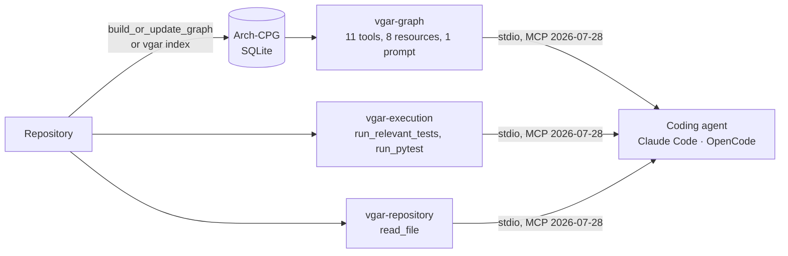

# VGAR-MCP

### Verified Graph-Augmented Reasoning via Model Context Protocol

**MCP servers that give a coding agent (Claude Code, OpenCode, …) a multi-layer code graph of a Python repository (Arch-CPG) and graph-based checks for the patches it writes.**

The agent still writes the code. VGAR answers graph questions (callers, dependency paths, related tests, task anchors, patch impact) and returns evidence about a proposed diff (schema, structure, public API, import cycles, lost ports, related tests before and after, ranking). No tool modifies the repository: every check runs on a temporary copy.



Scope and source of truth: the project proposal (*VGAR-MCP: Verified Graph-Augmented Reasoning via MCP for Multi-file Software Repair*, kept outside the repository) and the two-week plan [`docs/status/plan_2_weeks_mcp_server_2026-11-07.md`](docs/status/plan_2_weeks_mcp_server_2026-11-07.md).

## Contents

- [Quick start](#quick-start)
- [Installation](#installation)
- [Attach the servers to a coding agent](#attach-the-servers-to-a-coding-agent)
- [Working session](#working-session-proposal-1011)
- [Token usage and latency](#token-usage-and-latency)
- [Troubleshooting](#troubleshooting)
- [Build a graph ahead of time](#build-a-graph-ahead-of-time)
- [Tools, resources and prompt](#tools-resources-and-prompt)
- [Logging and debugging](#logging-and-debugging)
- [Layers](#layers)
- [Evaluation](#evaluation)
- [Testing](#testing)
- [Project structure](#project-structure)
- [Security](#security)

## Quick start

Install once, then attach the three servers to each repository you work on. Each configuration serves one repository only (proposal §10.5, path jail: "chỉ truy cập repo được allowlist").

You need three absolute paths:

- `$py`: the Python of this project's `.venv`
- `$repo`: the repository the agent will edit
- `$data`: a folder **outside** that repository, for the graph and the logs (it may not exist yet)

```powershell
# 1. Install (once, in this repository)
python -m venv .venv
.\.venv\Scripts\Activate.ps1
pip install -e ".[dev,history,code-graph]"

# 2. Attach the three servers (Claude Code, run in the root of the repository to edit)
cd <repository>
$py   = "<ABSOLUTE PATH TO>/vgar_mcp_mvp_demo/.venv/Scripts/python.exe"
$repo = "<ABSOLUTE PATH TO THE REPOSITORY>"
$data = "<ABSOLUTE PATH TO A FOLDER OUTSIDE THE REPOSITORY>"
claude mcp add vgar-graph      -e PYTHONUTF8=1 -e VGAR_GRAPH_BACKEND=sqlite -e VGAR_REPOSITORY_ROOT=$repo -e VGAR_GRAPH_DATABASE=$data/graph.db -e VGAR_MCP_AUDIT_LOG=$data/graph.jsonl -- $py -m vgar.mcp.servers.graph_server
claude mcp add vgar-execution  -e PYTHONUTF8=1 -e VGAR_GRAPH_BACKEND=sqlite -e VGAR_REPOSITORY_ROOT=$repo -e VGAR_GRAPH_DATABASE=$data/graph.db -e VGAR_MCP_AUDIT_LOG=$data/execution.jsonl -- $py -m vgar.mcp.servers.execution_server
claude mcp add vgar-repository -e PYTHONUTF8=1 -e VGAR_LEASE_ROOT=$repo -e VGAR_MCP_AUDIT_LOG=$data/repository.jsonl -- $py -m vgar.mcp.servers.repository_server
claude mcp list                       # the three servers show "Connected"

# 3. Open the agent in the repository and ask
claude
```

For OpenCode, see [OpenCode](#opencode). A first prompt can be:

```text
Build the code graph of this repository, then find where the checkout total is computed
and which files and tests depend on it. Use the vgar-graph and vgar-execution tools.
```

The agent calls `build_or_update_graph` (the host asks you to approve it), then the read tools.

## Installation

Python 3.11–3.13. One virtual environment holds everything. The servers run on the official MCP Python SDK `2.2.0` (`from mcp.server import MCPServer`, as in the MCP build-server guide).

```powershell
python -m venv .venv
.\.venv\Scripts\Activate.ps1          # Linux/macOS: source .venv/bin/activate
pip install -e ".[dev,history,code-graph]"
```

| Extra | Adds | Needed for |
|---|---|---|
| `dev` | pytest, mypy, Ruff | tests; mypy and Ruff are also run by the static checks |
| `history` | dulwich | commit history (layer 4), `get_related_context` with history |
| `code-graph` | networkx | `G_code` helpers |
| `plot` | matplotlib | optional plots in evaluation scripts |

Optional graph backends need Docker: JARVIS (`--enable-jarvis`) and Joern (`--joern`), see [Build a graph ahead of time](#build-a-graph-ahead-of-time).

## Attach the servers to a coding agent

Declare each server in the host configuration with a command, its arguments and its environment, using absolute paths. Then quit the host completely and reopen it. Stdio servers receive only the environment you declare.

A server stops at start-up, naming the variable, if a required variable is missing, relative, or has spaces around its value (`vgar-graph cannot start: VGAR_GRAPH_DATABASE is not set`). Relative paths are refused because `import vgar` also reads this project's `.env`, and relative values would land inside the repository being edited.

| Host | Copy | Into |
|---|---|---|
| Claude Code | [`configs/mcp_server/mcp.example.json`](configs/mcp_server/mcp.example.json) | `.mcp.json` in the repository root (project scope; Claude Code asks once whether to trust it), or use the `claude mcp add` commands of the [Quick start](#quick-start) |
| OpenCode | [`configs/mcp_server/opencode.example.jsonc`](configs/mcp_server/opencode.example.jsonc) | `opencode.jsonc` in the repository root, or use the commands below |
| Claude Desktop | [`configs/mcp_server/claude-desktop.example.json`](configs/mcp_server/claude-desktop.example.json) | `%APPDATA%\Claude\claude_desktop_config.json` |

Replace every `<ABSOLUTE ...>` placeholder. The database file may not exist yet. With Claude Code, use `claude mcp add` rather than `add-json`: Windows PowerShell 5.1 strips the quotes inside a JSON argument.

### OpenCode

Run in the root of the repository (`opencode.json` is written there), with `$py`, `$repo` and `$data` set as in the [Quick start](#quick-start):

```powershell
opencode.cmd mcp add vgar-graph      --env PYTHONUTF8=1 --env VGAR_GRAPH_BACKEND=sqlite --env VGAR_REPOSITORY_ROOT=$repo --env VGAR_GRAPH_DATABASE=$data/graph.db --env VGAR_MCP_AUDIT_LOG=$data/graph.jsonl -- $py -m vgar.mcp.servers.graph_server
opencode.cmd mcp add vgar-execution  --env PYTHONUTF8=1 --env VGAR_GRAPH_BACKEND=sqlite --env VGAR_REPOSITORY_ROOT=$repo --env VGAR_GRAPH_DATABASE=$data/graph.db --env VGAR_MCP_AUDIT_LOG=$data/execution.jsonl -- $py -m vgar.mcp.servers.execution_server
opencode.cmd mcp add vgar-repository --env PYTHONUTF8=1 --env VGAR_LEASE_ROOT=$repo --env VGAR_MCP_AUDIT_LOG=$data/repository.jsonl -- $py -m vgar.mcp.servers.repository_server
opencode mcp list                     # the three servers show "connected"
```

Call `opencode.cmd`, not `opencode`: under Windows PowerShell 5.1 the npm shim `opencode.ps1` drops the `--`, and OpenCode prints its help instead of adding the server. Running `mcp add` again replaces the server, including fields you edited by hand.

Then edit `opencode.json` as in [`opencode.example.jsonc`](configs/mcp_server/opencode.example.jsonc):

- add `"codemode": false` to each server. With Code Mode on (OpenCode's default) the model calls tools from generated JavaScript and must write `tools["vgar-graph"]`; it often guesses `tools.vgar_graph` and gets `Unknown tool`. Turned off, the tools are exposed directly and tool calls can be counted;
- add `"timeout": { "execution": 900000 }` under `"mcp"`, long enough for a first build;
- for a run without MCP, set `"disabled": true` on the servers.

### Optional: `run_pytest`

`run_relevant_tests` works with the configuration above. `run_pytest` (one pytest selector) is stricter: also give `vgar-execution` `VGAR_LEASE_ROOT=$repo` and the selectors it may run as a JSON list, for example `-e 'VGAR_ALLOWED_SELECTORS=["tests"]'`. Without them every call answers `ROOT_NOT_LEASED` or `SELECTOR_REJECTED`.

### Environment variables

| Variable | Server | Meaning |
|---|---|---|
| `VGAR_MCP_AUDIT_LOG` | all | **required**, absolute: audit log of every tool call |
| `VGAR_REPOSITORY_ROOT` | graph (required), execution (required unless `VGAR_LEASE_ROOT` is set) | absolute existing folder: the repository; the only one `build_or_update_graph` builds and `run_relevant_tests` tests |
| `VGAR_GRAPH_DATABASE` | graph, execution | **required** with `VGAR_REPOSITORY_ROOT`, absolute: SQLite graph file, created by `build_or_update_graph` if missing |
| `VGAR_GRAPH_BACKEND` | graph, execution | `sqlite` (default) or `snapshot` (read-only; needs `VGAR_GRAPH_SNAPSHOT_MANIFEST`, `VGAR_GRAPH_VERSION`, `VGAR_GRAPH_RESOLVER_HASH`, `VGAR_GRAPH_PROFILE_HASH` instead of a repository and database) |
| `VGAR_LEASE_ROOT` | repository (required), execution (required unless `VGAR_REPOSITORY_ROOT` is set) | absolute existing folder: root `read_file` may read and `run_pytest` runs in |
| `VGAR_ALLOWED_SELECTORS` | execution | JSON list of pytest paths or node ids `run_pytest` may run (default `[]`: none) |
| `VGAR_GRAPH_BUILD_TIMEOUT_SECONDS` | graph | limit for one build or update (default 900) |
| `VGAR_MCP_LOG_LEVEL` | all | `WARNING` (default), `INFO`, `DEBUG`; logs go to stderr |
| `VGAR_MCP_METRICS_LOG` | all | per-call metrics JSONL (default `<audit log name>.metrics.jsonl` next to the audit log) |

## Working session (proposal §10–§11)

1. Open Claude Code or OpenCode in the repository and describe the problem.
2. The agent calls `build_or_update_graph` and the host asks you to approve it (the confirmation of proposal §10.5). The first call builds the graph. Until then the read tools answer `GRAPH_NOT_READY` with a hint to build.
3. The agent locates code with the read tools (`find_task_anchors`, `get_related_context`, `get_callers`, …) and edits it.
4. After editing, it calls `build_or_update_graph` again. Only changed files are re-extracted, and every read tool sees the new graph on its next call without reconnecting. The database keeps only the current state of the repository, so reverting an edit serves the reverted code. If a build answers `TIMEOUT`, it keeps running and the next call waits for it.
5. It checks its patch with `analyze_patch_impact`, `verify_patch_graph_constraints`, `run_relevant_tests` and `rank_patch_candidates`.

### Example prompts

Describe the problem as a user would; the agent locates the code with the graph. On the demo repository [`tests/fixtures/vgar-demo-shop`](tests/fixtures/vgar-demo-shop):

```text
A customer reports a checkout bug: 5 BOOK (1,000,000 VND) with coupon SAVE10 gives tax = 100,000,
but the README says VAT is charged after the discount (expected 90,000). Find the cause, fix it,
and run the related tests. Use the vgar-graph and vgar-execution tools.
```

```text
Rename discount_amount to compute_discount. Before editing, list every caller in other files.
After editing, call analyze_patch_impact and verify_patch_graph_constraints with the diff.
```

Ask for `analyze_patch_impact` and `verify_patch_graph_constraints` explicitly when you want them, and always when the repository has no tests. The graph is built from the source alone, so it still finds callers, importers, signature changes, removed public API and import cycles across files, but nothing checks behaviour.

## Token usage and latency

Tool results in the chat are not annotated with tokens. Instead, every tool call writes one JSON line to `<server>.metrics.jsonl` next to its audit log: processing time, tokens in (arguments) and out (the result the model reads), and the shape of arguments and result (types and sizes, never content). Summarize per tool:

```powershell
$L = "<folder of VGAR_MCP_AUDIT_LOG>"
python scripts/summarize_mcp_metrics.py --metrics "$L\graph.metrics.jsonl" --metrics "$L\execution.metrics.jsonl" --out results\mcp_metrics
```

This prints totals and writes `mcp_metrics.md` / `mcp_metrics.json` (calls, errors, latency mean/p50/p95/max, tokens in and out per tool).

- The metric files accumulate across sessions. Rename or delete them before a run you want to measure on its own, and always the files written before 14/11/2026 (their counts are `approx_chars_div_4`).
- Token counts are UTF-8 bytes / 4 (`FALLBACK:utf8_bytes_ceil_div4`), the same counter as the retrieval evaluation (R1). They measure what the tools send, not the model's own tokens.
- The model's own tokens (prompt and answer) are counted by the host: Claude Code `/cost`, OpenCode's session statistics.
- To watch calls live, set `VGAR_MCP_LOG_LEVEL=INFO`: one `metrics tool=… duration_ms=… input_tokens=… output_tokens=…` line per call on stderr (OpenCode: `opencode --print-logs`).

## Troubleshooting

| Symptom | Cause and fix |
|---|---|
| Server not connected, log says `… is not set` or `… is not an absolute path` | Declare that variable with an absolute path (see [Environment variables](#environment-variables)), then check `claude mcp list` / `opencode mcp list` |
| `opencode mcp add` prints its help | PowerShell dropped `--`: run `opencode.cmd mcp add …` |
| `Unknown tool 'vgar_graph.build_or_update_graph'` | OpenCode Code Mode: set `"codemode": false` on each server and restart OpenCode |
| `GRAPH_NOT_READY` | No graph yet for this repository: call `build_or_update_graph` |
| `TIMEOUT` from `build_or_update_graph` | The build keeps running: call again. On large repositories raise `VGAR_GRAPH_BUILD_TIMEOUT_SECONDS` and the host's tool timeout |
| `PATCH_DOES_NOT_APPLY` | Hand-written hunk line numbers: take diffs from `git diff` |
| `ROOT_NOT_LEASED` / `SELECTOR_REJECTED` from `run_pytest` | See [Optional: `run_pytest`](#optional-run_pytest), or use `run_relevant_tests` |

MCP Inspector, host log locations and more errors: [`docs/mcp_server/debugging.md`](docs/mcp_server/debugging.md).

## Build a graph ahead of time

Useful for evaluation runs (one graph per SWE-bench task at `base_commit`), or so the read tools answer before the agent's first build. It does not shorten the agent's first `build_or_update_graph` call: the incremental cache lives in the server process, so that call is still a full build (on a large repository, let it run past one `TIMEOUT` and call again, or raise the timeouts). Later calls are incremental.

```powershell
python -m vgar.cli index <repo> --db D:/graphs/<repo>.db      # static graph; prints "<n> nodes -> <db>"
python -m vgar.cli doctor                                     # print the resolved settings
```

With JARVIS, Joern or a SCIP/LSP resolver, build the graph JSON with all options, then load it:

```powershell
python scripts/build_graph.py <repo> graph.json --repo-key <key> --revision <sha> --enable-jarvis --joern
python scripts/load_graph_fixture.py graph.json D:/graphs/<repo>.db
```

## Tools, resources and prompt

| Server | Tools |
|---|---|
| `vgar-graph` | `search_symbols`, `get_callers`, `get_callees` (multi-hop; `MAY_CALL` listed apart), `explain_dependency_path`, `find_task_anchors`, `get_related_context`, `get_related_tests`, `analyze_patch_impact`, `verify_patch_graph_constraints`, `rank_patch_candidates`, `build_or_update_graph` (the one write tool: cold build, then incremental updates) |
| `vgar-execution` | `run_relevant_tests` (graph-selected tests before and after a diff, on a temporary copy), `run_pytest` (one allowed selector), `health` |
| `vgar-repository` | `read_file`, `health` |

Resources: `vgar://repo/summary`, `vgar://repo/schema`, `vgar://graph/node/{node_id}`, `vgar://graph/subgraph/{node_id}`, `vgar://component/{component_id}`, `vgar://task/{task_id}`, `vgar://evidence/baseline`, `vgar://audit/log`. Prompt: `repair_with_graph_context`.

`get_related_context` takes an optional `budget_tokens`: default 12000, capped at 12000 by the server (proposal §9.2, §10.5), counted as UTF-8 bytes / 4. It bounds one call, not the agent's whole context. A larger request is clamped, and `diagnostics.budget` in the result says so (`requested`, `effective`, `ceiling`, `clamped`).

`rank_patch_candidates` takes each candidate's `diff_hash` (`sha256:` + hex digest of the diff). Take diffs from `git diff`; hand-written hunk line numbers are rejected with `PATCH_DOES_NOT_APPLY`.

Details: [`tools.md`](docs/mcp_server/tools.md), [`resources.md`](docs/mcp_server/resources.md), [`prompts.md`](docs/mcp_server/prompts.md), [`contract.md`](docs/mcp_server/contract.md).

## Logging and debugging

As in the MCP build-server guide (`2026-07-28`): only JSON-RPC on stdout, one `logging.getLogger(__name__)` per module, logs on stderr (captured by the host), no protocol logging. `VGAR_MCP_LOG_LEVEL=INFO` adds a start-up line and one line per tool call; `DEBUG` adds call arguments as hashes and sizes, never diff content. Per-call metrics: see [Token usage and latency](#token-usage-and-latency).

MCP Inspector, host log locations and common errors: [`docs/mcp_server/debugging.md`](docs/mcp_server/debugging.md).

## Layers

Arch-CPG follows proposal §5.2. Each row links to its run reports. How layers 1–3 feed layers 4–6 on the real graph: [`tv2_layer_integration_run`](docs/status/tv2_layer_integration_run_2026-11-11.md).

| Layer | Content | Owner | Reports |
|---|---|---|---|
| 1 Syntax | tree-sitter-graph facts, `Identifier`, `HAS_METHOD`, `HAS_CALLSITE`, fields, config, routes | TV2 | [`tv2_layer1_run`](docs/status/tv2_layer1_run_2026-11-08.md) |
| 2 Symbols and calls | static binding, JARVIS call graph, `MAY_CALL` with confidence and provenance | TV2 | [`tv2_l2_1_jarvis_run`](docs/status/tv2_l2_1_jarvis_run_2026-11-10.md), [`tv2_l2_2_may_call_run`](docs/status/tv2_l2_2_may_call_run_2026-11-08.md) |
| 3 Graph layers | `G_code` (Joern, optional), `G_arch` lift, `G_task` overlay, trace links, schema `S`, retrieval, impact | TV2 | [`tv2_l3_1_g_code_run`](docs/status/tv2_l3_1_g_code_run_2026-11-09.md), [`tv2_ga_g_arch_run`](docs/status/tv2_ga_g_arch_run_2026-11-09.md), [`tv2_gt_1_g_task_run`](docs/status/tv2_gt_1_g_task_run_2026-11-09.md), [`tv2_tr_1_trace_links_run`](docs/status/tv2_tr_1_trace_links_run_2026-11-10.md), [`tv2_sc_1_schema_run`](docs/status/tv2_sc_1_schema_run_2026-11-10.md), [`tv2_rt_1_retrieval_run`](docs/status/tv2_rt_1_retrieval_run_2026-11-10.md), [`tv2_im_1_impact_run`](docs/status/tv2_im_1_impact_run_2026-11-09.md) |
| 4 History | commit history (dulwich), Python AST diff | TV3 | [`tv3_commit_history`](docs/mcp_server/tv3_commit_history.md) |
| 5 Evidence | graph verification, diff tests, nine-field evidence and `score(patch)` ranking | TV3 | [`tv3_static_verification`](docs/mcp_server/tv3_static_verification.md), [`tv3_diff_tests`](docs/mcp_server/tv3_diff_tests.md), [`tv3_patch_ranking`](docs/mcp_server/tv3_patch_ranking.md) |
| 6 MCP | servers, resources, prompt, security, incremental build, SQLite storage | TV1 | [`docs/mcp_server/`](docs/mcp_server/status.md) |

## Evaluation

Scripts in `scripts/` for week 2 of the two-week plan (§4–§5):

| Measure | Scripts |
|---|---|
| Retrieval (RQ1/RQ2) | `run_bm25_retrieval.py`, `run_graph_retrieval.py`, `compare_graph_vs_bm25.py`, `run_rt1_ablation.py`, `compare_rt1_ablation.py`, `materialize_dev_gold.py` |
| Graph quality | `compare_static_vs_scip.py`, `measure_trace_links.py`, `bench_schema_validation.py` |
| Incremental update | `bench_incremental.py` |
| Impact (RQ3) | `measure_patch_impact.py` |
| Verification (FAR/FRR) | `build_mutant_pool.py`, `evaluate_mutant_pool.py`, `audit_mypy_deltas.py` |
| MCP usability | `summarize_mcp_metrics.py --metrics …` (per-tool calls, latency and tokens from the servers' own metrics; works with any host) |
| SWE-bench task environments | `prepare_manifest.py`, `prepare_task_env.py`, `pin_task_images.py`, `build_swebench_test_cmds.py` |

Two scripts still read the layout of the removed `vgar solve --agent` runner and **need an adapter** before they work with patches or traces from Claude Code/OpenCode:

- `grade_repair_candidates.py --execute` (repair, official SWE-bench harness) expects `attempts/*/attempt-*.json` whose `engine_run_dir` holds `run_record.json` with `stages.apply.status == PASS` and `applied.diff`.
- `aggregate_agent_traces.py --traces … --audit …` expects `<UTC>-<task>.json` traces with `calls`, `mode`, `by` besides the audit log.

## Testing

```powershell
python -m pytest -q                                   # full suite
python -m pytest -q tests/mcp_server                  # MCP servers
python -m pytest -q tests/test_tv2_removed_stack.py   # the repo stays MCP-only (no LangChain, no generator)
```

Tests that need Docker are marked `docker`.

## Project structure

```text
src/vgar/
├── cli.py              # vgar doctor | vgar index
├── config/             # settings from environment and .env
├── contracts/          # graph schema S, context, impact, evidence contracts
├── graph/              # Arch-CPG builder (layers 1–3), SQLite store and service, retrieval, impact, history
├── mcp/                # servers, tool envelope, audit, logging, proposal layer (providers, resources, prompt, security)
├── repair/             # patch parsing/apply, workspace, executors, static/API/structural checks, patch evidence
├── evaluation/         # retrieval, incremental, trace, verification and SWE-bench harness evaluation
└── observability/      # tool instrumentation, redaction, graph build traces
scripts/                # graph building and evaluation entry points
configs/mcp_server/     # runtime, security, ranking weights, host templates
docs/mcp_server/        # layer 6 and layer 4–5 documentation
docs/status/            # plans and run reports
```

## Security

Read tools only read. `build_or_update_graph` is the one write tool: it builds only `VGAR_REPOSITORY_ROOT`, and the host asks before each call (a host with TV1's trusted context keeps its write grant). Paths stay inside the leased root, secrets and `.env` files are refused, outputs are redacted, every call is audited, test runs have server-set timeouts and output caps, and repository text is marked untrusted. See [`docs/mcp_server/security.md`](docs/mcp_server/security.md).
