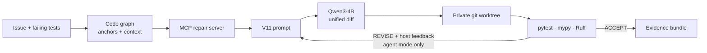
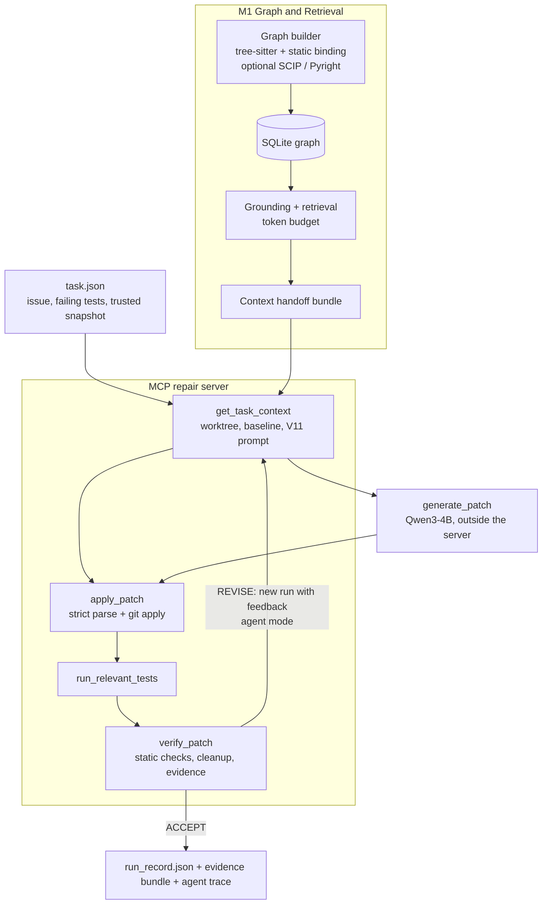

# VGAR-MCP

### Verified Graph-Augmented Reasoning via Model Context Protocol

**A graph-aware Python repair agent: it retrieves context from a code graph, gets a unified diff from a fixed local model, applies it in a private git worktree and accepts it only after independent test, type and lint verification.**



<p align="center">
  <a href="https://github.com/GauKho/VGAR">Repository</a> ·
  <a href="https://github.com/GauKho/VGAR/tree/feature/m3-w7-w8-repair-loop">Branch <code>feature/m3-w7-w8-repair-loop</code></a> ·
  <a href="docs/RUNBOOK.md">Runbook</a> ·
  <a href="Task%20Status.md">Task status</a>
</p>

<p align="center">
  
  
  
  
</p>

---

## Table of Contents

- [Overview](#overview)
- [Motivation and Research Questions](#motivation-and-research-questions)
- [Research Design vs. Current Implementation](#research-design-vs-current-implementation)
- [Key Features](#key-features)
- [Architecture](#architecture)
- [Repair Workflows](#repair-workflows)
- [Results](#results)
- [Technology Stack](#technology-stack)
- [Installation](#installation)
- [Quick Start](#quick-start)
- [CLI Reference](#cli-reference)
- [Configuration](#configuration)
- [Repository Graph](#repository-graph)
- [MCP Tool Layer](#mcp-tool-layer)
- [Verification and Evidence](#verification-and-evidence)
- [Testing](#testing)
- [Observability and Debugging](#observability-and-debugging)
- [Project Structure](#project-structure)
- [Security Considerations](#security-considerations)
- [Limitations](#limitations)
- [Roadmap](#roadmap)
- [Contributing](#contributing)
- [License](#license)

## Overview

VGAR-MCP is a research prototype for multi-file bug repair in Python repositories. It is a **graph infrastructure layer for coding agents**, not a new model: it builds a graph of a repository (files, modules, classes, functions, call sites, imports, tests), uses that graph to select the context an issue actually depends on, and exposes retrieval, patch application and verification to agents as typed Model Context Protocol (MCP) tools.

A patch is never accepted on the model's word. It is parsed strictly, applied with `git apply` in a private worktree of a trusted snapshot, and checked by running the baseline-failing tests, regression tests, syntax, mypy and Ruff. The original repository is fingerprinted before and after. Every run leaves a `run_record.json` and an evidence bundle.

### Core idea

> A repository is a multi-layer graph, not flat text. Coding agents should query that graph through a standard tool interface, and a patch needs evidence that it does not break important structure, not only a passing test.

### Project status

This is a 16-week capstone with three roles: **M1** Graph & Retrieval, **M2** Repair & Verification, **M3** MCP, Evaluation & Paper. This branch is the end of **weeks 7–8** (repair loop and basic verification) in the [16-week plan](docs/audit/2026-10-13/project_plan_16_weeks.snapshot.md):

| Milestone | Weeks | Required result | Status on this branch |
|---|---:|---|---|
| M1 | 1–2 | Research protocol, graph schema, benchmark/model scope | Schema and design docs done; parts of the protocol unverified |
| M2 | 3–4 | Graph MVP + MCP/LangChain connectivity | Done |
| M3 | 5–6 | Task grounding, graph retrieval, BM25 baseline | Done (22 paired dev tasks) |
| M4 | 7–8 | Repair loop + basic verification | Done on 3 trusted fixtures; Methodology draft and M1 ranking still open |
| M5 | 9–10 | Impact analysis + preliminary ablation | Not started |
| M6 | 11–12 | Complete MCP, security, performance | Partial |
| M7 | 13–14 | Held-out evaluation + failure analysis | Not started |
| M8 | 15–16 | Paper + public artifact | Not started |

Per-task status (150 checklist items, with evidence links) is in [Task Status.md](<Task Status.md>).

## Motivation and Research Questions

A bug in a real repository often spans several files: a change in a service, model, config or API boundary affects callers, tests and other components. Agents that read files as isolated text, or rank them by lexical similarity, can miss those dependencies, and they tend to report success without independent evidence.

The project proposal frames the target as the **dependency frontier** `F*(T, R)` of a task `T` in repository `R`: the set of nodes needed to write a correct patch. A good retriever reaches high `Recall@B = |C ∩ F*| / |F*|` within a fixed token budget `B`. The proposal's claim is conditional, not a theorem: *if* a task needs cross-file facts *and* the graph edges linking the issue or failing test to the frontier are accurate enough, graph-guided retrieval should reach the frontier more often than text-only retrieval under the same budget. That claim has to be measured, and the first measurement (see [Results](#results)) does not yet support it.

| RQ | Question | Where it stands |
|---|---|---|
| RQ1 Graph construction | Can the graph be built from existing open-source tools instead of a hand-written analyzer? | tree-sitter + static binding; optional SCIP/Pyright enrichment |
| RQ2 Context retrieval | Does graph-guided retrieval find the right files/functions better than BM25? | First paired comparison: no significant difference |
| RQ3 Patch impact | Does the graph locate a patch's impact better than reading the diff? | Planned (weeks 9–10) |
| RQ4 Verification | Do tests, type/lint and graph/API checks reduce risky or overfitted patches? | Tests + mypy + Ruff implemented; API/structural checks not yet |
| RQ5 MCP usability | Can an agent use the graph through MCP with acceptable latency and token cost? | Repair loop runs over MCP; latency/tokens logged, not yet evaluated at scale |

## Research Design vs. Current Implementation

The project proposal (*VGAR-MCP: Verified Graph-Augmented Reasoning via MCP for Multi-file Software Repair*, kept outside this repository) defines a full design built around **Arch-CPG**, a multi-layer graph `(G_code, G_repo, G_arch, G_task, Lift, Trace, S, Evidence)`. The 16-week MVP deliberately keeps only part of it: Python only, one fixed model, and layers 1 (syntax), 2 (symbols), 5 (test/type/lint evidence) and 6 (graph store + MCP). This table separates what exists in code from what is design only.

| Proposal concept | Meaning | In this branch |
|---|---|---|
| `G_repo` repository graph | Files, modules, classes, functions, methods, imports, call sites, tests and their edges | **Implemented** (`src/vgar/graph/`) |
| `G_task` task graph | Issue and failing-test nodes linked to code (`MENTIONS`, `REPRODUCES`) | **Implemented** as a task-local overlay |
| Confidence and provenance on edges | Every resolved edge records how it was resolved and how sure it is | **Implemented** |
| Graph-guided context retrieval | Anchors → k-hop traversal → ranking → packing under a token budget | **Implemented**; ranking improvement not yet accepted |
| Verified repair with evidence bundle | Tests, type and lint checks, integrity check, JSON evidence | **Implemented** for trusted fixtures |
| MCP delivery surface | Graph, repair and verification tools for agents | **Implemented** (4 servers, see [MCP Tool Layer](#mcp-tool-layer)) |
| Patch impact analysis | Diff → touched nodes → reverse `CALLS`/`IMPORTS`/`TESTS` → risk | Planned, weeks 9–10 |
| API compatibility / structural checks | Signature changes, forbidden imports, new cycles relative to baseline | Planned, weeks 11–12 (reported as `NOT_RUN`) |
| Incremental graph update | Reparse changed files and relink affected symbols | Planned, weeks 11–12 |
| `G_code` (CPG via Joern/CodeQL) | Statement-level AST/CFG/PDG and dataflow | Out of MVP scope (optional Layer 3) |
| `G_arch` + `Lift` | Components, ports and connectors lifted from code | Out of MVP scope |
| GraphDiff | Commit-history denoising with RefactoringMiner/GumTree | Out of MVP scope (optional Layer 4) |
| Daikon-style semantic invariants | Likely invariants from test traces | Out of MVP scope |

## Key Features

### Code graph and retrieval (M1)

- Parse Python with tree-sitter and bind imports, inheritance and calls statically; each edge stores `confidence` (1.0 for exact containment down to 0.6 for a unique-name fallback) and `provenance`.
- Optional symbol enrichment with SCIP (`@sourcegraph/scip-python`) or a Pyright language server; the static resolver is the default and the fallback.
- Persist graph snapshots in SQLite.
- Ground an issue to graph anchors (paths, symbols, stack frames, failing tests), then traverse, rank and pack snippets under a token budget measured with the pinned Qwen tokenizer.
- Static test-to-function links for relevant-test selection.
- A BM25 baseline and a paired evaluation harness (Recall@k, MRR, packed coverage, bootstrap CIs).

### Repair pipeline (M2)

- A fixed, hashed prompt template (`m2-w78-v11`) and one greedy generation with a pinned `Qwen/Qwen3-4B-Instruct-2507` snapshot.
- A strict unified-diff parser: allowed and protected paths, hunk counts, truncation. The host never rewrites model output.
- `git apply` in a private worktree; the original snapshot must match the byte hashes in `configs/m2/trusted_fixtures.json`.

### MCP repair server and agent loop (M3)

- The `repair` MCP server wraps the M2 engine as four tools with a strict call order; all run state lives in the run directory, so each call can be served by a new server process.
- `vgar solve` runs a fixed LangGraph flow over these tools.
- `vgar solve --agent` lets a LangChain agent choose the tools and when to stop. The diff still comes from the single-turn V11 generator. A failed attempt is closed and retried as a new run with host-built feedback, at most 3 generations.

### Verification and evidence

- Reproduce the failing tests on the baseline, select relevant tests from the changed files, run required and regression pytest, syntax, mypy and Ruff, and check that the source repository is unchanged.
- A run is PASS only when `verify_patch` returns `ACCEPT`. The CLI exit code follows that result.

## Architecture



### Component responsibilities

| Component | Path | Responsibility |
|---|---|---|
| CLI | `src/vgar/cli.py` | `doctor`, `tools`, `index`, `repair`, `solve`, `run`, `chat` |
| Settings | `src/vgar/config/settings.py` | Agent, model and graph settings from the environment and `.env` |
| Graph builder and store | `src/vgar/graph/builder.py`, `sqlite_store.py` | Parse, bind, persist nodes and edges |
| Grounding and retrieval | `src/vgar/graph/grounding.py`, `task_overlay.py`, `retrieval.py` | Issue → anchors → ranked, budgeted context |
| Contracts | `src/vgar/contracts/` | DTOs; validation of the M1 handoff (identity, source ranges, tokenizer provenance) |
| Repair engine | `src/vgar/repair/` | Prompt, diff parser, worktree, test selection, verification, evidence, sessions |
| Model backend | `src/vgar/models/` | HF worker generator and local LangChain chat model |
| MCP servers | `src/vgar/mcp/servers/` | `repair`, plus `graph`, `repository`, `execution` |
| Orchestration | `src/vgar/agents/workflow.py`, `tool_agent.py` | Fixed LangGraph flow; agent mode with a host object that owns the run |
| Evaluation | `src/vgar/evaluation/retrieval/` | BM25 baseline, gold labels, metrics, paired comparison |

In the current loop, repair uses the **M1 context bundle exported ahead of time** (`examples/m2/handoffs/`). Calling live graph retrieval inside the loop is planned for weeks 9–10.

## Repair Workflows

The CLI has three repair paths over the same M2 engine, plus an older agent:

| Command | Who decides the steps | Uses MCP | Retry | Generations |
|---|---|---|---|---:|
| `vgar repair` | Fixed pipeline | No | No | 1 |
| `vgar solve` | Fixed LangGraph flow: initialize → retrieve → generate → apply → test → verify | `repair` server | No | 1 |
| `vgar solve --agent` | LangChain agent over 5 argument-less tools | `repair` server | Yes, new run with host feedback | ≤ 3 |
| `vgar run` / `vgar chat` (legacy) | Agent with exact-edit tools on a disposable copy | `graph`, `repository`, `execution` | No | — |

What the LLM does in each command:

| Command | Role of the LLM | Who orchestrates | Evidence in code |
|---|---|---|---|
| `vgar repair` | Generates the diff only: one turn, V11 prompt | Sequential code, no MCP | `cli.py` `cmd_repair` → `run_repair()` → `generator.generate(prompt, ...)` (`repair/pipeline.py`) |
| `vgar solve` | Generates the diff only, in the single `generate` node | Fixed LangGraph flow: initialize → retrieve → generate → apply → test → verify | `agents/nodes/mcp_repair.py` docstring ("only `generate` runs the model"); `agents/workflow.py` `build_workflow` |
| `vgar solve --agent` | Two roles: (1) picks one of 5 argument-less tools, following the `NEXT:` hint computed by the host; (2) generates the diff, through the V11 worker or, with `--generator agent`, the agent's own model | In practice the host's state machine; the LLM mostly follows it | `agents/tool_agent.py` (`NoArgs`, `AgentRepairHost._next`); `agents/agent_generator.py` |
| `vgar run` / `vgar chat` | Full control, Claude Code style: chooses the tools, writes the edits (`old_text`/`new_text`), decides when to stop and writes the answer | The LLM | `agents/core.py` `create_agent(...)`; `cli.py` `cmd_run`, `cmd_chat` |

Steps of one repair run:

1. **Load** the task file and check that the snapshot matches its trusted hash.
2. **Prepare** a private worktree, reproduce the failing tests on the baseline, validate the M1 context bundle and build the V11 prompt within the token caps.
3. **Generate** one diff (fake mode replays a reference patch instead).
4. **Apply** it after strict parsing; one apply per run.
5. **Test** the required and the selected relevant tests.
6. **Verify**: static checks, final assessment, worktree cleanup, evidence bundle. `PASS → ACCEPT`, `FAIL → REVISE`, `ERROR → REJECT`.
7. **Retry** (agent mode only): if attempts remain, open a new run that records `supersedes_run_id` and feedback built by the host from the failed run record, never from agent text.

In agent mode, the agent sees only `get_task_context`, `generate_patch`, `apply_patch`, `run_relevant_tests` and `verify_patch`, all without arguments. The host binds the current run and holds the generated diff, so the agent never handles paths or writes a diff. Every run the host opens ends with `verify_patch`, called by the agent or, as a safety net, by the host. Limits: 3 attempts, 15 tool calls.

The legacy `run`/`chat` agent is kept but is not the repair path described here; its servers have open findings (see [Limitations](#limitations)).

## Results

All results below are on development data. **No SWE-bench repair run, resolved rate or held-out evaluation exists yet.**

### Repair on three trusted fixtures

Fixtures in `examples/m2/tasks/`: **A** `single_file_login`, **B** `multi_file_invoice` (the fix touches two files), **C** `missing_links` (no test links; fallback test selection). One real run per task and row.

| Run (date) | Flow | Result | Generation time A / B / C | Total time A / B / C |
|---|---|---:|---:|---:|
| 2026-10-15 | M2 standalone pipeline | **3/3 PASS** | 53 s / 142 s / 51 s | 69 s / 157 s / 64 s |
| 2026-10-17 | `vgar solve` (fixed flow over MCP) | **3/3 PASS** | 86 s / 148 s / 55 s | 109 s / 174 s / 81 s |
| 2026-10-18 | `vgar solve --agent --generator worker` | **3/3 PASS** | 179 s / 395 s / 106 s | 408 s / 517 s / 213 s |
| 2026-10-18 | `vgar solve --agent --generator agent` | **3/3 PASS** | 24 s / 95 s / 28 s | 121 s / 191 s / 137 s |

- In every run the prompt, raw model output and applied diff are byte-identical to the golden records in `tests/fixtures/m2/golden_v11/` (input/output tokens: A 1,299/43, B 1,769/157, C 1,169/43). Since decoding is greedy and the inputs are identical, the four rows are four reproductions of the same three patches. They do not measure repair ability on unseen bugs.
- In agent mode the agent called all five tools itself, with no host-made calls and one run per task. The retry branch has been exercised only in fake mode, where the first diff is deliberately broken.
- Evidence: the 2026-10-15 records are in [`tests/fixtures/m2/golden_v11/`](tests/fixtures/m2/golden_v11/run_manifest.json). The 2026-10-17/18 run records and agent traces stayed local (`results/` is git-ignored); their timings are reported in [docs/RUNBOOK.md](docs/RUNBOOK.md) §2.3.

### Retrieval: BM25 vs. graph (2026-10-13)

25 SWE-bench Verified development tasks; BM25 completed 25, the graph arm 22 (three SymPy tasks hit the 300 s timeout). Metrics are macro-averaged over the same 22 pairs, 8,000-token budget. Source: [REPORT.md](results/retrieval/20261013T125307312086Z-6d6b0b52b105/REPORT.md).

| Metric | BM25 (baseline) | Graph (issue-only) | Paired Δ (95% CI) |
|---|---:|---:|---|
| File Recall@5 | 0.538 | 0.447 | −0.091 [−0.292, +0.121] |
| Function Recall@5 | 0.275 | 0.315 | +0.041 [−0.157, +0.250] |
| File MRR | 0.578 | 0.605 | +0.027 [−0.151, +0.195] |
| Function MRR | 0.428 | 0.418 | −0.010 [−0.162, +0.143] |
| Packed gold-function coverage | 0.446 | 0.414 | −0.032 [−0.267, +0.206] |
| Mean packed tokens | 7,998 | 7,967 | −31 |

Every recall/MRR confidence interval contains 0. With n = 22 the comparison has little power: it shows neither that the graph beats BM25 nor that it is worse. This evaluation calls no LLM and applies no patch.

### Experimental setup

- **Data:** three hand-built trusted fixtures for repair; 25 SWE-bench Verified tasks (dataset revision `c104f840…`) for retrieval, with gold changed files/functions taken from the reference patches.
- **Repair pass criterion:** baseline-failing tests pass, regression tests still pass, syntax/mypy/Ruff pass, source repository unchanged.
- **Hardware and software:** Windows 11, NVIDIA RTX 4050 Laptop (6 GB, with CPU offload), Python 3.11.0, Torch 2.5.1+cu121, Transformers 4.57.6.
- **Model:** `Qwen/Qwen3-4B-Instruct-2507` at revision `cdbee75f17c01a7cc42f958dc650907174af0554`, greedy decoding, FP16, input cap 6,000 and output cap 1,536 tokens.
- **Statistics:** paired bootstrap CIs for retrieval. Greedy decoding makes repeated repair runs identical, so repetitions add no variance information.

## Technology Stack

| Technology | Role |
|---|---|
| Python 3.11 | Implementation language (metadata allows `>=3.11,<3.14`) |
| tree-sitter 0.25 + tree-sitter-python | Python parsing |
| scip-python 0.6.6, Pyright 1.1.414 (optional, Node.js) | Symbol enrichment beyond the static resolver |
| SQLite | Graph snapshot store |
| LangChain 1.x, LangGraph | Agent and fixed-flow orchestration |
| MCP SDK (`mcp[cli]`), `langchain-mcp-adapters` 0.3.2 | Tool servers over stdio and their bridge to LangChain |
| Transformers 4.x, PyTorch, Accelerate | Local generation with Qwen3-4B |
| Pydantic 2 | Contracts and evidence schemas |
| Git (`worktree`, `apply`) | Patch isolation and application |
| pytest, mypy, Ruff | Verification and the project's own tests |

Not used, although the proposal lists them as options: Jedi, NetworkX, Joern, CodeQL, Glean, Kythe, Kùzu/Neo4j, RefactoringMiner, GumTree.

## Installation

### Prerequisites

- Python 3.11 x64 (the measured profile used 3.11.0; package metadata allows `>=3.11,<3.14`)
- Git on `PATH`
- Network access to `huggingface.co` once, to fetch the four pinned tokenizer files (about 16 MB, no model weights). **This is required even for fake mode.**
- For real model runs: an NVIDIA GPU with a CUDA build of PyTorch, and the `Qwen/Qwen3-4B-Instruct-2507` snapshot at the pinned revision in the Hugging Face cache
- Optional: Node.js + npm for the SCIP/Pyright enrichers

### 1. Clone the branch

```bash
git clone -b feature/m3-w7-w8-repair-loop https://github.com/GauKho/VGAR.git
cd VGAR
```

### 2. Create the virtual environment

Keep it at `.venv` in the repository root: `configs/m2/demo.json` points the M2 model worker at that interpreter.

```bash
python -m venv .venv
# Windows PowerShell
.venv\Scripts\Activate.ps1
# Linux / macOS
source .venv/bin/activate
```

### 3. Install dependencies

```bash
python -m pip install --upgrade pip
pip install -r requirement.txt
pip install --no-deps -e .
pip install "mypy==2.4.0" "ruff==0.17.0"   # the [dev] extra pins; --no-deps above skips extras
```

`requirement.txt` does not contain mypy and Ruff, but verification runs `python -m mypy` and `python -m ruff` with the active interpreter, so they must be installed. It also does not choose a CUDA build of PyTorch; for real runs install the CUDA wheel that matches your driver and check `torch.cuda.is_available()`.

### 4. Provision the tokenizer

The token counter checks the pinned tokenizer files by SHA-256. They are git-ignored, so a fresh clone does not have them:

```bash
python scripts/provision_m1_tokenizer.py \
  --model-id Qwen/Qwen3-4B-Instruct-2507 \
  --revision cdbee75f17c01a7cc42f958dc650907174af0554 \
  --assets-root artifacts/m1/tokenizers \
  --manifest artifacts/m1/tokenizers/provisioned_manifest.json
```

The files land in `artifacts/m1/tokenizers/Qwen3-4B-Instruct-2507/<revision>/`, where the committed manifest `artifacts/m2/w5-w6/tokenizer_manifest.json` expects them. Write the new manifest to a separate path as above so the committed one is not overwritten. Without this step `repair` and `solve` stop with `FileNotFoundError: .../artifacts/m1/tokenizers/...`.

### 5. Verify the installation

```bash
vgar doctor   # resolved settings; loads no model
vgar tools    # spawns the graph/repository/execution MCP servers and lists their 11 tools
```

If the `vgar` entry point is not on `PATH`, use `python -m vgar.cli doctor`.

Further setup (separate M1-only environment, SCIP/LSP runtimes, the evaluation environment) is in [docs/RUNBOOK.md](docs/RUNBOOK.md) §6 and §9.

## Quick Start

Fake mode replays reference patches from `tests/fixtures/m2/reference_patches/` instead of calling the model, so it needs no weights or GPU. It still needs the tokenizer from step 4.

```bash
# 1. One-pass M2 repair; prints the run record path. Exit code 0/1/2 = PASS/FAIL/ERROR
python -m vgar.cli repair --task examples/m2/tasks/single_file_login.json --mode fake

# 2. Fixed LangGraph flow over the MCP repair server
python -m vgar.cli solve --task examples/m2/tasks/multi_file_invoice.json

# 3. Agent mode: the first fake diff is broken on purpose, the retry passes
python -m vgar.cli solve --task examples/m2/tasks/single_file_login.json --agent
```

Expected end of output for step 3:

```text
[status] COMPLETED after 2 attempt(s)
[run] <repo>/results/solve/<run-id>/run_record.json
[trace] <repo>/results/solve/agent-traces/<timestamp>-single_file_login.json
```

A fake PASS shows that the pipeline, tools and verification work. It says nothing about the model's ability to repair.

Real mode loads the pinned Qwen snapshot:

```bash
python -m vgar.cli solve --mode real --task examples/m2/tasks/single_file_login.json
python -m vgar.cli solve --mode real --agent --generator agent --task examples/m2/tasks/single_file_login.json
```

`--generator worker` (the default under `--agent`) generates in the M2 worker process and keeps two model copies in memory; `--generator agent` reuses the agent's own model with the same settings and is faster on small GPUs.

## CLI Reference

| Command | Purpose | Loads model? |
|---|---|---|
| `vgar doctor` | Print resolved settings | No |
| `vgar tools` | Spawn the `graph`, `repository`, `execution` MCP servers and list their tools | No |
| `vgar index REPO [--db PATH]` | Build a graph snapshot into SQLite (default `artifacts/graph.db`) | No |
| `vgar repair --task T --mode fake\|real` | One-pass M2 repair of a trusted fixture task | Real mode only |
| `vgar solve --task T [--mode fake\|real]` | Fixed LangGraph flow over the `repair` MCP server | Real mode only |
| `vgar solve --task T --agent [--generator worker\|agent]` | The agent chooses the repair tools; up to 3 generations | Yes (the agent's model), plus the worker's in real mode |
| `vgar run QUERY --repo R [--selector S]` | Legacy exact-edit agent on a disposable copy | Yes |
| `vgar chat --repo R` | Legacy interactive session on a disposable copy | Yes |

| Option | Commands | Purpose |
|---|---|---|
| `--task PATH` | `repair`, `solve` | Task JSON (issue, failing selectors, snapshot, allowed/protected paths) |
| `--mode fake\|real` | `repair` (required), `solve` (default `fake`) | Reference patch or real generation |
| `--output-root PATH` | `repair`, `solve` | Where runs and traces go (defaults `results/repair`, `results/solve`) |
| `--keep-workspace` / `--keep` | `repair` / `solve`, `run`, `chat` | Keep the temporary worktree or directory |
| `--config PATH` | `repair` | Repair profile (default `configs/m2/demo.json`); `solve` always uses the default |
| `--supersedes-run-id`, `--rerun-reason` | `repair` | Record a manual rerun; both are required together |
| `--selector TEST` | `run`, `chat` | Pytest selector for the final independent check |

**Exit codes.** `repair`: `0` PASS, `1` FAIL, `2` ERROR. `solve`: `0` only when the last run's `verify_patch` is `ACCEPT` (status `COMPLETED`), otherwise `1`. Legacy `run`: `0` when the independent pytest check passes and the source repository is unchanged; without `--selector` the pytest check is skipped, so `0` then only means the source repository was untouched.

## Configuration

### Repair profile

[`configs/m2/demo.json`](configs/m2/demo.json) fixes the run protocol:

| Field | Value |
|---|---|
| `prompt_version` | `m2-w78-v11` |
| `input_cap` / `output_cap` / `reserved_margin` | 6,000 / 1,536 / 256 tokens |
| `generation_timeout` / `command_timeout` / `global_timeout` | 900 s / 120 s / 1,800 s |
| `model_id`, `revision` | `Qwen/Qwen3-4B-Instruct-2507`, `cdbee75f…` |
| `snapshot` | Hugging Face cache path of that revision |
| `interpreter` | `../../.venv/Scripts/python.exe` (Windows layout) |
| `do_sample`, `dtype`, `device_map` | `false`, `float16`, `auto` |

Native execution is allowed only on fixtures whose bytes match [`configs/m2/trusted_fixtures.json`](configs/m2/trusted_fixtures.json). On Linux/macOS the `interpreter` path must point to `../../.venv/bin/python` for real mode; that layout has not been tested.

### Environment variables

Read by `src/vgar/config/settings.py`. Precedence: **process environment > `.env` > code defaults**. Copy `.env.example` to `.env` to start.

| Variable | Default | Used by |
|---|---|---|
| `HF_MODEL_ID` | `Qwen/Qwen3-4B-Instruct-2507` | Legacy `run`/`chat` agent model |
| `HF_TOKEN` | unset | Downloading weights only; never forwarded to MCP child processes |
| `VGAR_MODEL_PROVIDER` | `huggingface` | Agent model provider |
| `VGAR_TEMPERATURE` | `0` | Agent model |
| `MAX_NEW_TOKENS` | `512` | Agent's own turns (repair generation uses the profile's 1,536) |
| `VGAR_DEVICE_MAP` / `VGAR_TORCH_DTYPE` | `auto` / `auto` | Agent model placement |
| `MAX_ITERATIONS` | `5` | Legacy agent |
| `VGAR_MAX_TOOL_CALLS` | `30` | Legacy agent warning threshold (agent mode has its own limit of 15) |
| `VGAR_RECURSION_LIMIT` | `50` | Legacy agent LangGraph recursion limit |
| `VGAR_TOKEN_BUDGET` | `8000` | Context budget setting |
| `VGAR_GRAPH_BACKEND` | `demo` | `demo` or `sqlite` for the standalone graph server |
| `VGAR_GRAPH_DATABASE` | unset | SQLite graph path; required with `sqlite` |
| `VGAR_GRAPH_VERSION` | latest ready snapshot | Pin one snapshot |
| `VGAR_MCP_AUDIT_LOG` | `logs/mcp_audit.jsonl` | Graph server audit log |

Never commit `.env`, tokens or other secrets.

## Repository Graph

### Nodes and edges

| Node | Extracted from |
|---|---|
| `Repository`, `File`, `Module` | Repository root, each `.py` file, module name (plus placeholders for external imports) |
| `Class`, `Function`, `Method` | Definitions, with bases, decorators, owner and method kind |
| `Test` | `test_*` functions in test paths |
| `Import`, `CallSite` | Module-level imports; calls inside functions, methods and tests |
| `Issue` | Task-local overlay only, not stored in the base snapshot |

| Edge | Meaning |
|---|---|
| `CONTAINS` | Structural nesting from repository to call site |
| `IMPORTS` | Import → module |
| `INHERITS` | Class → internal base class |
| `CALLS` | Call site → function, method or class |
| `TESTS` | Test → directly called target |
| `REFERENCES` | Return-contract hints for unresolved chained calls |
| `MENTIONS`, `REPRODUCES` | Issue → grounded anchors; reported failing test → issue |

Full contract, IDs and confidence table: [docs/graph_schema.md](docs/graph_schema.md).

### Building a graph

```bash
# Static resolver into SQLite (what run/chat use internally)
vgar index examples/m2/snapshots/multi_file_invoice --db artifacts/invoice.db

# Graph JSON with a chosen resolver: static | scip | lsp | scip-lsp
python scripts/build_graph.py REPO OUT.json --repo-key demo/repo --revision dev --resolver static
```

Static binding cannot resolve every dynamic Python call. Unresolved calls are kept as call sites with candidate counts rather than guessed edges, but one known precision issue remains (finding B10: a missing explicit import can fall back to a globally unique name at confidence 0.6).

## MCP Tool Layer

Four FastMCP servers run over stdio. The client starts them with the current interpreter, prefixes tool names with the server name and strips `HF_TOKEN`, `HUGGING_FACE_HUB_TOKEN` and `OPENAI_API_KEY` from their environment.

**`repair` server** (the integrated repair path; not listed by `vgar tools`):

| Tool | Purpose | Allowed when the run is |
|---|---|---|
| `repair_get_task_context` | Start a run: trusted task, M1 context, worktree, baseline, V11 prompt; accepts feedback for a rerun | — |
| `repair_apply_patch` | Record the generation, parse the diff strictly, `git apply` once | `prepared` |
| `repair_run_relevant_tests` | Select and run relevant tests for the changed files | `applied` |
| `repair_verify_patch` | Static checks, final assessment, cleanup, evidence bundle | any unfinished phase |

Calls out of order return an `ERROR` envelope (`status`, `reason`, `detail`). Every accepted call is appended to `run_record.json` → `mcp_calls` with its input hash, start time, duration and status.

**`graph`, `repository`, `execution` servers** (listed by `vgar tools`; used by the legacy agent and the retrieval tooling):

| Server | Tools | Resources |
|---|---|---|
| `graph` | `graph_search_symbols`, `graph_get_callers`, `graph_get_callees`, `graph_find_task_anchors`, `graph_get_related_context`, `graph_get_related_tests` | `vgar://repo/summary`, `vgar://graph/node/{node_id}`, `vgar://graph/subgraph/{node_id}` |
| `repository` | `repository_health`, `repository_read_file`, `repository_apply_patch` (exact text replace) | — |
| `execution` | `execution_health`, `execution_run_pytest` | — |

Tool contracts: [docs/mcp_tool_contract.md](docs/mcp_tool_contract.md).

## Verification and Evidence

| Check | Status |
|---|---|
| Baseline reproduction of the failing tests | Implemented |
| Required (previously failing) tests pass after the patch | Implemented |
| Relevant-test selection from changed files, with fallback scope | Implemented |
| Regression pytest on the fixture | Implemented |
| Syntax, mypy, Ruff with tool-owned configs (`configs/m2/static/`) the target cannot weaken | Implemented |
| Source-repository fingerprint before/after | Implemented |
| API compatibility, structural/architecture rules | `NOT_RUN` (weeks 11–12) |
| Semantic invariants | Out of MVP scope |

Each run directory contains `run_record.json` (stages, prompt and template hashes, model id and revision, caps, token counts, `mcp_calls`, timings) and `evidence_bundle.json` (applied patch, baseline failing IDs and post outcomes, selection, type/lint results, hashes). Schema: [docs/evidence_bundle_schema.md](docs/evidence_bundle_schema.md); design: [docs/verification_design.md](docs/verification_design.md).

Passing these checks is evidence, not proof: a targeted test suite can still miss incorrect behavior, and the regression suite is only as good as the fixture's tests.

## Testing

```bash
python -m pytest -p no:cacheprovider -q
```

Focused suites:

```bash
python -m pytest tests/m2/w78/test_w78_golden_v11.py -v   # V11 prompt and diff stay byte-identical to the real records
python -m pytest tests/unit/test_agent_solve.py -v        # agent mode: retry, limits, safety-net verify
python -m pytest tests/m2/w78/test_w78_repair_server.py -v  # MCP repair server: call order, errors
```

The suite needs no GPU or model weights: fake mode and stubs stand in for generation. Real model runs are done by hand.

| Run | Environment | Result |
|---|---|---|
| 2026-10-18, team | Windows 11, tokenizer provisioned | **747 passed, 1 failed** (B01). Run in a session; no receipt saved |
| 2026-10-18, fresh clone | Linux, Python 3.11.17, tokenizer **not** provisioned | 665 passed, 45 failed, 38 errors, 1 skipped |

On the fresh clone, 78 of the 83 failures and errors stop at the missing tokenizer directory (`artifacts/m1/tokenizers/...`); provision it first ([Installation](#4-provision-the-tokenizer)). The other five are the known B01 failure (`tests/test_hf_model.py::test_local_chat_model_uses_one_greedy_generation_config`, legacy HF constructor, not on the repair path) and four tests in `tests/m2/w78/test_w78_workspace_cleanup.py` that simulate Windows sharing-lock errors (`winerror` 32/33) and fail on Linux.

The full suite may rewrite `artifacts/sample_graph.db`; back it up first if you need its exact bytes.

## Observability and Debugging

- `[VGAR] {...}` lines on stdout: CLI phases (`PHASE_START`/`PHASE_OUTPUT`/`PHASE_END`) with a run id.
- `[VGAR_TRACE] {...}` lines on stderr: workflow nodes, route decisions, MCP tool input/output, cleanup. Long values are summarized as type, length and a short hash.
- `run_record.json` → `mcp_calls`: the durable record of every repair tool call.
- Agent traces in `<output-root>/agent-traces/`: each tool call (by agent or host, status, duration), each model turn (latency, tokens in/out) and each run. Output tokens per agent turn are counted by re-tokenizing the returned text.
- Graph server audit log: `logs/mcp_audit.jsonl` (`VGAR_MCP_AUDIT_LOG`).
- Graph builder debug log: `VGAR_GRAPH_DEBUG_LOG` or `scripts/build_graph.py --debug-log`.

How to read the different kinds of PASS (fake, golden replay, real): [docs/RUNBOOK.md](docs/RUNBOOK.md) §11. Before sharing logs or traces, check them for credentials and private source code.

## Project Structure

```text
VGAR/
├── src/vgar/
│   ├── graph/          # M1: builder, SQLite store, grounding, retrieval, test links, handoff, SCIP/LSP
│   ├── contracts/      # DTOs, handoff consumer and validation, evidence schemas
│   ├── repair/         # M2: prompt, diff parser, worktree, test selection, verification, evidence, sessions
│   ├── models/         # HF worker generator and local LangChain chat model
│   ├── mcp/            # MCP client, audit, servers (repair, graph, repository, execution)
│   ├── agents/         # Fixed LangGraph flow, agent mode, prompts
│   ├── evaluation/     # BM25 baseline and retrieval evaluation
│   ├── observability/  # Phase logger, trace instrumentation
│   └── cli.py          # `vgar` entry point
├── tests/              # unit, M2 W7–W8 (incl. golden V11), integration; fixtures/
├── examples/m2/        # Trusted fixture tasks, snapshots and M1 handoff bundles
├── configs/            # m2/ repair profile + trusted hashes + static-check configs; agent/MCP/model YAML; SCIP/LSP
├── scripts/            # Graph build, tokenizer provisioning, retrieval evaluation, smoke scripts
├── artifacts/          # Graph fixtures, tokenizer manifests, M1/M2 evidence
├── results/retrieval/  # Committed retrieval reports (other results/ output is git-ignored)
├── docs/               # RUNBOOK, contracts, design specs and plans, handoffs, audits
├── Task Status.md      # 16-week checklist status with evidence
├── requirement.txt
└── pyproject.toml
```

## Security Considerations

VGAR runs tests and tools on target repositories. Treat them as untrusted.

- The `repair` server accepts only fixtures whose bytes match the trusted hash list, writes only inside the run's worktree and always closes the run with cleanup, including after early stops, exceptions and transport errors.
- Tests, `pytest.ini` and similar files are protected paths: a diff that touches them is rejected.
- Model credentials are removed from MCP child processes, but only three variable names are filtered.
- **A git worktree is not a sandbox.** Test code can still read files, use the network and consume resources. Use only trusted fixtures and repositories, ideally inside a container.
- The legacy `repository` and `execution` servers do not enforce a system-assigned root: `repository_apply_patch` can edit any existing directory the caller names (finding B04), and the pytest selector is not jailed and has no timeout ceiling (B05). Do not expose them to untrusted agents.

## Limitations

- Repair has been run only on three hand-built trusted fixtures, by the same team that built them. No SWE-bench repair run or resolved rate exists.
- One small local model (Qwen3-4B, greedy). The retry branch has not been triggered with a real model, because no real run has failed so far.
- The repair loop uses an M1 context bundle exported ahead of time, not live graph retrieval.
- The first retrieval comparison does not show an advantage for graph retrieval over BM25.
- The diff parser supports modifications only; adding, deleting or renaming files is not supported in this profile.
- API compatibility and structural checks are not implemented (`NOT_RUN`).
- Real-mode runs have been measured only on Windows 11; the profile's interpreter path is Windows-specific.
- Known open findings outside the repair path: B01 (legacy HF constructor test fails), B02 (graph node resources do not URL-decode IDs), B04/B05 (legacy server boundaries), B06, B10, B12. Details: [Task Status.md](<Task Status.md>) §6.

## Roadmap

Weeks 9–16 of the plan. Items are open until they have evidence.

- [ ] Draft Methodology: system overview, graph construction, retrieval (week 7–8 deliverable, still open)
- [ ] Ranking improvement on the development set with a before/after report (M1, week 7–8, open)
- [ ] Runnable SWE-bench subset of 50–100 tasks with verified environments
- [ ] Patch impact analysis (diff → graph nodes, reverse traversal, risk features) and an `analyze_patch_impact` MCP tool
- [ ] Live graph retrieval inside the repair loop
- [ ] Ablation A0 (BM25 + tests), A1 (graph + tests), A2 (graph + tests + type/lint) on 30–50 development tasks
- [ ] Verification v2: API compatibility and structural checks; A3
- [ ] Incremental graph update with cold/warm benchmarks
- [ ] MCP hardening: path jail, command allowlist, timeouts, audit completeness, latency and token measurements
- [ ] Held-out evaluation, failure taxonomy, confidence intervals
- [ ] Paper, Dockerfile/Dev Container, reproducibility script, external dry run of this README

Out of MVP scope unless the core is done early: Joern/CodeQL CPG, GraphDiff, automatic architecture lift, Daikon-style invariants, multi-language support.

## Contributing

This is a team capstone repository.

1. Describe the change in an issue or the weekly sync.
2. Work on a branch; do not commit to `main` directly.
3. Add or update tests. Never edit golden fixtures, reference patches, trusted hashes or verification guards to make a run pass.
4. Record task id, revision, model, prompt version, budgets and outputs for every experiment; results without config and logs do not go into the paper.
5. Open a pull request with the motivation and test evidence; at least one other member reviews it before merge.

## License

No license has been chosen yet. Until one is added, all rights are reserved by the authors.

---

<p align="center">
  <b>VGAR-MCP</b><br>
  Graph-guided context and independently verified Python repair, exposed through MCP.
</p>