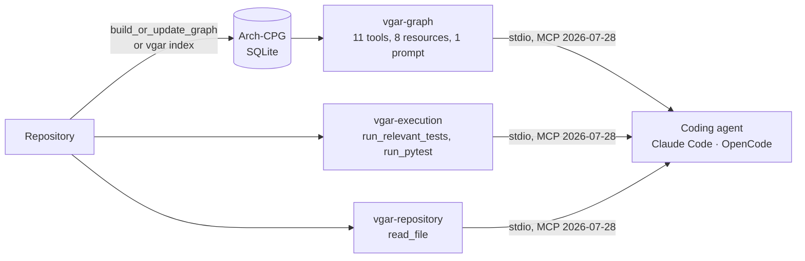

# VGAR-MCP

### Verified Graph-Augmented Reasoning via Model Context Protocol

**An MCP server that gives coding agents (Claude Code, OpenCode, …) a multi-layer code graph of a Python repository, Arch-CPG, and graph-based checks for the patches they write.**

The agent keeps writing the code. VGAR answers graph questions (callers, dependency paths, related tests, task anchors, patch impact) and returns evidence about a proposed diff (schema, structure, public API, import cycles, lost ports, related tests before and after, ranking). The repository is never modified by a tool: every check runs on a temporary copy.



Scope and source of truth: the project proposal (*VGAR-MCP: Verified Graph-Augmented Reasoning via MCP for Multi-file Software Repair*, kept outside the repository) and the two-week plan [`docs/status/plan_2_weeks_mcp_server_2026-11-07.md`](docs/status/plan_2_weeks_mcp_server_2026-11-07.md).

## Contents

- [Quick start](#quick-start)
- [Installation](#installation)
- [Attach the servers to a coding agent](#attach-the-servers-to-a-coding-agent)
- [Working session](#working-session-proposal-1011)
- [Token usage and latency](#token-usage-and-latency)
- [Troubleshooting](#troubleshooting)
- [Build a graph ahead of time](#build-a-graph-ahead-of-time)
- [Tools, resources and prompt](#tools-resources-and-prompt)
- [Logging and debugging](#logging-and-debugging)
- [Layers](#layers)
- [Evaluation](#evaluation)
- [Testing](#testing)
- [Project structure](#project-structure)
- [Security](#security)

## Quick start

Install once, then attach the three servers to each repository you work on. As proposal §10.5 requires ("path jail: chỉ truy cập repo được allowlist"), a server works only on the repository its configuration names.

```powershell
# 1. Install (in this repository)
python -m venv .venv
.\.venv\Scripts\Activate.ps1
pip install -e ".[dev,history,code-graph]"

# 2. Attach the three servers to one repository (Claude Code, run in that repository)
cd <repository>
$py   = "<ABSOLUTE PATH TO>/vgar_mcp_mvp_demo/.venv/Scripts/python.exe"
$repo = "<ABSOLUTE PATH TO THE REPOSITORY>"
$data = "<ABSOLUTE PATH TO A FOLDER OUTSIDE THE REPOSITORY>"    # graph and logs
claude mcp add vgar-graph      -e PYTHONUTF8=1 -e VGAR_GRAPH_BACKEND=sqlite -e VGAR_REPOSITORY_ROOT=$repo -e VGAR_GRAPH_DATABASE=$data/graph.db -e VGAR_MCP_AUDIT_LOG=$data/graph.jsonl -- $py -m vgar.mcp.servers.graph_server
claude mcp add vgar-execution  -e PYTHONUTF8=1 -e VGAR_GRAPH_BACKEND=sqlite -e VGAR_REPOSITORY_ROOT=$repo -e VGAR_GRAPH_DATABASE=$data/graph.db -e VGAR_MCP_AUDIT_LOG=$data/execution.jsonl -- $py -m vgar.mcp.servers.execution_server
claude mcp add vgar-repository -e PYTHONUTF8=1 -e VGAR_LEASE_ROOT=$repo -e VGAR_MCP_AUDIT_LOG=$data/repository.jsonl -- $py -m vgar.mcp.servers.repository_server
claude mcp list                       # the three servers show "Connected"

# 3. Open the agent in the repository and ask
claude
```

For OpenCode, see [OpenCode](#opencode). In the agent, a first prompt can be:

```text
Build the code graph of this repository, then find where the checkout total is computed
and which files and tests depend on it. Use the vgar-graph and vgar-execution tools.
```

The agent calls `build_or_update_graph` (the host asks you to approve it), then the read tools.

## Installation

Python 3.11–3.13. One virtual environment holds everything; the servers run on the official MCP Python SDK `2.2.0` (`from mcp.server import MCPServer`, as in the MCP build-server guide).

```powershell
python -m venv .venv
.\.venv\Scripts\Activate.ps1          # Linux/macOS: source .venv/bin/activate
pip install -e ".[dev,history,code-graph]"
```

| Extra | Adds | Needed for |
|---|---|---|
| `dev` | pytest, mypy, Ruff | tests; mypy/Ruff are also run by the static checks |
| `history` | dulwich | commit history (layer 4) and `get_related_context` with history |
| `code-graph` | networkx | `G_code` helpers |
| `plot` | matplotlib | optional plots in evaluation scripts |

Optional backends need Docker: JARVIS (`--enable-jarvis`), Joern (`--joern`).

## Attach the servers to a coding agent

As in the MCP build-server guide: declare each server in the host's configuration with a command, its arguments and the environment it needs, using absolute paths, then quit the host completely and reopen it. Stdio servers receive only the environment you declare.

Each configuration names one repository. A server started without a variable it needs, with a relative path, or with spaces around a value, stops and names the variable (`vgar-graph cannot start: VGAR_GRAPH_DATABASE is not set`). Relative paths are refused because `import vgar` also reads the VGAR project's `.env`, whose relative values would land inside the repository being edited.

| Host | Copy | Into |
|---|---|---|
| Claude Desktop | [`configs/mcp_server/claude-desktop.example.json`](configs/mcp_server/claude-desktop.example.json) | `%APPDATA%\Claude\claude_desktop_config.json` |
| Claude Code | [`configs/mcp_server/mcp.example.json`](configs/mcp_server/mcp.example.json) | `.mcp.json` in the repository root (project scope; Claude Code asks once whether to trust it), or the `claude mcp add` commands of the [Quick start](#quick-start) |
| OpenCode | [`configs/mcp_server/opencode.example.jsonc`](configs/mcp_server/opencode.example.jsonc) | `opencode.jsonc` in the repository root, or the commands below |

Replace every `<ABSOLUTE ...>` placeholder. The database file may not exist yet.

Use `claude mcp add` rather than `add-json`: Windows PowerShell 5.1 strips the quotes inside a JSON argument.

### OpenCode

Run in the root of the repository; `opencode.json` is written there:

```powershell
cd <repository>
$py   = "<ABSOLUTE PATH TO>/vgar_mcp_mvp_demo/.venv/Scripts/python.exe"
$repo = "<ABSOLUTE PATH TO THE REPOSITORY>"
$data = "<ABSOLUTE PATH TO A FOLDER OUTSIDE THE REPOSITORY>"
opencode.cmd mcp add vgar-graph      --env PYTHONUTF8=1 --env VGAR_GRAPH_BACKEND=sqlite --env VGAR_REPOSITORY_ROOT=$repo --env VGAR_GRAPH_DATABASE=$data/graph.db --env VGAR_MCP_AUDIT_LOG=$data/graph.jsonl -- $py -m vgar.mcp.servers.graph_server
opencode.cmd mcp add vgar-execution  --env PYTHONUTF8=1 --env VGAR_GRAPH_BACKEND=sqlite --env VGAR_REPOSITORY_ROOT=$repo --env VGAR_GRAPH_DATABASE=$data/graph.db --env VGAR_MCP_AUDIT_LOG=$data/execution.jsonl -- $py -m vgar.mcp.servers.execution_server
opencode.cmd mcp add vgar-repository --env PYTHONUTF8=1 --env VGAR_LEASE_ROOT=$repo --env VGAR_MCP_AUDIT_LOG=$data/repository.jsonl -- $py -m vgar.mcp.servers.repository_server
opencode mcp list                     # the three servers show "connected"
```

Call `opencode.cmd`, not `opencode`: the npm shim `opencode.ps1` loses the `--` under Windows PowerShell 5.1, and OpenCode then prints its help instead of adding the server. Running `mcp add` again for a server replaces it, including fields edited by hand.

Then edit `opencode.json`: add `"codemode": false` to each server, and a tool timeout long enough for a first build (`"timeout": { "execution": 900000 }` under `"mcp"`), as in [`opencode.example.jsonc`](configs/mcp_server/opencode.example.jsonc). With Code Mode on (OpenCode's default) the model calls tools from generated JavaScript and must write `tools["vgar-graph"]`; it often guesses `tools.vgar_graph` and gets `Unknown tool`. `codemode: false` exposes the tools directly and keeps tool-call counts measurable. For a run without MCP set `"disabled": true` on the servers.

### Environment variables

| Variable | Server | Meaning |
|---|---|---|
| `VGAR_GRAPH_BACKEND` | graph, execution | `sqlite` (default) or `snapshot` (read-only; needs no repository or database) |
| `VGAR_GRAPH_DATABASE` | graph, execution | **required** with `VGAR_REPOSITORY_ROOT`, absolute: SQLite graph file; created by `build_or_update_graph` if missing |
| `VGAR_REPOSITORY_ROOT` | graph (required), execution (required unless `VGAR_LEASE_ROOT` is set) | absolute existing folder: the repository; the only one `build_or_update_graph` will build and `run_relevant_tests` tests |
| `VGAR_LEASE_ROOT` | repository (required), execution (required unless `VGAR_REPOSITORY_ROOT` is set) | absolute existing folder: root `read_file` may read and `run_pytest` runs in |
| `VGAR_MCP_AUDIT_LOG` | all | **required**, absolute: audit log of every tool call |
| `VGAR_GRAPH_BUILD_TIMEOUT_SECONDS` | graph | limit for one build or update (default 900) |
| `VGAR_MCP_LOG_LEVEL` | all | `WARNING` (default), `INFO`, `DEBUG`; logs go to stderr |
| `VGAR_MCP_METRICS_LOG` | all | per-call metrics JSONL (default: `<audit log name>.metrics.jsonl` next to the audit log) |
| `VGAR_TOKENIZER_MANIFEST` | all | pinned tokenizer for exact token counts; without it counts are estimates |

## Working session (proposal §10–§11)

1. Open Claude Code or OpenCode in the repository and ask your question.
2. The agent calls `build_or_update_graph`; the host asks you to approve it (the confirmation of proposal §10.5). The first call builds the graph.
3. The agent uses the read tools (`find_task_anchors`, `get_related_context`, `get_callers`, …) and edits code.
4. After editing, the agent calls `build_or_update_graph` again: only the changed files are re-extracted (incremental update), and every read tool sees the new graph on its next call, without reconnecting. The database keeps only the current snapshot of the repository, so reverting an edit serves the reverted code. If a call answers `TIMEOUT`, the build keeps running and the next call waits for it.
5. The agent checks its patch with `analyze_patch_impact`, `verify_patch_graph_constraints`, `run_relevant_tests` and `rank_patch_candidates`.

Until the first build, read tools answer `GRAPH_NOT_READY` with a hint to call `build_or_update_graph`.

### Example prompts

Describe the problem as a user would; the agent locates the code with the graph. On [`tests/fixtures/vgar-demo-shop`](tests/fixtures/vgar-demo-shop):

```text
A customer reports a checkout bug: 5 BOOK (1,000,000 VND) with coupon SAVE10 gives tax = 100,000,
but the README says VAT is charged after the discount (expected 90,000). Find the cause, fix it,
and run the related tests. Use the vgar-graph and vgar-execution tools.
```

```text
Rename discount_amount to compute_discount. Before editing, list every caller in other files.
After editing, call analyze_patch_impact and verify_patch_graph_constraints with the diff.
```

Ask for `analyze_patch_impact` and `verify_patch_graph_constraints` in the prompt when you want them, and always when the repository has no tests: the graph is built from the source alone, so callers, importers, signature changes, removed public API and import cycles across files are still found, but nothing checks behaviour.

## Token usage and latency

Tool results are not annotated with tokens in the chat. Every tool call writes one JSON line to `<server>.metrics.jsonl` next to the audit log (`VGAR_MCP_AUDIT_LOG`): processing time, tokens in (arguments) and out (the result the model reads), and the format of arguments and result (types and sizes, never content). Summarize per tool:

```powershell
$L = "<folder of VGAR_MCP_AUDIT_LOG>"
python scripts/summarize_mcp_metrics.py --metrics "$L\graph.metrics.jsonl" --metrics "$L\execution.metrics.jsonl" --out results\mcp_metrics
```

It prints the totals and writes `mcp_metrics.md` / `mcp_metrics.json` (calls, errors, latency mean/p50/p95/max, tokens in and out per tool). The files accumulate across sessions: rename or delete them before a run you want to measure alone.

- Counts are estimates (`approx_chars_div_4`) unless `VGAR_TOKENIZER_MANIFEST` names a pinned tokenizer.
- The model's own tokens (prompt and answer) are counted by the host: Claude Code `/cost`, OpenCode's session statistics.
- To see each call live, set `VGAR_MCP_LOG_LEVEL=INFO`: one `metrics tool=… duration_ms=… input_tokens=… output_tokens=…` line on stderr (OpenCode: `opencode --print-logs`).

## Troubleshooting

| Symptom | Cause and fix |
|---|---|
| `opencode mcp add` prints its help | PowerShell dropped `--`: run `opencode.cmd mcp add …` |
| `Unknown tool 'vgar_graph.build_or_update_graph'` | OpenCode Code Mode: set `"codemode": false` on each server and restart OpenCode |
| `GRAPH_NOT_READY` | No graph yet for this repository: call `build_or_update_graph` |
| `TIMEOUT` from `build_or_update_graph` | The build keeps running; call again. On large repositories raise `VGAR_GRAPH_BUILD_TIMEOUT_SECONDS` and the host's tool timeout |
| Server not connected, log says `… is not set` or `… is not an absolute path` | Declare that variable in the host configuration with an absolute path (see [Environment variables](#environment-variables)). Check `claude mcp list` / `opencode mcp list` |
| `PATCH_DOES_NOT_APPLY` | Hand-written hunk line numbers: take diffs from `git diff` |

MCP Inspector, host log locations and more errors: [`docs/mcp_server/debugging.md`](docs/mcp_server/debugging.md).

## Build a graph ahead of time

For evaluation runs (one graph per SWE-bench task at `base_commit`), or so that the read tools can answer before the agent's first build. Building ahead does not shorten the agent's first `build_or_update_graph` call: the incremental cache lives in the server process, so that first call is still a full build (on a large repository, let it run past one TIMEOUT and call again, or raise `VGAR_GRAPH_BUILD_TIMEOUT_SECONDS` and the host's tool timeout). Later calls are incremental.

```powershell
python -m vgar.cli index <repo> --db D:/graphs/<repo>.db      # static graph, prints "<n> nodes -> <db>"
```

For JARVIS, Joern or a SCIP/LSP resolver, build the graph JSON with all options, then load it:

```powershell
python scripts/build_graph.py <repo> graph.json --repo-key <key> --revision <sha> --enable-jarvis --joern
python scripts/load_graph_fixture.py graph.json D:/graphs/<repo>.db
```

## Tools, resources and prompt

| Server | Tools |
|---|---|
| `vgar-graph` | `search_symbols`, `get_callers`, `get_callees` (multi-hop; `MAY_CALL` listed apart), `explain_dependency_path`, `find_task_anchors`, `get_related_context`, `get_related_tests`, `analyze_patch_impact`, `verify_patch_graph_constraints`, `rank_patch_candidates`, `build_or_update_graph` (writes the graph: cold build, then incremental updates) |
| `vgar-execution` | `run_relevant_tests` (graph-selected tests before and after a diff, on a temporary copy), `run_pytest`, `health` |
| `vgar-repository` | `read_file`, `health` |

Resources: `vgar://repo/summary`, `vgar://repo/schema`, `vgar://graph/node/{node_id}`, `vgar://graph/subgraph/{node_id}`, `vgar://component/{component_id}`, `vgar://task/{task_id}`, `vgar://evidence/baseline`, `vgar://audit/log`. Prompt: `repair_with_graph_context`.

Details: [`tools.md`](docs/mcp_server/tools.md), [`resources.md`](docs/mcp_server/resources.md), [`prompts.md`](docs/mcp_server/prompts.md), [`contract.md`](docs/mcp_server/contract.md).

`rank_patch_candidates` takes each candidate's `diff_hash` (`sha256:` + hex digest of the diff). Get diffs from `git diff`; hand-written hunk line numbers are rejected with `PATCH_DOES_NOT_APPLY`.

## Logging and debugging

Following the MCP build-server guide (`2026-07-28`): nothing but JSON-RPC on stdout, one `logging.getLogger(__name__)` per module, logs on stderr (the host captures them), no protocol logging. `VGAR_MCP_LOG_LEVEL=INFO` adds a start-up line and one line per tool call; `DEBUG` adds the call arguments as hashes and sizes, never diff content. Per-call metrics: see [Token usage and latency](#token-usage-and-latency).

MCP Inspector, host log locations and common errors: [`docs/mcp_server/debugging.md`](docs/mcp_server/debugging.md).

## Layers

Arch-CPG follows proposal §5.2. Each row links to its run reports.

| Layer | Content | Owner | Reports |
|---|---|---|---|
| 1 Syntax | tree-sitter-graph facts, `Identifier`, `HAS_METHOD`, `HAS_CALLSITE`, fields, config, routes | TV2 | [`tv2_layer1_run`](docs/status/tv2_layer1_run_2026-11-08.md) |
| 2 Symbols and calls | static binding, JARVIS call graph, `MAY_CALL` with confidence and provenance | TV2 | [`tv2_l2_1_jarvis_run`](docs/status/tv2_l2_1_jarvis_run_2026-11-10.md), [`tv2_l2_2_may_call_run`](docs/status/tv2_l2_2_may_call_run_2026-11-08.md) |
| 3 Graph layers | `G_code` (Joern, optional), `G_arch` lift, `G_task` overlay, trace links, schema `S`, retrieval, impact | TV2 | [`tv2_l3_1_g_code_run`](docs/status/tv2_l3_1_g_code_run_2026-11-09.md), [`tv2_ga_g_arch_run`](docs/status/tv2_ga_g_arch_run_2026-11-09.md), [`tv2_gt_1_g_task_run`](docs/status/tv2_gt_1_g_task_run_2026-11-09.md), [`tv2_tr_1_trace_links_run`](docs/status/tv2_tr_1_trace_links_run_2026-11-10.md), [`tv2_sc_1_schema_run`](docs/status/tv2_sc_1_schema_run_2026-11-10.md), [`tv2_rt_1_retrieval_run`](docs/status/tv2_rt_1_retrieval_run_2026-11-10.md), [`tv2_im_1_impact_run`](docs/status/tv2_im_1_impact_run_2026-11-09.md) |
| 4 History | commit history (dulwich), Python AST diff | TV3 | [`tv3_commit_history`](docs/mcp_server/tv3_commit_history.md) |
| 5 Evidence | graph verification, diff tests, nine-field evidence and `score(patch)` ranking | TV3 | [`tv3_static_verification`](docs/mcp_server/tv3_static_verification.md), [`tv3_diff_tests`](docs/mcp_server/tv3_diff_tests.md), [`tv3_patch_ranking`](docs/mcp_server/tv3_patch_ranking.md) |
| 6 MCP | servers, resources, prompt, security, incremental build, SQLite storage | TV1 | [`docs/mcp_server/`](docs/mcp_server/status.md) |

How layers 1–3 feed layers 4–6 on the real graph: [`tv2_layer_integration_run`](docs/status/tv2_layer_integration_run_2026-11-11.md).

## Evaluation

Week 2 of the two-week plan (§4–§5):

| Measure | Scripts |
|---|---|
| Retrieval (RQ1/RQ2) | `run_bm25_retrieval.py`, `run_graph_retrieval.py`, `compare_graph_vs_bm25.py`, `run_rt1_ablation.py`, `compare_rt1_ablation.py`, `materialize_dev_gold.py` |
| Graph quality | `compare_static_vs_scip.py`, `measure_trace_links.py`, `bench_schema_validation.py` |
| Incremental update | `bench_incremental.py` |
| Impact (RQ3) | `measure_patch_impact.py` |
| Verification (FAR/FRR) | `build_mutant_pool.py`, `evaluate_mutant_pool.py`, `audit_mypy_deltas.py` |
| Repair | `grade_repair_candidates.py --execute` (official SWE-bench harness). **Needs an adapter:** it reads the removed M2 runner layout (`attempts/*/attempt-*.json` whose `engine_run_dir` holds `run_record.json` with `stages.apply.status == PASS` and `applied.diff`); patches from Claude Code/OpenCode must be written in that layout first |
| MCP usability | `summarize_mcp_metrics.py --metrics …` (per-tool calls, latency and tokens from the servers' own metrics; works with any host). `aggregate_agent_traces.py --traces … --audit …` **needs an adapter:** it requires trace files of the removed `vgar solve --agent` (`<UTC>-<task>.json` with `calls`, `mode`, `by`) besides the audit log; Claude Code/OpenCode produce no such traces |
| SWE-bench task environments | `prepare_manifest.py`, `prepare_task_env.py`, `pin_task_images.py`, `build_swebench_test_cmds.py` |

## Testing

```powershell
python -m pytest -q                                   # full suite
python -m pytest -q tests/mcp_server                  # MCP servers
python -m pytest -q tests/test_tv2_removed_stack.py   # the repo stays MCP-only (no LangChain, no generator)
```

Tests that need Docker are marked `docker`.

## Project structure

```text
src/vgar/
├── cli.py              # vgar doctor | vgar index
├── config/             # settings from environment and .env
├── contracts/          # graph schema S, context, impact, evidence contracts
├── graph/              # Arch-CPG builder (layers 1–3), SQLite store and service, retrieval, impact, history
├── mcp/                # servers, tool envelope, audit, logging, proposal layer (providers, resources, prompt, security)
├── repair/             # patch parsing/apply, workspace, executors, static/API/structural checks, patch evidence
├── evaluation/         # retrieval, incremental, trace, verification and SWE-bench harness evaluation
└── observability/      # tool instrumentation, redaction, graph build traces
scripts/                # graph building and evaluation entry points
configs/mcp_server/     # runtime, security, ranking weights, host templates
docs/mcp_server/        # layer 6 and layer 4–5 documentation
docs/status/            # plans and run reports
```

## Security

Read tools only read; `build_or_update_graph` is the one write tool, builds only `VGAR_REPOSITORY_ROOT`, and the host asks before each call (a host with TV1's trusted context keeps its write grant). Paths stay inside the leased root, secrets and `.env` files are refused, outputs are redacted, every call is audited, test runs have server-set timeouts and output caps, and repository text is marked untrusted. See [`docs/mcp_server/security.md`](docs/mcp_server/security.md).
