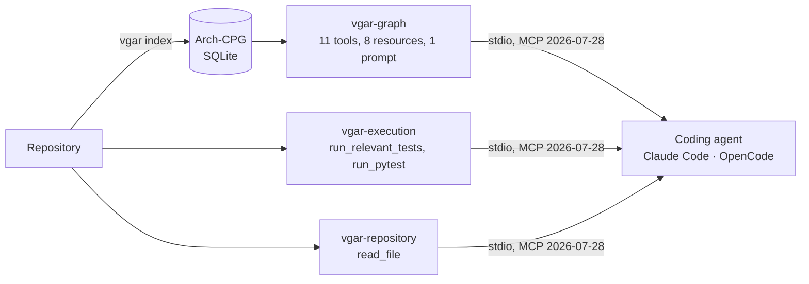

# VGAR-MCP

### Verified Graph-Augmented Reasoning via Model Context Protocol

**An MCP server that gives coding agents (Claude Code, OpenCode, …) a multi-layer code graph of a Python repository, Arch-CPG, and graph-based checks for the patches they write.**

The agent keeps writing the code. VGAR answers graph questions (callers, dependency paths, related tests, task anchors, patch impact) and returns evidence about a proposed diff (schema, structure, public API, import cycles, lost ports, related tests before and after, ranking). The repository is never modified by a tool: every check runs on a temporary copy.



Scope and source of truth: the project proposal (*VGAR-MCP: Verified Graph-Augmented Reasoning via MCP for Multi-file Software Repair*, kept outside the repository) and the two-week plan [`docs/status/plan_2_weeks_mcp_server_2026-11-07.md`](docs/status/plan_2_weeks_mcp_server_2026-11-07.md).

## Contents

- [Layers](#layers)
- [Installation](#installation)
- [Build a graph](#build-a-graph)
- [Attach the servers to a coding agent](#attach-the-servers-to-a-coding-agent)
- [Tools, resources and prompt](#tools-resources-and-prompt)
- [Logging and debugging](#logging-and-debugging)
- [Evaluation](#evaluation)
- [Testing](#testing)
- [Project structure](#project-structure)
- [Security](#security)

## Layers

Arch-CPG follows proposal §5.2. Each row links to its run reports.

| Layer | Content | Owner | Reports |
|---|---|---|---|
| 1 Syntax | tree-sitter-graph facts, `Identifier`, `HAS_METHOD`, `HAS_CALLSITE`, fields, config, routes | TV2 | [`tv2_layer1_run`](docs/status/tv2_layer1_run_2026-11-08.md) |
| 2 Symbols and calls | static binding, JARVIS call graph, `MAY_CALL` with confidence and provenance | TV2 | [`tv2_l2_1_jarvis_run`](docs/status/tv2_l2_1_jarvis_run_2026-11-10.md), [`tv2_l2_2_may_call_run`](docs/status/tv2_l2_2_may_call_run_2026-11-08.md) |
| 3 Graph layers | `G_code` (Joern, optional), `G_arch` lift, `G_task` overlay, trace links, schema `S`, retrieval, impact | TV2 | [`tv2_l3_1_g_code_run`](docs/status/tv2_l3_1_g_code_run_2026-11-09.md), [`tv2_ga_g_arch_run`](docs/status/tv2_ga_g_arch_run_2026-11-09.md), [`tv2_gt_1_g_task_run`](docs/status/tv2_gt_1_g_task_run_2026-11-09.md), [`tv2_tr_1_trace_links_run`](docs/status/tv2_tr_1_trace_links_run_2026-11-10.md), [`tv2_sc_1_schema_run`](docs/status/tv2_sc_1_schema_run_2026-11-10.md), [`tv2_rt_1_retrieval_run`](docs/status/tv2_rt_1_retrieval_run_2026-11-10.md), [`tv2_im_1_impact_run`](docs/status/tv2_im_1_impact_run_2026-11-09.md) |
| 4 History | commit history (dulwich), Python AST diff | TV3 | [`tv3_commit_history`](docs/mcp_server/tv3_commit_history.md) |
| 5 Evidence | graph verification, diff tests, nine-field evidence and `score(patch)` ranking | TV3 | [`tv3_static_verification`](docs/mcp_server/tv3_static_verification.md), [`tv3_diff_tests`](docs/mcp_server/tv3_diff_tests.md), [`tv3_patch_ranking`](docs/mcp_server/tv3_patch_ranking.md) |
| 6 MCP | servers, resources, prompt, security, incremental build, SQLite storage | TV1 | [`docs/mcp_server/`](docs/mcp_server/status.md) |

How layers 1–3 feed layers 4–6 on the real graph: [`tv2_layer_integration_run`](docs/status/tv2_layer_integration_run_2026-11-11.md).

## Installation

Python 3.11–3.13. One virtual environment holds everything; the servers run on the official MCP Python SDK `2.2.0`.

```powershell
python -m venv .venv
.\.venv\Scripts\Activate.ps1          # Linux/macOS: source .venv/bin/activate
pip install -e ".[dev,history,code-graph]"
```

| Extra | Adds | Needed for |
|---|---|---|
| `dev` | pytest, mypy, Ruff | tests; mypy/Ruff are also run by the static checks |
| `history` | dulwich | commit history (layer 4) and `get_related_context` with history |
| `code-graph` | networkx | `G_code` helpers |
| `plot` | matplotlib | optional plots in evaluation scripts |

Optional backends need Docker: JARVIS (`--enable-jarvis`), Joern (`--joern`).

## Build a graph

The graph server reads a SQLite graph; it never builds one at start-up.

```powershell
python -m vgar.cli index <repo> --db D:/graphs/<repo>.db      # static graph, prints "<n> nodes -> <db>"
```

For JARVIS, Joern or a SCIP/LSP resolver, build the graph JSON with all options, then load it:

```powershell
python scripts/build_graph.py <repo> graph.json --repo-key <key> --revision <sha> --enable-jarvis --joern
python scripts/load_graph_fixture.py graph.json D:/graphs/<repo>.db
```

The graph does not follow edits made by the agent; run the index again after the code changes.

## Attach the servers to a coding agent

Every server is one stdio process. Paths must be absolute; stdio servers receive only the environment you declare.

| Variable | Server | Meaning |
|---|---|---|
| `VGAR_GRAPH_BACKEND` | graph, execution | `sqlite` (or `snapshot`) |
| `VGAR_GRAPH_DATABASE` | graph, execution | SQLite file from `vgar index` |
| `VGAR_REPOSITORY_ROOT` | graph, execution | repository the graph was built from |
| `VGAR_LEASE_ROOT` | repository | root `read_file` may read |
| `VGAR_MCP_AUDIT_LOG` | all | audit log of every tool call (default `logs/mcp_audit.jsonl`) |
| `VGAR_MCP_LOG_LEVEL` | all | `WARNING` (default), `INFO`, `DEBUG`; logs go to stderr |

**Claude Code** (PowerShell, run inside the repository you will work on):

```powershell
claude --% mcp add vgar-graph -s local -e VGAR_GRAPH_BACKEND=sqlite -e VGAR_GRAPH_DATABASE=D:/graphs/<repo>.db -e VGAR_REPOSITORY_ROOT=<repo> -e PYTHONUTF8=1 -- <path-to>/.venv/Scripts/python.exe -m vgar.mcp.servers.graph_server
claude --% mcp add vgar-execution -s local -e VGAR_GRAPH_BACKEND=sqlite -e VGAR_GRAPH_DATABASE=D:/graphs/<repo>.db -e VGAR_REPOSITORY_ROOT=<repo> -e PYTHONUTF8=1 -- <path-to>/.venv/Scripts/python.exe -m vgar.mcp.servers.execution_server
```

Then `/mcp` in a session shows the servers and their tools. Templates: [`configs/mcp_server/claude-code.template.json`](configs/mcp_server/claude-code.template.json).

**OpenCode** (`opencode.jsonc` in the repository root; any local model that supports tool calls):

```jsonc
{
  "$schema": "https://opencode.ai/config.json",
  "mcp": {
    "timeout": { "execution": 600000 },
    "servers": {
      "vgar-graph": {
        "type": "local",
        "command": ["<path-to>/.venv/Scripts/python.exe", "-m", "vgar.mcp.servers.graph_server"],
        "environment": { "VGAR_GRAPH_BACKEND": "sqlite", "VGAR_GRAPH_DATABASE": "D:/graphs/<repo>.db",
                         "VGAR_REPOSITORY_ROOT": "<repo>", "VGAR_MCP_AUDIT_LOG": "D:/runs/graph.jsonl" },
        "codemode": false,
        "protocol": "2026-07-28"
      }
    }
  }
}
```

`codemode: false` exposes the tools directly, which keeps tool-call counts measurable. For a run without MCP, set `"disabled": true` on the servers.

## Tools, resources and prompt

| Server | Tools |
|---|---|
| `vgar-graph` | `search_symbols`, `get_callers`, `get_callees` (multi-hop; `MAY_CALL` listed apart), `explain_dependency_path`, `find_task_anchors`, `get_related_context`, `get_related_tests`, `analyze_patch_impact`, `verify_patch_graph_constraints`, `rank_patch_candidates`, `build_or_update_graph` (write tool; needs a host grant) |
| `vgar-execution` | `run_relevant_tests` (graph-selected tests before and after a diff, on a temporary copy), `run_pytest`, `health` |
| `vgar-repository` | `read_file`, `health` |

Resources: `vgar://repo/summary`, `vgar://repo/schema`, `vgar://graph/node/{node_id}`, `vgar://graph/subgraph/{node_id}`, `vgar://component/{component_id}`, `vgar://task/{task_id}`, `vgar://evidence/baseline`, `vgar://audit/log`. Prompt: `repair_with_graph_context`.

Details: [`tools.md`](docs/mcp_server/tools.md), [`resources.md`](docs/mcp_server/resources.md), [`prompts.md`](docs/mcp_server/prompts.md), [`contract.md`](docs/mcp_server/contract.md).

`rank_patch_candidates` takes each candidate's `diff_hash` (`sha256:` + hex digest of the diff). Get diffs from `git diff`; hand-written hunk line numbers are rejected with `PATCH_DOES_NOT_APPLY`.

## Logging and debugging

Following the MCP build-server guide (`2026-07-28`): nothing but JSON-RPC on stdout, one `logging.getLogger(__name__)` per module, logs on stderr (the host captures them), no protocol logging. `VGAR_MCP_LOG_LEVEL=INFO` adds a start-up line and one line per tool call; `DEBUG` adds the call arguments as hashes and sizes, never diff content.

MCP Inspector, host log locations and common errors: [`docs/mcp_server/debugging.md`](docs/mcp_server/debugging.md).

## Evaluation

Week 2 of the two-week plan (§4–§5):

| Measure | Scripts |
|---|---|
| Retrieval (RQ1/RQ2) | `run_bm25_retrieval.py`, `run_graph_retrieval.py`, `compare_graph_vs_bm25.py`, `run_rt1_ablation.py`, `compare_rt1_ablation.py`, `materialize_dev_gold.py` |
| Graph quality | `compare_static_vs_scip.py`, `measure_trace_links.py`, `bench_schema_validation.py` |
| Incremental update | `bench_incremental.py` |
| Impact (RQ3) | `measure_patch_impact.py` |
| Verification (FAR/FRR) | `build_mutant_pool.py`, `evaluate_mutant_pool.py`, `audit_mypy_deltas.py` |
| Repair | `grade_repair_candidates.py --execute` (official SWE-bench harness). **Needs an adapter:** it reads the removed M2 runner layout (`attempts/*/attempt-*.json` whose `engine_run_dir` holds `run_record.json` with `stages.apply.status == PASS` and `applied.diff`); patches from Claude Code/OpenCode must be written in that layout first |
| MCP usability | `aggregate_agent_traces.py --traces … --audit …`. **Needs an adapter:** it requires trace files of the removed `vgar solve --agent` (`<UTC>-<task>.json` with `calls`, `mode`, `by`) besides the audit log; Claude Code/OpenCode produce no such traces |
| SWE-bench task environments | `prepare_manifest.py`, `prepare_task_env.py`, `pin_task_images.py`, `build_swebench_test_cmds.py` |

## Testing

```powershell
python -m pytest -q                                   # full suite
python -m pytest -q tests/mcp_server                  # MCP servers
python -m pytest -q tests/test_tv2_removed_stack.py   # the repo stays MCP-only (no LangChain, no generator)
```

Tests that need Docker are marked `docker`. A few MCP tests use TV1's separate legacy interpreter (`environments/vgar-week78-cuda`) and fail when it is absent.

## Project structure

```text
src/vgar/
├── cli.py              # vgar doctor | vgar index
├── config/             # settings from environment and .env
├── contracts/          # graph schema S, context, impact, evidence contracts
├── graph/              # Arch-CPG builder (layers 1–3), SQLite store and service, retrieval, impact, history
├── mcp/                # servers, tool envelope, audit, logging, proposal layer (providers, resources, prompt, security)
├── repair/             # patch parsing/apply, workspace, executors, static/API/structural checks, patch evidence
├── evaluation/         # retrieval, incremental, trace, verification and SWE-bench harness evaluation
└── observability/      # tool instrumentation, redaction, graph build traces
scripts/                # graph building and evaluation entry points
configs/mcp_server/     # runtime, security, ranking weights, host templates
docs/mcp_server/        # layer 6 and layer 4–5 documentation
docs/status/            # plans and run reports
```

## Security

Read tools only read; `build_or_update_graph` writes and needs a host grant. Paths stay inside the leased root, secrets and `.env` files are refused, outputs are redacted, every call is audited, test runs have server-set timeouts and output caps, and repository text is marked untrusted. See [`docs/mcp_server/security.md`](docs/mcp_server/security.md).
