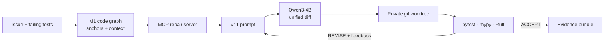
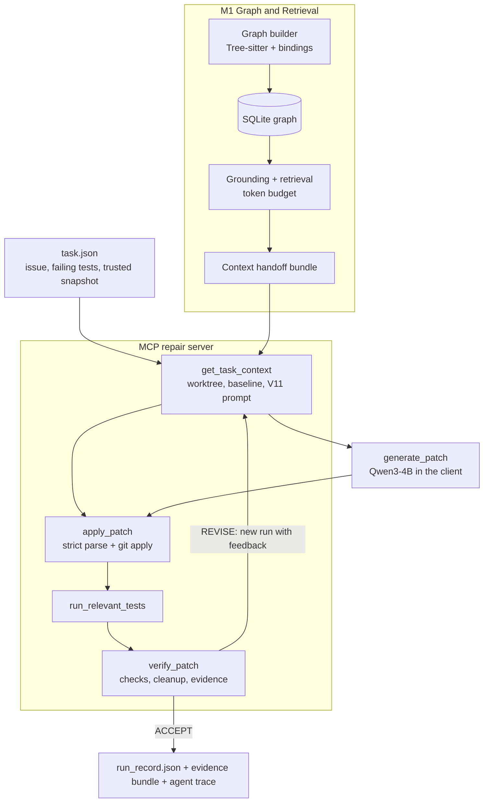

# VGAR-MCP

**Graph-guided context retrieval and verified multi-file repair for Python, exposed to coding agents through MCP.**

[](https://www.python.org/)
[](#testing)



<p align="center">
  <b>Code graph retrieval</b> · <b>Strict, sandboxed patch application</b> · <b>Agent-driven MCP repair loop</b>
</p>

## Table of Contents

- [Overview](#overview)
- [Key Features](#key-features)
- [Architecture](#architecture)
- [Results](#results)
- [Installation](#installation)
- [Quick Start](#quick-start)
- [Configuration](#configuration)
- [Project Structure](#project-structure)
- [Testing](#testing)
- [Limitations](#limitations)
- [Roadmap](#roadmap)
- [Contributing](#contributing)
- [License](#license)

## Overview

VGAR-MCP is a research prototype for repairing multi-file bugs in Python repositories. It builds a graph of the code (files, functions, calls, imports and tests), uses it to retrieve the context an issue actually touches, asks a fixed local model for a unified diff, and accepts the patch only after it has been applied in an isolated worktree and verified by execution.

Coding agents often read whole files or rely on lexical search, which misses the callers, callees and tests a change depends on, and they tend to report success without independent evidence. This project combines graph-guided retrieval with execution-based verification evidence and exposes both to agents through the Model Context Protocol (MCP) and LangChain.

**Motivation**
- Multi-file bugs need context that follows dependencies, not only text similarity.
- A patch is only useful with evidence: the failing tests must pass, nothing else may regress, and the original repository must stay untouched.
- Agents need these capabilities as typed tools with audit logs, not as ad-hoc scripts.

**Target users:** researchers and students working on LLM-based program repair, retrieval for code, and tool-using agents.

This is a 16-week capstone project with three roles: **M1** Graph & Retrieval, **M2** Repair & Verification, **M3** MCP, Evaluation & Paper. The current state is the end of weeks 7–8 (repair loop and basic verification). Per-task status and evidence are tracked in [Task Status.md](<Task Status.md>).

## Key Features

- **Code graph and retrieval (M1):** Tree-sitter parsing with static Python bindings into a SQLite graph store, with optional SCIP/Pyright LSP enrichment. Task grounding maps an issue to graph anchors; retrieval returns ranked snippets with node ids, ranges, graph rationale and token counts under a fixed budget. A BM25 baseline and a paired evaluation harness compare the two.
- **Repair pipeline (M2):** A fixed, hashed prompt template (`m2-w78-v11`), one greedy generation with a pinned `Qwen/Qwen3-4B-Instruct-2507` snapshot, a strict unified-diff parser (paths, allowlist, hunk counts; the host never rewrites model output), and `git apply` inside a private worktree.
- **MCP repair server and repair loop (M3):** The `repair` MCP server exposes `get_task_context`, `apply_patch`, `run_relevant_tests` and `verify_patch` in a strict order, with every call logged in the run record. `vgar solve` runs a fixed LangGraph flow over these tools; `vgar solve --agent` lets a LangChain agent choose the tools and when to stop, while the diff still comes from the single-turn V11 generator, and a failed attempt is retried in a new run with host-built feedback (at most 3 generations).
- **Verification:** Baseline reproduction of the failing tests, relevant-test selection from the changed files, required and regression pytest runs, syntax/mypy/Ruff checks, a source-integrity check of the original repository and a JSON evidence bundle per run. A run is reported as PASS only when `verify_patch` returns `ACCEPT`.

## Architecture



- **Graph builder and store** (`src/vgar/graph/`): parse Python sources, resolve symbols, persist nodes and edges with confidence and provenance.
- **Grounding and retrieval** (`src/vgar/graph/`, `src/vgar/contracts/`): issue → anchors → ranked context; the handoff bundle is validated for identity, source ranges and tokenizer provenance before M2 uses it.
- **Repair engine** (`src/vgar/repair/`, `src/vgar/models/`): prompt, generation, parser, worktree, test selection, verification and evidence. State is persisted in the run directory, so each MCP call can be served by a fresh server process.
- **MCP repair server** (`src/vgar/mcp/servers/repair_server.py`): the four tools above. Only trusted fixtures are accepted, writes happen only in the run's worktree, and `verify_patch` always closes the run and removes the worktree.
- **Orchestration** (`src/vgar/agents/`): `workflow.py` is the fixed LangGraph flow; `tool_agent.py` is agent mode, where a host object holds the current run and the generated diff so the agent never sees paths or writes a diff, and every run it opens ends with `verify_patch`, called by the agent or by the host as a safety net.

The older exact-edit agent (`vgar run` / `vgar chat`, with graph, repository and execution MCP servers) is still in the repository but is not the repair path described here; see [docs/RUNBOOK.md](docs/RUNBOOK.md) §3.2.

## Results

### Repair on three development fixtures

Three trusted fixtures (`examples/m2/tasks/`): **A** `single_file_login`, **B** `multi_file_invoice` (the fix touches two files), **C** `missing_links` (no test links; fallback test selection). Each row is one real run per task.

| Run (date) | Flow | Result | Generation time A / B / C | Total time A / B / C |
|---|---|---:|---:|---:|
| 2026-10-15 | M2 standalone pipeline | **3/3 PASS** | 53 s / 142 s / 51 s | 69 s / 157 s / 64 s |
| 2026-10-17 | `vgar solve` (fixed flow over MCP) | **3/3 PASS** | 86 s / 148 s / 55 s | 109 s / 174 s / 81 s |
| 2026-10-18 | `vgar solve --agent --generator worker` | **3/3 PASS** | 179 s / 395 s / 106 s | 408 s / 517 s / 213 s |
| 2026-10-18 | `vgar solve --agent --generator agent` | **3/3 PASS** | 24 s / 95 s / 28 s | 121 s / 191 s / 137 s |

- In every run the prompt, the raw model output and the applied diff are byte-identical to the golden records in `tests/fixtures/m2/golden_v11/` (input/output tokens: A 1,299/43, B 1,769/157, C 1,169/43).
- In agent mode the agent called all five tools itself (context → generate → apply → tests → verify), with no host-made calls and one run per task. The retry branch has been exercised only in fake mode, where the first diff is deliberately broken.
- `--generator worker` keeps two model copies in memory (agent + M2 worker) and is slower; it ran without out-of-memory errors on the hardware below.

### Retrieval: BM25 vs graph (2026-10-13)

25 development tasks; BM25 succeeded on 25, the graph arm on 22 (three SymPy tasks hit the 300 s timeout). Metrics are over the same 22 valid pairs.

| Metric | BM25 (baseline) | Graph (issue-only) |
|---|---:|---:|
| File Recall@5 | 0.538 | 0.447 |
| Function Recall@5 | 0.275 | 0.315 |
| File MRR | 0.578 | 0.605 |
| Function MRR | 0.428 | 0.418 |
| Packed gold-function coverage | 0.446 | 0.414 |
| Mean packed tokens | 7,998 | 7,967 |

Both 95% confidence intervals of the Recall@5 delta contain 0, so this does **not** show that graph retrieval beats BM25 in general. This evaluation calls no LLM and applies no patch.

**Experimental setup**
- Dataset: three hand-built trusted fixtures for repair; 25 SWE-bench-derived development tasks for retrieval.
- Evaluation protocol: repair passes when the baseline-failing tests pass, regression tests still pass, static checks pass and the source repository is unchanged; retrieval uses gold changed files/functions from the reference patches, macro-averaged.
- Hardware/software: Windows 11, NVIDIA RTX 4050 Laptop (6 GB, with CPU offload), Python 3.11.0, Torch 2.5.1+cu121, Transformers 4.57.6; `Qwen/Qwen3-4B-Instruct-2507` at revision `cdbee75f17c01a7cc42f958dc650907174af0554`, greedy decoding, FP16, input cap 6,000 / output cap 1,536 tokens.
- Repetitions or statistical analysis: greedy decoding, so repeated runs give the same diff; paired bootstrap CIs for retrieval. No repair benchmark or resolved rate has been measured yet.

## Installation

### Prerequisites

- Python 3.11 (x64); package metadata allows `>=3.11,<3.14`, the measured profile used 3.11.0
- Git on `PATH` (worktrees and `git apply`)
- For real model runs: an NVIDIA GPU with a CUDA build of PyTorch, and the `Qwen/Qwen3-4B-Instruct-2507` snapshot at the pinned revision in the Hugging Face cache
- Optional: Node.js + npm for the SCIP/Pyright LSP graph enrichers

### Setup

```bash
git clone https://github.com/GauKho/VGAR.git
cd VGAR

python -m venv .venv
```

Activate the environment:

```bash
# Windows PowerShell
.venv\Scripts\Activate.ps1

# Linux / macOS
source .venv/bin/activate
```

Install dependencies and register the `vgar` CLI:

```bash
pip install -r requirement.txt
pip install --no-deps -e .
vgar doctor
```

Keep the environment at `.venv` in the repository root: `configs/m2/demo.json` points the M2 model worker at that interpreter. `requirement.txt` does not choose a CUDA build of PyTorch for you; check `torch.cuda.is_available()` before real runs. Full setup notes (separate M1-only environment, tokenizer assets, SCIP/LSP) are in [docs/RUNBOOK.md](docs/RUNBOOK.md) §6.

## Quick Start

Fake mode uses reference patches instead of the model, so it runs without weights or a GPU:

```bash
# One-pass M2 repair; prints the run record path (exit code 0/1/2 = PASS/FAIL/ERROR)
python -m vgar.cli repair --task examples/m2/tasks/single_file_login.json --mode fake

# The agent chooses the MCP repair tools; the first fake diff is broken on purpose, the retry passes
python -m vgar.cli solve --task examples/m2/tasks/single_file_login.json --agent
```

**Expected output** (agent mode, fake):

```text
[status] COMPLETED after 2 attempt(s)
[run] ...\results\solve\<run-id>\run_record.json
[trace] ...\results\solve\agent-traces\<timestamp>-single_file_login.json
```

Real mode loads the pinned Qwen snapshot:

```bash
python -m vgar.cli solve --mode real --agent --generator agent --task examples/m2/tasks/single_file_login.json
python -m vgar.cli solve --mode real --task examples/m2/tasks/single_file_login.json   # fixed LangGraph flow
python -m vgar.cli --help
```

`--generator worker` (the default under `--agent`) generates in the M2 worker process; `--generator agent` reuses the agent's own model with the same settings. Use `--output-root PATH` to choose where runs and traces go, and `--keep` to keep the temporary worktree.

## Configuration

**Repair profile:** [configs/m2/demo.json](configs/m2/demo.json) selects the prompt version, token caps, timeouts, the model snapshot path and the worker interpreter. Native execution is allowed only on fixtures whose bytes match [configs/m2/trusted_fixtures.json](configs/m2/trusted_fixtures.json).

**Agent settings:** create a local environment file if you use the agent commands:

```bash
cp .env.example .env
```

| Variable | Description | Required |
|---|---|---|
| `HF_MODEL_ID` | Model for the legacy `run`/`chat` agent (default `Qwen/Qwen3-4B-Instruct-2507`) | No |
| `MAX_NEW_TOKENS` | Token cap of the agent model's own turns (default 512; repair generation uses the profile's 1,536) | No |
| `VGAR_GRAPH_BACKEND` | `demo` or `sqlite` | No |
| `VGAR_GRAPH_DATABASE` | SQLite graph path when the backend is `sqlite` | If using SQLite |
| `VGAR_MCP_AUDIT_LOG` | MCP audit log path (default `logs/mcp_audit.jsonl`) | No |
| `HF_TOKEN` | Hugging Face token, only to download weights | If downloading |

Environment variables override `.env`, which overrides the defaults. Never commit API keys, tokens, passwords, or other secrets.

## Project Structure

```text
VGAR/
├── src/vgar/
│   ├── graph/          # M1: graph builder, SQLite store, grounding, retrieval, test links, handoff
│   ├── contracts/      # DTOs, handoff consumer and validation, evidence schemas
│   ├── repair/         # M2: prompt, parser, worktree, test selection, verification, evidence, sessions
│   ├── models/         # HF worker generator and the local LangChain chat model
│   ├── mcp/            # MCP client and servers (repair, graph, repository, execution)
│   ├── agents/         # LangGraph fixed flow, agent mode (tool_agent.py), prompts incl. repair_v11.txt
│   ├── evaluation/     # BM25 baseline and retrieval evaluation
│   └── cli.py          # `vgar` entry point
├── tests/              # unit, M2 W7-W8 (golden V11) and integration tests
├── examples/m2/        # trusted fixture tasks, snapshots and M1 handoff bundles
├── configs/            # repair profile + trusted fixture hashes (m2/), agent/MCP/model YAML, SCIP/LSP
├── scripts/            # graph build, evaluation and smoke scripts
├── docs/               # RUNBOOK, contracts, design specs and plans, handoff reports
├── Task Status.md      # 16-week checklist status with evidence
├── pyproject.toml
└── README.md
```

## Testing

Run the test suite:

```bash
python -m pytest -p no:cacheprovider -q
```

For specific tests:

```bash
python -m pytest tests/m2/w78/test_w78_golden_v11.py -v   # V11 prompt and diff stay byte-identical to the real records
python -m pytest tests/unit/test_agent_solve.py -v        # agent mode: retry, limits, safety-net verify
```

Latest full run (2026-10-18): **747 passed, 1 failed** in about 11 minutes. The failure is a known, pre-existing test of the legacy HF constructor (`tests/test_hf_model.py::test_local_chat_model_uses_one_greedy_generation_config`, `KeyError: 'generation_config'`); it is not on the repair path. The suite needs no GPU or model weights: fake mode and stubs stand in for generation, while real model runs are done by hand.

## Limitations

- Repair has been run only on three trusted development fixtures. No SWE-bench repair run or resolved rate exists yet.
- Native worktree isolation is not an OS sandbox; only trusted fixtures and repositories should be used.
- One small local model (Qwen3-4B, greedy). The retry branch with a real model has not been triggered, because no real run has failed so far.
- Repair uses the M1 context bundle exported ahead of time; live graph retrieval inside the loop is planned for weeks 9–10.
- The legacy exact-edit agent (`vgar run` / `vgar chat`) and its repository/execution servers keep open findings (path binding, runner limits, resource ID decoding); see [Task Status.md](<Task Status.md>) §6.
- API-compatibility and structural architecture checks are not implemented yet (reported as `NOT_RUN`).
- In agent mode the agent's per-turn output tokens are counted by re-tokenizing the returned text.

## Roadmap

- [ ] Draft Methodology: system overview, graph construction, retrieval (week 7–8 deliverable, still open)
- [ ] Runnable SWE-bench subset (50–100 tasks with verified environments)
- [ ] Patch impact analysis (diff → graph nodes, impact report) and an `analyze_patch_impact` MCP tool
- [ ] Ablation A0 (BM25 + tests), A1 (graph + tests), A2 (graph + tests + type/lint) on 30–50 development tasks
- [ ] MCP hardening: security model, performance, audit completeness
- [ ] Held-out evaluation, failure analysis and statistics
- [ ] Paper and public artifact

## Contributing

This is a team capstone repository; contributions follow the team workflow.

1. Open an issue or describe the change in the weekly sync.
2. Create a branch for your changes; do not commit to `main` directly.
3. Add or update tests; never edit golden fixtures, reference patches or verification guards to make a run pass.
4. Open a pull request with a clear description; at least one other team member reviews it before merge.

Operational details (environments, evidence layout, how to read PASS/FAIL) are in [docs/RUNBOOK.md](docs/RUNBOOK.md).

## License

No license has been chosen yet. Until one is added, all rights are reserved by the authors.
