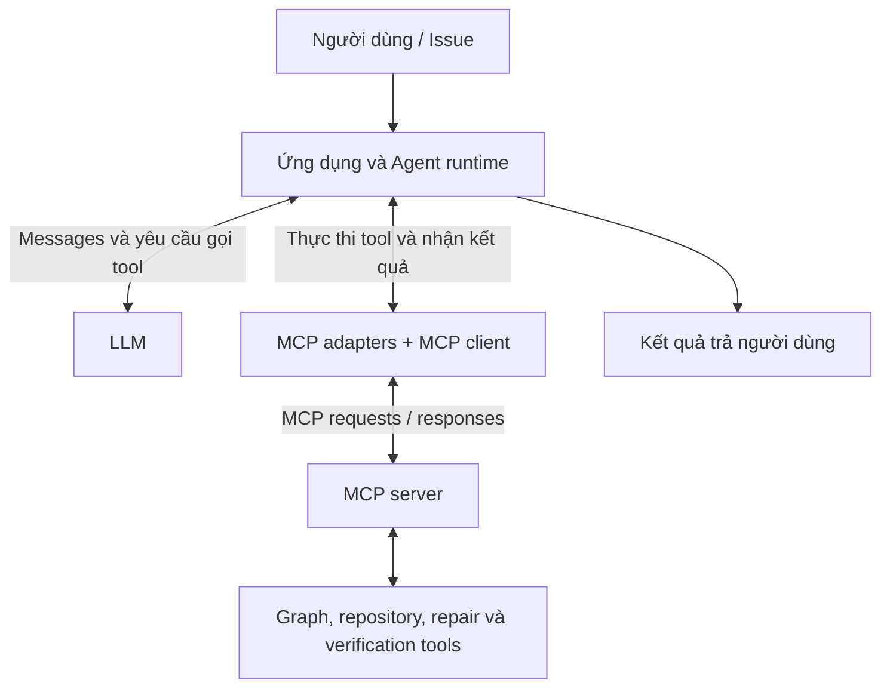
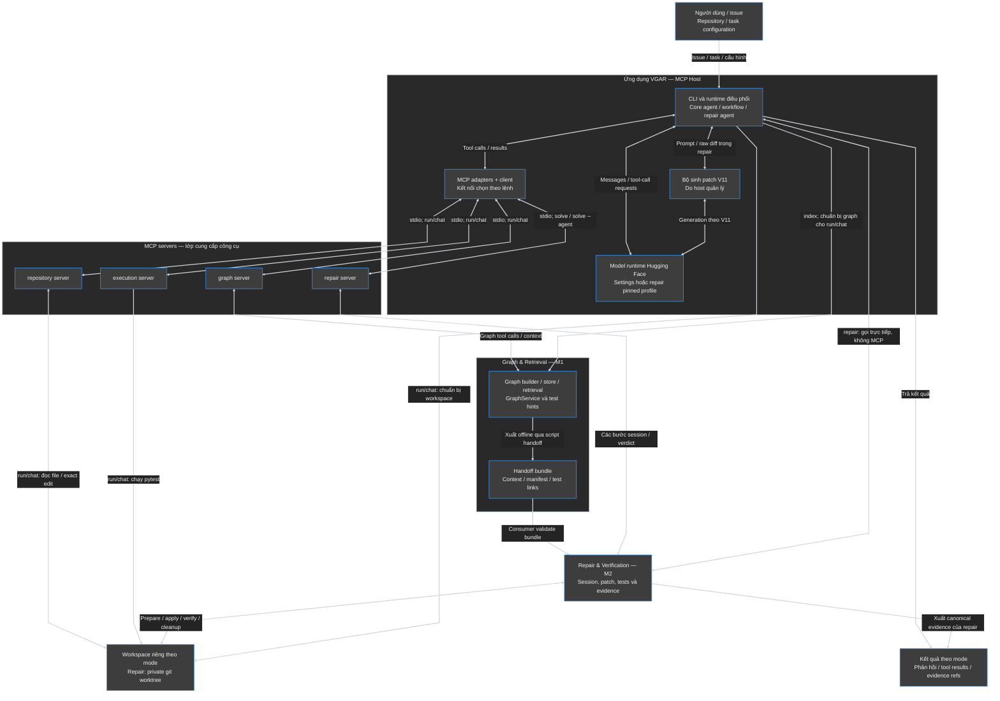
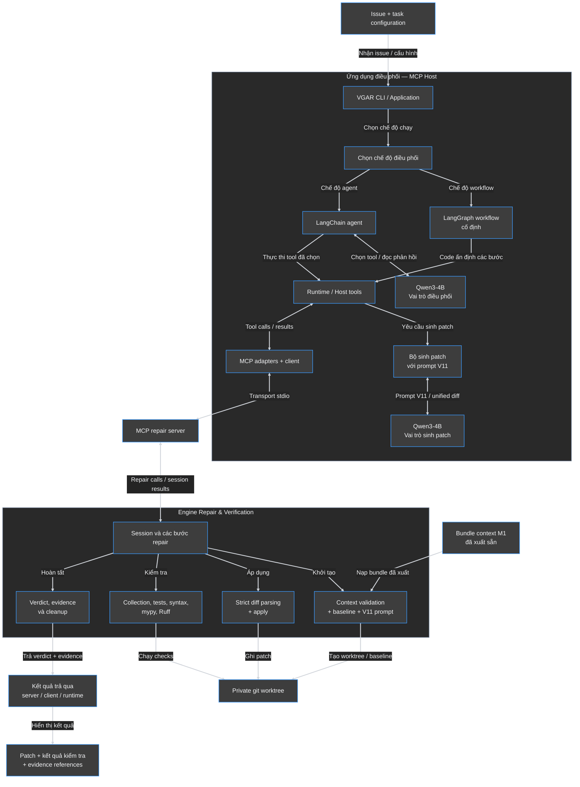

# Báo cáo kiến trúc Agent, LangChain, LangGraph và MCP trong VGAR

## 1. Mục tiêu và kết luận kiến trúc

Báo cáo trả lời ba câu hỏi: sơ đồ sửa lỗi ban đầu đã thể hiện đúng VGAR chưa; Agent, LangChain/LangGraph, LLM và MCP liên hệ thế nào; và nên biểu diễn kiến trúc project ra sao theo code hiện có.

**Kết luận:** sơ đồ ban đầu thể hiện được ý tưởng graph context → model sinh patch → kiểm tra, nhưng chưa đủ để giải thích ranh giới ứng dụng điều phối, model, MCP client/server và engine thực thi. Không nên hiểu nó là một chuỗi duy nhất áp dụng cho mọi lệnh.

Cấu trúc phù hợp để trình bày VGAR là **kiến trúc phân lớp với hai nhánh giao tiếp từ ứng dụng điều phối: gọi model và gọi tools**:

- **M1 — Graph & Retrieval:** xây graph, định vị anchors, chọn/đóng gói context và test hints.
- **M2 — Repair & Verification:** nhận context, chuẩn bị baseline/worktree, xử lý patch, kiểm tra và xuất evidence.
- **M3 — phần tích hợp trong kiến trúc:** CLI, LangChain/LangGraph, MCP adapters/client và các MCP servers kết nối những khả năng trên.
- **Model runtime:** phục vụ vai trò điều phối hoặc sinh patch theo chế độ chạy; không phải MCP server tự quyết định mọi hành động.

Đây là cách mô tả các thành phần đã có, **không phải đề xuất triển khai thêm một hệ thống khác**. Mục 5.1 trình bày hệ thống tổng thể; mục 5.2 khai triển sự phối hợp trong nhánh sửa lỗi. “Phù hợp nhất” ở đây nghĩa là đúng trách nhiệm và luồng code của VGAR, không phải một sơ đồ duy nhất bắt buộc cho mọi ứng dụng LangChain/LangGraph.

## 2. Quan hệ giữa Agent, LLM và MCP

### 2.1. Hai nhánh giao tiếp

`langchain-mcp-adapters` chuyển MCP tools thành tools cho ứng dụng LangChain/LangGraph. Kết nối tới model là một giao diện khác. Vì vậy, không nên mô tả kiến trúc bằng chuỗi bắt buộc `User → Agent → MCP adapters → LLM`.

Quan hệ tổng quát sau không giới hạn ở repair M2:



Runtime gửi messages/thông tin tools cho LLM; LLM trả lời hoặc đề nghị gọi tool. Runtime thực thi yêu cầu đó, nhận kết quả và tiếp tục điều phối. Với MCP tool, lời gọi đi qua adapters/client tới server; LLM không tự mở kết nối MCP. Xem [LangChain Agents](https://docs.langchain.com/oss/python/langchain/agents) và [MCP Architecture](https://modelcontextprotocol.io/docs/learn/architecture).

### 2.2. Vai trò các thành phần trong VGAR

| Thành phần                  | Trách nhiệm                                                                                | Căn cứ code                                                                                                                                                |
| ----------------------------- | -------------------------------------------------------------------------------------------- | ------------------------------------------------------------------------------------------------------------------------------------------------------------ |
| CLI / ứng dụng host         | Nhận lệnh, chuẩn bị môi trường và chọn đường thực thi                           | [cli.py](../src/vgar/cli.py)                                                                                                                                  |
| Core LangChain agent          | Điều phối model và graph/repository/execution tools cho `run`/`chat`                 | [core.py](../src/vgar/agents/core.py)                                                                                                                         |
| LangGraph workflow            | Định nghĩa các node và nhánh chuyển tiếp cố định cho `solve`                    | [workflow.py](../src/vgar/agents/workflow.py)                                                                                                                 |
| Repair LangChain agent + host | Agent chọn tool; host giữ run, prompt, diff và các giới hạn                            | [tool_agent.py](../src/vgar/agents/tool_agent.py)                                                                                                             |
| Model runtime Hugging Face    | Gọi model theo Settings của core hoặc profile được pin của repair                     | [factory.py](../src/vgar/models/factory.py), [agent_generator.py](../src/vgar/agents/agent_generator.py), [models/huggingface](../src/vgar/models/huggingface/) |
| MCP adapters/client           | Chuyển MCP tools sang LangChain tools, gọi server và nhận kết quả                      | [client.py](../src/vgar/mcp/client.py)                                                                                                                        |
| MCP servers                   | Expose các khả năng graph, repository, execution và repair                               | [servers](../src/vgar/mcp/servers/)                                                                                                                           |
| Graph builder/store           | Build graph từ source và lưu snapshot                                                     | [builder.py](../src/vgar/graph/builder.py), [sqlite_store.py](../src/vgar/graph/sqlite_store.py)                                                               |
| GraphService / retrieval      | Truy vấn symbols, grounding, context và test candidates                                    | [sqlite_service.py](../src/vgar/graph/sqlite_service.py), [retrieval.py](../src/vgar/graph/retrieval.py)                                                       |
| Handoff / contracts           | Đóng gói và kiểm tra context, identity, source bindings và test hints giữa các phần | [handoff.py](../src/vgar/graph/handoff.py), [contracts](../src/vgar/contracts/), [context_adapter.py](../src/vgar/repair/context_adapter.py)                    |
| Repair & Verification engine  | Worktree, baseline, strict parse/apply, tests, static checks và evidence                    | [repair](../src/vgar/repair/)                                                                                                                                 |
| Evaluation / observability    | Đánh giá retrieval offline; ghi metadata logs, timing, traces                             | [evaluation/retrieval](../src/vgar/evaluation/retrieval/), [observability](../src/vgar/observability/)                                                         |

LangChain `create_agent` cũng sử dụng LangGraph bên dưới. Khác biệt giữa hai kiểu điều phối là **code định sẵn đường đi hay model chọn hành động**, không phải “dùng LangChain thì không có LangGraph”. Xem [Workflows and agents](https://docs.langchain.com/oss/python/langgraph/workflows-agents).

## 3. Các đường chạy hiện có — không trộn thành một pipeline

| Lệnh                  | Đầu vào và điều phối                               | Kết nối công cụ                                     | Cơ chế sửa/kiểm tra                                                       |
| ---------------------- | --------------------------------------------------------- | ------------------------------------------------------- | ----------------------------------------------------------------------------- |
| `vgar run`           | Query + `--repo`; core LangChain agent                  | `graph`, `repository`, `execution` qua MCP        | Agent dùng tools; CLI có kiểm pytest độc lập khi truyền `--selector` |
| `vgar chat`          | Hội thoại + `--repo`; core LangChain agent            | `graph`, `repository`, `execution` qua MCP        | Tương tác nhiều lượt trên workspace được CLI chuẩn bị             |
| `vgar repair`        | `--task TASK.json`; gọi pipeline trực tiếp           | Không qua MCP repair server                            | Tối đa một generation; strict unified diff và verification                |
| `vgar solve`         | `--task TASK.json`; LangGraph workflow cố định       | Chỉ `repair` server                                  | Tối đa một generation; không có cạnh retry                              |
| `vgar solve --agent` | `--task TASK.json`; repair LangChain agent + host tools | Bốn MCP repair tools và một tool generation cục bộ | Host giới hạn tối đa ba generation; retry bằng run mới và feedback     |

Căn cứ: [cli.py](../src/vgar/cli.py), [core.py](../src/vgar/agents/core.py), [runtime.py](../src/vgar/agents/runtime.py), [tool_agent.py](../src/vgar/agents/tool_agent.py).

Các điểm cần phân biệt:

- `run`/`chat` dùng **core agent**. CLI index source và chuẩn bị workspace trước khi gọi agent. Không tự gán cơ chế V11/strict diff/evidence bundle của repair cho hai lệnh này.
- `repository_apply_patch` của core tools nhận `old_text/new_text` để thực hiện exact-text edit; `repair_apply_patch` nhận unified diff do generator sinh. Hai tên gần giống nhau nhưng input và phạm vi khác nhau.
- `repair`/`solve` nhận task chỉ tới issue, source snapshot và bundle M1; Native execution phải qua trusted-fixture gate và byte hashes trong [registry](../configs/m2/trusted_fixtures.json). Không mô tả chúng như đường Native tự do cho mọi repository.
- Trong repair, `fake` dùng generator kịch bản/reference patch để kiểm tra pipeline; `real` gọi model. Fake PASS không thay thế bằng chứng real repair.
- Các lệnh hỗ trợ như `doctor`, `tools`, `index` phục vụ kiểm tra cấu hình, khám phá tools hoặc build graph; bản thân chúng không chứng minh sửa lỗi thành công.

## 4. Bốn MCP servers và các ranh giới quan trọng

| Server         | Khả năng hiện có                                                          | Được kết nối bởi                                                         |
| -------------- | ----------------------------------------------------------------------------- | ------------------------------------------------------------------------------ |
| `graph`      | Symbols, callers/callees, task anchors, related context và related tests     | Core agent của `run`/`chat`; cũng có thể gọi qua client/script riêng |
| `repository` | Đọc file và áp dụng một exact-text edit                                 | Core agent của `run`/`chat`                                               |
| `execution`  | Chạy pytest selector và trả stdout/stderr/exit code                        | Core agent của `run`/`chat`                                               |
| `repair`     | Mở repair session, nhận/apply diff, chạy tests và hoàn tất verification | Workflow `solve` hoặc repair agent `solve --agent`                        |

Căn cứ: [graph_server.py](../src/vgar/mcp/servers/graph_server.py), [repository_server.py](../src/vgar/mcp/servers/repository_server.py), [execution_server.py](../src/vgar/mcp/servers/execution_server.py), [repair_server.py](../src/vgar/mcp/servers/repair_server.py), [client.py](../src/vgar/mcp/client.py).

**Không có nghĩa một agent mặc định gọi cả bốn server.** Core client chọn `graph/repository/execution`; repair runtime chọn riêng `repair`. Các lời gọi hiện dùng stdio.

Trong luồng repair phối hợp M1–M2–M3:

| Ranh giới                 | Cách hiểu đúng                                                                                                                                 | Căn cứ                                                                                                 |
| -------------------------- | -------------------------------------------------------------------------------------------------------------------------------------------------- | -------------------------------------------------------------------------------------------------------- |
| M1 → repair               | Consumer đọc bundle đã xuất sẵn; không mặc định gọi live graph retrieval trong mỗi repair run                                          | [context_adapter.py](../src/vgar/repair/context_adapter.py)                                               |
| Server → model            | Repair server chuẩn bị prompt và trả cho host; generator phía host/worker gọi model, không phải server trực tiếp sinh diff               | [mcp_repair.py](../src/vgar/agents/nodes/mcp_repair.py), [tool_agent.py](../src/vgar/agents/tool_agent.py) |
| Trước và sau generation | Worktree, collection và baseline có trước generation; patch được apply vào worktree đã có                                               | [session.py](../src/vgar/repair/session.py), `prepare`                                                  |
| Verification → kết quả  | Baseline → post, syntax/mypy/Ruff, integrity và finalization mới quyết định verdict; không chỉ dựa vào lời agent hoặc pytest exit code | [verification.py](../src/vgar/repair/verification.py), [session.py](../src/vgar/repair/session.py)         |
| Failure → evidence        | Run lỗi vẫn lưu record/dữ liệu đã thu thập; lỗi rất sớm có thể chưa đủ điều kiện tạo bundle                                    | [evidence.py](../src/vgar/repair/evidence.py)                                                             |

## 5. Sơ đồ kiến trúc VGAR

### 5.1. Kiến trúc tổng thể theo implementation hiện tại

Sơ đồ phân biệt ứng dụng host, model runtime, MCP delivery, Graph & Retrieval và Repair & Verification. Mỗi ô biểu diễn một nhóm trách nhiệm; các đường là **quan hệ gọi/sử dụng dữ liệu**, không phải một thứ tự chạy duy nhất. Các mode bên trong host được phân biệt ở mục 3 và khai triển trong sơ đồ chi tiết phía dưới.



**Cách đọc đúng:**

- CLI chọn đường chạy; `solve` và `solve --agent` không nối tiếp nhau. `repair` gọi trực tiếp engine, không đi vòng qua MCP.
- Ô model là **nhóm backend logic**, không hàm ý mọi lệnh dùng cùng instance hoặc cùng revision. Core dùng Settings/model factory; repair dùng profile được pin.
- MCP client trong hình biểu diễn lớp kết nối chung; mỗi đường chạy tạo/chọn kết nối riêng như mục 4, không phải một client luôn mở cả bốn server. Ô workspace cũng là một loại thành phần, không phải cùng một thư mục dùng cho tất cả các run.
- Graph server có thể trả context qua tools cho core agent. **Handoff cho repair là một đường khác:** kết quả M1 được xuất offline qua [export_m1_handoff.py](../scripts/export_m1_handoff.py), rồi consumer repair validate bundle. Không vẽ một kết nối live graph → repair mà code chưa tự thực hiện.
- [Evaluation offline](../src/vgar/evaluation/retrieval/) và observability là các phần hỗ trợ đã nêu ở mục 2 và 7; không vẽ chúng thành những bước bắt buộc của mỗi yêu cầu agent. Đánh giá retrieval không đồng nghĩa chạy LLM sửa SWE-bench.
- Logs instrumentation là metadata/timing/traces; prompt, raw diff và command evidence chi tiết thuộc artifacts tương ứng. Không coi mọi mode đều xuất cùng loại evidence bundle.

### 5.2. Chi tiết phối hợp M1–M2–M3 trong luồng sửa lỗi

Sơ đồ khai triển nhánh sửa lỗi của VGAR: context từ M1, ứng dụng điều phối và MCP của phần tích hợp M3, cùng engine Repair & Verification của M2. Nó mô tả sự phối hợp giữa các phần, không phải một đường chạy đại diện cho mọi lệnh CLI.

Trong hình này, `solve` và `solve --agent` đi qua MCP repair server; `repair` gọi engine trực tiếp như sơ đồ tổng thể ở trên.



**Cách đọc:**

- Mũi tên hai chiều biểu diễn lời gọi/phản hồi; nhãn đường nối cho biết quan hệ giữa hai ô.
- Các nhánh từ session là quan hệ gọi chức năng, **không thể hiện chạy song song**. Thứ tự thực thi xem mục 6.
- Nhóm MCP Host biểu diễn trách nhiệm của ứng dụng, không khẳng định mọi ô nằm trong cùng một process. Kết quả tools trở về qua session → server → client/adapters → runtime.

### 5.3. Model và prompt: phân biệt theo vai trò

Trong core agent, [model factory](../src/vgar/models/factory.py) dùng [Settings](../src/vgar/config/settings.py). Với luồng repair, profile hiện pin `Qwen/Qwen3-4B-Instruct-2507`, revision `cdbee75f17c01a7cc42f958dc650907174af0554`. Hai ô Qwen trong sơ đồ chi tiết ở mục 5.2 biểu diễn hai vai trò, không bắt buộc hai model instances hoặc hai agent độc lập:

| Vai trò                             | Đầu vào/prompt                                                                                               | Đầu ra                                     |
| ------------------------------------ | --------------------------------------------------------------------------------------------------------------- | -------------------------------------------- |
| Core agent của `run`/`chat`     | [system.md](../src/vgar/agents/prompts/system.md), query/hội thoại và kết quả tools                         | Tool requests hoặc phản hồi người dùng |
| Điều phối trong `solve --agent` | [repair_agent.md](../src/vgar/agents/prompts/repair_agent.md), messages và phản hồi tools                     | Yêu cầu gọi tool hoặc kết thúc         |
| Sinh patch                           | [repair_v11.txt](../src/vgar/agents/prompts/repair_v11.txt) cùng issue, context, baseline và feedback nếu có | Raw unified diff để parser M2 kiểm tra    |

V11 cố định **template**, không cố định toàn bộ nội dung prompt của mọi task. [prompt.py](../src/vgar/repair/prompt.py) lắp dữ liệu từng run vào template.

| Generator trong `solve --agent` | Cách dùng model                                                                                |
| --------------------------------- | ------------------------------------------------------------------------------------------------ |
| `--generator worker`            | Worker riêng sinh diff; model điều phối và model trong worker có thể cùng tồn tại      |
| `--generator agent`             | Dùng lại model đã nạp cho agent để sinh diff với thiết lập generation dành cho repair |

Căn cứ: [demo.json](../configs/m2/demo.json), [tool_agent.py](../src/vgar/agents/tool_agent.py), `select_generator`, và [agent_generator.py](../src/vgar/agents/agent_generator.py). **Giới hạn hiện có:** `AgentModelGenerator.generate` chạy trong process hiện tại và chưa cưỡng chế tham số `timeout_seconds`; không nên suy ra hai lựa chọn có cơ chế timeout giống nhau. Với `solve` cố định, code quyết định các bước; không có lượt model chọn tool.

### 5.4. M1 tạo và bàn giao context thế nào?

M1 build graph và lưu snapshot qua [builder.py](../src/vgar/graph/builder.py), [sqlite_store.py](../src/vgar/graph/sqlite_store.py). [GraphService](../src/vgar/graph/sqlite_service.py) cung cấp grounding/retrieval và test hints; [handoff.py](../src/vgar/graph/handoff.py) xuất context gắn với source snapshot. Graph factory hiện có backend `demo` và `sqlite`, không tự suy ra đang sử dụng một graph database khác.

Ở phía repair, [load_handoff](../src/vgar/repair/context_adapter.py) đọc:

- `context.json`: snippets và metadata context.
- `context_manifest.json`: identity, source bindings và hashes.
- `test_links.json`: test hints và dữ liệu fallback.

Consumer kiểm tra bundle với task/source, sau đó M2 dựng prompt và chọn tests. Bundle mẫu nằm tại [examples/m2/handoffs](../examples/m2/handoffs/). Đây là cách M1–M2 phối hợp trong luồng hiện tại; không phải live retrieval trong mỗi repair run.

## 6. Luồng thực thi theo từng đường chạy

### 6.1. Chuẩn bị Graph & Retrieval

1. Build graph từ source và lưu snapshot qua `vgar index` hoặc [build_graph.py](../scripts/build_graph.py).
2. Gọi grounding/retrieval để lấy anchors, context và test hints theo snapshot, repository root và tokenizer cấu hình.
3. Khi bàn giao cho repair, dùng script export để tạo bundle; đây là bước được thực hiện riêng, không tự xuất hiện trong mọi `solve`.
4. Khi đánh giá retrieval offline, dùng các scripts BM25/Graph và comparison để lưu metrics/report. Nhánh này không apply patch.

Căn cứ: [graph/factory.py](../src/vgar/graph/factory.py), [sqlite_service.py](../src/vgar/graph/sqlite_service.py), [export_m1_handoff.py](../scripts/export_m1_handoff.py), [compare_graph_vs_bm25.py](../scripts/compare_graph_vs_bm25.py).

### 6.2. Core agent: `run` và `chat`

1. CLI index repository, chuẩn bị workspace và cung cấp đường dẫn workspace trong prompt.
2. Core agent được tạo từ model factory, system prompt và graph/repository/execution tools.
3. Agent trao đổi với model; runtime thực thi tool requests qua MCP khi cần.
4. Repository tools đọc/exact-edit file; execution tool chạy pytest tại `repo_path` được truyền.
5. CLI trả lời/trace. Riêng `run` có kiểm pytest độc lập khi có `--selector`; không tự gán full M2 verdict cho `run`/`chat`.

Đường core tools nhận tham số `repo_path`; không đồng nhất với host-bound, argument-less repair tools. Căn cứ: [cli.py](../src/vgar/cli.py), `sandbox`, `cmd_run`, `cmd_chat`; [core.py](../src/vgar/agents/core.py).

### 6.3. Luồng sửa lỗi phối hợp M1–M2–M3

```text
1. Nạp task, issue, source snapshot và bundle M1
2. Kiểm trusted fixture, identity, source và context
3. Tạo private git worktree
4. Chạy collection, tests và static checks baseline; xác nhận baseline đủ điều kiện
5. Dựng prompt V11 từ issue, context, baseline và feedback nếu có
6. Gọi generator → nhận raw unified diff
7. Parse, kiểm paths/counts và exact source binding
8. Git apply trong worktree; kiểm bytes đã áp dụng
9. Chọn tests, collection và chạy tests sau patch
10. Chạy syntax, mypy, Ruff; đánh giá baseline → post và bảo vệ source/config
11. Hoàn tất integrity, cleanup và xuất record/evidence
12. Runtime nhận verdict và trả kết quả cùng artifact references
```

Baseline đủ điều kiện **không có nghĩa các tests đều PASS**: phải quan sát lỗi cần sửa trước generation. Post-patch phải làm các required tests đạt PASS và giữ các tests đã PASS ở baseline tiếp tục PASS. Xem [capture_baseline và assess_transition](../src/vgar/repair/verification.py).

### 6.4. Năm host tools và bốn MCP repair tools

| Tool của agent          | Đường thực thi                                              | Tác dụng                                                      |
| ------------------------ | --------------------------------------------------------------- | --------------------------------------------------------------- |
| `get_task_context()`   | MCP `repair_get_task_context`                                 | Mở run; kiểm bundle, chuẩn bị worktree, baseline và prompt |
| `generate_patch()`     | Cục bộ phía host; **không có MCP tool tương ứng** | Gọi generator và giữ diff trong host                         |
| `apply_patch()`        | MCP `repair_apply_patch`                                      | Ghi generation, parse và apply diff                            |
| `run_relevant_tests()` | MCP `repair_run_relevant_tests`                               | Chọn và thực thi tests sau patch                             |
| `verify_patch()`       | MCP `repair_verify_patch`                                     | Hoàn tất checks, verdict, cleanup và evidence                |

Trong `solve --agent`, host gắn run/path/diff vào lời gọi; repair agent thấy tools không có tham số và không tự cung cấp các giá trị đó. Tiền tố `repair_` do client đặt theo tên kết nối. Mapping: [tool_agent.py](../src/vgar/agents/tool_agent.py), `langchain_tools`; [client.py](../src/vgar/mcp/client.py); [repair_server.py](../src/vgar/mcp/servers/repair_server.py).

Repair session được lưu tại `<run-dir>/session.json`, cạnh `run_record.json`, để bước sau nạp lại dù MCP process mới được mở. Đây là persistence của repair session trong [session.py](../src/vgar/repair/session.py), không phải bằng chứng outer workflow đã cấu hình LangGraph checkpointer.

### 6.5. Retry trong repair agent mode

```text
Attempt thất bại
→ verify/đóng run cũ
→ host đọc record và tạo feedback
→ mở run mới, liên kết supersedes_run_id
→ dựng V11 với feedback và sinh patch mới nếu còn lượt
```

Host tạo feedback từ kết quả thực thi, không lấy lời giải thích tự do của agent làm bằng chứng lỗi. Giới hạn hiện tại là **ba lượt generation** và **15 tool calls do agent đề nghị**; các lời gọi nội bộ của host không đồng nhất với bộ đếm này. Host còn gọi verify để đóng run mà agent bỏ dở. Workflow `solve` cố định không có nhánh retry.

Căn cứ: [tool_agent.py](../src/vgar/agents/tool_agent.py), `MAX_ATTEMPTS`, `MAX_TOOL_CALLS`, `generate_patch`, `close`; [feedback.py](../src/vgar/agents/feedback.py).

## 7. Kết quả, verification và evidence

### 7.1. Verdict của luồng repair

M2 ánh xạ trạng thái **`PASS → ACCEPT`, `FAIL → REVISE`, `ERROR → REJECT`**. Trong `solve --agent`, `_result` chỉ trả `COMPLETED` khi verify trả `ACCEPT` và source gốc không đổi. Lời trả lời của agent không quyết định PASS.

| Nội dung                                              | Code/vị trí                                                        |
| ------------------------------------------------------ | -------------------------------------------------------------------- |
| Baseline → post, required tests và regression        | [verification.py](../src/vgar/repair/verification.py)                 |
| Syntax, mypy, Ruff                                     | [static_checks.py](../src/vgar/repair/static_checks.py)               |
| Integrity, cleanup và xuất evidence                  | [session.py](../src/vgar/repair/session.py), `finish`               |
| Mapping verdict                                        | [pipeline.py](../src/vgar/repair/pipeline.py), `recommendation_for` |
| Kết quả agent                                        | [tool_agent.py](../src/vgar/agents/tool_agent.py), `_result`        |
| Output mặc định của `repair`                     | `results/repair/<run-id>/`                                         |
| Output mặc định của `solve`, kể cả `--agent` | `results/solve/<run-id>/`                                          |
| Agent traces                                           | `<output-root>/agent-traces/`                                      |

Có thể đổi thư mục output bằng `--output-root`. Mỗi run lưu artifacts theo các bước thực sự đã thực hiện:

- `prompt.txt`, `raw_model_output.txt`: đầu vào generation và output gốc.
- `candidate.diff`, `applied.diff`: patch ứng viên và diff đã áp dụng.
- `run_record.json`: canonical record, stage results, lệnh, stdout/stderr, timing và lỗi.
- `evidence_bundle.json`: bằng chứng tổng hợp và liên kết record, nếu đủ điều kiện tạo.
- `REPORT.md`: bản tóm tắt dễ đọc.

Run lỗi sớm có thể thiếu artifacts của các bước chưa chạy; `NOT_RUN` không phải PASS. PASS chứng minh patch đạt các kiểm tra đã thực hiện, **không chứng minh semantic correctness cho mọi đầu vào**.

### 7.2. Kết quả của các nhánh khác

- **Core agent:** phản hồi, tool trace và kết quả execution tools; `cmd_run` kiểm pytest độc lập nếu có selector. Không coi mọi lời trả lời core agent là verdict `ACCEPT` của repair.
- **Graph/retrieval/handoff:** graph snapshots, context payload, test hints và bundle đã validate; export thành công không chứng minh tests đã chạy.
- **Evaluation offline:** metrics và `result.json`/`REPORT.md` theo run. Retrieval scores không phải resolved rate sửa lỗi.
- **Observability:** [instrumentation.py](../src/vgar/observability/instrumentation.py), [phase_logger.py](../src/vgar/observability/phase_logger.py) và [graph_trace.py](../src/vgar/observability/graph_trace.py) ghi metadata theo cơ chế tương ứng. Nội dung nhạy cảm được tóm tắt/lọc trong instrumentation; không nên hứa mọi logger chứa toàn bộ raw prompt/source.

## 8. Tài liệu tham khảo và cách đọc

### Nguồn chính thức

1. [LangChain — Agents](https://docs.langchain.com/oss/python/langchain/agents): model, tools và vòng tương tác agent.
2. [LangGraph — Workflows and agents](https://docs.langchain.com/oss/python/langgraph/workflows-agents): workflow định sẵn và agent quyết định động.
3. [langchain-mcp-adapters 0.3.2](https://pypi.org/project/langchain-mcp-adapters/0.3.2/): phiên bản được pin trong [pyproject.toml](../pyproject.toml), chuyển MCP tools sang LangChain tools.
4. [MCP — Architecture overview](https://modelcontextprotocol.io/docs/learn/architecture): host, client, server và giao tiếp công cụ.

Mô tả implementation trong báo cáo bám code được dẫn, không suy ra VGAR đã có mọi tính năng mà framework hỗ trợ. Hướng dẫn chạy dự án nằm tại [README](../README.md) và [RUNBOOK](RUNBOOK.md).

**Xem sơ đồ khi gửi riêng file:** cả ba sơ đồ là Mermaid nằm trực tiếp trong `.md`, không cần ảnh kèm theo; người nhận cần trình Preview hỗ trợ Mermaid.
