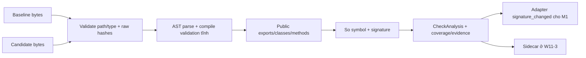
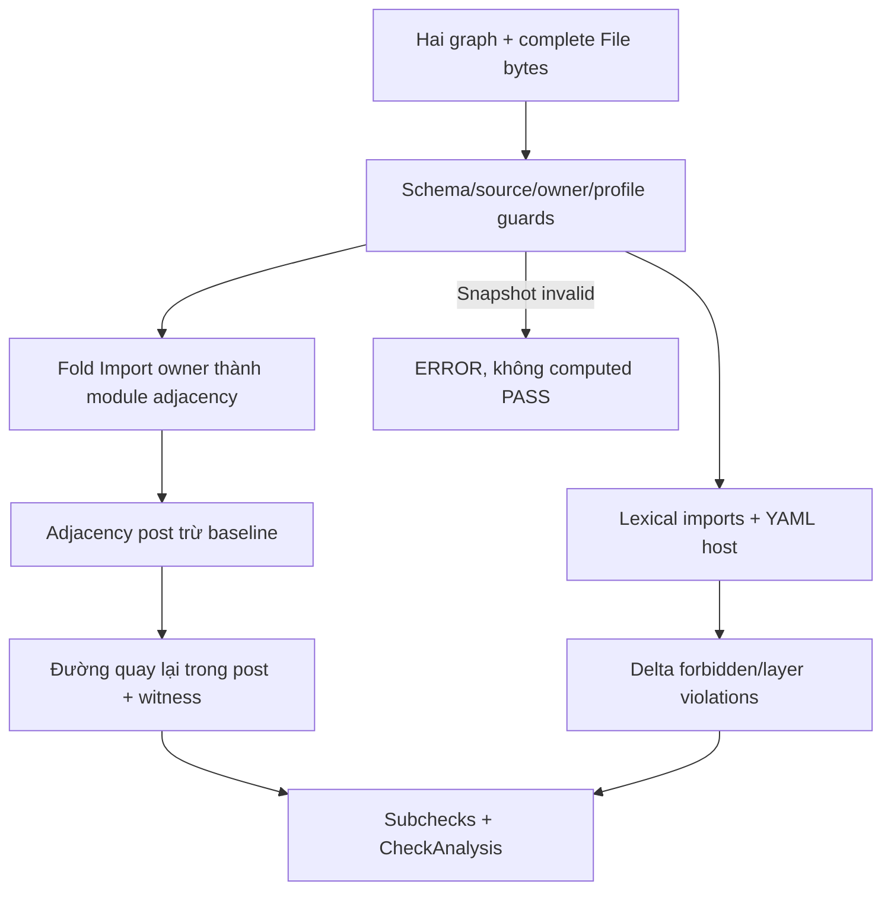
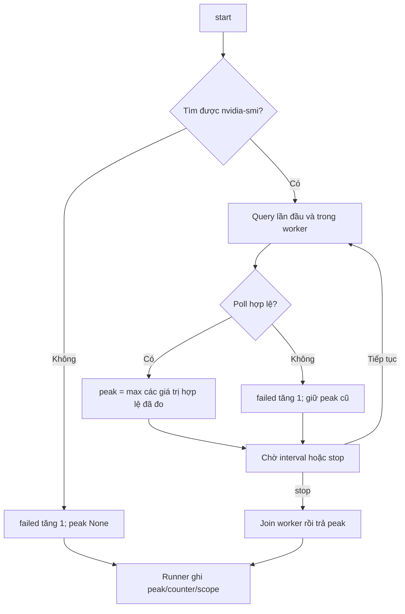
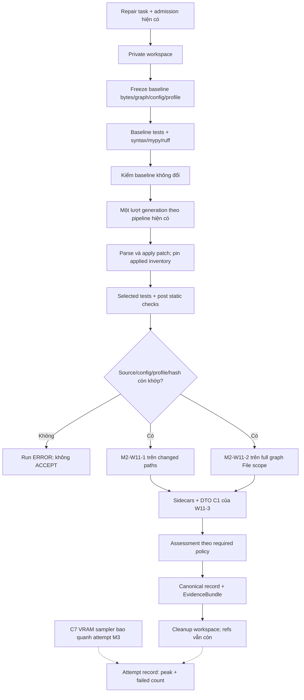

# Báo cáo tổng hợp M2-W11-1/2/3 và C7/D14

**Repository:** `D:\Project\CAPSTONES\VGAR`  
**Phiên bản được rà soát:** `32fd47237b380551ecf3abb32e84c7359c8d044a` (`32fd4723`).  
**Nhánh local:** `m2/w11-checkers-evidence-c7-20261102`.  
**Ngày triển khai các task:** 02/11/2026.  
**Phạm vi báo cáo:** API compatibility, structural checks, evidence/pipeline integration và VRAM sampler.  
**Ngôn ngữ:** Tiếng Việt. Các tên API, mã lỗi và tham số lệnh giữ nguyên theo code.

> Báo cáo tổng hợp **kết quả đã thực hiện**, không phải đề xuất triển khai. Số liệu được đối chiếu với source, `docs/status/m2.md`, JSON kết thúc task, log/JUnit và lịch sử lệnh của phiên làm việc. Việc lập báo cáo chỉ thêm file Markdown này; không chạy lại campaign/model/Docker, không sửa code hay ghi thêm trạng thái nghiệm thu.

## Mục lục

1. [Kết luận và trạng thái](#1-kết-luận-và-trạng-thái)
2. [Căn cứ và thuật ngữ](#2-căn-cứ-và-thuật-ngữ)
3. [Kết quả kiểm thử và số liệu](#3-kết-quả-kiểm-thử-và-số-liệu)
4. [M2-W11-1: API compatibility](#4-m2-w11-1-api-compatibility)
5. [M2-W11-2: Structural check](#5-m2-w11-2-structural-check)
6. [M2-W11-3: Evidence và pipeline](#6-m2-w11-3-evidence-và-pipeline)
7. [C7/D14: VRAM sampler](#7-c7d14-vram-sampler)
8. [Flow tổng thể](#8-flow-tổng-thể)
9. [Danh mục file/folder và quyền sở hữu](#9-danh-mục-filefolder-và-quyền-sở-hữu)
10. [Artifact, log và result](#10-artifact-log-và-result)
11. [Môi trường và cách tự chạy](#11-môi-trường-và-cách-tự-chạy)
12. [Bảo toàn dữ liệu và lịch sử Git](#12-bảo-toàn-dữ-liệu-và-lịch-sử-git)
13. [Giới hạn và bàn giao](#13-giới-hạn-và-bàn-giao)
14. [Nguồn đối chiếu](#14-nguồn-đối-chiếu)
15. Phụ lục A: toàn bộ 38 lượt lệnh pytest đã khôi phục, kèm mục đích/kết quả.
16. Phụ lục B: lệnh lint, whitespace, demo và kiểm tra artifact.

## 1. Kết luận và trạng thái

| Phần việc | Trạng thái kỹ thuật đã xác nhận | Kết quả chính | Phần còn chờ |
|---|---|---|---|
| **M2-W11-1** | **DONE kỹ thuật** | Checker AST public export/signature; adapter tạo bản sao `ImpactReport` với feature `signature_changed`; 71 case API PASS | M1 human review và nối adapter vào đường impact chung với binding đúng source/patch; CI/merge của nhóm |
| **M2-W11-2** | **DONE kỹ thuật** | Kiểm cycle mới, forbidden import và layer so với baseline; YAML/schema và 120 case structural PASS | M1 human review, CI/merge; policy kiến trúc cho repo thật nếu nhóm muốn bật các rule tương ứng |
| **M2-W11-3** | **DONE kỹ thuật** | DTO C1, sidecar thật, baseline/candidate binding và tích hợp verification dùng chung batch/session/MCP | Review C1/C2 của **M1, M2, M3**, CI/merge; A3 là task riêng, chưa bật |
| **C7/D14** | **DONE kỹ thuật** | Giữ peak hợp lệ qua mẫu lỗi, thêm `samples_failed`, giữ `stop() -> int \| None`; runner hiện có đọc được counter | M3 human review/merge trước GPU W12; số đo GPU/model thật thuộc run M3 |

**DONE kỹ thuật** nghĩa là implementation và các gate của task đã chạy đạt, có evidence và tài liệu bàn giao. Điều này không đồng nghĩa đã có đủ human review, đã merge vào `main`, hay đã có kết quả SWE-bench/model trên population thực nghiệm.

Các điểm cần hiểu đúng:

- Hai checker đã được nối vào evidence chung qua W11-3. Các câu “chưa nối evidence” trong tài liệu W11-1/2 là **trạng thái lịch sử tại thời điểm đóng từng task**.
- API/structural là **supplemental** ở A0–A2. Check có thể mang `FAIL`, `ERROR` hoặc `NOT_RUN` trong evidence mà không tự đổi quyết định của A0–A2; status đó không bị đổi thành `PASS`.
- `signature_changed` đã có adapter phía M2. Chưa thể tuyên bố mọi đường impact API/MCP của M1 đều trả feature này: producer chung còn cần M1 tích hợp.
- Các demo của báo cáo là synthetic/trusted fixtures. Không dùng chúng làm số liệu repair success, FAR/FRR hay VRAM của model thật.
- **Không triển khai M2-W12-1/A3, mutant pool, D15 hoặc task kế tiếp trong bốn phần việc này.**

### 1.1. Vì sao `Task Status.md` còn khác với báo cáo M2?

`D:\Project\CAPSTONES\VGAR\docs\status\m2.md`, mục 6.1–6.4, đã ghi các trạng thái trên. File `D:\Project\CAPSTONES\VGAR\Task Status.md` chưa được cập nhật trong đợt M2 này vì phân công quy định **chỉ M3 sửa bảng chung**. Các dòng API/structural trong bảng chung vẫn còn CT và phần giới thiệu vẫn nói chưa có code; đó là thông tin chưa đồng bộ.

Không nhầm hai hệ mã:

| Mã theo deliverables/task đã làm | Nội dung | Mã bảng W11–12 liên quan |
|---|---|---|
| M2-W11-1 | API compatibility | `W11-12-M2-01` |
| M2-W11-2 | Structural check | `W11-12-M2-02` |
| **M2-W11-3** | **Evidence API/structural** | Không phải dòng `W11-12-M2-03` |
| M2-W12-1, chưa triển khai | A3 | `W11-12-M2-03` của bảng chung |
| C7/D14 | Sampler và bàn giao counter VRAM | Phần bổ trợ M2, consumer runner thuộc M3 |

## 2. Căn cứ và thuật ngữ

Thứ tự căn cứ đã dùng: deliverables W9–W16 → phân công song song W11–W12 → spec kỹ thuật → quyết định đã được người dùng chốt → code/evidence thực tế. Một điểm đã được làm rõ khi duyệt plan: **thiếu structural config vẫn chạy cycle rule; forbidden/layer `NOT_RUN` riêng**. Vì deliverables và spec diễn đạt khác nhau, báo cáo ghi rõ quyết định này, không giả rằng hai subcheck đã chạy.

| Thuật ngữ | Nghĩa trong implementation |
|---|---|
| Baseline | Source/graph/test outcomes trước candidate patch, được chụp trong private workspace |
| Candidate/post | Source sau apply, được bind với inventory/hash của bytes thực sự đã apply |
| Source scope | Các path production được task cho phép; không suy rằng đó là toàn bộ repo/runtime |
| Snapshot binding | Ràng buộc đúng repo/revision/path/scope, source bytes, graph/profile và config bằng kiểm tra/hash |
| Sidecar | File JSON chi tiết nằm ngoài workspace tạm; DTO dùng `details_ref` để trỏ tới |
| Availability | Có đủ dữ liệu để kết luận hay không; unknown không phải giá trị đo bằng 0/false |
| Supplemental check | Được lưu evidence nhưng chưa phải điều kiện bắt buộc của policy đang dùng |
| Required check | Kết quả phải đủ và đạt; `ERROR`/`NOT_RUN` không được coi là PASS |
| Synthetic fixture | Input nhỏ/đáp án hoặc output được kiểm soát để kiểm tính đúng; không phải run thực nghiệm model |

Implementation của W11-1/2 bắt đầu tại `d018cca5`. W11-3 và C7/D14 dùng base `22212454` sau merge cập nhật static-line-map/M3. Commit `32fd4723` tập hợp các thay đổi để push sang nhánh riêng; không phải bằng chứng đã merge vào `main`.

## 3. Kết quả kiểm thử và số liệu

### 3.1. Các gate kết thúc task

| Task | Gate cuối đã chạy | PASS | SKIP | XFAIL | FAIL/ERROR | Thời lượng console |
|---|---|---:|---:|---:|---:|---:|
| W11-1 | `tests/m2` + impact + GPU/runner, offline markers | 692 | 16 | 0 | 0/0 | 488,70 giây |
| W11-2 | Cùng nhóm regression, có structural mới | 812 | 16 | 0 | 0/0 | 487,40 giây |
| W11-3 | **Offline toàn repo**, không truyền danh sách test path | 1.795 | 18 | 1 | 0/0 | 1.986,31 giây = **33 phút 06 giây** |
| C7/D14 | GPU + runner + `tests/m2/w1112` | 313 | 0 | 0 | 0/0 | **7,53 giây** |
| Trước push `32fd4723` | Chạy lại cùng nhóm C7/W11 | 313 | 0 | 0 | 0/0 | 6,34 giây |

Nguồn chính là `tests/regression-final.log/xml` của W11-1/2, `offline.log/xml` của W11-3, `final.log/xml` của C7 và log trong TEMP của lần trước push. JSON kết thúc ghi thời gian JUnit W11-1 là 488,677 giây, W11-2 là 487,373 giây; chênh lệch vài phần trăm giây so với dòng console là do cách ghi thời lượng, không phải hai run khác nhau.

**Không cộng 692 + 812 + 1.795 + 313 thành số test độc lập.** Các gate chồng lặp; suite cũng tăng dần trong quá trình triển khai. Full offline 1.795 PASS được chạy **trước C7**, không được trình bày thành full-suite run sau C7.

### 3.2. Phân bố test chuyên biệt

| File/nhóm | Số case đã PASS ở trạng thái cuối liên quan |
|---|---:|
| `tests/m2/w1112/test_api_check.py` | 71 |
| `tests/m2/w1112/test_structural_check.py` | 120 |
| `tests/m2/w1112/test_evidence_contract.py` | 41 |
| `tests/m2/w1112/test_evidence_checks.py` | 33 |
| **Tổng `tests/m2/w1112`** | **265** |
| W11-3 integration mới trong `tests/m2/w78/test_w1112_evidence_integration.py` | 4, có trong full offline W11-3 |
| `tests/m3/test_gpu.py` sau C7 | 29: 3 case cũ mở rộng + 26 case mới |
| `tests/m3/test_runner.py` trong gate C7 | 19 |
| **Gate C7** | **265 + 29 + 19 = 313** |

W11-3 thêm **78 case** vào full gate tại thời điểm đó: 41 contract + 33 collector/policy + 4 integration. Các file test này kiểm cả trường hợp cố ý checker trả FAIL/ERROR; một pytest case PASS có nghĩa code trả đúng kết quả mong đợi, không có nghĩa mọi candidate đều được checker chấp nhận.

### 3.3. Skip, XFAIL và phạm vi lựa chọn

- 16 skip ở các gate W11-1/2: 10 giới hạn POSIX/symlink/mode, 1 thiếu `vermin`, 4 real-Docker opt-in, 1 quyền tạo symlink Windows.
- Full offline W11-3 có thêm 2 skip: môi trường không tạo được symlink và thiếu `matplotlib`; tổng 18.
- Một XFAIL là B01 đã có trước đợt task này: test HF còn kỳ vọng `generation_config` được truyền vào pipeline. Không sửa/tạo XFAIL để che lỗi mới.
- Gate B10 có `-k`, đạt 3 PASS/20 deselected. Review DTO có `-k 'not passing_repair and not invalid_diff'`, đạt 48 PASS/2 deselected để chỉ chạy phần không cần private Git workspace trong sandbox. Đây là **gate chọn lọc**, không được gọi là toàn suite. Hai case native không được chọn ở bước DTO vẫn nằm trong regression đầy đủ sau đó.
- Các gate kết thúc task không thêm deselect để làm xanh lỗi. Marker offline loại nhóm `hf`/`docker`; các real-Docker opt-in không mang marker vẫn tự skip theo cơ chế có sẵn.

### 3.4. Lint, thời gian và review

- W11-1/2: lint phần triển khai và whitespace PASS theo artifact từng task.
- W11-3: DTO/collector/integration/tests mới PASS Ruff; **0 diagnostic mới** theo lint delta. Full Ruff trên danh sách có `patch.py` vẫn exit 1 vì **E731 cũ tại lambda `quote`**, nằm trên dòng không đổi. Không tuyên bố cả repo đã sạch lint.
- C7: Ruff `gpu.py` và `test_gpu.py` PASS; whitespace PASS.
- Whitespace repo dùng `git -c core.whitespace=cr-at-eol diff --check` vì có blob CRLF cũ. Đây không phải bỏ qua trailing spaces tùy ý.
- Mục tiêu CI dưới 10 phút **chưa đạt ở full offline W11-3 trên Windows**. Gate C7 7,53 giây là gate hẹp, không chứng minh full CI dưới 10 phút.
- Review tự động đã thực hiện, có findings được sửa bằng RED→GREEN. Chưa tự ghi human approval hoặc kết quả CI trên GitHub.

## 4. M2-W11-1: API compatibility

### 4.1. Yêu cầu và đầu vào/đầu ra

Mục tiêu là phát hiện patch làm mất public API hoặc không tương thích cách gọi hiện có, chỉ bằng phân tích tĩnh. Hai mapping `path -> bytes` biểu diễn baseline và candidate; path chỉ có một phía được hiểu là thêm/xóa file, không phải đọc thiếu do lỗi I/O.

```python
check_api(before, after, *, callers_in_repo=None) -> CheckAnalysis
with_api_risk(report, analysis) -> ImpactReport
```

`CheckAnalysis` là frozen dataclass nội bộ với `status`, tuple `reasons`, `details` JSON-ready. Checker nhận POSIX relative path `.py`, bytes thật; input sai boundary raise `ValueError`. Source parse/compile lỗi trả analysis `ERROR`. Checker không import dependency, thực thi decorator/default expression hay apply patch.

### 4.2. Phương pháp đã triển khai

1. Validate và copy thông tin đầu vào, giữ raw source hash cho từng path/phía.
2. Parse AST; compile AST để kiểm syntax/scope tĩnh mà `ast.parse` có thể chưa chặn, như tham số trùng, `return` ngoài hàm. **Không chạy code object**.
3. Xác định public exports: `__all__` literal list/tuple; nếu không có thì tên không bắt đầu `_`.
4. Thu declaration ở module, public class, public method và constructor. Không coi nested local function là API module.
5. So symbol/export và signature. Ghi before/after, symbol, dòng, loại thay đổi và chi tiết mất tương thích.
6. Gộp kết quả theo **ERROR > NOT_RUN > FAIL > PASS**; vẫn giữ break đã tìm thấy khi còn unknown ở phần khác.

| Thay đổi | Xử lý |
|---|---|
| Xóa symbol/export; bỏ tên khỏi `__all__` | FAIL / `API_SYMBOL_REMOVED` |
| Thêm required parameter, bỏ/reorder positional, mất default | FAIL / `API_SIGNATURE_INCOMPATIBLE` |
| Mất keyword/keyword-only hoặc khả năng gọi qua `*args`/`**kwargs` đã hỗ trợ | FAIL, có incompatibility evidence |
| Thêm optional parameter có default | Tương thích trong phạm vi checker; signature vẫn có thể đã đổi |
| Chỉ sửa thân hàm/private implementation | Tương thích |
| Đổi annotation/default expression | Ghi signature change; không tự suy ra breaking semantic type |
| Dynamic exports/re-export chưa resolve/assigned callable không biết signature | NOT_RUN, diagnostics cụ thể |
| Source lỗi syntax/scope | ERROR / `API_PARSE_ERROR` |
| Cả scope rỗng | NOT_RUN / `API_EMPTY_SCOPE` |

`callers_in_repo=None` là chưa có thông tin; `{}` là tập rỗng đã cung cấp. Đây chỉ là diagnostic. Không thấy caller không làm một API break trở thành hợp lệ.

### 4.3. Signature change khác API break

Từ `api_demo.json` chạy checker thật trên fixture:

| Case | Checker | `signature_changed` |
|---|---|---|
| `body_only` | PASS | available=true, value=false |
| `compatible_signature` | PASS | available=true, value=true |
| `breaking_signature` | FAIL / `API_SIGNATURE_INCOMPATIBLE` | available=true, value=true |
| `dynamic_exports` | NOT_RUN | available=false, value=null; có `API_DYNAMIC_EXPORTS` và change evidence |

`with_api_risk()` tạo bản sao `ImpactReport` đã validate và chỉ điền feature `signature_changed`. Unknown dùng `NOT_COMPUTED` theo enum impact hiện có; nguyên nhân chi tiết vẫn ở API analysis. Caller phải bind đúng snapshot/patch. M2 không tự sửa graph producer/MCP hoặc impact contract thuộc M1.

### 4.4. TDD và review

Lần đầu import module chưa có gây collection ERROR; sau chỉnh test boundary đã có RED assertion rõ ràng. Implementation đầu đạt 51 PASS, bổ sung export cases tạo 3 FAIL rồi 59 PASS. Review độc lập phát hiện 6 Important, được tái hiện bằng 12 case FAIL rồi sửa: compiler validation; `__all__` bị ghi đè; alias/lambda/factory không biết signature; constructor async/property; conditional `__new__`; collision khi positional-only chuyển thành keyword và khi kết hợp optional positional/`*args`.

Kết thúc: 71 API case PASS, scoped review 200 PASS/1 SKIP, regression 692 PASS/16 SKIP. Không giữ findings Critical/Important chưa xử lý từ lượt review này; human M1 review còn chờ.



## 5. M2-W11-2: Structural check

### 5.1. Interface và boundary

```python
check_structure(
    before_graph, after_graph,
    before_sources=before_bytes, after_sources=after_bytes,
    repo_config=None, min_confidence=0.60,
) -> CheckAnalysis
```

Checker không tự dựng graph hoặc đọc repo. Caller cung cấp graph và **toàn bộ File inventory bytes của từng graph**. Đó có thể là một production scope đã freeze, không mặc nhiên là toàn repo. `load_structural_config()` là bước đọc YAML host riêng.

Guards kiểm schema, repo identity/provenance, resolver profile, path/raw hash/range/line/byte-column, File/Module full-file binding và containment ownership. Partial parse, source mismatch, duplicate internal module names hoặc owner mơ hồ không được coi là computed PASS. Fingerprint không phải chữ ký xác thực graph producer; caller vẫn phải cung cấp snapshot từ nguồn tin cậy.

Profile cần kiểm là `tree-sitter+python-static-v4-external-import`. `graph_version` có thể còn chứa nhãn resolver v3 theo quy ước hash đã freeze của M1; chỉ so version label sẽ không đủ chứng minh profile đúng.

### 5.2. Kiểm cycle mới

Graph gốc lưu cạnh **Import → Module**. Checker:

1. Tìm Module sở hữu Import qua CONTAINS; xét containment ở mọi confidence, kể cả 0.
2. Chỉ đưa dependency nội bộ đã resolve, đủ confidence ≥0,60 vào cycle graph.
3. Kiểm metadata cả Import và Module target: external import cũng có thể có exact/confidence 1,0, nên không được chỉ lọc bằng confidence.
4. Chuẩn hóa adjacency thành cặp **source module path → target module path**.
5. Lấy adjacency mới ở post so với baseline. Với mỗi cạnh mới `u -> v`, tìm đường post từ `v` về `u`.
6. Có đường quay lại thì FAIL / `NEW_IMPORT_CYCLE`; giữ witness module paths và các cạnh IMPORTS gốc, thứ tự deterministic.

Cách này bỏ qua cycle đã tồn tại, bắt self-cycle và cycle mới bên trong SCC cũ. Không enumerate mọi simple cycle và không đặt quy tắc CALLS phải acyclic.

### 5.3. Forbidden imports và layer

- Forbidden dùng lexical namespace đã bind từ source import, có thể áp dụng external/unresolved imports; alias local không phải module target. Không lấy threshold cycle để bỏ qua import cấm đã quan sát.
- Layer dùng dependency nội bộ resolved/đủ threshold, hai module được policy classify; match theo ranh giới dấu chấm, prefix dài nhất thắng. Không suy đoán layer của module ngoài policy.
- Chỉ vi phạm **mới** so với baseline gây FAIL. Di chuyển dòng/đổi ID của import cũ không tự sinh violation mới.
- `from pkg import sub` có lexical targets `pkg`, `pkg.sub`, nhưng cycle không tự suy cạnh tới submodule khi builder chỉ resolve base package.

Ví dụ cấu trúc policy hiện có cho fixture `demo/structural`:

```yaml
repo_key: demo/structural
forbidden_imports:
  - source: a
    target: forbidden_lib
layers:
  upper: [a]
  lower: [b]
allowed_layer_imports:
  upper: [upper, lower]
  lower: [lower]
```

Đây là **fixture**, không phải rule kiến trúc đã cấu hình cho các repo SWE-bench. Loader dùng `safe_load`, chặn unsafe tags, duplicate keys và aliases, gồm cả alias ở mapping keys. Không eval/regex/wildcard. JSON Schema và runtime cross-validation được kiểm; PyYAML có sẵn khi triển khai, chưa bổ sung dependency manifest do M3 sở hữu.

### 5.4. Kết quả và giới hạn

`details` có source hashes, canonical graph hashes, config hash, threshold, `cycles`/`forbidden_imports`/`layers`, violations, counts, diagnostics và coverage. Thiếu config: cycle quyết định tổng; hai subcheck còn lại giữ `NOT_RUN`.

| Case thực trong `structural_demo.json` | Tổng | Cycles | Forbidden | Layer |
|---|---|---|---|---|
| `new_cycle_no_config` | FAIL | FAIL | NOT_RUN | NOT_RUN |
| `preexisting_cycle` | PASS | PASS | NOT_RUN | NOT_RUN |
| `configured_violations` | FAIL | PASS | FAIL | FAIL |
| `measured_zero_with_missing_optional_checks` | PASS | PASS | NOT_RUN | NOT_RUN |
| `invalid_source_binding` | ERROR | NOT_RUN | NOT_RUN | NOT_RUN |

Builder đang chỉ có static module-level imports, gồm import dưới condition cấp module. Function/class-local, dynamic imports và suy luận runtime chưa đầy đủ. Vì thế PASS là kết luận trong scope đã nêu, không phải chứng minh mọi dependency runtime đều không có cycle.

TDD: checker vắng mặt → 112 PASS đầu tiên. Review tái hiện snapshot Import giả bind vào bytes `else:` khiến SyntaxError thoát boundary; alias ở YAML key chưa bị chặn; reason NOT_RUN chưa đúng khi analysis abort. Tổng 5 FAIL → fix → 120 structural case PASS. Gate B10 3 PASS, scoped graph/API 331 PASS/1 SKIP, regression 812 PASS/16 SKIP.



## 6. M2-W11-3: Evidence và pipeline

### 6.1. Contract C1/C2

`CheckResult` cũ vẫn dành cho typecheck/lint. API/structural chuyển sang `AnalysisCheckResult`:

```json
{
  "status": "FAIL",
  "reasons": ["API_SIGNATURE_INCOMPATIBLE"],
  "details_ref": "checks/api.json"
}
```

Reader nhận placeholder legacy `{status, reason: null}` hoặc `reason: {code, message}`; code được normalize vào `reasons`. Legacy message không nằm trong DTO C1 mới; file evidence gốc không bị viết lại. Default/legacy có thể có ref null; trong đường projection có EvidenceBundle, producer mới tạo sidecar thật cho computed lẫn aborted checks. Path ref được validate tương đối/normalized; không absolute/traversal/URI.

| Cấp chi tiết checker | Cấp repair chung |
|---|---|
| `API_SYMBOL_REMOVED`, `API_SIGNATURE_INCOMPATIBLE`, ... | `API_BREAK` khi check là required và FAIL |
| `NEW_IMPORT_CYCLE`, `FORBIDDEN_IMPORT`, `LAYER_VIOLATION` | `STRUCTURAL_VIOLATION` khi required và FAIL |
| ERROR/NOT_RUN của required check | `VERIFICATION_INCOMPLETE`, không ACCEPT |

Không sửa enum repair hay thêm `schema_version` để tích hợp.

### 6.2. Freeze baseline, bind candidate, lưu sidecar

Implementation chung nằm trong `repair/verification_checks.py`:

1. Trong private workspace, chụp inventory/source bytes, graph static, repo/revision, scope, resolver/module roots và config host trước apply.
2. Lưu `checks/baseline.json` bằng UTF-8; bytes source được base64. Session/canonical stage giữ relative ref + SHA-256 + artifact root thay vì lặp toàn graph vào state.
3. Dựng graph bằng subclass thuộc M2 chỉ discover `.py` trong frozen `task.allowed_source_paths`. Giữ module naming roots `('src',)`, không nhầm production prefixes như `requests` thành roots để strip package.
4. Config host là `configs/m2/structural/<repo_key>.yaml`; ví dụ `pallets/flask.yaml`. Thiếu file không tự tạo policy; config hỏng là structural ERROR; config drift là integrity failure.
5. Sau baseline tests/static và ngay trước apply, xác minh baseline inventory chưa bị target tests thay đổi.
6. Sau patch engine đã xác minh bytes apply, pin `applied_inventory_hash`; persist/rehydrate qua session và ghi apply stage. Giữ DTO `PatchApplyResult`.
7. Trước selected tests kiểm candidate pin; sau tests/static/analysis phải vẫn khớp. File đã nằm trong changed paths cũng không được target tests tự sửa thành bytes khác patch.
8. API so **changed paths**; structural so toàn bộ File inventory của graph trong frozen production scope.
9. Ghi `checks/api.json` và `checks/structural.json`; canonical verification giữ DTO và `compatibility_hashes`. Projection đọc lại bytes, kiểm hash và status/reasons khớp trước khi đưa vào bundle.

Sidecars lưu scope, coverage/diagnostics/changes hoặc subchecks/witness, source hashes, graph/config/profile binding. Config hash trong checker là hash policy canonical; binding còn khóa raw host config file. Lỗi xây graph/config có status/reason rõ, không giả tạo một computed report đầy đủ.

Low-level collector có thể được dùng với snapshot synthetic chưa pin; `candidate_binding_available` nói rõ điều này. Các entry point repair thông thường có apply pin. Source root/original được kiểm bằng `lease.assert_original()`; delta ngoài changed files bị chặn; hash/config/profile drift không được hạ thành optional error để ACCEPT.

### 6.3. Ba đường gọi dùng chung

| Điểm nối | Vai trò |
|---|---|
| `verification.capture_baseline()` | Freeze trước apply, baseline tests/static, readiness giữ chính sách cũ |
| `verification.run_patch_tests()` | Pin/kiểm source trước selected tests, trả partial cùng candidate hash |
| `verification.complete_verification()` | Static/post check, compatibility, assessment và source protection |
| `session.prepare()/apply_candidate()/_complete_verification()` | Truyền run directory/deadline guard, persist/reload state |
| `pipeline._project_bundle()` | Chiếu DTO và sidecars chung cho batch, session và MCP repair hiện có |

Không sửa MCP wrapper/envelope của M3 để tạo một implementation thứ hai. Khi đã có workspace/lease và bundle được project, run abort/early ERROR có hai sidecar NOT_RUN với `VERIFICATION_NOT_COMPLETED`, coverage NONE. Nếu dừng trước khi có workspace, hoặc finalization không tạo được bundle, không được giả rằng các sidecar tồn tại: phải đọc `run_record.json` và lỗi artifact/finalization. Sau deadline không tiếp tục phân tích target để cố tạo computed evidence.

Global deadline được giữ bằng Session.observe và guard truyền vào collector. Graph/AST chạy trong process, guard kiểm trước/sau các bước; đây không phải hard-kill timeout riêng cho từng AST traversal.

### 6.4. A0–A2 và V10/V11

`repair/policy.py`, các variant JSON, required/recorded serialization và công thức `policy_hash` giữ nguyên. API/structural được lưu **ngoài serialized `recorded_checks` legacy** dưới compatibility stage và hai DTO public.

- Ordinary optional FAIL/ERROR/NOT_RUN không đổi verdict A0–A2.
- Integrity failure vẫn là run ERROR dù check optional.
- `assess_compatibility()` đã có semantics cho tập required names tương lai.
- **V10 kiểm helper với required `{api, structural}`; chưa bật public A3 hoặc chạy A3 thật.** Tên test chứa A3 không phải bằng chứng `A3.json` đã tồn tại.
- **V11 khóa 18 hash literal:** W9/W10 × A0/A1/A2 × unresolved/bm25/graph. Expected values được chụp trước thay đổi, không dùng chính hàm hash sau implementation làm oracle.

### 6.5. Review và kiểm chứng

Contract TDD: thiếu DTO gây 41 setup ERROR có chủ ý, rồi 41 PASS; reader regression 48 PASS/2 deselected. Collector RED: 1 FAIL/18 ERROR do module/argument mới chưa có, 2 test baseline đã PASS. Các vòng GREEN đầu còn lỗi fixture export và kiểu trả integrity error, được giữ trong log, không tính thành gate thành công.

Review quan trọng phát hiện baseline tests có thể sửa source và selected tests có thể thay candidate trong changed path mà report vẫn mô tả như bytes apply. Đã tái hiện **2 unit FAIL + 1 integration FAIL**, sửa bằng baseline checks và applied inventory pin như trên. Sau fix: focused 291 PASS; full offline 1.795 PASS/18 SKIP/1 XFAIL.

Consumer audit đọc bốn run fixture thật:

| Run lưu dưới `fixture_runs/` | Repair status | API/structural status | Kiểm tra |
|---|---|---|---|
| `1/` batch | PASS | PASS | Sidecar hash/status/reasons, canonical hash, applied candidate binding, source unchanged |
| `2/` persisted session + MCP verify | PASS | PASS | Cùng các kiểm tra trên, refs còn tồn tại sau workspace cleanup |
| `3/` invalid patch abort | FAIL | NOT_RUN | Sidecar thực có lý do chưa chạy, không đổi thành PASS |
| `4/` preapply source drift | ERROR | NOT_RUN | Integrity không bị che thành kết quả optional |

Các canonical JSON giữ absolute paths lịch sử; refs sidecar tương đối vẫn đọc được trong từng run được archive. Không coi folder copy là một active session có thể resume ở mọi máy.

## 7. C7/D14: VRAM sampler

### 7.1. Lỗi cũ và thay đổi

Trước C7, chỉ một poll lỗi làm `ok=False` và `stop()` trả None dù đã đo peak trước đó. Sau thay đổi, `stop()` vẫn trả `int | None` nhưng lấy peak của các poll thành công; `samples_failed` đếm mức thiếu dữ liệu.

| Tình huống | Peak | Counter |
|---|---|---|
| Thành công hoàn toàn | Max qua GPU/thời gian | 0 |
| Thành công xen lỗi hoặc lỗi rồi thành công | Max các poll thành công | Số poll lỗi |
| Không có poll hợp lệ | None | Số poll lỗi |
| Có poll hợp lệ bằng 0 | **0**, kể cả có lỗi khác | Số poll lỗi |
| Không tìm thấy executable khi start | None | 1; không query/tạo worker |
| Chưa start | None | 0 |

Mỗi poll lỗi tăng một lần, không theo số GPU/token lỗi. Exit khác 0, empty/malformed/non-integer/negative output, OSError và subprocess error/timeout đều là lỗi. Một poll nhiều GPU có dòng không hợp lệ thì toàn poll không cập nhật peak.

Metric giữ nguyên: `nvidia-smi --query-gpu=memory.used --format=csv,noheader,nounits`; max MiB trên các GPU/poll, **không phải tổng VRAM các GPU hoặc VRAM riêng process model**. Interval mặc định 0,5 giây, query timeout 5 giây. Stop signal rồi join worker trước khi đọc kết quả cuối; flag `ok` legacy vẫn phản ánh completeness nhưng không gate peak nữa.

### 7.2. Test và runner

Test giá trị/counter dùng polling được điều khiển để tránh race của thread 0,01 giây với manual sampling. Một test chạy worker thật, dùng Event để dừng sau đúng ba poll, join trước assertions, không dùng sleep đoán timing.

Runner M3 đã gọi stop trong finally và lưu `gpu_peak_mib`, `gpu_samples_failed = getattr(sampler, 'samples_failed', None)`. Không đổi return thành dict/tuple. Counter None vẫn có nghĩa sampler cũ/chưa hỗ trợ hoặc không có sampler; không backfill 0 cho record cũ. `gpu_peak_scope='device'` cả khi peak bằng 0.

TDD 29 FAIL → 29 PASS, sampler/runner 48 PASS, cuối cùng 313 PASS gồm cả W11 regression. Reviewer độc lập chạy 48 PASS, không có finding cần sửa. Source `runner.py` và `tests/m3/test_runner.py` không bị sửa trong C7.

### 7.3. Demo synthetic qua sampler thật và runner thật

`sampler_demo.json` và 18 attempt JSON dùng sáu tình huống, mỗi tình huống ba fixture variant A0/A1/A2. Launch được inject giả; không có engine/model/repair/Docker thật.

| Scenario | `gpu_peak_mib` | `gpu_samples_failed` | Attempt JSON |
|---|---:|---:|---:|
| all_success | 3000 | 0 | 3 |
| mixed | 2500 | 1 | 3 |
| all_failed | null | 3 | 3 |
| measured_zero | 0 | 1 | 3 |
| multiple_gpus | 3000 | 1 | 3 |
| missing_executable | null | 1 | 3 |

Đây là literal outputs giả để chứng minh wiring, **không phải số đo card GPU của máy**. Counter 0 chỉ nói mọi poll đã thử đều đọc được; polling vẫn có thể bỏ lỡ đỉnh giữa hai thời điểm đọc.



## 8. Flow tổng thể



VRAM telemetry không thay verdict repair. API/structural supplemental không đổi A0–A2 thành policy mới; áp chúng như required thuộc A3 sau này.

## 9. Danh mục file/folder và quyền sở hữu

Các đường dẫn dưới đây là absolute trên máy hiện tại. `Tạo`/`Sửa` được xác định theo task và diff với base, không theo việc file đã commit ở thời điểm đọc báo cáo.

### 9.1. M2-W11-1

| Loại | Đường dẫn | Vai trò |
|---|---|---|
| Tạo | `D:\Project\CAPSTONES\VGAR\src\vgar\repair\check_result.py` | `CheckAnalysis` dùng chung nội bộ |
| Tạo | `D:\Project\CAPSTONES\VGAR\src\vgar\repair\api_check.py` | AST checker và adapter risk |
| Tạo | `D:\Project\CAPSTONES\VGAR\tests\m2\w1112\test_api_check.py` | V1–V5 và boundary/regression; 71 case |
| Tạo | `D:\Project\CAPSTONES\VGAR\docs\m2_w11_1_api_check.md` | API, limitations, lệnh và handoff M1 |
| Sửa chung | `D:\Project\CAPSTONES\VGAR\docs\status\m2.md` | Mục 6.1 |

Folder `tests\m2\w1112\` hình thành trong đợt W11 và được các task sau bổ sung. `src\vgar\repair\` đã có trước, không phải toàn folder đều được tạo ở W11.

### 9.2. M2-W11-2

| Loại | Đường dẫn | Vai trò |
|---|---|---|
| Tạo | `D:\Project\CAPSTONES\VGAR\src\vgar\repair\structural_check.py` | Validation + cycle/forbidden/layer delta |
| Tạo | `D:\Project\CAPSTONES\VGAR\src\vgar\repair\structural_config.py` | Safe YAML và policy validation |
| Tạo | `D:\Project\CAPSTONES\VGAR\tests\m2\w1112\test_structural_check.py` | V6–V9 và graph/config/ownership guards; 120 case |
| Tạo | `D:\Project\CAPSTONES\VGAR\configs\m2\structural\schema.json` | JSON Schema policy |
| Tạo | `D:\Project\CAPSTONES\VGAR\configs\m2\structural\example.yaml` | Synthetic demo policy |
| Tạo | `D:\Project\CAPSTONES\VGAR\configs\m2\structural\README.md` | Semantics cấu hình |
| Tạo | `D:\Project\CAPSTONES\VGAR\docs\m2_w11_2_structural_check.md` | Thiết kế/cách chạy/giới hạn |
| Sửa chung | `D:\Project\CAPSTONES\VGAR\docs\status\m2.md` | Mục 6.2 |

Folder `configs\m2\structural\` được tạo cho schema/fixture. Không đồng nghĩa đã có policy thật cho 25 repo/task.

### 9.3. M2-W11-3

| Loại | Đường dẫn | Vai trò |
|---|---|---|
| Tạo | `D:\Project\CAPSTONES\VGAR\src\vgar\repair\verification_checks.py` | Collector, baseline snapshot, hash binding, sidecars, required semantics/projection |
| Sửa | `D:\Project\CAPSTONES\VGAR\src\vgar\contracts\evidence.py` | DTO C1 và reader legacy |
| Sửa | `D:\Project\CAPSTONES\VGAR\src\vgar\repair\verification.py` | Baseline/post integration, chia static names khỏi compatibility |
| Sửa | `D:\Project\CAPSTONES\VGAR\src\vgar\repair\session.py` | Persist/rehydrate pins, run root/deadline, preapply guard |
| Sửa | `D:\Project\CAPSTONES\VGAR\src\vgar\repair\pipeline.py` | Chiếu public evidence và reason codes |
| Sửa | `D:\Project\CAPSTONES\VGAR\src\vgar\repair\patch.py` | Gắn apply inventory hash sau kiểm bytes; không sửa lambda E731 cũ |
| Tạo | `D:\Project\CAPSTONES\VGAR\tests\m2\w1112\test_evidence_contract.py` | DTO round-trip/legacy/validation; 41 case |
| Tạo | `D:\Project\CAPSTONES\VGAR\tests\m2\w1112\test_evidence_checks.py` | Collector, integrity, V10/V11; 33 case |
| Tạo | `D:\Project\CAPSTONES\VGAR\tests\m2\w78\test_w1112_evidence_integration.py` | Batch/session/MCP và aborted/drift; 4 case |
| Tạo | `D:\Project\CAPSTONES\VGAR\docs\m2_w11_3_evidence.md` | Contract, integration, reproduction và handoff |
| Sửa chung | `D:\Project\CAPSTONES\VGAR\docs\status\m2.md` | Mục 6.3 |

### 9.4. C7/D14

| Loại | Đường dẫn | Vai trò |
|---|---|---|
| Sửa | `D:\Project\CAPSTONES\VGAR\src\vgar\evaluation\repair\gpu.py` | Peak thành công và failed count |
| Sửa | `D:\Project\CAPSTONES\VGAR\tests\m3\test_gpu.py` | 29 case; controlled/real worker polling |
| Tạo | `D:\Project\CAPSTONES\VGAR\docs\m2_c7_d14_vram_sampler.md` | Contract, flow, cách chạy và bàn giao |
| Sửa chung | `D:\Project\CAPSTONES\VGAR\docs\status\m2.md` | Mục 6.4 |

Tổng hợp bốn task có **25 path code/test/config/doc khác nhau**, trong đó `docs/status/m2.md` chỉ đếm một lần. Commit `32fd4723` có 26 file vì còn đưa lên `docs\BAO_CAO_3_TASK_CHAY_LINUX_WEEK_09.md` vốn đã tồn tại/chưa commit từ trước. **Báo cáo Linux không được tạo bởi W11/C7**; hash của nó được bảo toàn.

### 9.5. Những file được dùng nhưng không sửa để hoàn thành các task này

- `src\vgar\evaluation\repair\runner.py`, `tests\m3\test_runner.py`: consumer/các test sẵn có của M3.
- `src\vgar\repair\policy.py`, `configs\m2\variants\A0.json`–`A2.json`, `configs\m2\variants\w10\A0.json`–`A2.json`: giữ policy/hash.
- `src\vgar\graph\**`, `src\vgar\contracts\impact.py`, MCP wrapper/agent/runner M3: không tự sửa để vượt dependency.
- `artifacts\sample_graph.db`: cuối task giữ raw bytes gốc; riêng full W11-3 có migration test rồi restore backup đúng hash.
- `Task Status.md`: giữ quyền cập nhật M3; báo cáo này không tự đồng bộ bảng chung.

## 10. Artifact, log và result

### 10.1. Bốn evidence root hiện còn trên máy

| Task | Absolute root | File được hash trong manifest | Tổng file, gồm chính manifest |
|---|---|---:|---:|
| W11-1 | `D:\Project\CAPSTONES\VGAR\results\m2\w1112\m2-w11-1-20261102-api-check\` | 29 | 30 |
| W11-2 | `D:\Project\CAPSTONES\VGAR\results\m2\w1112\m2-w11-2-20261102-structural-check\` | 41 | 42 |
| W11-3 | `D:\Project\CAPSTONES\VGAR\results\m2\w1112\m2-w11-3-20261102-evidence\` | 100 | 101 |
| C7/D14 | `D:\Project\CAPSTONES\VGAR\results\m2\w1112\c7-d14-20261102-vram-sampler\` | 55 | 56 |

Khi lập báo cáo, đã đọc và kiểm lại **225 hash file trong bốn manifest**, không có mismatch. Cộng thêm bốn manifest tự thân là **229 file artifact**. Đây là số file evidence, không phải số tests/experiments. `results/` bị `.gitignore`; các folder này ở máy local, không nằm trong commit đã push.

### 10.2. File cần mở để kiểm chứng từng kết luận

Các suffix dưới đây nối vào **đúng absolute root** ở bảng trên.

| Task | Log/JUnit hoặc JSON | Dùng để xác nhận |
|---|---|---|
| W11-1 | `tests\regression-final.log`, `tests\regression-final.xml` | 692 PASS/16 SKIP |
| W11-1 | `tests\review-red.xml`, `tests\review-green.xml` | 12 case FAIL được sửa; sau đó 200 PASS/1 SKIP |
| W11-1 | `api_demo.json`, `review.md`, `closing_checks.json`, `commands.json` | API/risk examples, fixes, preservation, exact final argv |
| W11-2 | `tests\regression-final.log`, `tests\regression-final.xml` | 812 PASS/16 SKIP |
| W11-2 | `tests\b10.log/xml`, `tests\review-red.xml`, `tests\review-green.xml` | B10 targeted; 5 FAIL; scoped 331 PASS/1 SKIP |
| W11-2 | `structural_demo.json`, `schema_check.json`, `review.md`, `closing_checks.json` | Cycle/config/source evidence và schema validation |
| W11-3 | `offline.log`, `offline.xml`, `gate_metrics.json` | Full offline 1.795/18/1; 78 case mới |
| W11-3 | `dto-red.log`, `dto-green.log`, `dto-regression.log` | DTO RED/GREEN và targeted reader compatibility |
| W11-3 | `red.log`, `green-01.log/xml`–`green-03.log/xml`, `green-04.log` | Các lần phát triển, kể cả lỗi trước gate cuối |
| W11-3 | `review-red.log`, `preapply-red.log`, `review-green.log/xml`, `review.json` | Baseline/candidate mutation reproductions và fix |
| W11-3 | `consumer_audit.json`, `source_fingerprints.json`, `closing_checks.json` | Sidecar/canonical hash, applied binding, bảo toàn |
| W11-3 | `lint-full.json`, `lint_delta.json`, `lint-baseline.log`, `lint-new.log` | E731 cũ và 0 lỗi lint mới |
| W11-3 | `slow_tests.json` | Các test tốn thời gian; giải thích giới hạn full gate <10 phút |
| W11-3 | `fixture_runs\1\checks\api.json`, `fixture_runs\1\checks\structural.json`, `fixture_runs\1\checks\baseline.json` | Sidecars thực của run batch thành công |
| W11-3 | `fixture_runs\2\`, `fixture_runs\3\`, `fixture_runs\4\` | Session/MCP, invalid patch, source drift; mỗi run có `run_record.json` và `evidence_bundle.json` |
| W11-3 | `fixture_breaking_checks\checks\api.json`, `fixture_breaking_checks\checks\structural.json` | Synthetic signature/cycle FAIL |
| C7 | `red.log/xml`, `green.log/xml`, `final.log/xml` | 29 FAIL → 48 PASS → 313 PASS, các scope khác nhau |
| C7 | `sampler_demo.json`, `demo.py`, `demo_attempts\` | Sáu case synthetic đi qua sampler/runner, 18 JSON records |
| C7 | `status_preappend.md`, `status_external_change.json`, `status_external_change.diff` | Giữ thay đổi đồng thời của status trước append C7 |
| C7 | `closing_checks.json`, `review.json`, `commands.json`, `artifact_hashes.json` | Gate, pending review, exact final argv và hash manifest |

Ví dụ đường dẫn đầy đủ, không cần suy suffix:

```text
D:\Project\CAPSTONES\VGAR\results\m2\w1112\m2-w11-1-20261102-api-check\tests\regression-final.xml
D:\Project\CAPSTONES\VGAR\results\m2\w1112\m2-w11-2-20261102-structural-check\tests\regression-final.xml
D:\Project\CAPSTONES\VGAR\results\m2\w1112\m2-w11-3-20261102-evidence\offline.xml
D:\Project\CAPSTONES\VGAR\results\m2\w1112\m2-w11-3-20261102-evidence\fixture_runs\1\evidence_bundle.json
D:\Project\CAPSTONES\VGAR\results\m2\w1112\c7-d14-20261102-vram-sampler\final.xml
D:\Project\CAPSTONES\VGAR\results\m2\w1112\c7-d14-20261102-vram-sampler\sampler_demo.json
```

### 10.3. TEMP lịch sử và bản archive

| Task | TEMP dùng lúc chạy |
|---|---|
| W11-1 | `C:\Users\pc\AppData\Local\Temp\vg-api-cql0267q` |
| W11-2 | `C:\Users\pc\AppData\Local\Temp\vg-struct-363cdjcc` |
| W11-3 | `C:\Users\pc\AppData\Local\Temp\vg-ev-_asto9ww` |
| DTO của W11-3 | `C:\Users\pc\AppData\Local\Temp\vg-dto-1534e05a` |
| C7 | `C:\Users\pc\AppData\Local\Temp\vg-c7-wd9ue9zt` |
| Trước push | `C:\Users\pc\AppData\Local\Temp\vg-push-9m32a4zf` |

TEMP có thể bị hệ điều hành dọn. Để lưu lâu dài dùng evidence roots trong repo. Lệnh lịch sử ở phụ lục giữ đúng TEMP của lần chạy; **không chạy lại trên cùng basetemp**, vì pytest có thể xóa nội dung thư mục đó trước khi chạy. Các helper `finalize.py`/`finalize_artifacts.py` là script archive của phiên cũ, không phải CLI phục hồi chung; không chạy lại để sửa trạng thái/đóng task.

## 11. Môi trường và cách tự chạy

### 11.1. Môi trường đã dùng

| Thành phần | Giá trị/giới hạn |
|---|---|
| Host | Windows, PowerShell |
| Interpreter | `D:\Project\CAPSTONES\environments\vgar-week78-cuda\Scripts\python.exe` |
| Python của các artifact W11 | **3.11.6**, không suy từ Python default ở một phiên cũ |
| Backend trước collection | `VGAR_GRAPH_BACKEND=demo` |
| Encoding | Source/JSON UTF-8; một số redirect PowerShell lịch sử có UTF-16, W11-3 còn lưu raw logs |
| Graph | Static builder hiện có, không target execution để dựng graph |
| Unit tests | Không yêu cầu Docker, model, GPU hay dataset |
| Integration trusted fixtures | Có chạy tests/static của fixture; cần subprocess Git để tạo private workspace |
| Dependency | PyYAML có trong environment khi làm structural; chưa thêm vào manifest. `pyproject.toml` hiện chưa khai báo PyYAML trực tiếp; M3 cần xử lý đóng gói theo ownership |

Tên environment có chữ `cuda` không có nghĩa các task này đã chạy model/GPU. Các run Linux/Docker W9 trong báo cáo cũ là đợt khác.

### 11.2. Thiết lập chung

```powershell
Set-Location 'D:\Project\CAPSTONES\VGAR'
$vgarPython = 'D:\Project\CAPSTONES\environments\vgar-week78-cuda\Scripts\python.exe'
$env:PYTHONUTF8 = '1'
$env:PYTHONDONTWRITEBYTECODE = '1'
$env:VGAR_GRAPH_BACKEND = 'demo'
$env:HF_HUB_OFFLINE = '1'
$env:TRANSFORMERS_OFFLINE = '1'
$env:HF_DATASETS_OFFLINE = '1'
Remove-Item Env:VGAR_DOCKER_TESTS -ErrorAction SilentlyContinue
Remove-Item Env:VGAR_W9_EVIDENCE_ROOT -ErrorAction SilentlyContinue
$runRoot = Join-Path $env:TEMP ('vgar-m2-w11-' + [guid]::NewGuid().ToString('N').Substring(0,8))
New-Item -ItemType Directory -Path $runRoot | Out-Null
```

`Remove-Item Env:...` chỉ bỏ biến khỏi process PowerShell hiện tại, không xóa file/cache/image. Không cài package, pull image hoặc đổi dataset/population trong bước này.

### 11.3. Gate nhanh đã được dùng cho C7 và trước push

```powershell
& $vgarPython -B -m pytest tests/m3/test_gpu.py tests/m3/test_runner.py tests/m2/w1112 `
  -q -p no:cacheprovider --basetemp "$runRoot\focused" --junitxml "$runRoot\focused.xml"
$testExit = $LASTEXITCODE
if ($testExit -ne 0) { throw "Pytest thất bại, exit=$testExit" }
```

Đây là scope 313 case của các gate đã lưu. Khi tự chạy ở revision khác phải lấy kết quả mới từ console/JUnit; không mặc định số PASS cũ là kết quả máy mình.

### 11.4. Chạy riêng từng phần

```powershell
& $vgarPython -B -m pytest tests/m2/w1112/test_api_check.py -q -p no:cacheprovider --basetemp "$runRoot\api" --junitxml "$runRoot\api.xml"
& $vgarPython -B -m pytest tests/m2/w1112/test_structural_check.py -q -p no:cacheprovider --basetemp "$runRoot\structural" --junitxml "$runRoot\structural.xml"
& $vgarPython -B -m pytest tests/m2/w1112/test_evidence_contract.py tests/m2/w1112/test_evidence_checks.py -q -p no:cacheprovider --basetemp "$runRoot\evidence" --junitxml "$runRoot\evidence.xml"
& $vgarPython -B -m pytest tests/m3/test_gpu.py tests/m3/test_runner.py -q -p no:cacheprovider --basetemp "$runRoot\gpu" --junitxml "$runRoot\gpu.xml"
```

Đây là hướng dẫn tái lập trên code hiện tại. Số case có thể khác những vòng GREEN đầu, vì test được bổ sung theo TDD. Không kỳ vọng RED lịch sử vẫn FAIL sau khi implementation đã được sửa.

### 11.5. Integration và offline toàn repo

```powershell
# Batch / persisted session / MCP verify trên fixture trusted.
& $vgarPython -B -m pytest tests/m2/w78/test_w1112_evidence_integration.py `
  -q -p no:cacheprovider -o faulthandler_timeout=180 `
  --basetemp "$runRoot\integration" --junitxml "$runRoot\integration.xml"

# Lưu raw fixture DB trước full regression có thể chạy legacy initialize/migration.
$db = Join-Path (Get-Location) 'artifacts\sample_graph.db'
$dbBackup = Join-Path $runRoot 'sample_graph.before.db'
Copy-Item -LiteralPath $db -Destination $dbBackup
$dbHashBefore = (Get-FileHash -LiteralPath $db -Algorithm SHA256).Hash

try {
  & $vgarPython -B -m pytest -m 'not hf and not docker' -q -p no:cacheprovider `
    -o faulthandler_timeout=180 --basetemp "$runRoot\offline" --junitxml "$runRoot\offline.xml"
  $offlineExit = $LASTEXITCODE
} finally {
  if ((Get-FileHash -LiteralPath $dbBackup -Algorithm SHA256).Hash -ne $dbHashBefore) {
    throw 'Backup DB không đúng hash ban đầu; không được khôi phục từ file này.'
  }
  $dbHashAfter = (Get-FileHash -LiteralPath $db -Algorithm SHA256).Hash
  if ($dbHashAfter -ne $dbHashBefore) {
    Write-Host "Fixture DB thay đổi trong test: $dbHashBefore -> $dbHashAfter"
    Write-Host "Backup đã xác minh: $dbBackup"
    # Sau khi xác định thay đổi là migration của test và không có writer khác:
    # Copy-Item -LiteralPath $dbBackup -Destination $db -Force
  }
}
```

Đoạn DB là **hướng dẫn tái lập mới**, không phải nguyên văn lệnh lịch sử. Dòng restore được để comment để không ghi đè một thay đổi của người khác chỉ vì hash khác. Trong run W11-3 đã xác minh đúng migration hash rồi mới restore. Nếu chạy trong Codex sandbox mà private Git workspace bị chặn, dùng cơ chế cấp quyền chạy test ngoài sandbox; không sửa executor hoặc thêm xfail/deselect để vượt lỗi.

### 11.6. Ý nghĩa tham số lệnh

| Thành phần | Tác dụng thực tế |
|---|---|
| `& $vgarPython` | PowerShell gọi đúng interpreter path, không dùng nhầm Python trên PATH |
| `-B` / `PYTHONDONTWRITEBYTECODE=1` | Tránh ghi bytecode cache khi import; không tắt artifact JSON/JUnit của tests |
| `-m pytest` | Chạy pytest trong environment đã chọn |
| Path test/file hoặc `::test_name` | Chọn phạm vi test hoặc một node ID cụ thể |
| `-q` | Output gọn; số liệu vẫn ở summary/JUnit |
| `-p no:cacheprovider` | Tắt pytest cache provider |
| `--basetemp` | Root temp của run; dùng thư mục mới ngắn ngoài repo |
| `--junitxml` | Ghi machine-readable test case/result/time/reason |
| `-m 'not hf and not docker'` **sau pytest** | Lọc marker pytest; khác với Python `-m pytest` phía trước |
| `-k '...'` | Lựa chọn test theo expression tên; phải công khai deselected count |
| `--maxfail=1` | Dừng sau lỗi đầu; đã dùng khi tìm RED ban đầu, không đại diện toàn bộ suite |
| `-o faulthandler_timeout=180` | Dump stack khi một test chạy lâu; **không** tự kill/ấn định test chỉ được chạy 180 giây |
| `*> path` | PowerShell chuyển mọi stream vào log; encoding phụ thuộc phiên PowerShell |
| `$LASTEXITCODE` | Exit code process native gần nhất; phải lấy ngay sau pytest, trước command native khác |
| `Get-Content ... -Tail N` | Chỉ xem cuối log, không chạy lại pytest |
| Python `subprocess.run(..., stdout=log, stderr=STDOUT)` | Wrapper đã dùng để ghi log UTF-8 trực tiếp ở C7/trước push |
| `ruff check --no-cache` | Kiểm lint mà không ghi Ruff cache |
| `git ... diff --check` | Kiểm whitespace, không phải test behavior |

Không dùng exit code của một wrapper sau `Get-Content` để kết luận pytest PASS; một số lệnh RED lưu output rồi in log nên shell cuối có thể exit 0. Số PASS/FAIL ở đây dựa vào pytest summary/JUnit.

## 12. Bảo toàn dữ liệu và lịch sử Git

- Trước/sau mỗi task có snapshot/hash cho source/config/tests/DB và phần chưa commit. Không reset/clean hoặc ghi đè các phần W11 trước đó.
- Full W11-3 khiến legacy SQLite test đổi fixture DB từ `e85df9f6e1b2cf05e1afe66b0ca84137aa258040fb333bbef9c153431fb929ee` sang migration hash `052da10f114d76615a9acb25065432888270d2a39847654da7e09d116dd2971e`. Đã restore raw backup đã xác minh về đúng hash `e85d...29ee`.
- C7 không làm đổi DB; kiểm 173 file artifact W11 trước đó, gồm ba manifest, đều giữ hash. Có thay đổi đồng thời ở tiêu đề/format bảng/inline-code của `m2.md`; đã lưu snapshot/diff, giữ bản hiện tại rồi append C7, không revert nội dung của người khác.
- Báo cáo Linux được giữ đúng hash `82f6ce5d5751802226197e7ee5d3d1cf2b414b19abde2f37aa078a1aac0e8786`.
- Sau khi bốn task kết thúc, người dùng ra lệnh push riêng. Đã tạo commit **32fd4723** với 26 file và push nhánh [m2/w11-checkers-evidence-c7-20261102](https://github.com/GauKho/VGAR/tree/m2/w11-checkers-evidence-c7-20261102). Không merge main. Việc này không mâu thuẫn với ghi chú “không commit/push” tại thời điểm đóng từng task: lệnh push đến **sau**.
- Raw `results/`, datasets/models/cache theo `.gitignore` còn local. Link evidence local trong báo cáo cần có dữ liệu trên máy; clone nhánh GitHub đơn thuần chưa có các raw results này.
- File báo cáo tổng hợp này được tạo sau commit nói trên và chưa tự commit/push.

## 13. Giới hạn và bàn giao

| Việc còn lại | Owner/điều kiện | Không được suy từ bằng chứng hiện tại |
|---|---|---|
| Tích hợp `with_api_risk` vào impact producer chung | M1, bind đúng source/patch, human review | Adapter có unit test không chứng minh mọi impact endpoint đã dùng nó |
| Review API/structural và source coverage | M1, phối hợp M2 | Automated reviewer không thay owner review |
| Review C1/C2 | M1/M2/M3 | Test contract PASS không có nghĩa cả ba người đã approve |
| Đồng bộ `Task Status.md` | M3 | Không tự đổi CT thành HT từ báo cáo M2 |
| Policy/config/fairness A3 | M2-W12-1, cần lệnh triển khai riêng | V10 helper không chứng minh A3 đã bật hoặc đã chạy model |
| Real A3 records/pool Docker | M3 theo plan/máy chạy đã chốt | Native fixture pass không thay SWE-bench/runtime qualification |
| VRAM thật và phân tích record thiếu mẫu | M3 trước/trong GPU W12 | Synthetic 3000 MiB không phải GPU peak máy này |
| Dependency packaging PyYAML và CI/merge | M3/theo ownership và review | Có package trong máy phát triển không bảo đảm clean environment đủ dependency |
| Mục tiêu full offline CI <10 phút | Nhóm/M3 đo và xử lý theo task phù hợp | Gate C7 7,53 giây không thay kết quả full gate 33 phút |

Tình trạng hiện tại đủ để review/bàn giao code kỹ thuật bốn phần việc. Chưa có bằng chứng để đóng toàn bộ Week 11–12, gán FAR/FRR hay repair success thực nghiệm mới.

## 14. Nguồn đối chiếu

Nguồn chính là tài liệu nội bộ và bằng chứng đã lưu; báo cáo không bổ sung paper/nguồn bên ngoài chưa được dùng hoặc chưa xác minh.

1. `D:\Project\CAPSTONES\New_task\VGAR_W9_W16_Deliverables.md`, phần M2 Week 11.
2. [Phân công song song W11–W12](superpowers/specs/2026-10-31-w11-w12-parallel-split-design.md): C1/C2/C7, D14, ownership/review và quyền sửa Task Status.
3. [Spec kỹ thuật W11–W12](superpowers/specs/2026-10-31-w11-w12-design.md).
4. [Remediation/test V1–V16](status/w11_w12_remediation_plan.md).
5. [Quyết định M3](m3_w11_decisions.md) và [spec ngày 5 M3](superpowers/specs/2026-11-02-m3-w11-day5-design.md), semantics `gpu_samples_failed`.
6. [Trạng thái M2](status/m2.md), mục 6.1–6.4.
7. [W11-1](m2_w11_1_api_check.md), [W11-2](m2_w11_2_structural_check.md), [W11-3](m2_w11_3_evidence.md), [C7/D14](m2_c7_d14_vram_sampler.md).
8. Code và tests đã liệt kê ở mục 9; bốn `commands.json`/`inputs.json`, `closing_checks.json`, JUnit, review và hash manifests ở mục 10.
9. Lịch sử lệnh của **phiên làm việc này** và các lượt review liên quan, chỉ trích lệnh test cho phụ lục; không dùng lịch sử dự án khác.


## Phụ lục A. Toàn bộ lệnh pytest đã dùng và kết quả

Phụ lục trích **38 lượt lệnh pytest thực sự có trong lịch sử** của các task và review liên quan: W11-1 11 lượt, W11-2 8 lượt, W11-3 14 lượt, C7 4 lượt và 1 lượt xác minh trước push. Bảy lượt trong số này do tiến trình review/DTO độc lập thực hiện; đó không phải human review của nhóm.


Các code block giữ shell wrapper đã dùng: env, flags, TEMP, redirection, in cuối log; C7 có Python `subprocess.run` nằm trong here-string PowerShell. Dòng `cmd=[...]` chính là argv pytest, không phải một test runner khác. Các bước Get-Content/read/hash trong cùng wrapper không làm phát sinh run pytest thứ hai.


**Đây là lệnh lịch sử để audit, không nên copy chạy nối tiếp nguyên phụ lục:** có thư mục basetemp đã chứa evidence, có `exit`, có RED chỉ thất bại trên code cũ. Dùng mục 11 để chạy lại trên revision hiện tại với temp mới. Các mốc dưới là giờ Việt Nam (UTC+7), ngày 02/11/2026; sự sắp xếp theo task, không phải chỉ theo thứ tự timestamp giữa các reviewer.


Quy ước evidence prefix: `W1` = evidence root W11-1; `W2` = W11-2; `W3` = W11-3; `C7` = C7/D14, **đúng absolute roots ở mục 10.1**. Nếu nhiều suffix trong một ô, tất cả thuộc cùng root. Không giả rằng mỗi stdout của reviewer đều có JUnit đã archive; chỗ chỉ có review record/lịch sử được ghi rõ.

### A.01. W11-1 baseline

- **Mục đích:** Kiểm impact/policy trước khi thêm API checker.
- **Kết quả tại lúc chạy:** 129 PASS / 1 SKIP.
- **Evidence:** `W1/tests/baseline.xml`.
- **Thời điểm:** 16:07:06 UTC+7; thực hiện chính.

```powershell
$env:PYTHONUTF8='1'
$env:PYTHONDONTWRITEBYTECODE='1'
$env:VGAR_GRAPH_BACKEND='demo'
& 'D:\Project\CAPSTONES\environments\vgar-week78-cuda\Scripts\python.exe' -B -m pytest tests/test_impact.py tests/m2/w910/test_policy.py -q -p no:cacheprovider --basetemp 'C:\Users\pc\AppData\Local\Temp\vg-api-cql0267q\baseline' --junitxml 'C:\Users\pc\AppData\Local\Temp\vg-api-cql0267q\baseline.xml'
```

### A.02. W11-1 RED đầu

- **Mục đích:** Test khi API module chưa tồn tại; dừng lỗi đầu.
- **Kết quả tại lúc chạy:** 1 collection ERROR.
- **Evidence:** `W1/tests/red.log; tests/red.xml`.
- **Thời điểm:** 16:09:28 UTC+7; thực hiện chính.

```powershell
Get-Content -Encoding UTF8 -LiteralPath 'tests/m2/w1112/test_api_check.py' -Tail 110; $env:PYTHONUTF8='1'
$env:PYTHONDONTWRITEBYTECODE='1'
$env:VGAR_GRAPH_BACKEND='demo'
& 'D:\Project\CAPSTONES\environments\vgar-week78-cuda\Scripts\python.exe' -B -m pytest tests/m2/w1112/test_api_check.py -q -p no:cacheprovider --maxfail=1 --basetemp 'C:\Users\pc\AppData\Local\Temp\vg-api-cql0267q\red' --junitxml 'C:\Users\pc\AppData\Local\Temp\vg-api-cql0267q\red.xml' *> 'C:\Users\pc\AppData\Local\Temp\vg-api-cql0267q\red.log'
$vgarRedExit=$LASTEXITCODE
Get-Content -Encoding UTF8 -LiteralPath 'C:\Users\pc\AppData\Local\Temp\vg-api-cql0267q\red.log' -Tail 32
exit $vgarRedExit
```

### A.03. W11-1 RED assertion

- **Mục đích:** Xác nhận test thất bại rõ vì checker chưa có.
- **Kết quả tại lúc chạy:** 1 FAIL.
- **Evidence:** `W1/tests/red2.log; tests/red2.xml`.
- **Thời điểm:** 16:10:06 UTC+7; thực hiện chính.

```powershell
$env:PYTHONUTF8='1'
$env:PYTHONDONTWRITEBYTECODE='1'
$env:VGAR_GRAPH_BACKEND='demo'
& 'D:\Project\CAPSTONES\environments\vgar-week78-cuda\Scripts\python.exe' -B -m pytest tests/m2/w1112/test_api_check.py -q -p no:cacheprovider --maxfail=1 --basetemp 'C:\Users\pc\AppData\Local\Temp\vg-api-cql0267q\red2' --junitxml 'C:\Users\pc\AppData\Local\Temp\vg-api-cql0267q\red2.xml' *> 'C:\Users\pc\AppData\Local\Temp\vg-api-cql0267q\red2.log'
$vgarTestExit=$LASTEXITCODE
Get-Content -Encoding UTF8 -LiteralPath 'C:\Users\pc\AppData\Local\Temp\vg-api-cql0267q\red2.log' -Tail 20
exit $vgarTestExit
```

### A.04. W11-1 GREEN đầu

- **Mục đích:** Implementation API đầu tiên.
- **Kết quả tại lúc chạy:** 51 PASS.
- **Evidence:** `W1/tests/green1.log; tests/green1.xml`.
- **Thời điểm:** 16:12:17 UTC+7; thực hiện chính.

```powershell
$env:PYTHONUTF8='1'
$env:PYTHONDONTWRITEBYTECODE='1'
$env:VGAR_GRAPH_BACKEND='demo'
& 'D:\Project\CAPSTONES\environments\vgar-week78-cuda\Scripts\python.exe' -B -m pytest tests/m2/w1112/test_api_check.py -q -p no:cacheprovider --basetemp 'C:\Users\pc\AppData\Local\Temp\vg-api-cql0267q\green1' --junitxml 'C:\Users\pc\AppData\Local\Temp\vg-api-cql0267q\green1.xml' *> 'C:\Users\pc\AppData\Local\Temp\vg-api-cql0267q\green1.log'
$vgarTestExit=$LASTEXITCODE
Get-Content -Encoding UTF8 -LiteralPath 'C:\Users\pc\AppData\Local\Temp\vg-api-cql0267q\green1.log' -Tail 70
exit $vgarTestExit
```

### A.05. W11-1 export coverage RED

- **Mục đích:** Tái hiện thiếu xử lý export/binding.
- **Kết quả tại lúc chạy:** 56 PASS / 3 FAIL.
- **Evidence:** `W1/tests/coverage-red.log; tests/coverage-red.xml`.
- **Thời điểm:** 16:14:13 UTC+7; thực hiện chính.

```powershell
$env:PYTHONUTF8='1'
$env:PYTHONDONTWRITEBYTECODE='1'
$env:VGAR_GRAPH_BACKEND='demo'
& 'D:\Project\CAPSTONES\environments\vgar-week78-cuda\Scripts\python.exe' -B -m pytest tests/m2/w1112/test_api_check.py -q -p no:cacheprovider --basetemp 'C:\Users\pc\AppData\Local\Temp\vg-api-cql0267q\coverage-red' --junitxml 'C:\Users\pc\AppData\Local\Temp\vg-api-cql0267q\coverage-red.xml' *> 'C:\Users\pc\AppData\Local\Temp\vg-api-cql0267q\coverage-red.log'
$vgarTestExit=$LASTEXITCODE
Get-Content -Encoding UTF8 -LiteralPath 'C:\Users\pc\AppData\Local\Temp\vg-api-cql0267q\coverage-red.log' -Tail 75
exit $vgarTestExit
```

### A.06. W11-1 GREEN export

- **Mục đích:** Kiểm sau bổ sung export cases.
- **Kết quả tại lúc chạy:** 59 PASS.
- **Evidence:** `W1/tests/green2.log; tests/green2.xml`.
- **Thời điểm:** 16:14:41 UTC+7; thực hiện chính.

```powershell
$env:PYTHONUTF8='1'
$env:PYTHONDONTWRITEBYTECODE='1'
$env:VGAR_GRAPH_BACKEND='demo'
& 'D:\Project\CAPSTONES\environments\vgar-week78-cuda\Scripts\python.exe' -B -m pytest tests/m2/w1112/test_api_check.py -q -p no:cacheprovider --basetemp 'C:\Users\pc\AppData\Local\Temp\vg-api-cql0267q\green2' --junitxml 'C:\Users\pc\AppData\Local\Temp\vg-api-cql0267q\green2.xml' *> 'C:\Users\pc\AppData\Local\Temp\vg-api-cql0267q\green2.log'
$vgarTestExit=$LASTEXITCODE
Get-Content -Encoding UTF8 -LiteralPath 'C:\Users\pc\AppData\Local\Temp\vg-api-cql0267q\green2.log' -Tail 12
exit $vgarTestExit
```

### A.07. W11-1 regression bị gián đoạn

- **Mục đích:** Thử regression trong sandbox; private Git workspace không tiến triển, đã dừng.
- **Kết quả tại lúc chạy:** INTERRUPTED; không có gate PASS.
- **Evidence:** `W1/tests/regression.log`.
- **Thời điểm:** 16:15:35 UTC+7; thực hiện chính.

```powershell
$env:PYTHONUTF8='1'
$env:PYTHONDONTWRITEBYTECODE='1'
$env:VGAR_GRAPH_BACKEND='demo'
& 'D:\Project\CAPSTONES\environments\vgar-week78-cuda\Scripts\python.exe' -B -m pytest tests/m2 tests/test_impact.py tests/m3/test_gpu.py tests/m3/test_runner.py -m 'not hf and not docker' -q -p no:cacheprovider --basetemp 'C:\Users\pc\AppData\Local\Temp\vg-api-cql0267q\regression' --junitxml 'C:\Users\pc\AppData\Local\Temp\vg-api-cql0267q\regression.xml' *> 'C:\Users\pc\AppData\Local\Temp\vg-api-cql0267q\regression.log'
$vgarTestExit=$LASTEXITCODE
Get-Content -Encoding UTF8 -LiteralPath 'C:\Users\pc\AppData\Local\Temp\vg-api-cql0267q\regression.log' -Tail 42
exit $vgarTestExit
```

### A.08. W11-1 review RED

- **Mục đích:** Tái hiện sáu findings bằng 12 case mới.
- **Kết quả tại lúc chạy:** 59 PASS / 12 FAIL.
- **Evidence:** `W1/tests/review-red.log; tests/review-red.xml`.
- **Thời điểm:** 16:26:22 UTC+7; thực hiện chính.

```powershell
$env:PYTHONUTF8='1'
$env:PYTHONDONTWRITEBYTECODE='1'
$env:VGAR_GRAPH_BACKEND='demo'
& 'D:\Project\CAPSTONES\environments\vgar-week78-cuda\Scripts\python.exe' -B -m pytest tests/m2/w1112/test_api_check.py -q -p no:cacheprovider --basetemp 'C:\Users\pc\AppData\Local\Temp\vg-api-cql0267q\review-red' --junitxml 'C:\Users\pc\AppData\Local\Temp\vg-api-cql0267q\review-red.xml' *> 'C:\Users\pc\AppData\Local\Temp\vg-api-cql0267q\review-red.log'
$vgarTestExit=$LASTEXITCODE
Get-Content -Encoding UTF8 -LiteralPath 'C:\Users\pc\AppData\Local\Temp\vg-api-cql0267q\review-red.log' -Tail 26
exit $vgarTestExit
```

### A.09. W11-1 review GREEN

- **Mục đích:** API + impact + policy sau fix.
- **Kết quả tại lúc chạy:** 200 PASS / 1 SKIP.
- **Evidence:** `W1/tests/review-green.log; tests/review-green.xml`.
- **Thời điểm:** 16:28:21 UTC+7; thực hiện chính.

```powershell
$env:PYTHONUTF8='1'
$env:PYTHONDONTWRITEBYTECODE='1'
$env:VGAR_GRAPH_BACKEND='demo'
& 'D:\Project\CAPSTONES\environments\vgar-week78-cuda\Scripts\python.exe' -B -m pytest tests/m2/w1112/test_api_check.py tests/test_impact.py tests/m2/w910/test_policy.py -q -p no:cacheprovider --basetemp 'C:\Users\pc\AppData\Local\Temp\vg-api-cql0267q\review-green' --junitxml 'C:\Users\pc\AppData\Local\Temp\vg-api-cql0267q\review-green.xml' *> 'C:\Users\pc\AppData\Local\Temp\vg-api-cql0267q\review-green.log'
$vgarTestExit=$LASTEXITCODE
Get-Content -Encoding UTF8 -LiteralPath 'C:\Users\pc\AppData\Local\Temp\vg-api-cql0267q\review-green.log' -Tail 16
exit $vgarTestExit
```

### A.10. W11-1 final regression

- **Mục đích:** Regression đủ các file đã chỉ định, chạy ngoài sandbox.
- **Kết quả tại lúc chạy:** 692 PASS / 16 SKIP.
- **Evidence:** `W1/tests/regression-final.log; tests/regression-final.xml`.
- **Thời điểm:** 16:28:50 UTC+7; thực hiện chính.

```powershell
$env:PYTHONUTF8='1'
$env:PYTHONDONTWRITEBYTECODE='1'
$env:VGAR_GRAPH_BACKEND='demo'
& 'D:\Project\CAPSTONES\environments\vgar-week78-cuda\Scripts\python.exe' -B -m pytest tests/m2 tests/test_impact.py tests/m3/test_gpu.py tests/m3/test_runner.py -m 'not hf and not docker' -q -p no:cacheprovider -o faulthandler_timeout=180 --basetemp 'C:\Users\pc\AppData\Local\Temp\vg-api-cql0267q\regression-final' --junitxml 'C:\Users\pc\AppData\Local\Temp\vg-api-cql0267q\regression-final.xml' *> 'C:\Users\pc\AppData\Local\Temp\vg-api-cql0267q\regression-final.log'
$vgarTestExit=$LASTEXITCODE
Get-Content -Encoding UTF8 -LiteralPath 'C:\Users\pc\AppData\Local\Temp\vg-api-cql0267q\regression-final.log' -Tail 45
exit $vgarTestExit
```

### A.11. W11-2 baseline API

- **Mục đích:** Khóa lại W11-1 trước structural.
- **Kết quả tại lúc chạy:** 71 PASS.
- **Evidence:** `W2/tests/baseline.log; tests/baseline.xml`.
- **Thời điểm:** 16:51:45 UTC+7; thực hiện chính.

```powershell
rg -n '^class |def test_.*(external|explicit|unique|resolver)' tests/test_graph_builder.py; Get-Content -Encoding UTF8 -LiteralPath 'src/vgar/graph/builder.py' | Select-Object -Skip 1508 -First 72; Get-Content -Encoding UTF8 -LiteralPath 'src/vgar/repair/contracts.py' -Tail 60; $env:PYTHONUTF8='1'
$env:PYTHONDONTWRITEBYTECODE='1'
$env:VGAR_GRAPH_BACKEND='demo'
& 'D:\Project\CAPSTONES\environments\vgar-week78-cuda\Scripts\python.exe' -B -m pytest tests/m2/w1112/test_api_check.py -q -p no:cacheprovider --basetemp 'C:\Users\pc\AppData\Local\Temp\vg-struct-363cdjcc\baseline' --junitxml 'C:\Users\pc\AppData\Local\Temp\vg-struct-363cdjcc\baseline.xml' *> 'C:\Users\pc\AppData\Local\Temp\vg-struct-363cdjcc\baseline.log'
$vgarExit=$LASTEXITCODE
Get-Content -Encoding UTF8 -LiteralPath 'C:\Users\pc\AppData\Local\Temp\vg-struct-363cdjcc\baseline.log' -Tail 8
exit $vgarExit
```

### A.12. W11-2 B10 targeted

- **Mục đích:** Chỉ chọn ba resolver tests liên quan external/import fallback.
- **Kết quả tại lúc chạy:** 3 PASS / 20 DESELECTED.
- **Evidence:** `W2/tests/b10.log; tests/b10.xml`.
- **Thời điểm:** 16:53:54 UTC+7; thực hiện chính.

```powershell
Test-Path -LiteralPath 'tests/m2/w1112/test_structural_check.py'; $env:PYTHONUTF8='1'
$env:PYTHONDONTWRITEBYTECODE='1'
$env:VGAR_GRAPH_BACKEND='demo'
& 'D:\Project\CAPSTONES\environments\vgar-week78-cuda\Scripts\python.exe' -B -m pytest tests/test_graph_builder.py -k 'explicit_external_import or unique_name_fallback or b10_keeps' -q -p no:cacheprovider --basetemp 'C:\Users\pc\AppData\Local\Temp\vg-struct-363cdjcc\b10' --junitxml 'C:\Users\pc\AppData\Local\Temp\vg-struct-363cdjcc\b10.xml' *> 'C:\Users\pc\AppData\Local\Temp\vg-struct-363cdjcc\b10.log'
$vgarExit=$LASTEXITCODE
Get-Content -Encoding UTF8 -LiteralPath 'C:\Users\pc\AppData\Local\Temp\vg-struct-363cdjcc\b10.log' -Tail 7
exit $vgarExit
```

### A.13. W11-2 RED

- **Mục đích:** Structural module chưa có.
- **Kết quả tại lúc chạy:** 1 FAIL.
- **Evidence:** `W2/tests/red.log; tests/red.xml`.
- **Thời điểm:** 16:54:48 UTC+7; thực hiện chính.

```powershell
Get-Content -Encoding UTF8 -LiteralPath 'tests/m2/w1112/test_structural_check.py' -TotalCount 115; $env:PYTHONUTF8='1'
$env:PYTHONDONTWRITEBYTECODE='1'
$env:VGAR_GRAPH_BACKEND='demo'
& 'D:\Project\CAPSTONES\environments\vgar-week78-cuda\Scripts\python.exe' -B -m pytest tests/m2/w1112/test_structural_check.py -q -p no:cacheprovider --maxfail=1 --basetemp 'C:\Users\pc\AppData\Local\Temp\vg-struct-363cdjcc\red' --junitxml 'C:\Users\pc\AppData\Local\Temp\vg-struct-363cdjcc\red.xml' *> 'C:\Users\pc\AppData\Local\Temp\vg-struct-363cdjcc\red.log'
$vgarExit=$LASTEXITCODE
Get-Content -Encoding UTF8 -LiteralPath 'C:\Users\pc\AppData\Local\Temp\vg-struct-363cdjcc\red.log' -Tail 21
exit $vgarExit
```

### A.14. W11-2 GREEN đầu

- **Mục đích:** Structural implementation đầu tiên.
- **Kết quả tại lúc chạy:** 112 PASS.
- **Evidence:** `W2/tests/green1.log; tests/green1.xml`.
- **Thời điểm:** 16:59:46 UTC+7; thực hiện chính.

```powershell
$env:PYTHONUTF8='1'
$env:PYTHONDONTWRITEBYTECODE='1'
$env:VGAR_GRAPH_BACKEND='demo'
& 'D:\Project\CAPSTONES\environments\vgar-week78-cuda\Scripts\python.exe' -B -m pytest tests/m2/w1112/test_structural_check.py -q -p no:cacheprovider --basetemp 'C:\Users\pc\AppData\Local\Temp\vg-struct-363cdjcc\green1' --junitxml 'C:\Users\pc\AppData\Local\Temp\vg-struct-363cdjcc\green1.xml' *> 'C:\Users\pc\AppData\Local\Temp\vg-struct-363cdjcc\green1.log'
$vgarExit=$LASTEXITCODE
Get-Content -Encoding UTF8 -LiteralPath 'C:\Users\pc\AppData\Local\Temp\vg-struct-363cdjcc\green1.log' -Tail 65
exit $vgarExit
```

### A.15. W11-2 review RED

- **Mục đích:** Snapshot SyntaxError/YAML alias/reason accuracy.
- **Kết quả tại lúc chạy:** 115 PASS / 5 FAIL.
- **Evidence:** `W2/tests/review-red.log; tests/review-red.xml`.
- **Thời điểm:** 17:06:51 UTC+7; thực hiện chính.

```powershell
$env:PYTHONUTF8='1'
$env:PYTHONDONTWRITEBYTECODE='1'
$env:VGAR_GRAPH_BACKEND='demo'
& 'D:\Project\CAPSTONES\environments\vgar-week78-cuda\Scripts\python.exe' -B -m pytest tests/m2/w1112/test_structural_check.py -q -p no:cacheprovider --basetemp 'C:\Users\pc\AppData\Local\Temp\vg-struct-363cdjcc\review-red' --junitxml 'C:\Users\pc\AppData\Local\Temp\vg-struct-363cdjcc\review-red.xml' *> 'C:\Users\pc\AppData\Local\Temp\vg-struct-363cdjcc\review-red.log'
$vgarExit=$LASTEXITCODE
Get-Content -Encoding UTF8 -LiteralPath 'C:\Users\pc\AppData\Local\Temp\vg-struct-363cdjcc\review-red.log' -Tail 35
exit $vgarExit
```

### A.16. W11-2 scoped GREEN

- **Mục đích:** Structural/API + graph/schema/incremental/impact.
- **Kết quả tại lúc chạy:** 331 PASS / 1 SKIP.
- **Evidence:** `W2/tests/review-green.log; tests/review-green.xml`.
- **Thời điểm:** 17:07:42 UTC+7; thực hiện chính.

```powershell
$env:PYTHONUTF8='1'
$env:PYTHONDONTWRITEBYTECODE='1'
$env:VGAR_GRAPH_BACKEND='demo'
& 'D:\Project\CAPSTONES\environments\vgar-week78-cuda\Scripts\python.exe' -B -m pytest tests/m2/w1112 tests/test_graph_builder.py tests/test_graph_schema.py tests/test_incremental.py tests/test_impact.py -q -p no:cacheprovider --basetemp 'C:\Users\pc\AppData\Local\Temp\vg-struct-363cdjcc\review-green' --junitxml 'C:\Users\pc\AppData\Local\Temp\vg-struct-363cdjcc\review-green.xml' *> 'C:\Users\pc\AppData\Local\Temp\vg-struct-363cdjcc\review-green.log'
$vgarExit=$LASTEXITCODE
Get-Content -Encoding UTF8 -LiteralPath 'C:\Users\pc\AppData\Local\Temp\vg-struct-363cdjcc\review-green.log' -Tail 15
exit $vgarExit
```

### A.17. W11-2 final regression

- **Mục đích:** Regression cùng phạm vi rộng của W11-1, có structural mới.
- **Kết quả tại lúc chạy:** 812 PASS / 16 SKIP.
- **Evidence:** `W2/tests/regression-final.log; tests/regression-final.xml`.
- **Thời điểm:** 17:08:11 UTC+7; thực hiện chính.

```powershell
$env:PYTHONUTF8='1'
$env:PYTHONDONTWRITEBYTECODE='1'
$env:VGAR_GRAPH_BACKEND='demo'
& 'D:\Project\CAPSTONES\environments\vgar-week78-cuda\Scripts\python.exe' -B -m pytest tests/m2 tests/test_impact.py tests/m3/test_gpu.py tests/m3/test_runner.py -m 'not hf and not docker' -q -p no:cacheprovider -o faulthandler_timeout=180 --basetemp 'C:\Users\pc\AppData\Local\Temp\vg-struct-363cdjcc\regression-final' --junitxml 'C:\Users\pc\AppData\Local\Temp\vg-struct-363cdjcc\regression-final.xml' *> 'C:\Users\pc\AppData\Local\Temp\vg-struct-363cdjcc\regression-final.log'
$vgarExit=$LASTEXITCODE
Get-Content -Encoding UTF8 -LiteralPath 'C:\Users\pc\AppData\Local\Temp\vg-struct-363cdjcc\regression-final.log' -Tail 45
exit $vgarExit
```

### A.18. W11-3 collector RED

- **Mục đích:** Collector mới chưa có; baseline policy checks vẫn chạy.
- **Kết quả tại lúc chạy:** 2 PASS / 1 FAIL / 18 ERROR.
- **Evidence:** `W3/red.log`.
- **Thời điểm:** 20:39:21 UTC+7; thực hiện chính.

```powershell
$env:PYTHONUTF8='1'; $env:PYTHONDONTWRITEBYTECODE='1'; $env:VGAR_GRAPH_BACKEND='demo'; & 'D:\Project\CAPSTONES\environments\vgar-week78-cuda\Scripts\python.exe' -B -m pytest tests/m2/w1112/test_evidence_checks.py -q -p no:cacheprovider --basetemp "$env:TEMP\vg-ev-_asto9ww\red-tmp" *> "$env:TEMP\vg-ev-_asto9ww\red.log"; Get-Content "$env:TEMP\vg-ev-_asto9ww\red.log" -Tail 13
```

### A.19. W11-3 GREEN-01 chưa đạt

- **Mục đích:** Gate W1112; phát hiện fixture dùng public import làm API unknown.
- **Kết quả tại lúc chạy:** 252 PASS / 1 FAIL.
- **Evidence:** `W3/green-01.log; green-01.xml`.
- **Thời điểm:** 20:40:32 UTC+7; thực hiện chính.

```powershell
$env:PYTHONUTF8='1'; $env:PYTHONDONTWRITEBYTECODE='1'; $env:VGAR_GRAPH_BACKEND='demo'; & 'D:\Project\CAPSTONES\environments\vgar-week78-cuda\Scripts\python.exe' -B -m pytest tests/m2/w1112 -q -p no:cacheprovider --basetemp "$env:TEMP\vg-ev-_asto9ww\green-01-tmp" --junitxml "$env:TEMP\vg-ev-_asto9ww\green-01.xml" *> "$env:TEMP\vg-ev-_asto9ww\green-01.log"; Get-Content "$env:TEMP\vg-ev-_asto9ww\green-01.log" -Tail 35
```

### A.20. W11-3 GREEN-02 chưa đạt

- **Mục đích:** Thêm baseline-delta/contract regression; phát hiện kiểu trả integrity error thay đổi.
- **Kết quả tại lúc chạy:** 283 PASS / 1 FAIL.
- **Evidence:** `W3/green-02.log; green-02.xml`.
- **Thời điểm:** 20:41:15 UTC+7; thực hiện chính.

```powershell
$env:PYTHONUTF8='1'; $env:PYTHONDONTWRITEBYTECODE='1'; $env:VGAR_GRAPH_BACKEND='demo'; & 'D:\Project\CAPSTONES\environments\vgar-week78-cuda\Scripts\python.exe' -B -m pytest tests/m2/w1112 tests/m2/w910/test_baseline_delta.py tests/m2/test_contracts.py -q -p no:cacheprovider --basetemp "$env:TEMP\vg-ev-_asto9ww\green-02-tmp" --junitxml "$env:TEMP\vg-ev-_asto9ww\green-02.xml" *> "$env:TEMP\vg-ev-_asto9ww\green-02.log"; Get-Content "$env:TEMP\vg-ev-_asto9ww\green-02.log" -Tail 48; & 'D:\Project\CAPSTONES\environments\vgar-week78-cuda\Scripts\python.exe' -B -m ruff check src/vgar/contracts/evidence.py src/vgar/repair/verification_checks.py src/vgar/repair/verification.py src/vgar/repair/pipeline.py src/vgar/repair/session.py tests/m2/w1112/test_evidence_checks.py tests/m2/w1112/test_evidence_contract.py
```

### A.21. W11-3 GREEN-03

- **Mục đích:** Giữ fail-closed và public ERROR result sau integrity failure.
- **Kết quả tại lúc chạy:** 284 PASS.
- **Evidence:** `W3/green-03.log; green-03.xml`.
- **Thời điểm:** 20:41:59 UTC+7; thực hiện chính.

```powershell
$env:PYTHONUTF8='1'; $env:PYTHONDONTWRITEBYTECODE='1'; $env:VGAR_GRAPH_BACKEND='demo'; & 'D:\Project\CAPSTONES\environments\vgar-week78-cuda\Scripts\python.exe' -B -m pytest tests/m2/w1112 tests/m2/w910/test_baseline_delta.py tests/m2/test_contracts.py -q -p no:cacheprovider --basetemp "$env:TEMP\vg-ev-_asto9ww\green-03-tmp" --junitxml "$env:TEMP\vg-ev-_asto9ww\green-03.xml" *> "$env:TEMP\vg-ev-_asto9ww\green-03.log"; Get-Content "$env:TEMP\vg-ev-_asto9ww\green-03.log" -Tail 8; & 'D:\Project\CAPSTONES\environments\vgar-week78-cuda\Scripts\python.exe' -B -m ruff check --no-cache src/vgar/contracts/evidence.py src/vgar/repair/verification_checks.py src/vgar/repair/verification.py src/vgar/repair/pipeline.py src/vgar/repair/session.py tests/m2/w1112/test_evidence_checks.py tests/m2/w1112/test_evidence_contract.py
```

### A.22. W11-3 GREEN-04

- **Mục đích:** Bổ sung optional A0-A2 behavior và bound hash cases.
- **Kết quả tại lúc chạy:** 263 PASS.
- **Evidence:** `W3/green-04.log`.
- **Thời điểm:** 20:44:21 UTC+7; thực hiện chính.

```powershell
$env:PYTHONUTF8='1'; $env:PYTHONDONTWRITEBYTECODE='1'; $env:VGAR_GRAPH_BACKEND='demo'; & 'D:\Project\CAPSTONES\environments\vgar-week78-cuda\Scripts\python.exe' -B -m pytest tests/m2/w1112 -q -p no:cacheprovider --basetemp "$env:TEMP\vg-ev-_asto9ww\green-04-tmp" *> "$env:TEMP\vg-ev-_asto9ww\green-04.log"; Get-Content "$env:TEMP\vg-ev-_asto9ww\green-04.log" -Tail 9
```

### A.23. W11-3 integration trước fix review

- **Mục đích:** Batch, reload/session/MCP, aborted patch trên trusted native fixtures.
- **Kết quả tại lúc chạy:** 3 PASS.
- **Evidence:** `W3/integration.log; integration.xml`.
- **Thời điểm:** 20:44:53 UTC+7; thực hiện chính.

```powershell
$env:PYTHONUTF8='1'; $env:PYTHONDONTWRITEBYTECODE='1'; $env:VGAR_GRAPH_BACKEND='demo'; Remove-Item Env:VGAR_DOCKER_TESTS -ErrorAction SilentlyContinue; Remove-Item Env:VGAR_W9_EVIDENCE_ROOT -ErrorAction SilentlyContinue; & 'D:\Project\CAPSTONES\environments\vgar-week78-cuda\Scripts\python.exe' -B -m pytest tests/m2/w78/test_w1112_evidence_integration.py -q -p no:cacheprovider -o faulthandler_timeout=180 --basetemp "$env:TEMP\vg-ev-_asto9ww\integration-tmp" --junitxml "$env:TEMP\vg-ev-_asto9ww\integration.xml" *> "$env:TEMP\vg-ev-_asto9ww\integration.log"; $gateExit=$LASTEXITCODE; Get-Content "$env:TEMP\vg-ev-_asto9ww\integration.log" -Tail 22; exit $gateExit
```

### A.24. W11-3 review RED unit

- **Mục đích:** Hai test source mutation: baseline và candidate trong changed path.
- **Kết quả tại lúc chạy:** 2 FAIL / 31 DESELECTED.
- **Evidence:** `W3/review-red.log`.
- **Thời điểm:** 20:50:49 UTC+7; thực hiện chính.

```powershell
$env:PYTHONUTF8='1'; $env:PYTHONDONTWRITEBYTECODE='1'; $env:VGAR_GRAPH_BACKEND='demo'; & 'D:\Project\CAPSTONES\environments\vgar-week78-cuda\Scripts\python.exe' -B -m pytest tests/m2/w1112/test_evidence_checks.py -k 'baseline_tests_cannot or selected_tests_cannot' -q -p no:cacheprovider --basetemp "$env:TEMP\vg-ev-_asto9ww\review-red-tmp" *> "$env:TEMP\vg-ev-_asto9ww\review-red.log"; Get-Content "$env:TEMP\vg-ev-_asto9ww\review-red.log" -Tail 17
```

### A.25. W11-3 review RED integration

- **Mục đích:** Một node ID tái hiện preapply drift và yêu cầu ERROR.
- **Kết quả tại lúc chạy:** 1 FAIL.
- **Evidence:** `W3/preapply-red.log`.
- **Thời điểm:** 20:51:10 UTC+7; thực hiện chính.

```powershell
$env:PYTHONUTF8='1'; $env:PYTHONDONTWRITEBYTECODE='1'; $env:VGAR_GRAPH_BACKEND='demo'; & 'D:\Project\CAPSTONES\environments\vgar-week78-cuda\Scripts\python.exe' -B -m pytest tests/m2/w78/test_w1112_evidence_integration.py::test_preapply_source_drift_is_rejected_and_apply_pin_survives_reload -q -p no:cacheprovider --basetemp "$env:TEMP\vg-ev-_asto9ww\preapply-red-tmp" *> "$env:TEMP\vg-ev-_asto9ww\preapply-red.log"; $gateExit=$LASTEXITCODE; Get-Content "$env:TEMP\vg-ev-_asto9ww\preapply-red.log" -Tail 16; exit $gateExit
```

### A.26. W11-3 review GREEN

- **Mục đích:** W1112 + baseline-delta sau source binding fix.
- **Kết quả tại lúc chạy:** 291 PASS.
- **Evidence:** `W3/review-green.log; review-green.xml`.
- **Thời điểm:** 20:52:32 UTC+7; thực hiện chính.

```powershell
$env:PYTHONUTF8='1'; $env:PYTHONDONTWRITEBYTECODE='1'; $env:VGAR_GRAPH_BACKEND='demo'; & 'D:\Project\CAPSTONES\environments\vgar-week78-cuda\Scripts\python.exe' -B -m pytest tests/m2/w1112 tests/m2/w910/test_baseline_delta.py -q -p no:cacheprovider --basetemp "$env:TEMP\vg-ev-_asto9ww\review-green-tmp" --junitxml "$env:TEMP\vg-ev-_asto9ww\review-green.xml" *> "$env:TEMP\vg-ev-_asto9ww\review-green.log"; Get-Content "$env:TEMP\vg-ev-_asto9ww\review-green.log" -Tail 10
```

### A.27. W11-3 full offline final

- **Mục đích:** Toàn repo với marker offline; không truyền file subset.
- **Kết quả tại lúc chạy:** 1795 PASS / 18 SKIP / 1 XFAIL.
- **Evidence:** `W3/offline.log; offline.xml`.
- **Thời điểm:** 20:53:03 UTC+7; thực hiện chính.

```powershell
$env:PYTHONUTF8='1'; $env:PYTHONDONTWRITEBYTECODE='1'; $env:VGAR_GRAPH_BACKEND='demo'; $env:HF_HUB_OFFLINE='1'; $env:TRANSFORMERS_OFFLINE='1'; $env:HF_DATASETS_OFFLINE='1'; Remove-Item Env:VGAR_DOCKER_TESTS -ErrorAction SilentlyContinue; Remove-Item Env:VGAR_W9_EVIDENCE_ROOT -ErrorAction SilentlyContinue; & 'D:\Project\CAPSTONES\environments\vgar-week78-cuda\Scripts\python.exe' -B -m pytest -m 'not hf and not docker' -q -p no:cacheprovider -o faulthandler_timeout=180 --basetemp "$env:TEMP\vg-ev-_asto9ww\offline-tmp" --junitxml "$env:TEMP\vg-ev-_asto9ww\offline.xml" *> "$env:TEMP\vg-ev-_asto9ww\offline.log"; $gateExit=$LASTEXITCODE; Get-Content "$env:TEMP\vg-ev-_asto9ww\offline.log" -Tail 40; exit $gateExit
```

### A.28. C7 RED

- **Mục đích:** Counter/peak tests đối chiếu code cũ.
- **Kết quả tại lúc chạy:** 29 FAIL.
- **Evidence:** `C7/red.log; red.xml`.
- **Thời điểm:** 21:36:55 UTC+7; thực hiện chính.

```powershell
$env:PYTHONUTF8='1'; $env:PYTHONDONTWRITEBYTECODE='1'; $env:VGAR_GRAPH_BACKEND='demo'; @'
import pathlib,subprocess,sys
out=pathlib.Path.home()/'AppData/Local/Temp/vg-c7-wd9ue9zt'
cmd=[sys.executable,'-B','-m','pytest','tests/m3/test_gpu.py','-q','-p','no:cacheprovider','--basetemp',str(out/'red-tmp'),'--junitxml',str(out/'red.xml')]
with (out/'red.log').open('w',encoding='utf-8') as log:
 result=subprocess.run(cmd,stdout=log,stderr=subprocess.STDOUT)
print('exit',result.returncode); print('\n'.join((out/'red.log').read_text(encoding='utf-8').splitlines()[-13:]))
'@ | & 'D:\Project\CAPSTONES\environments\vgar-week78-cuda\Scripts\python.exe' -B -
```

### A.29. C7 GREEN sampler/runner

- **Mục đích:** Kiểm real sampler cùng consumer M3 sẵn có.
- **Kết quả tại lúc chạy:** 48 PASS.
- **Evidence:** `C7/green.log; green.xml`.
- **Thời điểm:** 21:37:30 UTC+7; thực hiện chính.

```powershell
$env:PYTHONUTF8='1'; $env:PYTHONDONTWRITEBYTECODE='1'; $env:VGAR_GRAPH_BACKEND='demo'; @'
import pathlib,subprocess,sys
out=pathlib.Path.home()/'AppData/Local/Temp/vg-c7-wd9ue9zt'
cmd=[sys.executable,'-B','-m','pytest','tests/m3/test_gpu.py','tests/m3/test_runner.py','-q','-p','no:cacheprovider','--basetemp',str(out/'green-tmp'),'--junitxml',str(out/'green.xml')]
with (out/'green.log').open('w',encoding='utf-8') as log:
 result=subprocess.run(cmd,stdout=log,stderr=subprocess.STDOUT)
print('exit',result.returncode); print('\n'.join((out/'green.log').read_text(encoding='utf-8').splitlines()[-22:]))
sys.exit(result.returncode)
'@ | & 'D:\Project\CAPSTONES\environments\vgar-week78-cuda\Scripts\python.exe' -B -
```

### A.30. C7 final regression

- **Mục đích:** GPU + runner + toàn W1112.
- **Kết quả tại lúc chạy:** 313 PASS / 0 SKIP/FAIL/ERROR.
- **Evidence:** `C7/final.log; final.xml`.
- **Thời điểm:** 21:40:13 UTC+7; thực hiện chính.

```powershell
$env:PYTHONUTF8='1'; $env:PYTHONDONTWRITEBYTECODE='1'; $env:VGAR_GRAPH_BACKEND='demo'; @'
from pathlib import Path
import subprocess,sys,json
out=Path.home()/'AppData/Local/Temp/vg-c7-wd9ue9zt'
cmd=[sys.executable,'-B','-m','pytest','tests/m3/test_gpu.py','tests/m3/test_runner.py','tests/m2/w1112','-q','-p','no:cacheprovider','--basetemp',str(out/'final-tmp'),'--junitxml',str(out/'final.xml')]
with (out/'final.log').open('w',encoding='utf-8') as log:
 p=subprocess.run(cmd,stdout=log,stderr=subprocess.STDOUT)
(out/'commands.json').write_text(json.dumps({'final_gate':cmd,'env':{'PYTHONUTF8':'1','PYTHONDONTWRITEBYTECODE':'1','VGAR_GRAPH_BACKEND':'demo'},'uses_real_gpu':False,'uses_Docker_or_model':False},indent=2),encoding='utf-8')
print('exit',p.returncode); print('\n'.join((out/'final.log').read_text(encoding='utf-8').splitlines()[-9:])); sys.exit(p.returncode)
'@ | & 'D:\Project\CAPSTONES\environments\vgar-week78-cuda\Scripts\python.exe' -B -
```

### A.31. Xác minh trước push

- **Mục đích:** Kiểm code fingerprints và chạy lại gate 313 trước commit.
- **Kết quả tại lúc chạy:** 313 PASS trong 6,34 giây.
- **Evidence:** `C:/Users/pc/AppData/Local/Temp/vg-push-9m32a4zf/gate.log; gate.xml (TEMP, chưa archive vào bốn task)`.
- **Thời điểm:** 21:55:19 UTC+7; thực hiện chính.

```powershell
$env:PYTHONUTF8='1'; $env:PYTHONDONTWRITEBYTECODE='1'; $env:VGAR_GRAPH_BACKEND='demo'; @'
from pathlib import Path
import hashlib,json,subprocess,sys,tempfile
root=Path.cwd(); out=Path(tempfile.mkdtemp(prefix='vg-push-')); print(out,flush=True)
paths=sorted(set(filter(None,subprocess.check_output(['git','ls-files','-co','--exclude-standard','-z']).decode().split('\0'))))
manifest={p:hashlib.sha256((root/p).read_bytes()).hexdigest() for p in paths if (root/p).is_file()}
(out/'before.json').write_text(json.dumps(manifest,indent=2),encoding='utf-8')
for folder in ('m2-w11-3-20261102-evidence','c7-d14-20261102-vram-sampler'):
 fingerprints=json.loads((root/'results/m2/w1112'/folder/'source_fingerprints.json').read_text(encoding='utf-8'))
 mismatches=[p for p,h in fingerprints.items() if p!='docs/status/m2.md' and 'sha256:'+hashlib.sha256((root/p).read_bytes()).hexdigest()!=h]
 assert not mismatches,(folder,mismatches)
cmd=[sys.executable,'-B','-m','pytest','tests/m3/test_gpu.py','tests/m3/test_runner.py','tests/m2/w1112','-q','-p','no:cacheprovider','--basetemp',str(out/'pytest'),'--junitxml',str(out/'gate.xml')]
with (out/'gate.log').open('w',encoding='utf-8') as f: result=subprocess.run(cmd,stdout=f,stderr=subprocess.STDOUT)
print('Test exit:',result.returncode); print('\n'.join((out/'gate.log').read_text(encoding='utf-8').splitlines()[-8:])); sys.exit(result.returncode)
'@ | & 'D:\Project\CAPSTONES\environments\vgar-week78-cuda\Scripts\python.exe' -B -
```

### A.32. Review độc lập W11-1

- **Mục đích:** Reviewer chạy API suite trước các fixes của root.
- **Kết quả tại lúc chạy:** 59 PASS theo review record.
- **Evidence:** `W1/review.md; stdout review trong lịch sử`.
- **Thời điểm:** 16:18:05 UTC+7; thực hiện bởi review/DTO tự động.

```powershell
$env:PYTHONDONTWRITEBYTECODE='1'
$env:PYTHONPATH='D:/Project/CAPSTONES/VGAR/src'
$env:PYTEST_DISABLE_PLUGIN_AUTOLOAD='1'
& 'D:/Project/CAPSTONES/environments/vgar-week78-cuda/Scripts/python.exe' -B -m pytest -p no:cacheprovider tests/m2/w1112/test_api_check.py -q --basetemp C:/Users/pc/AppData/Local/Temp/vgar-api-review-20261102
$i=0
Get-Content src/vgar/repair/api_check.py | ForEach-Object { $i++; if ($i -ge 78 -and $i -le 270) { '{0}: {1}' -f $i,$_ } }
```

### A.33. Review độc lập W11-2

- **Mục đích:** Reviewer chạy structural suite trước fixes.
- **Kết quả tại lúc chạy:** 112 PASS theo review record.
- **Evidence:** `W2/review.md; stdout review trong lịch sử`.
- **Thời điểm:** 17:02:32 UTC+7; thực hiện bởi review/DTO tự động.

```powershell
$env:PYTHONPATH='D:/Project/CAPSTONES/VGAR/src'; $env:PYTHONDONTWRITEBYTECODE='1'; $env:VGAR_GRAPH_BACKEND='demo'; & 'D:/Project/CAPSTONES/environments/vgar-week78-cuda/Scripts/python.exe' -B -m pytest tests/m2/w1112/test_structural_check.py -q -p no:cacheprovider
```

### A.34. W11-3 DTO RED

- **Mục đích:** Setup fixture xác nhận class DTO còn thiếu.
- **Kết quả tại lúc chạy:** 41 setup ERROR.
- **Evidence:** `W3/dto-red.log`.
- **Thời điểm:** 20:36:41 UTC+7; thực hiện bởi review/DTO tự động.

```powershell
$env:PYTHONUTF8='1'; $env:PYTHONDONTWRITEBYTECODE='1'; $env:VGAR_GRAPH_BACKEND='demo'; $dtoTemp=Join-Path $env:TEMP ('vg-dto-' + [guid]::NewGuid().ToString('N').Substring(0,8)); New-Item -ItemType Directory -Path $dtoTemp | Out-Null; & 'D:\Project\CAPSTONES\environments\vgar-week78-cuda\Scripts\python.exe' -B -m pytest tests/m2/w1112/test_evidence_contract.py -q -p no:cacheprovider --basetemp "$dtoTemp\red-temp" *> "$dtoTemp\red.log"; Get-Content "$dtoTemp\red.log" -Tail 6; Write-Output $dtoTemp
```

### A.35. W11-3 DTO GREEN

- **Mục đích:** Round-trip/legacy reader/validation.
- **Kết quả tại lúc chạy:** 41 PASS.
- **Evidence:** `W3/dto-green.log`.
- **Thời điểm:** 20:37:03 UTC+7; thực hiện bởi review/DTO tự động.

```powershell
$env:PYTHONUTF8='1'; $env:PYTHONDONTWRITEBYTECODE='1'; $env:VGAR_GRAPH_BACKEND='demo'; & 'D:\Project\CAPSTONES\environments\vgar-week78-cuda\Scripts\python.exe' -B -m pytest tests/m2/w1112/test_evidence_contract.py -q -p no:cacheprovider --basetemp "$env:TEMP\vg-dto-1534e05a\green-temp" *> "$env:TEMP\vg-dto-1534e05a\green.log"; Get-Content "$env:TEMP\vg-dto-1534e05a\green.log" -Tail 12
```

### A.36. W11-3 DTO targeted regression

- **Mục đích:** Loại hai native Git pipeline cases ở bước sandbox; không loại khỏi full gate sau.
- **Kết quả tại lúc chạy:** 48 PASS / 2 DESELECTED.
- **Evidence:** `W3/dto-regression.log`.
- **Thời điểm:** 20:37:40 UTC+7; thực hiện bởi review/DTO tự động.

```powershell
$env:PYTHONUTF8='1'; $env:PYTHONDONTWRITEBYTECODE='1'; $env:VGAR_GRAPH_BACKEND='demo'; & 'D:\Project\CAPSTONES\environments\vgar-week78-cuda\Scripts\python.exe' -B -m pytest tests/m2/w1112/test_evidence_contract.py tests/m2/w78/test_w78_evidence_bundle.py -k 'not passing_repair and not invalid_diff' -q -p no:cacheprovider --basetemp "$env:TEMP\vg-dto-1534e05a\regression-temp" *> "$env:TEMP\vg-dto-1534e05a\regression.log"; Get-Content "$env:TEMP\vg-dto-1534e05a\regression.log" -Tail 10
```

### A.37. Review độc lập W11-3

- **Mục đích:** Reviewer chạy contract + collector trước binding fix.
- **Kết quả tại lúc chạy:** 72 PASS theo stdout review; vẫn phát hiện gap ngoài cases đã có.
- **Evidence:** `W3/review.json; stdout review trong lịch sử`.
- **Thời điểm:** 20:46:23 UTC+7; thực hiện bởi review/DTO tự động.

```powershell
$env:VGAR_GRAPH_BACKEND='demo'
& 'D:/Project/CAPSTONES/environments/vgar-week78-cuda/Scripts/python.exe' -B -m pytest tests/m2/w1112/test_evidence_contract.py tests/m2/w1112/test_evidence_checks.py -q -p no:cacheprovider -o faulthandler_timeout=60
```

### A.38. Review độc lập C7

- **Mục đích:** Chạy sampler/runner trong temp mới, worker được điều khiển.
- **Kết quả tại lúc chạy:** 48 PASS trong 4,07 giây.
- **Evidence:** `C7/review.json`.
- **Thời điểm:** 21:39:00 UTC+7; thực hiện bởi review/DTO tự động.

```powershell
$env:PYTHONDONTWRITEBYTECODE='1'; $env:VGAR_GRAPH_BACKEND='demo'; $reviewTmp=Join-Path $env:TEMP ('vgar-c7-review-'+[guid]::NewGuid().ToString('N')); & 'D:/Project/CAPSTONES/environments/vgar-week78-cuda/Scripts/python.exe' -B -m pytest tests/m3/test_gpu.py tests/m3/test_runner.py -q -p no:cacheprovider --basetemp $reviewTmp
```

## Phụ lục B. Lint, whitespace, demo và kiểm tra evidence

### B.1. Các lệnh lint chốt phần triển khai

Các lệnh dưới tái lập cùng file set/flags của các bước lint đã dùng, trình bày với biến `$vgarPython` của mục 11. Wrapper archive W11-1/2 đặt `--no-cache` sau danh sách file; vị trí khác bên dưới không đổi ý nghĩa Ruff. Đây không phải trích nguyên văn shell wrapper như phụ lục A. Mỗi command kiểm file được nêu, không suy ra toàn repo đều sạch lint.

```powershell
# API checker, internal result, tests.
& $vgarPython -B -m ruff check --no-cache src/vgar/repair/api_check.py src/vgar/repair/check_result.py tests/m2/w1112/test_api_check.py

# Structural checker/config loader/tests.
& $vgarPython -B -m ruff check --no-cache src/vgar/repair/structural_check.py src/vgar/repair/structural_config.py tests/m2/w1112/test_structural_check.py

# Evidence integration mới; không bao gồm lambda E731 legacy trong patch.py.
& $vgarPython -B -m ruff check --no-cache src/vgar/contracts/evidence.py src/vgar/repair/verification_checks.py src/vgar/repair/verification.py src/vgar/repair/pipeline.py src/vgar/repair/session.py tests/m2/w1112/test_evidence_contract.py tests/m2/w1112/test_evidence_checks.py tests/m2/w78/test_w1112_evidence_integration.py

# C7/D14.
& $vgarPython -B -m ruff check --no-cache src/vgar/evaluation/repair/gpu.py tests/m3/test_gpu.py

# Whitespace: hai file C7 và toàn diff liên quan ở giai đoạn kết thúc.
git diff --check -- src/vgar/evaluation/repair/gpu.py tests/m3/test_gpu.py
git -c core.whitespace=cr-at-eol diff --check
```

Trong W11-3 còn có lần Ruff không dùng `--no-cache` bị Access Denied khi tạo cache, sau đó dùng `--no-cache`; đó là lỗi môi trường ghi cache, không phải PASS. Full lint có `patch.py` được lưu trong `lint-full.json`/`lint_delta.json`, exit 1 do E731 baseline. Bản backup của `patch.py` tái hiện cùng diagnostic. Không xóa/tắt rule để báo sạch.

### B.2. Lệnh tạo demo đã dùng và hướng dẫn đọc output

```powershell
# Script cấu trúc: dựng graph fixtures trong temp rồi gọi checker thật.
& $vgarPython -B 'C:\Users\pc\AppData\Local\Temp\vg-struct-363cdjcc\make_demo.py'

# Script C7: nvidia-smi giả -> sampler thật -> runner thật -> 18 attempt JSON.
& $vgarPython -B "$env:TEMP\vg-c7-wd9ue9zt\demo.py"

# Đọc kết quả đã archive, không chạy model/repair.
Get-Content 'D:\Project\CAPSTONES\VGAR\results\m2\w1112\m2-w11-1-20261102-api-check\api_demo.json' -Encoding utf8
Get-Content 'D:\Project\CAPSTONES\VGAR\results\m2\w1112\m2-w11-2-20261102-structural-check\structural_demo.json' -Encoding utf8
Get-Content 'D:\Project\CAPSTONES\VGAR\results\m2\w1112\c7-d14-20261102-vram-sampler\sampler_demo.json' -Encoding utf8
```

Demo API được tạo trong helper archive W11-1; demo structural/C7 có source generator lưu ở artifact. Những helper sử dụng TEMP và layout tại thời điểm triển khai, có thể không chạy lại sau khi temp bị dọn. Các lệnh Get-Content đọc JSON ở trên là hướng dẫn tự kiểm mới, không được gán thành các lượt pytest hay nguyên văn thao tác audit lịch sử. **Không chạy lại `finalize.py`/`finalize_artifacts.py` của phiên cũ**: chúng có assertions về HEAD/layout cũ, thao tác append status/archive và không phải public demo CLI.

### B.3. Tự kiểm hash toàn bộ bốn evidence root — lệnh tái lập mới

Đây là utility đọc-only viết cho báo cáo, không giả là nguyên văn một shell command lịch sử. Nó kiểm bytes các file so với manifest và không sửa hash để khớp.

```powershell
@'
from pathlib import Path
import hashlib, json

root = Path(r"D:\Project\CAPSTONES\VGAR\results\m2\w1112")
names = [
    "m2-w11-1-20261102-api-check",
    "m2-w11-2-20261102-structural-check",
    "m2-w11-3-20261102-evidence",
    "c7-d14-20261102-vram-sampler",
]
for name in names:
    folder = root / name
    manifest = json.loads((folder / "artifact_hashes.json").read_text(encoding="utf-8"))
    for relative, expected in manifest.items():
        path = folder / relative
        actual = "sha256:" + hashlib.sha256(path.read_bytes()).hexdigest()
        assert actual == expected, str(path)
    print(name, len(manifest), "file hashes PASS")
'@ | & $vgarPython -B -
```

Các số tương ứng khi lập báo cáo là 29, 41, 100, 55. Manifests không tự chứa hash của chính mình. Để đánh giá source ở revision sau, không bắt mọi source fingerprint lịch sử phải bằng source hiện tại: file status đã được append hợp lệ giữa các task. Phải xét task/base/scope và dùng `artifact_hashes.json` để kiểm bytes evidence lịch sử.

## Phụ lục C. Inventory đầy đủ các artifact đã tạo

Mỗi code block dưới là **tất cả file thực tế trong root được ghi ngay trước block**, path tương đối dùng dấu `/`. Ghép root absolute với path là có đường dẫn cụ thể. Danh mục gồm cả manifest; không gồm nội dung TEMP ngoài archive. Thư mục cha được thể hiện trong path của file, không được coi là một source folder mới của toàn dự án.

### m2-w11-1-20261102-api-check — 30 file

Root: `D:\Project\CAPSTONES\VGAR\results\m2\w1112\m2-w11-1-20261102-api-check`

```text
README.md
api_demo.json
artifact_hashes.json
before.json
closing_checks.json
commands.json
diff-check.log
lint.log
progress.md
review.md
sample_graph.before.db
test-temp.txt
tests/baseline.xml
tests/coverage-red.log
tests/coverage-red.xml
tests/green1.log
tests/green1.xml
tests/green2.log
tests/green2.xml
tests/red.log
tests/red.xml
tests/red2.log
tests/red2.xml
tests/regression-final.log
tests/regression-final.xml
tests/regression.log
tests/review-green.log
tests/review-green.xml
tests/review-red.log
tests/review-red.xml
```

### m2-w11-2-20261102-structural-check — 42 file

Root: `D:\Project\CAPSTONES\VGAR\results\m2\w1112\m2-w11-2-20261102-structural-check`

```text
README.md
artifact_hashes.json
before.json
closing_checks.json
commands.json
demo-inputs/configured_violations/baseline/src/a.py
demo-inputs/configured_violations/baseline/src/b.py
demo-inputs/configured_violations/candidate/src/a.py
demo-inputs/configured_violations/candidate/src/b.py
demo-inputs/measured_zero_with_missing_optional_checks/baseline/src/a.py
demo-inputs/measured_zero_with_missing_optional_checks/candidate/src/a.py
demo-inputs/new_cycle_no_config/baseline/src/a.py
demo-inputs/new_cycle_no_config/baseline/src/b.py
demo-inputs/new_cycle_no_config/candidate/src/a.py
demo-inputs/new_cycle_no_config/candidate/src/b.py
demo-inputs/preexisting_cycle/baseline/src/a.py
demo-inputs/preexisting_cycle/baseline/src/b.py
demo-inputs/preexisting_cycle/candidate/src/a.py
demo-inputs/preexisting_cycle/candidate/src/b.py
demo_generator.py
diff-check.log
lint.log
m2.before.md
progress.md
review.md
sample_graph.before.db
schema_check.json
structural_demo.json
tests/b10.log
tests/b10.xml
tests/baseline.log
tests/baseline.xml
tests/green1.log
tests/green1.xml
tests/red.log
tests/red.xml
tests/regression-final.log
tests/regression-final.xml
tests/review-green.log
tests/review-green.xml
tests/review-red.log
tests/review-red.xml
```

### m2-w11-3-20261102-evidence — 101 file

Root: `D:\Project\CAPSTONES\VGAR\results\m2\w1112\m2-w11-3-20261102-evidence`

```text
README.md
artifact_hashes.json
before.json
closing_checks.json
consumer_audit.json
diff-check.log
dto-green.log
dto-red.log
dto-regression.log
finalize_artifacts.py
fixture_breaking_checks/checks/api.json
fixture_breaking_checks/checks/baseline.json
fixture_breaking_checks/checks/structural.json
fixture_runs/1/REPORT.md
fixture_runs/1/applied.diff
fixture_runs/1/candidate.diff
fixture_runs/1/checks/api.json
fixture_runs/1/checks/baseline.json
fixture_runs/1/checks/structural.json
fixture_runs/1/evidence_bundle.json
fixture_runs/1/prompt.txt
fixture_runs/1/raw_model_output.txt
fixture_runs/1/run_record.json
fixture_runs/1/session.json
fixture_runs/1/transport.diff
fixture_runs/2/REPORT.md
fixture_runs/2/applied.diff
fixture_runs/2/candidate.diff
fixture_runs/2/checks/api.json
fixture_runs/2/checks/baseline.json
fixture_runs/2/checks/structural.json
fixture_runs/2/evidence_bundle.json
fixture_runs/2/prompt.txt
fixture_runs/2/raw_model_output.txt
fixture_runs/2/run_record.json
fixture_runs/2/session.json
fixture_runs/2/transport.diff
fixture_runs/3/REPORT.md
fixture_runs/3/checks/api.json
fixture_runs/3/checks/baseline.json
fixture_runs/3/checks/structural.json
fixture_runs/3/evidence_bundle.json
fixture_runs/3/prompt.txt
fixture_runs/3/raw_model_output.txt
fixture_runs/3/run_record.json
fixture_runs/3/session.json
fixture_runs/4/REPORT.md
fixture_runs/4/candidate.diff
fixture_runs/4/checks/api.json
fixture_runs/4/checks/baseline.json
fixture_runs/4/checks/structural.json
fixture_runs/4/evidence_bundle.json
fixture_runs/4/prompt.txt
fixture_runs/4/raw_model_output.txt
fixture_runs/4/run_record.json
fixture_runs/4/session.json
gate_metrics.json
green-01.log
green-01.xml
green-02.log
green-02.xml
green-03.log
green-03.xml
green-04.log
inputs.json
integration.log
integration.xml
lint-baseline.log
lint-full.json
lint-new.log
lint_delta.json
offline.log
offline.xml
policy_hashes.json
preapply-red.log
progress.md
raw_logs/dto-green.log
raw_logs/dto-red.log
raw_logs/dto-regression.log
raw_logs/green-01.log
raw_logs/green-02.log
raw_logs/green-03.log
raw_logs/green-04.log
raw_logs/integration.log
raw_logs/lint-baseline.log
raw_logs/lint-new.log
raw_logs/offline.log
raw_logs/preapply-red.log
raw_logs/red.log
raw_logs/review-green.log
raw_logs/review-red.log
red.log
review-green.log
review-green.xml
review-red.log
review.json
slow_tests.json
source_fingerprints.json
status.txt
status_append.md
task_changes.diff
```

### c7-d14-20261102-vram-sampler — 56 file

Root: `D:\Project\CAPSTONES\VGAR\results\m2\w1112\c7-d14-20261102-vram-sampler`

```text
README.md
artifact_hashes.json
before.json
closing_checks.json
commands.json
demo.py
demo_attempts/all_failed/75a23d66439f8d5d/attempts/single_file_login__A0/attempt-1.json
demo_attempts/all_failed/75a23d66439f8d5d/attempts/single_file_login__A1/attempt-1.json
demo_attempts/all_failed/75a23d66439f8d5d/attempts/single_file_login__A2/attempt-1.json
demo_attempts/all_failed/75a23d66439f8d5d/experiment.json
demo_attempts/all_failed/75a23d66439f8d5d/runner.lock
demo_attempts/all_success/75a23d66439f8d5d/attempts/single_file_login__A0/attempt-1.json
demo_attempts/all_success/75a23d66439f8d5d/attempts/single_file_login__A1/attempt-1.json
demo_attempts/all_success/75a23d66439f8d5d/attempts/single_file_login__A2/attempt-1.json
demo_attempts/all_success/75a23d66439f8d5d/experiment.json
demo_attempts/all_success/75a23d66439f8d5d/runner.lock
demo_attempts/measured_zero/75a23d66439f8d5d/attempts/single_file_login__A0/attempt-1.json
demo_attempts/measured_zero/75a23d66439f8d5d/attempts/single_file_login__A1/attempt-1.json
demo_attempts/measured_zero/75a23d66439f8d5d/attempts/single_file_login__A2/attempt-1.json
demo_attempts/measured_zero/75a23d66439f8d5d/experiment.json
demo_attempts/measured_zero/75a23d66439f8d5d/runner.lock
demo_attempts/missing_executable/75a23d66439f8d5d/attempts/single_file_login__A0/attempt-1.json
demo_attempts/missing_executable/75a23d66439f8d5d/attempts/single_file_login__A1/attempt-1.json
demo_attempts/missing_executable/75a23d66439f8d5d/attempts/single_file_login__A2/attempt-1.json
demo_attempts/missing_executable/75a23d66439f8d5d/experiment.json
demo_attempts/missing_executable/75a23d66439f8d5d/runner.lock
demo_attempts/mixed/75a23d66439f8d5d/attempts/single_file_login__A0/attempt-1.json
demo_attempts/mixed/75a23d66439f8d5d/attempts/single_file_login__A1/attempt-1.json
demo_attempts/mixed/75a23d66439f8d5d/attempts/single_file_login__A2/attempt-1.json
demo_attempts/mixed/75a23d66439f8d5d/experiment.json
demo_attempts/mixed/75a23d66439f8d5d/runner.lock
demo_attempts/multiple_gpus/75a23d66439f8d5d/attempts/single_file_login__A0/attempt-1.json
demo_attempts/multiple_gpus/75a23d66439f8d5d/attempts/single_file_login__A1/attempt-1.json
demo_attempts/multiple_gpus/75a23d66439f8d5d/attempts/single_file_login__A2/attempt-1.json
demo_attempts/multiple_gpus/75a23d66439f8d5d/experiment.json
demo_attempts/multiple_gpus/75a23d66439f8d5d/runner.lock
diff-check.log
final.log
final.xml
finalize.py
green.log
green.xml
lint.log
previous_artifacts.json
progress.md
red.log
red.xml
review.json
sampler_demo.json
source_fingerprints.json
status-before.txt
status_append.md
status_external_change.diff
status_external_change.json
status_preappend.md
task_changes.diff
```

## Phụ lục D. Checklist bàn giao để người nhận tự đối chiếu

- Đọc trạng thái và pending owners tại mục 1/13, không chỉ đọc từ DONE kỹ thuật.
- Mở code/test paths của đúng task; kiểm scope, unknown và policy compatibility.
- Đối chiếu final summary với JUnit/closing JSON; không cộng các gate chồng lặp.
- Với API: phân biệt thay đổi signature và incompatibility; kiểm binding trước khi dùng adapter risk.
- Với structural: xem từng subcheck và coverage; thiếu config không có nghĩa layer/forbidden đã PASS.
- Với evidence: resolve details_ref trong đúng run, kiểm bytes/hash và candidate binding; đọc NOT_RUN của aborted run.
- Với C7: xem counter cùng peak, phân biệt 0/None, giữ metric device-wide, không gọi số synthetic là số đo thật.
- M3 cập nhật bảng chung/review/merge và quản lý run GPU theo phân công; report này không thay quyết định của nhóm.

**Điểm kết thúc của báo cáo:** M2-W11-1/2/3 và C7/D14 đã có implementation/gate kỹ thuật như mô tả; các review, M1 risk integration, A3 và thực nghiệm W12 vẫn được ghi riêng. Không có task mới được triển khai trong quá trình tạo báo cáo này.

