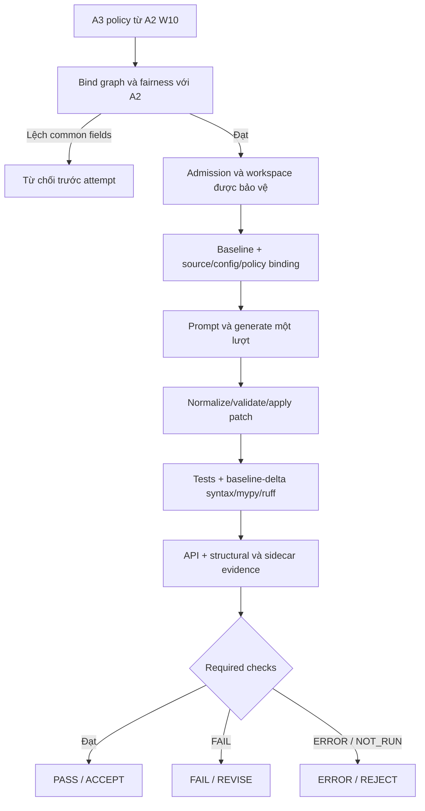
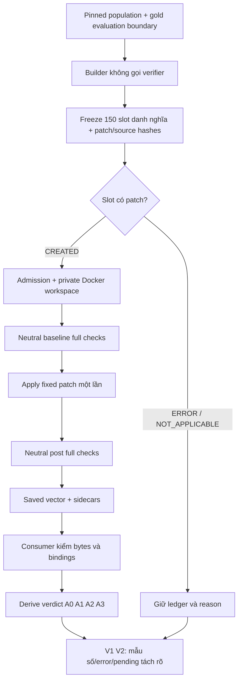
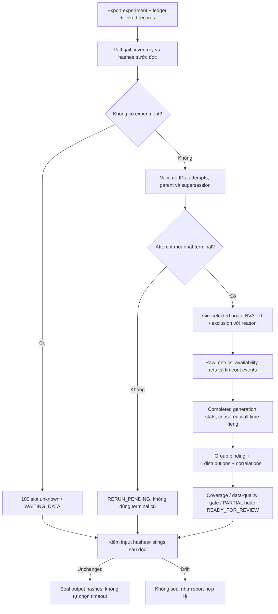
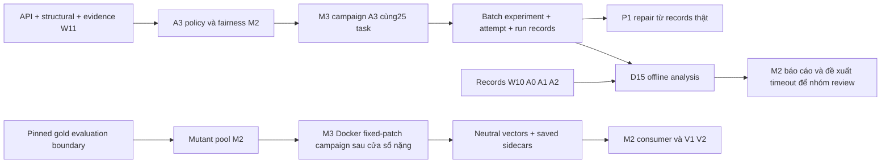

# Báo cáo tổng hợp M2-W12-1, M2-W12-2 và D15

- **Ngày lập:** 05/11/2026.
- **Repository:** `D:\Project\CAPSTONES\VGAR`.
- **HEAD đối chiếu hiện tại:** `c88290a147bc42b70261b39e50b7f11d5e5137ea`.
- **Nhánh local:** `m2/w11-checkers-evidence-c7-20261102`.
**Ngôn ngữ:** tiếng Việt; giữ nguyên tên API, mã trạng thái và tham số trong code.

> Đây là báo cáo kết quả đã có, đối chiếu code, tài liệu M2, JSON kết thúc task,
> log/JUnit và lịch sử lệnh được archive. Việc lập báo cáo chỉ thêm file Markdown
> này; không chạy lại tests, model, Docker hoặc campaign; không sửa trạng thái
> nghiệm thu, code, config hoặc dữ liệu cũ. Các số liệu ở những lần chạy trước
> được ghi rõ mốc, không trình bày thành kết quả mới chạy tại HEAD hiện tại.

## Mục lục

1. [Trạng thái và ý nghĩa DONE](#1-trạng-thái-và-ý-nghĩa-done)
2. [Yêu cầu gốc và phạm vi được duyệt](#2-yêu-cầu-gốc-và-phạm-vi-được-duyệt)
3. [Population, pins và môi trường](#3-population-pins-và-môi-trường)
4. [M2-W12-1 — A3 và fairness](#4-m2-w12-1--a3-và-fairness)
5. [M2-W12-2 — mutant pool và verifier evaluation](#5-m2-w12-2--mutant-pool-và-verifier-evaluation)
6. [D15 — phân tích timeout offline](#6-d15--phân-tích-timeout-offline)
7. [Flow liên kết ba phần việc](#7-flow-liên-kết-ba-phần-việc)
8. [File/folder đã tạo hoặc sửa](#8-filefolder-đã-tạo-hoặc-sửa)
9. [Tra cứu log/result bằng đường dẫn chi tiết](#9-tra-cứu-logresult-bằng-đường-dẫn-chi-tiết)
10. [Cách tự chạy và giải thích lệnh](#10-cách-tự-chạy-và-giải-thích-lệnh)
11. [Bảo toàn thay đổi cũ và tương thích](#11-bảo-toàn-thay-đổi-cũ-và-tương-thích)
12. [Bàn giao và điều kiện đóng thực nghiệm](#12-bàn-giao-và-điều-kiện-đóng-thực-nghiệm)
13. [Nguồn và giới hạn báo cáo](#13-nguồn-và-giới-hạn-báo-cáo)
14. Phụ lục A: toàn bộ argv kiểm thử/demo đã khôi phục từ evidence, kết quả và giải thích từng lệnh.
15. Phụ lục B: inventory đầy đủ file artifact trong ba bộ kết quả, gồm đường dẫn root và manifest.

## 1. Trạng thái và ý nghĩa DONE

| Phần việc | Trạng thái code/fixture | Số liệu chính đã xác nhận | Thực nghiệm và phần chờ |
|---|---|---|---|
| **M2-W12-1** | **DONE kỹ thuật local** | Policy A3; gate fairness; tăng ròng 56 case; 6 fixture run; full offline tại mốc task: 1877 PASS, 18 SKIP, 1 XFAIL | Bộ evidence M2 ghi **0/25 A3 real attempts**; chờ M3 chạy cùng 25 dev task, record đầy đủ, review và qualification CI |
| **M2-W12-2** | **DONE code/fixture local** | Builder + neutral verify-once + verdict A0–A3 + V1/V2; full offline cuối: 1994 PASS, 18 SKIP, 1 XFAIL | **0 patch thật được tạo, 0 real verification attempts** trong evidence này; chờ inputs/pool/campaign Docker M3 và bảng thật |
| **D15** | **DONE pha công cụ/fixture** | 54 D15 tests; gate chung 120 PASS, 0 FAIL/ERROR/SKIP, 77,444s JUnit; demo deterministic | Chưa phân tích raw W10/A3 thật; readiness **WAITING_DATA**; chưa chọn đề xuất timeout cuối |

**DONE kỹ thuật**: implementation, tests phù hợp phạm vi và evidence local đã có.
**DONE thực nghiệm/theo deliverables**: còn cần campaign/record population thật,
đủ mẫu số/exclusion/error, phân tích và bàn giao, review của người có trách nhiệm,
CI và điều kiện tích hợp của nhóm. Review tự động không thay human approval.

Vì vậy, **không dùng báo cáo này để đánh dấu cả M2 Week 12 và D15 đã DONE thực
nghiệm**. Các trạng thái còn chờ là dependency thực, không phải test fixture bị FAIL.
Không suy rằng M3 chưa chạy ở mọi máy; báo cáo xác nhận giới hạn của các bộ
record local đã đối chiếu và chưa nhận được bằng chứng thực nghiệm bổ sung.

### 1.1. Mốc phiên bản và cách đọc lịch sử

- A3 và mutant-pool task được triển khai/đóng gate trước merge, tại mốc
  `32fd47237b380551ecf3abb32e84c7359c8d044a`, ngày 04/11/2026.
- Sau đó repo fast-forward nhánh `m3/w12-all` tới `c88290a1`. Gate integration
  sau merge đã được lưu: **1419 PASS, 20 SKIP, 0 FAIL/ERROR, 1737,190s JUnit**;
  đây là gate tích hợp có phạm vi riêng, không phải full offline CI.
- D15 hoàn tất pha tool/fixture ngày 05/11/2026 trên HEAD `c88290a1`.
- `summary.json` cũ của M2-W12-2 còn `d15_not_started=true` và checkpoint cũ còn
  câu “không tự mở D15”: đó là snapshot trước lệnh triển khai D15, không phủ
  định kết quả D15 mới. Đọc `PROGRESS.md`, `docs/status/m2.md` mục 6.8 và
  checkpoint D15 để biết điểm dừng mới nhất.
- Thay đổi W12/D15 còn trong working tree local; không tự suy rằng đã commit,
  push hoặc merge vào `main` chỉ vì có code và gate PASS.

## 2. Yêu cầu gốc và phạm vi được duyệt

Nguồn chính: `D:\Project\CAPSTONES\New_task\VGAR_W9_W16_Deliverables.md`,
spec kỹ thuật W11–W12, phân công song song và các lựa chọn người dùng đã xác
nhận trong hội thoại triển khai.

| Phần | Yêu cầu trong nguồn | Phương án thực hiện đã được người dùng duyệt | Cách đánh giá |
|---|---|---|---|
| M2-W12-1 | A3 policy; bản deliverables gốc nói re-plan và pilot 5 task | **25 task W10**, A3 = A2 thêm API/structural required; giữ generation **một lượt/attempt**, không re-plan/retry riêng | Công khai khác biệt với bản gốc; code đã có, population thật còn chờ run |
| M2-W12-2 | Pool patch tốt/xấu, nhãn độc lập; TP/FP/FN/TN, FAR/FRR A0–A3 | 25 gold +5 operator/task, seed0; verify một patch một lần bằng full checks rồi suy arm verdict | Đủ planned/generated/NA/error/pending; không giả định 150 patch đều tạo và chạy được |
| D15 | Phân tích độ dài prompt, generation time, timeout theo arm; đề xuất timeout | Triển khai tool/fixture **trước** campaign A3; offline và không thay timeout | Đóng pha tool; raw analysis và đề xuất có dữ liệu thật là phần chờ |

Spec kỹ thuật ghi phương án 25 task/không re-plan là phần bổ sung cần duyệt.
Trong hội thoại triển khai, người dùng đã chọn phương án này. Báo cáo không
tạo thêm chữ ký/amendment hoặc tuyên bố nhóm đã ký protocol freeze.

Phần đã có từ W11 được **tái sử dụng**, không làm lại: API AST checker,
structural checker, compatibility DTO/sidecars, integration verification,
source protection và C7 sampler/runner counter. Chúng là dependency, không
phải số deliverable W12 mới để cộng lại. B10/resolver v4 và cập nhật M3 sau
merge cũng không được nhận là code do M2-W12/D15 tạo.

## 3. Population, pins và môi trường

### 3.1. Cùng population 25 task W10

Population được lấy từ `configs/m3/w10_dev_stage1.json` (11 task) và
`configs/m3/w10_dev_stage2.json` (14 task), **25 unique IDs**, không dùng tập
dev-25 phục vụ retrieval tuning. A3 không được thay task sau khi xem kết quả.

```text
Stage 1 — 11 IDs
astropy__astropy-13033
django__django-10914
matplotlib__matplotlib-13989
mwaskom__seaborn-3069
pallets__flask-5014
psf__requests-1724
pydata__xarray-3993
pylint-dev__pylint-4604
pytest-dev__pytest-5631
scikit-learn__scikit-learn-10297
sphinx-doc__sphinx-10673

Stage 2 — 14 IDs
sympy__sympy-11618
astropy__astropy-13453
django__django-10973
matplotlib__matplotlib-20488
psf__requests-1766
pydata__xarray-4629
pylint-dev__pylint-4970
pytest-dev__pytest-7205
scikit-learn__scikit-learn-10844
sphinx-doc__sphinx-11510
sympy__sympy-12481
astropy__astropy-13977
django__django-11087
matplotlib__matplotlib-20676
```

Các exclusion OVER_CAP đã có ở stage2: `astropy__astropy-13453`,
`astropy__astropy-13977`, `django__django-11087`. Với generation campaign,
giữ chúng trong ledger/mẫu số và xử lý theo config/admission; không thay task.
Với fixed-patch pool **không có prompt/generation**, runtime chỉ bỏ những
exclusion OVER_CAP đúng prefix đã biết trên **bản config in-memory**, lưu lý
do/config hash; vẫn enforce exclusion khác và admission. Không sửa file M3
hoặc tự kết luận ba task này đã runnable trên Docker.

### 3.2. Pins cho pool thật

| Pin | Giá trị |
|---|---|
| Dataset revision | `c104f840cc67f8b6eec6f759ebc8b2693d585d4a` |
| Parquet SHA-256 | `a45b1fe4e2f0c8390b2b2938ac83e92ed5979000856808f3679c07812e9e6dcd` |
| W10 manifest SHA-256 | `11e0b7b1168236e246dc8334db45ad932223a16ae7af0de149f30f25585f4177` |
| Mutation seed | `0` |
| Population pool danh nghĩa | 25 GOOD gold +125 BAD mutant =150 slot |

Gold/developer patch chỉ dùng ở evaluation boundary; không đưa vào retrieval,
context, prompt hoặc generator. D15 không cần gold/source/dataset Parquet.

### 3.3. Môi trường nào đã chạy?

| Hoạt động | Môi trường đã dùng | Docker/model thật? |
|---|---|---|
| A3 unit/fairness/policy | Windows, venv hiện có | Không |
| A3 6 integration run | Native trusted fixture, source/workspace riêng, fake generator | Không |
| Pool builder/evaluator/controller tests | Windows, fixture/mocks | Không |
| Pool 4 patch demo | Native trusted fixture, fixed patches | Không |
| D15 tests/CLI demo/readiness | Windows, JSON exports synthetic hoặc không input; script chỉ stdlib | Không |
| A3 campaign thật | Bàn giao M3, GPU generation và admitted Docker verification | **Chưa có record thật trong bộ evidence này** |
| Pool thật | Bàn giao M3, admitted Docker, không gọi model | **Chưa chạy trong đợt M2 này** |

Python thực tế trong artifact: **3.11.6**; pytest **8.4.2**; Pydantic **2.14.0**;
PyYAML **6.0.3**; tree-sitter **0.25.2**; tree-sitter-python **0.25.0**;
mypy **1.18.2**; Ruff **0.13.3**. Mypy/Ruff khác dev pins **2.4.0/0.17.0**:
không cài lại dependency trong task; local PASS không chứng nhận pinned CI
hoặc target image của M3. Hai full offline gate local mất khoảng 35 phút,
chưa chứng minh mục tiêu CI <10 phút. D15 gate 77,444s chỉ là suite scoped.

## 4. M2-W12-1 — A3 và fairness

### 4.1. Vấn đề và cách triển khai

A2 kiểm tests và các static checks syntax/mypy/ruff nhưng API/structural ở
W11 chỉ là supplemental evidence. A3 biến hai check đó thành điều kiện bắt
buộc chấp nhận patch, đồng thời giữ các yếu tố sinh/retrieval khác như A2 để
so sánh có ý nghĩa.

`configs/m2/variants/A3.json` được tạo từ **A2 W10**, không lấy policy W9 mặc
định. `VariantPolicy` mở rộng tên variant/check, gate arm graph và giữ
serializer/hash legacy. `check_arm_fairness()` kiểm các experiment được đưa
vào gate, không tự so với một config chưa được cung cấp.

| Thuộc tính | A2 W10 | A3 |
|---|---|---|
| Required checks | tests, syntax, mypy, ruff | Bốn check cũ +api +structural |
| Serialized recorded checks | tests, syntax, mypy, ruff | Giữ nguyên bốn tên legacy |
| Static mode | baseline_delta | baseline_delta |
| Diagnostic identity | m2-static-delta-v1 | m2-static-delta-v1 |
| Patch mode / path listing | normalized / context | normalized / context |
| Arm runtime | graph | graph, từ chối BM25 |
| Generation | Một lượt/attempt | Một lượt/attempt, không vòng re-plan riêng |

`arm:null` trong JSON nghĩa là policy chưa bind. Experiment phải bind graph;
đó không phải quyền tự chọn BM25. API/structural vẫn được lưu qua supplemental
sidecar/evidence path đã có; không thêm tên vào default serialized recorded
checks của A0–A2. Bảo toàn **18 literal policy hash/payload** W9/W10 ×3 variant
×3 trạng thái arm, không đổi công thức hash hoặc ghi lại record W10.

Fairness còn kiểm model ID/revision, tokenizer manifest hash, prompt template
hash, RepairPolicy chung (budget/timeout), bundle profile hash và các trường
variant chung. A2/A3 khi cùng tham gia phép so sánh phải đều graph; thay patch
mode, path listing, budget hay prompt không được đi qua gate như một ablation
“chỉ thêm checks”. Không sửa production verifier/session/pipeline ở task A3:
đường required-check assessment W11-3 đã có và được tests xác nhận dùng được.

### 4.2. Kết quả check được dùng ra sao?

| API/structural required, các check khác đạt | Verification | Recommendation | Giải thích |
|---|---|---|---|
| Cả hai PASS | PASS | ACCEPT | Đạt những rule thật sự áp dụng được |
| Có FAIL và không có ERROR/NOT_RUN | FAIL | REVISE | API_BREAK hoặc STRUCTURAL_VIOLATION |
| Có ERROR/NOT_RUN | ERROR | REJECT | VERIFICATION_INCOMPLETE; không biến unknown thành PASS |

Missing structural YAML: cycle vẫn chạy; layer/forbidden-import NOT_RUN riêng.
Structural tổng PASS không có nghĩa đã đo layer policy chưa cấu hình. Global
integrity/source/config binding luôn chặn mọi arm, không che thành optional
tool error. Ordinary supplemental API/structural failure không tự làm A0–A2
đổi verdict; A3 mới dùng chúng như required checks.

### 4.3. Số liệu test và fixture

| Gate theo trình tự | PASS / lỗi | Thời gian JUnit nếu có |
|---|---|---|
| Baseline trước sửa | 354 PASS | 7,780s |
| RED đầu | 50 PASS, 38 FAIL | 2,758s |
| Sau policy/config, fairness chưa xong | 85 PASS, 3 FAIL | 1,838s |
| Unit GREEN | 401 PASS | 8,615s |
| Integration +fairness | 25 PASS | 61,788s |
| Full offline ở mốc A3 | **1877 PASS,18 SKIP,1 XFAIL,0 FAIL/ERROR** | **2114,042s JUnit**; console 2114,11s |

Ba FAIL trung gian gồm hai lỗi fairness thật và một fixture prompt v1 không
còn đăng ký. Sửa seam registry của test, không đổi production prompt để làm
test xanh. Tăng ròng **56 test case**: 12 policy +14 fairness +24 verification
+6 native integration; thay unknown variant A3→A4 ở một case cũ không tính
thành case tăng thêm. Các gate chồng lặp, không cộng tổng PASS thành số task.

Sáu run fixture tạo thành ba cặp A2/A3:

| Patch fixture | A2 | A3 | API check |
|---|---|---|---|
| Body fix tương thích | PASS/ACCEPT | PASS/ACCEPT | PASS |
| Chuyển `login(value)` thành positional-only, đồng thời sửa body | PASS/ACCEPT | FAIL/REVISE | FAIL |
| Body fix nhưng thêm dynamic export | PASS/ACCEPT | ERROR/REJECT | NOT_RUN |

Mỗi run sinh **một lượt**; structural tổng PASS; source gốc unchanged. Mỗi cặp
có cùng prompt messages/hash. Token fixture **5217** do tokenizer test đếm
theo bytes/characters của fixture, không phải token cost Qwen. Không dùng sáu
run này để tính resolved rate hay nói A3 đã chạy 6/25 task thật.

### 4.4. Flow A3



Admission/baseline/parse/apply/deadline/integrity có thể dừng sớm. Diagram mô
tả đường có thể đi đến cuối, không khẳng định mọi run đều thực thi mọi stage.
Không có cạnh tự quay về generation sau K/L trong task này.

## 5. M2-W12-2 — mutant pool và verifier evaluation

### 5.1. Builder: nhãn độc lập và source bất biến

Builder đọc pinned W10 tasks/gold qua evaluation boundary `gold_inputs.select_rows`;
không import verifier trực tiếp hoặc qua aggregate. AST chỉ phân tích bytes,
không import/execute target source hoặc chạy tests repo đích để chọn mutant.
V13 kiểm cả import closure, gồm lazy imports.

1. Xác minh ordered population, pins, source Git/base inventory và bytes.
2. Áp gold trên bản private/in-memory để có predicted source, không sửa checkout gốc.
3. Lấy candidate theo path/vị trí ổn định; chọn với seed0.
4. Tạo mutant từ gold-predicted source; xuất **net patch base→mutant**, giữ các
   phần sửa gold khác, không xuất mỗi mutation rời khỏi gold context.
5. Freeze `pool.json`, patch bytes/hashes, source/predicted inventory, operator,
   mutation location, labels/reasons; kiểm source inventory trước–sau.

| Operator | Cách thực hiện trong code | Trường hợp không hỗ trợ phải ghi nhận |
|---|---|---|
| condition_flip | Thay predicate `if`/`while` bằng `not (<predicate>)` | Không có predicate hỗ trợ |
| public_function_delete | Xóa public module-level function, gồm decorator thuộc declaration | Không xác định được public function/export tĩnh |
| signature_change | Thêm keyword-only parameter bắt buộc `_vgar_required` hoặc tên tránh trùng | Không có declaration/tokenization hỗ trợ |
| import_cycle | Chọn quan hệ import nội bộ xác định, thêm import tạo cạnh ngược | Dynamic/local/alias/submodule không đủ chứng cứ |
| test_skip | Chèn `raise __import__("unittest").SkipTest(...)` trong production callable | Không có callable hỗ trợ; không sửa protected tests |

BAD là **nhãn kỳ vọng synthetic theo operator**, không chứng minh mutation
nào cũng sai hành vi thực tế. Operator không áp dụng: NOT_APPLICABLE +reason.
Input/hash/source/policy lỗi: ERROR. Không dựng mutant giả hoặc đổi task để đủ
125 BAD. Gold là GOOD theo thiết kế phép đo, vẫn phải qua verifier và có thể
FAIL/ERROR trong môi trường chưa qualified.

### 5.2. Verify một lần, suy bốn arm

`verify_once()` dùng admission, private workspace và **DockerExecutor cho
task thật**; native chỉ cho fixture được byte-verify/đăng ký. Không model,
không generator, không tạo fake repair run để chấm pool.

Raw measurement vector trung lập với arm:

- Thu baseline collection/tests và syntax/mypy/ruff structured measurements.
- API/structural baseline self-comparison lưu evidence riêng, không tự tạo
  một baseline qualification rule mới ngoài policy hiện có.
- Apply một fixed patch; pin actual candidate/source inventory.
- Thu post collection/tests/static/API/structural độc lập. Tests FAIL/ERROR
  không tự dừng các check khác; deadline/integrity/exception cấp run có thể
  ngăn phần còn lại, phải ghi NOT_RUN và lý do.
- Lưu `vector.json`, sidecars baseline/post, source/scope/config/profile/runtime
  hashes. Raw vector không bind A3 variant policy rồi tái gắn sang A0/A1.
- `derive_verdict()` qualify/assess từng arm trên bản sao measurement, tạo
  policy hash riêng cùng vector hash gốc. A0/A1 cùng required tests nên phải
  cùng verdict trên cùng patch/vector.

`collect_static_measurements()` trong file static cũ là entrypoint mới để
thu neutral data; đường `run_static_checks(..., variant=...)` legacy vẫn giữ
payload/hash và semantics. Consumer đọc **file sidecar thật đã lưu**, kiểm
candidate/source/scope/profile/policy/slot binding, không chỉ tin cờ PASS hoặc
hash tự khai của producer.

### 5.3. Metric: BAD là positive

| Kết quả patch | BAD | GOOD |
|---|---|---|
| ACCEPT | FN | TN |
| Không ACCEPT, đã có terminal result | TP | FP |

`FAR = FN / generated_BAD`, `FRR = FP / generated_GOOD` khi label tương ứng
đã có đủ kết quả và không còn unresolved pool ERROR. Planned/generated/NA/
pool ERROR/pending báo riêng. Zero denominator, pending hoặc pool error chưa
tạo patch làm rate tương ứng **N/A**, không chia cứng cho 125/25 danh nghĩa.

REVISE và ERROR đều non-ACCEPT theo quyết định người dùng, nhưng phải tách
`check_failures` với `errors/incomplete`: hạ tầng lỗi không chứng minh phát hiện
mutant đúng. NOT_RUN không tự được biến thành TP/FP. V2 có đủ năm loại mutant.
`verification_pool_counts.json` không thay cột P1 của repair runs thật.

### 5.4. Kết quả test, review và demo

| Gate | Kết quả |
|---|---|
| Builder ban đầu | 38 PASS |
| Builder overlap fix | 6 RED →44 PASS/2 SKIP; hai alias case chạy thật bằng junction: 2 PASS |
| Evaluator/policy ban đầu | 46 PASS |
| Consumer/campaign trước review | 90 PASS |
| Scoped trước/sau review fix | 530 PASS →542 PASS; gate sau fix 13,41s console |
| Native sau fix | 4 PASS/52,56s console |
| Table output overlap | 1 RED →13 PASS |
| Full offline cuối có thẩm quyền | **1994 PASS,18 SKIP,1 XFAIL,0 FAIL/ERROR**, **2142,428s JUnit** |

V16 gồm **32 tổ hợp** đối chiếu derive với verification trực tiếp theo arm trên
fixture, gồm tests skip/static unavailable/API/structural NOT_RUN và baseline/
post errors. Đây là case kiểm semantics, không phải 32 task SWE-bench.

Review độc lập phát hiện bốn Important và đã sửa bằng RED→GREEN: output/source
overlap; source/candidate/scope/policy proof; state/ref bypass; rate khi pool
ERROR. Table-output guard thuộc cùng lớp source/output overlap và cũng có
test tái hiện. Review tự động không thay M1/M3 review.

Hai full gate trước **không được tính PASS**:

- `offline.log`: bị controller ngắt để bổ sung table-output guard.
- `offline-final.log`: gặp test harness cũ tạo đường dẫn 263 ký tự trên Windows,
  rồi dừng. Test riêng với TEMP ngắn PASS; không sửa harness để né lỗi.
- Gate cuối dùng TEMP `C:\Users\pc\AppData\Local\Temp\vp6n9u634\of`;
  `tests/offline-short.command.json`, `.log`, `.xml` là nguồn có thẩm quyền.

Demo native: **1 fixture task, 6 planned slot, 4 patch EVALUATED,
2 NOT_APPLICABLE, 0 pending**. Mỗi arm A0–A3 có GOOD1/BAD3, TP3/TN1/FP0/FN0;
trong BAD non-ACCEPT có **1 FAIL +2 ERROR/incomplete**. FAR/FRR=0 của demo này
chỉ chứng minh tổng hợp đúng quy ước trên mẫu nhỏ synthetic, không phải hiệu
năng verifier trên SWE-bench. Hai lần render V1/V2 byte-identical, source unchanged.

Readiness thật trên các paths Windows đã kiểm: **25 task/150 slot,
0 CREATED/150 ERROR, 0 real verification attempts**, exit2 vì thiếu pinned
Parquet/data root. Repro configs có **23/25**, thiếu `psf__requests-1724` và
`pylint-dev__pylint-4970`. WSL `~/w10` chỉ là data root M3 được tài liệu nêu;
không khởi động/quét WSL trong đợt M2, không kết luận máy M3 cũng thiếu dữ liệu.

### 5.5. Flow pool



Đường native trong tests thay F bằng approved fixture runtime. Không có model
call trong flow pool; bốn arm không có nghĩa chạy target patch bốn lần.

## 6. D15 — phân tích timeout offline

### 6.1. Input và lựa chọn attempt

Script `scripts/analyze_repair_timeouts.py` chỉ stdlib, độc lập repair/harness.
Đọc `experiment.json`, ledger `attempts/<task>__<variant>/attempt-N.json` và
linked `engine/<task>__<variant>/attempt-N/<run_id>/run_record.json` trong export.
Không `load_experiment()`, không cần model/profile/source assets, không dùng
trace `solve --agent` thay batch record.

Đối chiếu experiment/task/variant/arm, attempt, run ID, status/reason/completion.
Đường tuyệt đối Linux cũ chỉ được lấy suffix đã bind vào layout tương đối
trong export Windows; không truy cập prefix cũ hoặc tìm ngoài export. Reject
traversal, symlink/junction/reparse, output/input overlap và output đã tồn tại.
Seal hashes/file inventory trước–sau, kể cả listing ledger/interrupted root.

Chọn latest terminal với `parent_attempt` và `supersedes_run_id`, kiểm duplicate/
cycle/mismatch. Newer RESERVED/INTERRUPTED → **RERUN_PENDING**; terminal cũ nằm
ở audit, không được dùng làm kết quả cuối. Interruption chỉ có
`engine_output_root` vẫn đọc được predecessor nếu có một record bound hợp lệ;
nhiều candidate là ambiguity, không tự chọn. Missing/malformed/excluded giữ
slot và reason. Mẫu số: **75 W10 slot (25×A0–A2) +25 A3 slot**.

### 6.2. Measurement và timeout semantics

| Field/event | Diễn giải |
|---|---|
| input_tokens / output_tokens | Chỉ dùng số đo đã ghi, không suy từ độ dài ký tự |
| Input token fallback | Khi generation không có số đo, dùng prompt.input_tokens hợp lệ; lưu pointer; hai số đo khác nhau →CONFLICT/unknown |
| generation_ms | Thời gian sinh backend; không thay bằng stage duration hoặc cộng load time |
| model_load_ms | Thời gian nạp model riêng |
| generation_stage_ms | Duration generation stage, có thể chứa load/overhead |
| wall_ms | Ledger wall time, thiếu thì dùng record duration có đo |
| GENERATION_TIMEOUT | Có reason/cờ generation chứng minh; không vào phân phối completed generation |
| RUN_TIMEOUT | Global timeout, wall time censored; generation đã hoàn tất trước đó vẫn dùng được |
| COMMAND_TIMEOUT | Cần command object với argv/command và timed_out; không suy từ cờ generation/ledger tổng |
| OUTPUT_CAP | Output truncated, đếm riêng; không gọi là generation timeout |
| MODEL_ERROR / INFRASTRUCTURE_ERROR | Phân loại riêng, giữ raw status/reason/failure/evidence |

Bool, NaN/Infinity, số âm và chuỗi số không là measurement hợp lệ. Unknown khác
measured0; `availability` và `metric_refs` lưu lý do/provenance. Generation PASS
vẫn tính dù patch/tests sau đó FAIL. Không suy timeout chỉ vì duration vượt config.

Thống kê count/min/median/p95/max; p95 nội suy `(n-1)*0.95`. Pearson và Spearman
chỉ dùng cặp input_tokens/generation_ms hoàn tất hợp lệ; Spearman dùng average
rank khi ties. N<3 hoặc variance0 →N/A/null +reason. Tách cohort/experiment/
variant/binding; chỉ gộp W10 stages khi đủ population đo và model/prompt/budget/
timeouts/code binding xác định tương đương. Unknown/mixed tách nhóm/cảnh báo;
correlation không chứng minh quan hệ nhân quả.

### 6.3. Output và readiness

| File | Nội dung |
|---|---|
| inputs.json | Tham số/input hashes/listings/population config identity |
| selection_audit.json | Attempts, selected/previous terminal, supersession, pending, lỗi |
| rows.csv | Từng task/variant, raw status/reason, metrics/availability/ref/events |
| summary.json | Coverage, distributions/correlations, warnings, data_quality_issues, proposal chưa chọn |
| report.md | Report tiếng Việt với số liệu và giới hạn |
| artifact_hashes.json | Checksums năm output còn lại; không tự hash chính nó |

| Trạng thái CLI | Exit | Ý nghĩa |
|---|---:|---|
| WAITING_DATA | 2 | Không experiment đầu vào; tạo readiness, không fake measurements |
| PARTIAL | 2 | Chỉ W10, thiếu/malformed/pending/invalid/unbound hoặc synthetic |
| READY_FOR_REVIEW | 0 | Đủ raw hợp lệ cho bước review dữ liệu; **không tự nghiệm thu D15** |

Invalid numeric/conflict, thiếu shared binding hoặc thiếu measurement cần thiết
ở completed generation chặn full readiness. Missing measurements thực sự khi
timeout/pre-generation vẫn unknown, không biến thành0 hoặc completed giả.
Failure metadata không serialize được giữ dạng string kèm INVALID/reason,
không làm toàn report biến mất.

### 6.4. Kết quả thực hiện và review

| Gate | Kết quả |
|---|---|
| RED đầu /GREEN đầu | 36 FAIL →36 PASS |
| RED binding/cohort /GREEN | 8 FAIL +38 PASS →46 PASS |
| RED review /GREEN | 8 FAIL +46 PASS →54 PASS |
| Regression failure/runner riêng | 66 PASS/44,77s console |
| Gate cuối chung | **120 PASS,0 FAIL/ERROR/SKIP,77,444s JUnit** =54 D15 +66 regression |
| Ruff scoped /whitespace | exit0 /exit0 |

Review fresh-context, read-only phát hiện 6 điểm và đã có 8 case tái hiện
RED→GREEN trong một lượt sửa; không có deferred finding, không giả thành
review/approval người của nhóm:

1. Resume predecessor thiếu engine_run_dir: hỗ trợ engine_output_root đã bind.
2. Generation timeout làm mất input tokens có ở prompt: fallback +provenance/conflict.
3. Readiness xanh dù invalid/unbound: data-quality gate trước READY.
4. Median của số hữu hạn lớn có thể overflow: midpoint an toàn.
5. Failure metadata NaN làm report abort: giữ malformed slot/evidence, không crash.
6. Attempt10 chọn đúng nhưng ref trỏ attempt9 do lexical order: lưu selected ledger path.

Demo **SYNTHETIC**: 100 rows, W10 unique resolved75/A3 unique resolved25;
**99 selected engine +1 runner exclusion**, state PARTIAL/exit2. Có các case
generation/global/command timeout và output cap do fixture tạo để kiểm tool.
Hai output directories byte-identical; input JSON unchanged. Không trình bày
token/time/correlation của demo này thành đo đạc model thật.

Không input: readiness **WAITING_DATA/exit2**, 100 slot unknown. **D15 không có
đề xuất timeout cuối dựa trên dữ liệu thật**. Config giữ generation/global
**900/1800 giây**; **1500/2700 giây** là ứng viên M3, chưa chọn/áp dụng;
`recommendation.selected_seconds=null`. Không thực hiện ĐX1–ĐX5.

### 6.5. Flow D15



Nhánh INVALID không bỏ task ra khỏi report. Diagram dùng READY_FOR_REVIEW để
chỉ readiness dữ liệu; bước đề xuất timeout/nhóm review vẫn ở ngoài công cụ.

## 7. Flow liên kết ba phần việc



Hai đường nghiên cứu khác nhau: A3 generation/repair tạo record batch; mutant
pool verify fixed patch không model. D15 phân tích record generation, không
lấy vector pool thay generation time. P1 lấy repair records, không lấy pool
counts. Chi tiết thứ tự GPU/pool/dry-run phải được M3/nhóm chốt theo phương án
N; không tự đổi lịch vì spec/runbook sau merge có diễn đạt khác nhau.

## 8. File/folder đã tạo hoặc sửa

Tất cả đường dẫn ở cột đầu là **suffix từ root tuyệt đối**
`D:\Project\CAPSTONES\VGAR\`. Ví dụ `src/vgar/repair/policy.py` là
`D:\Project\CAPSTONES\VGAR\src\vgar\repair\policy.py`; các link mở đúng file.
“Tạo/sửa” mô tả quá trình task, không đồng nghĩa đã được Git commit.

### 8.1. M2-W12-1

| File | Tạo/sửa | Vai trò |
|---|---|---|
| [configs/m2/variants/A3.json](../configs/m2/variants/A3.json) | Tạo | Policy A3 dựa A2 W10 |
| [src/vgar/repair/policy.py](../src/vgar/repair/policy.py) | Sửa | Variant/check validator, graph arm, giữ legacy serialization/hash |
| [src/vgar/evaluation/repair/fairness.py](../src/vgar/evaluation/repair/fairness.py) | Sửa | Gate A2/A3 graph và common identity |
| [tests/m2/w910/test_policy.py](../tests/m2/w910/test_policy.py) | Sửa | Contract/negative/canonical cases; unknown A4 thay A3 |
| [tests/m2/w910/test_arm_fairness.py](../tests/m2/w910/test_arm_fairness.py) | Sửa | Fairness/drift/CLI refusal |
| [tests/m2/w1112/test_a3_verification.py](../tests/m2/w1112/test_a3_verification.py) | Tạo | Required API/structural statuses và compatibility |
| [tests/m2/w78/test_a3_integration.py](../tests/m2/w78/test_a3_integration.py) | Tạo | Sáu native fixture run A2/A3 |
| [docs/m2_w12_1_a3.md](m2_w12_1_a3.md) | Tạo | Kỹ thuật, tests và handoff A3 |
| [docs/status/m2.md](status/m2.md) | Bổ sung | Trạng thái kỹ thuật/phần chờ |

Trong bộ task archive có `task_changes.diff` và `source_fingerprints.json`
ghi đúng 9 file của snapshot A3. PROGRESS tiếp tục được cập nhật ở các phiên
resume/status sau đó; không gán toàn bộ nội dung PROGRESS cho A3.

### 8.2. M2-W12-2

| File | Tạo/sửa | Vai trò |
|---|---|---|
| [src/vgar/evaluation/repair/mutant_pool.py](../src/vgar/evaluation/repair/mutant_pool.py) | Tạo | Builder, pins/population, candidate/mutation, frozen pool consumer |
| [scripts/build_mutant_pool.py](../scripts/build_mutant_pool.py) | Tạo | CLI tạo pool/readiness |
| [src/vgar/evaluation/repair/verifier_eval.py](../src/vgar/evaluation/repair/verifier_eval.py) | Tạo | Neutral measurements, controller, consumer, verdict/metrics/tables |
| [scripts/evaluate_mutant_pool.py](../scripts/evaluate_mutant_pool.py) | Tạo | CLI run/report, runtime planning, source/output guards |
| [src/vgar/repair/static_checks.py](../src/vgar/repair/static_checks.py) | Sửa | Entry neutral measurements, giữ legacy variant path |
| [tests/m2/w1112/test_mutant_pool.py](../tests/m2/w1112/test_mutant_pool.py) | Tạo | V13/V14, source/seed/pin/operator/overlap |
| [tests/m2/w1112/test_verifier_eval.py](../tests/m2/w1112/test_verifier_eval.py) | Tạo | V15/V16, neutral assessment/qualification/metrics |
| [tests/m2/w1112/test_verifier_campaign.py](../tests/m2/w1112/test_verifier_campaign.py) | Tạo | Ledger/state/ref/consumer/fairness/table guards |
| [tests/m2/w78/test_verifier_eval_integration.py](../tests/m2/w78/test_verifier_eval_integration.py) | Tạo | Native fixture, interruption và tampering |
| [docs/m2_w12_2_verifier_eval.md](m2_w12_2_verifier_eval.md) | Tạo | Phương pháp, đo lường, lệnh bàn giao |
| [docs/checkpoints/2026-11-04-m2-w12-2-checkpoint.md](checkpoints/2026-11-04-m2-w12-2-checkpoint.md) | Tạo/cập nhật | Resume/RED→GREEN/gate có thẩm quyền |
| [PROGRESS.md](../PROGRESS.md) | Bổ sung | Điểm dừng qua phiên |
| [docs/status/m2.md](status/m2.md) | Bổ sung | Kết quả và dependency M3 |

Archive snapshot có 13 source fingerprints, gồm cả tài liệu tiến độ. Không
nhận toàn bộ file W11 hoặc M3 sau merge là file do task pool sửa.

### 8.3. D15

| File | Tạo/sửa | Vai trò |
|---|---|---|
| [scripts/analyze_repair_timeouts.py](../scripts/analyze_repair_timeouts.py) | Tạo | Offline stdlib analyzer/CLI |
| [tests/m2/w1112/test_timeout_analysis.py](../tests/m2/w1112/test_timeout_analysis.py) | Tạo | 54 case D15, synthetic exports và review regressions |
| [docs/m2_d15_timeout_analysis.md](m2_d15_timeout_analysis.md) | Tạo | Schema, semantics và vận hành tool |
| [docs/checkpoints/2026-11-04-d15-timeout-analysis.md](checkpoints/2026-11-04-d15-timeout-analysis.md) | Tạo/cập nhật đến05/11 | Điểm dừng mới nhất và lịch sử |
| [PROGRESS.md](../PROGRESS.md) | Prepend, giữ lịch sử | Điểm dừng công cụ D15 |
| [docs/status/m2.md](status/m2.md) | Append mục6.8 | Kỹ thuật đạt, thực nghiệm chờ |

Task D15 không sửa engine/runner/aggregate/policy/timeouts hoặc spec nguồn.
`Task Status.md`, `docs/status/m1.md`, `docs/status/m3.md` không được cập nhật
để giả lập bàn giao/approval. Report Linux và thay đổi người dùng được bảo toàn.

### 8.4. Folder artifact, folder tạm và file helper

| Root đầy đủ | Thuộc task | Nội dung |
|---|---|---|
| `D:\Project\CAPSTONES\VGAR\results\m2\w1112\m2-w12-1-20261104-a3\` | A3 | tests/log/JUnit/command JSON; 6 fixture_runs; prompt/consumer/hash/preservation audits |
| `D:\Project\CAPSTONES\VGAR\results\m2\w1112\m2-w12-2-20261104-verifier-eval\` | Pool | builder-tests, overlap/junction, tests, fixture_demo, real-input-readiness, hashes/receipts |
| `D:\Project\CAPSTONES\VGAR\results\m2\w1112\d15\20261105-tool-fixture\` | D15 | tests, fixture_inputs, fixture_output_a/b, readiness, source snapshots, commands/hashes |
| `C:\Users\pc\AppData\Local\Temp\vg-a3-0p6a80m8\` | A3 lịch sử | TEMP gate paths theo argv; archive repo là nơi tra cứu kết quả bền hơn |
| `C:\Users\pc\AppData\Local\Temp\vg-pool-d414abe4\` | Builder lịch sử | RED/GREEN/pins/seed log |
| `C:\Users\pc\AppData\Local\Temp\vg-pool-overlap-20261104\` | Builder overlap lịch sử | Source/alias overlap tests |
| `C:\Users\pc\AppData\Local\Temp\vg-ve-ptwkd86_\` | Evaluator lịch sử | Gate/evidence trước khi archive |
| `C:\Users\pc\AppData\Local\Temp\vp6n9u634\of\` | Pool full gate cuối | TEMP ngắn tránh test harness path263 |
| `C:\Users\pc\AppData\Local\Temp\vgd15-20261104-ht47o7kd\` | D15 lịch sử | Snapshot, gate logs, helpers trước archive |

Helper `run_gate.py`, `run_short_gate.py`, `finalize*.py`, `postflight.py`,
`fixture_demo.py`, `archive.py`, `snapshot.py`, `update_status.py` trong các
archive là script điều phối/audit của phiên, **không phải API production**.
Các workspace/TEMP riêng từng gate đã được ghi đầy đủ trong command JSON ở
phụ lục A. Không đảm bảo TEMP còn tồn tại sau khi hệ điều hành dọn dẹp.
Phụ lục B liệt kê mọi file raw artifact đã seal, tránh bỏ sót hàng trăm JSON,
patch, vector, sidecar, log và generated table trong các folder này.

Các file trong `configs/m3/w10_dev_stage*.json`, W10 manifest, admission,
checker W11, executor, session, MCP servers được đọc/tái sử dụng, không sửa
bởi ba task này. Thay đổi spec split đang thấy trong git status là thay đổi
cũ được bảo toàn, không phải D15 hoặc phiên viết báo cáo sửa lại phân công.

## 9. Tra cứu log/result bằng đường dẫn chi tiết

Các path bảng sau nối với root task tương ứng ở mục8.4; link mở file thực.

| Task | File/kết quả quan trọng | Mục đích |
|---|---|---|
| A3 | [tests/offline.log](../results/m2/w1112/m2-w12-1-20261104-a3/tests/offline.log), [offline.xml](../results/m2/w1112/m2-w12-1-20261104-a3/tests/offline.xml), [command](../results/m2/w1112/m2-w12-1-20261104-a3/tests/offline.command.json) | Full gate1877PASS ở mốc A3 |
| A3 | [tests/integration.log](../results/m2/w1112/m2-w12-1-20261104-a3/tests/integration.log), [integration.xml](../results/m2/w1112/m2-w12-1-20261104-a3/tests/integration.xml) | Sáu run native +fairness25PASS |
| A3 | [summary.json](../results/m2/w1112/m2-w12-1-20261104-a3/summary.json), [consumer_audit.json](../results/m2/w1112/m2-w12-1-20261104-a3/consumer_audit.json) | 0/25 real attempts; audit sidecars6run |
| A3 | [fixture_runs/4/run_record.json](../results/m2/w1112/m2-w12-1-20261104-a3/fixture_runs/4/run_record.json) | Ví dụ A3 API break FAIL/REVISE; đối chiếu API sidecar trong cùng run |
| Pool | [tests/offline-short.log](../results/m2/w1112/m2-w12-2-20261104-verifier-eval/tests/offline-short.log), [XML](../results/m2/w1112/m2-w12-2-20261104-verifier-eval/tests/offline-short.xml), [command](../results/m2/w1112/m2-w12-2-20261104-verifier-eval/tests/offline-short.command.json) | Full gate1994PASS có thẩm quyền |
| Pool | [gate_interruptions.json](../results/m2/w1112/m2-w12-2-20261104-verifier-eval/gate_interruptions.json) | Giải thích hai run không PASS |
| Pool | [fixture_demo/demo_summary.json](../results/m2/w1112/m2-w12-2-20261104-verifier-eval/fixture_demo/demo_summary.json) | 6slot/4verified/2NA, source unchanged, replay identical |
| Pool | [fixture_demo/tables1/V1.md](../results/m2/w1112/m2-w12-2-20261104-verifier-eval/fixture_demo/tables1/V1.md), [V2.md](../results/m2/w1112/m2-w12-2-20261104-verifier-eval/fixture_demo/tables1/V2.md) | Bảng synthetic; không dùng làm bảng thật |
| Pool | [readiness.json](../results/m2/w1112/m2-w12-2-20261104-verifier-eval/readiness.json), [consumer_audit.json](../results/m2/w1112/m2-w12-2-20261104-verifier-eval/consumer_audit.json) | Missing inputs150ERROR; không phải150verification |
| D15 | [tests/final.log](../results/m2/w1112/d15/20261105-tool-fixture/tests/final.log), [final.xml](../results/m2/w1112/d15/20261105-tool-fixture/tests/final.xml), [final_commands.json](../results/m2/w1112/d15/20261105-tool-fixture/final_commands.json) | 120PASS/77,444s scoped |
| D15 | [readiness/report.md](../results/m2/w1112/d15/20261105-tool-fixture/readiness/report.md), [summary](../results/m2/w1112/d15/20261105-tool-fixture/readiness/summary.json) | WAITING_DATA, không đo giả |
| D15 | [fixture_output_a/report.md](../results/m2/w1112/d15/20261105-tool-fixture/fixture_output_a/report.md), [rows.csv](../results/m2/w1112/d15/20261105-tool-fixture/fixture_output_a/rows.csv) | Dữ liệu synthetic, availability/evidence theo từngslot |
| D15 | [fixture_checks.json](../results/m2/w1112/d15/20261105-tool-fixture/fixture_checks.json), [preservation.json](../results/m2/w1112/d15/20261105-tool-fixture/preservation.json), [review.json](../results/m2/w1112/d15/20261105-tool-fixture/review.json) | Determinism, bảo toàn và reviewfix |

Full path ví dụ log D15:
`D:\Project\CAPSTONES\VGAR\results\m2\w1112\d15\20261105-tool-fixture\tests\final.log`.
Log pool:
`D:\Project\CAPSTONES\VGAR\results\m2\w1112\m2-w12-2-20261104-verifier-eval\tests\offline-short.log`.
Đường dẫn raw local này không mặc định có trên GitHub hoặc máy thành viên khác;
raw results gitignored và không được tự push.

## 10. Cách tự chạy và giải thích lệnh

### 10.1. Setup và thư mục mới

Những block trong mục10 là **hướng dẫn tái chạy**, không phải tuyên bố vừa chạy
trong phiên viết báo cáo. Phụ lục A mới là argv lịch sử từng gate. Không chạy
nguyên đường dẫn basetemp/output cũ: pytest có thể dọn basetemp hiện hữu.

```powershell
Set-Location 'D:\Project\CAPSTONES\VGAR'
$vgarPython = 'D:\Project\CAPSTONES\environments\vgar-week78-cuda\Scripts\python.exe'
$env:PYTHONUTF8 = '1'
$env:PYTHONDONTWRITEBYTECODE = '1'
$env:VGAR_GRAPH_BACKEND = 'demo'
$runName = 'vwr-' + [guid]::NewGuid().ToString('N').Substring(0,8)
$gateRoot = Join-Path $env:TEMP $runName
New-Item -ItemType Directory -Path $gateRoot | Out-Null
Get-FileHash -LiteralPath 'artifacts\sample_graph.db' -Algorithm SHA256
Copy-Item -LiteralPath 'artifacts\sample_graph.db' -Destination (Join-Path $gateRoot 'sample_graph.db.before')
```

`Set-Location` đặt root để relative paths đúng. `$vgarPython` chọn đúng venv;
ba env vars ép UTF-8, tránh bytecode và đặt demo graph trước collection.
GUID tạo TEMP mới ngắn; `New-Item` chỉ tạo thư mục này. DB hash/backup dùng để
phát hiện legacy test migration, không cấp quyền restore đè thay đổi lạ.

### 10.2. A3 focused/native gate

```powershell
& $vgarPython -B -m pytest `
  tests/m2/w910/test_policy.py tests/m2/w910/test_arm_fairness.py `
  tests/m2/w1112/test_a3_verification.py tests/m2/w78/test_a3_integration.py `
  -q -p no:cacheprovider --basetemp "$gateRoot\a3" --junitxml "$gateRoot\a3.xml"
$a3Exit = $LASTEXITCODE
```

Chạy contract/policy, common-field fairness, required checks và sáu native
fixture A2/A3. `-B` tránh `.pyc`; `-m pytest` dùng pytest thuộc đúng interpreter;
`-q` output gọn; `-p no:cacheprovider` không `.pytest_cache`; `--basetemp` đặt
workspace fixture tách riêng; `--junitxml` lưu case/count/time/error đọc bằng máy.
`$LASTEXITCODE` phải chụp ngay sau Python, không lấy exit của `Get-Content` thay
pytest. Fixture vẫn không cần Docker/model; sandbox có thể cần quyền tạo
private Git worktree trong TEMP, không sửa source gốc để né lỗi quyền.

### 10.3. Pool focused gate và lint

```powershell
& $vgarPython -B -m pytest `
  tests/m2/w1112/test_mutant_pool.py tests/m2/w1112/test_verifier_eval.py `
  tests/m2/w1112/test_verifier_campaign.py tests/m2/w78/test_verifier_eval_integration.py `
  -q -p no:cacheprovider --basetemp "$gateRoot\pool" --junitxml "$gateRoot\pool.xml"
$poolExit = $LASTEXITCODE
& $vgarPython -B -m ruff check --no-cache `
  src/vgar/evaluation/repair/mutant_pool.py src/vgar/evaluation/repair/verifier_eval.py `
  src/vgar/repair/static_checks.py scripts/build_mutant_pool.py scripts/evaluate_mutant_pool.py `
  tests/m2/w1112/test_mutant_pool.py tests/m2/w1112/test_verifier_eval.py `
  tests/m2/w1112/test_verifier_campaign.py tests/m2/w78/test_verifier_eval_integration.py
```

Gate kiểm frozen pool, oracle independence, neutral vectors, per-arm qualification,
consumer binding, interruption và native fixture. Ruff `check --no-cache` chỉ
kiểm các file liệt kê, không format/sửa code, không đọc cache cũ. Lệnh lint
trên là hướng dẫn theo tài liệu task, không bịa thêm một historical run có
command JSON nếu archive không lưu entry riêng.

### 10.4. D15 gate và readiness

```powershell
& $vgarPython -B -m pytest tests/m2/w1112/test_timeout_analysis.py `
  tests/test_failure_class.py tests/m3/test_runner.py tests/m3/test_runner_code_state.py `
  tests/m3/test_aggregate_class.py tests/m2/w910/test_failure.py `
  -q -p no:cacheprovider --basetemp "$gateRoot\d15" --junitxml "$gateRoot\d15.xml"
$d15Exit = $LASTEXITCODE
& $vgarPython -B -m ruff check --no-cache `
  scripts/analyze_repair_timeouts.py tests/m2/w1112/test_timeout_analysis.py
& $vgarPython -B scripts/analyze_repair_timeouts.py --output-root "$gateRoot\readiness-new"
$readinessExit = $LASTEXITCODE
```

Đây là tập file của gate120PASS đã lưu; khi code/repo thay đổi ở tương lai,
không mặc định count phải luôn120. Readiness no-input expected exit**2** và
WAITING_DATA, không coi đó là test thất bại. D15 không cần Docker/GPU/model.

### 10.5. Full offline regression — chỉ chạy khi cần

```powershell
& $vgarPython -B -m pytest -m 'not hf and not docker' -q -p no:cacheprovider `
  -o faulthandler_timeout=180 --basetemp "$gateRoot\of" --junitxml "$gateRoot\offline.xml"
$offlineExit = $LASTEXITCODE
git -c core.whitespace=cr-at-eol diff --check
Get-FileHash -LiteralPath 'artifacts\sample_graph.db' -Algorithm SHA256
```

Marker dùng loại hf/docker có sẵn; không thêm deselect/xfail để làm xanh.
`faulthandler_timeout=180` in stack trace chẩn đoán test lâu, **không đổi**
generation/global timeout900/1800. `git diff --check` chỉ kiểm whitespace;
`core.whitespace=cr-at-eol` chấp nhận CRLF hiện có, không normalize bytes.
Đây là suite dài; D15 và phiên viết báo cáo không cần chạy lại khi không có
code liên quan thay đổi. Giữ TEMP ngắn vì harness test có thể vượt Windows
path limit. Nếu DB khác hash, xác minh nguyên nhân/backup trước mọi restore;
không reset/clean cả repo hoặc tự copy đè một thay đổi không xác định.

### 10.6. CLI D15 trên synthetic export đã archive — hướng dẫn, không campaign

```powershell
$d15Root = 'D:\Project\CAPSTONES\VGAR\results\m2\w1112\d15\20261105-tool-fixture'
& $vgarPython -B scripts/analyze_repair_timeouts.py `
  --w10-experiment "$d15Root\fixture_inputs\synthetic-w10-1" `
  --w10-experiment "$d15Root\fixture_inputs\synthetic-w10-2" `
  --w12-experiment "$d15Root\fixture_inputs\synthetic-w12-1" `
  --output-root "$gateRoot\d15-synthetic-new"
```

Các `--w10-experiment` lặp là hai stage; W12 là A3. Output mới ngoài input.
Expected PARTIAL/exit2 do synthetic, dù đủ100rows. Không bỏ nhãn synthetic
để xin READY hoặc dùng số đo fixture làm đề xuất timeout thật.

### 10.7. Template bàn giao thật — chưa thực thi trong các task local này

Chỉ chạy trên máy/inputs đã được M3/nhóm duyệt; không copy các placeholder
thành đường dẫn thật chưa kiểm. Đây không phải lịch sử lệnh PASS.

```bash
# Linux/WSL M3; chạy pool sau cửa sổ GPU/dry-run theo lịch đã chốt, không model.
python -B scripts/build_mutant_pool.py --parquet "$PINNED_PARQUET" --data-root "$M3_DATA_ROOT" --output-root "$NEW_POOL_ROOT" --seed 0
# Review pool, pin POOL_HASH độc lập rồi mới thực hiện Docker verification.
python -B scripts/evaluate_mutant_pool.py run --pool "$NEW_POOL_ROOT" --expected-pool-hash "$POOL_HASH" --data-root "$M3_DATA_ROOT" --config "$STAGE1_CONFIG" --config "$STAGE2_CONFIG" --output-root "$NEW_CAMPAIGN_ROOT" --table-root "$NEW_TABLE_ROOT" --temp-root "$PRIVATE_TEMP_ROOT"
python -B scripts/evaluate_mutant_pool.py report --pool "$NEW_POOL_ROOT" --expected-pool-hash "$POOL_HASH" --output-root "$NEW_CAMPAIGN_ROOT" --table-root "$SECOND_TABLE_ROOT"
```

`--seed0` cố định mutation selection; `--expected-pool-hash` bind pool đã review;
hai `--config` phải đúng ordered11+14; `run` đo fixed patch, `report` đọc saved
vector/sidecars để tái sinh bảng không chạy lại patch. Exit0 nghĩa ledger/bảng
đã terminal/complete theo công cụ, không phải mọi patch ACCEPT; exit2 phải đọc
ERROR/incomplete/input reasons; exit130 là interruption. A3 GPU launch vẫn dùng
runner/config M3; không tạo một lệnh campaign mới để thay lệnh M3 chưa chốt.

```powershell
# Sau khi M3 bàn giao batch export thật; thay paths ví dụ bằng export đã kiểm.
& $vgarPython -B scripts/analyze_repair_timeouts.py `
  --w10-experiment 'D:\exports\w10-stage1' `
  --w10-experiment 'D:\exports\w10-stage2' `
  --w12-experiment 'D:\exports\a3' `
  --output-root "$gateRoot\d15-real-analysis-new"
```

Không có yêu cầu mở WSL, pull Docker image, tải model hoặc làm campaign khi
đọc báo cáo này. Các template không phải bằng chứng đã chạy Linux/Docker.

### 10.8. Lịch sử lệnh: tính đầy đủ và giới hạn phục dựng

Phụ lục A ghi **57 lệnh có argv khôi phục được, gồm49 lệnh pytest** từ ba bộ
evidence. Hai lệnh overlap ghép chính xác từ python/common_args/basetemp/
junitxml có sẵn. D15 entries thiếu exit ở bước RED dùng observed log, không
tự tạo exit code. Các lượt collect-only/lint/demo không bị tính thành test PASS.

Hai pool full runs bị ngắt không có `.command.json` hoàn chỉnh. Không bịa argv
nguyên vẹn của chúng: nguồn `gate_interruptions.json`, `run_gate.py`,
`progress.md` và hai log chứng minh run đã diễn ra/chưa PASS, nhưng không đủ
để khẳng định toàn bộ command line. Tương tự, pool scoped Ruff PASS được task
documentation ghi nhưng không có entry argv riêng trong archive: mục10.3 là
lệnh tái chạy phù hợp, không gán thành historical JSON. “Toàn bộ lệnh” ở đây
là toàn bộ **có chứng cứ lưu lại**, có nêu rõ khoảng thiếu, không tạo transcript giả.

## 11. Bảo toàn thay đổi cũ và tương thích

| Mốc | Evidence bảo toàn đã lưu |
|---|---|
| A3 closure | 834 protected working files,229 artifact cũ unchanged;18 legacy hash/payload verified; report người dùng preserved |
| Pool closure | 840 protected working files,348 artifact cũ unchanged;18 legacy hash/payload; A3 source/report preserved |
| D15 closure | Snapshot908 pre-existing files;906 unchanged; chỉ PROGRESS prepend/m2 append, lịch sử bytes giữ nguyên; không drift ngoài dự kiến |

Full offline A3 từng làm DB fixture migrate từ hash gốc sang hash legacy;
đã restore **đúng raw backup** và kiểm final SHA-256:
`e85df9f6e1b2cf05e1afe66b0ca84137aa258040fb333bbef9c153431fb929ee`.
Hash migration đã xác định:
`052da10f114d76615a9acb25065432888270d2a39847654da7e09d116dd2971e`.
Các receipt pool từng run có bối cảnh khác nhau, không suy rằng mọi run đều
cần restore; D15 xác nhận DB unchanged, không sửa DB.

Việc sửa file policy/fairness/static cũ có phạm vi cụ thể: mở validator/gate
cho A3 và cung cấp neutral collector. Không đổi A0–A2 serialization/hash,
không nhận baseline A2 rồi đổi nhãn thành A3. D15 đứng ngoài đường chạy repair.
Regression và preservation là bằng chứng giảm rủi ro trong phạm vi đã test,
không phải bảo đảm tuyệt đối mọi tích hợp/human review/target image đã đạt.

Khi lập báo cáo, ba manifest được **đọc và đối chiếu lại**: A3 **118** entries,
pool **183**, D15 **259**, tổng **560 checksum entries**. Chúng không tự hash
manifest; không cộng số entry này thành số test/task. Không sửa artifact đã
seal. Bản report này không được chèn ngược vào các manifest lịch sử.

## 12. Bàn giao và điều kiện đóng thực nghiệm

| Phần | M2 đã bàn giao kỹ thuật | Phần còn cần người phụ trách | Điều kiện đủ bằng chứng |
|---|---|---|---|
| A3 | Policy/validators/fairness/required checks, fixture evidence,25-task identity | M3 config/launch model+Docker tuần tự; record population thật, human review/CI |25 task trong ledger, exclusions/errors rõ; đúng A2/A3 fairness/model/prompt/budget; record/sidecars đầy đủ |
| Pool | Frozen builder/consumer, verify-once, derive/report/V1/V2, templates | M3 cung cấp pinned Parquet/source/profile/repro/images và chạy Docker theo N | Planned/generated/NA/poolERROR/evaluated/pending rõ; terminal vectors có bindings; không giấu ERROR/NOT_RUN; replay bảng identical |
| V1/V2/P1 | M2 đã có script/fixture aggregate | M2 nhận saved records thật sau M3 run, kiểm consumer và sinh bảng | Mẫu số/nhãn đúng; errors tách check FAIL; P1 từ repair records, không pool counts |
| D15 | CLI/tests/synthetic/readiness và provenance semantics | M3 export W10/A3 batch metadata+ledgers+linked records; M2 phân tích và đề xuất | Chọn attempt đúng, binding tương đương hoặc tách cohort; timeouts censored đúng; đề xuất có dữ liệu và nhóm review |
| H5/freeze | Tài liệu và dữ liệu bàn giao từng phần | Chủ vai trò review, nhóm/M3 chốt policy/protocol/timeout | Không tự tạo chữ ký/tag/main merge; tuân thủ freeze/amendment của nhóm |

Mẫu số nominal150 không bắt buộc “mọi operator áp được” bằng cách tạo giả.
Những NOT_APPLICABLE hợp lệ phải có policy/reason/evidence; ERROR và NOT_RUN
còn unresolved không được che bằng complete flag. Đủ tool/fixture không tự
đóng thực nghiệm. Không tự chuyển task sau khi viết báo cáo này.

Các rủi ro cần giữ công khai khi bàn giao: local tool version khác CI pins;
missing inputs trên paths Windows đã kiểm; dynamic/unsupported AST/rules;
timeout censoring/unknown token metrics; exclusion population; input provenance;
ERROR bị hiểu nhầm là detection; lịch nặng một máy và fairness; raw results
không tự có trên GitHub. Mỗi rủi ro đã có field/reason/guard hoặc dependency
được ghi rõ, không giải quyết bằng thay population/budget/image ngoài lệnh nhóm.

## 13. Nguồn và giới hạn báo cáo

### 13.1. Nguồn yêu cầu và giải thích

- `D:\Project\CAPSTONES\New_task\VGAR_W9_W16_Deliverables.md`, mục W12 M2-W12-1/2.
- [Spec kỹ thuật W11–W12](superpowers/specs/2026-10-31-w11-w12-design.md), Q3 và hai task M2-W12.
- [Phân công song song](superpowers/specs/2026-10-31-w11-w12-parallel-split-design.md), M2/D15/H3/H4/H5/phương án máy.
- [Remediation và tests V12–V16](status/w11_w12_remediation_plan.md).
- [Ghi chú living architecture](superpowers/specs/2026-10-31-architecture-report-living-doc-design.md): đề xuất/tham khảo, không tự thay deliverables; không trộn demo với arm nghiên cứu.
- [A3](m2_w12_1_a3.md), [pool/evaluator](m2_w12_2_verifier_eval.md), [D15](m2_d15_timeout_analysis.md).
- [M2 status](status/m2.md), [PROGRESS](../PROGRESS.md), các checkpoint task ở mục8.
- [Audit sau merge](status/w11_w12_post_merge_status_2026-11-04.md) để phân biệt code upstream với code M2 và giới hạn gate1419PASS.
- Lựa chọn người dùng trong hội thoại:25 task/không re-plan riêng/một lượt mỗi attempt;
  phương án N; non-ACCEPT tính theo quy ước metric nhưng phải tách ERROR;
  triển khai riêng tool/fixture D15 trước campaign, giữ timeout900/1800.

### 13.2. Nguồn kết quả và mức tin cậy

Code/config/tests cho biết behavior hiện có; log/JUnit/command JSON cho biết
lệnh nào thực sự chạy; sidecar/vector/consumer audit cho biết bytes/binding
đã được kiểm; preservation/manifest cho biết snapshot nào giữ nguyên.
`summary.json` là tổng hợp có thể truy ngược, không thay raw record. Dùng
JUnit khi cần thời gian/count chính xác; console/wrapper wall time có thể
khác do đóng báo cáo/process overhead, không trộn thành generation time.

Không bổ sung paper/link internet để làm đẹp danh sách: ba task là triển khai
theo spec và code repo hiện có, chưa có chứng cứ task sử dụng paper ngoài cụ
thể nào. Không quy tài liệu tham khảo chung thành phương pháp đã đo/thực hiện.
Phụ lục dưới đây giữ toàn bộ lệnh/inventory có evidence, kể cả RED và run không
hoàn tất được nêu riêng, để người đọc có thể tự kiểm tra kết luận.

## Phụ lục A — lịch sử lệnh đã khôi phục từ evidence

Các block dưới đây giữ nguyên **argv** và ranh giới đối số đã lưu; dùng PowerShell single quotes để tránh nội suy.
Chúng là lịch sử, **không chạy lại nguyên basetemp/output cũ**. Khi tự kiểm thử, dùng phần hướng dẫn với thư mục mới.
Không tự gọi script finalize/archive cũ vì chúng ghi kết quả và trạng thái task.

Khôi phục 57 lệnh có argv, trong đó 49 lệnh pytest.
Các lượt trùng module vẫn được liệt kê riêng vì là các thời điểm RED/GREEN khác nhau.


### A01. A3 — baseline

Nguồn: [results/m2/w1112/m2-w12-1-20261104-a3/tests/baseline.command.json](../results/m2/w1112/m2-w12-1-20261104-a3/tests/baseline.command.json).

Gate GREEN/regression cho các module/case trong argv; đọc JUnit/log để biết phạm vi và trạng thái. Phạm vi: `tests/m2/w910/test_policy.py, tests/m2/w910/test_arm_fairness.py, tests/m3/test_gpu.py, tests/m3/test_runner.py`.

Kết quả JUnit: **354 PASS, 0 FAIL, 0 ERROR, 0 SKIP, 0 XFAIL**, 7.780s.

Exit code đã lưu: `0`.

```powershell
& 'D:\Project\CAPSTONES\environments\vgar-week78-cuda\Scripts\python.exe' '-B' '-m' 'pytest' 'tests/m2/w910/test_policy.py' 'tests/m2/w910/test_arm_fairness.py' 'tests/m2/w1112' 'tests/m3/test_gpu.py' 'tests/m3/test_runner.py' '-q' '-p' 'no:cacheprovider' '--basetemp' 'C:\Users\pc\AppData\Local\Temp\vg-a3-0p6a80m8\baseline-tmp' '--junitxml' 'C:\Users\pc\AppData\Local\Temp\vg-a3-0p6a80m8\baseline.xml'
```


### A02. A3 — green-unit

Nguồn: [results/m2/w1112/m2-w12-1-20261104-a3/tests/green-unit.command.json](../results/m2/w1112/m2-w12-1-20261104-a3/tests/green-unit.command.json).

Gate GREEN/regression cho các module/case trong argv; đọc JUnit/log để biết phạm vi và trạng thái. Phạm vi: `tests/m2/w910/test_policy.py, tests/m2/w910/test_arm_fairness.py, tests/m3/test_gpu.py, tests/m3/test_runner.py`.

Kết quả JUnit: **401 PASS, 0 FAIL, 0 ERROR, 0 SKIP, 0 XFAIL**, 8.615s.

Exit code đã lưu: `0`.

```powershell
& 'D:\Project\CAPSTONES\environments\vgar-week78-cuda\Scripts\python.exe' '-B' '-m' 'pytest' 'tests/m2/w910/test_policy.py' 'tests/m2/w910/test_arm_fairness.py' 'tests/m2/w1112' 'tests/m3/test_gpu.py' 'tests/m3/test_runner.py' '-q' '-p' 'no:cacheprovider' '--basetemp' 'C:\Users\pc\AppData\Local\Temp\vg-a3-0p6a80m8\green-unit-tmp' '--junitxml' 'C:\Users\pc\AppData\Local\Temp\vg-a3-0p6a80m8\green-unit.xml'
```


### A03. A3 — integration

Nguồn: [results/m2/w1112/m2-w12-1-20261104-a3/tests/integration.command.json](../results/m2/w1112/m2-w12-1-20261104-a3/tests/integration.command.json).

Integration trên trusted fixture/private workspace; generation fake hoặc fixed patch, không model thật. Phạm vi: `tests/m2/w78/test_a3_integration.py, tests/m2/w910/test_arm_fairness.py`.

Kết quả JUnit: **25 PASS, 0 FAIL, 0 ERROR, 0 SKIP, 0 XFAIL**, 61.788s.

Exit code đã lưu: `0`.

```powershell
& 'D:\Project\CAPSTONES\environments\vgar-week78-cuda\Scripts\python.exe' '-B' '-m' 'pytest' 'tests/m2/w78/test_a3_integration.py' 'tests/m2/w910/test_arm_fairness.py' '-q' '-p' 'no:cacheprovider' '--basetemp' 'C:\Users\pc\AppData\Local\Temp\vg-a3-0p6a80m8\integration-tmp' '--junitxml' 'C:\Users\pc\AppData\Local\Temp\vg-a3-0p6a80m8\integration.xml'
```


### A04. A3 — lint

Nguồn: [results/m2/w1112/m2-w12-1-20261104-a3/tests/lint.command.json](../results/m2/w1112/m2-w12-1-20261104-a3/tests/lint.command.json).

Lint các file được liệt kê; --no-cache tránh cache cũ. Không thực thi target code.

Exit code đã lưu: `0`.

```powershell
& 'D:\Project\CAPSTONES\environments\vgar-week78-cuda\Scripts\python.exe' '-B' '-m' 'ruff' 'check' '--no-cache' 'src/vgar/repair/policy.py' 'src/vgar/evaluation/repair/fairness.py' 'tests/m2/w910/test_policy.py' 'tests/m2/w910/test_arm_fairness.py' 'tests/m2/w1112/test_a3_verification.py' 'tests/m2/w78/test_a3_integration.py'
```


### A05. A3 — offline

Nguồn: [results/m2/w1112/m2-w12-1-20261104-a3/tests/offline.command.json](../results/m2/w1112/m2-w12-1-20261104-a3/tests/offline.command.json).

Offline suite với marker sẵn có not hf and not docker; không chạy model/Docker.

Kết quả JUnit: **1877 PASS, 0 FAIL, 0 ERROR, 18 SKIP, 1 XFAIL**, 2114.042s.

Exit code đã lưu: `0`.

```powershell
& 'D:\Project\CAPSTONES\environments\vgar-week78-cuda\Scripts\python.exe' '-B' '-m' 'pytest' '-m' 'not hf and not docker' '-o' 'faulthandler_timeout=180' '-q' '-p' 'no:cacheprovider' '--basetemp' 'C:\Users\pc\AppData\Local\Temp\vg-a3-0p6a80m8\offline-tmp' '--junitxml' 'C:\Users\pc\AppData\Local\Temp\vg-a3-0p6a80m8\offline.xml'
```


### A06. A3 — policy-green-fairness-red

Nguồn: [results/m2/w1112/m2-w12-1-20261104-a3/tests/policy-green-fairness-red.command.json](../results/m2/w1112/m2-w12-1-20261104-a3/tests/policy-green-fairness-red.command.json).

Bước RED kiểm chứng thiếu tính năng/bug trước fix; FAIL là evidence tái hiện, không phải gate đóng task. Phạm vi: `tests/m2/w910/test_policy.py, tests/m2/w910/test_arm_fairness.py, tests/m2/w1112/test_a3_verification.py`.

Kết quả JUnit: **85 PASS, 3 FAIL, 0 ERROR, 0 SKIP, 0 XFAIL**, 1.838s.

Exit code đã lưu: `1`.

```powershell
& 'D:\Project\CAPSTONES\environments\vgar-week78-cuda\Scripts\python.exe' '-B' '-m' 'pytest' 'tests/m2/w910/test_policy.py' 'tests/m2/w910/test_arm_fairness.py' 'tests/m2/w1112/test_a3_verification.py' '-q' '-p' 'no:cacheprovider' '--basetemp' 'C:\Users\pc\AppData\Local\Temp\vg-a3-0p6a80m8\policy-green-fairness-red-tmp' '--junitxml' 'C:\Users\pc\AppData\Local\Temp\vg-a3-0p6a80m8\policy-green-fairness-red.xml'
```


### A07. A3 — red

Nguồn: [results/m2/w1112/m2-w12-1-20261104-a3/tests/red.command.json](../results/m2/w1112/m2-w12-1-20261104-a3/tests/red.command.json).

Bước RED kiểm chứng thiếu tính năng/bug trước fix; FAIL là evidence tái hiện, không phải gate đóng task. Phạm vi: `tests/m2/w910/test_policy.py, tests/m2/w910/test_arm_fairness.py, tests/m2/w1112/test_a3_verification.py`.

Kết quả JUnit: **50 PASS, 38 FAIL, 0 ERROR, 0 SKIP, 0 XFAIL**, 2.758s.

Exit code đã lưu: `1`.

```powershell
& 'D:\Project\CAPSTONES\environments\vgar-week78-cuda\Scripts\python.exe' '-B' '-m' 'pytest' 'tests/m2/w910/test_policy.py' 'tests/m2/w910/test_arm_fairness.py' 'tests/m2/w1112/test_a3_verification.py' '-q' '-p' 'no:cacheprovider' '--basetemp' 'C:\Users\pc\AppData\Local\Temp\vg-a3-0p6a80m8\red-tmp' '--junitxml' 'C:\Users\pc\AppData\Local\Temp\vg-a3-0p6a80m8\red.xml'
```


### A08. A3 — whitespace

Nguồn: [results/m2/w1112/m2-w12-1-20261104-a3/tests/whitespace.command.json](../results/m2/w1112/m2-w12-1-20261104-a3/tests/whitespace.command.json).

Kiểm lỗi whitespace của diff theo CRLF; không thay đổi Git/index/working source.

Exit code đã lưu: `0`.

```powershell
& 'git' '-c' 'core.whitespace=cr-at-eol' 'diff' '--check'
```


### A09. POOL — campaign-green

Nguồn: [results/m2/w1112/m2-w12-2-20261104-verifier-eval/tests/campaign-green.command.json](../results/m2/w1112/m2-w12-2-20261104-verifier-eval/tests/campaign-green.command.json).

Gate GREEN/regression cho các module/case trong argv; đọc JUnit/log để biết phạm vi và trạng thái. Phạm vi: `tests/m2/w1112/test_verifier_campaign.py, tests/m2/w1112/test_verifier_eval.py`.

Kết quả JUnit: **57 PASS, 2 FAIL, 0 ERROR, 0 SKIP, 0 XFAIL**, 1.998s.

Exit code đã lưu: `1`.

```powershell
& 'D:\Project\CAPSTONES\environments\vgar-week78-cuda\Scripts\python.exe' '-B' '-m' 'pytest' 'tests/m2/w1112/test_verifier_campaign.py' 'tests/m2/w1112/test_verifier_eval.py' '-q' '-p' 'no:cacheprovider' '--basetemp' 'C:\Users\pc\AppData\Local\Temp\vg-ve-ptwkd86_\campaign-green-tmp' '--junitxml' 'C:\Users\pc\AppData\Local\Temp\vg-ve-ptwkd86_\campaign-green.xml'
```


### A10. POOL — campaign-green2

Nguồn: [results/m2/w1112/m2-w12-2-20261104-verifier-eval/tests/campaign-green2.command.json](../results/m2/w1112/m2-w12-2-20261104-verifier-eval/tests/campaign-green2.command.json).

Gate GREEN/regression cho các module/case trong argv; đọc JUnit/log để biết phạm vi và trạng thái. Phạm vi: `tests/m2/w1112/test_verifier_campaign.py, tests/m2/w1112/test_verifier_eval.py, tests/m2/w1112/test_mutant_pool.py`.

Kết quả JUnit: **88 PASS, 0 FAIL, 0 ERROR, 0 SKIP, 0 XFAIL**, 2.944s.

Exit code đã lưu: `0`.

```powershell
& 'D:\Project\CAPSTONES\environments\vgar-week78-cuda\Scripts\python.exe' '-B' '-m' 'pytest' 'tests/m2/w1112/test_verifier_campaign.py' 'tests/m2/w1112/test_verifier_eval.py' 'tests/m2/w1112/test_mutant_pool.py' '-q' '-p' 'no:cacheprovider' '--basetemp' 'C:\Users\pc\AppData\Local\Temp\vg-ve-ptwkd86_\campaign-green2-tmp' '--junitxml' 'C:\Users\pc\AppData\Local\Temp\vg-ve-ptwkd86_\campaign-green2.xml'
```


### A11. POOL — campaign-red

Nguồn: [results/m2/w1112/m2-w12-2-20261104-verifier-eval/tests/campaign-red.command.json](../results/m2/w1112/m2-w12-2-20261104-verifier-eval/tests/campaign-red.command.json).

Bước RED kiểm chứng thiếu tính năng/bug trước fix; FAIL là evidence tái hiện, không phải gate đóng task. Phạm vi: `tests/m2/w1112/test_verifier_campaign.py`.

Kết quả JUnit: **1 PASS, 4 FAIL, 0 ERROR, 0 SKIP, 0 XFAIL**, 0.994s.

Exit code đã lưu: `1`.

```powershell
& 'D:\Project\CAPSTONES\environments\vgar-week78-cuda\Scripts\python.exe' '-B' '-m' 'pytest' 'tests/m2/w1112/test_verifier_campaign.py' '-q' '-p' 'no:cacheprovider' '--basetemp' 'C:\Users\pc\AppData\Local\Temp\vg-ve-ptwkd86_\campaign-red-tmp' '--junitxml' 'C:\Users\pc\AppData\Local\Temp\vg-ve-ptwkd86_\campaign-red.xml'
```


### A12. POOL — collect

Nguồn: [results/m2/w1112/m2-w12-2-20261104-verifier-eval/tests/collect.command.json](../results/m2/w1112/m2-w12-2-20261104-verifier-eval/tests/collect.command.json).

Chỉ collection/inventory test case; không phải gate PASS thực thi.

Kết quả JUnit: **0 PASS, 0 FAIL, 0 ERROR, 0 SKIP, 0 XFAIL**, 10.248s.

Exit code đã lưu: `0`.

```powershell
& 'D:\Project\CAPSTONES\environments\vgar-week78-cuda\Scripts\python.exe' '-B' '-m' 'pytest' '-m' 'not hf and not docker' '--collect-only' '-q' '-p' 'no:cacheprovider' '--basetemp' 'C:\Users\pc\AppData\Local\Temp\vg-ve-ptwkd86_\collect-tmp' '--junitxml' 'C:\Users\pc\AppData\Local\Temp\vg-ve-ptwkd86_\collect.xml'
```


### A13. POOL — consumer-green

Nguồn: [results/m2/w1112/m2-w12-2-20261104-verifier-eval/tests/consumer-green.command.json](../results/m2/w1112/m2-w12-2-20261104-verifier-eval/tests/consumer-green.command.json).

Gate GREEN/regression cho các module/case trong argv; đọc JUnit/log để biết phạm vi và trạng thái. Phạm vi: `tests/m2/w1112/test_verifier_campaign.py, tests/m2/w1112/test_verifier_eval.py, tests/m2/w1112/test_mutant_pool.py`.

Kết quả JUnit: **90 PASS, 0 FAIL, 0 ERROR, 0 SKIP, 0 XFAIL**, 2.896s.

Exit code đã lưu: `0`.

```powershell
& 'D:\Project\CAPSTONES\environments\vgar-week78-cuda\Scripts\python.exe' '-B' '-m' 'pytest' 'tests/m2/w1112/test_verifier_campaign.py' 'tests/m2/w1112/test_verifier_eval.py' 'tests/m2/w1112/test_mutant_pool.py' '-q' '-p' 'no:cacheprovider' '--basetemp' 'C:\Users\pc\AppData\Local\Temp\vg-ve-ptwkd86_\consumer-green-tmp' '--junitxml' 'C:\Users\pc\AppData\Local\Temp\vg-ve-ptwkd86_\consumer-green.xml'
```


### A14. POOL — consumer-red

Nguồn: [results/m2/w1112/m2-w12-2-20261104-verifier-eval/tests/consumer-red.command.json](../results/m2/w1112/m2-w12-2-20261104-verifier-eval/tests/consumer-red.command.json).

Bước RED kiểm chứng thiếu tính năng/bug trước fix; FAIL là evidence tái hiện, không phải gate đóng task. Phạm vi: `tests/m2/w1112/test_verifier_campaign.py`.

Kết quả JUnit: **5 PASS, 2 FAIL, 0 ERROR, 0 SKIP, 0 XFAIL**, 1.236s.

Exit code đã lưu: `1`.

```powershell
& 'D:\Project\CAPSTONES\environments\vgar-week78-cuda\Scripts\python.exe' '-B' '-m' 'pytest' 'tests/m2/w1112/test_verifier_campaign.py' '-q' '-p' 'no:cacheprovider' '--basetemp' 'C:\Users\pc\AppData\Local\Temp\vg-ve-ptwkd86_\consumer-red-tmp' '--junitxml' 'C:\Users\pc\AppData\Local\Temp\vg-ve-ptwkd86_\consumer-red.xml'
```


### A15. POOL — coverage-red

Nguồn: [results/m2/w1112/m2-w12-2-20261104-verifier-eval/tests/coverage-red.command.json](../results/m2/w1112/m2-w12-2-20261104-verifier-eval/tests/coverage-red.command.json).

Bước RED kiểm chứng thiếu tính năng/bug trước fix; FAIL là evidence tái hiện, không phải gate đóng task. Phạm vi: `tests/m2/w1112/test_verifier_eval.py`.

Kết quả JUnit: **52 PASS, 2 FAIL, 0 ERROR, 0 SKIP, 0 XFAIL**, 1.286s.

Exit code đã lưu: `1`.

```powershell
& 'D:\Project\CAPSTONES\environments\vgar-week78-cuda\Scripts\python.exe' '-B' '-m' 'pytest' 'tests/m2/w1112/test_verifier_eval.py' '-q' '-p' 'no:cacheprovider' '--basetemp' 'C:\Users\pc\AppData\Local\Temp\vg-ve-ptwkd86_\coverage-red-tmp' '--junitxml' 'C:\Users\pc\AppData\Local\Temp\vg-ve-ptwkd86_\coverage-red.xml'
```


### A16. POOL — final-scoped

Nguồn: [results/m2/w1112/m2-w12-2-20261104-verifier-eval/tests/final-scoped.command.json](../results/m2/w1112/m2-w12-2-20261104-verifier-eval/tests/final-scoped.command.json).

Gate GREEN/regression cho các module/case trong argv; đọc JUnit/log để biết phạm vi và trạng thái. Phạm vi: `tests/m2/w910/test_policy.py, tests/m2/w910/test_arm_fairness.py, tests/m2/w910/test_baseline_delta.py, tests/m3/test_gpu.py, tests/m3/test_runner.py`.

Kết quả JUnit: **542 PASS, 0 FAIL, 0 ERROR, 0 SKIP, 0 XFAIL**, 13.380s.

Exit code đã lưu: `0`.

```powershell
& 'D:\Project\CAPSTONES\environments\vgar-week78-cuda\Scripts\python.exe' '-B' '-m' 'pytest' 'tests/m2/w1112' 'tests/m2/w910/test_policy.py' 'tests/m2/w910/test_arm_fairness.py' 'tests/m2/w910/test_baseline_delta.py' 'tests/m3/test_gpu.py' 'tests/m3/test_runner.py' '-q' '-p' 'no:cacheprovider' '--basetemp' 'C:\Users\pc\AppData\Local\Temp\vg-ve-ptwkd86_\final-scoped-tmp' '--junitxml' 'C:\Users\pc\AppData\Local\Temp\vg-ve-ptwkd86_\final-scoped.xml'
```


### A17. POOL — fixture_demo

Nguồn: [results/m2/w1112/m2-w12-2-20261104-verifier-eval/tests/fixture_demo.command.json](../results/m2/w1112/m2-w12-2-20261104-verifier-eval/tests/fixture_demo.command.json).

Chạy helper demo fixture đã archive; không model/Docker, không phải campaign thật.

Exit code đã lưu: `0`.

```powershell
& 'D:\Project\CAPSTONES\environments\vgar-week78-cuda\Scripts\python.exe' '-B' 'C:\Users\pc\AppData\Local\Temp\vg-ve-ptwkd86_\fixture_demo.py'
```


### A18. POOL — green1

Nguồn: [results/m2/w1112/m2-w12-2-20261104-verifier-eval/tests/green1.command.json](../results/m2/w1112/m2-w12-2-20261104-verifier-eval/tests/green1.command.json).

Gate GREEN/regression cho các module/case trong argv; đọc JUnit/log để biết phạm vi và trạng thái. Phạm vi: `tests/m2/w1112/test_verifier_eval.py, tests/m2/w910/test_baseline_delta.py`.

Kết quả JUnit: **46 PASS, 0 FAIL, 0 ERROR, 0 SKIP, 0 XFAIL**, 1.248s.

Exit code đã lưu: `0`.

```powershell
& 'D:\Project\CAPSTONES\environments\vgar-week78-cuda\Scripts\python.exe' '-B' '-m' 'pytest' 'tests/m2/w1112/test_verifier_eval.py' 'tests/m2/w910/test_baseline_delta.py' '-q' '-p' 'no:cacheprovider' '--basetemp' 'C:\Users\pc\AppData\Local\Temp\vg-ve-ptwkd86_\green1-tmp' '--junitxml' 'C:\Users\pc\AppData\Local\Temp\vg-ve-ptwkd86_\green1.xml'
```


### A19. POOL — green2

Nguồn: [results/m2/w1112/m2-w12-2-20261104-verifier-eval/tests/green2.command.json](../results/m2/w1112/m2-w12-2-20261104-verifier-eval/tests/green2.command.json).

Gate GREEN/regression cho các module/case trong argv; đọc JUnit/log để biết phạm vi và trạng thái. Phạm vi: `tests/m2/w1112/test_verifier_eval.py, tests/m2/w910/test_baseline_delta.py, tests/m2/w1112/test_a3_verification.py`.

Kết quả JUnit: **104 PASS, 0 FAIL, 0 ERROR, 0 SKIP, 0 XFAIL**, 2.722s.

Exit code đã lưu: `0`.

```powershell
& 'D:\Project\CAPSTONES\environments\vgar-week78-cuda\Scripts\python.exe' '-B' '-m' 'pytest' 'tests/m2/w1112/test_verifier_eval.py' 'tests/m2/w910/test_baseline_delta.py' 'tests/m2/w1112/test_a3_verification.py' '-q' '-p' 'no:cacheprovider' '--basetemp' 'C:\Users\pc\AppData\Local\Temp\vg-ve-ptwkd86_\green2-tmp' '--junitxml' 'C:\Users\pc\AppData\Local\Temp\vg-ve-ptwkd86_\green2.xml'
```


### A20. POOL — harness-repro

Nguồn: [results/m2/w1112/m2-w12-2-20261104-verifier-eval/tests/harness-repro.command.json](../results/m2/w1112/m2-w12-2-20261104-verifier-eval/tests/harness-repro.command.json).

Tái hiện/kiểm lại test harness cũ với TEMP ngắn; không sửa harness để làm xanh. Phạm vi: `tests/test_official_harness.py::test_campaign_reads_pinned_upstream_run_evaluation_directory`.

Kết quả JUnit: **0 PASS, 1 FAIL, 0 ERROR, 0 SKIP, 0 XFAIL**, 0.539s.

Exit code đã lưu: `1`.

```powershell
& 'D:\Project\CAPSTONES\environments\vgar-week78-cuda\Scripts\python.exe' '-B' '-m' 'pytest' 'tests/test_official_harness.py::test_campaign_reads_pinned_upstream_run_evaluation_directory' '-q' '-p' 'no:cacheprovider' '--basetemp' 'C:\Users\pc\AppData\Local\Temp\vg-ve-ptwkd86_\harness-repro-tmp' '--junitxml' 'C:\Users\pc\AppData\Local\Temp\vg-ve-ptwkd86_\harness-repro.xml'
```


### A21. POOL — harness-short

Nguồn: [results/m2/w1112/m2-w12-2-20261104-verifier-eval/tests/harness-short.command.json](../results/m2/w1112/m2-w12-2-20261104-verifier-eval/tests/harness-short.command.json).

Tái hiện/kiểm lại test harness cũ với TEMP ngắn; không sửa harness để làm xanh. Phạm vi: `tests/test_official_harness.py::test_campaign_reads_pinned_upstream_run_evaluation_directory`.

Kết quả JUnit: **1 PASS, 0 FAIL, 0 ERROR, 0 SKIP, 0 XFAIL**, 0.387s.

Exit code đã lưu: `0`.

```powershell
& 'D:\Project\CAPSTONES\environments\vgar-week78-cuda\Scripts\python.exe' '-B' '-m' 'pytest' 'tests/test_official_harness.py::test_campaign_reads_pinned_upstream_run_evaluation_directory' '-q' '-p' 'no:cacheprovider' '--basetemp' 'C:\Users\pc\AppData\Local\Temp\vp6n9u634\ha' '--junitxml' 'C:\Users\pc\AppData\Local\Temp\vg-ve-ptwkd86_\harness-short.xml'
```


### A22. POOL — native-green

Nguồn: [results/m2/w1112/m2-w12-2-20261104-verifier-eval/tests/native-green.command.json](../results/m2/w1112/m2-w12-2-20261104-verifier-eval/tests/native-green.command.json).

Integration trên trusted fixture/private workspace; generation fake hoặc fixed patch, không model thật. Phạm vi: `tests/m2/w78/test_verifier_eval_integration.py`.

Kết quả JUnit: **4 PASS, 0 FAIL, 0 ERROR, 0 SKIP, 0 XFAIL**, 52.522s.

Exit code đã lưu: `0`.

```powershell
& 'D:\Project\CAPSTONES\environments\vgar-week78-cuda\Scripts\python.exe' '-B' '-m' 'pytest' 'tests/m2/w78/test_verifier_eval_integration.py' '-q' '-p' 'no:cacheprovider' '--basetemp' 'C:\Users\pc\AppData\Local\Temp\vg-ve-ptwkd86_\native-green-tmp' '--junitxml' 'C:\Users\pc\AppData\Local\Temp\vg-ve-ptwkd86_\native-green.xml'
```


### A23. POOL — native-red

Nguồn: [results/m2/w1112/m2-w12-2-20261104-verifier-eval/tests/native-red.command.json](../results/m2/w1112/m2-w12-2-20261104-verifier-eval/tests/native-red.command.json).

Bước RED kiểm chứng thiếu tính năng/bug trước fix; FAIL là evidence tái hiện, không phải gate đóng task. Phạm vi: `tests/m2/w78/test_verifier_eval_integration.py`.

Kết quả JUnit: **2 PASS, 1 FAIL, 0 ERROR, 0 SKIP, 0 XFAIL**, 19.144s.

Exit code đã lưu: `1`.

```powershell
& 'D:\Project\CAPSTONES\environments\vgar-week78-cuda\Scripts\python.exe' '-B' '-m' 'pytest' 'tests/m2/w78/test_verifier_eval_integration.py' '-q' '-p' 'no:cacheprovider' '--basetemp' 'C:\Users\pc\AppData\Local\Temp\vg-ve-ptwkd86_\native-red-tmp' '--junitxml' 'C:\Users\pc\AppData\Local\Temp\vg-ve-ptwkd86_\native-red.xml'
```


### A24. POOL — offline-short

Nguồn: [results/m2/w1112/m2-w12-2-20261104-verifier-eval/tests/offline-short.command.json](../results/m2/w1112/m2-w12-2-20261104-verifier-eval/tests/offline-short.command.json).

Offline suite với marker sẵn có not hf and not docker; không chạy model/Docker.

Kết quả JUnit: **1994 PASS, 0 FAIL, 0 ERROR, 18 SKIP, 1 XFAIL**, 2142.428s.

Exit code đã lưu: `0`.

```powershell
& 'D:\Project\CAPSTONES\environments\vgar-week78-cuda\Scripts\python.exe' '-B' '-m' 'pytest' '-m' 'not hf and not docker' '-o' 'faulthandler_timeout=180' '-q' '-p' 'no:cacheprovider' '--basetemp' 'C:\Users\pc\AppData\Local\Temp\vp6n9u634\of' '--junitxml' 'C:\Users\pc\AppData\Local\Temp\vg-ve-ptwkd86_\offline-short.xml'
```


### A25. POOL — proof-red

Nguồn: [results/m2/w1112/m2-w12-2-20261104-verifier-eval/tests/proof-red.command.json](../results/m2/w1112/m2-w12-2-20261104-verifier-eval/tests/proof-red.command.json).

Bước RED kiểm chứng thiếu tính năng/bug trước fix; FAIL là evidence tái hiện, không phải gate đóng task. Phạm vi: `tests/m2/w78/test_verifier_eval_integration.py`.

Kết quả JUnit: **0 PASS, 1 FAIL, 0 ERROR, 0 SKIP, 0 XFAIL**, 34.567s.

Exit code đã lưu: `1`.

```powershell
& 'D:\Project\CAPSTONES\environments\vgar-week78-cuda\Scripts\python.exe' '-B' '-m' 'pytest' 'tests/m2/w78/test_verifier_eval_integration.py' '-k' 'frozen_pool' '-q' '-p' 'no:cacheprovider' '--basetemp' 'C:\Users\pc\AppData\Local\Temp\vg-ve-ptwkd86_\proof-red-tmp' '--junitxml' 'C:\Users\pc\AppData\Local\Temp\vg-ve-ptwkd86_\proof-red.xml'
```


### A26. POOL — red-contract

Nguồn: [results/m2/w1112/m2-w12-2-20261104-verifier-eval/tests/red-contract.command.json](../results/m2/w1112/m2-w12-2-20261104-verifier-eval/tests/red-contract.command.json).

Bước RED kiểm chứng thiếu tính năng/bug trước fix; FAIL là evidence tái hiện, không phải gate đóng task. Phạm vi: `tests/m2/w1112/test_verifier_eval.py`.

Kết quả JUnit: **0 PASS, 5 FAIL, 0 ERROR, 0 SKIP, 0 XFAIL**, 0.282s.

Exit code đã lưu: `1`.

```powershell
& 'D:\Project\CAPSTONES\environments\vgar-week78-cuda\Scripts\python.exe' '-B' '-m' 'pytest' 'tests/m2/w1112/test_verifier_eval.py' '-k' 'neutral_vector_accepts or structured_static_measurements' '-q' '-p' 'no:cacheprovider' '--basetemp' 'C:\Users\pc\AppData\Local\Temp\vg-ve-ptwkd86_\red-contract-tmp' '--junitxml' 'C:\Users\pc\AppData\Local\Temp\vg-ve-ptwkd86_\red-contract.xml'
```


### A27. POOL — red

Nguồn: [results/m2/w1112/m2-w12-2-20261104-verifier-eval/tests/red.command.json](../results/m2/w1112/m2-w12-2-20261104-verifier-eval/tests/red.command.json).

Bước RED kiểm chứng thiếu tính năng/bug trước fix; FAIL là evidence tái hiện, không phải gate đóng task. Phạm vi: `tests/m2/w1112/test_verifier_eval.py`.

Kết quả JUnit: **0 PASS, 1 FAIL, 19 ERROR, 0 SKIP, 0 XFAIL**, 0.408s.

Exit code đã lưu: `1`.

```powershell
& 'D:\Project\CAPSTONES\environments\vgar-week78-cuda\Scripts\python.exe' '-B' '-m' 'pytest' 'tests/m2/w1112/test_verifier_eval.py' '-q' '-p' 'no:cacheprovider' '--basetemp' 'C:\Users\pc\AppData\Local\Temp\vg-ve-ptwkd86_\red-tmp' '--junitxml' 'C:\Users\pc\AppData\Local\Temp\vg-ve-ptwkd86_\red.xml'
```


### A28. POOL — resume-green

Nguồn: [results/m2/w1112/m2-w12-2-20261104-verifier-eval/tests/resume-green.command.json](../results/m2/w1112/m2-w12-2-20261104-verifier-eval/tests/resume-green.command.json).

Gate GREEN/regression cho các module/case trong argv; đọc JUnit/log để biết phạm vi và trạng thái. Phạm vi: `tests/m2/w1112/test_verifier_campaign.py, tests/m2/w1112/test_verifier_eval.py`.

Kết quả JUnit: **63 PASS, 0 FAIL, 0 ERROR, 0 SKIP, 0 XFAIL**, 1.959s.

Exit code đã lưu: `0`.

```powershell
& 'D:\Project\CAPSTONES\environments\vgar-week78-cuda\Scripts\python.exe' '-B' '-m' 'pytest' 'tests/m2/w1112/test_verifier_campaign.py' 'tests/m2/w1112/test_verifier_eval.py' '-q' '-p' 'no:cacheprovider' '--basetemp' 'C:\Users\pc\AppData\Local\Temp\vg-ve-ptwkd86_\resume-green-tmp' '--junitxml' 'C:\Users\pc\AppData\Local\Temp\vg-ve-ptwkd86_\resume-green.xml'
```


### A29. POOL — resume-red

Nguồn: [results/m2/w1112/m2-w12-2-20261104-verifier-eval/tests/resume-red.command.json](../results/m2/w1112/m2-w12-2-20261104-verifier-eval/tests/resume-red.command.json).

Bước RED kiểm chứng thiếu tính năng/bug trước fix; FAIL là evidence tái hiện, không phải gate đóng task. Phạm vi: `tests/m2/w1112/test_verifier_campaign.py`.

Kết quả JUnit: **0 PASS, 1 FAIL, 0 ERROR, 0 SKIP, 0 XFAIL**, 0.547s.

Exit code đã lưu: `1`.

```powershell
& 'D:\Project\CAPSTONES\environments\vgar-week78-cuda\Scripts\python.exe' '-B' '-m' 'pytest' 'tests/m2/w1112/test_verifier_campaign.py' '-k' 'runtime_planner' '-q' '-p' 'no:cacheprovider' '--basetemp' 'C:\Users\pc\AppData\Local\Temp\vg-ve-ptwkd86_\resume-red-tmp' '--junitxml' 'C:\Users\pc\AppData\Local\Temp\vg-ve-ptwkd86_\resume-red.xml'
```


### A30. POOL — review-green-unit

Nguồn: [results/m2/w1112/m2-w12-2-20261104-verifier-eval/tests/review-green-unit.command.json](../results/m2/w1112/m2-w12-2-20261104-verifier-eval/tests/review-green-unit.command.json).

Gate GREEN/regression cho các module/case trong argv; đọc JUnit/log để biết phạm vi và trạng thái. Phạm vi: `tests/m2/w1112/test_verifier_campaign.py, tests/m2/w1112/test_verifier_eval.py, tests/m2/w1112/test_mutant_pool.py`.

Kết quả JUnit: **110 PASS, 0 FAIL, 0 ERROR, 2 SKIP, 0 XFAIL**, 3.826s.

Exit code đã lưu: `0`.

```powershell
& 'D:\Project\CAPSTONES\environments\vgar-week78-cuda\Scripts\python.exe' '-B' '-m' 'pytest' 'tests/m2/w1112/test_verifier_campaign.py' 'tests/m2/w1112/test_verifier_eval.py' 'tests/m2/w1112/test_mutant_pool.py' '-q' '-p' 'no:cacheprovider' '--basetemp' 'C:\Users\pc\AppData\Local\Temp\vg-ve-ptwkd86_\review-green-unit-tmp' '--junitxml' 'C:\Users\pc\AppData\Local\Temp\vg-ve-ptwkd86_\review-green-unit.xml'
```


### A31. POOL — review-red

Nguồn: [results/m2/w1112/m2-w12-2-20261104-verifier-eval/tests/review-red.command.json](../results/m2/w1112/m2-w12-2-20261104-verifier-eval/tests/review-red.command.json).

Bước RED kiểm chứng thiếu tính năng/bug trước fix; FAIL là evidence tái hiện, không phải gate đóng task. Phạm vi: `tests/m2/w1112/test_verifier_campaign.py`.

Kết quả JUnit: **0 PASS, 3 FAIL, 0 ERROR, 0 SKIP, 0 XFAIL**, 0.861s.

Exit code đã lưu: `1`.

```powershell
& 'D:\Project\CAPSTONES\environments\vgar-week78-cuda\Scripts\python.exe' '-B' '-m' 'pytest' 'tests/m2/w1112/test_verifier_campaign.py' '-k' 'source_output or evaluated_row or pool_input' '-q' '-p' 'no:cacheprovider' '--basetemp' 'C:\Users\pc\AppData\Local\Temp\vg-ve-ptwkd86_\review-red-tmp' '--junitxml' 'C:\Users\pc\AppData\Local\Temp\vg-ve-ptwkd86_\review-red.xml'
```


### A32. POOL — scoped

Nguồn: [results/m2/w1112/m2-w12-2-20261104-verifier-eval/tests/scoped.command.json](../results/m2/w1112/m2-w12-2-20261104-verifier-eval/tests/scoped.command.json).

Gate GREEN/regression cho các module/case trong argv; đọc JUnit/log để biết phạm vi và trạng thái. Phạm vi: `tests/m2/w910/test_policy.py, tests/m2/w910/test_arm_fairness.py, tests/m2/w910/test_baseline_delta.py, tests/m3/test_gpu.py, tests/m3/test_runner.py`.

Kết quả JUnit: **530 PASS, 0 FAIL, 0 ERROR, 0 SKIP, 0 XFAIL**, 12.142s.

Exit code đã lưu: `0`.

```powershell
& 'D:\Project\CAPSTONES\environments\vgar-week78-cuda\Scripts\python.exe' '-B' '-m' 'pytest' 'tests/m2/w1112' 'tests/m2/w910/test_policy.py' 'tests/m2/w910/test_arm_fairness.py' 'tests/m2/w910/test_baseline_delta.py' 'tests/m3/test_gpu.py' 'tests/m3/test_runner.py' '-q' '-p' 'no:cacheprovider' '--basetemp' 'C:\Users\pc\AppData\Local\Temp\vg-ve-ptwkd86_\scoped-tmp' '--junitxml' 'C:\Users\pc\AppData\Local\Temp\vg-ve-ptwkd86_\scoped.xml'
```


### A33. POOL — table-overlap-green

Nguồn: [results/m2/w1112/m2-w12-2-20261104-verifier-eval/tests/table-overlap-green.command.json](../results/m2/w1112/m2-w12-2-20261104-verifier-eval/tests/table-overlap-green.command.json).

Gate GREEN/regression cho các module/case trong argv; đọc JUnit/log để biết phạm vi và trạng thái. Phạm vi: `tests/m2/w1112/test_verifier_campaign.py`.

Kết quả JUnit: **13 PASS, 0 FAIL, 0 ERROR, 0 SKIP, 0 XFAIL**, 1.439s.

Exit code đã lưu: `0`.

```powershell
& 'D:\Project\CAPSTONES\environments\vgar-week78-cuda\Scripts\python.exe' '-B' '-m' 'pytest' 'tests/m2/w1112/test_verifier_campaign.py' '-q' '-p' 'no:cacheprovider' '--basetemp' 'C:\Users\pc\AppData\Local\Temp\vg-ve-ptwkd86_\table-overlap-green-tmp' '--junitxml' 'C:\Users\pc\AppData\Local\Temp\vg-ve-ptwkd86_\table-overlap-green.xml'
```


### A34. POOL — table-overlap-red

Nguồn: [results/m2/w1112/m2-w12-2-20261104-verifier-eval/tests/table-overlap-red.command.json](../results/m2/w1112/m2-w12-2-20261104-verifier-eval/tests/table-overlap-red.command.json).

Bước RED kiểm chứng thiếu tính năng/bug trước fix; FAIL là evidence tái hiện, không phải gate đóng task. Phạm vi: `tests/m2/w1112/test_verifier_campaign.py`.

Kết quả JUnit: **0 PASS, 1 FAIL, 0 ERROR, 0 SKIP, 0 XFAIL**, 0.559s.

Exit code đã lưu: `1`.

```powershell
& 'D:\Project\CAPSTONES\environments\vgar-week78-cuda\Scripts\python.exe' '-B' '-m' 'pytest' 'tests/m2/w1112/test_verifier_campaign.py' '-k' 'table_output' '-q' '-p' 'no:cacheprovider' '--basetemp' 'C:\Users\pc\AppData\Local\Temp\vg-ve-ptwkd86_\table-overlap-red-tmp' '--junitxml' 'C:\Users\pc\AppData\Local\Temp\vg-ve-ptwkd86_\table-overlap-red.xml'
```


### A35. POOL — builder-red

Nguồn: [results/m2/w1112/m2-w12-2-20261104-verifier-eval/builder-tests/commands.json](../results/m2/w1112/m2-w12-2-20261104-verifier-eval/builder-tests/commands.json).

Bước RED kiểm chứng thiếu tính năng/bug trước fix; FAIL là evidence tái hiện, không phải gate đóng task. Phạm vi: `tests/m2/w1112/test_mutant_pool.py`.

Kết quả JUnit: **0 PASS, 17 FAIL, 0 ERROR, 0 SKIP, 0 XFAIL**, 0.516s.

Exit code đã lưu: `1`.

```powershell
& 'D:\Project\CAPSTONES\environments\vgar-week78-cuda\Scripts\python.exe' '-B' '-m' 'pytest' 'tests/m2/w1112/test_mutant_pool.py' '-q' '-p' 'no:cacheprovider' '--basetemp' 'C:\Users\pc\AppData\Local\Temp\vg-pool-d414abe4\red-tmp' '--junitxml' 'C:\Users\pc\AppData\Local\Temp\vg-pool-d414abe4\red.xml'
```


### A36. POOL — builder-green1

Nguồn: [results/m2/w1112/m2-w12-2-20261104-verifier-eval/builder-tests/commands.json](../results/m2/w1112/m2-w12-2-20261104-verifier-eval/builder-tests/commands.json).

Gate GREEN/regression cho các module/case trong argv; đọc JUnit/log để biết phạm vi và trạng thái. Phạm vi: `tests/m2/w1112/test_mutant_pool.py`.

Kết quả JUnit: **17 PASS, 0 FAIL, 0 ERROR, 0 SKIP, 0 XFAIL**, 0.727s.

Exit code đã lưu: `0`.

```powershell
& 'D:\Project\CAPSTONES\environments\vgar-week78-cuda\Scripts\python.exe' '-B' '-m' 'pytest' 'tests/m2/w1112/test_mutant_pool.py' '-q' '-p' 'no:cacheprovider' '--basetemp' 'C:\Users\pc\AppData\Local\Temp\vg-pool-d414abe4\green1-tmp' '--junitxml' 'C:\Users\pc\AppData\Local\Temp\vg-pool-d414abe4\green1.xml'
```


### A37. POOL — builder-coverage-red

Nguồn: [results/m2/w1112/m2-w12-2-20261104-verifier-eval/builder-tests/commands.json](../results/m2/w1112/m2-w12-2-20261104-verifier-eval/builder-tests/commands.json).

Bước RED kiểm chứng thiếu tính năng/bug trước fix; FAIL là evidence tái hiện, không phải gate đóng task. Phạm vi: `tests/m2/w1112/test_mutant_pool.py`.

Kết quả JUnit: **24 PASS, 5 FAIL, 0 ERROR, 0 SKIP, 0 XFAIL**, 1.245s.

Exit code đã lưu: `1`.

```powershell
& 'D:\Project\CAPSTONES\environments\vgar-week78-cuda\Scripts\python.exe' '-B' '-m' 'pytest' 'tests/m2/w1112/test_mutant_pool.py' '-q' '-p' 'no:cacheprovider' '--basetemp' 'C:\Users\pc\AppData\Local\Temp\vg-pool-d414abe4\coverage-red-tmp' '--junitxml' 'C:\Users\pc\AppData\Local\Temp\vg-pool-d414abe4\coverage-red.xml'
```


### A38. POOL — builder-coverage-red2

Nguồn: [results/m2/w1112/m2-w12-2-20261104-verifier-eval/builder-tests/commands.json](../results/m2/w1112/m2-w12-2-20261104-verifier-eval/builder-tests/commands.json).

Bước RED kiểm chứng thiếu tính năng/bug trước fix; FAIL là evidence tái hiện, không phải gate đóng task. Phạm vi: `tests/m2/w1112/test_mutant_pool.py`.

Kết quả JUnit: **23 PASS, 6 FAIL, 0 ERROR, 0 SKIP, 0 XFAIL**, 1.687s.

Exit code đã lưu: `1`.

```powershell
& 'D:\Project\CAPSTONES\environments\vgar-week78-cuda\Scripts\python.exe' '-B' '-m' 'pytest' 'tests/m2/w1112/test_mutant_pool.py' '-q' '-p' 'no:cacheprovider' '--basetemp' 'C:\Users\pc\AppData\Local\Temp\vg-pool-d414abe4\coverage-red2-tmp' '--junitxml' 'C:\Users\pc\AppData\Local\Temp\vg-pool-d414abe4\coverage-red2.xml'
```


### A39. POOL — builder-green2

Nguồn: [results/m2/w1112/m2-w12-2-20261104-verifier-eval/builder-tests/commands.json](../results/m2/w1112/m2-w12-2-20261104-verifier-eval/builder-tests/commands.json).

Gate GREEN/regression cho các module/case trong argv; đọc JUnit/log để biết phạm vi và trạng thái. Phạm vi: `tests/m2/w1112/test_mutant_pool.py`.

Kết quả JUnit: **29 PASS, 0 FAIL, 0 ERROR, 0 SKIP, 0 XFAIL**, 1.430s.

Exit code đã lưu: `0`.

```powershell
& 'D:\Project\CAPSTONES\environments\vgar-week78-cuda\Scripts\python.exe' '-B' '-m' 'pytest' 'tests/m2/w1112/test_mutant_pool.py' '-q' '-p' 'no:cacheprovider' '--basetemp' 'C:\Users\pc\AppData\Local\Temp\vg-pool-d414abe4\green2-tmp' '--junitxml' 'C:\Users\pc\AppData\Local\Temp\vg-pool-d414abe4\green2.xml'
```


### A40. POOL — builder-pins-red

Nguồn: [results/m2/w1112/m2-w12-2-20261104-verifier-eval/builder-tests/commands.json](../results/m2/w1112/m2-w12-2-20261104-verifier-eval/builder-tests/commands.json).

Bước RED kiểm chứng thiếu tính năng/bug trước fix; FAIL là evidence tái hiện, không phải gate đóng task. Phạm vi: `tests/m2/w1112/test_mutant_pool.py`.

Kết quả JUnit: **30 PASS, 8 FAIL, 0 ERROR, 0 SKIP, 0 XFAIL**, 1.619s.

Exit code đã lưu: `1`.

```powershell
& 'D:\Project\CAPSTONES\environments\vgar-week78-cuda\Scripts\python.exe' '-B' '-m' 'pytest' 'tests/m2/w1112/test_mutant_pool.py' '-q' '-p' 'no:cacheprovider' '--basetemp' 'C:\Users\pc\AppData\Local\Temp\vg-pool-d414abe4\pins-red-tmp' '--junitxml' 'C:\Users\pc\AppData\Local\Temp\vg-pool-d414abe4\pins-red.xml'
```


### A41. POOL — builder-final

Nguồn: [results/m2/w1112/m2-w12-2-20261104-verifier-eval/builder-tests/commands.json](../results/m2/w1112/m2-w12-2-20261104-verifier-eval/builder-tests/commands.json).

Gate GREEN/regression cho các module/case trong argv; đọc JUnit/log để biết phạm vi và trạng thái. Phạm vi: `tests/m2/w1112/test_mutant_pool.py`.

Kết quả JUnit: **38 PASS, 0 FAIL, 0 ERROR, 0 SKIP, 0 XFAIL**, 1.411s.

Exit code đã lưu: `0`.

```powershell
& 'D:\Project\CAPSTONES\environments\vgar-week78-cuda\Scripts\python.exe' '-B' '-m' 'pytest' 'tests/m2/w1112/test_mutant_pool.py' '-q' '-p' 'no:cacheprovider' '--basetemp' 'C:\Users\pc\AppData\Local\Temp\vg-pool-d414abe4\final-tmp' '--junitxml' 'C:\Users\pc\AppData\Local\Temp\vg-pool-d414abe4\final.xml'
```


### A42. POOL — overlap-red

Nguồn: [results/m2/w1112/m2-w12-2-20261104-verifier-eval/builder-overlap-tests/commands.json](../results/m2/w1112/m2-w12-2-20261104-verifier-eval/builder-overlap-tests/commands.json).

Bước RED kiểm chứng thiếu tính năng/bug trước fix; FAIL là evidence tái hiện, không phải gate đóng task. Phạm vi: `tests/m2/w1112/test_mutant_pool.py`.

Ghép nguyên python/common_args/basetemp/junitxml đã lưu; không suy đoán tham số.

Kết quả JUnit: **38 PASS, 6 FAIL, 0 ERROR, 2 SKIP, 0 XFAIL**, 1.806s.

Exit code đã lưu: `1`.

```powershell
& 'D:\Project\CAPSTONES\environments\vgar-week78-cuda\Scripts\python.exe' '-B' '-m' 'pytest' 'tests/m2/w1112/test_mutant_pool.py' '-q' '-p' 'no:cacheprovider' '--basetemp' 'C:\Users\pc\AppData\Local\Temp\vg-pool-overlap-20261104\red-tmp' '--junitxml' 'C:\Users\pc\AppData\Local\Temp\vg-pool-overlap-20261104\red.xml'
```


### A43. POOL — overlap-green

Nguồn: [results/m2/w1112/m2-w12-2-20261104-verifier-eval/builder-overlap-tests/commands.json](../results/m2/w1112/m2-w12-2-20261104-verifier-eval/builder-overlap-tests/commands.json).

Gate GREEN/regression cho các module/case trong argv; đọc JUnit/log để biết phạm vi và trạng thái. Phạm vi: `tests/m2/w1112/test_mutant_pool.py`.

Ghép nguyên python/common_args/basetemp/junitxml đã lưu; không suy đoán tham số.

Kết quả JUnit: **44 PASS, 0 FAIL, 0 ERROR, 2 SKIP, 0 XFAIL**, 1.606s.

Exit code đã lưu: `0`.

```powershell
& 'D:\Project\CAPSTONES\environments\vgar-week78-cuda\Scripts\python.exe' '-B' '-m' 'pytest' 'tests/m2/w1112/test_mutant_pool.py' '-q' '-p' 'no:cacheprovider' '--basetemp' 'C:\Users\pc\AppData\Local\Temp\vg-pool-overlap-20261104\green-tmp' '--junitxml' 'C:\Users\pc\AppData\Local\Temp\vg-pool-overlap-20261104\green.xml'
```


### A44. POOL — junction

Nguồn: [results/m2/w1112/m2-w12-2-20261104-verifier-eval/builder-overlap-tests/junction-command.json](../results/m2/w1112/m2-w12-2-20261104-verifier-eval/builder-overlap-tests/junction-command.json).

Chạy hai case alias thật bằng Windows junction, không dùng kết quả SKIP để tuyên bố đã kiểm. Phạm vi: `tests/m2/w1112/test_mutant_pool.py`.

Kết quả JUnit: **2 PASS, 0 FAIL, 0 ERROR, 0 SKIP, 0 XFAIL**, 0.287s.

Exit code đã lưu: `0`.

```powershell
& '-B' '-m' 'pytest' 'tests/m2/w1112/test_mutant_pool.py' '-k' 'output_source_overlap_resolves_directory_symlinks_before_writing' '-q' '-p' 'no:cacheprovider' '--basetemp' 'C:\Users\pc\AppData\Local\Temp\vg-pool-overlap-20261104\junction-tmp' '--junitxml' 'C:\Users\pc\AppData\Local\Temp\vg-pool-overlap-20261104\junction.xml'
```


### A45. D15 — red

Nguồn: [results/m2/w1112/d15/20261105-tool-fixture/commands.json](../results/m2/w1112/d15/20261105-tool-fixture/commands.json).

Bước RED kiểm chứng thiếu tính năng/bug trước fix; FAIL là evidence tái hiện, không phải gate đóng task. Phạm vi: `tests/m2/w1112/test_timeout_analysis.py`.

Kết quả ghi trong ledger: **36 failed: analyzer missing**; không tạo số liệu JUnit thay thế.

Exit code đã lưu: `không lưu trong entry này; xem log/ledger`.

```powershell
& 'D:\Project\CAPSTONES\environments\vgar-week78-cuda\Scripts\python.exe' '-B' '-m' 'pytest' 'tests/m2/w1112/test_timeout_analysis.py' '-q' '-p' 'no:cacheprovider' '--basetemp' 'C:\Users\pc\AppData\Local\Temp\vgd15-red-01'
```


### A46. D15 — green-01

Nguồn: [results/m2/w1112/d15/20261105-tool-fixture/commands.json](../results/m2/w1112/d15/20261105-tool-fixture/commands.json).

Gate GREEN/regression cho các module/case trong argv; đọc JUnit/log để biết phạm vi và trạng thái. Phạm vi: `tests/m2/w1112/test_timeout_analysis.py`.

Kết quả ghi trong ledger: **36 passed**; không tạo số liệu JUnit thay thế.

Exit code đã lưu: `không lưu trong entry này; xem log/ledger`.

```powershell
& 'D:\Project\CAPSTONES\environments\vgar-week78-cuda\Scripts\python.exe' '-B' '-m' 'pytest' 'tests/m2/w1112/test_timeout_analysis.py' '-q' '-p' 'no:cacheprovider' '--basetemp' 'C:\Users\pc\AppData\Local\Temp\vgd15-green-01'
```


### A47. D15 — red-02

Nguồn: [results/m2/w1112/d15/20261105-tool-fixture/commands.json](../results/m2/w1112/d15/20261105-tool-fixture/commands.json).

Bước RED kiểm chứng thiếu tính năng/bug trước fix; FAIL là evidence tái hiện, không phải gate đóng task. Phạm vi: `tests/m2/w1112/test_timeout_analysis.py`.

Kết quả ghi trong ledger: **8 failed, 38 passed**; không tạo số liệu JUnit thay thế.

Exit code đã lưu: `không lưu trong entry này; xem log/ledger`.

```powershell
& 'D:\Project\CAPSTONES\environments\vgar-week78-cuda\Scripts\python.exe' '-B' '-m' 'pytest' 'tests/m2/w1112/test_timeout_analysis.py' '-q' '-p' 'no:cacheprovider' '--basetemp' 'C:\Users\pc\AppData\Local\Temp\vgd15-red-02'
```


### A48. D15 — green-02

Nguồn: [results/m2/w1112/d15/20261105-tool-fixture/commands.json](../results/m2/w1112/d15/20261105-tool-fixture/commands.json).

Gate GREEN/regression cho các module/case trong argv; đọc JUnit/log để biết phạm vi và trạng thái. Phạm vi: `tests/m2/w1112/test_timeout_analysis.py`.

Kết quả JUnit: **46 PASS, 0 FAIL, 0 ERROR, 0 SKIP, 0 XFAIL**, 20.511s.

Exit code đã lưu: `không lưu trong entry này; xem log/ledger`.

```powershell
& 'D:\Project\CAPSTONES\environments\vgar-week78-cuda\Scripts\python.exe' '-B' '-m' 'pytest' 'tests/m2/w1112/test_timeout_analysis.py' '-q' '-p' 'no:cacheprovider' '--basetemp' 'C:\Users\pc\AppData\Local\Temp\vgd15-green-02' '--junitxml' 'C:\Users\pc\AppData\Local\Temp\vgd15-20261104-ht47o7kd\green-02.xml'
```


### A49. D15 — review-red

Nguồn: [results/m2/w1112/d15/20261105-tool-fixture/commands.json](../results/m2/w1112/d15/20261105-tool-fixture/commands.json).

Bước RED kiểm chứng thiếu tính năng/bug trước fix; FAIL là evidence tái hiện, không phải gate đóng task. Phạm vi: `tests/m2/w1112/test_timeout_analysis.py`.

Kết quả JUnit: **46 PASS, 8 FAIL, 0 ERROR, 0 SKIP, 0 XFAIL**, 21.270s.

Exit code đã lưu: `không lưu trong entry này; xem log/ledger`.

```powershell
& 'D:\Project\CAPSTONES\environments\vgar-week78-cuda\Scripts\python.exe' '-B' '-m' 'pytest' 'tests/m2/w1112/test_timeout_analysis.py' '-q' '-p' 'no:cacheprovider' '--basetemp' 'C:\Users\pc\AppData\Local\Temp\vgd15-review-red-01' '--junitxml' 'C:\Users\pc\AppData\Local\Temp\vgd15-20261104-ht47o7kd\review-red.xml'
```


### A50. D15 — review-green

Nguồn: [results/m2/w1112/d15/20261105-tool-fixture/commands.json](../results/m2/w1112/d15/20261105-tool-fixture/commands.json).

Gate GREEN/regression cho các module/case trong argv; đọc JUnit/log để biết phạm vi và trạng thái. Phạm vi: `tests/m2/w1112/test_timeout_analysis.py`.

Kết quả JUnit: **54 PASS, 0 FAIL, 0 ERROR, 0 SKIP, 0 XFAIL**, 22.183s.

Exit code đã lưu: `không lưu trong entry này; xem log/ledger`.

```powershell
& 'D:\Project\CAPSTONES\environments\vgar-week78-cuda\Scripts\python.exe' '-B' '-m' 'pytest' 'tests/m2/w1112/test_timeout_analysis.py' '-q' '-p' 'no:cacheprovider' '--basetemp' 'C:\Users\pc\AppData\Local\Temp\vgd15-review-green-01' '--junitxml' 'C:\Users\pc\AppData\Local\Temp\vgd15-20261104-ht47o7kd\review-green.xml'
```


### A51. D15 — regression

Nguồn: [results/m2/w1112/d15/20261105-tool-fixture/commands.json](../results/m2/w1112/d15/20261105-tool-fixture/commands.json).

Gate GREEN/regression cho các module/case trong argv; đọc JUnit/log để biết phạm vi và trạng thái. Phạm vi: `tests/test_failure_class.py, tests/m3/test_runner.py, tests/m3/test_runner_code_state.py, tests/m3/test_aggregate_class.py, tests/m2/w910/test_failure.py`.

Kết quả JUnit: **66 PASS, 0 FAIL, 0 ERROR, 0 SKIP, 0 XFAIL**, 44.775s.

Exit code đã lưu: `không lưu trong entry này; xem log/ledger`.

```powershell
& 'D:\Project\CAPSTONES\environments\vgar-week78-cuda\Scripts\python.exe' '-B' '-m' 'pytest' 'tests/test_failure_class.py' 'tests/m3/test_runner.py' 'tests/m3/test_runner_code_state.py' 'tests/m3/test_aggregate_class.py' 'tests/m2/w910/test_failure.py' '-q' '-p' 'no:cacheprovider' '--basetemp' 'C:\Users\pc\AppData\Local\Temp\vgd15-regression-01' '--junitxml' 'C:\Users\pc\AppData\Local\Temp\vgd15-20261104-ht47o7kd\regression.xml'
```


### A52. D15 — final

Nguồn: [results/m2/w1112/d15/20261105-tool-fixture/commands.json](../results/m2/w1112/d15/20261105-tool-fixture/commands.json).

Gate GREEN/regression cho các module/case trong argv; đọc JUnit/log để biết phạm vi và trạng thái. Phạm vi: `tests/m2/w1112/test_timeout_analysis.py, tests/test_failure_class.py, tests/m3/test_runner.py, tests/m3/test_runner_code_state.py, tests/m3/test_aggregate_class.py, tests/m2/w910/test_failure.py`.

Kết quả JUnit: **120 PASS, 0 FAIL, 0 ERROR, 0 SKIP, 0 XFAIL**, 77.444s.

Exit code đã lưu: `0`.

```powershell
& 'D:\Project\CAPSTONES\environments\vgar-week78-cuda\Scripts\python.exe' '-B' '-m' 'pytest' 'tests/m2/w1112/test_timeout_analysis.py' 'tests/test_failure_class.py' 'tests/m3/test_runner.py' 'tests/m3/test_runner_code_state.py' 'tests/m3/test_aggregate_class.py' 'tests/m2/w910/test_failure.py' '-q' '-p' 'no:cacheprovider' '--basetemp' 'C:\Users\pc\AppData\Local\Temp\vgd15-final-01' '--junitxml' 'C:\Users\pc\AppData\Local\Temp\vgd15-20261104-ht47o7kd\final.xml'
```


### A53. D15 — ruff

Nguồn: [results/m2/w1112/d15/20261105-tool-fixture/commands.json](../results/m2/w1112/d15/20261105-tool-fixture/commands.json).

Lint các file được liệt kê; --no-cache tránh cache cũ. Không thực thi target code.

Exit code đã lưu: `0`.

```powershell
& 'D:\Project\CAPSTONES\environments\vgar-week78-cuda\Scripts\python.exe' '-B' '-m' 'ruff' 'check' '--no-cache' 'scripts/analyze_repair_timeouts.py' 'tests/m2/w1112/test_timeout_analysis.py'
```


### A54. D15 — whitespace

Nguồn: [results/m2/w1112/d15/20261105-tool-fixture/commands.json](../results/m2/w1112/d15/20261105-tool-fixture/commands.json).

Kiểm lỗi whitespace của diff theo CRLF; không thay đổi Git/index/working source.

Exit code đã lưu: `0`.

```powershell
& 'git' '-c' 'core.whitespace=cr-at-eol' 'diff' '--check'
```


### A55. D15 — demo-fixture_output_a

Nguồn: [results/m2/w1112/d15/20261105-tool-fixture/commands.json](../results/m2/w1112/d15/20261105-tool-fixture/commands.json).

CLI D15 trên export synthetic hoặc không có input; expected exit2 là PARTIAL/WAITING_DATA.

Exit code đã lưu: `2`.

```powershell
& 'D:\Project\CAPSTONES\environments\vgar-week78-cuda\Scripts\python.exe' '-B' 'scripts/analyze_repair_timeouts.py' '--w10-experiment' 'D:\Project\CAPSTONES\VGAR\results\m2\w1112\d15\20261105-tool-fixture\fixture_inputs\synthetic-w10-1' '--w10-experiment' 'D:\Project\CAPSTONES\VGAR\results\m2\w1112\d15\20261105-tool-fixture\fixture_inputs\synthetic-w10-2' '--w12-experiment' 'D:\Project\CAPSTONES\VGAR\results\m2\w1112\d15\20261105-tool-fixture\fixture_inputs\synthetic-w12-1' '--output-root' 'D:\Project\CAPSTONES\VGAR\results\m2\w1112\d15\20261105-tool-fixture\fixture_output_a'
```


### A56. D15 — demo-fixture_output_b

Nguồn: [results/m2/w1112/d15/20261105-tool-fixture/commands.json](../results/m2/w1112/d15/20261105-tool-fixture/commands.json).

CLI D15 trên export synthetic hoặc không có input; expected exit2 là PARTIAL/WAITING_DATA.

Exit code đã lưu: `2`.

```powershell
& 'D:\Project\CAPSTONES\environments\vgar-week78-cuda\Scripts\python.exe' '-B' 'scripts/analyze_repair_timeouts.py' '--w10-experiment' 'D:\Project\CAPSTONES\VGAR\results\m2\w1112\d15\20261105-tool-fixture\fixture_inputs\synthetic-w10-1' '--w10-experiment' 'D:\Project\CAPSTONES\VGAR\results\m2\w1112\d15\20261105-tool-fixture\fixture_inputs\synthetic-w10-2' '--w12-experiment' 'D:\Project\CAPSTONES\VGAR\results\m2\w1112\d15\20261105-tool-fixture\fixture_inputs\synthetic-w12-1' '--output-root' 'D:\Project\CAPSTONES\VGAR\results\m2\w1112\d15\20261105-tool-fixture\fixture_output_b'
```


### A57. D15 — demo-readiness

Nguồn: [results/m2/w1112/d15/20261105-tool-fixture/commands.json](../results/m2/w1112/d15/20261105-tool-fixture/commands.json).

CLI D15 trên export synthetic hoặc không có input; expected exit2 là PARTIAL/WAITING_DATA.

Exit code đã lưu: `2`.

```powershell
& 'D:\Project\CAPSTONES\environments\vgar-week78-cuda\Scripts\python.exe' '-B' 'scripts/analyze_repair_timeouts.py' '--output-root' 'D:\Project\CAPSTONES\VGAR\results\m2\w1112\d15\20261105-tool-fixture\readiness'
```


## Phụ lục B — inventory toàn bộ file artifact đã seal

Đường dẫn chung của mỗi nhóm được ghi tuyệt đối; từng dòng dưới là suffix tương đối cần nối vào root đó.
Đã đối chiếu lại SHA-256 khi lập báo cáo, chỉ đọc. Manifest không tự hash chính nó; vì vậy inventory thêm dòng `artifact_hashes.json` ngoài số entries đã seal.
Đây là file sinh trong quá trình test/demo/audit, không phải toàn bộ là code production hoặc kết quả benchmark.


### B.A3. 118 checksum entries

Root tuyệt đối: `D:\Project\CAPSTONES\VGAR\results\m2\w1112\m2-w12-1-20261104-a3`. Manifest: [artifact_hashes.json](../results/m2/w1112/m2-w12-1-20261104-a3/artifact_hashes.json).

<details>
<summary>Mở danh sách 119 file, gồm manifest</summary>

```text
artifact_hashes.json
before.json
closing_checks.json
consumer_audit.json
environment.json
finalize.py
fixture_prompt_audit.json
fixture_runs/1/REPORT.md
fixture_runs/1/applied.diff
fixture_runs/1/candidate.diff
fixture_runs/1/checks/api.json
fixture_runs/1/checks/baseline.json
fixture_runs/1/checks/structural.json
fixture_runs/1/evidence_bundle.json
fixture_runs/1/normalized.diff
fixture_runs/1/prompt.txt
fixture_runs/1/raw_model_output.txt
fixture_runs/1/run_record.json
fixture_runs/1/session.json
fixture_runs/1/transport.diff
fixture_runs/2/REPORT.md
fixture_runs/2/applied.diff
fixture_runs/2/candidate.diff
fixture_runs/2/checks/api.json
fixture_runs/2/checks/baseline.json
fixture_runs/2/checks/structural.json
fixture_runs/2/evidence_bundle.json
fixture_runs/2/normalized.diff
fixture_runs/2/prompt.txt
fixture_runs/2/raw_model_output.txt
fixture_runs/2/run_record.json
fixture_runs/2/session.json
fixture_runs/2/transport.diff
fixture_runs/3/REPORT.md
fixture_runs/3/applied.diff
fixture_runs/3/candidate.diff
fixture_runs/3/checks/api.json
fixture_runs/3/checks/baseline.json
fixture_runs/3/checks/structural.json
fixture_runs/3/evidence_bundle.json
fixture_runs/3/normalized.diff
fixture_runs/3/prompt.txt
fixture_runs/3/raw_model_output.txt
fixture_runs/3/run_record.json
fixture_runs/3/session.json
fixture_runs/3/transport.diff
fixture_runs/4/REPORT.md
fixture_runs/4/applied.diff
fixture_runs/4/candidate.diff
fixture_runs/4/checks/api.json
fixture_runs/4/checks/baseline.json
fixture_runs/4/checks/structural.json
fixture_runs/4/evidence_bundle.json
fixture_runs/4/normalized.diff
fixture_runs/4/prompt.txt
fixture_runs/4/raw_model_output.txt
fixture_runs/4/run_record.json
fixture_runs/4/session.json
fixture_runs/4/transport.diff
fixture_runs/5/REPORT.md
fixture_runs/5/applied.diff
fixture_runs/5/candidate.diff
fixture_runs/5/checks/api.json
fixture_runs/5/checks/baseline.json
fixture_runs/5/checks/structural.json
fixture_runs/5/evidence_bundle.json
fixture_runs/5/normalized.diff
fixture_runs/5/prompt.txt
fixture_runs/5/raw_model_output.txt
fixture_runs/5/run_record.json
fixture_runs/5/session.json
fixture_runs/5/transport.diff
fixture_runs/6/REPORT.md
fixture_runs/6/applied.diff
fixture_runs/6/candidate.diff
fixture_runs/6/checks/api.json
fixture_runs/6/checks/baseline.json
fixture_runs/6/checks/structural.json
fixture_runs/6/evidence_bundle.json
fixture_runs/6/normalized.diff
fixture_runs/6/prompt.txt
fixture_runs/6/raw_model_output.txt
fixture_runs/6/run_record.json
fixture_runs/6/session.json
fixture_runs/6/transport.diff
legacy_policy_audit.json
new_case_audit.json
old_artifacts.json
population_handoff.json
postflight.json
progress.md
review.json
run_gate.py
skip_xfail_audit.json
source_fingerprints.json
summary.json
task_changes.diff
tests/baseline.command.json
tests/baseline.log
tests/baseline.xml
tests/green-unit.command.json
tests/green-unit.log
tests/green-unit.xml
tests/integration.command.json
tests/integration.log
tests/integration.xml
tests/lint.command.json
tests/lint.log
tests/offline.command.json
tests/offline.log
tests/offline.xml
tests/policy-green-fairness-red.command.json
tests/policy-green-fairness-red.log
tests/policy-green-fairness-red.xml
tests/red.command.json
tests/red.log
tests/red.xml
tests/whitespace.command.json
tests/whitespace.log
```

</details>


### B.POOL. 183 checksum entries

Root tuyệt đối: `D:\Project\CAPSTONES\VGAR\results\m2\w1112\m2-w12-2-20261104-verifier-eval`. Manifest: [artifact_hashes.json](../results/m2/w1112/m2-w12-2-20261104-verifier-eval/artifact_hashes.json).

<details>
<summary>Mở danh sách 184 file, gồm manifest</summary>

```text
archive_retry_receipt.json
artifact_hashes.json
before-short-db.json
before.json
before/m2-status.md
before_full.json
before_full_final.json
builder-overlap-tests/commands.json
builder-overlap-tests/green.log
builder-overlap-tests/green.log.utf16le.raw
builder-overlap-tests/green.xml
builder-overlap-tests/junction-command.json
builder-overlap-tests/junction.log
builder-overlap-tests/junction.log.utf16le.raw
builder-overlap-tests/junction.xml
builder-overlap-tests/red.log
builder-overlap-tests/red.log.utf16le.raw
builder-overlap-tests/red.xml
builder-tests/commands.json
builder-tests/coverage-red.log
builder-tests/coverage-red.log.utf16le.raw
builder-tests/coverage-red.xml
builder-tests/coverage-red2.log
builder-tests/coverage-red2.log.utf16le.raw
builder-tests/coverage-red2.xml
builder-tests/final.log
builder-tests/final.log.utf16le.raw
builder-tests/final.xml
builder-tests/green1.log
builder-tests/green1.log.utf16le.raw
builder-tests/green1.xml
builder-tests/green2.log
builder-tests/green2.log.utf16le.raw
builder-tests/green2.xml
builder-tests/pins-red.log
builder-tests/pins-red.log.utf16le.raw
builder-tests/pins-red.xml
builder-tests/red.log
builder-tests/red.log.utf16le.raw
builder-tests/red.xml
builder-tests/source_fingerprints.json
closing_checks.json
complete_docs.py
consumer_audit.json
environment.json
finalize_task.py
fixture_demo.py
fixture_demo/campaign/campaign.json
fixture_demo/campaign/vectors/000/baseline_checks/api.json
fixture_demo/campaign/vectors/000/baseline_checks/structural.json
fixture_demo/campaign/vectors/000/checks/api.json
fixture_demo/campaign/vectors/000/checks/baseline.json
fixture_demo/campaign/vectors/000/checks/structural.json
fixture_demo/campaign/vectors/000/vector.json
fixture_demo/campaign/vectors/002/baseline_checks/api.json
fixture_demo/campaign/vectors/002/baseline_checks/structural.json
fixture_demo/campaign/vectors/002/checks/api.json
fixture_demo/campaign/vectors/002/checks/baseline.json
fixture_demo/campaign/vectors/002/checks/structural.json
fixture_demo/campaign/vectors/002/vector.json
fixture_demo/campaign/vectors/003/baseline_checks/api.json
fixture_demo/campaign/vectors/003/baseline_checks/structural.json
fixture_demo/campaign/vectors/003/checks/api.json
fixture_demo/campaign/vectors/003/checks/baseline.json
fixture_demo/campaign/vectors/003/checks/structural.json
fixture_demo/campaign/vectors/003/vector.json
fixture_demo/campaign/vectors/005/baseline_checks/api.json
fixture_demo/campaign/vectors/005/baseline_checks/structural.json
fixture_demo/campaign/vectors/005/checks/api.json
fixture_demo/campaign/vectors/005/checks/baseline.json
fixture_demo/campaign/vectors/005/checks/structural.json
fixture_demo/campaign/vectors/005/vector.json
fixture_demo/demo_summary.json
fixture_demo/pool/patches/000/gold.diff
fixture_demo/pool/patches/000/public_function_delete.diff
fixture_demo/pool/patches/000/signature_change.diff
fixture_demo/pool/patches/000/test_skip.diff
fixture_demo/pool/pool.json
fixture_demo/source/auth.py
fixture_demo/source/pytest.ini
fixture_demo/source/tests/test_auth.py
fixture_demo/tables1/V1.md
fixture_demo/tables1/V2.md
fixture_demo/tables1/verification_pool_counts.json
fixture_demo/tables2/V1.md
fixture_demo/tables2/V2.md
fixture_demo/tables2/verification_pool_counts.json
fixture_demo/temp/.cleanup-records/m2-w78-40slhbb6.json
fixture_demo/temp/.cleanup-records/m2-w78-8pwnmy7m.json
fixture_demo/temp/.cleanup-records/m2-w78-ib0y118h.json
fixture_demo/temp/.cleanup-records/m2-w78-lit3kz39.json
gate_interruptions.json
postflight.json
postflight.py
progress.md
readiness.json
real-input-readiness/pool.json
review.json
run_gate.py
run_short_gate.py
short_temp_root.json
source_fingerprints.json
status-w12-2-section.md
summary.json
task_changes.diff
tests/campaign-green.command.json
tests/campaign-green.log
tests/campaign-green.xml
tests/campaign-green2.command.json
tests/campaign-green2.log
tests/campaign-green2.xml
tests/campaign-red.command.json
tests/campaign-red.log
tests/campaign-red.xml
tests/collect.command.json
tests/collect.log
tests/collect.xml
tests/consumer-green.command.json
tests/consumer-green.log
tests/consumer-green.xml
tests/consumer-red.command.json
tests/consumer-red.log
tests/consumer-red.xml
tests/coverage-red.command.json
tests/coverage-red.log
tests/coverage-red.xml
tests/final-scoped.command.json
tests/final-scoped.log
tests/final-scoped.xml
tests/fixture_demo.command.json
tests/green1.command.json
tests/green1.log
tests/green1.xml
tests/green2.command.json
tests/green2.log
tests/green2.xml
tests/harness-repro.command.json
tests/harness-repro.log
tests/harness-repro.xml
tests/harness-short.command.json
tests/harness-short.log
tests/harness-short.xml
tests/native-green.command.json
tests/native-green.log
tests/native-green.xml
tests/native-red.command.json
tests/native-red.log
tests/native-red.xml
tests/offline-final.log
tests/offline-short.command.json
tests/offline-short.log
tests/offline-short.xml
tests/offline.log
tests/proof-red.command.json
tests/proof-red.log
tests/proof-red.xml
tests/readiness.log
tests/red-contract.command.json
tests/red-contract.log
tests/red-contract.xml
tests/red.command.json
tests/red.log
tests/red.xml
tests/resume-green.command.json
tests/resume-green.log
tests/resume-green.xml
tests/resume-red.command.json
tests/resume-red.log
tests/resume-red.xml
tests/review-green-unit.command.json
tests/review-green-unit.log
tests/review-green-unit.xml
tests/review-red.command.json
tests/review-red.log
tests/review-red.xml
tests/scoped.command.json
tests/scoped.log
tests/scoped.xml
tests/table-overlap-green.command.json
tests/table-overlap-green.log
tests/table-overlap-green.xml
tests/table-overlap-red.command.json
tests/table-overlap-red.log
tests/table-overlap-red.xml
```

</details>


### B.D15. 259 checksum entries

Root tuyệt đối: `D:\Project\CAPSTONES\VGAR\results\m2\w1112\d15\20261105-tool-fixture`. Manifest: [artifact_hashes.json](../results/m2/w1112/d15/20261105-tool-fixture/artifact_hashes.json).

<details>
<summary>Mở danh sách 260 file, gồm manifest</summary>

```text
archive.py
artifact_hashes.json
before.json
commands.json
commands.md
demo_commands.json
final_commands.json
final_gate.py
finalize.py
fixture_checks.json
fixture_inputs/synthetic-w10-1/attempts/astropy__astropy-13033__A0/attempt-1.json
fixture_inputs/synthetic-w10-1/attempts/astropy__astropy-13033__A1/attempt-1.json
fixture_inputs/synthetic-w10-1/attempts/astropy__astropy-13033__A2/attempt-1.json
fixture_inputs/synthetic-w10-1/attempts/django__django-10914__A0/attempt-1.json
fixture_inputs/synthetic-w10-1/attempts/django__django-10914__A1/attempt-1.json
fixture_inputs/synthetic-w10-1/attempts/django__django-10914__A2/attempt-1.json
fixture_inputs/synthetic-w10-1/attempts/matplotlib__matplotlib-13989__A0/attempt-1.json
fixture_inputs/synthetic-w10-1/attempts/matplotlib__matplotlib-13989__A1/attempt-1.json
fixture_inputs/synthetic-w10-1/attempts/matplotlib__matplotlib-13989__A2/attempt-1.json
fixture_inputs/synthetic-w10-1/attempts/mwaskom__seaborn-3069__A0/attempt-1.json
fixture_inputs/synthetic-w10-1/attempts/mwaskom__seaborn-3069__A1/attempt-1.json
fixture_inputs/synthetic-w10-1/attempts/mwaskom__seaborn-3069__A2/attempt-1.json
fixture_inputs/synthetic-w10-1/attempts/pallets__flask-5014__A0/attempt-1.json
fixture_inputs/synthetic-w10-1/attempts/pallets__flask-5014__A1/attempt-1.json
fixture_inputs/synthetic-w10-1/attempts/pallets__flask-5014__A2/attempt-1.json
fixture_inputs/synthetic-w10-1/attempts/psf__requests-1724__A0/attempt-1.json
fixture_inputs/synthetic-w10-1/attempts/psf__requests-1724__A1/attempt-1.json
fixture_inputs/synthetic-w10-1/attempts/psf__requests-1724__A2/attempt-1.json
fixture_inputs/synthetic-w10-1/attempts/pydata__xarray-3993__A0/attempt-1.json
fixture_inputs/synthetic-w10-1/attempts/pydata__xarray-3993__A1/attempt-1.json
fixture_inputs/synthetic-w10-1/attempts/pydata__xarray-3993__A2/attempt-1.json
fixture_inputs/synthetic-w10-1/attempts/pylint-dev__pylint-4604__A0/attempt-1.json
fixture_inputs/synthetic-w10-1/attempts/pylint-dev__pylint-4604__A1/attempt-1.json
fixture_inputs/synthetic-w10-1/attempts/pylint-dev__pylint-4604__A2/attempt-1.json
fixture_inputs/synthetic-w10-1/attempts/pytest-dev__pytest-5631__A0/attempt-1.json
fixture_inputs/synthetic-w10-1/attempts/pytest-dev__pytest-5631__A1/attempt-1.json
fixture_inputs/synthetic-w10-1/attempts/pytest-dev__pytest-5631__A2/attempt-1.json
fixture_inputs/synthetic-w10-1/attempts/scikit-learn__scikit-learn-10297__A0/attempt-1.json
fixture_inputs/synthetic-w10-1/attempts/scikit-learn__scikit-learn-10297__A1/attempt-1.json
fixture_inputs/synthetic-w10-1/attempts/scikit-learn__scikit-learn-10297__A2/attempt-1.json
fixture_inputs/synthetic-w10-1/attempts/sphinx-doc__sphinx-10673__A0/attempt-1.json
fixture_inputs/synthetic-w10-1/attempts/sphinx-doc__sphinx-10673__A1/attempt-1.json
fixture_inputs/synthetic-w10-1/attempts/sphinx-doc__sphinx-10673__A2/attempt-1.json
fixture_inputs/synthetic-w10-1/engine/astropy__astropy-13033__A0/attempt-1/run-1/run_record.json
fixture_inputs/synthetic-w10-1/engine/astropy__astropy-13033__A1/attempt-1/run-1/run_record.json
fixture_inputs/synthetic-w10-1/engine/astropy__astropy-13033__A2/attempt-1/run-1/run_record.json
fixture_inputs/synthetic-w10-1/engine/django__django-10914__A0/attempt-1/run-1/run_record.json
fixture_inputs/synthetic-w10-1/engine/django__django-10914__A1/attempt-1/run-1/run_record.json
fixture_inputs/synthetic-w10-1/engine/django__django-10914__A2/attempt-1/run-1/run_record.json
fixture_inputs/synthetic-w10-1/engine/matplotlib__matplotlib-13989__A0/attempt-1/run-1/run_record.json
fixture_inputs/synthetic-w10-1/engine/matplotlib__matplotlib-13989__A1/attempt-1/run-1/run_record.json
fixture_inputs/synthetic-w10-1/engine/matplotlib__matplotlib-13989__A2/attempt-1/run-1/run_record.json
fixture_inputs/synthetic-w10-1/engine/mwaskom__seaborn-3069__A0/attempt-1/run-1/run_record.json
fixture_inputs/synthetic-w10-1/engine/mwaskom__seaborn-3069__A1/attempt-1/run-1/run_record.json
fixture_inputs/synthetic-w10-1/engine/mwaskom__seaborn-3069__A2/attempt-1/run-1/run_record.json
fixture_inputs/synthetic-w10-1/engine/pallets__flask-5014__A0/attempt-1/run-1/run_record.json
fixture_inputs/synthetic-w10-1/engine/pallets__flask-5014__A1/attempt-1/run-1/run_record.json
fixture_inputs/synthetic-w10-1/engine/pallets__flask-5014__A2/attempt-1/run-1/run_record.json
fixture_inputs/synthetic-w10-1/engine/psf__requests-1724__A0/attempt-1/run-1/run_record.json
fixture_inputs/synthetic-w10-1/engine/psf__requests-1724__A1/attempt-1/run-1/run_record.json
fixture_inputs/synthetic-w10-1/engine/psf__requests-1724__A2/attempt-1/run-1/run_record.json
fixture_inputs/synthetic-w10-1/engine/pydata__xarray-3993__A0/attempt-1/run-1/run_record.json
fixture_inputs/synthetic-w10-1/engine/pydata__xarray-3993__A1/attempt-1/run-1/run_record.json
fixture_inputs/synthetic-w10-1/engine/pydata__xarray-3993__A2/attempt-1/run-1/run_record.json
fixture_inputs/synthetic-w10-1/engine/pylint-dev__pylint-4604__A0/attempt-1/run-1/run_record.json
fixture_inputs/synthetic-w10-1/engine/pylint-dev__pylint-4604__A1/attempt-1/run-1/run_record.json
fixture_inputs/synthetic-w10-1/engine/pylint-dev__pylint-4604__A2/attempt-1/run-1/run_record.json
fixture_inputs/synthetic-w10-1/engine/pytest-dev__pytest-5631__A0/attempt-1/run-1/run_record.json
fixture_inputs/synthetic-w10-1/engine/pytest-dev__pytest-5631__A1/attempt-1/run-1/run_record.json
fixture_inputs/synthetic-w10-1/engine/pytest-dev__pytest-5631__A2/attempt-1/run-1/run_record.json
fixture_inputs/synthetic-w10-1/engine/scikit-learn__scikit-learn-10297__A0/attempt-1/run-1/run_record.json
fixture_inputs/synthetic-w10-1/engine/scikit-learn__scikit-learn-10297__A1/attempt-1/run-1/run_record.json
fixture_inputs/synthetic-w10-1/engine/scikit-learn__scikit-learn-10297__A2/attempt-1/run-1/run_record.json
fixture_inputs/synthetic-w10-1/engine/sphinx-doc__sphinx-10673__A0/attempt-1/run-1/run_record.json
fixture_inputs/synthetic-w10-1/engine/sphinx-doc__sphinx-10673__A1/attempt-1/run-1/run_record.json
fixture_inputs/synthetic-w10-1/engine/sphinx-doc__sphinx-10673__A2/attempt-1/run-1/run_record.json
fixture_inputs/synthetic-w10-1/experiment.json
fixture_inputs/synthetic-w10-2/attempts/astropy__astropy-13453__A0/attempt-1.json
fixture_inputs/synthetic-w10-2/attempts/astropy__astropy-13453__A1/attempt-1.json
fixture_inputs/synthetic-w10-2/attempts/astropy__astropy-13453__A2/attempt-1.json
fixture_inputs/synthetic-w10-2/attempts/astropy__astropy-13977__A0/attempt-1.json
fixture_inputs/synthetic-w10-2/attempts/astropy__astropy-13977__A1/attempt-1.json
fixture_inputs/synthetic-w10-2/attempts/astropy__astropy-13977__A2/attempt-1.json
fixture_inputs/synthetic-w10-2/attempts/django__django-10973__A0/attempt-1.json
fixture_inputs/synthetic-w10-2/attempts/django__django-10973__A1/attempt-1.json
fixture_inputs/synthetic-w10-2/attempts/django__django-10973__A2/attempt-1.json
fixture_inputs/synthetic-w10-2/attempts/django__django-11087__A0/attempt-1.json
fixture_inputs/synthetic-w10-2/attempts/django__django-11087__A1/attempt-1.json
fixture_inputs/synthetic-w10-2/attempts/django__django-11087__A2/attempt-1.json
fixture_inputs/synthetic-w10-2/attempts/matplotlib__matplotlib-20488__A0/attempt-1.json
fixture_inputs/synthetic-w10-2/attempts/matplotlib__matplotlib-20488__A1/attempt-1.json
fixture_inputs/synthetic-w10-2/attempts/matplotlib__matplotlib-20488__A2/attempt-1.json
fixture_inputs/synthetic-w10-2/attempts/matplotlib__matplotlib-20676__A0/attempt-1.json
fixture_inputs/synthetic-w10-2/attempts/matplotlib__matplotlib-20676__A1/attempt-1.json
fixture_inputs/synthetic-w10-2/attempts/matplotlib__matplotlib-20676__A2/attempt-1.json
fixture_inputs/synthetic-w10-2/attempts/psf__requests-1766__A0/attempt-1.json
fixture_inputs/synthetic-w10-2/attempts/psf__requests-1766__A1/attempt-1.json
fixture_inputs/synthetic-w10-2/attempts/psf__requests-1766__A2/attempt-1.json
fixture_inputs/synthetic-w10-2/attempts/pydata__xarray-4629__A0/attempt-1.json
fixture_inputs/synthetic-w10-2/attempts/pydata__xarray-4629__A1/attempt-1.json
fixture_inputs/synthetic-w10-2/attempts/pydata__xarray-4629__A2/attempt-1.json
fixture_inputs/synthetic-w10-2/attempts/pylint-dev__pylint-4970__A0/attempt-1.json
fixture_inputs/synthetic-w10-2/attempts/pylint-dev__pylint-4970__A1/attempt-1.json
fixture_inputs/synthetic-w10-2/attempts/pylint-dev__pylint-4970__A2/attempt-1.json
fixture_inputs/synthetic-w10-2/attempts/pytest-dev__pytest-7205__A0/attempt-1.json
fixture_inputs/synthetic-w10-2/attempts/pytest-dev__pytest-7205__A1/attempt-1.json
fixture_inputs/synthetic-w10-2/attempts/pytest-dev__pytest-7205__A2/attempt-1.json
fixture_inputs/synthetic-w10-2/attempts/scikit-learn__scikit-learn-10844__A0/attempt-1.json
fixture_inputs/synthetic-w10-2/attempts/scikit-learn__scikit-learn-10844__A1/attempt-1.json
fixture_inputs/synthetic-w10-2/attempts/scikit-learn__scikit-learn-10844__A2/attempt-1.json
fixture_inputs/synthetic-w10-2/attempts/sphinx-doc__sphinx-11510__A0/attempt-1.json
fixture_inputs/synthetic-w10-2/attempts/sphinx-doc__sphinx-11510__A1/attempt-1.json
fixture_inputs/synthetic-w10-2/attempts/sphinx-doc__sphinx-11510__A2/attempt-1.json
fixture_inputs/synthetic-w10-2/attempts/sympy__sympy-11618__A0/attempt-1.json
fixture_inputs/synthetic-w10-2/attempts/sympy__sympy-11618__A1/attempt-1.json
fixture_inputs/synthetic-w10-2/attempts/sympy__sympy-11618__A2/attempt-1.json
fixture_inputs/synthetic-w10-2/attempts/sympy__sympy-12481__A0/attempt-1.json
fixture_inputs/synthetic-w10-2/attempts/sympy__sympy-12481__A1/attempt-1.json
fixture_inputs/synthetic-w10-2/attempts/sympy__sympy-12481__A2/attempt-1.json
fixture_inputs/synthetic-w10-2/engine/astropy__astropy-13453__A0/attempt-1/run-1/run_record.json
fixture_inputs/synthetic-w10-2/engine/astropy__astropy-13453__A1/attempt-1/run-1/run_record.json
fixture_inputs/synthetic-w10-2/engine/astropy__astropy-13453__A2/attempt-1/run-1/run_record.json
fixture_inputs/synthetic-w10-2/engine/astropy__astropy-13977__A0/attempt-1/run-1/run_record.json
fixture_inputs/synthetic-w10-2/engine/astropy__astropy-13977__A1/attempt-1/run-1/run_record.json
fixture_inputs/synthetic-w10-2/engine/astropy__astropy-13977__A2/attempt-1/run-1/run_record.json
fixture_inputs/synthetic-w10-2/engine/django__django-10973__A0/attempt-1/run-1/run_record.json
fixture_inputs/synthetic-w10-2/engine/django__django-10973__A1/attempt-1/run-1/run_record.json
fixture_inputs/synthetic-w10-2/engine/django__django-10973__A2/attempt-1/run-1/run_record.json
fixture_inputs/synthetic-w10-2/engine/django__django-11087__A0/attempt-1/run-1/run_record.json
fixture_inputs/synthetic-w10-2/engine/django__django-11087__A1/attempt-1/run-1/run_record.json
fixture_inputs/synthetic-w10-2/engine/django__django-11087__A2/attempt-1/run-1/run_record.json
fixture_inputs/synthetic-w10-2/engine/matplotlib__matplotlib-20488__A0/attempt-1/run-1/run_record.json
fixture_inputs/synthetic-w10-2/engine/matplotlib__matplotlib-20488__A1/attempt-1/run-1/run_record.json
fixture_inputs/synthetic-w10-2/engine/matplotlib__matplotlib-20488__A2/attempt-1/run-1/run_record.json
fixture_inputs/synthetic-w10-2/engine/matplotlib__matplotlib-20676__A0/attempt-1/run-1/run_record.json
fixture_inputs/synthetic-w10-2/engine/matplotlib__matplotlib-20676__A1/attempt-1/run-1/run_record.json
fixture_inputs/synthetic-w10-2/engine/matplotlib__matplotlib-20676__A2/attempt-1/run-1/run_record.json
fixture_inputs/synthetic-w10-2/engine/psf__requests-1766__A0/attempt-1/run-1/run_record.json
fixture_inputs/synthetic-w10-2/engine/psf__requests-1766__A1/attempt-1/run-1/run_record.json
fixture_inputs/synthetic-w10-2/engine/psf__requests-1766__A2/attempt-1/run-1/run_record.json
fixture_inputs/synthetic-w10-2/engine/pydata__xarray-4629__A0/attempt-1/run-1/run_record.json
fixture_inputs/synthetic-w10-2/engine/pydata__xarray-4629__A1/attempt-1/run-1/run_record.json
fixture_inputs/synthetic-w10-2/engine/pydata__xarray-4629__A2/attempt-1/run-1/run_record.json
fixture_inputs/synthetic-w10-2/engine/pylint-dev__pylint-4970__A0/attempt-1/run-1/run_record.json
fixture_inputs/synthetic-w10-2/engine/pylint-dev__pylint-4970__A1/attempt-1/run-1/run_record.json
fixture_inputs/synthetic-w10-2/engine/pylint-dev__pylint-4970__A2/attempt-1/run-1/run_record.json
fixture_inputs/synthetic-w10-2/engine/pytest-dev__pytest-7205__A0/attempt-1/run-1/run_record.json
fixture_inputs/synthetic-w10-2/engine/pytest-dev__pytest-7205__A1/attempt-1/run-1/run_record.json
fixture_inputs/synthetic-w10-2/engine/pytest-dev__pytest-7205__A2/attempt-1/run-1/run_record.json
fixture_inputs/synthetic-w10-2/engine/scikit-learn__scikit-learn-10844__A0/attempt-1/run-1/run_record.json
fixture_inputs/synthetic-w10-2/engine/scikit-learn__scikit-learn-10844__A1/attempt-1/run-1/run_record.json
fixture_inputs/synthetic-w10-2/engine/scikit-learn__scikit-learn-10844__A2/attempt-1/run-1/run_record.json
fixture_inputs/synthetic-w10-2/engine/sphinx-doc__sphinx-11510__A0/attempt-1/run-1/run_record.json
fixture_inputs/synthetic-w10-2/engine/sphinx-doc__sphinx-11510__A1/attempt-1/run-1/run_record.json
fixture_inputs/synthetic-w10-2/engine/sphinx-doc__sphinx-11510__A2/attempt-1/run-1/run_record.json
fixture_inputs/synthetic-w10-2/engine/sympy__sympy-11618__A0/attempt-1/run-1/run_record.json
fixture_inputs/synthetic-w10-2/engine/sympy__sympy-11618__A1/attempt-1/run-1/run_record.json
fixture_inputs/synthetic-w10-2/engine/sympy__sympy-11618__A2/attempt-1/run-1/run_record.json
fixture_inputs/synthetic-w10-2/engine/sympy__sympy-12481__A0/attempt-1/run-1/run_record.json
fixture_inputs/synthetic-w10-2/engine/sympy__sympy-12481__A1/attempt-1/run-1/run_record.json
fixture_inputs/synthetic-w10-2/engine/sympy__sympy-12481__A2/attempt-1/run-1/run_record.json
fixture_inputs/synthetic-w10-2/experiment.json
fixture_inputs/synthetic-w12-1/attempts/astropy__astropy-13033__A3/attempt-1.json
fixture_inputs/synthetic-w12-1/attempts/astropy__astropy-13453__A3/attempt-1.json
fixture_inputs/synthetic-w12-1/attempts/astropy__astropy-13977__A3/attempt-1.json
fixture_inputs/synthetic-w12-1/attempts/django__django-10914__A3/attempt-1.json
fixture_inputs/synthetic-w12-1/attempts/django__django-10973__A3/attempt-1.json
fixture_inputs/synthetic-w12-1/attempts/django__django-11087__A3/attempt-1.json
fixture_inputs/synthetic-w12-1/attempts/matplotlib__matplotlib-13989__A3/attempt-1.json
fixture_inputs/synthetic-w12-1/attempts/matplotlib__matplotlib-20488__A3/attempt-1.json
fixture_inputs/synthetic-w12-1/attempts/matplotlib__matplotlib-20676__A3/attempt-1.json
fixture_inputs/synthetic-w12-1/attempts/mwaskom__seaborn-3069__A3/attempt-1.json
fixture_inputs/synthetic-w12-1/attempts/pallets__flask-5014__A3/attempt-1.json
fixture_inputs/synthetic-w12-1/attempts/psf__requests-1724__A3/attempt-1.json
fixture_inputs/synthetic-w12-1/attempts/psf__requests-1766__A3/attempt-1.json
fixture_inputs/synthetic-w12-1/attempts/pydata__xarray-3993__A3/attempt-1.json
fixture_inputs/synthetic-w12-1/attempts/pydata__xarray-4629__A3/attempt-1.json
fixture_inputs/synthetic-w12-1/attempts/pylint-dev__pylint-4604__A3/attempt-1.json
fixture_inputs/synthetic-w12-1/attempts/pylint-dev__pylint-4970__A3/attempt-1.json
fixture_inputs/synthetic-w12-1/attempts/pytest-dev__pytest-5631__A3/attempt-1.json
fixture_inputs/synthetic-w12-1/attempts/pytest-dev__pytest-7205__A3/attempt-1.json
fixture_inputs/synthetic-w12-1/attempts/scikit-learn__scikit-learn-10297__A3/attempt-1.json
fixture_inputs/synthetic-w12-1/attempts/scikit-learn__scikit-learn-10844__A3/attempt-1.json
fixture_inputs/synthetic-w12-1/attempts/sphinx-doc__sphinx-10673__A3/attempt-1.json
fixture_inputs/synthetic-w12-1/attempts/sphinx-doc__sphinx-11510__A3/attempt-1.json
fixture_inputs/synthetic-w12-1/attempts/sympy__sympy-11618__A3/attempt-1.json
fixture_inputs/synthetic-w12-1/attempts/sympy__sympy-12481__A3/attempt-1.json
fixture_inputs/synthetic-w12-1/engine/astropy__astropy-13033__A3/attempt-1/run-1/run_record.json
fixture_inputs/synthetic-w12-1/engine/astropy__astropy-13453__A3/attempt-1/run-1/run_record.json
fixture_inputs/synthetic-w12-1/engine/astropy__astropy-13977__A3/attempt-1/run-1/run_record.json
fixture_inputs/synthetic-w12-1/engine/django__django-10914__A3/attempt-1/run-1/run_record.json
fixture_inputs/synthetic-w12-1/engine/django__django-10973__A3/attempt-1/run-1/run_record.json
fixture_inputs/synthetic-w12-1/engine/django__django-11087__A3/attempt-1/run-1/run_record.json
fixture_inputs/synthetic-w12-1/engine/matplotlib__matplotlib-13989__A3/attempt-1/run-1/run_record.json
fixture_inputs/synthetic-w12-1/engine/matplotlib__matplotlib-20488__A3/attempt-1/run-1/run_record.json
fixture_inputs/synthetic-w12-1/engine/matplotlib__matplotlib-20676__A3/attempt-1/run-1/run_record.json
fixture_inputs/synthetic-w12-1/engine/mwaskom__seaborn-3069__A3/attempt-1/run-1/run_record.json
fixture_inputs/synthetic-w12-1/engine/pallets__flask-5014__A3/attempt-1/run-1/run_record.json
fixture_inputs/synthetic-w12-1/engine/psf__requests-1724__A3/attempt-1/run-1/run_record.json
fixture_inputs/synthetic-w12-1/engine/psf__requests-1766__A3/attempt-1/run-1/run_record.json
fixture_inputs/synthetic-w12-1/engine/pydata__xarray-3993__A3/attempt-1/run-1/run_record.json
fixture_inputs/synthetic-w12-1/engine/pydata__xarray-4629__A3/attempt-1/run-1/run_record.json
fixture_inputs/synthetic-w12-1/engine/pylint-dev__pylint-4604__A3/attempt-1/run-1/run_record.json
fixture_inputs/synthetic-w12-1/engine/pylint-dev__pylint-4970__A3/attempt-1/run-1/run_record.json
fixture_inputs/synthetic-w12-1/engine/pytest-dev__pytest-5631__A3/attempt-1/run-1/run_record.json
fixture_inputs/synthetic-w12-1/engine/pytest-dev__pytest-7205__A3/attempt-1/run-1/run_record.json
fixture_inputs/synthetic-w12-1/engine/scikit-learn__scikit-learn-10297__A3/attempt-1/run-1/run_record.json
fixture_inputs/synthetic-w12-1/engine/scikit-learn__scikit-learn-10844__A3/attempt-1/run-1/run_record.json
fixture_inputs/synthetic-w12-1/engine/sphinx-doc__sphinx-10673__A3/attempt-1/run-1/run_record.json
fixture_inputs/synthetic-w12-1/engine/sphinx-doc__sphinx-11510__A3/attempt-1/run-1/run_record.json
fixture_inputs/synthetic-w12-1/engine/sympy__sympy-11618__A3/attempt-1/run-1/run_record.json
fixture_inputs/synthetic-w12-1/engine/sympy__sympy-12481__A3/attempt-1/run-1/run_record.json
fixture_inputs/synthetic-w12-1/experiment.json
fixture_output_a.log
fixture_output_a/artifact_hashes.json
fixture_output_a/inputs.json
fixture_output_a/report.md
fixture_output_a/rows.csv
fixture_output_a/selection_audit.json
fixture_output_a/summary.json
fixture_output_b.log
fixture_output_b/artifact_hashes.json
fixture_output_b/inputs.json
fixture_output_b/report.md
fixture_output_b/rows.csv
fixture_output_b/selection_audit.json
fixture_output_b/summary.json
preservation-before-docs.json
preservation.json
progress.md
readiness.log
readiness/artifact_hashes.json
readiness/inputs.json
readiness/report.md
readiness/rows.csv
readiness/selection_audit.json
readiness/summary.json
review.json
snapshot.py
source/2026-11-04-d15-timeout-analysis.md
source/analyze_repair_timeouts.py
source/m2_d15_timeout_analysis.md
source/test_timeout_analysis.py
tests/final.log
tests/final.xml
tests/green-01.log
tests/green-02.log
tests/green-02.xml
tests/red-02.log
tests/red.log
tests/regression.log
tests/regression.xml
tests/review-green.log
tests/review-green.xml
tests/review-red.log
tests/review-red.xml
tests/ruff.log
tests/whitespace-final.log
tests/whitespace.log
update_status.py
```

</details>
