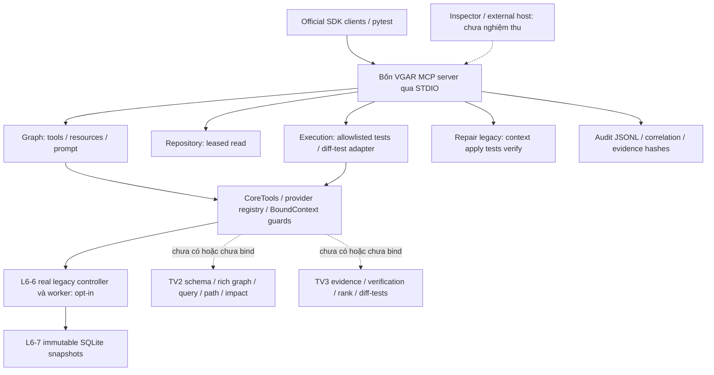
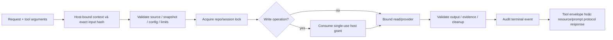
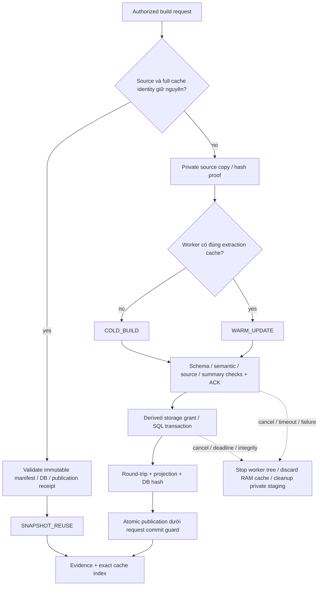

# BÁO CÁO TỔNG HỢP H1 → L6-8 — VGAR MCP server

**Ngày lập:** 09/11/2026, Asia/Saigon. **Repository:** `D:\Project\CAPSTONES\VGAR`. **Nhánh kiểm kê:** `m2/w12-a3-verifier-d15-20261105`; **HEAD:** `3f77fcf6ba68d7cfc6356dfe9757f6f53eed691b`.

**Kết luận:** đã xây dựng/chạy được nền tảng bốn MCP server, adapters/resources/prompt/security và build/storage legacy, có nghiệm thu SDK/wire và fixture thực. **Chưa hoàn tất production toàn bộ 11 core tools hoặc L6-8 end-to-end**: còn provider/schema/bootstrap và external-host validation. H1 đã được ACCEPTED_FOR_IMPLEMENTATION; không còn yêu cầu chờ review TV2/TV3, nhưng thiếu implementation/schema là dependency kỹ thuật thực.

Tài liệu này tổng hợp bằng chứng đã lưu, **không chạy lại test hoặc thay code trong lần lập báo cáo**. Các số test bên dưới là kết quả từng gate tại thời điểm seal, không phải một suite mới chạy hôm nay. UTC trong run_id có thể là08/11 trong khi ngày làm việc Việt Nam là09/11. Không đổi timestamp để làm đồng nhất giả.

## Mục lục

1. [Nguồn và cách đối chiếu diff](#1-nguồn-và-cách-đối-chiếu-diff)
2. [Trạng thái và số liệu](#2-trạng-thái-và-số-liệu)
3. [Kiến trúc và flow](#3-kiến-trúc-và-flow)
4. [Chi tiết từng task và file](#4-chi-tiết-từng-task-và-file)
5. [Inventory giao diện](#5-inventory-giao-diện)
6. [Bàn giao TV2/TV3](#6-bàn-giao-tv2tv3)
7. [Hướng dẫn chạy và giải thích lệnh](#7-hướng-dẫn-chạy-và-giải-thích-lệnh)
8. [Danh mục lệnh thực tế](#8-danh-mục-lệnh-thực-tế)
9. [Rủi ro và điểm tiếp tục](#9-rủi-ro-và-điểm-tiếp-tục)
10. [References](#10-references)

## 1. Nguồn và cách đối chiếu diff

Nguồn phạm vi theo thứ tự: [Plan MCP server](D:/Project/CAPSTONES/Final_Task/2026-11-08-mcp-server-implementation-plan.md); [Plan hai tuần/phân công](D:/Project/CAPSTONES/Final_Task/plan_2_weeks_mcp_server_2026-11-07.md); [Proposal](D:/Project/CAPSTONES/Final_Task/proposal_vgar_mcp_final_corrected.md). Context và lịch sử chat hỗ trợ diễn giải; code/receipt là bằng chứng implementation. Hai plan W9–W16/16tuần cũ không được dùng để tự mở rộng phạm vi hướng mới.

**“Codex Diff” trong báo cáo:** dùng `git status`, diff hiện có và đặc biệt `baseline.json`/`preservation.json`/`deliverable_hashes.json` hoặc `source_hashes.json` theo task để xác định file mới/sửa/bổ sung. Không giả rằng đã truy cập UI Codex Diff hoặc có từng commit riêng: các task chưa commit, diff so HEAD là diff tích lũy và còn chứa thay đổi M2 trước H1. Vì vậy attribution theo manifest từng task chính xác hơn việc gán toàn bộ `git diff` hiện tại cho MCP.

Danh mục bên dưới gồm **88 file bàn giao khác nhau** (source/scripts/tests/fixtures/config/requirements/docs), nhiều file xuất hiện ở nhiều task vì được mở rộng lần lượt. Nhãn NEW/MODIFIED/APPEND mô tả **tại task đó**, không phải Git status hiện tại. Ví dụ factory mới ở L6-1 rồi được sửa L6-3/L6-4; runtime worker được mở rộng nhiều lần. Có244 command receipts test/wire/helpers và28 quality receipts trong phạm vi đã trích xuất, bao gồm cả RED/failed steps. Lệnh có dấu `#pytest` trong đường dẫn receipt là JSON key, không phải một file khác.

Đường dẫn file trong bảng là link tuyệt đối trên máy Windows; `VGAR\...` tương ứng root nêu ở đầu báo cáo. Thư mục results bị ignore: clone/push code không tự mang theo raw logs. Khi bàn giao cần gửi raw receipts liên quan riêng hoặc vị trí lưu được nhóm truy cập. Không tự đưa authority/grants/secrets/venv/DB/raw repair data lên GitHub.

## 2. Trạng thái và số liệu

**Thứ tự triển khai thực tế:** H1→L6-1→L6-5→L6-2→L6-3→L6-4→L6-7→L6-6→preflight L6-8. Security/storage được làm trước adapter/orchestration sử dụng chúng; không phải làm thiếu task vì số thứ tự không tăng đều.

| Task | Nội dung | Trạng thái đúng phạm vi | Gate đã lưu | Giải thích |
| --- | --- | --- | --- | --- |
| H1 | Chuẩn bị contract và bảo toàn baseline | DONE chuẩn bị; ACCEPTED_FOR_IMPLEMENTATION | 15/15 kiểm tra tĩnh; cập nhật xác nhận plan: 8 checks + 3 regression tests PASS | Không runtime/provider/production schema; bản seal gốc vẫn DRAFT như lịch sử. |
| L6-1 | Migration bốn server và runtime riêng | DONE kỹ thuật; runtime ACCEPTED | 19 SDK2; 99 legacy + 1 skip cũ; 28 repair/legacy; 2 lifecycle; 16/16 wire | Các nhóm test chồng lấn; không cộng unique total. Không provider mới. |
| L6-5 | Security và concurrency nền | DONE kỹ thuật foundations | 78 SDK2 = 59 security + 19 runtime; 100 legacy + 1 skip cũ; 16/16 wire | Nền bảo vệ đã có; provider mới vẫn phải đi qua guards khi tích hợp. |
| L6-2 | Adapters cho 11 core tools | DONE kỹ thuật adapter; WAITING_PROVIDER | 139 SDK2 = 61 mới + 78 regression; 100 legacy + 1 skip; pinned regression56 + 1 skip; 16/16 wire | 20 tools được đăng ký không đồng nghĩa 11 core production đều hoạt động. |
| L6-3 | Resource serving và tương thích legacy | DONE kỹ thuật serving; WAITING_PROVIDER | 211 SDK2 = 72 mới + 139 regression; 100 legacy + 1 skip; 16/16 wire | 8 canonical + 1 alias; schema/component/task/baseline production chưa bind. |
| L6-4 | Prompt repair_with_graph_context | DONE kỹ thuật template | 266 SDK2 = 55 prompt/controller mới + 211 regression; 102 legacy + 1 skip; 16/16 wire | Một prompt thật; renderer/template PASS không chứng minh agent đã làm workflow. |
| L6-7 | SQLite snapshot storage và khảo sát backend | DONE kỹ thuật SQLite/legacy; WAITING_SCHEMA_PROVIDER | 328 SDK2 = 52 storage + 10 SQLite legacy + 266 MCP; 102 legacy + 1 skip | Schema graph mới chưa round-trip thật. Kùzu/Neo4j OPTIONAL_NOT_SELECTED. |
| L6-6 | Build/update graph với cache theo phiên | DONE kỹ thuật legacy; WAITING_PROVIDER/SCHEMA_PROVIDER | 399 SDK2 = 45 mới + 354 regression; 102 legacy + 1 skip; 3 real STDIO lanes | Static Python legacy thực; extraction cached nhưng linking toàn repo, chưa benchmark rich graph. |
| L6-8 | Preflight offline cho tích hợp thật | DONE kỹ thuật preflight; toàn L6-8 PARTIAL | 50 SDK2, trong đó31 preflight; 40 legacy + 1 skip; 8/8 wire; 2 real fixture build chains | Exit2/PARTIAL; Inspector/Claude/full production chain NOT_RUN. Chưa bootstrap production mới. |

**Không cộng**19+78+139+211+266+328+399+50 thành tổng số test độc lập: nhiều gate là superset hoặc scoped subset. Gate399 tại L6-6 rộng hơn gate50 preflight nhưng không có nghĩa L6-8 bị giảm chất lượng; preflight không sửa domain/runtime nên chỉ chạy regression liên quan. Legacy symlink test skip đã tồn tại, không thêm skip/xfail để làm xanh.

Pip check, import isolation, scoped Ruff và preservation của từng task PASS theo receipt. Global whitespace còn15 findings cũ trong báo cáo M2, được giữ nguyên và không tuyên bố toàn repository lint/CI đều xanh. Không có số Repair%, FAR/FRR, model latency/token hoặc benchmark rich-graph mới từ các task MCP này.

| Task | Baseline bảo vệ | Không đổi nguyên byte | Thay đổi hợp lệ |
| --- | --- | --- | --- |
| H1 | 480 | 479 | PROGRESS append; file H1 mới nằm ngoài baseline |
| L6-1 | 117 | 109 | 6MCP source + PROGRESS/status; runtime mới bên ngoài legacy venv |
| L6-5 | 589 | 580 | 6intentional edits +3append |
| L6-2 | 1.768 | 1.757 | 8intentional edits +3append |
| L6-3 | 2.042 | 2.031 | 8intentional edits +3append |
| L6-4 | 2.369 | 2.359 | 7intentional edits +3append |
| L6-7 | 2.605 | 2.600 | 2legacy storage/factory edits +3append |
| L6-6 | 2.701 | 2.695 | 3integration edits +3append |
| L6-8 preflight | 2.894 | 2.891 | 3append; CLI campaign bảo vệ2.903file gồm9file preflight mới |

Số trên mô tả inventories khác nhau tại từng thời điểm, không phải số toàn bộ repository. Receipt là nguồn số tuyệt đối; thay đổi hợp lệ đã nằm trong allowlist, không phải mất bảo toàn.

## 3. Kiến trúc và flow



MCP server cung cấp giao diện; host quản lý client/model/tool orchestration. Scripted SDK client là công cụ test, không agent. Claude Code là một host candidate, không phải ràng buộc chọn Claude model. Model local/fine-tune cần host phù hợp và gate compatibility, không tự biến weights thành MCP client.



Không có context/capability/quyền thì từ chối hoặc trả unavailable đúng contract; không tự trả rỗng/PASS. Write authorization đến từ host, không từ README/model/confirmed=true. Audit failure, hash/binding mismatch và cancellation không được chuyển thành success.



`published=true` có nghĩa snapshot manifest READY/evidence hợp lệ, không chỉ DB đã tồn tại. Extraction cache và durable snapshot khác nhau; restart mất RAM cache nhưng không xóa snapshots đã công bố. Source không bị apply patch trong build graph.

## 4. Chi tiết từng task và file

## 4.1. H1 — Chuẩn bị contract và bảo toàn baseline

**Trạng thái:** DONE chuẩn bị; ACCEPTED_FOR_IMPLEMENTATION. **Checkpoint:** [điểm khôi phục](D:/Project/CAPSTONES/VGAR/docs/checkpoints/2026-11-08-mcp-contract-baseline.md).

### Yêu cầu và cách thực hiện

Chụp HEAD/branch/status/staged–unstaged/untracked, hash source/DB/report/contracts và tài liệu nguồn trước khi tạo contract. H1 chỉ dùng source/AST/metadata để phân biệt 15 legacy tool registrations, 3 resources, 0 prompt với mục tiêu 11 core tools, 8 canonical resources, 1 prompt; không import server hay chạy target code. Có 14 tên bare-tool khác nhau trong 15 registrations vì `health` có ở cả repository và execution server; phải phân biệt routing/server, không chỉ đếm tên. Sau L6-2, `run_relevant_tests` cũng cần phân biệt execution và repair namespace.

Tạo contract với signature, envelope/error, limits, quyền, task/snapshot binding, STDIO stdout dành cho protocol; draft Component/Port tách khỏi legacy GraphDocument. Fixture oracle viết tay, không lấy chính output producer làm đáp án: 5 Python source files, 4 symbols, 3 callsites, 7 raw evidence edges, 2 patches GOOD/BAD và 2 behavior examples. Callers/callees legacy có Test caller, production impact oracle tách riêng.

H1 đầu tiên seal `DRAFT / REVIEW_PENDING`; sau khi người dùng xác nhận quyền tự quyết và plan đã chốt, status được cập nhật thành `ACCEPTED_FOR_IMPLEMENTATION`. Đây là xác nhận scope triển khai, không phải chữ ký review TV2/TV3 hay nghiệm thu schema thật. Bản seal cũ không được sửa để che lịch sử. Artifact cập nhật: `results/mcp_server/contract/20261108T130221Z-plan-confirmation/`; ngoài các file H1, cross-reference trong runtime runbook/checkpoint được cập nhật metadata.

### Kết quả và giới hạn

Baseline480 protected files/7 tài liệu nguồn; final15/15 kiểm tra tĩnh PASS. Reproducer review-red chỉ fail test_08 do thiếu Test caller; sửa oracle rồi GREEN. Lượt xác nhận plan có8 static/status checks và3 legacy compatibility tests PASS. Đây không phải 15 target pytest tests hoặc repair experiment. Các ID quyết định H1 còn là đầu vào implementation/schema/protocol thực nghiệm, không phải yêu cầu xin duyệt lại.

### File/folder tạo mới hoặc thay đổi của H1

| File — đường dẫn cụ thể | Loại thay đổi tại task | Vai trò |
| --- | --- | --- |
| [VGAR\PROGRESS.md](D:/Project/CAPSTONES/VGAR/PROGRESS.md) | Bổ sung cuối, giữ lịch sử | Tiến độ liên phiên; mỗi task bổ sung kết quả/điểm dừng, bảo toàn phần lịch sử. |
| [VGAR\docs\checkpoints\2026-11-08-mcp-contract-baseline.md](D:/Project/CAPSTONES/VGAR/docs/checkpoints/2026-11-08-mcp-contract-baseline.md) | Tạo mới | Checkpoint của H1: baseline, IN_PROGRESS lịch sử, final evidence, dependency và điểm tiếp tục. |
| [VGAR\docs\mcp_server\contract.md](D:/Project/CAPSTONES/VGAR/docs/mcp_server/contract.md) | Tạo mới | Contract gốc H1 và phần bổ sung theo triển khai: inventory, DTO, binding, semantics, limits, dependencies. |
| [VGAR\docs\mcp_server\status.md](D:/Project/CAPSTONES/VGAR/docs/mcp_server/status.md) | Tạo mới | Sổ trạng thái MCP: DONE kỹ thuật, provider/schema pending, actual evidence; không đồng nhất các mức. |
| [VGAR\tests\fixtures\mcp_server\expected_contract.json](D:/Project/CAPSTONES/VGAR/tests/fixtures/mcp_server/expected_contract.json) | Tạo mới | Oracle H1 viết tay: surface/payload fingerprints, Python sources, callers/path/impact và GOOD/BAD patches; architecture draft tách riêng. |

Lượt H1 plan-confirmation sau L6-1 còn sửa cross-reference trạng thái trong [VGAR\docs\mcp_server\runtime.md](D:/Project/CAPSTONES/VGAR/docs/mcp_server/runtime.md) và [VGAR\docs\checkpoints\2026-11-08-mcp-sdk-runtime.md](D:/Project/CAPSTONES/VGAR/docs/checkpoints/2026-11-08-mcp-sdk-runtime.md). Đây là cập nhật tài liệu H1 sau xác nhận, không sửa runtime implementation.7file của status update vẫn thuộc88file chung, không tính thành file mới riêng.

### Artifact và nơi đọc log/result

**Thư mục đầy đủ:** `D:\Project\CAPSTONES\VGAR\results\mcp_server\contract\20261108T100021Z-baseline` — [mở artifact H1](D:/Project/CAPSTONES/VGAR/results/mcp_server/contract/20261108T100021Z-baseline). Các folder con là từng lượt test/wire/fixture; không phải source triển khai production.

| File bằng chứng | Dùng để xem |
| --- | --- |
| [summary.json](D:/Project/CAPSTONES/VGAR/results/mcp_server/contract/20261108T100021Z-baseline/summary.json) | Metadata/result/receipt có thể đối chiếu với checkpoint và command journals. |
| [preservation.json](D:/Project/CAPSTONES/VGAR/results/mcp_server/contract/20261108T100021Z-baseline/preservation.json) | Bảo toàn input/baseline/allowlist/append-only. |
| [artifact_hashes.json](D:/Project/CAPSTONES/VGAR/results/mcp_server/contract/20261108T100021Z-baseline/artifact_hashes.json) | Inventory đầy đủ path→SHA-256 của raw artifact; không sửa sau seal. |
| [validation-final.log](D:/Project/CAPSTONES/VGAR/results/mcp_server/contract/20261108T100021Z-baseline/validation-final.log) | Log/JUnit gate đã chạy; phân biệt RED/failed intermediate và final. |
| [validation-final.xml](D:/Project/CAPSTONES/VGAR/results/mcp_server/contract/20261108T100021Z-baseline/validation-final.xml) | Log/JUnit gate đã chạy; phân biệt RED/failed intermediate và final. |
| [review.json](D:/Project/CAPSTONES/VGAR/results/mcp_server/contract/20261108T100021Z-baseline/review.json) | Metadata/result/receipt có thể đối chiếu với checkpoint và command journals. |
| [commands.md](D:/Project/CAPSTONES/VGAR/results/mcp_server/contract/20261108T100021Z-baseline/commands.md) | Metadata/result/receipt có thể đối chiếu với checkpoint và command journals. |

Inventory raw file/folder đầy đủ nằm trong `artifact_hashes.json` của thư mục này; bảng source ở trên không trộn hàng nghìn log/generated fixture files vào code bàn giao. Phụ lục8 ghi từng command receipt thực cùng exit code, argv, log/JUnit references khi có. Raw result đã ignore không tự xuất hiện trên GitHub.

## 4.2. L6-1 — Migration bốn server và runtime riêng

**Trạng thái:** DONE kỹ thuật; runtime ACCEPTED. **Checkpoint:** [điểm khôi phục](D:/Project/CAPSTONES/VGAR/docs/checkpoints/2026-11-08-mcp-sdk-runtime.md).

### Yêu cầu và cách thực hiện

Giữ bốn entrypoints/names/decorators/signatures/payload legacy nhưng chạy trong runtime MCP SDK2 riêng. `create_server()` đọc installed package metadata: major2 dùng MCPServer, major1 dùng FastMCP, version/import lỗi fail rõ và không fallback âm thầm. Tách eager imports bằng lazy export; registry dùng interface chỉ cần `name` để server không phụ thuộc BaseTool/LangChain.

Tạo venv riêng `D:ProjectCAPSTONESenvironmentsgar-mcp-server-sdk2`, pin `mcp==2.2.0`; không sửa CUDA venv, không `--system-site-packages`, không cài root VGAR distribution còn ràng buộc MCP<2. Lock56 distributions cùng wheel hashes được sinh từ install report và kiểm resolver dry-run. Proof cài chung MCP2 và legacy LangChain adapter conflict trả exit1 đúng kỳ vọng; không gọi đó là runtime install hỏng.

Official SDK clients chạy list/call/read qua STDIO: graph query/error/resource, repository health/read/path jail, execution health/leased pytest/selector denial, repair trusted `single_file_login` reference patch context→apply→tests→verify ACCEPT. Repair smoke là dữ liệu synthetic/reference patch, không generator/model.

### Kết quả và giới hạn

Final19 SDK2 unit PASS;99 legacy PASS+1 skip cũ;28 repair/legacy PASS;2 lifecycle PASS, các nhóm có overlap. Wire16/16: SDK2→SDK2 modern4 và legacy4, SDK1→SDK2 legacy4, SDK1→SDK1 legacy4. Protocol đo thực2026-07-28/2025-11-25, không suy từ SDK major. Runtime ACCEPTED; import isolation/pip check/lock hash và cleanup PASS. L6-1 không có provider mới, prompt hay agent loop; các task sau mở rộng cùng factory/worker mà không viết lại receipt L6-1.

### File/folder tạo mới hoặc thay đổi của L6-1

| File — đường dẫn cụ thể | Loại thay đổi tại task | Vai trò |
| --- | --- | --- |
| [VGAR\PROGRESS.md](D:/Project/CAPSTONES/VGAR/PROGRESS.md) | Bổ sung cuối, giữ lịch sử | Tiến độ liên phiên; mỗi task bổ sung kết quả/điểm dừng, bảo toàn phần lịch sử. |
| [VGAR\configs\mcp_server\runtime.json](D:/Project/CAPSTONES/VGAR/configs/mcp_server/runtime.json) | Tạo mới | Interpreter, SDK/entrypoints và receipt runtime đã chấp nhận; không tự cấp quyền hoặc bật provider. |
| [VGAR\docs\checkpoints\2026-11-08-mcp-sdk-runtime.md](D:/Project/CAPSTONES/VGAR/docs/checkpoints/2026-11-08-mcp-sdk-runtime.md) | Tạo mới | Checkpoint của L6-1: baseline, IN_PROGRESS lịch sử, final evidence, dependency và điểm tiếp tục. |
| [VGAR\docs\mcp_server\runtime.md](D:/Project/CAPSTONES/VGAR/docs/mcp_server/runtime.md) | Tạo mới | Runbook runtime SDK1/SDK2, import isolation, wire lanes và launcher. |
| [VGAR\docs\mcp_server\status.md](D:/Project/CAPSTONES/VGAR/docs/mcp_server/status.md) | Bổ sung cuối, giữ lịch sử | Sổ trạng thái MCP: DONE kỹ thuật, provider/schema pending, actual evidence; không đồng nhất các mức. |
| [VGAR\requirements\mcp-server.in](D:/Project/CAPSTONES/VGAR/requirements/mcp-server.in) | Tạo mới | Dependency input cho runtime server riêng; pin mcp2.2.0 và filelock4.2.9 trực tiếp. |
| [VGAR\requirements\mcp-server.lock](D:/Project/CAPSTONES/VGAR/requirements/mcp-server.lock) | Tạo mới | Khóa 56 distributions chính xác kèm wheel SHA-256 từ resolver/install report. |
| [VGAR\scripts\mcp_server\_runtime_probe.py](D:/Project/CAPSTONES/VGAR/scripts/mcp_server/_runtime_probe.py) | Tạo mới | Child probe kiểm SDK class/imports/allowlist/inventory; không import legacy agent client. |
| [VGAR\scripts\mcp_server\_runtime_worker.py](D:/Project/CAPSTONES/VGAR/scripts/mcp_server/_runtime_worker.py) | Tạo mới | Official SDK client qua STDIO: list/call/read/get_prompt, negative cases, trusted repair reference-patch fixture. |
| [VGAR\scripts\mcp_server\check_runtime.py](D:/Project/CAPSTONES/VGAR/scripts/mcp_server/check_runtime.py) | Tạo mới | Controller kiểm package/import isolation, chạy wire lanes bằng client/server interpreter được chọn và đọc receipt. |
| [VGAR\src\vgar\mcp\__init__.py](D:/Project/CAPSTONES/VGAR/src/vgar/mcp/__init__.py) | Sửa/mở rộng file có sẵn | Lazy export giữ create_mcp_client legacy, tránh kéo LangChain khi import server. |
| [VGAR\src\vgar\mcp\registry.py](D:/Project/CAPSTONES/VGAR/src/vgar/mcp/registry.py) | Sửa/mở rộng file có sẵn | Interface NamedTool chỉ cần name, public allowlist rõ; mở rộng thêm đúng core tools. |
| [VGAR\src\vgar\mcp\server_factory.py](D:/Project/CAPSTONES/VGAR/src/vgar/mcp/server_factory.py) | Tạo mới | SDK-major factory; resource raw-URI override và safe prompt/protocol boundary khi các task sau mở rộng. |
| [VGAR\src\vgar\mcp\servers\execution_server.py](D:/Project/CAPSTONES/VGAR/src/vgar/mcp/servers/execution_server.py) | Sửa/mở rộng file có sẵn | Execution MCP entrypoint; leased selector legacy và adapter run_relevant_tests(diff) mới. |
| [VGAR\src\vgar\mcp\servers\graph_server.py](D:/Project/CAPSTONES/VGAR/src/vgar/mcp/servers/graph_server.py) | Sửa/mở rộng file có sẵn | Graph MCP entrypoint; đăng ký legacy/core tools, resources, prompt; opt-in trusted CoreTools/controller và shutdown. |
| [VGAR\src\vgar\mcp\servers\repair_server.py](D:/Project/CAPSTONES/VGAR/src/vgar/mcp/servers/repair_server.py) | Sửa/mở rộng file có sẵn | Repair MCP entrypoint legacy; trusted workflow, khóa whole-cycle load/mutate/persist/finalize và sidecars. |
| [VGAR\src\vgar\mcp\servers\repository_server.py](D:/Project/CAPSTONES/VGAR/src/vgar/mcp/servers/repository_server.py) | Sửa/mở rộng file có sẵn | Repository MCP entrypoint; read-only leased root, protected-file/path guard, không tool ghi file mới. |
| [VGAR\tests\mcp_server\test_legacy_compatibility.py](D:/Project/CAPSTONES/VGAR/tests/mcp_server/test_legacy_compatibility.py) | Tạo mới | Frozen surface/payload/canonical compatibility; inventory additions được kiểm tách, không rewrite H1 fingerprints. |
| [VGAR\tests\mcp_server\test_runtime_cli.py](D:/Project/CAPSTONES/VGAR/tests/mcp_server/test_runtime_cli.py) | Tạo mới | Runtime checker/receipt gates; sau L6-4 kiểm get_prompt thật thay listing-only. |
| [VGAR\tests\mcp_server\test_runtime_lifecycle.py](D:/Project/CAPSTONES/VGAR/tests/mcp_server/test_runtime_lifecycle.py) | Tạo mới | Start/close/abnormal exit/timeout/shutdown và process cleanup. |
| [VGAR\tests\mcp_server\test_sdk_runtime.py](D:/Project/CAPSTONES/VGAR/tests/mcp_server/test_sdk_runtime.py) | Tạo mới | SDK1/2 factory class, lazy imports, metadata-error/fail-closed và runtime isolation. |

### Artifact và nơi đọc log/result

**Thư mục đầy đủ:** `D:\Project\CAPSTONES\VGAR\results\mcp_server\runtime\20261108T121938Z-sdk2` — [mở artifact L6-1](D:/Project/CAPSTONES/VGAR/results/mcp_server/runtime/20261108T121938Z-sdk2). Các folder con là từng lượt test/wire/fixture; không phải source triển khai production.

| File bằng chứng | Dùng để xem |
| --- | --- |
| [summary.json](D:/Project/CAPSTONES/VGAR/results/mcp_server/runtime/20261108T121938Z-sdk2/summary.json) | Metadata/result/receipt có thể đối chiếu với checkpoint và command journals. |
| [preservation.json](D:/Project/CAPSTONES/VGAR/results/mcp_server/runtime/20261108T121938Z-sdk2/preservation.json) | Bảo toàn input/baseline/allowlist/append-only. |
| [artifact_hashes.json](D:/Project/CAPSTONES/VGAR/results/mcp_server/runtime/20261108T121938Z-sdk2/artifact_hashes.json) | Inventory đầy đủ path→SHA-256 của raw artifact; không sửa sau seal. |
| [runtime-acceptance.json](D:/Project/CAPSTONES/VGAR/results/mcp_server/runtime/20261108T121938Z-sdk2/runtime-acceptance.json) | Metadata/result/receipt có thể đối chiếu với checkpoint và command journals. |
| [review.json](D:/Project/CAPSTONES/VGAR/results/mcp_server/runtime/20261108T121938Z-sdk2/review.json) | Metadata/result/receipt có thể đối chiếu với checkpoint và command journals. |
| [setup-and-commands.md](D:/Project/CAPSTONES/VGAR/results/mcp_server/runtime/20261108T121938Z-sdk2/setup-and-commands.md) | Metadata/result/receipt có thể đối chiếu với checkpoint và command journals. |

Inventory raw file/folder đầy đủ nằm trong `artifact_hashes.json` của thư mục này; bảng source ở trên không trộn hàng nghìn log/generated fixture files vào code bàn giao. Phụ lục8 ghi từng command receipt thực cùng exit code, argv, log/JUnit references khi có. Raw result đã ignore không tự xuất hiện trên GitHub.

## 4.3. L6-5 — Security và concurrency nền

**Trạng thái:** DONE kỹ thuật foundations. **Checkpoint:** [điểm khôi phục](D:/Project/CAPSTONES/VGAR/docs/checkpoints/2026-11-08-mcp-security-concurrency.md).

### Yêu cầu và cách thực hiện

Host tạo immutable BoundContext gồm repo/lease/output/state roots tách biệt, request/run/task IDs, snapshot/source/config hashes, deadline/limits. ContextAuthority ký HMAC; model không thể tự gửi dict/confirmed=true để tạo context/grant. Write grant bind exact operation/input/scope/expiry, consume single-use dưới OS-backed file lock; replay hai process chỉ một thành công.

Path/read guard kiểm traversal, drive/UNC/ADS/device/Windows aliases, symlink/junction/reparse và opened-handle path; chặn secrets/control files. Legacy repository read được nối guard. Repair giữ session lock toàn chu kỳ validate→load→mutate→persist/finalize; managed marker và session_commit sidecar chứng minh cặp session/run-record. Run lịch sử chưa managed vẫn qua validation cũ, không migrate artifacts frozen.

Audit JSONL append dưới OS lock, flush/fsync, kiểm tail/record cap, redact sensitive keys/known secrets và raw issue/prompt/diff thành metadata/hash. Reader chỉ đọc log bind đúng run/task, bounded cursor. Async cancellation ghi terminal audit rồi truyền tiếp. CPU/blocking job chạy subprocess trong process-tree boundary; timeout/cancel/output cap dừng descendants và có receipt, không chỉ cancel coroutine/thread. Atomic publication dùng commit guard cùng request cancellation.

### Kết quả và giới hạn

78 SDK2 PASS (59 security+19 runtime),100 legacy PASS+1 skip cũ,16/16 wire PASS. Audit concurrency120/120 records, session24 updates, native junction và apply-once/optimized-Python/commit-order cases đã kiểm. Limits mới: file read65.536bytes, worker120s, output12.000bytes/stream, lock10s, audit256KiB/200records. Không đổi repair timeout900/1800. Filelock4.2.9 đã có trong lock được đưa thành direct dependency, không nâng môi trường.

Guards là bảo vệ application/host boundary, không phải OS sandbox chống Python plugin độc hại cùng tài khoản. Không hứa phát hiện mọi prompt injection. SQLite thread test dùng snapshot đã chuẩn bị, không chứng minh legacy concurrent migration an toàn. Nối guard vào adapter/build/storage là phần các task sau.

### File/folder tạo mới hoặc thay đổi của L6-5

| File — đường dẫn cụ thể | Loại thay đổi tại task | Vai trò |
| --- | --- | --- |
| [VGAR\PROGRESS.md](D:/Project/CAPSTONES/VGAR/PROGRESS.md) | Bổ sung cuối, giữ lịch sử | Tiến độ liên phiên; mỗi task bổ sung kết quả/điểm dừng, bảo toàn phần lịch sử. |
| [VGAR\configs\mcp_server\security.json](D:/Project/CAPSTONES/VGAR/configs/mcp_server/security.json) | Tạo mới | Defaults giới hạn đọc, worker, output, khóa và audit; tách khỏi timeout repair cũ. |
| [VGAR\docs\checkpoints\2026-11-08-mcp-security-concurrency.md](D:/Project/CAPSTONES/VGAR/docs/checkpoints/2026-11-08-mcp-security-concurrency.md) | Tạo mới | Checkpoint của L6-5: baseline, IN_PROGRESS lịch sử, final evidence, dependency và điểm tiếp tục. |
| [VGAR\docs\mcp_server\contract.md](D:/Project/CAPSTONES/VGAR/docs/mcp_server/contract.md) | Bổ sung cuối, giữ lịch sử | Contract gốc H1 và phần bổ sung theo triển khai: inventory, DTO, binding, semantics, limits, dependencies. |
| [VGAR\docs\mcp_server\security.md](D:/Project/CAPSTONES/VGAR/docs/mcp_server/security.md) | Tạo mới | Runbook trusted context/grants, path/read policy, locks, session, audit, cancellation. |
| [VGAR\docs\mcp_server\status.md](D:/Project/CAPSTONES/VGAR/docs/mcp_server/status.md) | Bổ sung cuối, giữ lịch sử | Sổ trạng thái MCP: DONE kỹ thuật, provider/schema pending, actual evidence; không đồng nhất các mức. |
| [VGAR\requirements\mcp-server.in](D:/Project/CAPSTONES/VGAR/requirements/mcp-server.in) | Sửa/mở rộng file có sẵn | Dependency input cho runtime server riêng; pin mcp2.2.0 và filelock4.2.9 trực tiếp. |
| [VGAR\src\vgar\mcp\audit.py](D:/Project/CAPSTONES/VGAR/src/vgar/mcp/audit.py) | Sửa/mở rộng file có sẵn | Append JSONL dưới OS lock, fsync/tail/cap checks, redaction và correlation, giữ event envelope legacy. |
| [VGAR\src\vgar\mcp\client.py](D:/Project/CAPSTONES/VGAR/src/vgar/mcp/client.py) | Sửa/mở rộng file có sẵn | Legacy client được giữ; bổ sung lọc env credentials/tắt child dotenv reload. |
| [VGAR\src\vgar\mcp\proposal\__init__.py](D:/Project/CAPSTONES/VGAR/src/vgar/mcp/proposal/__init__.py) | Tạo mới | Namespace foundations/adapters mới, không tạo agent loop hoặc tự chọn provider. |
| [VGAR\src\vgar\mcp\proposal\context.py](D:/Project/CAPSTONES/VGAR/src/vgar/mcp/proposal/context.py) | Tạo mới | ContextAuthority, sealed immutable BoundContext, exact single-use grants, request scope/cancel và source inventory hash. |
| [VGAR\src\vgar\mcp\proposal\jobs.py](D:/Project/CAPSTONES/VGAR/src/vgar/mcp/proposal/jobs.py) | Tạo mới | Guarded subprocess/process-tree boundary, output caps/deadline/cancellation/cleanup receipts. |
| [VGAR\src\vgar\mcp\proposal\locking.py](D:/Project/CAPSTONES/VGAR/src/vgar/mcp/proposal/locking.py) | Tạo mới | OS-backed filelock theo canonical repo/session/request; no-links guard và giới hạn chờ. |
| [VGAR\src\vgar\mcp\proposal\security.py](D:/Project/CAPSTONES/VGAR/src/vgar/mcp/proposal/security.py) | Tạo mới | Root/path/read jail, protected secrets/control files, opened-handle validation; bound audit reader và redaction helpers. |
| [VGAR\src\vgar\mcp\proposal\state.py](D:/Project/CAPSTONES/VGAR/src/vgar/mcp/proposal/state.py) | Tạo mới | Session managed marker/commit pair, whole-cycle guard và atomic publication primitive. |
| [VGAR\src\vgar\mcp\servers\repair_server.py](D:/Project/CAPSTONES/VGAR/src/vgar/mcp/servers/repair_server.py) | Sửa/mở rộng file có sẵn | Repair MCP entrypoint legacy; trusted workflow, khóa whole-cycle load/mutate/persist/finalize và sidecars. |
| [VGAR\src\vgar\mcp\servers\repository_server.py](D:/Project/CAPSTONES/VGAR/src/vgar/mcp/servers/repository_server.py) | Sửa/mở rộng file có sẵn | Repository MCP entrypoint; read-only leased root, protected-file/path guard, không tool ghi file mới. |
| [VGAR\src\vgar\mcp\tooling.py](D:/Project/CAPSTONES/VGAR/src/vgar/mcp/tooling.py) | Sửa/mở rộng file có sẵn | Sync/async wrapper giữ tool envelope và terminal audit; audit cancellation rồi truyền tiếp. |
| [VGAR\tests\mcp_server\conftest.py](D:/Project/CAPSTONES/VGAR/tests/mcp_server/conftest.py) | Tạo mới | Thiết lập test scope/fixtures security và cleanup; không cấp quyền production. |
| [VGAR\tests\mcp_server\test_concurrency.py](D:/Project/CAPSTONES/VGAR/tests/mcp_server/test_concurrency.py) | Tạo mới | Cross-thread/process replay, audit/session/update serialization, commit/cancellation ordering. |
| [VGAR\tests\mcp_server\test_security.py](D:/Project/CAPSTONES/VGAR/tests/mcp_server/test_security.py) | Tạo mới | Spoof/expiry/replay context/grants, root/path/secret guards, audit integrity và optimized-Python fail-closed. |
| [VGAR\tests\mcp_server\test_security_jobs.py](D:/Project/CAPSTONES/VGAR/tests/mcp_server/test_security_jobs.py) | Tạo mới | Native worker/descendant cleanup tại build/copy/test barriers, timeout/output cap và cancellation. |
| [VGAR\tests\mcp_server\test_security_wire.py](D:/Project/CAPSTONES/VGAR/tests/mcp_server/test_security_wire.py) | Tạo mới | SDK2 guarded synthetic tool: denied call không operation write/spawn, audit/cancellation wire. |

### Artifact và nơi đọc log/result

**Thư mục đầy đủ:** `D:\Project\CAPSTONES\VGAR\results\mcp_server\security\20261108T131906Z-guards` — [mở artifact L6-5](D:/Project/CAPSTONES/VGAR/results/mcp_server/security/20261108T131906Z-guards). Các folder con là từng lượt test/wire/fixture; không phải source triển khai production.

| File bằng chứng | Dùng để xem |
| --- | --- |
| [summary.json](D:/Project/CAPSTONES/VGAR/results/mcp_server/security/20261108T131906Z-guards/summary.json) | Metadata/result/receipt có thể đối chiếu với checkpoint và command journals. |
| [preservation.json](D:/Project/CAPSTONES/VGAR/results/mcp_server/security/20261108T131906Z-guards/preservation.json) | Bảo toàn input/baseline/allowlist/append-only. |
| [artifact_hashes.json](D:/Project/CAPSTONES/VGAR/results/mcp_server/security/20261108T131906Z-guards/artifact_hashes.json) | Inventory đầy đủ path→SHA-256 của raw artifact; không sửa sau seal. |
| [sdk2-final.xml](D:/Project/CAPSTONES/VGAR/results/mcp_server/security/20261108T131906Z-guards/sdk2-final.xml) | Log/JUnit gate đã chạy; phân biệt RED/failed intermediate và final. |
| [sdk2-release.xml](D:/Project/CAPSTONES/VGAR/results/mcp_server/security/20261108T131906Z-guards/sdk2-release.xml) | Log/JUnit gate đã chạy; phân biệt RED/failed intermediate và final. |
| [review.json](D:/Project/CAPSTONES/VGAR/results/mcp_server/security/20261108T131906Z-guards/review.json) | Metadata/result/receipt có thể đối chiếu với checkpoint và command journals. |
| [commands.md](D:/Project/CAPSTONES/VGAR/results/mcp_server/security/20261108T131906Z-guards/commands.md) | Metadata/result/receipt có thể đối chiếu với checkpoint và command journals. |

Inventory raw file/folder đầy đủ nằm trong `artifact_hashes.json` của thư mục này; bảng source ở trên không trộn hàng nghìn log/generated fixture files vào code bàn giao. Phụ lục8 ghi từng command receipt thực cùng exit code, argv, log/JUnit references khi có. Raw result đã ignore không tự xuất hiện trên GitHub.

## 4.4. L6-2 — Adapters cho 11 core tools

**Trạng thái:** DONE kỹ thuật adapter; WAITING_PROVIDER. **Checkpoint:** [điểm khôi phục](D:/Project/CAPSTONES/VGAR/docs/checkpoints/2026-11-08-mcp-core-tools.md).

### Yêu cầu và cách thực hiện

Triển khai contract/ports/CoreTools adapters, không viết thuật toán TV2/TV3. DTO frozen Pydantic, extra=forbid; diff hash lấy UTF-8 bytes chính xác, không normalize newline. ProviderRegistry immutable do Python bootstrap trusted tạo; production từ chối synthetic test registry. Output phải khớp snapshot/source/config/task/run và evidence file/hash thực.

Thêm graph tools build/path/constraints/rank và execution `run_relevant_tests(diff)`, nâng15→20 registrations để đủ11 core names. Legacy depth1 giữ payload; depth>1 cần traversal provider, không echo depth như đã duyệt. Bounds mặc định2hop/200nodes/10.000edges; ranking kiểm candidate IDs/hash, finite score, deterministic ties và required check eligibility: FAIL/ERROR/NOT_RUN không được điểm cao biến thành ACCEPT.

Build/test adapters xác minh source dưới khóa trước consume grant và gọi provider. Test provider sở hữu private admitted workspace, apply state/count, execution và cleanup receipt; không sửa source gốc hoặc gọi repair finalizer để lấy test result. Cleanup kiểm mọi file/ignored cache/empty dirs, chỉ cho phép candidate subtree host đã bind thay đổi. Default graph/execution registry vẫn rỗng khi chưa bootstrap.

### Kết quả và giới hạn

139 SDK2 PASS (61 mới+78 regression);100 legacy PASS+1skip; regression pinned56 PASS+1skip;16/16 compatibility wire. Bốn core synthetic STDIO cases thuộc gate; output fixture chỉ chứng minh adapter, không provider production. Không thêm resource/prompt ở bước này. Provider path/traversal/verification/rank/diff-tests vẫn thiếu; build thực được thêm sau bằng L6-6 nhưng launcher default chưa tự bind.

### File/folder tạo mới hoặc thay đổi của L6-2

| File — đường dẫn cụ thể | Loại thay đổi tại task | Vai trò |
| --- | --- | --- |
| [VGAR\PROGRESS.md](D:/Project/CAPSTONES/VGAR/PROGRESS.md) | Bổ sung cuối, giữ lịch sử | Tiến độ liên phiên; mỗi task bổ sung kết quả/điểm dừng, bảo toàn phần lịch sử. |
| [VGAR\docs\checkpoints\2026-11-08-mcp-core-tools.md](D:/Project/CAPSTONES/VGAR/docs/checkpoints/2026-11-08-mcp-core-tools.md) | Tạo mới | Checkpoint của L6-2: baseline, IN_PROGRESS lịch sử, final evidence, dependency và điểm tiếp tục. |
| [VGAR\docs\mcp_server\contract.md](D:/Project/CAPSTONES/VGAR/docs/mcp_server/contract.md) | Bổ sung cuối, giữ lịch sử | Contract gốc H1 và phần bổ sung theo triển khai: inventory, DTO, binding, semantics, limits, dependencies. |
| [VGAR\docs\mcp_server\status.md](D:/Project/CAPSTONES/VGAR/docs/mcp_server/status.md) | Bổ sung cuối, giữ lịch sử | Sổ trạng thái MCP: DONE kỹ thuật, provider/schema pending, actual evidence; không đồng nhất các mức. |
| [VGAR\docs\mcp_server\tools.md](D:/Project/CAPSTONES/VGAR/docs/mcp_server/tools.md) | Tạo mới | Contract/bootstrap/capability/readiness của 11 core tools và lifecycle adapter. |
| [VGAR\scripts\mcp_server\_runtime_probe.py](D:/Project/CAPSTONES/VGAR/scripts/mcp_server/_runtime_probe.py) | Sửa/mở rộng file có sẵn | Child probe kiểm SDK class/imports/allowlist/inventory; không import legacy agent client. |
| [VGAR\scripts\mcp_server\_runtime_worker.py](D:/Project/CAPSTONES/VGAR/scripts/mcp_server/_runtime_worker.py) | Sửa/mở rộng file có sẵn | Official SDK client qua STDIO: list/call/read/get_prompt, negative cases, trusted repair reference-patch fixture. |
| [VGAR\src\vgar\mcp\proposal\contracts.py](D:/Project/CAPSTONES/VGAR/src/vgar/mcp/proposal/contracts.py) | Tạo mới | Frozen Pydantic DTO extra=forbid: bindings, build/path/traversal/diff/check/test/rank/resource payloads. |
| [VGAR\src\vgar\mcp\proposal\ports.py](D:/Project/CAPSTONES/VGAR/src/vgar/mcp/proposal/ports.py) | Tạo mới | Provider protocols/immutable registry/capabilities; production và synthetic test bootstrap tách biệt. |
| [VGAR\src\vgar\mcp\proposal\tools.py](D:/Project/CAPSTONES/VGAR/src/vgar/mcp/proposal/tools.py) | Tạo mới | CoreTools adapters: authorization/binding/evidence/limits/rank eligibility/test lifecycle; opt-in graph controller. |
| [VGAR\src\vgar\mcp\registry.py](D:/Project/CAPSTONES/VGAR/src/vgar/mcp/registry.py) | Sửa/mở rộng file có sẵn | Interface NamedTool chỉ cần name, public allowlist rõ; mở rộng thêm đúng core tools. |
| [VGAR\src\vgar\mcp\servers\execution_server.py](D:/Project/CAPSTONES/VGAR/src/vgar/mcp/servers/execution_server.py) | Sửa/mở rộng file có sẵn | Execution MCP entrypoint; leased selector legacy và adapter run_relevant_tests(diff) mới. |
| [VGAR\src\vgar\mcp\servers\graph_server.py](D:/Project/CAPSTONES/VGAR/src/vgar/mcp/servers/graph_server.py) | Sửa/mở rộng file có sẵn | Graph MCP entrypoint; đăng ký legacy/core tools, resources, prompt; opt-in trusted CoreTools/controller và shutdown. |
| [VGAR\tests\fixtures\mcp_server\core_fixture_server.py](D:/Project/CAPSTONES/VGAR/tests/fixtures/mcp_server/core_fixture_server.py) | Tạo mới | Synthetic provider STDIO bootstrap để kiểm adapter/security, không provider production. |
| [VGAR\tests\mcp_server\test_core_tools.py](D:/Project/CAPSTONES/VGAR/tests/mcp_server/test_core_tools.py) | Tạo mới | 11 names/schema/routing, frozen DTO, hashes, limits, legacy behavior, ranking eligibility và provider output validation. |
| [VGAR\tests\mcp_server\test_core_wire.py](D:/Project/CAPSTONES/VGAR/tests/mcp_server/test_core_wire.py) | Tạo mới | Core synthetic calls qua STDIO SDK2/compatibility, phân biệt execution và repair run_relevant_tests. |
| [VGAR\tests\mcp_server\test_legacy_compatibility.py](D:/Project/CAPSTONES/VGAR/tests/mcp_server/test_legacy_compatibility.py) | Sửa/mở rộng file có sẵn | Frozen surface/payload/canonical compatibility; inventory additions được kiểm tách, không rewrite H1 fingerprints. |
| [VGAR\tests\mcp_server\test_provider_binding.py](D:/Project/CAPSTONES/VGAR/tests/mcp_server/test_provider_binding.py) | Tạo mới | Trusted/immutable registry, source/snapshot/config/task/run mismatch, grants và lifecycle/cleanup checks. |
| [VGAR\tests\test_mcp_day5.py](D:/Project/CAPSTONES/VGAR/tests/test_mcp_day5.py) | Sửa/mở rộng file có sẵn | Legacy tool/security contract test được điều chỉnh inventory core additions, giữ security-checklist references. |
| [VGAR\tests\test_mcp_legacy_servers.py](D:/Project/CAPSTONES/VGAR/tests/test_mcp_legacy_servers.py) | Sửa/mở rộng file có sẵn | Legacy server/read/path-jail/resource tests; inventory additions được kiểm mà giữ payload cũ. |

### Artifact và nơi đọc log/result

**Thư mục đầy đủ:** `D:\Project\CAPSTONES\VGAR\results\mcp_server\tools\20261108T141511Z-adapters` — [mở artifact L6-2](D:/Project/CAPSTONES/VGAR/results/mcp_server/tools/20261108T141511Z-adapters). Các folder con là từng lượt test/wire/fixture; không phải source triển khai production.

| File bằng chứng | Dùng để xem |
| --- | --- |
| [summary.json](D:/Project/CAPSTONES/VGAR/results/mcp_server/tools/20261108T141511Z-adapters/summary.json) | Metadata/result/receipt có thể đối chiếu với checkpoint và command journals. |
| [preservation.json](D:/Project/CAPSTONES/VGAR/results/mcp_server/tools/20261108T141511Z-adapters/preservation.json) | Bảo toàn input/baseline/allowlist/append-only. |
| [artifact_hashes.json](D:/Project/CAPSTONES/VGAR/results/mcp_server/tools/20261108T141511Z-adapters/artifact_hashes.json) | Inventory đầy đủ path→SHA-256 của raw artifact; không sửa sau seal. |
| [deliverable_hashes.json](D:/Project/CAPSTONES/VGAR/results/mcp_server/tools/20261108T141511Z-adapters/deliverable_hashes.json) | Metadata/result/receipt có thể đối chiếu với checkpoint và command journals. |
| [sdk2-final.xml](D:/Project/CAPSTONES/VGAR/results/mcp_server/tools/20261108T141511Z-adapters/sdk2-final.xml) | Log/JUnit gate đã chạy; phân biệt RED/failed intermediate và final. |
| [sdk2-release-final.xml](D:/Project/CAPSTONES/VGAR/results/mcp_server/tools/20261108T141511Z-adapters/sdk2-release-final.xml) | Log/JUnit gate đã chạy; phân biệt RED/failed intermediate và final. |
| [legacy-final.xml](D:/Project/CAPSTONES/VGAR/results/mcp_server/tools/20261108T141511Z-adapters/legacy-final.xml) | Log/JUnit gate đã chạy; phân biệt RED/failed intermediate và final. |
| [legacy-regression.xml](D:/Project/CAPSTONES/VGAR/results/mcp_server/tools/20261108T141511Z-adapters/legacy-regression.xml) | Log/JUnit gate đã chạy; phân biệt RED/failed intermediate và final. |
| [sdk2-release.xml](D:/Project/CAPSTONES/VGAR/results/mcp_server/tools/20261108T141511Z-adapters/sdk2-release.xml) | Log/JUnit gate đã chạy; phân biệt RED/failed intermediate và final. |
| [review.json](D:/Project/CAPSTONES/VGAR/results/mcp_server/tools/20261108T141511Z-adapters/review.json) | Metadata/result/receipt có thể đối chiếu với checkpoint và command journals. |
| [commands.md](D:/Project/CAPSTONES/VGAR/results/mcp_server/tools/20261108T141511Z-adapters/commands.md) | Metadata/result/receipt có thể đối chiếu với checkpoint và command journals. |

Inventory raw file/folder đầy đủ nằm trong `artifact_hashes.json` của thư mục này; bảng source ở trên không trộn hàng nghìn log/generated fixture files vào code bàn giao. Phụ lục8 ghi từng command receipt thực cùng exit code, argv, log/JUnit references khi có. Raw result đã ignore không tự xuất hiện trên GitHub.

## 4.5. L6-3 — Resource serving và tương thích legacy

**Trạng thái:** DONE kỹ thuật serving; WAITING_PROVIDER. **Checkpoint:** [điểm khôi phục](D:/Project/CAPSTONES/VGAR/docs/checkpoints/2026-11-09-mcp-resource-serving.md).

### Yêu cầu và cách thực hiện

Phục vụ8 canonical URIs và giữ subgraph không query làm alias depth2. Factory `create_resource_server()` override public read_resource để router nhận URI gốc trước SDK decode. Tách scheme/path/query trước, percent-decode ID đúng một lần UTF-8 strict; ID chỉ dùng lookup, không ghép filesystem path. Query chỉ k=2 hoặc audit cursor, reject duplicates/fragment/encoding lỗi; double-encoded literal không decode lần hai.

Mở rộng ResourceRequest/Result và resource capabilities trong registry. Resource mới cần trusted context, explicit snapshot, source/config/task/run binding; schema/component/task/baseline không có provider phải error/unavailable rõ. Ba URI legacy vẫn có unbound compatibility mode, khi host đã bind thì cũng kiểm snapshot. Raw JSON legacy/MIME text/plain giữ nguyên, không bọc tool envelope.

Evidence public view kiểm regular files trong output root và hash; không đọc tùy ý session/latest. Serialization bounded65.536 UTF-8bytes, URI2.048ký tự, subgraph depth2/≤200nodes; quá cap trả lỗi thay vì cắt JSON. Audit pagination giới hạn256KiB/200records; cursor chỉ tiến qua records thật đã trả. Metadata và protocol errors được redact trong lúc trusted scope còn tồn tại; audit failure không thành success.

### Kết quả và giới hạn

211 SDK2 PASS (72 resource cases+139 regression),100 legacy PASS+1skip,16/16 compatibility wire. Có3 synthetic resource wire sessions SDK2modern/legacy/SDK1legacy. Review đóng metadata/protocol-secret leak và hard audit200 cap. Schema/component/task/baseline production WAITING_PROVIDER; canonical audit/subgraph cần binding, fixture resource PASS không phải rich graph evidence.

### File/folder tạo mới hoặc thay đổi của L6-3

| File — đường dẫn cụ thể | Loại thay đổi tại task | Vai trò |
| --- | --- | --- |
| [VGAR\PROGRESS.md](D:/Project/CAPSTONES/VGAR/PROGRESS.md) | Bổ sung cuối, giữ lịch sử | Tiến độ liên phiên; mỗi task bổ sung kết quả/điểm dừng, bảo toàn phần lịch sử. |
| [VGAR\docs\checkpoints\2026-11-09-mcp-resource-serving.md](D:/Project/CAPSTONES/VGAR/docs/checkpoints/2026-11-09-mcp-resource-serving.md) | Tạo mới | Checkpoint của L6-3: baseline, IN_PROGRESS lịch sử, final evidence, dependency và điểm tiếp tục. |
| [VGAR\docs\mcp_server\contract.md](D:/Project/CAPSTONES/VGAR/docs/mcp_server/contract.md) | Bổ sung cuối, giữ lịch sử | Contract gốc H1 và phần bổ sung theo triển khai: inventory, DTO, binding, semantics, limits, dependencies. |
| [VGAR\docs\mcp_server\resources.md](D:/Project/CAPSTONES/VGAR/docs/mcp_server/resources.md) | Tạo mới | URI, raw JSON/MIME legacy, routing/decode, context, limits và pagination audit. |
| [VGAR\docs\mcp_server\status.md](D:/Project/CAPSTONES/VGAR/docs/mcp_server/status.md) | Bổ sung cuối, giữ lịch sử | Sổ trạng thái MCP: DONE kỹ thuật, provider/schema pending, actual evidence; không đồng nhất các mức. |
| [VGAR\scripts\mcp_server\_runtime_probe.py](D:/Project/CAPSTONES/VGAR/scripts/mcp_server/_runtime_probe.py) | Sửa/mở rộng file có sẵn | Child probe kiểm SDK class/imports/allowlist/inventory; không import legacy agent client. |
| [VGAR\scripts\mcp_server\_runtime_worker.py](D:/Project/CAPSTONES/VGAR/scripts/mcp_server/_runtime_worker.py) | Sửa/mở rộng file có sẵn | Official SDK client qua STDIO: list/call/read/get_prompt, negative cases, trusted repair reference-patch fixture. |
| [VGAR\src\vgar\mcp\proposal\contracts.py](D:/Project/CAPSTONES/VGAR/src/vgar/mcp/proposal/contracts.py) | Sửa/mở rộng file có sẵn | Frozen Pydantic DTO extra=forbid: bindings, build/path/traversal/diff/check/test/rank/resource payloads. |
| [VGAR\src\vgar\mcp\proposal\ports.py](D:/Project/CAPSTONES/VGAR/src/vgar/mcp/proposal/ports.py) | Sửa/mở rộng file có sẵn | Provider protocols/immutable registry/capabilities; production và synthetic test bootstrap tách biệt. |
| [VGAR\src\vgar\mcp\proposal\resources.py](D:/Project/CAPSTONES/VGAR/src/vgar/mcp/proposal/resources.py) | Tạo mới | Raw URI router, resource provider binding, public bounded serialization, legacy aliases và audit pagination. |
| [VGAR\src\vgar\mcp\proposal\security.py](D:/Project/CAPSTONES/VGAR/src/vgar/mcp/proposal/security.py) | Sửa/mở rộng file có sẵn | Root/path/read jail, protected secrets/control files, opened-handle validation; bound audit reader và redaction helpers. |
| [VGAR\src\vgar\mcp\server_factory.py](D:/Project/CAPSTONES/VGAR/src/vgar/mcp/server_factory.py) | Sửa/mở rộng file có sẵn | SDK-major factory; resource raw-URI override và safe prompt/protocol boundary khi các task sau mở rộng. |
| [VGAR\src\vgar\mcp\servers\graph_server.py](D:/Project/CAPSTONES/VGAR/src/vgar/mcp/servers/graph_server.py) | Sửa/mở rộng file có sẵn | Graph MCP entrypoint; đăng ký legacy/core tools, resources, prompt; opt-in trusted CoreTools/controller và shutdown. |
| [VGAR\tests\fixtures\mcp_server\resource_contract.json](D:/Project/CAPSTONES/VGAR/tests/fixtures/mcp_server/resource_contract.json) | Tạo mới | Oracle canonical URI/alias/inventory resource; không sửa sealed H1 oracle để làm xanh. |
| [VGAR\tests\fixtures\mcp_server\resource_fixture_server.py](D:/Project/CAPSTONES/VGAR/tests/fixtures/mcp_server/resource_fixture_server.py) | Tạo mới | Synthetic resource/service provider để wire-test decode/binding/redaction/pagination. |
| [VGAR\tests\mcp_server\test_legacy_compatibility.py](D:/Project/CAPSTONES/VGAR/tests/mcp_server/test_legacy_compatibility.py) | Sửa/mở rộng file có sẵn | Frozen surface/payload/canonical compatibility; inventory additions được kiểm tách, không rewrite H1 fingerprints. |
| [VGAR\tests\mcp_server\test_resource_wire.py](D:/Project/CAPSTONES/VGAR/tests/mcp_server/test_resource_wire.py) | Tạo mới | SDK1/2 raw resource/MIME/decoding/protocol errors và nguồn/DB bất biến. |
| [VGAR\tests\mcp_server\test_resources.py](D:/Project/CAPSTONES/VGAR/tests/mcp_server/test_resources.py) | Tạo mới | URI Unicode/percent/query/fragment, availability/binding/evidence/hash/caps và pagination/redaction. |

### Artifact và nơi đọc log/result

**Thư mục đầy đủ:** `D:\Project\CAPSTONES\VGAR\results\mcp_server\resources\20261108T173125Z-serving` — [mở artifact L6-3](D:/Project/CAPSTONES/VGAR/results/mcp_server/resources/20261108T173125Z-serving). Các folder con là từng lượt test/wire/fixture; không phải source triển khai production.

| File bằng chứng | Dùng để xem |
| --- | --- |
| [summary.json](D:/Project/CAPSTONES/VGAR/results/mcp_server/resources/20261108T173125Z-serving/summary.json) | Metadata/result/receipt có thể đối chiếu với checkpoint và command journals. |
| [preservation.json](D:/Project/CAPSTONES/VGAR/results/mcp_server/resources/20261108T173125Z-serving/preservation.json) | Bảo toàn input/baseline/allowlist/append-only. |
| [artifact_hashes.json](D:/Project/CAPSTONES/VGAR/results/mcp_server/resources/20261108T173125Z-serving/artifact_hashes.json) | Inventory đầy đủ path→SHA-256 của raw artifact; không sửa sau seal. |
| [deliverable_hashes.json](D:/Project/CAPSTONES/VGAR/results/mcp_server/resources/20261108T173125Z-serving/deliverable_hashes.json) | Metadata/result/receipt có thể đối chiếu với checkpoint và command journals. |
| [sdk2-final.xml](D:/Project/CAPSTONES/VGAR/results/mcp_server/resources/20261108T173125Z-serving/sdk2-final.xml) | Log/JUnit gate đã chạy; phân biệt RED/failed intermediate và final. |
| [legacy-regression.xml](D:/Project/CAPSTONES/VGAR/results/mcp_server/resources/20261108T173125Z-serving/legacy-regression.xml) | Log/JUnit gate đã chạy; phân biệt RED/failed intermediate và final. |
| [sdk2-release.xml](D:/Project/CAPSTONES/VGAR/results/mcp_server/resources/20261108T173125Z-serving/sdk2-release.xml) | Log/JUnit gate đã chạy; phân biệt RED/failed intermediate và final. |
| [review.json](D:/Project/CAPSTONES/VGAR/results/mcp_server/resources/20261108T173125Z-serving/review.json) | Metadata/result/receipt có thể đối chiếu với checkpoint và command journals. |
| [commands.md](D:/Project/CAPSTONES/VGAR/results/mcp_server/resources/20261108T173125Z-serving/commands.md) | Metadata/result/receipt có thể đối chiếu với checkpoint và command journals. |

Inventory raw file/folder đầy đủ nằm trong `artifact_hashes.json` của thư mục này; bảng source ở trên không trộn hàng nghìn log/generated fixture files vào code bàn giao. Phụ lục8 ghi từng command receipt thực cùng exit code, argv, log/JUnit references khi có. Raw result đã ignore không tự xuất hiện trên GitHub.

## 4.6. L6-4 — Prompt repair_with_graph_context

**Trạng thái:** DONE kỹ thuật template. **Checkpoint:** [điểm khôi phục](D:/Project/CAPSTONES/VGAR/docs/checkpoints/2026-11-09-mcp-repair-prompt.md).

### Yêu cầu và cách thực hiện

Đăng ký duy nhất graph prompt `repair_with_graph_context(issue_text: str, failing_tests: str, context_budget: str)`, cả ba bắt buộc. Failing tests là JSON array string, [] hợp lệ; budget là positive ASCII decimal, không float/bool/scientific/zero và không tự kế thừa B1500. Leading zeros được normalize trước parse; không thay Python global settings.

Renderer thuần trả2 user messages: workflow English cố định và JSON task-data untrusted. Bảy bước: find anchors→retrieve graph context→read selected files→propose minimal patch→analyze impact→tests+verification→explain evidence. JSON-encode dữ liệu, không nội suy issue/test text vào instruction. Không đọc source/env/gold/tokenizer/provider, không gọi tool/model hoặc phát grant/retry loop.

Template hash deterministic, không timestamp/request ID trong messages. Host chỉ hạ input/rendered byte caps65.536; secret patterns/host-known values được redact; audit prompt_render chỉ name/hash/count/status/correlation, không raw text. Safe get_prompt/protocol boundary xử lý malformed requests; rejection trước renderer ghi protocol_reject thay vì giả prompt_render. Runtime worker/controller phải thực sự get_prompt và so oracle, listing-only không đủ.

### Kết quả và giới hạn

266 SDK2 PASS (55 prompt/controller cases+211 regression),102 legacy PASS+1skip,16/16 compatibility wire. Graph1 prompt, ba server khác0;20tools/8canonical+alias giữ nguyên. Ba dedicated positive prompt wire sessions và2 raw-protocol cases nằm trong gate. V11/policies/source/DB/seals không đổi. Prompt template có thể DONE độc lập; không chứng minh model làm đúng bảy bước hoặc đóng dependencies production của L6-2/L6-3.

### File/folder tạo mới hoặc thay đổi của L6-4

| File — đường dẫn cụ thể | Loại thay đổi tại task | Vai trò |
| --- | --- | --- |
| [VGAR\PROGRESS.md](D:/Project/CAPSTONES/VGAR/PROGRESS.md) | Bổ sung cuối, giữ lịch sử | Tiến độ liên phiên; mỗi task bổ sung kết quả/điểm dừng, bảo toàn phần lịch sử. |
| [VGAR\docs\checkpoints\2026-11-09-mcp-repair-prompt.md](D:/Project/CAPSTONES/VGAR/docs/checkpoints/2026-11-09-mcp-repair-prompt.md) | Tạo mới | Checkpoint của L6-4: baseline, IN_PROGRESS lịch sử, final evidence, dependency và điểm tiếp tục. |
| [VGAR\docs\mcp_server\contract.md](D:/Project/CAPSTONES/VGAR/docs/mcp_server/contract.md) | Bổ sung cuối, giữ lịch sử | Contract gốc H1 và phần bổ sung theo triển khai: inventory, DTO, binding, semantics, limits, dependencies. |
| [VGAR\docs\mcp_server\prompts.md](D:/Project/CAPSTONES/VGAR/docs/mcp_server/prompts.md) | Tạo mới | Interface ba chuỗi, hai messages/bảy bước, deterministic hash, redaction và giới hạn prompt. |
| [VGAR\docs\mcp_server\status.md](D:/Project/CAPSTONES/VGAR/docs/mcp_server/status.md) | Bổ sung cuối, giữ lịch sử | Sổ trạng thái MCP: DONE kỹ thuật, provider/schema pending, actual evidence; không đồng nhất các mức. |
| [VGAR\scripts\mcp_server\_runtime_worker.py](D:/Project/CAPSTONES/VGAR/scripts/mcp_server/_runtime_worker.py) | Sửa/mở rộng file có sẵn | Official SDK client qua STDIO: list/call/read/get_prompt, negative cases, trusted repair reference-patch fixture. |
| [VGAR\scripts\mcp_server\check_runtime.py](D:/Project/CAPSTONES/VGAR/scripts/mcp_server/check_runtime.py) | Sửa/mở rộng file có sẵn | Controller kiểm package/import isolation, chạy wire lanes bằng client/server interpreter được chọn và đọc receipt. |
| [VGAR\src\vgar\mcp\proposal\prompts.py](D:/Project/CAPSTONES/VGAR/src/vgar/mcp/proposal/prompts.py) | Tạo mới | Pure renderer, PromptLimits/template hash và prompt_render audit; không gọi model/provider/tool. |
| [VGAR\src\vgar\mcp\server_factory.py](D:/Project/CAPSTONES/VGAR/src/vgar/mcp/server_factory.py) | Sửa/mở rộng file có sẵn | SDK-major factory; resource raw-URI override và safe prompt/protocol boundary khi các task sau mở rộng. |
| [VGAR\src\vgar\mcp\servers\graph_server.py](D:/Project/CAPSTONES/VGAR/src/vgar/mcp/servers/graph_server.py) | Sửa/mở rộng file có sẵn | Graph MCP entrypoint; đăng ký legacy/core tools, resources, prompt; opt-in trusted CoreTools/controller và shutdown. |
| [VGAR\tests\fixtures\mcp_server\prompt_contract.json](D:/Project/CAPSTONES/VGAR/tests/fixtures/mcp_server/prompt_contract.json) | Tạo mới | Golden two-message instruction/data và template hash độc lập của MCP prompt. |
| [VGAR\tests\fixtures\mcp_server\prompt_fixture_server.py](D:/Project/CAPSTONES/VGAR/tests/fixtures/mcp_server/prompt_fixture_server.py) | Tạo mới | Fixture entrypoint kiểm prompt/context/secret/audit qua wire, không model. |
| [VGAR\tests\mcp_server\test_legacy_compatibility.py](D:/Project/CAPSTONES/VGAR/tests/mcp_server/test_legacy_compatibility.py) | Sửa/mở rộng file có sẵn | Frozen surface/payload/canonical compatibility; inventory additions được kiểm tách, không rewrite H1 fingerprints. |
| [VGAR\tests\mcp_server\test_prompt.py](D:/Project/CAPSTONES/VGAR/tests/mcp_server/test_prompt.py) | Tạo mới | Renderer hai messages/bảy bước, strict arguments, byte caps, deterministic hash, secrets/audit. |
| [VGAR\tests\mcp_server\test_prompt_wire.py](D:/Project/CAPSTONES/VGAR/tests/mcp_server/test_prompt_wire.py) | Tạo mới | list_prompts/get_prompt thật, malformed protocol validation, safe error output và session tiếp tục hoạt động. |
| [VGAR\tests\mcp_server\test_resource_wire.py](D:/Project/CAPSTONES/VGAR/tests/mcp_server/test_resource_wire.py) | Sửa/mở rộng file có sẵn | SDK1/2 raw resource/MIME/decoding/protocol errors và nguồn/DB bất biến. |
| [VGAR\tests\mcp_server\test_runtime_cli.py](D:/Project/CAPSTONES/VGAR/tests/mcp_server/test_runtime_cli.py) | Sửa/mở rộng file có sẵn | Runtime checker/receipt gates; sau L6-4 kiểm get_prompt thật thay listing-only. |

### Artifact và nơi đọc log/result

**Thư mục đầy đủ:** `D:\Project\CAPSTONES\VGAR\results\mcp_server\prompts\20261108T181049Z-template` — [mở artifact L6-4](D:/Project/CAPSTONES/VGAR/results/mcp_server/prompts/20261108T181049Z-template). Các folder con là từng lượt test/wire/fixture; không phải source triển khai production.

| File bằng chứng | Dùng để xem |
| --- | --- |
| [summary.json](D:/Project/CAPSTONES/VGAR/results/mcp_server/prompts/20261108T181049Z-template/summary.json) | Metadata/result/receipt có thể đối chiếu với checkpoint và command journals. |
| [preservation.json](D:/Project/CAPSTONES/VGAR/results/mcp_server/prompts/20261108T181049Z-template/preservation.json) | Bảo toàn input/baseline/allowlist/append-only. |
| [artifact_hashes.json](D:/Project/CAPSTONES/VGAR/results/mcp_server/prompts/20261108T181049Z-template/artifact_hashes.json) | Inventory đầy đủ path→SHA-256 của raw artifact; không sửa sau seal. |
| [deliverable_hashes.json](D:/Project/CAPSTONES/VGAR/results/mcp_server/prompts/20261108T181049Z-template/deliverable_hashes.json) | Metadata/result/receipt có thể đối chiếu với checkpoint và command journals. |
| [legacy-regression.xml](D:/Project/CAPSTONES/VGAR/results/mcp_server/prompts/20261108T181049Z-template/legacy-regression.xml) | Log/JUnit gate đã chạy; phân biệt RED/failed intermediate và final. |
| [sdk2-release.xml](D:/Project/CAPSTONES/VGAR/results/mcp_server/prompts/20261108T181049Z-template/sdk2-release.xml) | Log/JUnit gate đã chạy; phân biệt RED/failed intermediate và final. |
| [review.json](D:/Project/CAPSTONES/VGAR/results/mcp_server/prompts/20261108T181049Z-template/review.json) | Metadata/result/receipt có thể đối chiếu với checkpoint và command journals. |
| [commands.md](D:/Project/CAPSTONES/VGAR/results/mcp_server/prompts/20261108T181049Z-template/commands.md) | Metadata/result/receipt có thể đối chiếu với checkpoint và command journals. |

Inventory raw file/folder đầy đủ nằm trong `artifact_hashes.json` của thư mục này; bảng source ở trên không trộn hàng nghìn log/generated fixture files vào code bàn giao. Phụ lục8 ghi từng command receipt thực cùng exit code, argv, log/JUnit references khi có. Raw result đã ignore không tự xuất hiện trên GitHub.

## 4.7. L6-7 — SQLite snapshot storage và khảo sát backend

**Trạng thái:** DONE kỹ thuật SQLite/legacy; WAITING_SCHEMA_PROVIDER. **Checkpoint:** [điểm khôi phục](D:/Project/CAPSTONES/VGAR/docs/checkpoints/2026-11-09-mcp-snapshot-storage.md).

### Yêu cầu và cách thực hiện

Chọn SQLite production, mỗi snapshot một DB riêng. StorageIdentity gồm graph_version/source inventory/schema/resolver/profile/canonical document hashes; snapshot_id là hash canonical identity, không chỉ graph_version. Không rewrite IDs/hash legacy. Profile/validator/fingerprint phải do trusted host đăng ký; manifest không tự đăng ký profile, draft Component/Port không thành schema hợp lệ.

Writer kiểm BoundContext/exact storage_ingest grant trước tạo operation, serialize theo repo/snapshot, chỉ ghi output mới. Graph rows/full canonical document/identity/READY cùng SQL transaction; hook legacy _before_ready mặc định no-op. Close DB rồi round-trip/SQL projection/hash, fsync manifest và atomic directory publication dưới commit guard. DB commit hoặc staging manifest READY chưa đồng nghĩa public READY; orphan/crash không tự adopt/xóa dữ liệu cũ.

Reader bắt buộc manifest/version/trusted profile cụ thể, mode=ro/query_only và read transaction/connection riêng từng operation/thread; không initialize/ALTER/latest/demo fallback/immutable=1. Kiểm manifest/DB/document/SQL projection kể cả scalar range fields, file identity và SQLite sidecars. Queries vẫn SQL/indexes, không giả SQL bằng load toàn document.

### Kết quả và giới hạn

328 SDK2 PASS (52storage+10SQLitelegacy+266MCP),102 legacy PASS+1skip.52storage gồm50unit/process/thread và2real STDIO snapshot lanes. SQLite3.42.0 chạy thật; Kùzu0.11.3 và Neo4j driver6.4 chỉ khảo sát, OPTIONAL_NOT_SELECTED, không cài. Kùzu chính thức archived có rủi ro maintenance. Không cần cài cả hai backend tùy chọn để đóng phần SQLite.

Review7 RED cases→GREEN đã đóng manifest-profile self-trust và mismatch SQL projection/canonical JSON. L6-7 đầy đủ vẫn WAITING_SCHEMA_PROVIDER: cần validator/fixture/profile/projection thực của TV2 cho graph mới rồi round-trip/query. Không dùng synthetic profile để chốt phần này.

### File/folder tạo mới hoặc thay đổi của L6-7

| File — đường dẫn cụ thể | Loại thay đổi tại task | Vai trò |
| --- | --- | --- |
| [VGAR\PROGRESS.md](D:/Project/CAPSTONES/VGAR/PROGRESS.md) | Bổ sung cuối, giữ lịch sử | Tiến độ liên phiên; mỗi task bổ sung kết quả/điểm dừng, bảo toàn phần lịch sử. |
| [VGAR\docs\checkpoints\2026-11-09-mcp-snapshot-storage.md](D:/Project/CAPSTONES/VGAR/docs/checkpoints/2026-11-09-mcp-snapshot-storage.md) | Tạo mới | Checkpoint của L6-7: baseline, IN_PROGRESS lịch sử, final evidence, dependency và điểm tiếp tục. |
| [VGAR\docs\mcp_server\contract.md](D:/Project/CAPSTONES/VGAR/docs/mcp_server/contract.md) | Bổ sung cuối, giữ lịch sử | Contract gốc H1 và phần bổ sung theo triển khai: inventory, DTO, binding, semantics, limits, dependencies. |
| [VGAR\docs\mcp_server\status.md](D:/Project/CAPSTONES/VGAR/docs/mcp_server/status.md) | Bổ sung cuối, giữ lịch sử | Sổ trạng thái MCP: DONE kỹ thuật, provider/schema pending, actual evidence; không đồng nhất các mức. |
| [VGAR\docs\mcp_server\storage_backends.md](D:/Project/CAPSTONES/VGAR/docs/mcp_server/storage_backends.md) | Tạo mới | Runbook snapshot SQLite và khảo sát Kùzu/Neo4j; backend tùy chọn chưa tích hợp. |
| [VGAR\src\vgar\graph\factory.py](D:/Project/CAPSTONES/VGAR/src/vgar/graph/factory.py) | Sửa/mở rộng file có sẵn | Opt-in snapshot backend với manifest/version/operator-pinned profile; giữ backend mặc định. |
| [VGAR\src\vgar\graph\sqlite_store.py](D:/Project/CAPSTONES/VGAR/src/vgar/graph/sqlite_store.py) | Sửa/mở rộng file có sẵn | Legacy ingest thêm hook _before_ready mặc định no-op để storage kiểm transaction; không migrate DB tracked. |
| [VGAR\src\vgar\graph\storage_capabilities.py](D:/Project/CAPSTONES/VGAR/src/vgar/graph/storage_capabilities.py) | Tạo mới | StorageIdentity/Profile, authorized new snapshot ingest, immutable publication và strict read-only SnapshotGraphStore. |
| [VGAR\tests\mcp_server\test_storage_snapshots.py](D:/Project/CAPSTONES/VGAR/tests/mcp_server/test_storage_snapshots.py) | Tạo mới | Identity/profile/round-trip/SQL projection, read-only threads, authorization/concurrency/crash/cancel và snapshot STDIO. |

### Artifact và nơi đọc log/result

**Thư mục đầy đủ:** `D:\Project\CAPSTONES\VGAR\results\mcp_server\storage\20261108T185307Z-snapshots` — [mở artifact L6-7](D:/Project/CAPSTONES/VGAR/results/mcp_server/storage/20261108T185307Z-snapshots). Các folder con là từng lượt test/wire/fixture; không phải source triển khai production.

| File bằng chứng | Dùng để xem |
| --- | --- |
| [summary.json](D:/Project/CAPSTONES/VGAR/results/mcp_server/storage/20261108T185307Z-snapshots/summary.json) | Metadata/result/receipt có thể đối chiếu với checkpoint và command journals. |
| [preservation.json](D:/Project/CAPSTONES/VGAR/results/mcp_server/storage/20261108T185307Z-snapshots/preservation.json) | Bảo toàn input/baseline/allowlist/append-only. |
| [artifact_hashes.json](D:/Project/CAPSTONES/VGAR/results/mcp_server/storage/20261108T185307Z-snapshots/artifact_hashes.json) | Inventory đầy đủ path→SHA-256 của raw artifact; không sửa sau seal. |
| [deliverable_hashes.json](D:/Project/CAPSTONES/VGAR/results/mcp_server/storage/20261108T185307Z-snapshots/deliverable_hashes.json) | Metadata/result/receipt có thể đối chiếu với checkpoint và command journals. |
| [sdk2-final.xml](D:/Project/CAPSTONES/VGAR/results/mcp_server/storage/20261108T185307Z-snapshots/sdk2-final.xml) | Log/JUnit gate đã chạy; phân biệt RED/failed intermediate và final. |
| [legacy-final.xml](D:/Project/CAPSTONES/VGAR/results/mcp_server/storage/20261108T185307Z-snapshots/legacy-final.xml) | Log/JUnit gate đã chạy; phân biệt RED/failed intermediate và final. |
| [legacy-regression.xml](D:/Project/CAPSTONES/VGAR/results/mcp_server/storage/20261108T185307Z-snapshots/legacy-regression.xml) | Log/JUnit gate đã chạy; phân biệt RED/failed intermediate và final. |
| [sdk2-release.xml](D:/Project/CAPSTONES/VGAR/results/mcp_server/storage/20261108T185307Z-snapshots/sdk2-release.xml) | Log/JUnit gate đã chạy; phân biệt RED/failed intermediate và final. |
| [review.json](D:/Project/CAPSTONES/VGAR/results/mcp_server/storage/20261108T185307Z-snapshots/review.json) | Metadata/result/receipt có thể đối chiếu với checkpoint và command journals. |
| [commands.md](D:/Project/CAPSTONES/VGAR/results/mcp_server/storage/20261108T185307Z-snapshots/commands.md) | Metadata/result/receipt có thể đối chiếu với checkpoint và command journals. |

Inventory raw file/folder đầy đủ nằm trong `artifact_hashes.json` của thư mục này; bảng source ở trên không trộn hàng nghìn log/generated fixture files vào code bàn giao. Phụ lục8 ghi từng command receipt thực cùng exit code, argv, log/JUnit references khi có. Raw result đã ignore không tự xuất hiện trên GitHub.

## 4.8. L6-6 — Build/update graph với cache theo phiên

**Trạng thái:** DONE kỹ thuật legacy; WAITING_PROVIDER/SCHEMA_PROVIDER. **Checkpoint:** [điểm khôi phục](D:/Project/CAPSTONES/VGAR/docs/checkpoints/2026-11-09-mcp-graph-jobs.md).

### Yêu cầu và cách thực hiện

Nối build_or_update_graph với IncrementalGraphBuilder thực và storage L6-7, opt-in trusted controller. Một controller/repo, tối đa một job và một worker persistent; extraction cache trong RAM theo phiên, mất khi restart/error/cancel, durable SQLite snapshots vẫn giữ. Lần đầu build(), sau đó update(); linking vẫn toàn repo, không tuyên bố O(Δ+Fanout) hay speedup production.

Controller thread sở hữu validate→repo lock→consume exact build grant→copy Python source→worker→validate/ACK→storage→receipt/cache. Adapter không giữ OS lock ở thread khác để tránh deadlock. Worker nhận source/config cần thiết, không authority/grants/DB; dùng JSON IPC riêng, không pickle cache hoặc stdout MCP. Không import/execute target code. Document/summary/fingerprints/source/graph_version/types phải qua parent validation.

Host storage_issuer tạo derived context/grant đúng identity; storage snapshot ID và graph snapshot namespace tách biệt. Derived context giữ repo/roots/source/config/request/run/task/deadline; parent cancellation/operation deadline vẫn điều phối commit/publication. Snapshot reuse chỉ khi full identity/index/original publication receipt/manifest/DB hợp lệ, không latest. Warm result so full-build semantic document, chỉ bỏ statistics.build_time_ms. Source lineage A→B→reuseA phải reset worker trước update tiếp, không warm giả.

### Kết quả và giới hạn

399 SDK2 PASS (45L6-6 cases+354regression);102 legacy PASS+1skip;3real STDIO lanes SDK2modern/legacy và SDK1legacy chạy cold→reuse→warm→read snapshot.45cases có modification/add/delete/rename, concurrency/native crash/cancel/process-tree, deadline/source/config/code drift, integrity/ACK và optimized-Python.

Review đóng staging URI leak, cached-baseline/lineage và deadline sau scan. Sidecar có manifest/hash/storage identity/cache mode/file changes/timing/cleanup; result published chỉ khi public snapshot/evidence đã kiểm. Default server vẫn chưa tự bootstrap controller. G_arch/G_task/Trace/Component/Port mới còn WAITING_SCHEMA_PROVIDER/WAITING_PROVIDER.

### File/folder tạo mới hoặc thay đổi của L6-6

| File — đường dẫn cụ thể | Loại thay đổi tại task | Vai trò |
| --- | --- | --- |
| [VGAR\PROGRESS.md](D:/Project/CAPSTONES/VGAR/PROGRESS.md) | Bổ sung cuối, giữ lịch sử | Tiến độ liên phiên; mỗi task bổ sung kết quả/điểm dừng, bảo toàn phần lịch sử. |
| [VGAR\docs\checkpoints\2026-11-09-mcp-graph-jobs.md](D:/Project/CAPSTONES/VGAR/docs/checkpoints/2026-11-09-mcp-graph-jobs.md) | Tạo mới | Checkpoint của L6-6: baseline, IN_PROGRESS lịch sử, final evidence, dependency và điểm tiếp tục. |
| [VGAR\docs\mcp_server\contract.md](D:/Project/CAPSTONES/VGAR/docs/mcp_server/contract.md) | Bổ sung cuối, giữ lịch sử | Contract gốc H1 và phần bổ sung theo triển khai: inventory, DTO, binding, semantics, limits, dependencies. |
| [VGAR\docs\mcp_server\graph_jobs.md](D:/Project/CAPSTONES/VGAR/docs/mcp_server/graph_jobs.md) | Tạo mới | Controller/worker thật, cache cold/reuse/warm, grants, storage issuer, cancellation và bootstrap opt-in. |
| [VGAR\docs\mcp_server\status.md](D:/Project/CAPSTONES/VGAR/docs/mcp_server/status.md) | Bổ sung cuối, giữ lịch sử | Sổ trạng thái MCP: DONE kỹ thuật, provider/schema pending, actual evidence; không đồng nhất các mức. |
| [VGAR\src\vgar\graph\storage_capabilities.py](D:/Project/CAPSTONES/VGAR/src/vgar/graph/storage_capabilities.py) | Sửa/mở rộng file có sẵn | StorageIdentity/Profile, authorized new snapshot ingest, immutable publication và strict read-only SnapshotGraphStore. |
| [VGAR\src\vgar\mcp\proposal\_graph_worker.py](D:/Project/CAPSTONES/VGAR/src/vgar/mcp/proposal/_graph_worker.py) | Tạo mới | Persistent subprocess giữ IncrementalGraphBuilder trong RAM; JSON IPC/ACK và graph outputs, không DB/grant/target imports. |
| [VGAR\src\vgar\mcp\proposal\graph_jobs.py](D:/Project/CAPSTONES/VGAR/src/vgar/mcp/proposal/graph_jobs.py) | Tạo mới | Trusted GraphJobConfig/controller: khóa/grant, source copy, persistent worker IPC, validation/storage/cache/evidence. |
| [VGAR\src\vgar\mcp\proposal\tools.py](D:/Project/CAPSTONES/VGAR/src/vgar/mcp/proposal/tools.py) | Sửa/mở rộng file có sẵn | CoreTools adapters: authorization/binding/evidence/limits/rank eligibility/test lifecycle; opt-in graph controller. |
| [VGAR\src\vgar\mcp\servers\graph_server.py](D:/Project/CAPSTONES/VGAR/src/vgar/mcp/servers/graph_server.py) | Sửa/mở rộng file có sẵn | Graph MCP entrypoint; đăng ký legacy/core tools, resources, prompt; opt-in trusted CoreTools/controller và shutdown. |
| [VGAR\tests\fixtures\mcp_server\graph_jobs_fixture_server.py](D:/Project/CAPSTONES/VGAR/tests/fixtures/mcp_server/graph_jobs_fixture_server.py) | Tạo mới | Source fixture nhưng builder/controller/storage thật; authority/auto-grants chỉ cho private test scope. |
| [VGAR\tests\mcp_server\test_graph_jobs.py](D:/Project/CAPSTONES/VGAR/tests/mcp_server/test_graph_jobs.py) | Tạo mới | Cold/reuse/warm, source/config/code drift, full-build equality, cache lineage và worker/receipt integrity. |
| [VGAR\tests\mcp_server\test_incremental_serving.py](D:/Project/CAPSTONES/VGAR/tests/mcp_server/test_incremental_serving.py) | Tạo mới | Concurrency/cancel/process crash/timeout và real static-builder/storage STDIO với fixture source. |

### Artifact và nơi đọc log/result

**Thư mục đầy đủ:** `D:\Project\CAPSTONES\VGAR\results\mcp_server\graph_jobs\20261109T050523Z-incremental` — [mở artifact L6-6](D:/Project/CAPSTONES/VGAR/results/mcp_server/graph_jobs/20261109T050523Z-incremental). Các folder con là từng lượt test/wire/fixture; không phải source triển khai production.

| File bằng chứng | Dùng để xem |
| --- | --- |
| [summary.json](D:/Project/CAPSTONES/VGAR/results/mcp_server/graph_jobs/20261109T050523Z-incremental/summary.json) | Metadata/result/receipt có thể đối chiếu với checkpoint và command journals. |
| [preservation.json](D:/Project/CAPSTONES/VGAR/results/mcp_server/graph_jobs/20261109T050523Z-incremental/preservation.json) | Bảo toàn input/baseline/allowlist/append-only. |
| [artifact_hashes.json](D:/Project/CAPSTONES/VGAR/results/mcp_server/graph_jobs/20261109T050523Z-incremental/artifact_hashes.json) | Inventory đầy đủ path→SHA-256 của raw artifact; không sửa sau seal. |
| [deliverable_hashes.json](D:/Project/CAPSTONES/VGAR/results/mcp_server/graph_jobs/20261109T050523Z-incremental/deliverable_hashes.json) | Metadata/result/receipt có thể đối chiếu với checkpoint và command journals. |
| [sdk2-final.xml](D:/Project/CAPSTONES/VGAR/results/mcp_server/graph_jobs/20261109T050523Z-incremental/sdk2-final.xml) | Log/JUnit gate đã chạy; phân biệt RED/failed intermediate và final. |
| [sdk2-certified.xml](D:/Project/CAPSTONES/VGAR/results/mcp_server/graph_jobs/20261109T050523Z-incremental/sdk2-certified.xml) | Log/JUnit gate đã chạy; phân biệt RED/failed intermediate và final. |
| [legacy-regression.xml](D:/Project/CAPSTONES/VGAR/results/mcp_server/graph_jobs/20261109T050523Z-incremental/legacy-regression.xml) | Log/JUnit gate đã chạy; phân biệt RED/failed intermediate và final. |
| [sdk2-release.xml](D:/Project/CAPSTONES/VGAR/results/mcp_server/graph_jobs/20261109T050523Z-incremental/sdk2-release.xml) | Log/JUnit gate đã chạy; phân biệt RED/failed intermediate và final. |
| [review.json](D:/Project/CAPSTONES/VGAR/results/mcp_server/graph_jobs/20261109T050523Z-incremental/review.json) | Metadata/result/receipt có thể đối chiếu với checkpoint và command journals. |
| [commands.md](D:/Project/CAPSTONES/VGAR/results/mcp_server/graph_jobs/20261109T050523Z-incremental/commands.md) | Metadata/result/receipt có thể đối chiếu với checkpoint và command journals. |

Inventory raw file/folder đầy đủ nằm trong `artifact_hashes.json` của thư mục này; bảng source ở trên không trộn hàng nghìn log/generated fixture files vào code bàn giao. Phụ lục8 ghi từng command receipt thực cùng exit code, argv, log/JUnit references khi có. Raw result đã ignore không tự xuất hiện trên GitHub.

## 4.9. L6-8 — Preflight offline cho tích hợp thật

**Trạng thái:** DONE kỹ thuật preflight; toàn L6-8 PARTIAL. **Checkpoint:** [điểm khôi phục](D:/Project/CAPSTONES/VGAR/docs/checkpoints/2026-11-09-mcp-preflight.md).

### Yêu cầu và phần đã thực hiện

Task L6-8 gốc cần whole-chain provider thật, SDK/wire, Inspector modern/legacy và external host. Người dùng mới cho phép **offline preflight**: chưa cài/download, model/agent/login, host global config hoặc triển khai provider. CLI bắt buộc --preflight; dùng output mới, reject overlap/links/path escapes; chụp inputs/git và hash trước–sau.

Fixed helper actions probe/runtime/graph/clients lọc env child trước imports/spawn. Probe default graph/execution registry thật, signed context nhưng thiếu grant phải bị từ chối trước operation write/spawn; denial audit trong host control được phép. Dùng official SDK client cho bốn server × hai mode, kiểm actual success/denial payload, graph resources, prompt oracle và legacy protocol. Independent consumer kiểm job sidecars/hash/trusted profile/manifest/DB/source của real static-builder fixture chain, không chỉ producer PASS.

Client inspection chỉ Node/npm version, Claude --version/--help và những Inspector package locations cụ thể. Không đọc credential store/login/account. Templates Inspector modern/legacy và Claude riêng, TEMPLATE_NOT_EXECUTED. Claude Code chỉ là host candidate; plan cho phép host khác đã chọn khi đáp ứng tools/resources/prompts/security/evidence. VGAR không bắt buộc Claude model.

### Kết quả, lỗi đã sửa và giới hạn

Final50 SDK2 PASS, gồm31preflight;40legacy PASS+1skip cũ. Real campaign-02 exit2/PARTIAL, local_checks PASS, preflight_completed true:8/8 wire lanes, protocol modern2026-07-28/legacy2025-11-25;2real fixture lanes×3cold/reuse/warm calls và read PASS. Node22.22.2/npm10.9.7/ClaudeCLI2.1.193; Inspector NOT_FOUND_IN_CHECKED_LOCATIONS, auth NOT_CHECKED_OFFLINE, external session/full-chain NOT_RUN.20 dependency rows có owner/handoff/TV1integration/gate.

Campaign-01 exit1/ERROR do smoke lấy source hash trước khi lazy SDK client khởi tạo fixture; không phải production builder lỗi. Reproducer và6 RED regressions→GREEN31 đóng lazy init, receipt consumer quá lỏng và bảo toàn ignored old seals. Campaign-01/logs giữ nguyên; gate cuối dùng campaign-02. CLI preservation2.903files PASS; baseline task2.894 gồm2.891unchanged+3append-only. Final artifact seal312entries được xác minh tại lúc chốt preflight.

**Không đóng toàn L6-8**: bootstrap production mới chưa nối; provider/schema còn thiếu; Inspector thật, external-host session và full-chain production chưa chạy. Không dùng 50test PASS hoặc SDK smoke thay các gate đó.

### File/folder tạo mới hoặc thay đổi của L6-8

| File — đường dẫn cụ thể | Loại thay đổi tại task | Vai trò |
| --- | --- | --- |
| [VGAR\PROGRESS.md](D:/Project/CAPSTONES/VGAR/PROGRESS.md) | Bổ sung cuối, giữ lịch sử | Tiến độ liên phiên; mỗi task bổ sung kết quả/điểm dừng, bảo toàn phần lịch sử. |
| [VGAR\configs\mcp_server\claude-code.template.json](D:/Project/CAPSTONES/VGAR/configs/mcp_server/claude-code.template.json) | Tạo mới | Template host MCP riêng, placeholder roots/snapshot; không sửa global settings. |
| [VGAR\configs\mcp_server\inspector-legacy.template.json](D:/Project/CAPSTONES/VGAR/configs/mcp_server/inspector-legacy.template.json) | Tạo mới | Template Inspector legacy tách riêng; protocol era không phải loại transport. |
| [VGAR\configs\mcp_server\inspector-modern.template.json](D:/Project/CAPSTONES/VGAR/configs/mcp_server/inspector-modern.template.json) | Tạo mới | Template kết nối bốn server qua STDIO với Inspector modern; chưa cài/chạy Inspector. |
| [VGAR\configs\mcp_server\preflight-templates.json](D:/Project/CAPSTONES/VGAR/configs/mcp_server/preflight-templates.json) | Tạo mới | Metadata TEMPLATE_NOT_EXECUTED, vị trí Claude CLI và giới hạn kiểm offline. |
| [VGAR\docs\checkpoints\2026-11-09-mcp-preflight.md](D:/Project/CAPSTONES/VGAR/docs/checkpoints/2026-11-09-mcp-preflight.md) | Tạo mới | Checkpoint của L6-8: baseline, IN_PROGRESS lịch sử, final evidence, dependency và điểm tiếp tục. |
| [VGAR\docs\mcp_server\contract.md](D:/Project/CAPSTONES/VGAR/docs/mcp_server/contract.md) | Bổ sung cuối, giữ lịch sử | Contract gốc H1 và phần bổ sung theo triển khai: inventory, DTO, binding, semantics, limits, dependencies. |
| [VGAR\docs\mcp_server\runbook.md](D:/Project/CAPSTONES/VGAR/docs/mcp_server/runbook.md) | Tạo mới | Tổng hợp kết nối/preflight, đọc dependency matrix, template configs và điều kiện nghiệm thu external host. |
| [VGAR\docs\mcp_server\status.md](D:/Project/CAPSTONES/VGAR/docs/mcp_server/status.md) | Bổ sung cuối, giữ lịch sử | Sổ trạng thái MCP: DONE kỹ thuật, provider/schema pending, actual evidence; không đồng nhất các mức. |
| [VGAR\scripts\mcp_server\_preflight_worker.py](D:/Project/CAPSTONES/VGAR/scripts/mcp_server/_preflight_worker.py) | Tạo mới | Fixed actions probe/runtime/graph/clients trong môi trường child đã lọc; không model-selected provider. |
| [VGAR\scripts\mcp_server\smoke_mcp.py](D:/Project/CAPSTONES/VGAR/scripts/mcp_server/smoke_mcp.py) | Tạo mới | CLI offline preflight, output jail, independent receipt consumers, dependencies JSON/MD và preservation. |
| [VGAR\tests\mcp_server\test_end_to_end.py](D:/Project/CAPSTONES/VGAR/tests/mcp_server/test_end_to_end.py) | Tạo mới | Offline preflight consumer/guard/report tests; tên file không có nghĩa full production chain đã chạy. |

### Artifact và nơi đọc log/result

**Thư mục đầy đủ:** `D:\Project\CAPSTONES\VGAR\results\mcp_server\preflight\20261109T055933Z-offline` — [mở artifact L6-8](D:/Project/CAPSTONES/VGAR/results/mcp_server/preflight/20261109T055933Z-offline). Các folder con là từng lượt test/wire/fixture; không phải source triển khai production.

| File bằng chứng | Dùng để xem |
| --- | --- |
| [completion.json](D:/Project/CAPSTONES/VGAR/results/mcp_server/preflight/20261109T055933Z-offline/completion.json) | Metadata/result/receipt có thể đối chiếu với checkpoint và command journals. |
| [preservation.json](D:/Project/CAPSTONES/VGAR/results/mcp_server/preflight/20261109T055933Z-offline/preservation.json) | Bảo toàn input/baseline/allowlist/append-only. |
| [artifact_hashes.json](D:/Project/CAPSTONES/VGAR/results/mcp_server/preflight/20261109T055933Z-offline/artifact_hashes.json) | Inventory đầy đủ path→SHA-256 của raw artifact; không sửa sau seal. |
| [source_hashes.json](D:/Project/CAPSTONES/VGAR/results/mcp_server/preflight/20261109T055933Z-offline/source_hashes.json) | Metadata/result/receipt có thể đối chiếu với checkpoint và command journals. |
| [sdk2-final.xml](D:/Project/CAPSTONES/VGAR/results/mcp_server/preflight/20261109T055933Z-offline/sdk2-final.xml) | Log/JUnit gate đã chạy; phân biệt RED/failed intermediate và final. |
| [legacy-gate.xml](D:/Project/CAPSTONES/VGAR/results/mcp_server/preflight/20261109T055933Z-offline/legacy-gate.xml) | Log/JUnit gate đã chạy; phân biệt RED/failed intermediate và final. |
| [review.json](D:/Project/CAPSTONES/VGAR/results/mcp_server/preflight/20261109T055933Z-offline/review.json) | Metadata/result/receipt có thể đối chiếu với checkpoint và command journals. |
| [campaign-02/summary.json](D:/Project/CAPSTONES/VGAR/results/mcp_server/preflight/20261109T055933Z-offline/campaign-02/summary.json) | Metadata/result/receipt có thể đối chiếu với checkpoint và command journals. |
| [campaign-02/report.md](D:/Project/CAPSTONES/VGAR/results/mcp_server/preflight/20261109T055933Z-offline/campaign-02/report.md) | Metadata/result/receipt có thể đối chiếu với checkpoint và command journals. |
| [campaign-02/dependencies.json](D:/Project/CAPSTONES/VGAR/results/mcp_server/preflight/20261109T055933Z-offline/campaign-02/dependencies.json) | Ma trận owner/handoff/gate production còn thiếu. |
| [campaign-02/dependencies.md](D:/Project/CAPSTONES/VGAR/results/mcp_server/preflight/20261109T055933Z-offline/campaign-02/dependencies.md) | Ma trận owner/handoff/gate production còn thiếu. |
| [campaign-02/inventory.json](D:/Project/CAPSTONES/VGAR/results/mcp_server/preflight/20261109T055933Z-offline/campaign-02/inventory.json) | Metadata/result/receipt có thể đối chiếu với checkpoint và command journals. |
| [campaign-02/graph-consumer.json](D:/Project/CAPSTONES/VGAR/results/mcp_server/preflight/20261109T055933Z-offline/campaign-02/graph-consumer.json) | Metadata/result/receipt có thể đối chiếu với checkpoint và command journals. |
| [campaign-02/clients.json](D:/Project/CAPSTONES/VGAR/results/mcp_server/preflight/20261109T055933Z-offline/campaign-02/clients.json) | Metadata/result/receipt có thể đối chiếu với checkpoint và command journals. |
| [final-verification.json](D:/Project/CAPSTONES/VGAR/results/mcp_server/preflight/20261109T055933Z-offline/final-verification.json) | Metadata/result/receipt có thể đối chiếu với checkpoint và command journals. |

Inventory raw file/folder đầy đủ nằm trong `artifact_hashes.json` của thư mục này; bảng source ở trên không trộn hàng nghìn log/generated fixture files vào code bàn giao. Phụ lục8 ghi từng command receipt thực cùng exit code, argv, log/JUnit references khi có. Raw result đã ignore không tự xuất hiện trên GitHub.

## 5. Inventory giao diện

### 5.1. Mười một core tools và routing

| Tool | Server | Signature/oracle | Mức sẵn sàng |
| --- | --- | --- | --- |
| build_or_update_graph | graph | repo_path: str | Adapter+real legacy controller/storage đã có; production bootstrap chưa bind; rich layers pending. |
| search_symbols | graph | query: str, limit: int=20 | Legacy implementation có; cần source/snapshot/task/tokenizer binding phù hợp; rich extension pending. |
| find_task_anchors | graph | issue_text: str, graph_version: str, task_id: str, failing_tests: list[str] \| None=None | Legacy implementation có; cần source/snapshot/task/tokenizer binding phù hợp; rich extension pending. |
| get_related_context | graph | anchor_ids: list[str], budget_tokens: int, graph_version: str, task_id: str, issue_text: str='', failing_tests: list[str] \| None=None | Legacy implementation có; cần source/snapshot/task/tokenizer binding phù hợp; rich extension pending. |
| get_callers | graph | symbol_id: str, depth: int=1 | Legacy depth1; depth>1 cần traversal provider. |
| get_callees | graph | symbol_id: str, depth: int=1 | Legacy depth1; depth>1 cần traversal provider. |
| explain_dependency_path | graph | source_id: str, target_id: str | Adapter có; provider production còn thiếu. run_relevant_tests ở đây thuộc execution. |
| analyze_patch_impact | graph | diff: str, graph_version: str, max_hops: int=2, max_nodes: int=200 | Legacy implementation có; cần source/snapshot/task/tokenizer binding phù hợp; rich extension pending. |
| verify_patch_graph_constraints | graph | diff: str | Adapter có; provider production còn thiếu. run_relevant_tests ở đây thuộc execution. |
| run_relevant_tests | execution | diff: str | Adapter có; provider production còn thiếu. run_relevant_tests ở đây thuộc execution. |
| rank_patch_candidates | graph | candidates: list[dict] (H1 ghi prose RankRequest candidates; runtime có schema array) | Adapter có; provider production còn thiếu. run_relevant_tests ở đây thuộc execution. |

Tổng20 registrations =15legacy+5new. Sáu legacy core: search_symbols/find_task_anchors/get_related_context/get_callers/get_callees/analyze_patch_impact; năm additions như bảng. **Execution `run_relevant_tests(diff)` khác Repair `run_relevant_tests(run_dir)`**. Bare name trùng phải phân biệt server/prefix mà host thực tế chọn. Tool envelope PASS không bảo đảm inner verification verdict PASS; phải đọc data.verdict/status/reasons/evidence.

### 5.2. Resources và prompt

| Canonical URI | Nội dung / điều kiện |
| --- | --- |
| vgar://repo/summary | Raw legacy summary; backend snapshot explicit khi host bind. |
| vgar://repo/schema | Cần schema resource provider TV2. |
| vgar://graph/node/{node_id} | Raw GraphNodeRef wrapper repo, không flatten schema. |
| vgar://graph/subgraph/{node_id}?k=2 | Trusted bounded depth2, ≤200nodes; không query là alias legacy. |
| vgar://component/{component_id} | Cần Component/Port/Lift provider/schema TV2. |
| vgar://task/{task_id} | Cần task/trace provider TV2; chỉ đúng bound task. |
| vgar://evidence/baseline | Cần public baseline evidence TV3, regular files/hash và task/run binding. |
| vgar://audit/log | Reader L6-5/3 có; cần bound run/task/log; cursor là pagination, không resource thứ chín. |

Alias duy nhất: `vgar://graph/subgraph/{node_id}`. Tổng4static+5templates tính cảalias;8canonical+1alias. Resources trả JSON text/plain không tool envelope; protocol errors giữ rõ. Prompt graph duy nhất `repair_with_graph_context` có3required string arguments và2user messages; không thay repair promptV11.

## 6. Bàn giao TV2/TV3

### 6.1. Gói chung gửi hai thành viên

1. `docs/mcp_server/contract.md`, `status.md`, `tools.md`, `resources.md`, `storage_backends.md`, `graph_jobs.md`, `runbook.md` và báo cáo này.
2. `src/vgar/mcp/proposal/contracts.py`, `ports.py`, `tools.py`, `resources.py`, `graph/storage_capabilities.py`: đây là interface để implement provider, không yêu cầu sửa wrapper tùy ý.
3. `tests/fixtures/mcp_server/expected_contract.json`, resource/prompt contracts và test adapter/provider-binding: oracle synthetic cho integration contract; không phải dữ liệu thực nghiệm/gold.
4. `results/mcp_server/preflight/20261109T055933Z-offline/campaign-02/dependencies.{json,md}` và receipts liên quan. Nếu không share raw results thì ít nhất share ma trận, summary, hashes và địa chỉ lưu logs được nhóm truy cập.
5. Khi bàn giao provider: implementation+module/entrypoint/capabilities+schema/validator/fingerprints+valid/invalid fixtures+unit test commands/results+limitations/coverage+source/tokenizer/config requirements. Không gửi secret keys/grants như part of provider API.

Không yêu cầu TV2/TV3 duyệt lại H1; yêu cầu bên dưới là đầu vào kỹ thuật cần có. Quyền tự quyết của TV1 không thay thế implementation của thành viên khác.

### 6.2. Ma trận đầy đủ20dependency, phân biệt owner và phần TV1 còn làm

| ID/capability → consumer | Hiện trạng | Chủ trì/task | Cần bàn giao | TV1 phải tích hợp | Gate để đóng |
| --- | --- | --- | --- | --- | --- |
| bootstrap → all core tools/resources | IMPLEMENTED_NOT_BOUND | TV1 / L6-2, L6-3, L6-6, L6-8 | Trusted request context, fixed providers, explicit snapshot/tokenizer/lease and per-operation grants | Configure immutable per-request bindings and explicit readers | Real calls with correct binding, denied unauthorized writes and cleanup |
| build → build_or_update_graph | IMPLEMENTED_NOT_BOUND | TV1 / L6-6, L6-7 | Legacy GraphJobController exists; configure host and storage issuer | Bind existing legacy controller; do not auto-grant from model input | Cold/reuse/warm and source/snapshot publication evidence |
| schema → vgar://repo/schema | WAITING_SCHEMA_PROVIDER | TV2 / SC-1 | New node/edge types, endpoints, IDs, validator and fingerprint; valid/invalid fixtures | Register actual profile and adapt storage projection without widening legacy | Round-trip rich schema and reject invalid endpoints/IDs |
| rich_build → build_or_update_graph | WAITING_PROVIDER | TV2 / Layer 1-3, GA-1, GA-2, GT-1, TR-1 | Real graph builder/update capability, coverage and full-rebuild oracle for each layer | Orchestrate new capabilities and invalidation in controller/storage | Warm/full semantic equality, no stale layer relabeling |
| queries → search_symbols, get_callers, get_callees, vgar://graph/node/{node_id}, vgar://graph/subgraph/{node_id}?k=2, vgar://repo/summary | LEGACY_OR_FIXTURE_ONLY_REQUIRES_BINDING | TV2 / Layer 1-3 | Legacy SQL queries exist; richer traversal semantics need bound graph provider | Select explicit real snapshot and source binding; preserve depth1 payload | Query oracle on real provider, source/DB immutable |
| traversal → get_callers, get_callees | WAITING_PROVIDER | TV2 / Layer 1-3 | Multi-hop provider with direction/confidence/provenance/caps | Bind traversal provider; no depth echo or fake edges | Cycles/diamonds/ownership/hop and cap oracle |
| path → explain_dependency_path | WAITING_PROVIDER | TV2 / Layer 1-3 | Dependency path provider with original witness edges and availability | Bind existing adapter, source/snapshot checks | Witness connectivity, directions, confidence, truncation |
| context → find_task_anchors, get_related_context | LEGACY_OR_FIXTURE_ONLY_REQUIRES_BINDING | TV2 / GT-1, TR-1, RT-1 | Legacy grounding/retrieval exists; real source snapshot and pinned tokenizer plus richer ranking provider needed | Bind source/tokenizer/task; do not inherit experiment budget | Context under explicit budget, source hashes/token accounting verified |
| impact → analyze_patch_impact | LEGACY_OR_FIXTURE_ONLY_REQUIRES_BINDING | TV2 / IM-1 | Legacy impact exists; architecture/port impact capability and coverage needed | Bind extended provider without changing legacy defaults | Impact oracle with measured zero distinct from unknown |
| component → vgar://component/{component_id} | WAITING_PROVIDER | TV2 / GA-1, GA-2 | Component/Port/Lift facts and schema-bound resource view | Bind resource provider with evidence and bounded serialization | Component view from exact selected snapshot |
| task → vgar://task/{task_id} | WAITING_PROVIDER | TV2 / GT-1, TR-1 | Task/trace facts, identifiers and task-scoped resource view | Bind task provider, reject cross-task reads | Task/trace oracle with correct snapshot/task binding |
| verification → verify_patch_graph_constraints | WAITING_PROVIDER | TV3 / EV-2, Layer 4-5 | New-contract graph checks, baseline/post evidence, coverage; legacy API/structural code is reusable input | Bind verifier; preserve incomplete/error and independent finalizer | GOOD/BAD fixture, exact source/config hashes and real evidence refs |
| ranking → rank_patch_candidates | WAITING_PROVIDER | TV3 / EV-1 | Real evidence/score provider with candidate/diff hashes and required-check policy | Bind rank adapter, stable ties; FAIL/ERROR/NOT_RUN cannot become eligible ACCEPT | Rank all candidates and preserve required-check rejection |
| tests → run_relevant_tests | WAITING_PROVIDER | TV3 / EV-3 | Diff-test provider with admitted private workspace, execution/apply/cleanup receipts | Bind execution adapter; do not call repair finalizer as test shortcut | No source mutation, apply once, real test result and cleanup |
| baseline → vgar://evidence/baseline | WAITING_PROVIDER | TV3 / EV-1, EV-2, EV-3 | Public baseline evidence view tied to actual task/run/snapshot and sidecar hashes | Bind baseline provider, no latest/session dump | References exist/hash-match and cross-run denied |
| storage → build_or_update_graph, vgar://repo/schema | LEGACY_ONLY_WAITING_SCHEMA_PROVIDER | TV1 / L6-7 | TV2 new schema/validator/projection contract; legacy SQLite already implemented | Implement profile/projection for supplied schema; keep old DBs frozen | Real new-schema round-trip and SQL query proof; synthetic profile insufficient |
| audit → vgar://audit/log | LEGACY_OR_FIXTURE_ONLY_REQUIRES_BINDING | TV1 / L6-3, L6-5 | Actual current run/task audit context and private audit root | Bind existing reader and bounded cursor pages | Redaction, complete records, cross-run denial |
| prompt → repair_with_graph_context | IMPLEMENTED_EXTERNAL_HOST_NOT_RUN | TV1 / L6-4 | Template implemented; external host still needs get_prompt validation | Use existing deterministic prompt, no grant or model in renderer | Two messages/seven steps and safe data separation |
| inspector → Inspector modern/legacy | NOT_FOUND_IN_CHECKED_LOCATIONS | TV1 / L6-8 | Select/pin/install a revision supporting documented protocol eras in a separate approved step | Use a separate operator-rendered config; no global settings or automatic grants | Actual Inspector modern+legacy calls; protocol/version receipts, not SDK replacement |
| claude → Claude Code tools/resources/prompt | CLI_FOUND | TV1 / L6-8 | CLI found is not auth/account/protocol/isolation acceptance; check in a separate authorized step | Use a separate operator-rendered config; no global settings or automatic grants | Real external-host discover/call/read/get_prompt and denied/authorized fixture permissions |

### 6.3. Yêu cầu cụ thể gửi TV2

- **SC-1:** node/edge definitions, chiều và endpoint semantics, IDs/namespaces/ownership/Port identity, validator/profile/schema hash, examples valid/invalid. Draft H1 không được đưa nguyên vào legacy validator.
- **Graph layers/query/path:** builder/update/static extraction đúng scope của TV2; storage/projected query contract, edge witnesses/direction/confidence/provenance, bounded traversal và coverage; warm-vs-full oracle. Full graph schema phải có integration fixture thật để TV1 nghiệm thu SQLite profile/projection.
- **GA-1/2, GT-1/TR-1, RT-1, IM-1:** Component/Lift/task/trace resource views; anchors/context/ranking/token accounting inputs; architecture/port impact với unknown khác zero. Pin source/resolver/schema/config/tokenizer, không dùng graph_version riêng làm toàn bộ identity.
- Bàn giao từng capability khi sẵn sàng; TV1 có thể tích hợp từng phần, không cần đợi toàn bộ TV2/TV3 hoàn thành cùng lúc.

### 6.4. Yêu cầu cụ thể gửi TV3

- **EV-1:** evidence/ranking provider, candidate ID/diff hashes, required-check policy do host bind, finite score và deterministic tie-break; score không vượt FAIL/ERROR/NOT_RUN.
- **EV-2:** graph verification/baseline-post scope, CheckEvidence/status/reasons/coverage, real sidecars/hash/binding và GOOD/BAD oracle. Legacy API/structural checker đã có là input có thể tái sử dụng, không tự coi là provider contract mới đã hoàn tất.
- **EV-3:** async guarded diff-test provider với admission/private candidate workspace, apply-once state/count, executor/deadline/cancellation, test result/baseline và cleanup receipts. Không gọi repair verify finalizer chỉ để lấy test result.
- Public baseline evidence view: đúng task/run/snapshot, references nằm trong bound output root/hash hợp lệ, không dump raw session/run record hoặc tìm latest. Tách infrastructure/integrity ERROR khỏi patch FAIL; không làm unavailable thành PASS.

### 6.5. Phần TV1 còn tự thực hiện

Bootstrap/binding production mới chưa nối: context factory, registry/controller opt-in, storage issuer và explicit readers/source/tokenizer/task/run/config. Các bước này thuộc TV1, không được ghi mọi việc là “chờ TV2/TV3”. Sau khi có SC-1, TV1 còn đăng ký profile/projection, query/round-trip gate; sau provider sẽ nối adapter/evidence và full-chain. Inspector pin/install/run và external-host discover/call/read/get_prompt/permission checks vẫn chưa làm.

Thứ tự thực dụng: lưu/push checkpoint ở nhánh riêng nếu được yêu cầu→trao contract/dependencies→tích hợp từng provider/capability→Inspector→external-host/full-chain khi đủ điều kiện. Không tự merge/push trong lúc tạo báo cáo. Nếu chọn host/model khác Claude Code, cập nhật gate/config tương ứng và kiểm khả năng hỗ trợ đầy đủ; không tự xây native agent loop trái phương ánA.

## 7. Hướng dẫn chạy và giải thích lệnh

### 7.1. Môi trường và setup

Các lệnh dưới đây là **hướng dẫn chạy mới**, tách khỏi phụ lục lịch sử exact argv. PowerShell ở root repo:

```powershell
Set-Location 'D:\Project\CAPSTONES\VGAR'
$sdk2 = 'D:\Project\CAPSTONES\environments\vgar-mcp-server-sdk2\Scripts\python.exe'
$legacy = 'D:\Project\CAPSTONES\environments\vgar-week78-cuda\Scripts\python.exe'
$env:PYTHONUTF8 = '1'
$env:PYTHONDONTWRITEBYTECODE = '1'
$env:GIT_OPTIONAL_LOCKS = '0'
$env:VGAR_GRAPH_BACKEND = 'demo'
$env:PYTHONPATH = "$PWD\src"
```

SDK2 env đã ACCEPTED: không tạo/cài lại chỉ để đọc báo cáo. `PYTHONPATH` trỏ thư mục **src**, không phải root repo và không cài root VGAR metadata. `demo` dùng ở collection, fixtures/child tự chọn DB temp/snapshot; không dùng nó để tuyên bố production binding. Legacy client tests cần venv cũ có framework; không cài LangChain vào SDK2.

L6-1 từng tạo runtime mới bằng `& $legacy -B -m venv <sdk2-root>`, rồi pip install `requirements/mcp-server.in`, resolver conflict proof và lock dry-run require-hashes. Đây là lịch sử setup đã làm, không hướng dẫn chạy lại vào venv accepted. Xem setup-and-commands.md trong runtime artifact để lấy exact install argv/report. Chỉ taskL6-1 có install, các task sau không nâng dependency/runtime.

### 7.2. Chạy unit gate theo task vào temp/log mới

```powershell
$stamp = Get-Date -Format 'yyyyMMdd-HHmmss'
$tempRoot = Join-Path $env:TEMP "vg-mcp-user-$stamp"
$newOut = Join-Path $PWD "results/mcp_server/manual/$stamp"
New-Item -ItemType Directory -Path $newOut | Out-Null

# Chọn đúng task muốn kiểm; ví dụ prompt, không chạy model:
& $sdk2 -B -m pytest tests/mcp_server/test_prompt.py tests/mcp_server/test_prompt_wire.py `
  -q -p no:cacheprovider --basetemp "$tempRoot-prompt" `
  --junitxml "$newOut/prompt.xml"
$gateExit = $LASTEXITCODE
```

Folder manual là output mới của người tự chạy, không phải artifact gate đã tồn tại. Chọn temp/output mới mỗi lượt, không overwrite sealed reports hoặc rerun seal/fixture writers. Muốn tái hiện exact gate lịch sử hãy dùng argv tương ứng ở phụ lục nhưng **đổi temp/JUnit/output thành đường dẫn mới**, giữ flags/modules/marker semantics; kết quả mới không được ghi đè vào receipt cũ.

| Task | Modules để kiểm targeted | Lưu ý |
| --- | --- | --- |
| L6-1 | `tests/mcp_server/test_sdk_runtime.py tests/mcp_server/test_runtime_cli.py tests/mcp_server/test_runtime_lifecycle.py` | H1 không pytest production; runtime SDK2 cho các wire mới. Module legacy đầy đủ dùng đúng env/plugin trong receipt. |
| L6-5 | `tests/mcp_server/test_security.py tests/mcp_server/test_concurrency.py tests/mcp_server/test_security_jobs.py tests/mcp_server/test_security_wire.py` | H1 không pytest production; runtime SDK2 cho các wire mới. Module legacy đầy đủ dùng đúng env/plugin trong receipt. |
| L6-2 | `tests/mcp_server/test_core_tools.py tests/mcp_server/test_provider_binding.py tests/mcp_server/test_core_wire.py` | H1 không pytest production; runtime SDK2 cho các wire mới. Module legacy đầy đủ dùng đúng env/plugin trong receipt. |
| L6-3 | `tests/mcp_server/test_resources.py tests/mcp_server/test_resource_wire.py` | H1 không pytest production; runtime SDK2 cho các wire mới. Module legacy đầy đủ dùng đúng env/plugin trong receipt. |
| L6-4 | `tests/mcp_server/test_prompt.py tests/mcp_server/test_prompt_wire.py` | H1 không pytest production; runtime SDK2 cho các wire mới. Module legacy đầy đủ dùng đúng env/plugin trong receipt. |
| L6-7 | `tests/mcp_server/test_storage_snapshots.py tests/test_sqlite_graph_service.py` | H1 không pytest production; runtime SDK2 cho các wire mới. Module legacy đầy đủ dùng đúng env/plugin trong receipt. |
| L6-6 | `tests/mcp_server/test_graph_jobs.py tests/mcp_server/test_incremental_serving.py` | H1 không pytest production; runtime SDK2 cho các wire mới. Module legacy đầy đủ dùng đúng env/plugin trong receipt. |
| L6-8 | `tests/mcp_server/test_end_to_end.py tests/mcp_server/test_runtime_cli.py` | H1 không pytest production; runtime SDK2 cho các wire mới. Module legacy đầy đủ dùng đúng env/plugin trong receipt. |

H1 dùng stdlib validator lịch sử đã bind baseline trước các task sau; **không rerun `validate_h1.py --final` trên checkout hiện tại rồi kỳ vọng cùng15checks**, vì source/inventory được phép thay đổi sau H1 và DRAFT assertion là lịch sử. Đọc validation-final.* và H1 plan-confirmation receipts để kiểm bằng chứng, không tạo lại oracle bằng producer.

### 7.3. Runtime checker và preflight mới

```powershell
# Official SDK test-client smoke; không agent/model:
& $sdk2 -B scripts/mcp_server/check_runtime.py `
  --client-python $sdk2 --server-python $sdk2 --require-no-langchain `
  --output-root "$newOut/runtime"

# Offline preflight: thiếu provider/client có thể trả exit2/PARTIAL đúng thiết kế:
$preflightOut = Join-Path $PWD "results/mcp_server/preflight/manual-$stamp"
& $sdk2 -B scripts/mcp_server/smoke_mcp.py --preflight `
  --client-python $sdk2 --server-python $sdk2 `
  --output-root "$preflightOut"
$preflightExit = $LASTEXITCODE
```

CLI preflight chỉ cho output **trong repo** dưới `results/mcp_server/preflight/`, nên lệnh trên dùng `$preflightOut` riêng và chưa tồn tại. Cũng có thể chọn output mới ngoài repo. Không dùng đường dẫn manual/runtime của lệnh thứ nhất làm root preflight. Exit0=đủ điều kiện local để external validation; exit2=preflight hoàn thành còn dependency/unknown; exit1=runtime/integrity/tooling lỗi. Exit2 không phải pytest fail và không làm full L6-8 PASS.

Runtime checker hiện phản ánh surface hiện tại, không surface15tools/0prompt của L6-1 gốc. Nó tạo source fixture/leased workspace riêng, không dùng tracked DB để write, không tự bật provider production. Khi test regression yêu cầu `-p mcp_regression_safety`, thêm đúng task artifact folder chứa plugin vào PYTHONPATH theo receipt; plugin chỉ redirect sample DB sang temp copy, không đổi expected verdict.

### 7.4. Tác dụng các đối số/biến

| Thành phần | Tác dụng |
| --- | --- |
| `& <python>` | PowerShell call operator chạy đúng interpreter; không dựa Python mặc định trong PATH. |
| `-B` / PYTHONDONTWRITEBYTECODE | Không ghi __pycache__/pyc trong checkout; không ảnh hưởng verdict. |
| `-m pytest` | Chạy pytest thuộc chính environment được chọn, tránh dùng executable từ env khác. |
| `-q` | Output gọn; log/JUnit vẫn giữ counts/failures. |
| `-p no:cacheprovider` | Tắt pytest cache để không tạo .pytest_cache trong source. |
| `--basetemp <fresh>` | Root temp mới ngắn ngoài repo. Pytest có thể dọn root này, không trỏ vào source/DB/output cũ. |
| `--junitxml <fresh.xml>` | Lưu test case/counts/skips/failures để kiểm tự động. Không ghi đè XML đã seal. |
| `-p mcp_regression_safety` | Plugin task-local copy DB tracked sang temp; cần đúng PYTHONPATH của artifact, không giảm assertion. |
| `-k ...`, `file.py::test_name` | Chạy subset/targeted reproducer. Không dùng kết quả subset như full-suite total. |
| `-O` / optimized guard | Kiểm fail-closed không dựa assert; explicit require/ValueError vẫn hoạt động. |
| `--client-python` / `--server-python` | Cho phép cross-version client/server đúng lane; SDK version khác protocol negotiated. |
| `--require-no-langchain` | Fail nếu server env/import closure có framework/model packages bị cấm. |
| `--preflight` | Bắt buộc chọn offline readiness mode; không mặc định chạy model/external session. |
| `--output-root` | Fresh output riêng, path jail/no overlap/no overwrite; receipts/logs/sidecars/hashes tại đây. |
| `PYTHONUTF8=1` | Unicode source/path/log ổn định trên Windows. |
| `GIT_OPTIONAL_LOCKS=0` | Git read-only inspection tránh optional index refresh/locks. |
| `PYTHONPATH` | Source checkout src và plugin task-local nếu cần; không cài root package. |
| `VGAR_MCP_AUDIT_LOG` | Bind audit file vào output mới của test, không ghi log vào seal/artifact cũ. |
| `ruff check --no-cache` | Static lint scoped, không sửa code hoặc tạo Ruff cache; không ruff --fix trong báo cáo. |
| `pip check` | Kiểm installed dependency consistency; không cài/download. |
| `git diff --check` | Whitespace trên tracked diff; untracked mới cần kiểm riêng; có15historical findings ngoài scope. |

## 8. Danh mục lệnh thực tế

Phụ lục này lấy trực tiếp `argv` và `exit_code` từ command receipts trong9run chính và H1 plan-confirmation, **không phải lệnh dự định**. Gồm244receipt test/wire/helper và28quality receipts, không coi mỗi receipt là một test case. Các lệnh worker sinh ra dưới runtime checker cũng được liệt kê để thấy cả hai interpreter/protocol và dữ liệu fixture. Không chạy lại các command này khi lập báo cáo.

Exact argv được chuyển sang cú pháp PowerShell bằng single-quote từng argument, escape apostrophe đúng quy tắc; giữ nguyên paths/arguments/values, không thay argv gốc bằng mẫu rút gọn. Working directory của các launcher thông thường là rootVGAR; receipt có cwd là nguồn kiểm chính thức. Lệnh worker trực tiếp thuộc orchestrator, không khuyến nghị chạy riêng vì cần môi trường/fixture setup. Logs stdout/stderr nằm cạnh command receipt hoặc paths trong receipt; `--junitxml` chỉ đúng file result đã dùng. Với argv chạy `<python> -c <payload>`, payload được giữ nguyên nếu xuất hiện, không tự sửa code test lịch sử.

Lịch sử shell không có receipt argv (ví dụ stdlib script chạy từ stdin) không được bịa lại thành exact command. H1 journal dưới đây giữ các invocation đã được ghi bằng Markdown, bổ sung cho JSON receipts. Cần phân biệt FAIL/RED chủ đích, dependency conflict exit1 chủ đích và lỗi intermediate với final gate PASS; exit0 của helper không tự là production acceptance.

### 8.1. H1: các invocation validator được lưu trong command journal

```powershell
& 'D:\Project\CAPSTONES\environments\vgar-week78-cuda\Scripts\python.exe' -B 'results/mcp_server/contract/20261108T100021Z-baseline/validate_h1.py'
& 'D:\Project\CAPSTONES\environments\vgar-week78-cuda\Scripts\python.exe' -B 'results/mcp_server/contract/20261108T100021Z-baseline/validate_h1.py' --review-red
& 'D:\Project\CAPSTONES\environments\vgar-week78-cuda\Scripts\python.exe' -B 'results/mcp_server/contract/20261108T100021Z-baseline/validate_h1.py' --final
& 'D:\Project\CAPSTONES\environments\vgar-week78-cuda\Scripts\python.exe' -B 'results/mcp_server/contract/20261108T130221Z-plan-confirmation/validate_update.py'
```

Theo thứ tự: static gate ban đầu; RED tái hiện thiếu Test caller; gate cuối trên baseline H1; status-confirmation validator chạy8checks/3regression về sau. `write_fixture.py`/`finalize_h1.py` là writer/seal operation, không test command để rerun tùy ý: chúng refuse overwrite, và oracle/baseline lịch sử phải giữ nguyên.

### 8.2. H1 — command receipts test/wire

**C001 — exit 0**; [results/mcp_server/contract/20261108T100021Z-baseline/final-command.json](D:/Project/CAPSTONES/VGAR/results/mcp_server/contract/20261108T100021Z-baseline/final-command.json)

Stdlib contract/fixture/document gate H1; không import/execute target hoặc production server.

```powershell
& 'D:\Project\CAPSTONES\environments\vgar-week78-cuda\Scripts\python.exe' '-B' 'D:\Project\CAPSTONES\VGAR\results\mcp_server\contract\20261108T100021Z-baseline\validate_h1.py' '--final'
```

**C002 — exit 0**; [results/mcp_server/contract/20261108T130221Z-plan-confirmation/commands.json#pytest](D:/Project/CAPSTONES/VGAR/results/mcp_server/contract/20261108T130221Z-plan-confirmation/commands.json)

Pytest gate/reproducer; modules/::selectors/-k trong argv xác định phạm vi, XML tại --junitxml nếu có.

```powershell
& 'D:\Project\CAPSTONES\environments\vgar-week78-cuda\Scripts\python.exe' '-B' '-m' 'pytest' 'tests/mcp_server/test_legacy_compatibility.py' '-q' '-p' 'no:cacheprovider' '--basetemp' 'C:\Users\pc\AppData\Local\Temp\vg-h1-status-20261108-130221' '--junitxml' 'D:\Project\CAPSTONES\VGAR\results\mcp_server\contract\20261108T130221Z-plan-confirmation\legacy-compatibility.xml'
```

### 8.3. L6-1 — command receipts test/wire

**C003 — exit 0**; [results/mcp_server/runtime/20261108T121938Z-sdk2/cli-green/command.json](D:/Project/CAPSTONES/VGAR/results/mcp_server/runtime/20261108T121938Z-sdk2/cli-green/command.json)

Pytest gate/reproducer; modules/::selectors/-k trong argv xác định phạm vi, XML tại --junitxml nếu có. Label là lịch sử RED/GREEN, không phải verdict toàn task.

```powershell
& 'D:\Project\CAPSTONES\environments\vgar-week78-cuda\Scripts\python.exe' '-B' '-m' 'pytest' 'tests/mcp_server' '-q' '-p' 'no:cacheprovider' '--basetemp' 'C:\Users\pc\AppData\Local\Temp\mcp-cli-green-121938' '--junitxml' 'results/mcp_server/runtime/20261108T121938Z-sdk2/cli-green.xml'
```

**C004 — exit 1**; [results/mcp_server/runtime/20261108T121938Z-sdk2/cli-red/command.json](D:/Project/CAPSTONES/VGAR/results/mcp_server/runtime/20261108T121938Z-sdk2/cli-red/command.json)

Pytest gate/reproducer; modules/::selectors/-k trong argv xác định phạm vi, XML tại --junitxml nếu có. Label là lịch sử RED/GREEN, không phải verdict toàn task.

```powershell
& 'D:\Project\CAPSTONES\environments\vgar-week78-cuda\Scripts\python.exe' '-B' '-m' 'pytest' 'tests/mcp_server/test_runtime_cli.py' '-q' '-p' 'no:cacheprovider' '--basetemp' 'C:\Users\pc\AppData\Local\Temp\mcp-cli-red-121938' '--junitxml' 'results/mcp_server/runtime/20261108T121938Z-sdk2/cli-red.xml'
```

**C005 — exit 0**; [results/mcp_server/runtime/20261108T121938Z-sdk2/factory-green/command.json](D:/Project/CAPSTONES/VGAR/results/mcp_server/runtime/20261108T121938Z-sdk2/factory-green/command.json)

Pytest gate/reproducer; modules/::selectors/-k trong argv xác định phạm vi, XML tại --junitxml nếu có. Label là lịch sử RED/GREEN, không phải verdict toàn task.

```powershell
& 'D:\Project\CAPSTONES\environments\vgar-week78-cuda\Scripts\python.exe' '-B' '-m' 'pytest' 'tests/mcp_server/test_sdk_runtime.py' 'tests/mcp_server/test_legacy_compatibility.py' '-q' '-p' 'no:cacheprovider' '--basetemp' 'C:\Users\pc\AppData\Local\Temp\mcp-sdk-green-121938' '--junitxml' 'results/mcp_server/runtime/20261108T121938Z-sdk2/factory-green.xml'
```

**C006 — exit 1**; [results/mcp_server/runtime/20261108T121938Z-sdk2/factory-red/command.json](D:/Project/CAPSTONES/VGAR/results/mcp_server/runtime/20261108T121938Z-sdk2/factory-red/command.json)

Pytest gate/reproducer; modules/::selectors/-k trong argv xác định phạm vi, XML tại --junitxml nếu có. Label là lịch sử RED/GREEN, không phải verdict toàn task.

```powershell
& 'D:\Project\CAPSTONES\environments\vgar-week78-cuda\Scripts\python.exe' '-B' '-m' 'pytest' 'tests/mcp_server/test_sdk_runtime.py' 'tests/mcp_server/test_legacy_compatibility.py' '-q' '-p' 'no:cacheprovider' '--basetemp' 'C:\Users\pc\AppData\Local\Temp\mcp-sdk-red-121938' '--junitxml' 'results/mcp_server/runtime/20261108T121938Z-sdk2/factory-red.xml'
```

**C007 — exit 0**; [results/mcp_server/runtime/20261108T121938Z-sdk2/lifecycle-final/command.json](D:/Project/CAPSTONES/VGAR/results/mcp_server/runtime/20261108T121938Z-sdk2/lifecycle-final/command.json)

Pytest gate/reproducer; modules/::selectors/-k trong argv xác định phạm vi, XML tại --junitxml nếu có.

```powershell
& 'D:\Project\CAPSTONES\environments\vgar-mcp-server-sdk2\Scripts\python.exe' '-B' '-m' 'pytest' 'tests/mcp_server/test_runtime_lifecycle.py' '-q' '-p' 'no:cacheprovider' '--basetemp' 'C:\Users\pc\AppData\Local\Temp\mcp-life-final-121938' '--junitxml' 'results/mcp_server/runtime/20261108T121938Z-sdk2/lifecycle-final.xml'
```

**C008 — exit 0**; [results/mcp_server/runtime/20261108T121938Z-sdk2/lifecycle-sdk2/command.json](D:/Project/CAPSTONES/VGAR/results/mcp_server/runtime/20261108T121938Z-sdk2/lifecycle-sdk2/command.json)

Pytest gate/reproducer; modules/::selectors/-k trong argv xác định phạm vi, XML tại --junitxml nếu có.

```powershell
& 'D:\Project\CAPSTONES\environments\vgar-mcp-server-sdk2\Scripts\python.exe' '-B' '-m' 'pytest' 'tests/mcp_server/test_runtime_lifecycle.py' '-q' '-p' 'no:cacheprovider' '--basetemp' 'C:\Users\pc\AppData\Local\Temp\mcp-life-121938' '--junitxml' 'results/mcp_server/runtime/20261108T121938Z-sdk2/lifecycle-sdk2.xml'
```

**C009 — exit 0**; [results/mcp_server/runtime/20261108T121938Z-sdk2/optimized-gate-green/command.json](D:/Project/CAPSTONES/VGAR/results/mcp_server/runtime/20261108T121938Z-sdk2/optimized-gate-green/command.json)

Pytest gate/reproducer; modules/::selectors/-k trong argv xác định phạm vi, XML tại --junitxml nếu có. Label là lịch sử RED/GREEN, không phải verdict toàn task.

```powershell
& 'D:\Project\CAPSTONES\environments\vgar-mcp-server-sdk2\Scripts\python.exe' '-B' '-m' 'pytest' 'tests/mcp_server/test_runtime_cli.py' 'tests/mcp_server/test_runtime_lifecycle.py' 'tests/mcp_server/test_sdk_runtime.py' 'tests/mcp_server/test_legacy_compatibility.py::test_public_surface_matches_frozen_h1' 'tests/mcp_server/test_legacy_compatibility.py::test_legacy_payload_bytes_and_canonical_unchanged' '-q' '-p' 'no:cacheprovider' '--basetemp' 'C:\Users\pc\AppData\Local\Temp\mcp-final-sdk2-121938' '--junitxml' 'results/mcp_server/runtime/20261108T121938Z-sdk2/unit-final-sdk2.xml'
```

**C010 — exit 1**; [results/mcp_server/runtime/20261108T121938Z-sdk2/optimized-gate-red/command.json](D:/Project/CAPSTONES/VGAR/results/mcp_server/runtime/20261108T121938Z-sdk2/optimized-gate-red/command.json)

Pytest gate/reproducer; modules/::selectors/-k trong argv xác định phạm vi, XML tại --junitxml nếu có. Label là lịch sử RED/GREEN, không phải verdict toàn task.

```powershell
& 'D:\Project\CAPSTONES\environments\vgar-mcp-server-sdk2\Scripts\python.exe' '-B' '-m' 'pytest' 'tests/mcp_server/test_runtime_cli.py::test_optimized_worker_still_rejects_inconsistent_wire_payload' '-q' '-p' 'no:cacheprovider' '--basetemp' 'C:\Users\pc\AppData\Local\Temp\mcp-opt-red-121938' '--junitxml' 'results/mcp_server/runtime/20261108T121938Z-sdk2/optimized-gate-red.xml'
```

**C011 — exit 0**; [results/mcp_server/runtime/20261108T121938Z-sdk2/regression-legacy/command.json](D:/Project/CAPSTONES/VGAR/results/mcp_server/runtime/20261108T121938Z-sdk2/regression-legacy/command.json)

Pytest gate/reproducer; modules/::selectors/-k trong argv xác định phạm vi, XML tại --junitxml nếu có.

```powershell
& 'D:\Project\CAPSTONES\environments\vgar-week78-cuda\Scripts\python.exe' '-B' '-m' 'pytest' 'tests/test_mcp_client.py' 'tests/test_mcp_tool_contract.py' 'tests/test_mcp_security.py' 'tests/test_mcp_result_parser.py' 'tests/test_mcp_legacy_servers.py' 'tests/test_mcp_day5.py' 'tests/test_w5_w6_mcp.py' 'tests/test_w10_impact_mcp.py' 'tests/test_security_checklist.py' 'tests/m2/w78/test_w78_repair_server.py' 'tests/mcp_server/test_sdk_runtime.py' 'tests/mcp_server/test_legacy_compatibility.py' 'tests/mcp_server/test_runtime_cli.py' '-q' '-p' 'no:cacheprovider' '-p' 'mcp_regression_safety' '--basetemp' 'C:\Users\pc\AppData\Local\Temp\mcp-reg-121938' '--junitxml' 'results/mcp_server/runtime/20261108T121938Z-sdk2/regression-legacy.xml'
```

**C012 — exit 0**; [results/mcp_server/runtime/20261108T121938Z-sdk2/regression-repair-final/command.json](D:/Project/CAPSTONES/VGAR/results/mcp_server/runtime/20261108T121938Z-sdk2/regression-repair-final/command.json)

Pytest gate/reproducer; modules/::selectors/-k trong argv xác định phạm vi, XML tại --junitxml nếu có.

```powershell
& 'D:\Project\CAPSTONES\environments\vgar-week78-cuda\Scripts\python.exe' '-B' '-m' 'pytest' 'tests/m2/w78/test_w78_repair_server.py' 'tests/mcp_server/test_sdk_runtime.py' 'tests/mcp_server/test_legacy_compatibility.py' 'tests/mcp_server/test_runtime_cli.py' '-q' '-p' 'no:cacheprovider' '-p' 'mcp_regression_safety' '--basetemp' 'C:\Users\pc\AppData\Local\Temp\mcp-repair-final-121938' '--junitxml' 'results/mcp_server/runtime/20261108T121938Z-sdk2/regression-repair-final.xml'
```

**C013 — exit 0**; [results/mcp_server/runtime/20261108T121938Z-sdk2/unit-sdk2/command.json](D:/Project/CAPSTONES/VGAR/results/mcp_server/runtime/20261108T121938Z-sdk2/unit-sdk2/command.json)

Pytest gate/reproducer; modules/::selectors/-k trong argv xác định phạm vi, XML tại --junitxml nếu có.

```powershell
& 'D:\Project\CAPSTONES\environments\vgar-mcp-server-sdk2\Scripts\python.exe' '-B' '-m' 'pytest' 'tests/mcp_server/test_sdk_runtime.py' 'tests/mcp_server/test_runtime_cli.py' 'tests/mcp_server/test_legacy_compatibility.py::test_public_surface_matches_frozen_h1' 'tests/mcp_server/test_legacy_compatibility.py::test_legacy_payload_bytes_and_canonical_unchanged' '-q' '-p' 'no:cacheprovider' '--basetemp' 'C:\Users\pc\AppData\Local\Temp\mcp-unit-sdk2-121938' '--junitxml' 'results/mcp_server/runtime/20261108T121938Z-sdk2/unit-sdk2.xml'
```

**C014 — exit 0**; [results/mcp_server/runtime/20261108T121938Z-sdk2/wire-sdk1-legacy/command.json](D:/Project/CAPSTONES/VGAR/results/mcp_server/runtime/20261108T121938Z-sdk2/wire-sdk1-legacy/command.json)

Runtime controller: isolation/import checks + bốn server wire và bounded shutdown; không model/agent.

```powershell
& 'D:\Project\CAPSTONES\environments\vgar-week78-cuda\Scripts\python.exe' '-B' 'scripts/mcp_server/check_runtime.py' '--client-python' 'D:\Project\CAPSTONES\environments\vgar-week78-cuda\Scripts\python.exe' '--server-python' 'D:\Project\CAPSTONES\environments\vgar-week78-cuda\Scripts\python.exe' '--output-root' 'results/mcp_server/runtime/20261108T121938Z-sdk2/wire-sdk1-legacy-receipts'
```

**C015 — exit 0**; [results/mcp_server/runtime/20261108T121938Z-sdk2/wire-sdk1-legacy-final/command.json](D:/Project/CAPSTONES/VGAR/results/mcp_server/runtime/20261108T121938Z-sdk2/wire-sdk1-legacy-final/command.json)

Runtime controller: isolation/import checks + bốn server wire và bounded shutdown; không model/agent.

```powershell
& 'D:\Project\CAPSTONES\environments\vgar-week78-cuda\Scripts\python.exe' '-B' 'scripts/mcp_server/check_runtime.py' '--client-python' 'D:\Project\CAPSTONES\environments\vgar-week78-cuda\Scripts\python.exe' '--server-python' 'D:\Project\CAPSTONES\environments\vgar-week78-cuda\Scripts\python.exe' '--output-root' 'results/mcp_server/runtime/20261108T121938Z-sdk2/wire-sdk1-legacy-final-receipts'
```

**C016 — exit 0**; [results/mcp_server/runtime/20261108T121938Z-sdk2/wire-sdk1-legacy-final-receipts/legacy-execution/command.json](D:/Project/CAPSTONES/VGAR/results/mcp_server/runtime/20261108T121938Z-sdk2/wire-sdk1-legacy-final-receipts/legacy-execution/command.json)

Official SDK wire worker: trực tiếp list/call/read/get_prompt cho một server/protocol lane; cần setup do controller tạo.

```powershell
& 'D:\Project\CAPSTONES\environments\vgar-week78-cuda\Scripts\python.exe' '-B' 'D:\Project\CAPSTONES\VGAR\scripts\mcp_server\_runtime_worker.py' '--server' 'execution' '--mode' 'legacy' '--server-python' 'D:\Project\CAPSTONES\environments\vgar-week78-cuda\Scripts\python.exe' '--output' 'D:\Project\CAPSTONES\VGAR\results\mcp_server\runtime\20261108T121938Z-sdk2\wire-sdk1-legacy-final-receipts\legacy-execution'
```

**C017 — exit 0**; [results/mcp_server/runtime/20261108T121938Z-sdk2/wire-sdk1-legacy-final-receipts/legacy-graph/command.json](D:/Project/CAPSTONES/VGAR/results/mcp_server/runtime/20261108T121938Z-sdk2/wire-sdk1-legacy-final-receipts/legacy-graph/command.json)

Official SDK wire worker: trực tiếp list/call/read/get_prompt cho một server/protocol lane; cần setup do controller tạo.

```powershell
& 'D:\Project\CAPSTONES\environments\vgar-week78-cuda\Scripts\python.exe' '-B' 'D:\Project\CAPSTONES\VGAR\scripts\mcp_server\_runtime_worker.py' '--server' 'graph' '--mode' 'legacy' '--server-python' 'D:\Project\CAPSTONES\environments\vgar-week78-cuda\Scripts\python.exe' '--output' 'D:\Project\CAPSTONES\VGAR\results\mcp_server\runtime\20261108T121938Z-sdk2\wire-sdk1-legacy-final-receipts\legacy-graph'
```

**C018 — exit 0**; [results/mcp_server/runtime/20261108T121938Z-sdk2/wire-sdk1-legacy-final-receipts/legacy-repair/command.json](D:/Project/CAPSTONES/VGAR/results/mcp_server/runtime/20261108T121938Z-sdk2/wire-sdk1-legacy-final-receipts/legacy-repair/command.json)

Official SDK wire worker: trực tiếp list/call/read/get_prompt cho một server/protocol lane; cần setup do controller tạo.

```powershell
& 'D:\Project\CAPSTONES\environments\vgar-week78-cuda\Scripts\python.exe' '-B' 'D:\Project\CAPSTONES\VGAR\scripts\mcp_server\_runtime_worker.py' '--server' 'repair' '--mode' 'legacy' '--server-python' 'D:\Project\CAPSTONES\environments\vgar-week78-cuda\Scripts\python.exe' '--output' 'D:\Project\CAPSTONES\VGAR\results\mcp_server\runtime\20261108T121938Z-sdk2\wire-sdk1-legacy-final-receipts\legacy-repair'
```

**C019 — exit 0**; [results/mcp_server/runtime/20261108T121938Z-sdk2/wire-sdk1-legacy-final-receipts/legacy-repository/command.json](D:/Project/CAPSTONES/VGAR/results/mcp_server/runtime/20261108T121938Z-sdk2/wire-sdk1-legacy-final-receipts/legacy-repository/command.json)

Official SDK wire worker: trực tiếp list/call/read/get_prompt cho một server/protocol lane; cần setup do controller tạo.

```powershell
& 'D:\Project\CAPSTONES\environments\vgar-week78-cuda\Scripts\python.exe' '-B' 'D:\Project\CAPSTONES\VGAR\scripts\mcp_server\_runtime_worker.py' '--server' 'repository' '--mode' 'legacy' '--server-python' 'D:\Project\CAPSTONES\environments\vgar-week78-cuda\Scripts\python.exe' '--output' 'D:\Project\CAPSTONES\VGAR\results\mcp_server\runtime\20261108T121938Z-sdk2\wire-sdk1-legacy-final-receipts\legacy-repository'
```

**C020 — exit 0**; [results/mcp_server/runtime/20261108T121938Z-sdk2/wire-sdk1-legacy-receipts/legacy-execution/command.json](D:/Project/CAPSTONES/VGAR/results/mcp_server/runtime/20261108T121938Z-sdk2/wire-sdk1-legacy-receipts/legacy-execution/command.json)

Official SDK wire worker: trực tiếp list/call/read/get_prompt cho một server/protocol lane; cần setup do controller tạo.

```powershell
& 'D:\Project\CAPSTONES\environments\vgar-week78-cuda\Scripts\python.exe' '-B' 'D:\Project\CAPSTONES\VGAR\scripts\mcp_server\_runtime_worker.py' '--server' 'execution' '--mode' 'legacy' '--server-python' 'D:\Project\CAPSTONES\environments\vgar-week78-cuda\Scripts\python.exe' '--output' 'D:\Project\CAPSTONES\VGAR\results\mcp_server\runtime\20261108T121938Z-sdk2\wire-sdk1-legacy-receipts\legacy-execution'
```

**C021 — exit 0**; [results/mcp_server/runtime/20261108T121938Z-sdk2/wire-sdk1-legacy-receipts/legacy-graph/command.json](D:/Project/CAPSTONES/VGAR/results/mcp_server/runtime/20261108T121938Z-sdk2/wire-sdk1-legacy-receipts/legacy-graph/command.json)

Official SDK wire worker: trực tiếp list/call/read/get_prompt cho một server/protocol lane; cần setup do controller tạo.

```powershell
& 'D:\Project\CAPSTONES\environments\vgar-week78-cuda\Scripts\python.exe' '-B' 'D:\Project\CAPSTONES\VGAR\scripts\mcp_server\_runtime_worker.py' '--server' 'graph' '--mode' 'legacy' '--server-python' 'D:\Project\CAPSTONES\environments\vgar-week78-cuda\Scripts\python.exe' '--output' 'D:\Project\CAPSTONES\VGAR\results\mcp_server\runtime\20261108T121938Z-sdk2\wire-sdk1-legacy-receipts\legacy-graph'
```

**C022 — exit 0**; [results/mcp_server/runtime/20261108T121938Z-sdk2/wire-sdk1-legacy-receipts/legacy-repair/command.json](D:/Project/CAPSTONES/VGAR/results/mcp_server/runtime/20261108T121938Z-sdk2/wire-sdk1-legacy-receipts/legacy-repair/command.json)

Official SDK wire worker: trực tiếp list/call/read/get_prompt cho một server/protocol lane; cần setup do controller tạo.

```powershell
& 'D:\Project\CAPSTONES\environments\vgar-week78-cuda\Scripts\python.exe' '-B' 'D:\Project\CAPSTONES\VGAR\scripts\mcp_server\_runtime_worker.py' '--server' 'repair' '--mode' 'legacy' '--server-python' 'D:\Project\CAPSTONES\environments\vgar-week78-cuda\Scripts\python.exe' '--output' 'D:\Project\CAPSTONES\VGAR\results\mcp_server\runtime\20261108T121938Z-sdk2\wire-sdk1-legacy-receipts\legacy-repair'
```

**C023 — exit 0**; [results/mcp_server/runtime/20261108T121938Z-sdk2/wire-sdk1-legacy-receipts/legacy-repository/command.json](D:/Project/CAPSTONES/VGAR/results/mcp_server/runtime/20261108T121938Z-sdk2/wire-sdk1-legacy-receipts/legacy-repository/command.json)

Official SDK wire worker: trực tiếp list/call/read/get_prompt cho một server/protocol lane; cần setup do controller tạo.

```powershell
& 'D:\Project\CAPSTONES\environments\vgar-week78-cuda\Scripts\python.exe' '-B' 'D:\Project\CAPSTONES\VGAR\scripts\mcp_server\_runtime_worker.py' '--server' 'repository' '--mode' 'legacy' '--server-python' 'D:\Project\CAPSTONES\environments\vgar-week78-cuda\Scripts\python.exe' '--output' 'D:\Project\CAPSTONES\VGAR\results\mcp_server\runtime\20261108T121938Z-sdk2\wire-sdk1-legacy-receipts\legacy-repository'
```

**C024 — exit 0**; [results/mcp_server/runtime/20261108T121938Z-sdk2/wire-sdk1-to-sdk2/command.json](D:/Project/CAPSTONES/VGAR/results/mcp_server/runtime/20261108T121938Z-sdk2/wire-sdk1-to-sdk2/command.json)

Runtime controller: isolation/import checks + bốn server wire và bounded shutdown; không model/agent.

```powershell
& 'D:\Project\CAPSTONES\environments\vgar-week78-cuda\Scripts\python.exe' '-B' 'scripts/mcp_server/check_runtime.py' '--client-python' 'D:\Project\CAPSTONES\environments\vgar-week78-cuda\Scripts\python.exe' '--server-python' 'D:\Project\CAPSTONES\environments\vgar-mcp-server-sdk2\Scripts\python.exe' '--require-no-langchain' '--output-root' 'results/mcp_server/runtime/20261108T121938Z-sdk2/wire-sdk1-to-sdk2-receipts'
```

**C025 — exit 0**; [results/mcp_server/runtime/20261108T121938Z-sdk2/wire-sdk1-to-sdk2-final/command.json](D:/Project/CAPSTONES/VGAR/results/mcp_server/runtime/20261108T121938Z-sdk2/wire-sdk1-to-sdk2-final/command.json)

Runtime controller: isolation/import checks + bốn server wire và bounded shutdown; không model/agent.

```powershell
& 'D:\Project\CAPSTONES\environments\vgar-week78-cuda\Scripts\python.exe' '-B' 'scripts/mcp_server/check_runtime.py' '--client-python' 'D:\Project\CAPSTONES\environments\vgar-week78-cuda\Scripts\python.exe' '--server-python' 'D:\Project\CAPSTONES\environments\vgar-mcp-server-sdk2\Scripts\python.exe' '--require-no-langchain' '--output-root' 'results/mcp_server/runtime/20261108T121938Z-sdk2/wire-sdk1-to-sdk2-final-receipts'
```

**C026 — exit 0**; [results/mcp_server/runtime/20261108T121938Z-sdk2/wire-sdk1-to-sdk2-final-receipts/legacy-execution/command.json](D:/Project/CAPSTONES/VGAR/results/mcp_server/runtime/20261108T121938Z-sdk2/wire-sdk1-to-sdk2-final-receipts/legacy-execution/command.json)

Official SDK wire worker: trực tiếp list/call/read/get_prompt cho một server/protocol lane; cần setup do controller tạo.

```powershell
& 'D:\Project\CAPSTONES\environments\vgar-week78-cuda\Scripts\python.exe' '-B' 'D:\Project\CAPSTONES\VGAR\scripts\mcp_server\_runtime_worker.py' '--server' 'execution' '--mode' 'legacy' '--server-python' 'D:\Project\CAPSTONES\environments\vgar-mcp-server-sdk2\Scripts\python.exe' '--output' 'D:\Project\CAPSTONES\VGAR\results\mcp_server\runtime\20261108T121938Z-sdk2\wire-sdk1-to-sdk2-final-receipts\legacy-execution'
```

**C027 — exit 0**; [results/mcp_server/runtime/20261108T121938Z-sdk2/wire-sdk1-to-sdk2-final-receipts/legacy-graph/command.json](D:/Project/CAPSTONES/VGAR/results/mcp_server/runtime/20261108T121938Z-sdk2/wire-sdk1-to-sdk2-final-receipts/legacy-graph/command.json)

Official SDK wire worker: trực tiếp list/call/read/get_prompt cho một server/protocol lane; cần setup do controller tạo.

```powershell
& 'D:\Project\CAPSTONES\environments\vgar-week78-cuda\Scripts\python.exe' '-B' 'D:\Project\CAPSTONES\VGAR\scripts\mcp_server\_runtime_worker.py' '--server' 'graph' '--mode' 'legacy' '--server-python' 'D:\Project\CAPSTONES\environments\vgar-mcp-server-sdk2\Scripts\python.exe' '--output' 'D:\Project\CAPSTONES\VGAR\results\mcp_server\runtime\20261108T121938Z-sdk2\wire-sdk1-to-sdk2-final-receipts\legacy-graph'
```

**C028 — exit 0**; [results/mcp_server/runtime/20261108T121938Z-sdk2/wire-sdk1-to-sdk2-final-receipts/legacy-repair/command.json](D:/Project/CAPSTONES/VGAR/results/mcp_server/runtime/20261108T121938Z-sdk2/wire-sdk1-to-sdk2-final-receipts/legacy-repair/command.json)

Official SDK wire worker: trực tiếp list/call/read/get_prompt cho một server/protocol lane; cần setup do controller tạo.

```powershell
& 'D:\Project\CAPSTONES\environments\vgar-week78-cuda\Scripts\python.exe' '-B' 'D:\Project\CAPSTONES\VGAR\scripts\mcp_server\_runtime_worker.py' '--server' 'repair' '--mode' 'legacy' '--server-python' 'D:\Project\CAPSTONES\environments\vgar-mcp-server-sdk2\Scripts\python.exe' '--output' 'D:\Project\CAPSTONES\VGAR\results\mcp_server\runtime\20261108T121938Z-sdk2\wire-sdk1-to-sdk2-final-receipts\legacy-repair'
```

**C029 — exit 0**; [results/mcp_server/runtime/20261108T121938Z-sdk2/wire-sdk1-to-sdk2-final-receipts/legacy-repository/command.json](D:/Project/CAPSTONES/VGAR/results/mcp_server/runtime/20261108T121938Z-sdk2/wire-sdk1-to-sdk2-final-receipts/legacy-repository/command.json)

Official SDK wire worker: trực tiếp list/call/read/get_prompt cho một server/protocol lane; cần setup do controller tạo.

```powershell
& 'D:\Project\CAPSTONES\environments\vgar-week78-cuda\Scripts\python.exe' '-B' 'D:\Project\CAPSTONES\VGAR\scripts\mcp_server\_runtime_worker.py' '--server' 'repository' '--mode' 'legacy' '--server-python' 'D:\Project\CAPSTONES\environments\vgar-mcp-server-sdk2\Scripts\python.exe' '--output' 'D:\Project\CAPSTONES\VGAR\results\mcp_server\runtime\20261108T121938Z-sdk2\wire-sdk1-to-sdk2-final-receipts\legacy-repository'
```

**C030 — exit 0**; [results/mcp_server/runtime/20261108T121938Z-sdk2/wire-sdk1-to-sdk2-receipts/legacy-execution/command.json](D:/Project/CAPSTONES/VGAR/results/mcp_server/runtime/20261108T121938Z-sdk2/wire-sdk1-to-sdk2-receipts/legacy-execution/command.json)

Official SDK wire worker: trực tiếp list/call/read/get_prompt cho một server/protocol lane; cần setup do controller tạo.

```powershell
& 'D:\Project\CAPSTONES\environments\vgar-week78-cuda\Scripts\python.exe' '-B' 'D:\Project\CAPSTONES\VGAR\scripts\mcp_server\_runtime_worker.py' '--server' 'execution' '--mode' 'legacy' '--server-python' 'D:\Project\CAPSTONES\environments\vgar-mcp-server-sdk2\Scripts\python.exe' '--output' 'D:\Project\CAPSTONES\VGAR\results\mcp_server\runtime\20261108T121938Z-sdk2\wire-sdk1-to-sdk2-receipts\legacy-execution'
```

**C031 — exit 0**; [results/mcp_server/runtime/20261108T121938Z-sdk2/wire-sdk1-to-sdk2-receipts/legacy-graph/command.json](D:/Project/CAPSTONES/VGAR/results/mcp_server/runtime/20261108T121938Z-sdk2/wire-sdk1-to-sdk2-receipts/legacy-graph/command.json)

Official SDK wire worker: trực tiếp list/call/read/get_prompt cho một server/protocol lane; cần setup do controller tạo.

```powershell
& 'D:\Project\CAPSTONES\environments\vgar-week78-cuda\Scripts\python.exe' '-B' 'D:\Project\CAPSTONES\VGAR\scripts\mcp_server\_runtime_worker.py' '--server' 'graph' '--mode' 'legacy' '--server-python' 'D:\Project\CAPSTONES\environments\vgar-mcp-server-sdk2\Scripts\python.exe' '--output' 'D:\Project\CAPSTONES\VGAR\results\mcp_server\runtime\20261108T121938Z-sdk2\wire-sdk1-to-sdk2-receipts\legacy-graph'
```

**C032 — exit 0**; [results/mcp_server/runtime/20261108T121938Z-sdk2/wire-sdk1-to-sdk2-receipts/legacy-repair/command.json](D:/Project/CAPSTONES/VGAR/results/mcp_server/runtime/20261108T121938Z-sdk2/wire-sdk1-to-sdk2-receipts/legacy-repair/command.json)

Official SDK wire worker: trực tiếp list/call/read/get_prompt cho một server/protocol lane; cần setup do controller tạo.

```powershell
& 'D:\Project\CAPSTONES\environments\vgar-week78-cuda\Scripts\python.exe' '-B' 'D:\Project\CAPSTONES\VGAR\scripts\mcp_server\_runtime_worker.py' '--server' 'repair' '--mode' 'legacy' '--server-python' 'D:\Project\CAPSTONES\environments\vgar-mcp-server-sdk2\Scripts\python.exe' '--output' 'D:\Project\CAPSTONES\VGAR\results\mcp_server\runtime\20261108T121938Z-sdk2\wire-sdk1-to-sdk2-receipts\legacy-repair'
```

**C033 — exit 0**; [results/mcp_server/runtime/20261108T121938Z-sdk2/wire-sdk1-to-sdk2-receipts/legacy-repository/command.json](D:/Project/CAPSTONES/VGAR/results/mcp_server/runtime/20261108T121938Z-sdk2/wire-sdk1-to-sdk2-receipts/legacy-repository/command.json)

Official SDK wire worker: trực tiếp list/call/read/get_prompt cho một server/protocol lane; cần setup do controller tạo.

```powershell
& 'D:\Project\CAPSTONES\environments\vgar-week78-cuda\Scripts\python.exe' '-B' 'D:\Project\CAPSTONES\VGAR\scripts\mcp_server\_runtime_worker.py' '--server' 'repository' '--mode' 'legacy' '--server-python' 'D:\Project\CAPSTONES\environments\vgar-mcp-server-sdk2\Scripts\python.exe' '--output' 'D:\Project\CAPSTONES\VGAR\results\mcp_server\runtime\20261108T121938Z-sdk2\wire-sdk1-to-sdk2-receipts\legacy-repository'
```

**C034 — exit 0**; [results/mcp_server/runtime/20261108T121938Z-sdk2/wire-sdk2/command.json](D:/Project/CAPSTONES/VGAR/results/mcp_server/runtime/20261108T121938Z-sdk2/wire-sdk2/command.json)

Runtime controller: isolation/import checks + bốn server wire và bounded shutdown; không model/agent.

```powershell
& 'D:\Project\CAPSTONES\environments\vgar-mcp-server-sdk2\Scripts\python.exe' '-B' 'scripts/mcp_server/check_runtime.py' '--client-python' 'D:\Project\CAPSTONES\environments\vgar-mcp-server-sdk2\Scripts\python.exe' '--server-python' 'D:\Project\CAPSTONES\environments\vgar-mcp-server-sdk2\Scripts\python.exe' '--require-no-langchain' '--output-root' 'results/mcp_server/runtime/20261108T121938Z-sdk2/wire-sdk2-receipts'
```

**C035 — exit 0**; [results/mcp_server/runtime/20261108T121938Z-sdk2/wire-sdk2-final/command.json](D:/Project/CAPSTONES/VGAR/results/mcp_server/runtime/20261108T121938Z-sdk2/wire-sdk2-final/command.json)

Runtime controller: isolation/import checks + bốn server wire và bounded shutdown; không model/agent.

```powershell
& 'D:\Project\CAPSTONES\environments\vgar-mcp-server-sdk2\Scripts\python.exe' '-B' 'scripts/mcp_server/check_runtime.py' '--client-python' 'D:\Project\CAPSTONES\environments\vgar-mcp-server-sdk2\Scripts\python.exe' '--server-python' 'D:\Project\CAPSTONES\environments\vgar-mcp-server-sdk2\Scripts\python.exe' '--require-no-langchain' '--output-root' 'results/mcp_server/runtime/20261108T121938Z-sdk2/wire-sdk2-final-receipts'
```

**C036 — exit 0**; [results/mcp_server/runtime/20261108T121938Z-sdk2/wire-sdk2-final-receipts/2026-07-28-execution/command.json](D:/Project/CAPSTONES/VGAR/results/mcp_server/runtime/20261108T121938Z-sdk2/wire-sdk2-final-receipts/2026-07-28-execution/command.json)

Official SDK wire worker: trực tiếp list/call/read/get_prompt cho một server/protocol lane; cần setup do controller tạo.

```powershell
& 'D:\Project\CAPSTONES\environments\vgar-mcp-server-sdk2\Scripts\python.exe' '-B' 'D:\Project\CAPSTONES\VGAR\scripts\mcp_server\_runtime_worker.py' '--server' 'execution' '--mode' '2026-07-28' '--server-python' 'D:\Project\CAPSTONES\environments\vgar-mcp-server-sdk2\Scripts\python.exe' '--output' 'D:\Project\CAPSTONES\VGAR\results\mcp_server\runtime\20261108T121938Z-sdk2\wire-sdk2-final-receipts\2026-07-28-execution'
```

**C037 — exit 0**; [results/mcp_server/runtime/20261108T121938Z-sdk2/wire-sdk2-final-receipts/2026-07-28-graph/command.json](D:/Project/CAPSTONES/VGAR/results/mcp_server/runtime/20261108T121938Z-sdk2/wire-sdk2-final-receipts/2026-07-28-graph/command.json)

Official SDK wire worker: trực tiếp list/call/read/get_prompt cho một server/protocol lane; cần setup do controller tạo.

```powershell
& 'D:\Project\CAPSTONES\environments\vgar-mcp-server-sdk2\Scripts\python.exe' '-B' 'D:\Project\CAPSTONES\VGAR\scripts\mcp_server\_runtime_worker.py' '--server' 'graph' '--mode' '2026-07-28' '--server-python' 'D:\Project\CAPSTONES\environments\vgar-mcp-server-sdk2\Scripts\python.exe' '--output' 'D:\Project\CAPSTONES\VGAR\results\mcp_server\runtime\20261108T121938Z-sdk2\wire-sdk2-final-receipts\2026-07-28-graph'
```

**C038 — exit 0**; [results/mcp_server/runtime/20261108T121938Z-sdk2/wire-sdk2-final-receipts/2026-07-28-repair/command.json](D:/Project/CAPSTONES/VGAR/results/mcp_server/runtime/20261108T121938Z-sdk2/wire-sdk2-final-receipts/2026-07-28-repair/command.json)

Official SDK wire worker: trực tiếp list/call/read/get_prompt cho một server/protocol lane; cần setup do controller tạo.

```powershell
& 'D:\Project\CAPSTONES\environments\vgar-mcp-server-sdk2\Scripts\python.exe' '-B' 'D:\Project\CAPSTONES\VGAR\scripts\mcp_server\_runtime_worker.py' '--server' 'repair' '--mode' '2026-07-28' '--server-python' 'D:\Project\CAPSTONES\environments\vgar-mcp-server-sdk2\Scripts\python.exe' '--output' 'D:\Project\CAPSTONES\VGAR\results\mcp_server\runtime\20261108T121938Z-sdk2\wire-sdk2-final-receipts\2026-07-28-repair'
```

**C039 — exit 0**; [results/mcp_server/runtime/20261108T121938Z-sdk2/wire-sdk2-final-receipts/2026-07-28-repository/command.json](D:/Project/CAPSTONES/VGAR/results/mcp_server/runtime/20261108T121938Z-sdk2/wire-sdk2-final-receipts/2026-07-28-repository/command.json)

Official SDK wire worker: trực tiếp list/call/read/get_prompt cho một server/protocol lane; cần setup do controller tạo.

```powershell
& 'D:\Project\CAPSTONES\environments\vgar-mcp-server-sdk2\Scripts\python.exe' '-B' 'D:\Project\CAPSTONES\VGAR\scripts\mcp_server\_runtime_worker.py' '--server' 'repository' '--mode' '2026-07-28' '--server-python' 'D:\Project\CAPSTONES\environments\vgar-mcp-server-sdk2\Scripts\python.exe' '--output' 'D:\Project\CAPSTONES\VGAR\results\mcp_server\runtime\20261108T121938Z-sdk2\wire-sdk2-final-receipts\2026-07-28-repository'
```

**C040 — exit 0**; [results/mcp_server/runtime/20261108T121938Z-sdk2/wire-sdk2-final-receipts/legacy-execution/command.json](D:/Project/CAPSTONES/VGAR/results/mcp_server/runtime/20261108T121938Z-sdk2/wire-sdk2-final-receipts/legacy-execution/command.json)

Official SDK wire worker: trực tiếp list/call/read/get_prompt cho một server/protocol lane; cần setup do controller tạo.

```powershell
& 'D:\Project\CAPSTONES\environments\vgar-mcp-server-sdk2\Scripts\python.exe' '-B' 'D:\Project\CAPSTONES\VGAR\scripts\mcp_server\_runtime_worker.py' '--server' 'execution' '--mode' 'legacy' '--server-python' 'D:\Project\CAPSTONES\environments\vgar-mcp-server-sdk2\Scripts\python.exe' '--output' 'D:\Project\CAPSTONES\VGAR\results\mcp_server\runtime\20261108T121938Z-sdk2\wire-sdk2-final-receipts\legacy-execution'
```

**C041 — exit 0**; [results/mcp_server/runtime/20261108T121938Z-sdk2/wire-sdk2-final-receipts/legacy-graph/command.json](D:/Project/CAPSTONES/VGAR/results/mcp_server/runtime/20261108T121938Z-sdk2/wire-sdk2-final-receipts/legacy-graph/command.json)

Official SDK wire worker: trực tiếp list/call/read/get_prompt cho một server/protocol lane; cần setup do controller tạo.

```powershell
& 'D:\Project\CAPSTONES\environments\vgar-mcp-server-sdk2\Scripts\python.exe' '-B' 'D:\Project\CAPSTONES\VGAR\scripts\mcp_server\_runtime_worker.py' '--server' 'graph' '--mode' 'legacy' '--server-python' 'D:\Project\CAPSTONES\environments\vgar-mcp-server-sdk2\Scripts\python.exe' '--output' 'D:\Project\CAPSTONES\VGAR\results\mcp_server\runtime\20261108T121938Z-sdk2\wire-sdk2-final-receipts\legacy-graph'
```

**C042 — exit 0**; [results/mcp_server/runtime/20261108T121938Z-sdk2/wire-sdk2-final-receipts/legacy-repair/command.json](D:/Project/CAPSTONES/VGAR/results/mcp_server/runtime/20261108T121938Z-sdk2/wire-sdk2-final-receipts/legacy-repair/command.json)

Official SDK wire worker: trực tiếp list/call/read/get_prompt cho một server/protocol lane; cần setup do controller tạo.

```powershell
& 'D:\Project\CAPSTONES\environments\vgar-mcp-server-sdk2\Scripts\python.exe' '-B' 'D:\Project\CAPSTONES\VGAR\scripts\mcp_server\_runtime_worker.py' '--server' 'repair' '--mode' 'legacy' '--server-python' 'D:\Project\CAPSTONES\environments\vgar-mcp-server-sdk2\Scripts\python.exe' '--output' 'D:\Project\CAPSTONES\VGAR\results\mcp_server\runtime\20261108T121938Z-sdk2\wire-sdk2-final-receipts\legacy-repair'
```

**C043 — exit 0**; [results/mcp_server/runtime/20261108T121938Z-sdk2/wire-sdk2-final-receipts/legacy-repository/command.json](D:/Project/CAPSTONES/VGAR/results/mcp_server/runtime/20261108T121938Z-sdk2/wire-sdk2-final-receipts/legacy-repository/command.json)

Official SDK wire worker: trực tiếp list/call/read/get_prompt cho một server/protocol lane; cần setup do controller tạo.

```powershell
& 'D:\Project\CAPSTONES\environments\vgar-mcp-server-sdk2\Scripts\python.exe' '-B' 'D:\Project\CAPSTONES\VGAR\scripts\mcp_server\_runtime_worker.py' '--server' 'repository' '--mode' 'legacy' '--server-python' 'D:\Project\CAPSTONES\environments\vgar-mcp-server-sdk2\Scripts\python.exe' '--output' 'D:\Project\CAPSTONES\VGAR\results\mcp_server\runtime\20261108T121938Z-sdk2\wire-sdk2-final-receipts\legacy-repository'
```

**C044 — exit 0**; [results/mcp_server/runtime/20261108T121938Z-sdk2/wire-sdk2-receipts/2026-07-28-execution/command.json](D:/Project/CAPSTONES/VGAR/results/mcp_server/runtime/20261108T121938Z-sdk2/wire-sdk2-receipts/2026-07-28-execution/command.json)

Official SDK wire worker: trực tiếp list/call/read/get_prompt cho một server/protocol lane; cần setup do controller tạo.

```powershell
& 'D:\Project\CAPSTONES\environments\vgar-mcp-server-sdk2\Scripts\python.exe' '-B' 'D:\Project\CAPSTONES\VGAR\scripts\mcp_server\_runtime_worker.py' '--server' 'execution' '--mode' '2026-07-28' '--server-python' 'D:\Project\CAPSTONES\environments\vgar-mcp-server-sdk2\Scripts\python.exe' '--output' 'D:\Project\CAPSTONES\VGAR\results\mcp_server\runtime\20261108T121938Z-sdk2\wire-sdk2-receipts\2026-07-28-execution'
```

**C045 — exit 0**; [results/mcp_server/runtime/20261108T121938Z-sdk2/wire-sdk2-receipts/2026-07-28-graph/command.json](D:/Project/CAPSTONES/VGAR/results/mcp_server/runtime/20261108T121938Z-sdk2/wire-sdk2-receipts/2026-07-28-graph/command.json)

Official SDK wire worker: trực tiếp list/call/read/get_prompt cho một server/protocol lane; cần setup do controller tạo.

```powershell
& 'D:\Project\CAPSTONES\environments\vgar-mcp-server-sdk2\Scripts\python.exe' '-B' 'D:\Project\CAPSTONES\VGAR\scripts\mcp_server\_runtime_worker.py' '--server' 'graph' '--mode' '2026-07-28' '--server-python' 'D:\Project\CAPSTONES\environments\vgar-mcp-server-sdk2\Scripts\python.exe' '--output' 'D:\Project\CAPSTONES\VGAR\results\mcp_server\runtime\20261108T121938Z-sdk2\wire-sdk2-receipts\2026-07-28-graph'
```

**C046 — exit 0**; [results/mcp_server/runtime/20261108T121938Z-sdk2/wire-sdk2-receipts/2026-07-28-repair/command.json](D:/Project/CAPSTONES/VGAR/results/mcp_server/runtime/20261108T121938Z-sdk2/wire-sdk2-receipts/2026-07-28-repair/command.json)

Official SDK wire worker: trực tiếp list/call/read/get_prompt cho một server/protocol lane; cần setup do controller tạo.

```powershell
& 'D:\Project\CAPSTONES\environments\vgar-mcp-server-sdk2\Scripts\python.exe' '-B' 'D:\Project\CAPSTONES\VGAR\scripts\mcp_server\_runtime_worker.py' '--server' 'repair' '--mode' '2026-07-28' '--server-python' 'D:\Project\CAPSTONES\environments\vgar-mcp-server-sdk2\Scripts\python.exe' '--output' 'D:\Project\CAPSTONES\VGAR\results\mcp_server\runtime\20261108T121938Z-sdk2\wire-sdk2-receipts\2026-07-28-repair'
```

**C047 — exit 0**; [results/mcp_server/runtime/20261108T121938Z-sdk2/wire-sdk2-receipts/2026-07-28-repository/command.json](D:/Project/CAPSTONES/VGAR/results/mcp_server/runtime/20261108T121938Z-sdk2/wire-sdk2-receipts/2026-07-28-repository/command.json)

Official SDK wire worker: trực tiếp list/call/read/get_prompt cho một server/protocol lane; cần setup do controller tạo.

```powershell
& 'D:\Project\CAPSTONES\environments\vgar-mcp-server-sdk2\Scripts\python.exe' '-B' 'D:\Project\CAPSTONES\VGAR\scripts\mcp_server\_runtime_worker.py' '--server' 'repository' '--mode' '2026-07-28' '--server-python' 'D:\Project\CAPSTONES\environments\vgar-mcp-server-sdk2\Scripts\python.exe' '--output' 'D:\Project\CAPSTONES\VGAR\results\mcp_server\runtime\20261108T121938Z-sdk2\wire-sdk2-receipts\2026-07-28-repository'
```

**C048 — exit 0**; [results/mcp_server/runtime/20261108T121938Z-sdk2/wire-sdk2-receipts/legacy-execution/command.json](D:/Project/CAPSTONES/VGAR/results/mcp_server/runtime/20261108T121938Z-sdk2/wire-sdk2-receipts/legacy-execution/command.json)

Official SDK wire worker: trực tiếp list/call/read/get_prompt cho một server/protocol lane; cần setup do controller tạo.

```powershell
& 'D:\Project\CAPSTONES\environments\vgar-mcp-server-sdk2\Scripts\python.exe' '-B' 'D:\Project\CAPSTONES\VGAR\scripts\mcp_server\_runtime_worker.py' '--server' 'execution' '--mode' 'legacy' '--server-python' 'D:\Project\CAPSTONES\environments\vgar-mcp-server-sdk2\Scripts\python.exe' '--output' 'D:\Project\CAPSTONES\VGAR\results\mcp_server\runtime\20261108T121938Z-sdk2\wire-sdk2-receipts\legacy-execution'
```

**C049 — exit 0**; [results/mcp_server/runtime/20261108T121938Z-sdk2/wire-sdk2-receipts/legacy-graph/command.json](D:/Project/CAPSTONES/VGAR/results/mcp_server/runtime/20261108T121938Z-sdk2/wire-sdk2-receipts/legacy-graph/command.json)

Official SDK wire worker: trực tiếp list/call/read/get_prompt cho một server/protocol lane; cần setup do controller tạo.

```powershell
& 'D:\Project\CAPSTONES\environments\vgar-mcp-server-sdk2\Scripts\python.exe' '-B' 'D:\Project\CAPSTONES\VGAR\scripts\mcp_server\_runtime_worker.py' '--server' 'graph' '--mode' 'legacy' '--server-python' 'D:\Project\CAPSTONES\environments\vgar-mcp-server-sdk2\Scripts\python.exe' '--output' 'D:\Project\CAPSTONES\VGAR\results\mcp_server\runtime\20261108T121938Z-sdk2\wire-sdk2-receipts\legacy-graph'
```

**C050 — exit 0**; [results/mcp_server/runtime/20261108T121938Z-sdk2/wire-sdk2-receipts/legacy-repair/command.json](D:/Project/CAPSTONES/VGAR/results/mcp_server/runtime/20261108T121938Z-sdk2/wire-sdk2-receipts/legacy-repair/command.json)

Official SDK wire worker: trực tiếp list/call/read/get_prompt cho một server/protocol lane; cần setup do controller tạo.

```powershell
& 'D:\Project\CAPSTONES\environments\vgar-mcp-server-sdk2\Scripts\python.exe' '-B' 'D:\Project\CAPSTONES\VGAR\scripts\mcp_server\_runtime_worker.py' '--server' 'repair' '--mode' 'legacy' '--server-python' 'D:\Project\CAPSTONES\environments\vgar-mcp-server-sdk2\Scripts\python.exe' '--output' 'D:\Project\CAPSTONES\VGAR\results\mcp_server\runtime\20261108T121938Z-sdk2\wire-sdk2-receipts\legacy-repair'
```

**C051 — exit 0**; [results/mcp_server/runtime/20261108T121938Z-sdk2/wire-sdk2-receipts/legacy-repository/command.json](D:/Project/CAPSTONES/VGAR/results/mcp_server/runtime/20261108T121938Z-sdk2/wire-sdk2-receipts/legacy-repository/command.json)

Official SDK wire worker: trực tiếp list/call/read/get_prompt cho một server/protocol lane; cần setup do controller tạo.

```powershell
& 'D:\Project\CAPSTONES\environments\vgar-mcp-server-sdk2\Scripts\python.exe' '-B' 'D:\Project\CAPSTONES\VGAR\scripts\mcp_server\_runtime_worker.py' '--server' 'repository' '--mode' 'legacy' '--server-python' 'D:\Project\CAPSTONES\environments\vgar-mcp-server-sdk2\Scripts\python.exe' '--output' 'D:\Project\CAPSTONES\VGAR\results\mcp_server\runtime\20261108T121938Z-sdk2\wire-sdk2-receipts\legacy-repository'
```

### 8.4. L6-5 — command receipts test/wire

**C052 — exit 0**; [results/mcp_server/security/20261108T131906Z-guards/commit-order-green/command.json](D:/Project/CAPSTONES/VGAR/results/mcp_server/security/20261108T131906Z-guards/commit-order-green/command.json)

Pytest gate/reproducer; modules/::selectors/-k trong argv xác định phạm vi, XML tại --junitxml nếu có. Label là lịch sử RED/GREEN, không phải verdict toàn task.

```powershell
& 'D:\Project\CAPSTONES\environments\vgar-mcp-server-sdk2\Scripts\python.exe' '-B' '-m' 'pytest' 'tests/mcp_server/test_concurrency.py::test_cancellation_and_final_publication_have_one_commit_order' 'tests/mcp_server/test_security.py::test_cancel_after_staging_never_publishes' '-q' '-p' 'no:cacheprovider' '--basetemp' 'C:\Users\pc\AppData\Local\Temp\mcp-sec-commit-green-131906' '--junitxml' 'results/mcp_server/security/20261108T131906Z-guards/commit-order-green.xml'
```

**C053 — exit 1**; [results/mcp_server/security/20261108T131906Z-guards/commit-order-red/command.json](D:/Project/CAPSTONES/VGAR/results/mcp_server/security/20261108T131906Z-guards/commit-order-red/command.json)

Pytest gate/reproducer; modules/::selectors/-k trong argv xác định phạm vi, XML tại --junitxml nếu có. Label là lịch sử RED/GREEN, không phải verdict toàn task.

```powershell
& 'D:\Project\CAPSTONES\environments\vgar-mcp-server-sdk2\Scripts\python.exe' '-B' '-m' 'pytest' 'tests/mcp_server/test_concurrency.py::test_cancellation_and_final_publication_have_one_commit_order' '-q' '-p' 'no:cacheprovider' '--basetemp' 'C:\Users\pc\AppData\Local\Temp\mcp-sec-commit-red-131906' '--junitxml' 'results/mcp_server/security/20261108T131906Z-guards/commit-order-red.xml'
```

**C054 — exit 1**; [results/mcp_server/security/20261108T131906Z-guards/concurrency-and-jobs/command.json](D:/Project/CAPSTONES/VGAR/results/mcp_server/security/20261108T131906Z-guards/concurrency-and-jobs/command.json)

Pytest gate/reproducer; modules/::selectors/-k trong argv xác định phạm vi, XML tại --junitxml nếu có.

```powershell
& 'D:\Project\CAPSTONES\environments\vgar-mcp-server-sdk2\Scripts\python.exe' '-B' '-m' 'pytest' 'tests/mcp_server/test_security.py' 'tests/mcp_server/test_concurrency.py' 'tests/mcp_server/test_security_jobs.py' '-q' '-p' 'no:cacheprovider' '--basetemp' 'C:\Users\pc\AppData\Local\Temp\mcp-sec-jobs-131906' '--junitxml' 'results/mcp_server/security/20261108T131906Z-guards/concurrency-and-jobs.xml'
```

**C055 — exit 0**; [results/mcp_server/security/20261108T131906Z-guards/foundation-complete/command.json](D:/Project/CAPSTONES/VGAR/results/mcp_server/security/20261108T131906Z-guards/foundation-complete/command.json)

Pytest gate/reproducer; modules/::selectors/-k trong argv xác định phạm vi, XML tại --junitxml nếu có.

```powershell
& 'D:\Project\CAPSTONES\environments\vgar-mcp-server-sdk2\Scripts\python.exe' '-B' '-m' 'pytest' 'tests/mcp_server/test_security.py' 'tests/mcp_server/test_concurrency.py' 'tests/mcp_server/test_security_jobs.py' 'tests/mcp_server/test_security_wire.py' '-q' '-p' 'no:cacheprovider' '--basetemp' 'C:\Users\pc\AppData\Local\Temp\mcp-sec-complete-131906' '--junitxml' 'results/mcp_server/security/20261108T131906Z-guards/foundation-complete.xml'
```

**C056 — exit 1**; [results/mcp_server/security/20261108T131906Z-guards/foundation-green/command.json](D:/Project/CAPSTONES/VGAR/results/mcp_server/security/20261108T131906Z-guards/foundation-green/command.json)

Pytest gate/reproducer; modules/::selectors/-k trong argv xác định phạm vi, XML tại --junitxml nếu có. Label là lịch sử RED/GREEN, không phải verdict toàn task.

```powershell
& 'D:\Project\CAPSTONES\environments\vgar-mcp-server-sdk2\Scripts\python.exe' '-B' '-m' 'pytest' 'tests/mcp_server/test_security.py' 'tests/mcp_server/test_concurrency.py' 'tests/mcp_server/test_security_jobs.py' 'tests/mcp_server/test_security_wire.py' '-q' '-p' 'no:cacheprovider' '--basetemp' 'C:\Users\pc\AppData\Local\Temp\mcp-sec-found-131906' '--junitxml' 'results/mcp_server/security/20261108T131906Z-guards/foundation-green.xml'
```

**C057 — exit 0**; [results/mcp_server/security/20261108T131906Z-guards/foundation-post-review/command.json](D:/Project/CAPSTONES/VGAR/results/mcp_server/security/20261108T131906Z-guards/foundation-post-review/command.json)

Pytest gate/reproducer; modules/::selectors/-k trong argv xác định phạm vi, XML tại --junitxml nếu có.

```powershell
& 'D:\Project\CAPSTONES\environments\vgar-mcp-server-sdk2\Scripts\python.exe' '-B' '-m' 'pytest' 'tests/mcp_server/test_security.py' 'tests/mcp_server/test_concurrency.py' 'tests/mcp_server/test_security_jobs.py' 'tests/mcp_server/test_security_wire.py' '-q' '-p' 'no:cacheprovider' '--basetemp' 'C:\Users\pc\AppData\Local\Temp\mcp-sec-postreview-131906' '--junitxml' 'results/mcp_server/security/20261108T131906Z-guards/foundation-post-review.xml'
```

**C058 — exit 1**; [results/mcp_server/security/20261108T131906Z-guards/publication-cancel-red/command.json](D:/Project/CAPSTONES/VGAR/results/mcp_server/security/20261108T131906Z-guards/publication-cancel-red/command.json)

Pytest gate/reproducer; modules/::selectors/-k trong argv xác định phạm vi, XML tại --junitxml nếu có. Label là lịch sử RED/GREEN, không phải verdict toàn task.

```powershell
& 'D:\Project\CAPSTONES\environments\vgar-mcp-server-sdk2\Scripts\python.exe' '-B' '-m' 'pytest' 'tests/mcp_server/test_security.py::test_cancel_after_staging_never_publishes' '-q' '-p' 'no:cacheprovider' '--basetemp' 'C:\Users\pc\AppData\Local\Temp\mcp-sec-pub-red-131906' '--junitxml' 'results/mcp_server/security/20261108T131906Z-guards/publication-cancel-red.xml'
```

**C059 — exit 0**; [results/mcp_server/security/20261108T131906Z-guards/regression-final/command.json](D:/Project/CAPSTONES/VGAR/results/mcp_server/security/20261108T131906Z-guards/regression-final/command.json)

Pytest gate/reproducer; modules/::selectors/-k trong argv xác định phạm vi, XML tại --junitxml nếu có.

```powershell
& 'D:\Project\CAPSTONES\environments\vgar-week78-cuda\Scripts\python.exe' '-B' '-m' 'pytest' 'tests/test_mcp_client.py' 'tests/test_mcp_tool_contract.py' 'tests/test_mcp_security.py' 'tests/test_mcp_result_parser.py' 'tests/test_mcp_legacy_servers.py' 'tests/test_mcp_day5.py' 'tests/test_w5_w6_mcp.py' 'tests/test_w10_impact_mcp.py' 'tests/test_security_checklist.py' 'tests/m2/w78/test_w78_repair_server.py' 'tests/mcp_server/test_sdk_runtime.py' 'tests/mcp_server/test_legacy_compatibility.py' 'tests/mcp_server/test_runtime_cli.py' '-q' '-p' 'no:cacheprovider' '-p' 'mcp_regression_safety' '--basetemp' 'C:\Users\pc\AppData\Local\Temp\mcp-l65-reg-final-131906' '--junitxml' 'results/mcp_server/security/20261108T131906Z-guards/regression-final.xml'
```

**C060 — exit 1**; [results/mcp_server/security/20261108T131906Z-guards/regression-legacy/command.json](D:/Project/CAPSTONES/VGAR/results/mcp_server/security/20261108T131906Z-guards/regression-legacy/command.json)

Pytest gate/reproducer; modules/::selectors/-k trong argv xác định phạm vi, XML tại --junitxml nếu có.

```powershell
& 'D:\Project\CAPSTONES\environments\vgar-week78-cuda\Scripts\python.exe' '-B' '-m' 'pytest' 'tests/test_mcp_client.py' 'tests/test_mcp_tool_contract.py' 'tests/test_mcp_security.py' 'tests/test_mcp_result_parser.py' 'tests/test_mcp_legacy_servers.py' 'tests/test_mcp_day5.py' 'tests/test_w5_w6_mcp.py' 'tests/test_w10_impact_mcp.py' 'tests/test_security_checklist.py' 'tests/m2/w78/test_w78_repair_server.py' 'tests/mcp_server/test_sdk_runtime.py' 'tests/mcp_server/test_legacy_compatibility.py' 'tests/mcp_server/test_runtime_cli.py' '-q' '-p' 'no:cacheprovider' '-p' 'mcp_regression_safety' '--basetemp' 'C:\Users\pc\AppData\Local\Temp\mcp-l65-reg-131906' '--junitxml' 'results/mcp_server/security/20261108T131906Z-guards/regression-legacy.xml'
```

**C061 — exit 1**; [results/mcp_server/security/20261108T131906Z-guards/roots-review-red/command.json](D:/Project/CAPSTONES/VGAR/results/mcp_server/security/20261108T131906Z-guards/roots-review-red/command.json)

Pytest gate/reproducer; modules/::selectors/-k trong argv xác định phạm vi, XML tại --junitxml nếu có. Label là lịch sử RED/GREEN, không phải verdict toàn task.

```powershell
& 'D:\Project\CAPSTONES\environments\vgar-mcp-server-sdk2\Scripts\python.exe' '-B' '-m' 'pytest' 'tests/mcp_server/test_security.py::test_bound_roots_must_be_disjoint_in_both_directions' '-q' '-p' 'no:cacheprovider' '--basetemp' 'C:\Users\pc\AppData\Local\Temp\mcp-sec-roots-red-131906' '--junitxml' 'results/mcp_server/security/20261108T131906Z-guards/roots-review-red.xml'
```

**C062 — exit 0**; [results/mcp_server/security/20261108T131906Z-guards/sdk2-accepted/command.json](D:/Project/CAPSTONES/VGAR/results/mcp_server/security/20261108T131906Z-guards/sdk2-accepted/command.json)

Pytest gate/reproducer; modules/::selectors/-k trong argv xác định phạm vi, XML tại --junitxml nếu có.

```powershell
& 'D:\Project\CAPSTONES\environments\vgar-mcp-server-sdk2\Scripts\python.exe' '-B' '-m' 'pytest' 'tests/mcp_server/test_security.py' 'tests/mcp_server/test_concurrency.py' 'tests/mcp_server/test_security_jobs.py' 'tests/mcp_server/test_security_wire.py' 'tests/mcp_server/test_sdk_runtime.py' 'tests/mcp_server/test_runtime_cli.py' 'tests/mcp_server/test_runtime_lifecycle.py' 'tests/mcp_server/test_legacy_compatibility.py::test_public_surface_matches_frozen_h1' 'tests/mcp_server/test_legacy_compatibility.py::test_legacy_payload_bytes_and_canonical_unchanged' '-q' '-p' 'no:cacheprovider' '--basetemp' 'C:\Users\pc\AppData\Local\Temp\mcp-l65-accepted-131906' '--junitxml' 'results/mcp_server/security/20261108T131906Z-guards/sdk2-accepted.xml'
```

**C063 — exit 0**; [results/mcp_server/security/20261108T131906Z-guards/sdk2-final/command.json](D:/Project/CAPSTONES/VGAR/results/mcp_server/security/20261108T131906Z-guards/sdk2-final/command.json)

Pytest gate/reproducer; modules/::selectors/-k trong argv xác định phạm vi, XML tại --junitxml nếu có.

```powershell
& 'D:\Project\CAPSTONES\environments\vgar-mcp-server-sdk2\Scripts\python.exe' '-B' '-m' 'pytest' 'tests/mcp_server/test_security.py' 'tests/mcp_server/test_concurrency.py' 'tests/mcp_server/test_security_jobs.py' 'tests/mcp_server/test_security_wire.py' 'tests/mcp_server/test_sdk_runtime.py' 'tests/mcp_server/test_runtime_cli.py' 'tests/mcp_server/test_runtime_lifecycle.py' 'tests/mcp_server/test_legacy_compatibility.py::test_public_surface_matches_frozen_h1' 'tests/mcp_server/test_legacy_compatibility.py::test_legacy_payload_bytes_and_canonical_unchanged' '-q' '-p' 'no:cacheprovider' '--basetemp' 'C:\Users\pc\AppData\Local\Temp\mcp-l65-final-131906' '--junitxml' 'results/mcp_server/security/20261108T131906Z-guards/sdk2-final.xml'
```

**C064 — exit 0**; [results/mcp_server/security/20261108T131906Z-guards/sdk2-release/command.json](D:/Project/CAPSTONES/VGAR/results/mcp_server/security/20261108T131906Z-guards/sdk2-release/command.json)

Pytest gate/reproducer; modules/::selectors/-k trong argv xác định phạm vi, XML tại --junitxml nếu có.

```powershell
& 'D:\Project\CAPSTONES\environments\vgar-mcp-server-sdk2\Scripts\python.exe' '-B' '-m' 'pytest' 'tests/mcp_server/test_security.py' 'tests/mcp_server/test_concurrency.py' 'tests/mcp_server/test_security_jobs.py' 'tests/mcp_server/test_security_wire.py' 'tests/mcp_server/test_sdk_runtime.py' 'tests/mcp_server/test_runtime_cli.py' 'tests/mcp_server/test_runtime_lifecycle.py' 'tests/mcp_server/test_legacy_compatibility.py::test_public_surface_matches_frozen_h1' 'tests/mcp_server/test_legacy_compatibility.py::test_legacy_payload_bytes_and_canonical_unchanged' '-q' '-p' 'no:cacheprovider' '--basetemp' 'C:\Users\pc\AppData\Local\Temp\mcp-l65-release-131906' '--junitxml' 'results/mcp_server/security/20261108T131906Z-guards/sdk2-release.xml'
```

**C065 — exit 1**; [results/mcp_server/security/20261108T131906Z-guards/security-expanded/command.json](D:/Project/CAPSTONES/VGAR/results/mcp_server/security/20261108T131906Z-guards/security-expanded/command.json)

Pytest gate/reproducer; modules/::selectors/-k trong argv xác định phạm vi, XML tại --junitxml nếu có.

```powershell
& 'D:\Project\CAPSTONES\environments\vgar-mcp-server-sdk2\Scripts\python.exe' '-B' '-m' 'pytest' 'tests/mcp_server/test_security.py' 'tests/mcp_server/test_concurrency.py' 'tests/mcp_server/test_security_jobs.py' '-q' '-p' 'no:cacheprovider' '--basetemp' 'C:\Users\pc\AppData\Local\Temp\mcp-sec-expanded-131906' '--junitxml' 'results/mcp_server/security/20261108T131906Z-guards/security-expanded.xml'
```

**C066 — exit 0**; [results/mcp_server/security/20261108T131906Z-guards/security-green-initial/command.json](D:/Project/CAPSTONES/VGAR/results/mcp_server/security/20261108T131906Z-guards/security-green-initial/command.json)

Pytest gate/reproducer; modules/::selectors/-k trong argv xác định phạm vi, XML tại --junitxml nếu có. Label là lịch sử RED/GREEN, không phải verdict toàn task.

```powershell
& 'D:\Project\CAPSTONES\environments\vgar-mcp-server-sdk2\Scripts\python.exe' '-B' '-m' 'pytest' 'tests/mcp_server/test_security.py' 'tests/mcp_server/test_concurrency.py' '-q' '-p' 'no:cacheprovider' '--basetemp' 'C:\Users\pc\AppData\Local\Temp\mcp-sec-green-131906' '--junitxml' 'results/mcp_server/security/20261108T131906Z-guards/security-green-initial.xml'
```

**C067 — exit 1**; [results/mcp_server/security/20261108T131906Z-guards/security-red/command.json](D:/Project/CAPSTONES/VGAR/results/mcp_server/security/20261108T131906Z-guards/security-red/command.json)

Pytest gate/reproducer; modules/::selectors/-k trong argv xác định phạm vi, XML tại --junitxml nếu có. Label là lịch sử RED/GREEN, không phải verdict toàn task.

```powershell
& 'D:\Project\CAPSTONES\environments\vgar-mcp-server-sdk2\Scripts\python.exe' '-B' '-m' 'pytest' 'tests/mcp_server/test_security.py' 'tests/mcp_server/test_concurrency.py' '-q' '-p' 'no:cacheprovider' '--basetemp' 'C:\Users\pc\AppData\Local\Temp\mcp-sec-red-131906' '--junitxml' 'results/mcp_server/security/20261108T131906Z-guards/security-red.xml'
```

**C068 — exit 1**; [results/mcp_server/security/20261108T131906Z-guards/security-sdk-wire/command.json](D:/Project/CAPSTONES/VGAR/results/mcp_server/security/20261108T131906Z-guards/security-sdk-wire/command.json)

Pytest gate/reproducer; modules/::selectors/-k trong argv xác định phạm vi, XML tại --junitxml nếu có.

```powershell
& 'D:\Project\CAPSTONES\environments\vgar-mcp-server-sdk2\Scripts\python.exe' '-B' '-m' 'pytest' 'tests/mcp_server/test_security_wire.py' '-q' '-p' 'no:cacheprovider' '--basetemp' 'C:\Users\pc\AppData\Local\Temp\mcp-sec-wire-131906' '--junitxml' 'results/mcp_server/security/20261108T131906Z-guards/security-sdk-wire.xml'
```

**C069 — exit 0**; [results/mcp_server/security/20261108T131906Z-guards/wire-sdk1-legacy/command.json](D:/Project/CAPSTONES/VGAR/results/mcp_server/security/20261108T131906Z-guards/wire-sdk1-legacy/command.json)

Runtime controller: isolation/import checks + bốn server wire và bounded shutdown; không model/agent.

```powershell
& 'D:\Project\CAPSTONES\environments\vgar-week78-cuda\Scripts\python.exe' '-B' 'scripts/mcp_server/check_runtime.py' '--client-python' 'D:\Project\CAPSTONES\environments\vgar-week78-cuda\Scripts\python.exe' '--server-python' 'D:\Project\CAPSTONES\environments\vgar-week78-cuda\Scripts\python.exe' '--output-root' 'results/mcp_server/security/20261108T131906Z-guards/wire-sdk1-legacy-receipts'
```

**C070 — exit 0**; [results/mcp_server/security/20261108T131906Z-guards/wire-sdk1-legacy-receipts/legacy-execution/command.json](D:/Project/CAPSTONES/VGAR/results/mcp_server/security/20261108T131906Z-guards/wire-sdk1-legacy-receipts/legacy-execution/command.json)

Official SDK wire worker: trực tiếp list/call/read/get_prompt cho một server/protocol lane; cần setup do controller tạo.

```powershell
& 'D:\Project\CAPSTONES\environments\vgar-week78-cuda\Scripts\python.exe' '-B' 'D:\Project\CAPSTONES\VGAR\scripts\mcp_server\_runtime_worker.py' '--server' 'execution' '--mode' 'legacy' '--server-python' 'D:\Project\CAPSTONES\environments\vgar-week78-cuda\Scripts\python.exe' '--output' 'D:\Project\CAPSTONES\VGAR\results\mcp_server\security\20261108T131906Z-guards\wire-sdk1-legacy-receipts\legacy-execution'
```

**C071 — exit 0**; [results/mcp_server/security/20261108T131906Z-guards/wire-sdk1-legacy-receipts/legacy-graph/command.json](D:/Project/CAPSTONES/VGAR/results/mcp_server/security/20261108T131906Z-guards/wire-sdk1-legacy-receipts/legacy-graph/command.json)

Official SDK wire worker: trực tiếp list/call/read/get_prompt cho một server/protocol lane; cần setup do controller tạo.

```powershell
& 'D:\Project\CAPSTONES\environments\vgar-week78-cuda\Scripts\python.exe' '-B' 'D:\Project\CAPSTONES\VGAR\scripts\mcp_server\_runtime_worker.py' '--server' 'graph' '--mode' 'legacy' '--server-python' 'D:\Project\CAPSTONES\environments\vgar-week78-cuda\Scripts\python.exe' '--output' 'D:\Project\CAPSTONES\VGAR\results\mcp_server\security\20261108T131906Z-guards\wire-sdk1-legacy-receipts\legacy-graph'
```

**C072 — exit 0**; [results/mcp_server/security/20261108T131906Z-guards/wire-sdk1-legacy-receipts/legacy-repair/command.json](D:/Project/CAPSTONES/VGAR/results/mcp_server/security/20261108T131906Z-guards/wire-sdk1-legacy-receipts/legacy-repair/command.json)

Official SDK wire worker: trực tiếp list/call/read/get_prompt cho một server/protocol lane; cần setup do controller tạo.

```powershell
& 'D:\Project\CAPSTONES\environments\vgar-week78-cuda\Scripts\python.exe' '-B' 'D:\Project\CAPSTONES\VGAR\scripts\mcp_server\_runtime_worker.py' '--server' 'repair' '--mode' 'legacy' '--server-python' 'D:\Project\CAPSTONES\environments\vgar-week78-cuda\Scripts\python.exe' '--output' 'D:\Project\CAPSTONES\VGAR\results\mcp_server\security\20261108T131906Z-guards\wire-sdk1-legacy-receipts\legacy-repair'
```

**C073 — exit 0**; [results/mcp_server/security/20261108T131906Z-guards/wire-sdk1-legacy-receipts/legacy-repository/command.json](D:/Project/CAPSTONES/VGAR/results/mcp_server/security/20261108T131906Z-guards/wire-sdk1-legacy-receipts/legacy-repository/command.json)

Official SDK wire worker: trực tiếp list/call/read/get_prompt cho một server/protocol lane; cần setup do controller tạo.

```powershell
& 'D:\Project\CAPSTONES\environments\vgar-week78-cuda\Scripts\python.exe' '-B' 'D:\Project\CAPSTONES\VGAR\scripts\mcp_server\_runtime_worker.py' '--server' 'repository' '--mode' 'legacy' '--server-python' 'D:\Project\CAPSTONES\environments\vgar-week78-cuda\Scripts\python.exe' '--output' 'D:\Project\CAPSTONES\VGAR\results\mcp_server\security\20261108T131906Z-guards\wire-sdk1-legacy-receipts\legacy-repository'
```

**C074 — exit 0**; [results/mcp_server/security/20261108T131906Z-guards/wire-sdk1-to-sdk2/command.json](D:/Project/CAPSTONES/VGAR/results/mcp_server/security/20261108T131906Z-guards/wire-sdk1-to-sdk2/command.json)

Runtime controller: isolation/import checks + bốn server wire và bounded shutdown; không model/agent.

```powershell
& 'D:\Project\CAPSTONES\environments\vgar-week78-cuda\Scripts\python.exe' '-B' 'scripts/mcp_server/check_runtime.py' '--client-python' 'D:\Project\CAPSTONES\environments\vgar-week78-cuda\Scripts\python.exe' '--server-python' 'D:\Project\CAPSTONES\environments\vgar-mcp-server-sdk2\Scripts\python.exe' '--require-no-langchain' '--output-root' 'results/mcp_server/security/20261108T131906Z-guards/wire-sdk1-to-sdk2-receipts'
```

**C075 — exit 0**; [results/mcp_server/security/20261108T131906Z-guards/wire-sdk1-to-sdk2-receipts/legacy-execution/command.json](D:/Project/CAPSTONES/VGAR/results/mcp_server/security/20261108T131906Z-guards/wire-sdk1-to-sdk2-receipts/legacy-execution/command.json)

Official SDK wire worker: trực tiếp list/call/read/get_prompt cho một server/protocol lane; cần setup do controller tạo.

```powershell
& 'D:\Project\CAPSTONES\environments\vgar-week78-cuda\Scripts\python.exe' '-B' 'D:\Project\CAPSTONES\VGAR\scripts\mcp_server\_runtime_worker.py' '--server' 'execution' '--mode' 'legacy' '--server-python' 'D:\Project\CAPSTONES\environments\vgar-mcp-server-sdk2\Scripts\python.exe' '--output' 'D:\Project\CAPSTONES\VGAR\results\mcp_server\security\20261108T131906Z-guards\wire-sdk1-to-sdk2-receipts\legacy-execution'
```

**C076 — exit 0**; [results/mcp_server/security/20261108T131906Z-guards/wire-sdk1-to-sdk2-receipts/legacy-graph/command.json](D:/Project/CAPSTONES/VGAR/results/mcp_server/security/20261108T131906Z-guards/wire-sdk1-to-sdk2-receipts/legacy-graph/command.json)

Official SDK wire worker: trực tiếp list/call/read/get_prompt cho một server/protocol lane; cần setup do controller tạo.

```powershell
& 'D:\Project\CAPSTONES\environments\vgar-week78-cuda\Scripts\python.exe' '-B' 'D:\Project\CAPSTONES\VGAR\scripts\mcp_server\_runtime_worker.py' '--server' 'graph' '--mode' 'legacy' '--server-python' 'D:\Project\CAPSTONES\environments\vgar-mcp-server-sdk2\Scripts\python.exe' '--output' 'D:\Project\CAPSTONES\VGAR\results\mcp_server\security\20261108T131906Z-guards\wire-sdk1-to-sdk2-receipts\legacy-graph'
```

**C077 — exit 0**; [results/mcp_server/security/20261108T131906Z-guards/wire-sdk1-to-sdk2-receipts/legacy-repair/command.json](D:/Project/CAPSTONES/VGAR/results/mcp_server/security/20261108T131906Z-guards/wire-sdk1-to-sdk2-receipts/legacy-repair/command.json)

Official SDK wire worker: trực tiếp list/call/read/get_prompt cho một server/protocol lane; cần setup do controller tạo.

```powershell
& 'D:\Project\CAPSTONES\environments\vgar-week78-cuda\Scripts\python.exe' '-B' 'D:\Project\CAPSTONES\VGAR\scripts\mcp_server\_runtime_worker.py' '--server' 'repair' '--mode' 'legacy' '--server-python' 'D:\Project\CAPSTONES\environments\vgar-mcp-server-sdk2\Scripts\python.exe' '--output' 'D:\Project\CAPSTONES\VGAR\results\mcp_server\security\20261108T131906Z-guards\wire-sdk1-to-sdk2-receipts\legacy-repair'
```

**C078 — exit 0**; [results/mcp_server/security/20261108T131906Z-guards/wire-sdk1-to-sdk2-receipts/legacy-repository/command.json](D:/Project/CAPSTONES/VGAR/results/mcp_server/security/20261108T131906Z-guards/wire-sdk1-to-sdk2-receipts/legacy-repository/command.json)

Official SDK wire worker: trực tiếp list/call/read/get_prompt cho một server/protocol lane; cần setup do controller tạo.

```powershell
& 'D:\Project\CAPSTONES\environments\vgar-week78-cuda\Scripts\python.exe' '-B' 'D:\Project\CAPSTONES\VGAR\scripts\mcp_server\_runtime_worker.py' '--server' 'repository' '--mode' 'legacy' '--server-python' 'D:\Project\CAPSTONES\environments\vgar-mcp-server-sdk2\Scripts\python.exe' '--output' 'D:\Project\CAPSTONES\VGAR\results\mcp_server\security\20261108T131906Z-guards\wire-sdk1-to-sdk2-receipts\legacy-repository'
```

**C079 — exit 0**; [results/mcp_server/security/20261108T131906Z-guards/wire-sdk2/command.json](D:/Project/CAPSTONES/VGAR/results/mcp_server/security/20261108T131906Z-guards/wire-sdk2/command.json)

Runtime controller: isolation/import checks + bốn server wire và bounded shutdown; không model/agent.

```powershell
& 'D:\Project\CAPSTONES\environments\vgar-mcp-server-sdk2\Scripts\python.exe' '-B' 'scripts/mcp_server/check_runtime.py' '--client-python' 'D:\Project\CAPSTONES\environments\vgar-mcp-server-sdk2\Scripts\python.exe' '--server-python' 'D:\Project\CAPSTONES\environments\vgar-mcp-server-sdk2\Scripts\python.exe' '--require-no-langchain' '--output-root' 'results/mcp_server/security/20261108T131906Z-guards/wire-sdk2-receipts'
```

**C080 — exit 0**; [results/mcp_server/security/20261108T131906Z-guards/wire-sdk2-receipts/2026-07-28-execution/command.json](D:/Project/CAPSTONES/VGAR/results/mcp_server/security/20261108T131906Z-guards/wire-sdk2-receipts/2026-07-28-execution/command.json)

Official SDK wire worker: trực tiếp list/call/read/get_prompt cho một server/protocol lane; cần setup do controller tạo.

```powershell
& 'D:\Project\CAPSTONES\environments\vgar-mcp-server-sdk2\Scripts\python.exe' '-B' 'D:\Project\CAPSTONES\VGAR\scripts\mcp_server\_runtime_worker.py' '--server' 'execution' '--mode' '2026-07-28' '--server-python' 'D:\Project\CAPSTONES\environments\vgar-mcp-server-sdk2\Scripts\python.exe' '--output' 'D:\Project\CAPSTONES\VGAR\results\mcp_server\security\20261108T131906Z-guards\wire-sdk2-receipts\2026-07-28-execution'
```

**C081 — exit 0**; [results/mcp_server/security/20261108T131906Z-guards/wire-sdk2-receipts/2026-07-28-graph/command.json](D:/Project/CAPSTONES/VGAR/results/mcp_server/security/20261108T131906Z-guards/wire-sdk2-receipts/2026-07-28-graph/command.json)

Official SDK wire worker: trực tiếp list/call/read/get_prompt cho một server/protocol lane; cần setup do controller tạo.

```powershell
& 'D:\Project\CAPSTONES\environments\vgar-mcp-server-sdk2\Scripts\python.exe' '-B' 'D:\Project\CAPSTONES\VGAR\scripts\mcp_server\_runtime_worker.py' '--server' 'graph' '--mode' '2026-07-28' '--server-python' 'D:\Project\CAPSTONES\environments\vgar-mcp-server-sdk2\Scripts\python.exe' '--output' 'D:\Project\CAPSTONES\VGAR\results\mcp_server\security\20261108T131906Z-guards\wire-sdk2-receipts\2026-07-28-graph'
```

**C082 — exit 0**; [results/mcp_server/security/20261108T131906Z-guards/wire-sdk2-receipts/2026-07-28-repair/command.json](D:/Project/CAPSTONES/VGAR/results/mcp_server/security/20261108T131906Z-guards/wire-sdk2-receipts/2026-07-28-repair/command.json)

Official SDK wire worker: trực tiếp list/call/read/get_prompt cho một server/protocol lane; cần setup do controller tạo.

```powershell
& 'D:\Project\CAPSTONES\environments\vgar-mcp-server-sdk2\Scripts\python.exe' '-B' 'D:\Project\CAPSTONES\VGAR\scripts\mcp_server\_runtime_worker.py' '--server' 'repair' '--mode' '2026-07-28' '--server-python' 'D:\Project\CAPSTONES\environments\vgar-mcp-server-sdk2\Scripts\python.exe' '--output' 'D:\Project\CAPSTONES\VGAR\results\mcp_server\security\20261108T131906Z-guards\wire-sdk2-receipts\2026-07-28-repair'
```

**C083 — exit 0**; [results/mcp_server/security/20261108T131906Z-guards/wire-sdk2-receipts/2026-07-28-repository/command.json](D:/Project/CAPSTONES/VGAR/results/mcp_server/security/20261108T131906Z-guards/wire-sdk2-receipts/2026-07-28-repository/command.json)

Official SDK wire worker: trực tiếp list/call/read/get_prompt cho một server/protocol lane; cần setup do controller tạo.

```powershell
& 'D:\Project\CAPSTONES\environments\vgar-mcp-server-sdk2\Scripts\python.exe' '-B' 'D:\Project\CAPSTONES\VGAR\scripts\mcp_server\_runtime_worker.py' '--server' 'repository' '--mode' '2026-07-28' '--server-python' 'D:\Project\CAPSTONES\environments\vgar-mcp-server-sdk2\Scripts\python.exe' '--output' 'D:\Project\CAPSTONES\VGAR\results\mcp_server\security\20261108T131906Z-guards\wire-sdk2-receipts\2026-07-28-repository'
```

**C084 — exit 0**; [results/mcp_server/security/20261108T131906Z-guards/wire-sdk2-receipts/legacy-execution/command.json](D:/Project/CAPSTONES/VGAR/results/mcp_server/security/20261108T131906Z-guards/wire-sdk2-receipts/legacy-execution/command.json)

Official SDK wire worker: trực tiếp list/call/read/get_prompt cho một server/protocol lane; cần setup do controller tạo.

```powershell
& 'D:\Project\CAPSTONES\environments\vgar-mcp-server-sdk2\Scripts\python.exe' '-B' 'D:\Project\CAPSTONES\VGAR\scripts\mcp_server\_runtime_worker.py' '--server' 'execution' '--mode' 'legacy' '--server-python' 'D:\Project\CAPSTONES\environments\vgar-mcp-server-sdk2\Scripts\python.exe' '--output' 'D:\Project\CAPSTONES\VGAR\results\mcp_server\security\20261108T131906Z-guards\wire-sdk2-receipts\legacy-execution'
```

**C085 — exit 0**; [results/mcp_server/security/20261108T131906Z-guards/wire-sdk2-receipts/legacy-graph/command.json](D:/Project/CAPSTONES/VGAR/results/mcp_server/security/20261108T131906Z-guards/wire-sdk2-receipts/legacy-graph/command.json)

Official SDK wire worker: trực tiếp list/call/read/get_prompt cho một server/protocol lane; cần setup do controller tạo.

```powershell
& 'D:\Project\CAPSTONES\environments\vgar-mcp-server-sdk2\Scripts\python.exe' '-B' 'D:\Project\CAPSTONES\VGAR\scripts\mcp_server\_runtime_worker.py' '--server' 'graph' '--mode' 'legacy' '--server-python' 'D:\Project\CAPSTONES\environments\vgar-mcp-server-sdk2\Scripts\python.exe' '--output' 'D:\Project\CAPSTONES\VGAR\results\mcp_server\security\20261108T131906Z-guards\wire-sdk2-receipts\legacy-graph'
```

**C086 — exit 0**; [results/mcp_server/security/20261108T131906Z-guards/wire-sdk2-receipts/legacy-repair/command.json](D:/Project/CAPSTONES/VGAR/results/mcp_server/security/20261108T131906Z-guards/wire-sdk2-receipts/legacy-repair/command.json)

Official SDK wire worker: trực tiếp list/call/read/get_prompt cho một server/protocol lane; cần setup do controller tạo.

```powershell
& 'D:\Project\CAPSTONES\environments\vgar-mcp-server-sdk2\Scripts\python.exe' '-B' 'D:\Project\CAPSTONES\VGAR\scripts\mcp_server\_runtime_worker.py' '--server' 'repair' '--mode' 'legacy' '--server-python' 'D:\Project\CAPSTONES\environments\vgar-mcp-server-sdk2\Scripts\python.exe' '--output' 'D:\Project\CAPSTONES\VGAR\results\mcp_server\security\20261108T131906Z-guards\wire-sdk2-receipts\legacy-repair'
```

**C087 — exit 0**; [results/mcp_server/security/20261108T131906Z-guards/wire-sdk2-receipts/legacy-repository/command.json](D:/Project/CAPSTONES/VGAR/results/mcp_server/security/20261108T131906Z-guards/wire-sdk2-receipts/legacy-repository/command.json)

Official SDK wire worker: trực tiếp list/call/read/get_prompt cho một server/protocol lane; cần setup do controller tạo.

```powershell
& 'D:\Project\CAPSTONES\environments\vgar-mcp-server-sdk2\Scripts\python.exe' '-B' 'D:\Project\CAPSTONES\VGAR\scripts\mcp_server\_runtime_worker.py' '--server' 'repository' '--mode' 'legacy' '--server-python' 'D:\Project\CAPSTONES\environments\vgar-mcp-server-sdk2\Scripts\python.exe' '--output' 'D:\Project\CAPSTONES\VGAR\results\mcp_server\security\20261108T131906Z-guards\wire-sdk2-receipts\legacy-repository'
```

### 8.5. L6-2 — command receipts test/wire

**C088 — exit 1**; [results/mcp_server/tools/20261108T141511Z-adapters/legacy-final/command.json](D:/Project/CAPSTONES/VGAR/results/mcp_server/tools/20261108T141511Z-adapters/legacy-final/command.json)

Pytest gate/reproducer; modules/::selectors/-k trong argv xác định phạm vi, XML tại --junitxml nếu có.

```powershell
& 'D:\Project\CAPSTONES\environments\vgar-week78-cuda\Scripts\python.exe' '-B' '-m' 'pytest' 'tests/test_mcp_client.py' 'tests/test_mcp_tool_contract.py' 'tests/test_mcp_security.py' 'tests/test_mcp_result_parser.py' 'tests/test_mcp_legacy_servers.py' 'tests/test_mcp_day5.py' 'tests/test_w5_w6_mcp.py' 'tests/test_w10_impact_mcp.py' 'tests/test_security_checklist.py' 'tests/m2/w78/test_w78_repair_server.py' 'tests/mcp_server/test_sdk_runtime.py' 'tests/mcp_server/test_legacy_compatibility.py' 'tests/mcp_server/test_runtime_cli.py' '-q' '-p' 'no:cacheprovider' '-p' 'mcp_regression_safety' '--basetemp' 'C:\Users\pc\AppData\Local\Temp\vg-l62-legacy-02' '--junitxml' 'results/mcp_server/tools/20261108T141511Z-adapters/legacy-final.xml'
```

**C089 — exit 0**; [results/mcp_server/tools/20261108T141511Z-adapters/legacy-pin-regression/command.json](D:/Project/CAPSTONES/VGAR/results/mcp_server/tools/20261108T141511Z-adapters/legacy-pin-regression/command.json)

Pytest gate/reproducer; modules/::selectors/-k trong argv xác định phạm vi, XML tại --junitxml nếu có.

```powershell
& 'D:\Project\CAPSTONES\environments\vgar-week78-cuda\Scripts\python.exe' '-B' '-m' 'pytest' 'tests/test_mcp_tool_contract.py' 'tests/test_mcp_day5.py' 'tests/test_mcp_legacy_servers.py' 'tests/test_security_checklist.py' 'tests/mcp_server/test_core_tools.py' '-q' '-p' 'no:cacheprovider' '-p' 'mcp_regression_safety' '--basetemp' 'C:\Users\pc\AppData\Local\Temp\vg-l62-legacy-pin' '--junitxml' 'results/mcp_server/tools/20261108T141511Z-adapters/legacy-pin.xml'
```

**C090 — exit 1**; [results/mcp_server/tools/20261108T141511Z-adapters/legacy-regression/command.json](D:/Project/CAPSTONES/VGAR/results/mcp_server/tools/20261108T141511Z-adapters/legacy-regression/command.json)

Pytest gate/reproducer; modules/::selectors/-k trong argv xác định phạm vi, XML tại --junitxml nếu có.

```powershell
& 'D:\Project\CAPSTONES\environments\vgar-week78-cuda\Scripts\python.exe' '-B' '-m' 'pytest' 'tests/test_mcp_client.py' 'tests/test_mcp_tool_contract.py' 'tests/test_mcp_security.py' 'tests/test_mcp_result_parser.py' 'tests/test_mcp_legacy_servers.py' 'tests/test_mcp_day5.py' 'tests/test_w5_w6_mcp.py' 'tests/test_w10_impact_mcp.py' 'tests/test_security_checklist.py' 'tests/m2/w78/test_w78_repair_server.py' 'tests/mcp_server/test_sdk_runtime.py' 'tests/mcp_server/test_legacy_compatibility.py' 'tests/mcp_server/test_runtime_cli.py' '-q' '-p' 'no:cacheprovider' '-p' 'mcp_regression_safety' '--basetemp' 'C:\Users\pc\AppData\Local\Temp\vg-l62-legacy-01' '--junitxml' 'results/mcp_server/tools/20261108T141511Z-adapters/legacy-regression.xml'
```

**C091 — exit 0**; [results/mcp_server/tools/20261108T141511Z-adapters/legacy-release/command.json](D:/Project/CAPSTONES/VGAR/results/mcp_server/tools/20261108T141511Z-adapters/legacy-release/command.json)

Pytest gate/reproducer; modules/::selectors/-k trong argv xác định phạm vi, XML tại --junitxml nếu có.

```powershell
& 'D:\Project\CAPSTONES\environments\vgar-week78-cuda\Scripts\python.exe' '-B' '-m' 'pytest' 'tests/test_mcp_client.py' 'tests/test_mcp_tool_contract.py' 'tests/test_mcp_security.py' 'tests/test_mcp_result_parser.py' 'tests/test_mcp_legacy_servers.py' 'tests/test_mcp_day5.py' 'tests/test_w5_w6_mcp.py' 'tests/test_w10_impact_mcp.py' 'tests/test_security_checklist.py' 'tests/m2/w78/test_w78_repair_server.py' 'tests/mcp_server/test_sdk_runtime.py' 'tests/mcp_server/test_legacy_compatibility.py' 'tests/mcp_server/test_runtime_cli.py' '-q' '-p' 'no:cacheprovider' '-p' 'mcp_regression_safety' '--basetemp' 'C:\Users\pc\AppData\Local\Temp\vg-l62-legacy-03' '--junitxml' 'results/mcp_server/tools/20261108T141511Z-adapters/legacy-release.xml'
```

**C092 — exit 0**; [results/mcp_server/tools/20261108T141511Z-adapters/ruff-final/command.json](D:/Project/CAPSTONES/VGAR/results/mcp_server/tools/20261108T141511Z-adapters/ruff-final/command.json)

Official SDK wire worker: trực tiếp list/call/read/get_prompt cho một server/protocol lane; cần setup do controller tạo.

```powershell
& 'D:\Project\CAPSTONES\environments\vgar-mcp-server-sdk2\Scripts\python.exe' '-B' '-m' 'ruff' 'check' '--no-cache' 'src/vgar/mcp/proposal/contracts.py' 'src/vgar/mcp/proposal/ports.py' 'src/vgar/mcp/proposal/tools.py' 'src/vgar/mcp/servers/graph_server.py' 'src/vgar/mcp/servers/execution_server.py' 'src/vgar/mcp/registry.py' 'scripts/mcp_server/_runtime_probe.py' 'scripts/mcp_server/_runtime_worker.py' 'tests/mcp_server/test_core_tools.py' 'tests/mcp_server/test_provider_binding.py' 'tests/mcp_server/test_core_wire.py' 'tests/mcp_server/test_legacy_compatibility.py' 'tests/fixtures/mcp_server/core_fixture_server.py' 'tests/test_mcp_legacy_servers.py' 'tests/test_mcp_day5.py'
```

**C093 — exit 0**; [results/mcp_server/tools/20261108T141511Z-adapters/sdk2-final/command.json](D:/Project/CAPSTONES/VGAR/results/mcp_server/tools/20261108T141511Z-adapters/sdk2-final/command.json)

Pytest gate/reproducer; modules/::selectors/-k trong argv xác định phạm vi, XML tại --junitxml nếu có.

```powershell
& 'D:\Project\CAPSTONES\environments\vgar-mcp-server-sdk2\Scripts\python.exe' '-B' '-m' 'pytest' 'tests/mcp_server/test_core_tools.py' 'tests/mcp_server/test_provider_binding.py' 'tests/mcp_server/test_core_wire.py' 'tests/mcp_server/test_security.py' 'tests/mcp_server/test_concurrency.py' 'tests/mcp_server/test_security_jobs.py' 'tests/mcp_server/test_security_wire.py' 'tests/mcp_server/test_sdk_runtime.py' 'tests/mcp_server/test_runtime_cli.py' 'tests/mcp_server/test_runtime_lifecycle.py' 'tests/mcp_server/test_legacy_compatibility.py::test_public_surface_matches_frozen_h1' 'tests/mcp_server/test_legacy_compatibility.py::test_legacy_payload_bytes_and_canonical_unchanged' '-q' '-p' 'no:cacheprovider' '--basetemp' 'C:\Users\pc\AppData\Local\Temp\vg-l62-final-02' '--junitxml' 'results/mcp_server/tools/20261108T141511Z-adapters/sdk2-final.xml'
```

**C094 — exit 0**; [results/mcp_server/tools/20261108T141511Z-adapters/sdk2-release/command.json](D:/Project/CAPSTONES/VGAR/results/mcp_server/tools/20261108T141511Z-adapters/sdk2-release/command.json)

Pytest gate/reproducer; modules/::selectors/-k trong argv xác định phạm vi, XML tại --junitxml nếu có.

```powershell
& 'D:\Project\CAPSTONES\environments\vgar-mcp-server-sdk2\Scripts\python.exe' '-B' '-m' 'pytest' 'tests/mcp_server/test_core_tools.py' 'tests/mcp_server/test_provider_binding.py' 'tests/mcp_server/test_core_wire.py' 'tests/mcp_server/test_security.py' 'tests/mcp_server/test_concurrency.py' 'tests/mcp_server/test_security_jobs.py' 'tests/mcp_server/test_security_wire.py' 'tests/mcp_server/test_sdk_runtime.py' 'tests/mcp_server/test_runtime_cli.py' 'tests/mcp_server/test_runtime_lifecycle.py' 'tests/mcp_server/test_legacy_compatibility.py::test_public_surface_matches_frozen_h1' 'tests/mcp_server/test_legacy_compatibility.py::test_legacy_payload_bytes_and_canonical_unchanged' '-q' '-p' 'no:cacheprovider' '--basetemp' 'C:\Users\pc\AppData\Local\Temp\vg-l62-release-01' '--junitxml' 'results/mcp_server/tools/20261108T141511Z-adapters/sdk2-release.xml'
```

**C095 — exit 0**; [results/mcp_server/tools/20261108T141511Z-adapters/sdk2-release-final/command.json](D:/Project/CAPSTONES/VGAR/results/mcp_server/tools/20261108T141511Z-adapters/sdk2-release-final/command.json)

Pytest gate/reproducer; modules/::selectors/-k trong argv xác định phạm vi, XML tại --junitxml nếu có.

```powershell
& 'D:\Project\CAPSTONES\environments\vgar-mcp-server-sdk2\Scripts\python.exe' '-B' '-m' 'pytest' 'tests/mcp_server/test_core_tools.py' 'tests/mcp_server/test_provider_binding.py' 'tests/mcp_server/test_core_wire.py' 'tests/mcp_server/test_security.py' 'tests/mcp_server/test_concurrency.py' 'tests/mcp_server/test_security_jobs.py' 'tests/mcp_server/test_security_wire.py' 'tests/mcp_server/test_sdk_runtime.py' 'tests/mcp_server/test_runtime_cli.py' 'tests/mcp_server/test_runtime_lifecycle.py' 'tests/mcp_server/test_legacy_compatibility.py::test_public_surface_matches_frozen_h1' 'tests/mcp_server/test_legacy_compatibility.py::test_legacy_payload_bytes_and_canonical_unchanged' '-q' '-p' 'no:cacheprovider' '--basetemp' 'C:\Users\pc\AppData\Local\Temp\vg-l62-final-03' '--junitxml' 'results/mcp_server/tools/20261108T141511Z-adapters/sdk2-release-final.xml'
```

**C096 — exit 0**; [results/mcp_server/tools/20261108T141511Z-adapters/wire-sdk1-legacy/command.json](D:/Project/CAPSTONES/VGAR/results/mcp_server/tools/20261108T141511Z-adapters/wire-sdk1-legacy/command.json)

Runtime controller: isolation/import checks + bốn server wire và bounded shutdown; không model/agent.

```powershell
& 'D:\Project\CAPSTONES\environments\vgar-week78-cuda\Scripts\python.exe' '-B' 'scripts/mcp_server/check_runtime.py' '--client-python' 'D:\Project\CAPSTONES\environments\vgar-week78-cuda\Scripts\python.exe' '--server-python' 'D:\Project\CAPSTONES\environments\vgar-week78-cuda\Scripts\python.exe' '--output-root' 'results/mcp_server/tools/20261108T141511Z-adapters/wire-sdk1-legacy-receipts'
```

**C097 — exit 0**; [results/mcp_server/tools/20261108T141511Z-adapters/wire-sdk1-legacy-receipts/legacy-execution/command.json](D:/Project/CAPSTONES/VGAR/results/mcp_server/tools/20261108T141511Z-adapters/wire-sdk1-legacy-receipts/legacy-execution/command.json)

Official SDK wire worker: trực tiếp list/call/read/get_prompt cho một server/protocol lane; cần setup do controller tạo.

```powershell
& 'D:\Project\CAPSTONES\environments\vgar-week78-cuda\Scripts\python.exe' '-B' 'D:\Project\CAPSTONES\VGAR\scripts\mcp_server\_runtime_worker.py' '--server' 'execution' '--mode' 'legacy' '--server-python' 'D:\Project\CAPSTONES\environments\vgar-week78-cuda\Scripts\python.exe' '--output' 'D:\Project\CAPSTONES\VGAR\results\mcp_server\tools\20261108T141511Z-adapters\wire-sdk1-legacy-receipts\legacy-execution'
```

**C098 — exit 0**; [results/mcp_server/tools/20261108T141511Z-adapters/wire-sdk1-legacy-receipts/legacy-graph/command.json](D:/Project/CAPSTONES/VGAR/results/mcp_server/tools/20261108T141511Z-adapters/wire-sdk1-legacy-receipts/legacy-graph/command.json)

Official SDK wire worker: trực tiếp list/call/read/get_prompt cho một server/protocol lane; cần setup do controller tạo.

```powershell
& 'D:\Project\CAPSTONES\environments\vgar-week78-cuda\Scripts\python.exe' '-B' 'D:\Project\CAPSTONES\VGAR\scripts\mcp_server\_runtime_worker.py' '--server' 'graph' '--mode' 'legacy' '--server-python' 'D:\Project\CAPSTONES\environments\vgar-week78-cuda\Scripts\python.exe' '--output' 'D:\Project\CAPSTONES\VGAR\results\mcp_server\tools\20261108T141511Z-adapters\wire-sdk1-legacy-receipts\legacy-graph'
```

**C099 — exit 0**; [results/mcp_server/tools/20261108T141511Z-adapters/wire-sdk1-legacy-receipts/legacy-repair/command.json](D:/Project/CAPSTONES/VGAR/results/mcp_server/tools/20261108T141511Z-adapters/wire-sdk1-legacy-receipts/legacy-repair/command.json)

Official SDK wire worker: trực tiếp list/call/read/get_prompt cho một server/protocol lane; cần setup do controller tạo.

```powershell
& 'D:\Project\CAPSTONES\environments\vgar-week78-cuda\Scripts\python.exe' '-B' 'D:\Project\CAPSTONES\VGAR\scripts\mcp_server\_runtime_worker.py' '--server' 'repair' '--mode' 'legacy' '--server-python' 'D:\Project\CAPSTONES\environments\vgar-week78-cuda\Scripts\python.exe' '--output' 'D:\Project\CAPSTONES\VGAR\results\mcp_server\tools\20261108T141511Z-adapters\wire-sdk1-legacy-receipts\legacy-repair'
```

**C100 — exit 0**; [results/mcp_server/tools/20261108T141511Z-adapters/wire-sdk1-legacy-receipts/legacy-repository/command.json](D:/Project/CAPSTONES/VGAR/results/mcp_server/tools/20261108T141511Z-adapters/wire-sdk1-legacy-receipts/legacy-repository/command.json)

Official SDK wire worker: trực tiếp list/call/read/get_prompt cho một server/protocol lane; cần setup do controller tạo.

```powershell
& 'D:\Project\CAPSTONES\environments\vgar-week78-cuda\Scripts\python.exe' '-B' 'D:\Project\CAPSTONES\VGAR\scripts\mcp_server\_runtime_worker.py' '--server' 'repository' '--mode' 'legacy' '--server-python' 'D:\Project\CAPSTONES\environments\vgar-week78-cuda\Scripts\python.exe' '--output' 'D:\Project\CAPSTONES\VGAR\results\mcp_server\tools\20261108T141511Z-adapters\wire-sdk1-legacy-receipts\legacy-repository'
```

**C101 — exit 0**; [results/mcp_server/tools/20261108T141511Z-adapters/wire-sdk1-to-sdk2/command.json](D:/Project/CAPSTONES/VGAR/results/mcp_server/tools/20261108T141511Z-adapters/wire-sdk1-to-sdk2/command.json)

Runtime controller: isolation/import checks + bốn server wire và bounded shutdown; không model/agent.

```powershell
& 'D:\Project\CAPSTONES\environments\vgar-week78-cuda\Scripts\python.exe' '-B' 'scripts/mcp_server/check_runtime.py' '--client-python' 'D:\Project\CAPSTONES\environments\vgar-week78-cuda\Scripts\python.exe' '--server-python' 'D:\Project\CAPSTONES\environments\vgar-mcp-server-sdk2\Scripts\python.exe' '--require-no-langchain' '--output-root' 'results/mcp_server/tools/20261108T141511Z-adapters/wire-sdk1-to-sdk2-receipts'
```

**C102 — exit 0**; [results/mcp_server/tools/20261108T141511Z-adapters/wire-sdk1-to-sdk2-receipts/legacy-execution/command.json](D:/Project/CAPSTONES/VGAR/results/mcp_server/tools/20261108T141511Z-adapters/wire-sdk1-to-sdk2-receipts/legacy-execution/command.json)

Official SDK wire worker: trực tiếp list/call/read/get_prompt cho một server/protocol lane; cần setup do controller tạo.

```powershell
& 'D:\Project\CAPSTONES\environments\vgar-week78-cuda\Scripts\python.exe' '-B' 'D:\Project\CAPSTONES\VGAR\scripts\mcp_server\_runtime_worker.py' '--server' 'execution' '--mode' 'legacy' '--server-python' 'D:\Project\CAPSTONES\environments\vgar-mcp-server-sdk2\Scripts\python.exe' '--output' 'D:\Project\CAPSTONES\VGAR\results\mcp_server\tools\20261108T141511Z-adapters\wire-sdk1-to-sdk2-receipts\legacy-execution'
```

**C103 — exit 0**; [results/mcp_server/tools/20261108T141511Z-adapters/wire-sdk1-to-sdk2-receipts/legacy-graph/command.json](D:/Project/CAPSTONES/VGAR/results/mcp_server/tools/20261108T141511Z-adapters/wire-sdk1-to-sdk2-receipts/legacy-graph/command.json)

Official SDK wire worker: trực tiếp list/call/read/get_prompt cho một server/protocol lane; cần setup do controller tạo.

```powershell
& 'D:\Project\CAPSTONES\environments\vgar-week78-cuda\Scripts\python.exe' '-B' 'D:\Project\CAPSTONES\VGAR\scripts\mcp_server\_runtime_worker.py' '--server' 'graph' '--mode' 'legacy' '--server-python' 'D:\Project\CAPSTONES\environments\vgar-mcp-server-sdk2\Scripts\python.exe' '--output' 'D:\Project\CAPSTONES\VGAR\results\mcp_server\tools\20261108T141511Z-adapters\wire-sdk1-to-sdk2-receipts\legacy-graph'
```

**C104 — exit 0**; [results/mcp_server/tools/20261108T141511Z-adapters/wire-sdk1-to-sdk2-receipts/legacy-repair/command.json](D:/Project/CAPSTONES/VGAR/results/mcp_server/tools/20261108T141511Z-adapters/wire-sdk1-to-sdk2-receipts/legacy-repair/command.json)

Official SDK wire worker: trực tiếp list/call/read/get_prompt cho một server/protocol lane; cần setup do controller tạo.

```powershell
& 'D:\Project\CAPSTONES\environments\vgar-week78-cuda\Scripts\python.exe' '-B' 'D:\Project\CAPSTONES\VGAR\scripts\mcp_server\_runtime_worker.py' '--server' 'repair' '--mode' 'legacy' '--server-python' 'D:\Project\CAPSTONES\environments\vgar-mcp-server-sdk2\Scripts\python.exe' '--output' 'D:\Project\CAPSTONES\VGAR\results\mcp_server\tools\20261108T141511Z-adapters\wire-sdk1-to-sdk2-receipts\legacy-repair'
```

**C105 — exit 0**; [results/mcp_server/tools/20261108T141511Z-adapters/wire-sdk1-to-sdk2-receipts/legacy-repository/command.json](D:/Project/CAPSTONES/VGAR/results/mcp_server/tools/20261108T141511Z-adapters/wire-sdk1-to-sdk2-receipts/legacy-repository/command.json)

Official SDK wire worker: trực tiếp list/call/read/get_prompt cho một server/protocol lane; cần setup do controller tạo.

```powershell
& 'D:\Project\CAPSTONES\environments\vgar-week78-cuda\Scripts\python.exe' '-B' 'D:\Project\CAPSTONES\VGAR\scripts\mcp_server\_runtime_worker.py' '--server' 'repository' '--mode' 'legacy' '--server-python' 'D:\Project\CAPSTONES\environments\vgar-mcp-server-sdk2\Scripts\python.exe' '--output' 'D:\Project\CAPSTONES\VGAR\results\mcp_server\tools\20261108T141511Z-adapters\wire-sdk1-to-sdk2-receipts\legacy-repository'
```

**C106 — exit 0**; [results/mcp_server/tools/20261108T141511Z-adapters/wire-sdk2/command.json](D:/Project/CAPSTONES/VGAR/results/mcp_server/tools/20261108T141511Z-adapters/wire-sdk2/command.json)

Runtime controller: isolation/import checks + bốn server wire và bounded shutdown; không model/agent.

```powershell
& 'D:\Project\CAPSTONES\environments\vgar-mcp-server-sdk2\Scripts\python.exe' '-B' 'scripts/mcp_server/check_runtime.py' '--client-python' 'D:\Project\CAPSTONES\environments\vgar-mcp-server-sdk2\Scripts\python.exe' '--server-python' 'D:\Project\CAPSTONES\environments\vgar-mcp-server-sdk2\Scripts\python.exe' '--require-no-langchain' '--output-root' 'results/mcp_server/tools/20261108T141511Z-adapters/wire-sdk2-receipts'
```

**C107 — exit 0**; [results/mcp_server/tools/20261108T141511Z-adapters/wire-sdk2-receipts/2026-07-28-execution/command.json](D:/Project/CAPSTONES/VGAR/results/mcp_server/tools/20261108T141511Z-adapters/wire-sdk2-receipts/2026-07-28-execution/command.json)

Official SDK wire worker: trực tiếp list/call/read/get_prompt cho một server/protocol lane; cần setup do controller tạo.

```powershell
& 'D:\Project\CAPSTONES\environments\vgar-mcp-server-sdk2\Scripts\python.exe' '-B' 'D:\Project\CAPSTONES\VGAR\scripts\mcp_server\_runtime_worker.py' '--server' 'execution' '--mode' '2026-07-28' '--server-python' 'D:\Project\CAPSTONES\environments\vgar-mcp-server-sdk2\Scripts\python.exe' '--output' 'D:\Project\CAPSTONES\VGAR\results\mcp_server\tools\20261108T141511Z-adapters\wire-sdk2-receipts\2026-07-28-execution'
```

**C108 — exit 0**; [results/mcp_server/tools/20261108T141511Z-adapters/wire-sdk2-receipts/2026-07-28-graph/command.json](D:/Project/CAPSTONES/VGAR/results/mcp_server/tools/20261108T141511Z-adapters/wire-sdk2-receipts/2026-07-28-graph/command.json)

Official SDK wire worker: trực tiếp list/call/read/get_prompt cho một server/protocol lane; cần setup do controller tạo.

```powershell
& 'D:\Project\CAPSTONES\environments\vgar-mcp-server-sdk2\Scripts\python.exe' '-B' 'D:\Project\CAPSTONES\VGAR\scripts\mcp_server\_runtime_worker.py' '--server' 'graph' '--mode' '2026-07-28' '--server-python' 'D:\Project\CAPSTONES\environments\vgar-mcp-server-sdk2\Scripts\python.exe' '--output' 'D:\Project\CAPSTONES\VGAR\results\mcp_server\tools\20261108T141511Z-adapters\wire-sdk2-receipts\2026-07-28-graph'
```

**C109 — exit 0**; [results/mcp_server/tools/20261108T141511Z-adapters/wire-sdk2-receipts/2026-07-28-repair/command.json](D:/Project/CAPSTONES/VGAR/results/mcp_server/tools/20261108T141511Z-adapters/wire-sdk2-receipts/2026-07-28-repair/command.json)

Official SDK wire worker: trực tiếp list/call/read/get_prompt cho một server/protocol lane; cần setup do controller tạo.

```powershell
& 'D:\Project\CAPSTONES\environments\vgar-mcp-server-sdk2\Scripts\python.exe' '-B' 'D:\Project\CAPSTONES\VGAR\scripts\mcp_server\_runtime_worker.py' '--server' 'repair' '--mode' '2026-07-28' '--server-python' 'D:\Project\CAPSTONES\environments\vgar-mcp-server-sdk2\Scripts\python.exe' '--output' 'D:\Project\CAPSTONES\VGAR\results\mcp_server\tools\20261108T141511Z-adapters\wire-sdk2-receipts\2026-07-28-repair'
```

**C110 — exit 0**; [results/mcp_server/tools/20261108T141511Z-adapters/wire-sdk2-receipts/2026-07-28-repository/command.json](D:/Project/CAPSTONES/VGAR/results/mcp_server/tools/20261108T141511Z-adapters/wire-sdk2-receipts/2026-07-28-repository/command.json)

Official SDK wire worker: trực tiếp list/call/read/get_prompt cho một server/protocol lane; cần setup do controller tạo.

```powershell
& 'D:\Project\CAPSTONES\environments\vgar-mcp-server-sdk2\Scripts\python.exe' '-B' 'D:\Project\CAPSTONES\VGAR\scripts\mcp_server\_runtime_worker.py' '--server' 'repository' '--mode' '2026-07-28' '--server-python' 'D:\Project\CAPSTONES\environments\vgar-mcp-server-sdk2\Scripts\python.exe' '--output' 'D:\Project\CAPSTONES\VGAR\results\mcp_server\tools\20261108T141511Z-adapters\wire-sdk2-receipts\2026-07-28-repository'
```

**C111 — exit 0**; [results/mcp_server/tools/20261108T141511Z-adapters/wire-sdk2-receipts/legacy-execution/command.json](D:/Project/CAPSTONES/VGAR/results/mcp_server/tools/20261108T141511Z-adapters/wire-sdk2-receipts/legacy-execution/command.json)

Official SDK wire worker: trực tiếp list/call/read/get_prompt cho một server/protocol lane; cần setup do controller tạo.

```powershell
& 'D:\Project\CAPSTONES\environments\vgar-mcp-server-sdk2\Scripts\python.exe' '-B' 'D:\Project\CAPSTONES\VGAR\scripts\mcp_server\_runtime_worker.py' '--server' 'execution' '--mode' 'legacy' '--server-python' 'D:\Project\CAPSTONES\environments\vgar-mcp-server-sdk2\Scripts\python.exe' '--output' 'D:\Project\CAPSTONES\VGAR\results\mcp_server\tools\20261108T141511Z-adapters\wire-sdk2-receipts\legacy-execution'
```

**C112 — exit 0**; [results/mcp_server/tools/20261108T141511Z-adapters/wire-sdk2-receipts/legacy-graph/command.json](D:/Project/CAPSTONES/VGAR/results/mcp_server/tools/20261108T141511Z-adapters/wire-sdk2-receipts/legacy-graph/command.json)

Official SDK wire worker: trực tiếp list/call/read/get_prompt cho một server/protocol lane; cần setup do controller tạo.

```powershell
& 'D:\Project\CAPSTONES\environments\vgar-mcp-server-sdk2\Scripts\python.exe' '-B' 'D:\Project\CAPSTONES\VGAR\scripts\mcp_server\_runtime_worker.py' '--server' 'graph' '--mode' 'legacy' '--server-python' 'D:\Project\CAPSTONES\environments\vgar-mcp-server-sdk2\Scripts\python.exe' '--output' 'D:\Project\CAPSTONES\VGAR\results\mcp_server\tools\20261108T141511Z-adapters\wire-sdk2-receipts\legacy-graph'
```

**C113 — exit 0**; [results/mcp_server/tools/20261108T141511Z-adapters/wire-sdk2-receipts/legacy-repair/command.json](D:/Project/CAPSTONES/VGAR/results/mcp_server/tools/20261108T141511Z-adapters/wire-sdk2-receipts/legacy-repair/command.json)

Official SDK wire worker: trực tiếp list/call/read/get_prompt cho một server/protocol lane; cần setup do controller tạo.

```powershell
& 'D:\Project\CAPSTONES\environments\vgar-mcp-server-sdk2\Scripts\python.exe' '-B' 'D:\Project\CAPSTONES\VGAR\scripts\mcp_server\_runtime_worker.py' '--server' 'repair' '--mode' 'legacy' '--server-python' 'D:\Project\CAPSTONES\environments\vgar-mcp-server-sdk2\Scripts\python.exe' '--output' 'D:\Project\CAPSTONES\VGAR\results\mcp_server\tools\20261108T141511Z-adapters\wire-sdk2-receipts\legacy-repair'
```

**C114 — exit 0**; [results/mcp_server/tools/20261108T141511Z-adapters/wire-sdk2-receipts/legacy-repository/command.json](D:/Project/CAPSTONES/VGAR/results/mcp_server/tools/20261108T141511Z-adapters/wire-sdk2-receipts/legacy-repository/command.json)

Official SDK wire worker: trực tiếp list/call/read/get_prompt cho một server/protocol lane; cần setup do controller tạo.

```powershell
& 'D:\Project\CAPSTONES\environments\vgar-mcp-server-sdk2\Scripts\python.exe' '-B' 'D:\Project\CAPSTONES\VGAR\scripts\mcp_server\_runtime_worker.py' '--server' 'repository' '--mode' 'legacy' '--server-python' 'D:\Project\CAPSTONES\environments\vgar-mcp-server-sdk2\Scripts\python.exe' '--output' 'D:\Project\CAPSTONES\VGAR\results\mcp_server\tools\20261108T141511Z-adapters\wire-sdk2-receipts\legacy-repository'
```

### 8.6. L6-3 — command receipts test/wire

**C115 — exit 0**; [results/mcp_server/resources/20261108T173125Z-serving/legacy-regression/command.json](D:/Project/CAPSTONES/VGAR/results/mcp_server/resources/20261108T173125Z-serving/legacy-regression/command.json)

Pytest gate/reproducer; modules/::selectors/-k trong argv xác định phạm vi, XML tại --junitxml nếu có.

```powershell
& 'D:\Project\CAPSTONES\environments\vgar-week78-cuda\Scripts\python.exe' '-B' '-m' 'pytest' 'tests/test_mcp_client.py' 'tests/test_mcp_tool_contract.py' 'tests/test_mcp_security.py' 'tests/test_mcp_result_parser.py' 'tests/test_mcp_legacy_servers.py' 'tests/test_mcp_day5.py' 'tests/test_w5_w6_mcp.py' 'tests/test_w10_impact_mcp.py' 'tests/test_security_checklist.py' 'tests/m2/w78/test_w78_repair_server.py' 'tests/mcp_server/test_sdk_runtime.py' 'tests/mcp_server/test_legacy_compatibility.py' 'tests/mcp_server/test_runtime_cli.py' '-q' '-p' 'no:cacheprovider' '-p' 'mcp_regression_safety' '--basetemp' 'C:\Users\pc\AppData\Local\Temp\vg-l63-legacy-01' '--junitxml' 'results/mcp_server/resources/20261108T173125Z-serving/legacy-regression.xml'
```

**C116 — exit 0**; [results/mcp_server/resources/20261108T173125Z-serving/ruff-final/command.json](D:/Project/CAPSTONES/VGAR/results/mcp_server/resources/20261108T173125Z-serving/ruff-final/command.json)

Official SDK wire worker: trực tiếp list/call/read/get_prompt cho một server/protocol lane; cần setup do controller tạo.

```powershell
& 'D:\Project\CAPSTONES\environments\vgar-mcp-server-sdk2\Scripts\python.exe' '-B' '-m' 'ruff' 'check' '--no-cache' 'src/vgar/mcp/proposal/resources.py' 'src/vgar/mcp/proposal/contracts.py' 'src/vgar/mcp/proposal/ports.py' 'src/vgar/mcp/proposal/security.py' 'src/vgar/mcp/server_factory.py' 'src/vgar/mcp/servers/graph_server.py' 'scripts/mcp_server/_runtime_probe.py' 'scripts/mcp_server/_runtime_worker.py' 'tests/mcp_server/test_resources.py' 'tests/mcp_server/test_resource_wire.py' 'tests/mcp_server/test_legacy_compatibility.py' 'tests/fixtures/mcp_server/resource_fixture_server.py'
```

**C117 — exit 0**; [results/mcp_server/resources/20261108T173125Z-serving/sdk2-final/command.json](D:/Project/CAPSTONES/VGAR/results/mcp_server/resources/20261108T173125Z-serving/sdk2-final/command.json)

Pytest gate/reproducer; modules/::selectors/-k trong argv xác định phạm vi, XML tại --junitxml nếu có.

```powershell
& 'D:\Project\CAPSTONES\environments\vgar-mcp-server-sdk2\Scripts\python.exe' '-B' '-m' 'pytest' 'tests/mcp_server/test_resources.py' 'tests/mcp_server/test_resource_wire.py' 'tests/mcp_server/test_core_tools.py' 'tests/mcp_server/test_provider_binding.py' 'tests/mcp_server/test_core_wire.py' 'tests/mcp_server/test_security.py' 'tests/mcp_server/test_concurrency.py' 'tests/mcp_server/test_security_jobs.py' 'tests/mcp_server/test_security_wire.py' 'tests/mcp_server/test_sdk_runtime.py' 'tests/mcp_server/test_runtime_cli.py' 'tests/mcp_server/test_runtime_lifecycle.py' 'tests/mcp_server/test_legacy_compatibility.py::test_public_surface_matches_frozen_h1' 'tests/mcp_server/test_legacy_compatibility.py::test_legacy_payload_bytes_and_canonical_unchanged' '-q' '-p' 'no:cacheprovider' '--basetemp' 'C:\Users\pc\AppData\Local\Temp\vg-l63-final-02' '--junitxml' 'results/mcp_server/resources/20261108T173125Z-serving/sdk2-final.xml'
```

**C118 — exit 0**; [results/mcp_server/resources/20261108T173125Z-serving/sdk2-release/command.json](D:/Project/CAPSTONES/VGAR/results/mcp_server/resources/20261108T173125Z-serving/sdk2-release/command.json)

Pytest gate/reproducer; modules/::selectors/-k trong argv xác định phạm vi, XML tại --junitxml nếu có.

```powershell
& 'D:\Project\CAPSTONES\environments\vgar-mcp-server-sdk2\Scripts\python.exe' '-B' '-m' 'pytest' 'tests/mcp_server/test_resources.py' 'tests/mcp_server/test_resource_wire.py' 'tests/mcp_server/test_core_tools.py' 'tests/mcp_server/test_provider_binding.py' 'tests/mcp_server/test_core_wire.py' 'tests/mcp_server/test_security.py' 'tests/mcp_server/test_concurrency.py' 'tests/mcp_server/test_security_jobs.py' 'tests/mcp_server/test_security_wire.py' 'tests/mcp_server/test_sdk_runtime.py' 'tests/mcp_server/test_runtime_cli.py' 'tests/mcp_server/test_runtime_lifecycle.py' 'tests/mcp_server/test_legacy_compatibility.py::test_public_surface_matches_frozen_h1' 'tests/mcp_server/test_legacy_compatibility.py::test_legacy_payload_bytes_and_canonical_unchanged' '-q' '-p' 'no:cacheprovider' '--basetemp' 'C:\Users\pc\AppData\Local\Temp\vg-l63-release-01' '--junitxml' 'results/mcp_server/resources/20261108T173125Z-serving/sdk2-release.xml'
```

**C119 — exit 0**; [results/mcp_server/resources/20261108T173125Z-serving/wire-sdk1-legacy/command.json](D:/Project/CAPSTONES/VGAR/results/mcp_server/resources/20261108T173125Z-serving/wire-sdk1-legacy/command.json)

Runtime controller: isolation/import checks + bốn server wire và bounded shutdown; không model/agent.

```powershell
& 'D:\Project\CAPSTONES\environments\vgar-week78-cuda\Scripts\python.exe' '-B' 'scripts/mcp_server/check_runtime.py' '--client-python' 'D:\Project\CAPSTONES\environments\vgar-week78-cuda\Scripts\python.exe' '--server-python' 'D:\Project\CAPSTONES\environments\vgar-week78-cuda\Scripts\python.exe' '--output-root' 'results/mcp_server/resources/20261108T173125Z-serving/wire-sdk1-legacy-receipts'
```

**C120 — exit 0**; [results/mcp_server/resources/20261108T173125Z-serving/wire-sdk1-legacy-receipts/legacy-execution/command.json](D:/Project/CAPSTONES/VGAR/results/mcp_server/resources/20261108T173125Z-serving/wire-sdk1-legacy-receipts/legacy-execution/command.json)

Official SDK wire worker: trực tiếp list/call/read/get_prompt cho một server/protocol lane; cần setup do controller tạo.

```powershell
& 'D:\Project\CAPSTONES\environments\vgar-week78-cuda\Scripts\python.exe' '-B' 'D:\Project\CAPSTONES\VGAR\scripts\mcp_server\_runtime_worker.py' '--server' 'execution' '--mode' 'legacy' '--server-python' 'D:\Project\CAPSTONES\environments\vgar-week78-cuda\Scripts\python.exe' '--output' 'D:\Project\CAPSTONES\VGAR\results\mcp_server\resources\20261108T173125Z-serving\wire-sdk1-legacy-receipts\legacy-execution'
```

**C121 — exit 0**; [results/mcp_server/resources/20261108T173125Z-serving/wire-sdk1-legacy-receipts/legacy-graph/command.json](D:/Project/CAPSTONES/VGAR/results/mcp_server/resources/20261108T173125Z-serving/wire-sdk1-legacy-receipts/legacy-graph/command.json)

Official SDK wire worker: trực tiếp list/call/read/get_prompt cho một server/protocol lane; cần setup do controller tạo.

```powershell
& 'D:\Project\CAPSTONES\environments\vgar-week78-cuda\Scripts\python.exe' '-B' 'D:\Project\CAPSTONES\VGAR\scripts\mcp_server\_runtime_worker.py' '--server' 'graph' '--mode' 'legacy' '--server-python' 'D:\Project\CAPSTONES\environments\vgar-week78-cuda\Scripts\python.exe' '--output' 'D:\Project\CAPSTONES\VGAR\results\mcp_server\resources\20261108T173125Z-serving\wire-sdk1-legacy-receipts\legacy-graph'
```

**C122 — exit 0**; [results/mcp_server/resources/20261108T173125Z-serving/wire-sdk1-legacy-receipts/legacy-repair/command.json](D:/Project/CAPSTONES/VGAR/results/mcp_server/resources/20261108T173125Z-serving/wire-sdk1-legacy-receipts/legacy-repair/command.json)

Official SDK wire worker: trực tiếp list/call/read/get_prompt cho một server/protocol lane; cần setup do controller tạo.

```powershell
& 'D:\Project\CAPSTONES\environments\vgar-week78-cuda\Scripts\python.exe' '-B' 'D:\Project\CAPSTONES\VGAR\scripts\mcp_server\_runtime_worker.py' '--server' 'repair' '--mode' 'legacy' '--server-python' 'D:\Project\CAPSTONES\environments\vgar-week78-cuda\Scripts\python.exe' '--output' 'D:\Project\CAPSTONES\VGAR\results\mcp_server\resources\20261108T173125Z-serving\wire-sdk1-legacy-receipts\legacy-repair'
```

**C123 — exit 0**; [results/mcp_server/resources/20261108T173125Z-serving/wire-sdk1-legacy-receipts/legacy-repository/command.json](D:/Project/CAPSTONES/VGAR/results/mcp_server/resources/20261108T173125Z-serving/wire-sdk1-legacy-receipts/legacy-repository/command.json)

Official SDK wire worker: trực tiếp list/call/read/get_prompt cho một server/protocol lane; cần setup do controller tạo.

```powershell
& 'D:\Project\CAPSTONES\environments\vgar-week78-cuda\Scripts\python.exe' '-B' 'D:\Project\CAPSTONES\VGAR\scripts\mcp_server\_runtime_worker.py' '--server' 'repository' '--mode' 'legacy' '--server-python' 'D:\Project\CAPSTONES\environments\vgar-week78-cuda\Scripts\python.exe' '--output' 'D:\Project\CAPSTONES\VGAR\results\mcp_server\resources\20261108T173125Z-serving\wire-sdk1-legacy-receipts\legacy-repository'
```

**C124 — exit 0**; [results/mcp_server/resources/20261108T173125Z-serving/wire-sdk1-to-sdk2/command.json](D:/Project/CAPSTONES/VGAR/results/mcp_server/resources/20261108T173125Z-serving/wire-sdk1-to-sdk2/command.json)

Runtime controller: isolation/import checks + bốn server wire và bounded shutdown; không model/agent.

```powershell
& 'D:\Project\CAPSTONES\environments\vgar-week78-cuda\Scripts\python.exe' '-B' 'scripts/mcp_server/check_runtime.py' '--client-python' 'D:\Project\CAPSTONES\environments\vgar-week78-cuda\Scripts\python.exe' '--server-python' 'D:\Project\CAPSTONES\environments\vgar-mcp-server-sdk2\Scripts\python.exe' '--require-no-langchain' '--output-root' 'results/mcp_server/resources/20261108T173125Z-serving/wire-sdk1-to-sdk2-receipts'
```

**C125 — exit 0**; [results/mcp_server/resources/20261108T173125Z-serving/wire-sdk1-to-sdk2-receipts/legacy-execution/command.json](D:/Project/CAPSTONES/VGAR/results/mcp_server/resources/20261108T173125Z-serving/wire-sdk1-to-sdk2-receipts/legacy-execution/command.json)

Official SDK wire worker: trực tiếp list/call/read/get_prompt cho một server/protocol lane; cần setup do controller tạo.

```powershell
& 'D:\Project\CAPSTONES\environments\vgar-week78-cuda\Scripts\python.exe' '-B' 'D:\Project\CAPSTONES\VGAR\scripts\mcp_server\_runtime_worker.py' '--server' 'execution' '--mode' 'legacy' '--server-python' 'D:\Project\CAPSTONES\environments\vgar-mcp-server-sdk2\Scripts\python.exe' '--output' 'D:\Project\CAPSTONES\VGAR\results\mcp_server\resources\20261108T173125Z-serving\wire-sdk1-to-sdk2-receipts\legacy-execution'
```

**C126 — exit 0**; [results/mcp_server/resources/20261108T173125Z-serving/wire-sdk1-to-sdk2-receipts/legacy-graph/command.json](D:/Project/CAPSTONES/VGAR/results/mcp_server/resources/20261108T173125Z-serving/wire-sdk1-to-sdk2-receipts/legacy-graph/command.json)

Official SDK wire worker: trực tiếp list/call/read/get_prompt cho một server/protocol lane; cần setup do controller tạo.

```powershell
& 'D:\Project\CAPSTONES\environments\vgar-week78-cuda\Scripts\python.exe' '-B' 'D:\Project\CAPSTONES\VGAR\scripts\mcp_server\_runtime_worker.py' '--server' 'graph' '--mode' 'legacy' '--server-python' 'D:\Project\CAPSTONES\environments\vgar-mcp-server-sdk2\Scripts\python.exe' '--output' 'D:\Project\CAPSTONES\VGAR\results\mcp_server\resources\20261108T173125Z-serving\wire-sdk1-to-sdk2-receipts\legacy-graph'
```

**C127 — exit 0**; [results/mcp_server/resources/20261108T173125Z-serving/wire-sdk1-to-sdk2-receipts/legacy-repair/command.json](D:/Project/CAPSTONES/VGAR/results/mcp_server/resources/20261108T173125Z-serving/wire-sdk1-to-sdk2-receipts/legacy-repair/command.json)

Official SDK wire worker: trực tiếp list/call/read/get_prompt cho một server/protocol lane; cần setup do controller tạo.

```powershell
& 'D:\Project\CAPSTONES\environments\vgar-week78-cuda\Scripts\python.exe' '-B' 'D:\Project\CAPSTONES\VGAR\scripts\mcp_server\_runtime_worker.py' '--server' 'repair' '--mode' 'legacy' '--server-python' 'D:\Project\CAPSTONES\environments\vgar-mcp-server-sdk2\Scripts\python.exe' '--output' 'D:\Project\CAPSTONES\VGAR\results\mcp_server\resources\20261108T173125Z-serving\wire-sdk1-to-sdk2-receipts\legacy-repair'
```

**C128 — exit 0**; [results/mcp_server/resources/20261108T173125Z-serving/wire-sdk1-to-sdk2-receipts/legacy-repository/command.json](D:/Project/CAPSTONES/VGAR/results/mcp_server/resources/20261108T173125Z-serving/wire-sdk1-to-sdk2-receipts/legacy-repository/command.json)

Official SDK wire worker: trực tiếp list/call/read/get_prompt cho một server/protocol lane; cần setup do controller tạo.

```powershell
& 'D:\Project\CAPSTONES\environments\vgar-week78-cuda\Scripts\python.exe' '-B' 'D:\Project\CAPSTONES\VGAR\scripts\mcp_server\_runtime_worker.py' '--server' 'repository' '--mode' 'legacy' '--server-python' 'D:\Project\CAPSTONES\environments\vgar-mcp-server-sdk2\Scripts\python.exe' '--output' 'D:\Project\CAPSTONES\VGAR\results\mcp_server\resources\20261108T173125Z-serving\wire-sdk1-to-sdk2-receipts\legacy-repository'
```

**C129 — exit 0**; [results/mcp_server/resources/20261108T173125Z-serving/wire-sdk2/command.json](D:/Project/CAPSTONES/VGAR/results/mcp_server/resources/20261108T173125Z-serving/wire-sdk2/command.json)

Runtime controller: isolation/import checks + bốn server wire và bounded shutdown; không model/agent.

```powershell
& 'D:\Project\CAPSTONES\environments\vgar-mcp-server-sdk2\Scripts\python.exe' '-B' 'scripts/mcp_server/check_runtime.py' '--client-python' 'D:\Project\CAPSTONES\environments\vgar-mcp-server-sdk2\Scripts\python.exe' '--server-python' 'D:\Project\CAPSTONES\environments\vgar-mcp-server-sdk2\Scripts\python.exe' '--require-no-langchain' '--output-root' 'results/mcp_server/resources/20261108T173125Z-serving/wire-sdk2-receipts'
```

**C130 — exit 0**; [results/mcp_server/resources/20261108T173125Z-serving/wire-sdk2-final/command.json](D:/Project/CAPSTONES/VGAR/results/mcp_server/resources/20261108T173125Z-serving/wire-sdk2-final/command.json)

Runtime controller: isolation/import checks + bốn server wire và bounded shutdown; không model/agent.

```powershell
& 'D:\Project\CAPSTONES\environments\vgar-mcp-server-sdk2\Scripts\python.exe' '-B' 'scripts/mcp_server/check_runtime.py' '--client-python' 'D:\Project\CAPSTONES\environments\vgar-mcp-server-sdk2\Scripts\python.exe' '--server-python' 'D:\Project\CAPSTONES\environments\vgar-mcp-server-sdk2\Scripts\python.exe' '--require-no-langchain' '--output-root' 'results/mcp_server/resources/20261108T173125Z-serving/wire-sdk2-final-receipts'
```

**C131 — exit 0**; [results/mcp_server/resources/20261108T173125Z-serving/wire-sdk2-final-receipts/2026-07-28-execution/command.json](D:/Project/CAPSTONES/VGAR/results/mcp_server/resources/20261108T173125Z-serving/wire-sdk2-final-receipts/2026-07-28-execution/command.json)

Official SDK wire worker: trực tiếp list/call/read/get_prompt cho một server/protocol lane; cần setup do controller tạo.

```powershell
& 'D:\Project\CAPSTONES\environments\vgar-mcp-server-sdk2\Scripts\python.exe' '-B' 'D:\Project\CAPSTONES\VGAR\scripts\mcp_server\_runtime_worker.py' '--server' 'execution' '--mode' '2026-07-28' '--server-python' 'D:\Project\CAPSTONES\environments\vgar-mcp-server-sdk2\Scripts\python.exe' '--output' 'D:\Project\CAPSTONES\VGAR\results\mcp_server\resources\20261108T173125Z-serving\wire-sdk2-final-receipts\2026-07-28-execution'
```

**C132 — exit 0**; [results/mcp_server/resources/20261108T173125Z-serving/wire-sdk2-final-receipts/2026-07-28-graph/command.json](D:/Project/CAPSTONES/VGAR/results/mcp_server/resources/20261108T173125Z-serving/wire-sdk2-final-receipts/2026-07-28-graph/command.json)

Official SDK wire worker: trực tiếp list/call/read/get_prompt cho một server/protocol lane; cần setup do controller tạo.

```powershell
& 'D:\Project\CAPSTONES\environments\vgar-mcp-server-sdk2\Scripts\python.exe' '-B' 'D:\Project\CAPSTONES\VGAR\scripts\mcp_server\_runtime_worker.py' '--server' 'graph' '--mode' '2026-07-28' '--server-python' 'D:\Project\CAPSTONES\environments\vgar-mcp-server-sdk2\Scripts\python.exe' '--output' 'D:\Project\CAPSTONES\VGAR\results\mcp_server\resources\20261108T173125Z-serving\wire-sdk2-final-receipts\2026-07-28-graph'
```

**C133 — exit 0**; [results/mcp_server/resources/20261108T173125Z-serving/wire-sdk2-final-receipts/2026-07-28-repair/command.json](D:/Project/CAPSTONES/VGAR/results/mcp_server/resources/20261108T173125Z-serving/wire-sdk2-final-receipts/2026-07-28-repair/command.json)

Official SDK wire worker: trực tiếp list/call/read/get_prompt cho một server/protocol lane; cần setup do controller tạo.

```powershell
& 'D:\Project\CAPSTONES\environments\vgar-mcp-server-sdk2\Scripts\python.exe' '-B' 'D:\Project\CAPSTONES\VGAR\scripts\mcp_server\_runtime_worker.py' '--server' 'repair' '--mode' '2026-07-28' '--server-python' 'D:\Project\CAPSTONES\environments\vgar-mcp-server-sdk2\Scripts\python.exe' '--output' 'D:\Project\CAPSTONES\VGAR\results\mcp_server\resources\20261108T173125Z-serving\wire-sdk2-final-receipts\2026-07-28-repair'
```

**C134 — exit 0**; [results/mcp_server/resources/20261108T173125Z-serving/wire-sdk2-final-receipts/2026-07-28-repository/command.json](D:/Project/CAPSTONES/VGAR/results/mcp_server/resources/20261108T173125Z-serving/wire-sdk2-final-receipts/2026-07-28-repository/command.json)

Official SDK wire worker: trực tiếp list/call/read/get_prompt cho một server/protocol lane; cần setup do controller tạo.

```powershell
& 'D:\Project\CAPSTONES\environments\vgar-mcp-server-sdk2\Scripts\python.exe' '-B' 'D:\Project\CAPSTONES\VGAR\scripts\mcp_server\_runtime_worker.py' '--server' 'repository' '--mode' '2026-07-28' '--server-python' 'D:\Project\CAPSTONES\environments\vgar-mcp-server-sdk2\Scripts\python.exe' '--output' 'D:\Project\CAPSTONES\VGAR\results\mcp_server\resources\20261108T173125Z-serving\wire-sdk2-final-receipts\2026-07-28-repository'
```

**C135 — exit 0**; [results/mcp_server/resources/20261108T173125Z-serving/wire-sdk2-final-receipts/legacy-execution/command.json](D:/Project/CAPSTONES/VGAR/results/mcp_server/resources/20261108T173125Z-serving/wire-sdk2-final-receipts/legacy-execution/command.json)

Official SDK wire worker: trực tiếp list/call/read/get_prompt cho một server/protocol lane; cần setup do controller tạo.

```powershell
& 'D:\Project\CAPSTONES\environments\vgar-mcp-server-sdk2\Scripts\python.exe' '-B' 'D:\Project\CAPSTONES\VGAR\scripts\mcp_server\_runtime_worker.py' '--server' 'execution' '--mode' 'legacy' '--server-python' 'D:\Project\CAPSTONES\environments\vgar-mcp-server-sdk2\Scripts\python.exe' '--output' 'D:\Project\CAPSTONES\VGAR\results\mcp_server\resources\20261108T173125Z-serving\wire-sdk2-final-receipts\legacy-execution'
```

**C136 — exit 0**; [results/mcp_server/resources/20261108T173125Z-serving/wire-sdk2-final-receipts/legacy-graph/command.json](D:/Project/CAPSTONES/VGAR/results/mcp_server/resources/20261108T173125Z-serving/wire-sdk2-final-receipts/legacy-graph/command.json)

Official SDK wire worker: trực tiếp list/call/read/get_prompt cho một server/protocol lane; cần setup do controller tạo.

```powershell
& 'D:\Project\CAPSTONES\environments\vgar-mcp-server-sdk2\Scripts\python.exe' '-B' 'D:\Project\CAPSTONES\VGAR\scripts\mcp_server\_runtime_worker.py' '--server' 'graph' '--mode' 'legacy' '--server-python' 'D:\Project\CAPSTONES\environments\vgar-mcp-server-sdk2\Scripts\python.exe' '--output' 'D:\Project\CAPSTONES\VGAR\results\mcp_server\resources\20261108T173125Z-serving\wire-sdk2-final-receipts\legacy-graph'
```

**C137 — exit 0**; [results/mcp_server/resources/20261108T173125Z-serving/wire-sdk2-final-receipts/legacy-repair/command.json](D:/Project/CAPSTONES/VGAR/results/mcp_server/resources/20261108T173125Z-serving/wire-sdk2-final-receipts/legacy-repair/command.json)

Official SDK wire worker: trực tiếp list/call/read/get_prompt cho một server/protocol lane; cần setup do controller tạo.

```powershell
& 'D:\Project\CAPSTONES\environments\vgar-mcp-server-sdk2\Scripts\python.exe' '-B' 'D:\Project\CAPSTONES\VGAR\scripts\mcp_server\_runtime_worker.py' '--server' 'repair' '--mode' 'legacy' '--server-python' 'D:\Project\CAPSTONES\environments\vgar-mcp-server-sdk2\Scripts\python.exe' '--output' 'D:\Project\CAPSTONES\VGAR\results\mcp_server\resources\20261108T173125Z-serving\wire-sdk2-final-receipts\legacy-repair'
```

**C138 — exit 0**; [results/mcp_server/resources/20261108T173125Z-serving/wire-sdk2-final-receipts/legacy-repository/command.json](D:/Project/CAPSTONES/VGAR/results/mcp_server/resources/20261108T173125Z-serving/wire-sdk2-final-receipts/legacy-repository/command.json)

Official SDK wire worker: trực tiếp list/call/read/get_prompt cho một server/protocol lane; cần setup do controller tạo.

```powershell
& 'D:\Project\CAPSTONES\environments\vgar-mcp-server-sdk2\Scripts\python.exe' '-B' 'D:\Project\CAPSTONES\VGAR\scripts\mcp_server\_runtime_worker.py' '--server' 'repository' '--mode' 'legacy' '--server-python' 'D:\Project\CAPSTONES\environments\vgar-mcp-server-sdk2\Scripts\python.exe' '--output' 'D:\Project\CAPSTONES\VGAR\results\mcp_server\resources\20261108T173125Z-serving\wire-sdk2-final-receipts\legacy-repository'
```

**C139 — exit 0**; [results/mcp_server/resources/20261108T173125Z-serving/wire-sdk2-receipts/2026-07-28-execution/command.json](D:/Project/CAPSTONES/VGAR/results/mcp_server/resources/20261108T173125Z-serving/wire-sdk2-receipts/2026-07-28-execution/command.json)

Official SDK wire worker: trực tiếp list/call/read/get_prompt cho một server/protocol lane; cần setup do controller tạo.

```powershell
& 'D:\Project\CAPSTONES\environments\vgar-mcp-server-sdk2\Scripts\python.exe' '-B' 'D:\Project\CAPSTONES\VGAR\scripts\mcp_server\_runtime_worker.py' '--server' 'execution' '--mode' '2026-07-28' '--server-python' 'D:\Project\CAPSTONES\environments\vgar-mcp-server-sdk2\Scripts\python.exe' '--output' 'D:\Project\CAPSTONES\VGAR\results\mcp_server\resources\20261108T173125Z-serving\wire-sdk2-receipts\2026-07-28-execution'
```

**C140 — exit 0**; [results/mcp_server/resources/20261108T173125Z-serving/wire-sdk2-receipts/2026-07-28-graph/command.json](D:/Project/CAPSTONES/VGAR/results/mcp_server/resources/20261108T173125Z-serving/wire-sdk2-receipts/2026-07-28-graph/command.json)

Official SDK wire worker: trực tiếp list/call/read/get_prompt cho một server/protocol lane; cần setup do controller tạo.

```powershell
& 'D:\Project\CAPSTONES\environments\vgar-mcp-server-sdk2\Scripts\python.exe' '-B' 'D:\Project\CAPSTONES\VGAR\scripts\mcp_server\_runtime_worker.py' '--server' 'graph' '--mode' '2026-07-28' '--server-python' 'D:\Project\CAPSTONES\environments\vgar-mcp-server-sdk2\Scripts\python.exe' '--output' 'D:\Project\CAPSTONES\VGAR\results\mcp_server\resources\20261108T173125Z-serving\wire-sdk2-receipts\2026-07-28-graph'
```

**C141 — exit 0**; [results/mcp_server/resources/20261108T173125Z-serving/wire-sdk2-receipts/2026-07-28-repair/command.json](D:/Project/CAPSTONES/VGAR/results/mcp_server/resources/20261108T173125Z-serving/wire-sdk2-receipts/2026-07-28-repair/command.json)

Official SDK wire worker: trực tiếp list/call/read/get_prompt cho một server/protocol lane; cần setup do controller tạo.

```powershell
& 'D:\Project\CAPSTONES\environments\vgar-mcp-server-sdk2\Scripts\python.exe' '-B' 'D:\Project\CAPSTONES\VGAR\scripts\mcp_server\_runtime_worker.py' '--server' 'repair' '--mode' '2026-07-28' '--server-python' 'D:\Project\CAPSTONES\environments\vgar-mcp-server-sdk2\Scripts\python.exe' '--output' 'D:\Project\CAPSTONES\VGAR\results\mcp_server\resources\20261108T173125Z-serving\wire-sdk2-receipts\2026-07-28-repair'
```

**C142 — exit 0**; [results/mcp_server/resources/20261108T173125Z-serving/wire-sdk2-receipts/2026-07-28-repository/command.json](D:/Project/CAPSTONES/VGAR/results/mcp_server/resources/20261108T173125Z-serving/wire-sdk2-receipts/2026-07-28-repository/command.json)

Official SDK wire worker: trực tiếp list/call/read/get_prompt cho một server/protocol lane; cần setup do controller tạo.

```powershell
& 'D:\Project\CAPSTONES\environments\vgar-mcp-server-sdk2\Scripts\python.exe' '-B' 'D:\Project\CAPSTONES\VGAR\scripts\mcp_server\_runtime_worker.py' '--server' 'repository' '--mode' '2026-07-28' '--server-python' 'D:\Project\CAPSTONES\environments\vgar-mcp-server-sdk2\Scripts\python.exe' '--output' 'D:\Project\CAPSTONES\VGAR\results\mcp_server\resources\20261108T173125Z-serving\wire-sdk2-receipts\2026-07-28-repository'
```

**C143 — exit 0**; [results/mcp_server/resources/20261108T173125Z-serving/wire-sdk2-receipts/legacy-execution/command.json](D:/Project/CAPSTONES/VGAR/results/mcp_server/resources/20261108T173125Z-serving/wire-sdk2-receipts/legacy-execution/command.json)

Official SDK wire worker: trực tiếp list/call/read/get_prompt cho một server/protocol lane; cần setup do controller tạo.

```powershell
& 'D:\Project\CAPSTONES\environments\vgar-mcp-server-sdk2\Scripts\python.exe' '-B' 'D:\Project\CAPSTONES\VGAR\scripts\mcp_server\_runtime_worker.py' '--server' 'execution' '--mode' 'legacy' '--server-python' 'D:\Project\CAPSTONES\environments\vgar-mcp-server-sdk2\Scripts\python.exe' '--output' 'D:\Project\CAPSTONES\VGAR\results\mcp_server\resources\20261108T173125Z-serving\wire-sdk2-receipts\legacy-execution'
```

**C144 — exit 0**; [results/mcp_server/resources/20261108T173125Z-serving/wire-sdk2-receipts/legacy-graph/command.json](D:/Project/CAPSTONES/VGAR/results/mcp_server/resources/20261108T173125Z-serving/wire-sdk2-receipts/legacy-graph/command.json)

Official SDK wire worker: trực tiếp list/call/read/get_prompt cho một server/protocol lane; cần setup do controller tạo.

```powershell
& 'D:\Project\CAPSTONES\environments\vgar-mcp-server-sdk2\Scripts\python.exe' '-B' 'D:\Project\CAPSTONES\VGAR\scripts\mcp_server\_runtime_worker.py' '--server' 'graph' '--mode' 'legacy' '--server-python' 'D:\Project\CAPSTONES\environments\vgar-mcp-server-sdk2\Scripts\python.exe' '--output' 'D:\Project\CAPSTONES\VGAR\results\mcp_server\resources\20261108T173125Z-serving\wire-sdk2-receipts\legacy-graph'
```

**C145 — exit 0**; [results/mcp_server/resources/20261108T173125Z-serving/wire-sdk2-receipts/legacy-repair/command.json](D:/Project/CAPSTONES/VGAR/results/mcp_server/resources/20261108T173125Z-serving/wire-sdk2-receipts/legacy-repair/command.json)

Official SDK wire worker: trực tiếp list/call/read/get_prompt cho một server/protocol lane; cần setup do controller tạo.

```powershell
& 'D:\Project\CAPSTONES\environments\vgar-mcp-server-sdk2\Scripts\python.exe' '-B' 'D:\Project\CAPSTONES\VGAR\scripts\mcp_server\_runtime_worker.py' '--server' 'repair' '--mode' 'legacy' '--server-python' 'D:\Project\CAPSTONES\environments\vgar-mcp-server-sdk2\Scripts\python.exe' '--output' 'D:\Project\CAPSTONES\VGAR\results\mcp_server\resources\20261108T173125Z-serving\wire-sdk2-receipts\legacy-repair'
```

**C146 — exit 0**; [results/mcp_server/resources/20261108T173125Z-serving/wire-sdk2-receipts/legacy-repository/command.json](D:/Project/CAPSTONES/VGAR/results/mcp_server/resources/20261108T173125Z-serving/wire-sdk2-receipts/legacy-repository/command.json)

Official SDK wire worker: trực tiếp list/call/read/get_prompt cho một server/protocol lane; cần setup do controller tạo.

```powershell
& 'D:\Project\CAPSTONES\environments\vgar-mcp-server-sdk2\Scripts\python.exe' '-B' 'D:\Project\CAPSTONES\VGAR\scripts\mcp_server\_runtime_worker.py' '--server' 'repository' '--mode' 'legacy' '--server-python' 'D:\Project\CAPSTONES\environments\vgar-mcp-server-sdk2\Scripts\python.exe' '--output' 'D:\Project\CAPSTONES\VGAR\results\mcp_server\resources\20261108T173125Z-serving\wire-sdk2-receipts\legacy-repository'
```

### 8.7. L6-4 — command receipts test/wire

**C147 — exit 0**; [results/mcp_server/prompts/20261108T181049Z-template/legacy-regression/command.json](D:/Project/CAPSTONES/VGAR/results/mcp_server/prompts/20261108T181049Z-template/legacy-regression/command.json)

Pytest gate/reproducer; modules/::selectors/-k trong argv xác định phạm vi, XML tại --junitxml nếu có.

```powershell
& 'D:\Project\CAPSTONES\environments\vgar-week78-cuda\Scripts\python.exe' '-B' '-m' 'pytest' 'tests/test_mcp_client.py' 'tests/test_mcp_tool_contract.py' 'tests/test_mcp_security.py' 'tests/test_mcp_result_parser.py' 'tests/test_mcp_legacy_servers.py' 'tests/test_mcp_day5.py' 'tests/test_w5_w6_mcp.py' 'tests/test_w10_impact_mcp.py' 'tests/test_security_checklist.py' 'tests/m2/w78/test_w78_repair_server.py' 'tests/mcp_server/test_sdk_runtime.py' 'tests/mcp_server/test_legacy_compatibility.py' 'tests/mcp_server/test_runtime_cli.py' '-q' '-p' 'no:cacheprovider' '-p' 'mcp_regression_safety' '--basetemp' 'C:\Users\pc\AppData\Local\Temp\vg-l64-legacy-01' '--junitxml' 'results/mcp_server/prompts/20261108T181049Z-template/legacy-regression.xml'
```

**C148 — exit 0**; [results/mcp_server/prompts/20261108T181049Z-template/ruff-final/command.json](D:/Project/CAPSTONES/VGAR/results/mcp_server/prompts/20261108T181049Z-template/ruff-final/command.json)

Official SDK wire worker: trực tiếp list/call/read/get_prompt cho một server/protocol lane; cần setup do controller tạo.

```powershell
& 'D:\Project\CAPSTONES\environments\vgar-mcp-server-sdk2\Scripts\python.exe' '-B' '-m' 'ruff' 'check' '--no-cache' 'src/vgar/mcp/proposal/prompts.py' 'src/vgar/mcp/server_factory.py' 'src/vgar/mcp/servers/graph_server.py' 'scripts/mcp_server/check_runtime.py' 'scripts/mcp_server/_runtime_worker.py' 'tests/mcp_server/test_prompt.py' 'tests/mcp_server/test_prompt_wire.py' 'tests/mcp_server/test_runtime_cli.py' 'tests/mcp_server/test_resource_wire.py' 'tests/mcp_server/test_legacy_compatibility.py' 'tests/fixtures/mcp_server/prompt_fixture_server.py'
```

**C149 — exit 0**; [results/mcp_server/prompts/20261108T181049Z-template/sdk2-release/command.json](D:/Project/CAPSTONES/VGAR/results/mcp_server/prompts/20261108T181049Z-template/sdk2-release/command.json)

Pytest gate/reproducer; modules/::selectors/-k trong argv xác định phạm vi, XML tại --junitxml nếu có.

```powershell
& 'D:\Project\CAPSTONES\environments\vgar-mcp-server-sdk2\Scripts\python.exe' '-B' '-m' 'pytest' 'tests/mcp_server/test_prompt.py' 'tests/mcp_server/test_prompt_wire.py' 'tests/mcp_server/test_resources.py' 'tests/mcp_server/test_resource_wire.py' 'tests/mcp_server/test_core_tools.py' 'tests/mcp_server/test_provider_binding.py' 'tests/mcp_server/test_core_wire.py' 'tests/mcp_server/test_security.py' 'tests/mcp_server/test_concurrency.py' 'tests/mcp_server/test_security_jobs.py' 'tests/mcp_server/test_security_wire.py' 'tests/mcp_server/test_sdk_runtime.py' 'tests/mcp_server/test_runtime_cli.py' 'tests/mcp_server/test_runtime_lifecycle.py' 'tests/mcp_server/test_legacy_compatibility.py::test_public_surface_matches_frozen_h1' 'tests/mcp_server/test_legacy_compatibility.py::test_legacy_payload_bytes_and_canonical_unchanged' '-q' '-p' 'no:cacheprovider' '--basetemp' 'C:\Users\pc\AppData\Local\Temp\vg-l64-release-01' '--junitxml' 'results/mcp_server/prompts/20261108T181049Z-template/sdk2-release.xml'
```

**C150 — exit 0**; [results/mcp_server/prompts/20261108T181049Z-template/wire-sdk1-legacy/command.json](D:/Project/CAPSTONES/VGAR/results/mcp_server/prompts/20261108T181049Z-template/wire-sdk1-legacy/command.json)

Runtime controller: isolation/import checks + bốn server wire và bounded shutdown; không model/agent.

```powershell
& 'D:\Project\CAPSTONES\environments\vgar-week78-cuda\Scripts\python.exe' '-B' 'scripts/mcp_server/check_runtime.py' '--client-python' 'D:\Project\CAPSTONES\environments\vgar-week78-cuda\Scripts\python.exe' '--server-python' 'D:\Project\CAPSTONES\environments\vgar-week78-cuda\Scripts\python.exe' '--output-root' 'results/mcp_server/prompts/20261108T181049Z-template/wire-sdk1-legacy-receipts'
```

**C151 — exit 0**; [results/mcp_server/prompts/20261108T181049Z-template/wire-sdk1-legacy-receipts/legacy-execution/command.json](D:/Project/CAPSTONES/VGAR/results/mcp_server/prompts/20261108T181049Z-template/wire-sdk1-legacy-receipts/legacy-execution/command.json)

Official SDK wire worker: trực tiếp list/call/read/get_prompt cho một server/protocol lane; cần setup do controller tạo.

```powershell
& 'D:\Project\CAPSTONES\environments\vgar-week78-cuda\Scripts\python.exe' '-B' 'D:\Project\CAPSTONES\VGAR\scripts\mcp_server\_runtime_worker.py' '--server' 'execution' '--mode' 'legacy' '--server-python' 'D:\Project\CAPSTONES\environments\vgar-week78-cuda\Scripts\python.exe' '--output' 'D:\Project\CAPSTONES\VGAR\results\mcp_server\prompts\20261108T181049Z-template\wire-sdk1-legacy-receipts\legacy-execution'
```

**C152 — exit 0**; [results/mcp_server/prompts/20261108T181049Z-template/wire-sdk1-legacy-receipts/legacy-graph/command.json](D:/Project/CAPSTONES/VGAR/results/mcp_server/prompts/20261108T181049Z-template/wire-sdk1-legacy-receipts/legacy-graph/command.json)

Official SDK wire worker: trực tiếp list/call/read/get_prompt cho một server/protocol lane; cần setup do controller tạo.

```powershell
& 'D:\Project\CAPSTONES\environments\vgar-week78-cuda\Scripts\python.exe' '-B' 'D:\Project\CAPSTONES\VGAR\scripts\mcp_server\_runtime_worker.py' '--server' 'graph' '--mode' 'legacy' '--server-python' 'D:\Project\CAPSTONES\environments\vgar-week78-cuda\Scripts\python.exe' '--output' 'D:\Project\CAPSTONES\VGAR\results\mcp_server\prompts\20261108T181049Z-template\wire-sdk1-legacy-receipts\legacy-graph'
```

**C153 — exit 0**; [results/mcp_server/prompts/20261108T181049Z-template/wire-sdk1-legacy-receipts/legacy-repair/command.json](D:/Project/CAPSTONES/VGAR/results/mcp_server/prompts/20261108T181049Z-template/wire-sdk1-legacy-receipts/legacy-repair/command.json)

Official SDK wire worker: trực tiếp list/call/read/get_prompt cho một server/protocol lane; cần setup do controller tạo.

```powershell
& 'D:\Project\CAPSTONES\environments\vgar-week78-cuda\Scripts\python.exe' '-B' 'D:\Project\CAPSTONES\VGAR\scripts\mcp_server\_runtime_worker.py' '--server' 'repair' '--mode' 'legacy' '--server-python' 'D:\Project\CAPSTONES\environments\vgar-week78-cuda\Scripts\python.exe' '--output' 'D:\Project\CAPSTONES\VGAR\results\mcp_server\prompts\20261108T181049Z-template\wire-sdk1-legacy-receipts\legacy-repair'
```

**C154 — exit 0**; [results/mcp_server/prompts/20261108T181049Z-template/wire-sdk1-legacy-receipts/legacy-repository/command.json](D:/Project/CAPSTONES/VGAR/results/mcp_server/prompts/20261108T181049Z-template/wire-sdk1-legacy-receipts/legacy-repository/command.json)

Official SDK wire worker: trực tiếp list/call/read/get_prompt cho một server/protocol lane; cần setup do controller tạo.

```powershell
& 'D:\Project\CAPSTONES\environments\vgar-week78-cuda\Scripts\python.exe' '-B' 'D:\Project\CAPSTONES\VGAR\scripts\mcp_server\_runtime_worker.py' '--server' 'repository' '--mode' 'legacy' '--server-python' 'D:\Project\CAPSTONES\environments\vgar-week78-cuda\Scripts\python.exe' '--output' 'D:\Project\CAPSTONES\VGAR\results\mcp_server\prompts\20261108T181049Z-template\wire-sdk1-legacy-receipts\legacy-repository'
```

**C155 — exit 0**; [results/mcp_server/prompts/20261108T181049Z-template/wire-sdk1-to-sdk2/command.json](D:/Project/CAPSTONES/VGAR/results/mcp_server/prompts/20261108T181049Z-template/wire-sdk1-to-sdk2/command.json)

Runtime controller: isolation/import checks + bốn server wire và bounded shutdown; không model/agent.

```powershell
& 'D:\Project\CAPSTONES\environments\vgar-week78-cuda\Scripts\python.exe' '-B' 'scripts/mcp_server/check_runtime.py' '--client-python' 'D:\Project\CAPSTONES\environments\vgar-week78-cuda\Scripts\python.exe' '--server-python' 'D:\Project\CAPSTONES\environments\vgar-mcp-server-sdk2\Scripts\python.exe' '--require-no-langchain' '--output-root' 'results/mcp_server/prompts/20261108T181049Z-template/wire-sdk1-to-sdk2-receipts'
```

**C156 — exit 0**; [results/mcp_server/prompts/20261108T181049Z-template/wire-sdk1-to-sdk2-receipts/legacy-execution/command.json](D:/Project/CAPSTONES/VGAR/results/mcp_server/prompts/20261108T181049Z-template/wire-sdk1-to-sdk2-receipts/legacy-execution/command.json)

Official SDK wire worker: trực tiếp list/call/read/get_prompt cho một server/protocol lane; cần setup do controller tạo.

```powershell
& 'D:\Project\CAPSTONES\environments\vgar-week78-cuda\Scripts\python.exe' '-B' 'D:\Project\CAPSTONES\VGAR\scripts\mcp_server\_runtime_worker.py' '--server' 'execution' '--mode' 'legacy' '--server-python' 'D:\Project\CAPSTONES\environments\vgar-mcp-server-sdk2\Scripts\python.exe' '--output' 'D:\Project\CAPSTONES\VGAR\results\mcp_server\prompts\20261108T181049Z-template\wire-sdk1-to-sdk2-receipts\legacy-execution'
```

**C157 — exit 0**; [results/mcp_server/prompts/20261108T181049Z-template/wire-sdk1-to-sdk2-receipts/legacy-graph/command.json](D:/Project/CAPSTONES/VGAR/results/mcp_server/prompts/20261108T181049Z-template/wire-sdk1-to-sdk2-receipts/legacy-graph/command.json)

Official SDK wire worker: trực tiếp list/call/read/get_prompt cho một server/protocol lane; cần setup do controller tạo.

```powershell
& 'D:\Project\CAPSTONES\environments\vgar-week78-cuda\Scripts\python.exe' '-B' 'D:\Project\CAPSTONES\VGAR\scripts\mcp_server\_runtime_worker.py' '--server' 'graph' '--mode' 'legacy' '--server-python' 'D:\Project\CAPSTONES\environments\vgar-mcp-server-sdk2\Scripts\python.exe' '--output' 'D:\Project\CAPSTONES\VGAR\results\mcp_server\prompts\20261108T181049Z-template\wire-sdk1-to-sdk2-receipts\legacy-graph'
```

**C158 — exit 0**; [results/mcp_server/prompts/20261108T181049Z-template/wire-sdk1-to-sdk2-receipts/legacy-repair/command.json](D:/Project/CAPSTONES/VGAR/results/mcp_server/prompts/20261108T181049Z-template/wire-sdk1-to-sdk2-receipts/legacy-repair/command.json)

Official SDK wire worker: trực tiếp list/call/read/get_prompt cho một server/protocol lane; cần setup do controller tạo.

```powershell
& 'D:\Project\CAPSTONES\environments\vgar-week78-cuda\Scripts\python.exe' '-B' 'D:\Project\CAPSTONES\VGAR\scripts\mcp_server\_runtime_worker.py' '--server' 'repair' '--mode' 'legacy' '--server-python' 'D:\Project\CAPSTONES\environments\vgar-mcp-server-sdk2\Scripts\python.exe' '--output' 'D:\Project\CAPSTONES\VGAR\results\mcp_server\prompts\20261108T181049Z-template\wire-sdk1-to-sdk2-receipts\legacy-repair'
```

**C159 — exit 0**; [results/mcp_server/prompts/20261108T181049Z-template/wire-sdk1-to-sdk2-receipts/legacy-repository/command.json](D:/Project/CAPSTONES/VGAR/results/mcp_server/prompts/20261108T181049Z-template/wire-sdk1-to-sdk2-receipts/legacy-repository/command.json)

Official SDK wire worker: trực tiếp list/call/read/get_prompt cho một server/protocol lane; cần setup do controller tạo.

```powershell
& 'D:\Project\CAPSTONES\environments\vgar-week78-cuda\Scripts\python.exe' '-B' 'D:\Project\CAPSTONES\VGAR\scripts\mcp_server\_runtime_worker.py' '--server' 'repository' '--mode' 'legacy' '--server-python' 'D:\Project\CAPSTONES\environments\vgar-mcp-server-sdk2\Scripts\python.exe' '--output' 'D:\Project\CAPSTONES\VGAR\results\mcp_server\prompts\20261108T181049Z-template\wire-sdk1-to-sdk2-receipts\legacy-repository'
```

**C160 — exit 0**; [results/mcp_server/prompts/20261108T181049Z-template/wire-sdk2/command.json](D:/Project/CAPSTONES/VGAR/results/mcp_server/prompts/20261108T181049Z-template/wire-sdk2/command.json)

Runtime controller: isolation/import checks + bốn server wire và bounded shutdown; không model/agent.

```powershell
& 'D:\Project\CAPSTONES\environments\vgar-mcp-server-sdk2\Scripts\python.exe' '-B' 'scripts/mcp_server/check_runtime.py' '--client-python' 'D:\Project\CAPSTONES\environments\vgar-mcp-server-sdk2\Scripts\python.exe' '--server-python' 'D:\Project\CAPSTONES\environments\vgar-mcp-server-sdk2\Scripts\python.exe' '--require-no-langchain' '--output-root' 'results/mcp_server/prompts/20261108T181049Z-template/wire-sdk2-receipts'
```

**C161 — exit 0**; [results/mcp_server/prompts/20261108T181049Z-template/wire-sdk2-receipts/2026-07-28-execution/command.json](D:/Project/CAPSTONES/VGAR/results/mcp_server/prompts/20261108T181049Z-template/wire-sdk2-receipts/2026-07-28-execution/command.json)

Official SDK wire worker: trực tiếp list/call/read/get_prompt cho một server/protocol lane; cần setup do controller tạo.

```powershell
& 'D:\Project\CAPSTONES\environments\vgar-mcp-server-sdk2\Scripts\python.exe' '-B' 'D:\Project\CAPSTONES\VGAR\scripts\mcp_server\_runtime_worker.py' '--server' 'execution' '--mode' '2026-07-28' '--server-python' 'D:\Project\CAPSTONES\environments\vgar-mcp-server-sdk2\Scripts\python.exe' '--output' 'D:\Project\CAPSTONES\VGAR\results\mcp_server\prompts\20261108T181049Z-template\wire-sdk2-receipts\2026-07-28-execution'
```

**C162 — exit 0**; [results/mcp_server/prompts/20261108T181049Z-template/wire-sdk2-receipts/2026-07-28-graph/command.json](D:/Project/CAPSTONES/VGAR/results/mcp_server/prompts/20261108T181049Z-template/wire-sdk2-receipts/2026-07-28-graph/command.json)

Official SDK wire worker: trực tiếp list/call/read/get_prompt cho một server/protocol lane; cần setup do controller tạo.

```powershell
& 'D:\Project\CAPSTONES\environments\vgar-mcp-server-sdk2\Scripts\python.exe' '-B' 'D:\Project\CAPSTONES\VGAR\scripts\mcp_server\_runtime_worker.py' '--server' 'graph' '--mode' '2026-07-28' '--server-python' 'D:\Project\CAPSTONES\environments\vgar-mcp-server-sdk2\Scripts\python.exe' '--output' 'D:\Project\CAPSTONES\VGAR\results\mcp_server\prompts\20261108T181049Z-template\wire-sdk2-receipts\2026-07-28-graph'
```

**C163 — exit 0**; [results/mcp_server/prompts/20261108T181049Z-template/wire-sdk2-receipts/2026-07-28-repair/command.json](D:/Project/CAPSTONES/VGAR/results/mcp_server/prompts/20261108T181049Z-template/wire-sdk2-receipts/2026-07-28-repair/command.json)

Official SDK wire worker: trực tiếp list/call/read/get_prompt cho một server/protocol lane; cần setup do controller tạo.

```powershell
& 'D:\Project\CAPSTONES\environments\vgar-mcp-server-sdk2\Scripts\python.exe' '-B' 'D:\Project\CAPSTONES\VGAR\scripts\mcp_server\_runtime_worker.py' '--server' 'repair' '--mode' '2026-07-28' '--server-python' 'D:\Project\CAPSTONES\environments\vgar-mcp-server-sdk2\Scripts\python.exe' '--output' 'D:\Project\CAPSTONES\VGAR\results\mcp_server\prompts\20261108T181049Z-template\wire-sdk2-receipts\2026-07-28-repair'
```

**C164 — exit 0**; [results/mcp_server/prompts/20261108T181049Z-template/wire-sdk2-receipts/2026-07-28-repository/command.json](D:/Project/CAPSTONES/VGAR/results/mcp_server/prompts/20261108T181049Z-template/wire-sdk2-receipts/2026-07-28-repository/command.json)

Official SDK wire worker: trực tiếp list/call/read/get_prompt cho một server/protocol lane; cần setup do controller tạo.

```powershell
& 'D:\Project\CAPSTONES\environments\vgar-mcp-server-sdk2\Scripts\python.exe' '-B' 'D:\Project\CAPSTONES\VGAR\scripts\mcp_server\_runtime_worker.py' '--server' 'repository' '--mode' '2026-07-28' '--server-python' 'D:\Project\CAPSTONES\environments\vgar-mcp-server-sdk2\Scripts\python.exe' '--output' 'D:\Project\CAPSTONES\VGAR\results\mcp_server\prompts\20261108T181049Z-template\wire-sdk2-receipts\2026-07-28-repository'
```

**C165 — exit 0**; [results/mcp_server/prompts/20261108T181049Z-template/wire-sdk2-receipts/legacy-execution/command.json](D:/Project/CAPSTONES/VGAR/results/mcp_server/prompts/20261108T181049Z-template/wire-sdk2-receipts/legacy-execution/command.json)

Official SDK wire worker: trực tiếp list/call/read/get_prompt cho một server/protocol lane; cần setup do controller tạo.

```powershell
& 'D:\Project\CAPSTONES\environments\vgar-mcp-server-sdk2\Scripts\python.exe' '-B' 'D:\Project\CAPSTONES\VGAR\scripts\mcp_server\_runtime_worker.py' '--server' 'execution' '--mode' 'legacy' '--server-python' 'D:\Project\CAPSTONES\environments\vgar-mcp-server-sdk2\Scripts\python.exe' '--output' 'D:\Project\CAPSTONES\VGAR\results\mcp_server\prompts\20261108T181049Z-template\wire-sdk2-receipts\legacy-execution'
```

**C166 — exit 0**; [results/mcp_server/prompts/20261108T181049Z-template/wire-sdk2-receipts/legacy-graph/command.json](D:/Project/CAPSTONES/VGAR/results/mcp_server/prompts/20261108T181049Z-template/wire-sdk2-receipts/legacy-graph/command.json)

Official SDK wire worker: trực tiếp list/call/read/get_prompt cho một server/protocol lane; cần setup do controller tạo.

```powershell
& 'D:\Project\CAPSTONES\environments\vgar-mcp-server-sdk2\Scripts\python.exe' '-B' 'D:\Project\CAPSTONES\VGAR\scripts\mcp_server\_runtime_worker.py' '--server' 'graph' '--mode' 'legacy' '--server-python' 'D:\Project\CAPSTONES\environments\vgar-mcp-server-sdk2\Scripts\python.exe' '--output' 'D:\Project\CAPSTONES\VGAR\results\mcp_server\prompts\20261108T181049Z-template\wire-sdk2-receipts\legacy-graph'
```

**C167 — exit 0**; [results/mcp_server/prompts/20261108T181049Z-template/wire-sdk2-receipts/legacy-repair/command.json](D:/Project/CAPSTONES/VGAR/results/mcp_server/prompts/20261108T181049Z-template/wire-sdk2-receipts/legacy-repair/command.json)

Official SDK wire worker: trực tiếp list/call/read/get_prompt cho một server/protocol lane; cần setup do controller tạo.

```powershell
& 'D:\Project\CAPSTONES\environments\vgar-mcp-server-sdk2\Scripts\python.exe' '-B' 'D:\Project\CAPSTONES\VGAR\scripts\mcp_server\_runtime_worker.py' '--server' 'repair' '--mode' 'legacy' '--server-python' 'D:\Project\CAPSTONES\environments\vgar-mcp-server-sdk2\Scripts\python.exe' '--output' 'D:\Project\CAPSTONES\VGAR\results\mcp_server\prompts\20261108T181049Z-template\wire-sdk2-receipts\legacy-repair'
```

**C168 — exit 0**; [results/mcp_server/prompts/20261108T181049Z-template/wire-sdk2-receipts/legacy-repository/command.json](D:/Project/CAPSTONES/VGAR/results/mcp_server/prompts/20261108T181049Z-template/wire-sdk2-receipts/legacy-repository/command.json)

Official SDK wire worker: trực tiếp list/call/read/get_prompt cho một server/protocol lane; cần setup do controller tạo.

```powershell
& 'D:\Project\CAPSTONES\environments\vgar-mcp-server-sdk2\Scripts\python.exe' '-B' 'D:\Project\CAPSTONES\VGAR\scripts\mcp_server\_runtime_worker.py' '--server' 'repository' '--mode' 'legacy' '--server-python' 'D:\Project\CAPSTONES\environments\vgar-mcp-server-sdk2\Scripts\python.exe' '--output' 'D:\Project\CAPSTONES\VGAR\results\mcp_server\prompts\20261108T181049Z-template\wire-sdk2-receipts\legacy-repository'
```

### 8.8. L6-7 — command receipts test/wire

**C169 — exit 0**; [results/mcp_server/storage/20261108T185307Z-snapshots/expanded/command.json](D:/Project/CAPSTONES/VGAR/results/mcp_server/storage/20261108T185307Z-snapshots/expanded/command.json)

Pytest gate/reproducer; modules/::selectors/-k trong argv xác định phạm vi, XML tại --junitxml nếu có.

```powershell
& 'D:\Project\CAPSTONES\environments\vgar-mcp-server-sdk2\Scripts\python.exe' '-B' '-m' 'pytest' 'tests/mcp_server/test_storage_snapshots.py' '-q' '-p' 'no:cacheprovider' '--basetemp' 'C:\Users\pc\AppData\Local\Temp\vg-st-g4' '--junitxml' 'results/mcp_server/storage/20261108T185307Z-snapshots/expanded.xml'
```

**C170 — exit 0**; [results/mcp_server/storage/20261108T185307Z-snapshots/green-final-unit/command.json](D:/Project/CAPSTONES/VGAR/results/mcp_server/storage/20261108T185307Z-snapshots/green-final-unit/command.json)

Pytest gate/reproducer; modules/::selectors/-k trong argv xác định phạm vi, XML tại --junitxml nếu có. Label là lịch sử RED/GREEN, không phải verdict toàn task.

```powershell
& 'D:\Project\CAPSTONES\environments\vgar-mcp-server-sdk2\Scripts\python.exe' '-B' '-m' 'pytest' 'tests/mcp_server/test_storage_snapshots.py' '-q' '-p' 'no:cacheprovider' '--basetemp' 'C:\Users\pc\AppData\Local\Temp\vg-st-gu1' '--junitxml' 'results/mcp_server/storage/20261108T185307Z-snapshots/green-final-unit.xml'
```

**C171 — exit 1**; [results/mcp_server/storage/20261108T185307Z-snapshots/green-review/command.json](D:/Project/CAPSTONES/VGAR/results/mcp_server/storage/20261108T185307Z-snapshots/green-review/command.json)

Pytest gate/reproducer; modules/::selectors/-k trong argv xác định phạm vi, XML tại --junitxml nếu có. Label là lịch sử RED/GREEN, không phải verdict toàn task.

```powershell
& 'D:\Project\CAPSTONES\environments\vgar-mcp-server-sdk2\Scripts\python.exe' '-B' '-m' 'pytest' 'tests/mcp_server/test_storage_snapshots.py' '-q' '-p' 'no:cacheprovider' '--basetemp' 'C:\Users\pc\AppData\Local\Temp\vg-st-gr1' '--junitxml' 'results/mcp_server/storage/20261108T185307Z-snapshots/green-review.xml'
```

**C172 — exit 0**; [results/mcp_server/storage/20261108T185307Z-snapshots/green-review2/command.json](D:/Project/CAPSTONES/VGAR/results/mcp_server/storage/20261108T185307Z-snapshots/green-review2/command.json)

Pytest gate/reproducer; modules/::selectors/-k trong argv xác định phạm vi, XML tại --junitxml nếu có. Label là lịch sử RED/GREEN, không phải verdict toàn task.

```powershell
& 'D:\Project\CAPSTONES\environments\vgar-mcp-server-sdk2\Scripts\python.exe' '-B' '-m' 'pytest' 'tests/mcp_server/test_storage_snapshots.py' '-q' '-p' 'no:cacheprovider' '--basetemp' 'C:\Users\pc\AppData\Local\Temp\vg-st-gr2' '--junitxml' 'results/mcp_server/storage/20261108T185307Z-snapshots/green-review2.xml'
```

**C173 — exit 1**; [results/mcp_server/storage/20261108T185307Z-snapshots/green1/command.json](D:/Project/CAPSTONES/VGAR/results/mcp_server/storage/20261108T185307Z-snapshots/green1/command.json)

Pytest gate/reproducer; modules/::selectors/-k trong argv xác định phạm vi, XML tại --junitxml nếu có. Label là lịch sử RED/GREEN, không phải verdict toàn task.

```powershell
& 'D:\Project\CAPSTONES\environments\vgar-mcp-server-sdk2\Scripts\python.exe' '-B' '-m' 'pytest' 'tests/mcp_server/test_storage_snapshots.py' '-q' '-p' 'no:cacheprovider' '--basetemp' 'C:\Users\pc\AppData\Local\Temp\vg-st-g1' '--junitxml' 'results/mcp_server/storage/20261108T185307Z-snapshots/green1.xml'
```

**C174 — exit 1**; [results/mcp_server/storage/20261108T185307Z-snapshots/green2/command.json](D:/Project/CAPSTONES/VGAR/results/mcp_server/storage/20261108T185307Z-snapshots/green2/command.json)

Pytest gate/reproducer; modules/::selectors/-k trong argv xác định phạm vi, XML tại --junitxml nếu có. Label là lịch sử RED/GREEN, không phải verdict toàn task.

```powershell
& 'D:\Project\CAPSTONES\environments\vgar-mcp-server-sdk2\Scripts\python.exe' '-B' '-m' 'pytest' 'tests/mcp_server/test_storage_snapshots.py' '-q' '-p' 'no:cacheprovider' '--basetemp' 'C:\Users\pc\AppData\Local\Temp\vg-st-g2' '--junitxml' 'results/mcp_server/storage/20261108T185307Z-snapshots/green2.xml'
```

**C175 — exit 0**; [results/mcp_server/storage/20261108T185307Z-snapshots/green3/command.json](D:/Project/CAPSTONES/VGAR/results/mcp_server/storage/20261108T185307Z-snapshots/green3/command.json)

Pytest gate/reproducer; modules/::selectors/-k trong argv xác định phạm vi, XML tại --junitxml nếu có. Label là lịch sử RED/GREEN, không phải verdict toàn task.

```powershell
& 'D:\Project\CAPSTONES\environments\vgar-mcp-server-sdk2\Scripts\python.exe' '-B' '-m' 'pytest' 'tests/mcp_server/test_storage_snapshots.py' '-q' '-p' 'no:cacheprovider' '--basetemp' 'C:\Users\pc\AppData\Local\Temp\vg-st-g3' '--junitxml' 'results/mcp_server/storage/20261108T185307Z-snapshots/green3.xml'
```

**C176 — exit 0**; [results/mcp_server/storage/20261108T185307Z-snapshots/legacy-final/command.json](D:/Project/CAPSTONES/VGAR/results/mcp_server/storage/20261108T185307Z-snapshots/legacy-final/command.json)

Pytest gate/reproducer; modules/::selectors/-k trong argv xác định phạm vi, XML tại --junitxml nếu có.

```powershell
& 'D:\Project\CAPSTONES\environments\vgar-week78-cuda\Scripts\python.exe' '-B' '-m' 'pytest' 'tests/test_mcp_client.py' 'tests/test_mcp_tool_contract.py' 'tests/test_mcp_security.py' 'tests/test_mcp_result_parser.py' 'tests/test_mcp_legacy_servers.py' 'tests/test_mcp_day5.py' 'tests/test_w5_w6_mcp.py' 'tests/test_w10_impact_mcp.py' 'tests/test_security_checklist.py' 'tests/m2/w78/test_w78_repair_server.py' 'tests/mcp_server/test_sdk_runtime.py' 'tests/mcp_server/test_legacy_compatibility.py' 'tests/mcp_server/test_runtime_cli.py' '-q' '-p' 'no:cacheprovider' '-p' 'mcp_regression_safety' '--basetemp' 'C:\Users\pc\AppData\Local\Temp\vg-st-legacy02' '--junitxml' 'results/mcp_server/storage/20261108T185307Z-snapshots/legacy-final.xml'
```

**C177 — exit 0**; [results/mcp_server/storage/20261108T185307Z-snapshots/legacy-regression/command.json](D:/Project/CAPSTONES/VGAR/results/mcp_server/storage/20261108T185307Z-snapshots/legacy-regression/command.json)

Pytest gate/reproducer; modules/::selectors/-k trong argv xác định phạm vi, XML tại --junitxml nếu có.

```powershell
& 'D:\Project\CAPSTONES\environments\vgar-week78-cuda\Scripts\python.exe' '-B' '-m' 'pytest' 'tests/test_mcp_client.py' 'tests/test_mcp_tool_contract.py' 'tests/test_mcp_security.py' 'tests/test_mcp_result_parser.py' 'tests/test_mcp_legacy_servers.py' 'tests/test_mcp_day5.py' 'tests/test_w5_w6_mcp.py' 'tests/test_w10_impact_mcp.py' 'tests/test_security_checklist.py' 'tests/m2/w78/test_w78_repair_server.py' 'tests/mcp_server/test_sdk_runtime.py' 'tests/mcp_server/test_legacy_compatibility.py' 'tests/mcp_server/test_runtime_cli.py' '-q' '-p' 'no:cacheprovider' '-p' 'mcp_regression_safety' '--basetemp' 'C:\Users\pc\AppData\Local\Temp\vg-st-legacy01' '--junitxml' 'results/mcp_server/storage/20261108T185307Z-snapshots/legacy-regression.xml'
```

**C178 — exit 1**; [results/mcp_server/storage/20261108T185307Z-snapshots/red/command.json](D:/Project/CAPSTONES/VGAR/results/mcp_server/storage/20261108T185307Z-snapshots/red/command.json)

Pytest gate/reproducer; modules/::selectors/-k trong argv xác định phạm vi, XML tại --junitxml nếu có. Label là lịch sử RED/GREEN, không phải verdict toàn task.

```powershell
& 'D:\Project\CAPSTONES\environments\vgar-mcp-server-sdk2\Scripts\python.exe' '-B' '-m' 'pytest' 'tests/mcp_server/test_storage_snapshots.py' '-q' '-p' 'no:cacheprovider' '--basetemp' 'C:\Users\pc\AppData\Local\Temp\vg-st-red1' '--junitxml' 'results/mcp_server/storage/20261108T185307Z-snapshots/red.xml'
```

**C179 — exit 1**; [results/mcp_server/storage/20261108T185307Z-snapshots/red-review/command.json](D:/Project/CAPSTONES/VGAR/results/mcp_server/storage/20261108T185307Z-snapshots/red-review/command.json)

Pytest gate/reproducer; modules/::selectors/-k trong argv xác định phạm vi, XML tại --junitxml nếu có. Label là lịch sử RED/GREEN, không phải verdict toàn task.

```powershell
& 'D:\Project\CAPSTONES\environments\vgar-mcp-server-sdk2\Scripts\python.exe' '-B' '-m' 'pytest' 'tests/mcp_server/test_storage_snapshots.py' '-k' 'manifest_cannot or sql_projection' '-q' '-p' 'no:cacheprovider' '--basetemp' 'C:\Users\pc\AppData\Local\Temp\vg-st-rv1' '--junitxml' 'results/mcp_server/storage/20261108T185307Z-snapshots/red-review.xml'
```

**C180 — exit 1**; [results/mcp_server/storage/20261108T185307Z-snapshots/red2/command.json](D:/Project/CAPSTONES/VGAR/results/mcp_server/storage/20261108T185307Z-snapshots/red2/command.json)

Pytest gate/reproducer; modules/::selectors/-k trong argv xác định phạm vi, XML tại --junitxml nếu có. Label là lịch sử RED/GREEN, không phải verdict toàn task.

```powershell
& 'D:\Project\CAPSTONES\environments\vgar-mcp-server-sdk2\Scripts\python.exe' '-B' '-m' 'pytest' 'tests/mcp_server/test_storage_snapshots.py' '-q' '-p' 'no:cacheprovider' '--basetemp' 'C:\Users\pc\AppData\Local\Temp\vg-st-r2' '--junitxml' 'results/mcp_server/storage/20261108T185307Z-snapshots/red2.xml'
```

**C181 — exit 0**; [results/mcp_server/storage/20261108T185307Z-snapshots/sdk2-final/command.json](D:/Project/CAPSTONES/VGAR/results/mcp_server/storage/20261108T185307Z-snapshots/sdk2-final/command.json)

Pytest gate/reproducer; modules/::selectors/-k trong argv xác định phạm vi, XML tại --junitxml nếu có.

```powershell
& 'D:\Project\CAPSTONES\environments\vgar-mcp-server-sdk2\Scripts\python.exe' '-B' '-m' 'pytest' 'tests/mcp_server/test_storage_snapshots.py' 'tests/test_sqlite_graph_service.py' 'tests/mcp_server/test_prompt.py' 'tests/mcp_server/test_prompt_wire.py' 'tests/mcp_server/test_resources.py' 'tests/mcp_server/test_resource_wire.py' 'tests/mcp_server/test_core_tools.py' 'tests/mcp_server/test_provider_binding.py' 'tests/mcp_server/test_core_wire.py' 'tests/mcp_server/test_security.py' 'tests/mcp_server/test_concurrency.py' 'tests/mcp_server/test_security_jobs.py' 'tests/mcp_server/test_security_wire.py' 'tests/mcp_server/test_sdk_runtime.py' 'tests/mcp_server/test_runtime_cli.py' 'tests/mcp_server/test_runtime_lifecycle.py' 'tests/mcp_server/test_legacy_compatibility.py::test_public_surface_matches_frozen_h1' 'tests/mcp_server/test_legacy_compatibility.py::test_legacy_payload_bytes_and_canonical_unchanged' '-q' '-p' 'no:cacheprovider' '-p' 'mcp_regression_safety' '--basetemp' 'C:\Users\pc\AppData\Local\Temp\vg-st-sdk2-02' '--junitxml' 'results/mcp_server/storage/20261108T185307Z-snapshots/sdk2-final.xml'
```

**C182 — exit 0**; [results/mcp_server/storage/20261108T185307Z-snapshots/sdk2-release/command.json](D:/Project/CAPSTONES/VGAR/results/mcp_server/storage/20261108T185307Z-snapshots/sdk2-release/command.json)

Pytest gate/reproducer; modules/::selectors/-k trong argv xác định phạm vi, XML tại --junitxml nếu có.

```powershell
& 'D:\Project\CAPSTONES\environments\vgar-mcp-server-sdk2\Scripts\python.exe' '-B' '-m' 'pytest' 'tests/mcp_server/test_storage_snapshots.py' 'tests/test_sqlite_graph_service.py' 'tests/mcp_server/test_prompt.py' 'tests/mcp_server/test_prompt_wire.py' 'tests/mcp_server/test_resources.py' 'tests/mcp_server/test_resource_wire.py' 'tests/mcp_server/test_core_tools.py' 'tests/mcp_server/test_provider_binding.py' 'tests/mcp_server/test_core_wire.py' 'tests/mcp_server/test_security.py' 'tests/mcp_server/test_concurrency.py' 'tests/mcp_server/test_security_jobs.py' 'tests/mcp_server/test_security_wire.py' 'tests/mcp_server/test_sdk_runtime.py' 'tests/mcp_server/test_runtime_cli.py' 'tests/mcp_server/test_runtime_lifecycle.py' 'tests/mcp_server/test_legacy_compatibility.py::test_public_surface_matches_frozen_h1' 'tests/mcp_server/test_legacy_compatibility.py::test_legacy_payload_bytes_and_canonical_unchanged' '-q' '-p' 'no:cacheprovider' '-p' 'mcp_regression_safety' '--basetemp' 'C:\Users\pc\AppData\Local\Temp\vg-st-sdk2-01' '--junitxml' 'results/mcp_server/storage/20261108T185307Z-snapshots/sdk2-release.xml'
```

**C183 — exit 0**; [results/mcp_server/storage/20261108T185307Z-snapshots/snapshot-wire/command.json](D:/Project/CAPSTONES/VGAR/results/mcp_server/storage/20261108T185307Z-snapshots/snapshot-wire/command.json)

Pytest gate/reproducer; modules/::selectors/-k trong argv xác định phạm vi, XML tại --junitxml nếu có.

```powershell
& 'D:\Project\CAPSTONES\environments\vgar-mcp-server-sdk2\Scripts\python.exe' '-B' '-m' 'pytest' 'tests/mcp_server/test_storage_snapshots.py' '-k' 'real_sdk2_stdio' '-q' '-p' 'no:cacheprovider' '--basetemp' 'C:\Users\pc\AppData\Local\Temp\vg-st-wire01' '--junitxml' 'results/mcp_server/storage/20261108T185307Z-snapshots/snapshot-wire.xml'
```

### 8.9. L6-6 — command receipts test/wire

**C184 — exit 1**; [results/mcp_server/graph_jobs/20261109T050523Z-incremental/binding-gate/command.json](D:/Project/CAPSTONES/VGAR/results/mcp_server/graph_jobs/20261109T050523Z-incremental/binding-gate/command.json)

Pytest gate/reproducer; modules/::selectors/-k trong argv xác định phạm vi, XML tại --junitxml nếu có.

```powershell
& 'D:\Project\CAPSTONES\environments\vgar-mcp-server-sdk2\Scripts\python.exe' '-B' '-m' 'pytest' 'tests/mcp_server/test_graph_jobs.py' '-k' 'changed_build_bindings or non_python_source' '-q' '-p' 'no:cacheprovider' '--basetemp' 'C:\Users\pc\AppData\Local\Temp\vg-gj-bind1' '--junitxml' 'results/mcp_server/graph_jobs/20261109T050523Z-incremental/binding-gate.xml'
```

**C185 — exit 0**; [results/mcp_server/graph_jobs/20261109T050523Z-incremental/binding-green/command.json](D:/Project/CAPSTONES/VGAR/results/mcp_server/graph_jobs/20261109T050523Z-incremental/binding-green/command.json)

Pytest gate/reproducer; modules/::selectors/-k trong argv xác định phạm vi, XML tại --junitxml nếu có. Label là lịch sử RED/GREEN, không phải verdict toàn task.

```powershell
& 'D:\Project\CAPSTONES\environments\vgar-mcp-server-sdk2\Scripts\python.exe' '-B' '-m' 'pytest' 'tests/mcp_server/test_graph_jobs.py' '-k' 'changed_build_bindings' '-q' '-p' 'no:cacheprovider' '--basetemp' 'C:\Users\pc\AppData\Local\Temp\vg-gj-bind2' '--junitxml' 'results/mcp_server/graph_jobs/20261109T050523Z-incremental/binding-green.xml'
```

**C186 — exit 0**; [results/mcp_server/graph_jobs/20261109T050523Z-incremental/green-deadline-compat/command.json](D:/Project/CAPSTONES/VGAR/results/mcp_server/graph_jobs/20261109T050523Z-incremental/green-deadline-compat/command.json)

Pytest gate/reproducer; modules/::selectors/-k trong argv xác định phạm vi, XML tại --junitxml nếu có. Label là lịch sử RED/GREEN, không phải verdict toàn task.

```powershell
& 'D:\Project\CAPSTONES\environments\vgar-mcp-server-sdk2\Scripts\python.exe' '-B' '-m' 'pytest' 'tests/mcp_server/test_storage_snapshots.py' '-k' 'insert_guard_failure' 'tests/mcp_server/test_graph_jobs.py' '-k' 'insert_guard_failure or rechecks_deadline or worker_deadline' '-q' '-p' 'no:cacheprovider' '--basetemp' 'C:\Users\pc\AppData\Local\Temp\vg-gj-time1' '--junitxml' 'results/mcp_server/graph_jobs/20261109T050523Z-incremental/green-deadline-compat.xml'
```

**C187 — exit 0**; [results/mcp_server/graph_jobs/20261109T050523Z-incremental/green-final-scan/command.json](D:/Project/CAPSTONES/VGAR/results/mcp_server/graph_jobs/20261109T050523Z-incremental/green-final-scan/command.json)

Pytest gate/reproducer; modules/::selectors/-k trong argv xác định phạm vi, XML tại --junitxml nếu có. Label là lịch sử RED/GREEN, không phải verdict toàn task.

```powershell
& 'D:\Project\CAPSTONES\environments\vgar-mcp-server-sdk2\Scripts\python.exe' '-B' '-m' 'pytest' 'tests/mcp_server/test_graph_jobs.py' '-k' 'rechecks_deadline' '-q' '-p' 'no:cacheprovider' '--basetemp' 'C:\Users\pc\AppData\Local\Temp\vg-gj-g6' '--junitxml' 'results/mcp_server/graph_jobs/20261109T050523Z-incremental/green-final-scan.xml'
```

**C188 — exit 1**; [results/mcp_server/graph_jobs/20261109T050523Z-incremental/green-review/command.json](D:/Project/CAPSTONES/VGAR/results/mcp_server/graph_jobs/20261109T050523Z-incremental/green-review/command.json)

Pytest gate/reproducer; modules/::selectors/-k trong argv xác định phạm vi, XML tại --junitxml nếu có. Label là lịch sử RED/GREEN, không phải verdict toàn task.

```powershell
& 'D:\Project\CAPSTONES\environments\vgar-mcp-server-sdk2\Scripts\python.exe' '-B' '-m' 'pytest' 'tests/mcp_server/test_graph_jobs.py' 'tests/mcp_server/test_incremental_serving.py' '-q' '-p' 'no:cacheprovider' '--basetemp' 'C:\Users\pc\AppData\Local\Temp\vg-gj-g4' '--junitxml' 'results/mcp_server/graph_jobs/20261109T050523Z-incremental/green-review.xml'
```

**C189 — exit 0**; [results/mcp_server/graph_jobs/20261109T050523Z-incremental/green-review2/command.json](D:/Project/CAPSTONES/VGAR/results/mcp_server/graph_jobs/20261109T050523Z-incremental/green-review2/command.json)

Pytest gate/reproducer; modules/::selectors/-k trong argv xác định phạm vi, XML tại --junitxml nếu có. Label là lịch sử RED/GREEN, không phải verdict toàn task.

```powershell
& 'D:\Project\CAPSTONES\environments\vgar-mcp-server-sdk2\Scripts\python.exe' '-B' '-m' 'pytest' 'tests/mcp_server/test_graph_jobs.py' 'tests/mcp_server/test_incremental_serving.py' '-q' '-p' 'no:cacheprovider' '--basetemp' 'C:\Users\pc\AppData\Local\Temp\vg-gj-g5' '--junitxml' 'results/mcp_server/graph_jobs/20261109T050523Z-incremental/green-review2.xml'
```

**C190 — exit 0**; [results/mcp_server/graph_jobs/20261109T050523Z-incremental/green-semantic/command.json](D:/Project/CAPSTONES/VGAR/results/mcp_server/graph_jobs/20261109T050523Z-incremental/green-semantic/command.json)

Pytest gate/reproducer; modules/::selectors/-k trong argv xác định phạm vi, XML tại --junitxml nếu có. Label là lịch sử RED/GREEN, không phải verdict toàn task.

```powershell
& 'D:\Project\CAPSTONES\environments\vgar-mcp-server-sdk2\Scripts\python.exe' '-B' '-m' 'pytest' 'tests/mcp_server/test_graph_jobs.py' 'tests/mcp_server/test_incremental_serving.py' '-q' '-p' 'no:cacheprovider' '--basetemp' 'C:\Users\pc\AppData\Local\Temp\vg-gj-g3' '--junitxml' 'results/mcp_server/graph_jobs/20261109T050523Z-incremental/green-semantic.xml'
```

**C191 — exit 0**; [results/mcp_server/graph_jobs/20261109T050523Z-incremental/green1/command.json](D:/Project/CAPSTONES/VGAR/results/mcp_server/graph_jobs/20261109T050523Z-incremental/green1/command.json)

Pytest gate/reproducer; modules/::selectors/-k trong argv xác định phạm vi, XML tại --junitxml nếu có. Label là lịch sử RED/GREEN, không phải verdict toàn task.

```powershell
& 'D:\Project\CAPSTONES\environments\vgar-mcp-server-sdk2\Scripts\python.exe' '-B' '-m' 'pytest' 'tests/mcp_server/test_graph_jobs.py' '-q' '-p' 'no:cacheprovider' '--basetemp' 'C:\Users\pc\AppData\Local\Temp\vg-gj-g1' '--junitxml' 'results/mcp_server/graph_jobs/20261109T050523Z-incremental/green1.xml'
```

**C192 — exit 0**; [results/mcp_server/graph_jobs/20261109T050523Z-incremental/green2/command.json](D:/Project/CAPSTONES/VGAR/results/mcp_server/graph_jobs/20261109T050523Z-incremental/green2/command.json)

Pytest gate/reproducer; modules/::selectors/-k trong argv xác định phạm vi, XML tại --junitxml nếu có. Label là lịch sử RED/GREEN, không phải verdict toàn task.

```powershell
& 'D:\Project\CAPSTONES\environments\vgar-mcp-server-sdk2\Scripts\python.exe' '-B' '-m' 'pytest' 'tests/mcp_server/test_graph_jobs.py' '-q' '-p' 'no:cacheprovider' '--basetemp' 'C:\Users\pc\AppData\Local\Temp\vg-gj-g2' '--junitxml' 'results/mcp_server/graph_jobs/20261109T050523Z-incremental/green2.xml'
```

**C193 — exit 0**; [results/mcp_server/graph_jobs/20261109T050523Z-incremental/legacy-regression/command.json](D:/Project/CAPSTONES/VGAR/results/mcp_server/graph_jobs/20261109T050523Z-incremental/legacy-regression/command.json)

Pytest gate/reproducer; modules/::selectors/-k trong argv xác định phạm vi, XML tại --junitxml nếu có.

```powershell
& 'D:\Project\CAPSTONES\environments\vgar-week78-cuda\Scripts\python.exe' '-B' '-m' 'pytest' 'tests/test_mcp_client.py' 'tests/test_mcp_tool_contract.py' 'tests/test_mcp_security.py' 'tests/test_mcp_result_parser.py' 'tests/test_mcp_legacy_servers.py' 'tests/test_mcp_day5.py' 'tests/test_w5_w6_mcp.py' 'tests/test_w10_impact_mcp.py' 'tests/test_security_checklist.py' 'tests/m2/w78/test_w78_repair_server.py' 'tests/mcp_server/test_sdk_runtime.py' 'tests/mcp_server/test_legacy_compatibility.py' 'tests/mcp_server/test_runtime_cli.py' '-q' '-p' 'no:cacheprovider' '-p' 'mcp_regression_safety' '--basetemp' 'C:\Users\pc\AppData\Local\Temp\vg-gj-leg-01' '--junitxml' 'results/mcp_server/graph_jobs/20261109T050523Z-incremental/legacy-regression.xml'
```

**C194 — exit 0**; [results/mcp_server/graph_jobs/20261109T050523Z-incremental/process-gate/command.json](D:/Project/CAPSTONES/VGAR/results/mcp_server/graph_jobs/20261109T050523Z-incremental/process-gate/command.json)

Pytest gate/reproducer; modules/::selectors/-k trong argv xác định phạm vi, XML tại --junitxml nếu có.

```powershell
& 'D:\Project\CAPSTONES\environments\vgar-mcp-server-sdk2\Scripts\python.exe' '-B' '-m' 'pytest' 'tests/mcp_server/test_graph_jobs.py' '-k' 'native or cancellation or optimized' '-q' '-p' 'no:cacheprovider' '--basetemp' 'C:\Users\pc\AppData\Local\Temp\vg-gj-proc1' '--junitxml' 'results/mcp_server/graph_jobs/20261109T050523Z-incremental/process-gate.xml'
```

**C195 — exit 1**; [results/mcp_server/graph_jobs/20261109T050523Z-incremental/red/command.json](D:/Project/CAPSTONES/VGAR/results/mcp_server/graph_jobs/20261109T050523Z-incremental/red/command.json)

Pytest gate/reproducer; modules/::selectors/-k trong argv xác định phạm vi, XML tại --junitxml nếu có. Label là lịch sử RED/GREEN, không phải verdict toàn task.

```powershell
& 'D:\Project\CAPSTONES\environments\vgar-mcp-server-sdk2\Scripts\python.exe' '-B' '-m' 'pytest' 'tests/mcp_server/test_graph_jobs.py' '-q' '-p' 'no:cacheprovider' '--basetemp' 'C:\Users\pc\AppData\Local\Temp\vg-gj-red1' '--junitxml' 'results/mcp_server/graph_jobs/20261109T050523Z-incremental/red.xml'
```

**C196 — exit 1**; [results/mcp_server/graph_jobs/20261109T050523Z-incremental/red-final-scan/command.json](D:/Project/CAPSTONES/VGAR/results/mcp_server/graph_jobs/20261109T050523Z-incremental/red-final-scan/command.json)

Pytest gate/reproducer; modules/::selectors/-k trong argv xác định phạm vi, XML tại --junitxml nếu có. Label là lịch sử RED/GREEN, không phải verdict toàn task.

```powershell
& 'D:\Project\CAPSTONES\environments\vgar-mcp-server-sdk2\Scripts\python.exe' '-B' '-m' 'pytest' 'tests/mcp_server/test_graph_jobs.py' '-k' 'rechecks_deadline' '-q' '-p' 'no:cacheprovider' '--basetemp' 'C:\Users\pc\AppData\Local\Temp\vg-gj-r6' '--junitxml' 'results/mcp_server/graph_jobs/20261109T050523Z-incremental/red-final-scan.xml'
```

**C197 — exit 1**; [results/mcp_server/graph_jobs/20261109T050523Z-incremental/red-hardening/command.json](D:/Project/CAPSTONES/VGAR/results/mcp_server/graph_jobs/20261109T050523Z-incremental/red-hardening/command.json)

Pytest gate/reproducer; modules/::selectors/-k trong argv xác định phạm vi, XML tại --junitxml nếu có. Label là lịch sử RED/GREEN, không phải verdict toàn task.

```powershell
& 'D:\Project\CAPSTONES\environments\vgar-mcp-server-sdk2\Scripts\python.exe' '-B' '-m' 'pytest' 'tests/mcp_server/test_graph_jobs.py' '-k' 'missing_worker_ack or original_publication or implementation_drift or readiness' '-q' '-p' 'no:cacheprovider' '--basetemp' 'C:\Users\pc\AppData\Local\Temp\vg-gj-r2' '--junitxml' 'results/mcp_server/graph_jobs/20261109T050523Z-incremental/red-hardening.xml'
```

**C198 — exit 1**; [results/mcp_server/graph_jobs/20261109T050523Z-incremental/red-review/command.json](D:/Project/CAPSTONES/VGAR/results/mcp_server/graph_jobs/20261109T050523Z-incremental/red-review/command.json)

Pytest gate/reproducer; modules/::selectors/-k trong argv xác định phạm vi, XML tại --junitxml nếu có. Label là lịch sử RED/GREEN, không phải verdict toàn task.

```powershell
& 'D:\Project\CAPSTONES\environments\vgar-mcp-server-sdk2\Scripts\python.exe' '-B' '-m' 'pytest' 'tests/mcp_server/test_graph_jobs.py' '-k' 'worker_deadline or returning_to_cached or malformed_worker_summary' '-q' '-p' 'no:cacheprovider' '--basetemp' 'C:\Users\pc\AppData\Local\Temp\vg-gj-r4' '--junitxml' 'results/mcp_server/graph_jobs/20261109T050523Z-incremental/red-review.xml'
```

**C199 — exit 1**; [results/mcp_server/graph_jobs/20261109T050523Z-incremental/red-semantic/command.json](D:/Project/CAPSTONES/VGAR/results/mcp_server/graph_jobs/20261109T050523Z-incremental/red-semantic/command.json)

Pytest gate/reproducer; modules/::selectors/-k trong argv xác định phạm vi, XML tại --junitxml nếu có. Label là lịch sử RED/GREEN, không phải verdict toàn task.

```powershell
& 'D:\Project\CAPSTONES\environments\vgar-mcp-server-sdk2\Scripts\python.exe' '-B' '-m' 'pytest' 'tests/mcp_server/test_incremental_serving.py' '-k' 'metadata or effective_storage' '-q' '-p' 'no:cacheprovider' '--basetemp' 'C:\Users\pc\AppData\Local\Temp\vg-gj-r3' '--junitxml' 'results/mcp_server/graph_jobs/20261109T050523Z-incremental/red-semantic.xml'
```

**C200 — exit 1**; [results/mcp_server/graph_jobs/20261109T050523Z-incremental/red-source-cleanup/command.json](D:/Project/CAPSTONES/VGAR/results/mcp_server/graph_jobs/20261109T050523Z-incremental/red-source-cleanup/command.json)

Pytest gate/reproducer; modules/::selectors/-k trong argv xác định phạm vi, XML tại --junitxml nếu có. Label là lịch sử RED/GREEN, không phải verdict toàn task.

```powershell
& 'D:\Project\CAPSTONES\environments\vgar-mcp-server-sdk2\Scripts\python.exe' '-B' '-m' 'pytest' 'tests/mcp_server/test_graph_jobs.py' '-k' 'disappearing_source' '-q' '-p' 'no:cacheprovider' '--basetemp' 'C:\Users\pc\AppData\Local\Temp\vg-gj-r7' '--junitxml' 'results/mcp_server/graph_jobs/20261109T050523Z-incremental/red-source-cleanup.xml'
```

**C201 — exit 1**; [results/mcp_server/graph_jobs/20261109T050523Z-incremental/red-summary/command.json](D:/Project/CAPSTONES/VGAR/results/mcp_server/graph_jobs/20261109T050523Z-incremental/red-summary/command.json)

Pytest gate/reproducer; modules/::selectors/-k trong argv xác định phạm vi, XML tại --junitxml nếu có. Label là lịch sử RED/GREEN, không phải verdict toàn task.

```powershell
& 'D:\Project\CAPSTONES\environments\vgar-mcp-server-sdk2\Scripts\python.exe' '-B' '-m' 'pytest' 'tests/mcp_server/test_graph_jobs.py' '-k' 'malformed_worker_summary' '-q' '-p' 'no:cacheprovider' '--basetemp' 'C:\Users\pc\AppData\Local\Temp\vg-gj-r5' '--junitxml' 'results/mcp_server/graph_jobs/20261109T050523Z-incremental/red-summary.xml'
```

**C202 — exit 0**; [results/mcp_server/graph_jobs/20261109T050523Z-incremental/sdk2-certified/command.json](D:/Project/CAPSTONES/VGAR/results/mcp_server/graph_jobs/20261109T050523Z-incremental/sdk2-certified/command.json)

Pytest gate/reproducer; modules/::selectors/-k trong argv xác định phạm vi, XML tại --junitxml nếu có.

```powershell
& 'D:\Project\CAPSTONES\environments\vgar-mcp-server-sdk2\Scripts\python.exe' '-B' '-m' 'pytest' 'tests/mcp_server/test_graph_jobs.py' 'tests/mcp_server/test_incremental_serving.py' 'tests/mcp_server/test_storage_snapshots.py' 'tests/test_incremental.py' 'tests/test_bench_incremental.py' 'tests/test_sqlite_graph_service.py' 'tests/mcp_server/test_prompt.py' 'tests/mcp_server/test_prompt_wire.py' 'tests/mcp_server/test_resources.py' 'tests/mcp_server/test_resource_wire.py' 'tests/mcp_server/test_core_tools.py' 'tests/mcp_server/test_provider_binding.py' 'tests/mcp_server/test_core_wire.py' 'tests/mcp_server/test_security.py' 'tests/mcp_server/test_concurrency.py' 'tests/mcp_server/test_security_jobs.py' 'tests/mcp_server/test_security_wire.py' 'tests/mcp_server/test_sdk_runtime.py' 'tests/mcp_server/test_runtime_cli.py' 'tests/mcp_server/test_runtime_lifecycle.py' 'tests/mcp_server/test_legacy_compatibility.py::test_public_surface_matches_frozen_h1' 'tests/mcp_server/test_legacy_compatibility.py::test_legacy_payload_bytes_and_canonical_unchanged' '-q' '-p' 'no:cacheprovider' '-p' 'mcp_regression_safety' '--basetemp' 'C:\Users\pc\AppData\Local\Temp\vg-gj-sdk2-03' '--junitxml' 'results/mcp_server/graph_jobs/20261109T050523Z-incremental/sdk2-certified.xml'
```

**C203 — exit 1**; [results/mcp_server/graph_jobs/20261109T050523Z-incremental/sdk2-final/command.json](D:/Project/CAPSTONES/VGAR/results/mcp_server/graph_jobs/20261109T050523Z-incremental/sdk2-final/command.json)

Pytest gate/reproducer; modules/::selectors/-k trong argv xác định phạm vi, XML tại --junitxml nếu có.

```powershell
& 'D:\Project\CAPSTONES\environments\vgar-mcp-server-sdk2\Scripts\python.exe' '-B' '-m' 'pytest' 'tests/mcp_server/test_graph_jobs.py' 'tests/mcp_server/test_incremental_serving.py' 'tests/mcp_server/test_storage_snapshots.py' 'tests/test_incremental.py' 'tests/test_bench_incremental.py' 'tests/test_sqlite_graph_service.py' 'tests/mcp_server/test_prompt.py' 'tests/mcp_server/test_prompt_wire.py' 'tests/mcp_server/test_resources.py' 'tests/mcp_server/test_resource_wire.py' 'tests/mcp_server/test_core_tools.py' 'tests/mcp_server/test_provider_binding.py' 'tests/mcp_server/test_core_wire.py' 'tests/mcp_server/test_security.py' 'tests/mcp_server/test_concurrency.py' 'tests/mcp_server/test_security_jobs.py' 'tests/mcp_server/test_security_wire.py' 'tests/mcp_server/test_sdk_runtime.py' 'tests/mcp_server/test_runtime_cli.py' 'tests/mcp_server/test_runtime_lifecycle.py' 'tests/mcp_server/test_legacy_compatibility.py::test_public_surface_matches_frozen_h1' 'tests/mcp_server/test_legacy_compatibility.py::test_legacy_payload_bytes_and_canonical_unchanged' '-q' '-p' 'no:cacheprovider' '-p' 'mcp_regression_safety' '--basetemp' 'C:\Users\pc\AppData\Local\Temp\vg-gj-sdk2-02' '--junitxml' 'results/mcp_server/graph_jobs/20261109T050523Z-incremental/sdk2-final.xml'
```

**C204 — exit 1**; [results/mcp_server/graph_jobs/20261109T050523Z-incremental/sdk2-release/command.json](D:/Project/CAPSTONES/VGAR/results/mcp_server/graph_jobs/20261109T050523Z-incremental/sdk2-release/command.json)

Pytest gate/reproducer; modules/::selectors/-k trong argv xác định phạm vi, XML tại --junitxml nếu có.

```powershell
& 'D:\Project\CAPSTONES\environments\vgar-mcp-server-sdk2\Scripts\python.exe' '-B' '-m' 'pytest' 'tests/mcp_server/test_graph_jobs.py' 'tests/mcp_server/test_incremental_serving.py' 'tests/mcp_server/test_storage_snapshots.py' 'tests/test_incremental.py' 'tests/test_bench_incremental.py' 'tests/test_sqlite_graph_service.py' 'tests/mcp_server/test_prompt.py' 'tests/mcp_server/test_prompt_wire.py' 'tests/mcp_server/test_resources.py' 'tests/mcp_server/test_resource_wire.py' 'tests/mcp_server/test_core_tools.py' 'tests/mcp_server/test_provider_binding.py' 'tests/mcp_server/test_core_wire.py' 'tests/mcp_server/test_security.py' 'tests/mcp_server/test_concurrency.py' 'tests/mcp_server/test_security_jobs.py' 'tests/mcp_server/test_security_wire.py' 'tests/mcp_server/test_sdk_runtime.py' 'tests/mcp_server/test_runtime_cli.py' 'tests/mcp_server/test_runtime_lifecycle.py' 'tests/mcp_server/test_legacy_compatibility.py::test_public_surface_matches_frozen_h1' 'tests/mcp_server/test_legacy_compatibility.py::test_legacy_payload_bytes_and_canonical_unchanged' '-q' '-p' 'no:cacheprovider' '-p' 'mcp_regression_safety' '--basetemp' 'C:\Users\pc\AppData\Local\Temp\vg-gj-sdk2-01' '--junitxml' 'results/mcp_server/graph_jobs/20261109T050523Z-incremental/sdk2-release.xml'
```

**C205 — exit 0**; [results/mcp_server/graph_jobs/20261109T050523Z-incremental/wire/command.json](D:/Project/CAPSTONES/VGAR/results/mcp_server/graph_jobs/20261109T050523Z-incremental/wire/command.json)

Pytest gate/reproducer; modules/::selectors/-k trong argv xác định phạm vi, XML tại --junitxml nếu có.

```powershell
& 'D:\Project\CAPSTONES\environments\vgar-mcp-server-sdk2\Scripts\python.exe' '-B' '-m' 'pytest' 'tests/mcp_server/test_incremental_serving.py' '-k' 'stdio' '-q' '-p' 'no:cacheprovider' '--basetemp' 'C:\Users\pc\AppData\Local\Temp\vg-gj-wire1' '--junitxml' 'results/mcp_server/graph_jobs/20261109T050523Z-incremental/wire.xml'
```

### 8.10. L6-8 — command receipts test/wire

**C206 — exit 0**; [results/mcp_server/preflight/20261109T055933Z-offline/campaign-01/bootstrap-command.json](D:/Project/CAPSTONES/VGAR/results/mcp_server/preflight/20261109T055933Z-offline/campaign-01/bootstrap-command.json)

Fixed child action probe; môi trường đã lọc, kết quả chỉ scope preflight.

```powershell
& 'D:\Project\CAPSTONES\environments\vgar-mcp-server-sdk2\Scripts\python.exe' '-B' 'D:\Project\CAPSTONES\VGAR\scripts\mcp_server\_preflight_worker.py' 'probe'
```

**C207 — exit 1**; [results/mcp_server/preflight/20261109T055933Z-offline/campaign-01/graph-chain-command.json](D:/Project/CAPSTONES/VGAR/results/mcp_server/preflight/20261109T055933Z-offline/campaign-01/graph-chain-command.json)

Fixed child action graph; môi trường đã lọc, kết quả chỉ scope preflight.

```powershell
& 'D:\Project\CAPSTONES\environments\vgar-mcp-server-sdk2\Scripts\python.exe' '-B' 'D:\Project\CAPSTONES\VGAR\scripts\mcp_server\_preflight_worker.py' 'graph' '--server-python' 'D:\Project\CAPSTONES\environments\vgar-mcp-server-sdk2\Scripts\python.exe' '--output-root' 'D:\Project\CAPSTONES\VGAR\results\mcp_server\preflight\20261109T055933Z-offline\campaign-01\graph-chain'
```

**C208 — exit 0**; [results/mcp_server/preflight/20261109T055933Z-offline/campaign-01/runtime/2026-07-28-execution/command.json](D:/Project/CAPSTONES/VGAR/results/mcp_server/preflight/20261109T055933Z-offline/campaign-01/runtime/2026-07-28-execution/command.json)

Official SDK wire worker: trực tiếp list/call/read/get_prompt cho một server/protocol lane; cần setup do controller tạo.

```powershell
& 'D:\Project\CAPSTONES\environments\vgar-mcp-server-sdk2\Scripts\python.exe' '-B' 'D:\Project\CAPSTONES\VGAR\scripts\mcp_server\_runtime_worker.py' '--server' 'execution' '--mode' '2026-07-28' '--server-python' 'D:\Project\CAPSTONES\environments\vgar-mcp-server-sdk2\Scripts\python.exe' '--output' 'D:\Project\CAPSTONES\VGAR\results\mcp_server\preflight\20261109T055933Z-offline\campaign-01\runtime\2026-07-28-execution'
```

**C209 — exit 0**; [results/mcp_server/preflight/20261109T055933Z-offline/campaign-01/runtime/2026-07-28-graph/command.json](D:/Project/CAPSTONES/VGAR/results/mcp_server/preflight/20261109T055933Z-offline/campaign-01/runtime/2026-07-28-graph/command.json)

Official SDK wire worker: trực tiếp list/call/read/get_prompt cho một server/protocol lane; cần setup do controller tạo.

```powershell
& 'D:\Project\CAPSTONES\environments\vgar-mcp-server-sdk2\Scripts\python.exe' '-B' 'D:\Project\CAPSTONES\VGAR\scripts\mcp_server\_runtime_worker.py' '--server' 'graph' '--mode' '2026-07-28' '--server-python' 'D:\Project\CAPSTONES\environments\vgar-mcp-server-sdk2\Scripts\python.exe' '--output' 'D:\Project\CAPSTONES\VGAR\results\mcp_server\preflight\20261109T055933Z-offline\campaign-01\runtime\2026-07-28-graph'
```

**C210 — exit 0**; [results/mcp_server/preflight/20261109T055933Z-offline/campaign-01/runtime/2026-07-28-repair/command.json](D:/Project/CAPSTONES/VGAR/results/mcp_server/preflight/20261109T055933Z-offline/campaign-01/runtime/2026-07-28-repair/command.json)

Official SDK wire worker: trực tiếp list/call/read/get_prompt cho một server/protocol lane; cần setup do controller tạo.

```powershell
& 'D:\Project\CAPSTONES\environments\vgar-mcp-server-sdk2\Scripts\python.exe' '-B' 'D:\Project\CAPSTONES\VGAR\scripts\mcp_server\_runtime_worker.py' '--server' 'repair' '--mode' '2026-07-28' '--server-python' 'D:\Project\CAPSTONES\environments\vgar-mcp-server-sdk2\Scripts\python.exe' '--output' 'D:\Project\CAPSTONES\VGAR\results\mcp_server\preflight\20261109T055933Z-offline\campaign-01\runtime\2026-07-28-repair'
```

**C211 — exit 0**; [results/mcp_server/preflight/20261109T055933Z-offline/campaign-01/runtime/2026-07-28-repository/command.json](D:/Project/CAPSTONES/VGAR/results/mcp_server/preflight/20261109T055933Z-offline/campaign-01/runtime/2026-07-28-repository/command.json)

Official SDK wire worker: trực tiếp list/call/read/get_prompt cho một server/protocol lane; cần setup do controller tạo.

```powershell
& 'D:\Project\CAPSTONES\environments\vgar-mcp-server-sdk2\Scripts\python.exe' '-B' 'D:\Project\CAPSTONES\VGAR\scripts\mcp_server\_runtime_worker.py' '--server' 'repository' '--mode' '2026-07-28' '--server-python' 'D:\Project\CAPSTONES\environments\vgar-mcp-server-sdk2\Scripts\python.exe' '--output' 'D:\Project\CAPSTONES\VGAR\results\mcp_server\preflight\20261109T055933Z-offline\campaign-01\runtime\2026-07-28-repository'
```

**C212 — exit 0**; [results/mcp_server/preflight/20261109T055933Z-offline/campaign-01/runtime/legacy-execution/command.json](D:/Project/CAPSTONES/VGAR/results/mcp_server/preflight/20261109T055933Z-offline/campaign-01/runtime/legacy-execution/command.json)

Official SDK wire worker: trực tiếp list/call/read/get_prompt cho một server/protocol lane; cần setup do controller tạo.

```powershell
& 'D:\Project\CAPSTONES\environments\vgar-mcp-server-sdk2\Scripts\python.exe' '-B' 'D:\Project\CAPSTONES\VGAR\scripts\mcp_server\_runtime_worker.py' '--server' 'execution' '--mode' 'legacy' '--server-python' 'D:\Project\CAPSTONES\environments\vgar-mcp-server-sdk2\Scripts\python.exe' '--output' 'D:\Project\CAPSTONES\VGAR\results\mcp_server\preflight\20261109T055933Z-offline\campaign-01\runtime\legacy-execution'
```

**C213 — exit 0**; [results/mcp_server/preflight/20261109T055933Z-offline/campaign-01/runtime/legacy-graph/command.json](D:/Project/CAPSTONES/VGAR/results/mcp_server/preflight/20261109T055933Z-offline/campaign-01/runtime/legacy-graph/command.json)

Official SDK wire worker: trực tiếp list/call/read/get_prompt cho một server/protocol lane; cần setup do controller tạo.

```powershell
& 'D:\Project\CAPSTONES\environments\vgar-mcp-server-sdk2\Scripts\python.exe' '-B' 'D:\Project\CAPSTONES\VGAR\scripts\mcp_server\_runtime_worker.py' '--server' 'graph' '--mode' 'legacy' '--server-python' 'D:\Project\CAPSTONES\environments\vgar-mcp-server-sdk2\Scripts\python.exe' '--output' 'D:\Project\CAPSTONES\VGAR\results\mcp_server\preflight\20261109T055933Z-offline\campaign-01\runtime\legacy-graph'
```

**C214 — exit 0**; [results/mcp_server/preflight/20261109T055933Z-offline/campaign-01/runtime/legacy-repair/command.json](D:/Project/CAPSTONES/VGAR/results/mcp_server/preflight/20261109T055933Z-offline/campaign-01/runtime/legacy-repair/command.json)

Official SDK wire worker: trực tiếp list/call/read/get_prompt cho một server/protocol lane; cần setup do controller tạo.

```powershell
& 'D:\Project\CAPSTONES\environments\vgar-mcp-server-sdk2\Scripts\python.exe' '-B' 'D:\Project\CAPSTONES\VGAR\scripts\mcp_server\_runtime_worker.py' '--server' 'repair' '--mode' 'legacy' '--server-python' 'D:\Project\CAPSTONES\environments\vgar-mcp-server-sdk2\Scripts\python.exe' '--output' 'D:\Project\CAPSTONES\VGAR\results\mcp_server\preflight\20261109T055933Z-offline\campaign-01\runtime\legacy-repair'
```

**C215 — exit 0**; [results/mcp_server/preflight/20261109T055933Z-offline/campaign-01/runtime/legacy-repository/command.json](D:/Project/CAPSTONES/VGAR/results/mcp_server/preflight/20261109T055933Z-offline/campaign-01/runtime/legacy-repository/command.json)

Official SDK wire worker: trực tiếp list/call/read/get_prompt cho một server/protocol lane; cần setup do controller tạo.

```powershell
& 'D:\Project\CAPSTONES\environments\vgar-mcp-server-sdk2\Scripts\python.exe' '-B' 'D:\Project\CAPSTONES\VGAR\scripts\mcp_server\_runtime_worker.py' '--server' 'repository' '--mode' 'legacy' '--server-python' 'D:\Project\CAPSTONES\environments\vgar-mcp-server-sdk2\Scripts\python.exe' '--output' 'D:\Project\CAPSTONES\VGAR\results\mcp_server\preflight\20261109T055933Z-offline\campaign-01\runtime\legacy-repository'
```

**C216 — exit 0**; [results/mcp_server/preflight/20261109T055933Z-offline/campaign-01/runtime-command.json](D:/Project/CAPSTONES/VGAR/results/mcp_server/preflight/20261109T055933Z-offline/campaign-01/runtime-command.json)

Fixed child action runtime; môi trường đã lọc, kết quả chỉ scope preflight.

```powershell
& 'D:\Project\CAPSTONES\environments\vgar-mcp-server-sdk2\Scripts\python.exe' '-B' 'D:\Project\CAPSTONES\VGAR\scripts\mcp_server\_preflight_worker.py' 'runtime' '--client-python' 'D:\Project\CAPSTONES\environments\vgar-mcp-server-sdk2\Scripts\python.exe' '--server-python' 'D:\Project\CAPSTONES\environments\vgar-mcp-server-sdk2\Scripts\python.exe' '--output-root' 'D:\Project\CAPSTONES\VGAR\results\mcp_server\preflight\20261109T055933Z-offline\campaign-01\runtime' '--require-no-langchain'
```

**C217 — exit 0**; [results/mcp_server/preflight/20261109T055933Z-offline/campaign-02/bootstrap-command.json](D:/Project/CAPSTONES/VGAR/results/mcp_server/preflight/20261109T055933Z-offline/campaign-02/bootstrap-command.json)

Fixed child action probe; môi trường đã lọc, kết quả chỉ scope preflight.

```powershell
& 'D:\Project\CAPSTONES\environments\vgar-mcp-server-sdk2\Scripts\python.exe' '-B' 'D:\Project\CAPSTONES\VGAR\scripts\mcp_server\_preflight_worker.py' 'probe'
```

**C218 — exit 0**; [results/mcp_server/preflight/20261109T055933Z-offline/campaign-02/clients-command.json](D:/Project/CAPSTONES/VGAR/results/mcp_server/preflight/20261109T055933Z-offline/campaign-02/clients-command.json)

Fixed child action clients; môi trường đã lọc, kết quả chỉ scope preflight.

```powershell
& 'D:\Project\CAPSTONES\environments\vgar-mcp-server-sdk2\Scripts\python.exe' '-B' 'D:\Project\CAPSTONES\VGAR\scripts\mcp_server\_preflight_worker.py' 'clients'
```

**C219 — exit 0**; [results/mcp_server/preflight/20261109T055933Z-offline/campaign-02/graph-chain-command.json](D:/Project/CAPSTONES/VGAR/results/mcp_server/preflight/20261109T055933Z-offline/campaign-02/graph-chain-command.json)

Fixed child action graph; môi trường đã lọc, kết quả chỉ scope preflight.

```powershell
& 'D:\Project\CAPSTONES\environments\vgar-mcp-server-sdk2\Scripts\python.exe' '-B' 'D:\Project\CAPSTONES\VGAR\scripts\mcp_server\_preflight_worker.py' 'graph' '--server-python' 'D:\Project\CAPSTONES\environments\vgar-mcp-server-sdk2\Scripts\python.exe' '--output-root' 'D:\Project\CAPSTONES\VGAR\results\mcp_server\preflight\20261109T055933Z-offline\campaign-02\graph-chain'
```

**C220 — exit 0**; [results/mcp_server/preflight/20261109T055933Z-offline/campaign-02/runtime/2026-07-28-execution/command.json](D:/Project/CAPSTONES/VGAR/results/mcp_server/preflight/20261109T055933Z-offline/campaign-02/runtime/2026-07-28-execution/command.json)

Official SDK wire worker: trực tiếp list/call/read/get_prompt cho một server/protocol lane; cần setup do controller tạo.

```powershell
& 'D:\Project\CAPSTONES\environments\vgar-mcp-server-sdk2\Scripts\python.exe' '-B' 'D:\Project\CAPSTONES\VGAR\scripts\mcp_server\_runtime_worker.py' '--server' 'execution' '--mode' '2026-07-28' '--server-python' 'D:\Project\CAPSTONES\environments\vgar-mcp-server-sdk2\Scripts\python.exe' '--output' 'D:\Project\CAPSTONES\VGAR\results\mcp_server\preflight\20261109T055933Z-offline\campaign-02\runtime\2026-07-28-execution'
```

**C221 — exit 0**; [results/mcp_server/preflight/20261109T055933Z-offline/campaign-02/runtime/2026-07-28-graph/command.json](D:/Project/CAPSTONES/VGAR/results/mcp_server/preflight/20261109T055933Z-offline/campaign-02/runtime/2026-07-28-graph/command.json)

Official SDK wire worker: trực tiếp list/call/read/get_prompt cho một server/protocol lane; cần setup do controller tạo.

```powershell
& 'D:\Project\CAPSTONES\environments\vgar-mcp-server-sdk2\Scripts\python.exe' '-B' 'D:\Project\CAPSTONES\VGAR\scripts\mcp_server\_runtime_worker.py' '--server' 'graph' '--mode' '2026-07-28' '--server-python' 'D:\Project\CAPSTONES\environments\vgar-mcp-server-sdk2\Scripts\python.exe' '--output' 'D:\Project\CAPSTONES\VGAR\results\mcp_server\preflight\20261109T055933Z-offline\campaign-02\runtime\2026-07-28-graph'
```

**C222 — exit 0**; [results/mcp_server/preflight/20261109T055933Z-offline/campaign-02/runtime/2026-07-28-repair/command.json](D:/Project/CAPSTONES/VGAR/results/mcp_server/preflight/20261109T055933Z-offline/campaign-02/runtime/2026-07-28-repair/command.json)

Official SDK wire worker: trực tiếp list/call/read/get_prompt cho một server/protocol lane; cần setup do controller tạo.

```powershell
& 'D:\Project\CAPSTONES\environments\vgar-mcp-server-sdk2\Scripts\python.exe' '-B' 'D:\Project\CAPSTONES\VGAR\scripts\mcp_server\_runtime_worker.py' '--server' 'repair' '--mode' '2026-07-28' '--server-python' 'D:\Project\CAPSTONES\environments\vgar-mcp-server-sdk2\Scripts\python.exe' '--output' 'D:\Project\CAPSTONES\VGAR\results\mcp_server\preflight\20261109T055933Z-offline\campaign-02\runtime\2026-07-28-repair'
```

**C223 — exit 0**; [results/mcp_server/preflight/20261109T055933Z-offline/campaign-02/runtime/2026-07-28-repository/command.json](D:/Project/CAPSTONES/VGAR/results/mcp_server/preflight/20261109T055933Z-offline/campaign-02/runtime/2026-07-28-repository/command.json)

Official SDK wire worker: trực tiếp list/call/read/get_prompt cho một server/protocol lane; cần setup do controller tạo.

```powershell
& 'D:\Project\CAPSTONES\environments\vgar-mcp-server-sdk2\Scripts\python.exe' '-B' 'D:\Project\CAPSTONES\VGAR\scripts\mcp_server\_runtime_worker.py' '--server' 'repository' '--mode' '2026-07-28' '--server-python' 'D:\Project\CAPSTONES\environments\vgar-mcp-server-sdk2\Scripts\python.exe' '--output' 'D:\Project\CAPSTONES\VGAR\results\mcp_server\preflight\20261109T055933Z-offline\campaign-02\runtime\2026-07-28-repository'
```

**C224 — exit 0**; [results/mcp_server/preflight/20261109T055933Z-offline/campaign-02/runtime/legacy-execution/command.json](D:/Project/CAPSTONES/VGAR/results/mcp_server/preflight/20261109T055933Z-offline/campaign-02/runtime/legacy-execution/command.json)

Official SDK wire worker: trực tiếp list/call/read/get_prompt cho một server/protocol lane; cần setup do controller tạo.

```powershell
& 'D:\Project\CAPSTONES\environments\vgar-mcp-server-sdk2\Scripts\python.exe' '-B' 'D:\Project\CAPSTONES\VGAR\scripts\mcp_server\_runtime_worker.py' '--server' 'execution' '--mode' 'legacy' '--server-python' 'D:\Project\CAPSTONES\environments\vgar-mcp-server-sdk2\Scripts\python.exe' '--output' 'D:\Project\CAPSTONES\VGAR\results\mcp_server\preflight\20261109T055933Z-offline\campaign-02\runtime\legacy-execution'
```

**C225 — exit 0**; [results/mcp_server/preflight/20261109T055933Z-offline/campaign-02/runtime/legacy-graph/command.json](D:/Project/CAPSTONES/VGAR/results/mcp_server/preflight/20261109T055933Z-offline/campaign-02/runtime/legacy-graph/command.json)

Official SDK wire worker: trực tiếp list/call/read/get_prompt cho một server/protocol lane; cần setup do controller tạo.

```powershell
& 'D:\Project\CAPSTONES\environments\vgar-mcp-server-sdk2\Scripts\python.exe' '-B' 'D:\Project\CAPSTONES\VGAR\scripts\mcp_server\_runtime_worker.py' '--server' 'graph' '--mode' 'legacy' '--server-python' 'D:\Project\CAPSTONES\environments\vgar-mcp-server-sdk2\Scripts\python.exe' '--output' 'D:\Project\CAPSTONES\VGAR\results\mcp_server\preflight\20261109T055933Z-offline\campaign-02\runtime\legacy-graph'
```

**C226 — exit 0**; [results/mcp_server/preflight/20261109T055933Z-offline/campaign-02/runtime/legacy-repair/command.json](D:/Project/CAPSTONES/VGAR/results/mcp_server/preflight/20261109T055933Z-offline/campaign-02/runtime/legacy-repair/command.json)

Official SDK wire worker: trực tiếp list/call/read/get_prompt cho một server/protocol lane; cần setup do controller tạo.

```powershell
& 'D:\Project\CAPSTONES\environments\vgar-mcp-server-sdk2\Scripts\python.exe' '-B' 'D:\Project\CAPSTONES\VGAR\scripts\mcp_server\_runtime_worker.py' '--server' 'repair' '--mode' 'legacy' '--server-python' 'D:\Project\CAPSTONES\environments\vgar-mcp-server-sdk2\Scripts\python.exe' '--output' 'D:\Project\CAPSTONES\VGAR\results\mcp_server\preflight\20261109T055933Z-offline\campaign-02\runtime\legacy-repair'
```

**C227 — exit 0**; [results/mcp_server/preflight/20261109T055933Z-offline/campaign-02/runtime/legacy-repository/command.json](D:/Project/CAPSTONES/VGAR/results/mcp_server/preflight/20261109T055933Z-offline/campaign-02/runtime/legacy-repository/command.json)

Official SDK wire worker: trực tiếp list/call/read/get_prompt cho một server/protocol lane; cần setup do controller tạo.

```powershell
& 'D:\Project\CAPSTONES\environments\vgar-mcp-server-sdk2\Scripts\python.exe' '-B' 'D:\Project\CAPSTONES\VGAR\scripts\mcp_server\_runtime_worker.py' '--server' 'repository' '--mode' 'legacy' '--server-python' 'D:\Project\CAPSTONES\environments\vgar-mcp-server-sdk2\Scripts\python.exe' '--output' 'D:\Project\CAPSTONES\VGAR\results\mcp_server\preflight\20261109T055933Z-offline\campaign-02\runtime\legacy-repository'
```

**C228 — exit 0**; [results/mcp_server/preflight/20261109T055933Z-offline/campaign-02/runtime-command.json](D:/Project/CAPSTONES/VGAR/results/mcp_server/preflight/20261109T055933Z-offline/campaign-02/runtime-command.json)

Fixed child action runtime; môi trường đã lọc, kết quả chỉ scope preflight.

```powershell
& 'D:\Project\CAPSTONES\environments\vgar-mcp-server-sdk2\Scripts\python.exe' '-B' 'D:\Project\CAPSTONES\VGAR\scripts\mcp_server\_preflight_worker.py' 'runtime' '--client-python' 'D:\Project\CAPSTONES\environments\vgar-mcp-server-sdk2\Scripts\python.exe' '--server-python' 'D:\Project\CAPSTONES\environments\vgar-mcp-server-sdk2\Scripts\python.exe' '--output-root' 'D:\Project\CAPSTONES\VGAR\results\mcp_server\preflight\20261109T055933Z-offline\campaign-02\runtime' '--require-no-langchain'
```

**C229 — exit 0**; [results/mcp_server/preflight/20261109T055933Z-offline/green-review-fixes/command.json](D:/Project/CAPSTONES/VGAR/results/mcp_server/preflight/20261109T055933Z-offline/green-review-fixes/command.json)

Pytest gate/reproducer; modules/::selectors/-k trong argv xác định phạm vi, XML tại --junitxml nếu có. Label là lịch sử RED/GREEN, không phải verdict toàn task.

```powershell
& 'D:\Project\CAPSTONES\environments\vgar-mcp-server-sdk2\Scripts\python.exe' '-B' '-m' 'pytest' 'tests/mcp_server/test_end_to_end.py' '-q' '-p' 'no:cacheprovider' '--basetemp' 'C:\Users\pc\AppData\Local\Temp\vg-pf-green-fix' '--junitxml' 'results/mcp_server/preflight/20261109T055933Z-offline/green-review-fixes.xml'
```

**C230 — exit 0**; [results/mcp_server/preflight/20261109T055933Z-offline/green1/command.json](D:/Project/CAPSTONES/VGAR/results/mcp_server/preflight/20261109T055933Z-offline/green1/command.json)

Pytest gate/reproducer; modules/::selectors/-k trong argv xác định phạm vi, XML tại --junitxml nếu có. Label là lịch sử RED/GREEN, không phải verdict toàn task.

```powershell
& 'D:\Project\CAPSTONES\environments\vgar-mcp-server-sdk2\Scripts\python.exe' '-B' '-m' 'pytest' 'tests/mcp_server/test_end_to_end.py' '-q' '-p' 'no:cacheprovider' '--basetemp' 'C:\Users\pc\AppData\Local\Temp\vg-pf-g1' '--junitxml' 'results/mcp_server/preflight/20261109T055933Z-offline/green1.xml'
```

**C231 — exit 0**; [results/mcp_server/preflight/20261109T055933Z-offline/green2/command.json](D:/Project/CAPSTONES/VGAR/results/mcp_server/preflight/20261109T055933Z-offline/green2/command.json)

Pytest gate/reproducer; modules/::selectors/-k trong argv xác định phạm vi, XML tại --junitxml nếu có. Label là lịch sử RED/GREEN, không phải verdict toàn task.

```powershell
& 'D:\Project\CAPSTONES\environments\vgar-mcp-server-sdk2\Scripts\python.exe' '-B' '-m' 'pytest' 'tests/mcp_server/test_end_to_end.py' '-q' '-p' 'no:cacheprovider' '--basetemp' 'C:\Users\pc\AppData\Local\Temp\vg-pf-g2' '--junitxml' 'results/mcp_server/preflight/20261109T055933Z-offline/green2.xml'
```

**C232 — exit 1**; [results/mcp_server/preflight/20261109T055933Z-offline/green3/command.json](D:/Project/CAPSTONES/VGAR/results/mcp_server/preflight/20261109T055933Z-offline/green3/command.json)

Pytest gate/reproducer; modules/::selectors/-k trong argv xác định phạm vi, XML tại --junitxml nếu có. Label là lịch sử RED/GREEN, không phải verdict toàn task.

```powershell
& 'D:\Project\CAPSTONES\environments\vgar-mcp-server-sdk2\Scripts\python.exe' '-B' '-m' 'pytest' 'tests/mcp_server/test_end_to_end.py' '-q' '-p' 'no:cacheprovider' '--basetemp' 'C:\Users\pc\AppData\Local\Temp\vg-pf-g3' '--junitxml' 'results/mcp_server/preflight/20261109T055933Z-offline/green3.xml'
```

**C233 — exit 0**; [results/mcp_server/preflight/20261109T055933Z-offline/green4/command.json](D:/Project/CAPSTONES/VGAR/results/mcp_server/preflight/20261109T055933Z-offline/green4/command.json)

Pytest gate/reproducer; modules/::selectors/-k trong argv xác định phạm vi, XML tại --junitxml nếu có. Label là lịch sử RED/GREEN, không phải verdict toàn task.

```powershell
& 'D:\Project\CAPSTONES\environments\vgar-mcp-server-sdk2\Scripts\python.exe' '-B' '-m' 'pytest' 'tests/mcp_server/test_end_to_end.py' '-q' '-p' 'no:cacheprovider' '--basetemp' 'C:\Users\pc\AppData\Local\Temp\vg-pf-g4' '--junitxml' 'results/mcp_server/preflight/20261109T055933Z-offline/green4.xml'
```

**C234 — exit 0**; [results/mcp_server/preflight/20261109T055933Z-offline/legacy-gate/command.json](D:/Project/CAPSTONES/VGAR/results/mcp_server/preflight/20261109T055933Z-offline/legacy-gate/command.json)

Pytest gate/reproducer; modules/::selectors/-k trong argv xác định phạm vi, XML tại --junitxml nếu có.

```powershell
& 'D:\Project\CAPSTONES\environments\vgar-week78-cuda\Scripts\python.exe' '-B' '-m' 'pytest' 'tests/test_mcp_tool_contract.py' 'tests/test_mcp_legacy_servers.py' 'tests/test_w5_w6_mcp.py' 'tests/mcp_server/test_legacy_compatibility.py' '-q' '-p' 'no:cacheprovider' '-p' 'mcp_regression_safety' '--basetemp' 'C:\Users\pc\AppData\Local\Temp\vg-pf-leg-01' '--junitxml' 'results/mcp_server/preflight/20261109T055933Z-offline/legacy-gate.xml'
```

**C235 — exit 0**; [results/mcp_server/preflight/20261109T055933Z-offline/lint-final/command.json](D:/Project/CAPSTONES/VGAR/results/mcp_server/preflight/20261109T055933Z-offline/lint-final/command.json)

Offline preflight controller; exit2/PARTIAL là còn dependency, exit1 là runtime/integrity error.

```powershell
& 'D:\Project\CAPSTONES\environments\vgar-mcp-server-sdk2\Scripts\python.exe' '-B' '-m' 'ruff' 'check' '--no-cache' 'scripts/mcp_server/smoke_mcp.py' 'scripts/mcp_server/_preflight_worker.py' 'tests/mcp_server/test_end_to_end.py'
```

**C236 — exit 1**; [results/mcp_server/preflight/20261109T055933Z-offline/real-preflight/command.json](D:/Project/CAPSTONES/VGAR/results/mcp_server/preflight/20261109T055933Z-offline/real-preflight/command.json)

Offline preflight controller; exit2/PARTIAL là còn dependency, exit1 là runtime/integrity error.

```powershell
& 'D:\Project\CAPSTONES\environments\vgar-mcp-server-sdk2\Scripts\python.exe' '-B' 'scripts/mcp_server/smoke_mcp.py' '--preflight' '--client-python' 'D:\Project\CAPSTONES\environments\vgar-mcp-server-sdk2\Scripts\python.exe' '--server-python' 'D:\Project\CAPSTONES\environments\vgar-mcp-server-sdk2\Scripts\python.exe' '--output-root' 'results/mcp_server/preflight/20261109T055933Z-offline/campaign-01'
```

**C237 — exit 2**; [results/mcp_server/preflight/20261109T055933Z-offline/real-preflight-02/command.json](D:/Project/CAPSTONES/VGAR/results/mcp_server/preflight/20261109T055933Z-offline/real-preflight-02/command.json)

Offline preflight controller; exit2/PARTIAL là còn dependency, exit1 là runtime/integrity error.

```powershell
& 'D:\Project\CAPSTONES\environments\vgar-mcp-server-sdk2\Scripts\python.exe' '-B' 'scripts/mcp_server/smoke_mcp.py' '--preflight' '--client-python' 'D:\Project\CAPSTONES\environments\vgar-mcp-server-sdk2\Scripts\python.exe' '--server-python' 'D:\Project\CAPSTONES\environments\vgar-mcp-server-sdk2\Scripts\python.exe' '--output-root' 'results/mcp_server/preflight/20261109T055933Z-offline/campaign-02'
```

**C238 — exit 1**; [results/mcp_server/preflight/20261109T055933Z-offline/red/command.json](D:/Project/CAPSTONES/VGAR/results/mcp_server/preflight/20261109T055933Z-offline/red/command.json)

Pytest gate/reproducer; modules/::selectors/-k trong argv xác định phạm vi, XML tại --junitxml nếu có. Label là lịch sử RED/GREEN, không phải verdict toàn task.

```powershell
& 'D:\Project\CAPSTONES\environments\vgar-mcp-server-sdk2\Scripts\python.exe' '-B' '-m' 'pytest' 'tests/mcp_server/test_end_to_end.py' '-q' '-p' 'no:cacheprovider' '--basetemp' 'C:\Users\pc\AppData\Local\Temp\vg-pf-red1' '--junitxml' 'results/mcp_server/preflight/20261109T055933Z-offline/red.xml'
```

**C239 — exit 1**; [results/mcp_server/preflight/20261109T055933Z-offline/red-consumer/command.json](D:/Project/CAPSTONES/VGAR/results/mcp_server/preflight/20261109T055933Z-offline/red-consumer/command.json)

Pytest gate/reproducer; modules/::selectors/-k trong argv xác định phạm vi, XML tại --junitxml nếu có. Label là lịch sử RED/GREEN, không phải verdict toàn task.

```powershell
& 'D:\Project\CAPSTONES\environments\vgar-mcp-server-sdk2\Scripts\python.exe' '-B' '-m' 'pytest' 'tests/mcp_server/test_end_to_end.py' '-k' 'producer_pass or boolean_exit or duplicate_tool' '-q' '-p' 'no:cacheprovider' '--basetemp' 'C:\Users\pc\AppData\Local\Temp\vg-pf-r4' '--junitxml' 'results/mcp_server/preflight/20261109T055933Z-offline/red-consumer.xml'
```

**C240 — exit 1**; [results/mcp_server/preflight/20261109T055933Z-offline/red-probe/command.json](D:/Project/CAPSTONES/VGAR/results/mcp_server/preflight/20261109T055933Z-offline/red-probe/command.json)

Pytest gate/reproducer; modules/::selectors/-k trong argv xác định phạm vi, XML tại --junitxml nếu có. Label là lịch sử RED/GREEN, không phải verdict toàn task.

```powershell
& 'D:\Project\CAPSTONES\environments\vgar-mcp-server-sdk2\Scripts\python.exe' '-B' '-m' 'pytest' 'tests/mcp_server/test_end_to_end.py' '-k' 'real_default or rich_schema' '-q' '-p' 'no:cacheprovider' '--basetemp' 'C:\Users\pc\AppData\Local\Temp\vg-pf-r2' '--junitxml' 'results/mcp_server/preflight/20261109T055933Z-offline/red-probe.xml'
```

**C241 — exit 1**; [results/mcp_server/preflight/20261109T055933Z-offline/red-rank-signature/command.json](D:/Project/CAPSTONES/VGAR/results/mcp_server/preflight/20261109T055933Z-offline/red-rank-signature/command.json)

Pytest gate/reproducer; modules/::selectors/-k trong argv xác định phạm vi, XML tại --junitxml nếu có. Label là lịch sử RED/GREEN, không phải verdict toàn task.

```powershell
& 'D:\Project\CAPSTONES\environments\vgar-mcp-server-sdk2\Scripts\python.exe' '-B' '-m' 'pytest' 'tests/mcp_server/test_end_to_end.py' '-k' 'frozen_h1' '-q' '-p' 'no:cacheprovider' '--basetemp' 'C:\Users\pc\AppData\Local\Temp\vg-pf-r3' '--junitxml' 'results/mcp_server/preflight/20261109T055933Z-offline/red-rank-signature.xml'
```

**C242 — exit 1**; [results/mcp_server/preflight/20261109T055933Z-offline/red-review-fixes/command.json](D:/Project/CAPSTONES/VGAR/results/mcp_server/preflight/20261109T055933Z-offline/red-review-fixes/command.json)

Pytest gate/reproducer; modules/::selectors/-k trong argv xác định phạm vi, XML tại --junitxml nếu có. Label là lịch sử RED/GREEN, không phải verdict toàn task.

```powershell
& 'D:\Project\CAPSTONES\environments\vgar-mcp-server-sdk2\Scripts\python.exe' '-B' '-m' 'pytest' 'tests/mcp_server/test_end_to_end.py' '-q' '-p' 'no:cacheprovider' '--basetemp' 'C:\Users\pc\AppData\Local\Temp\vg-pf-red-fix' '--junitxml' 'results/mcp_server/preflight/20261109T055933Z-offline/red-review-fixes.xml'
```

**C243 — exit 0**; [results/mcp_server/preflight/20261109T055933Z-offline/sdk2-final/command.json](D:/Project/CAPSTONES/VGAR/results/mcp_server/preflight/20261109T055933Z-offline/sdk2-final/command.json)

Pytest gate/reproducer; modules/::selectors/-k trong argv xác định phạm vi, XML tại --junitxml nếu có.

```powershell
& 'D:\Project\CAPSTONES\environments\vgar-mcp-server-sdk2\Scripts\python.exe' '-B' '-m' 'pytest' 'tests/mcp_server/test_end_to_end.py' 'tests/mcp_server/test_runtime_cli.py' 'tests/mcp_server/test_sdk_runtime.py' 'tests/mcp_server/test_legacy_compatibility.py::test_public_surface_matches_frozen_h1' 'tests/mcp_server/test_legacy_compatibility.py::test_legacy_payload_bytes_and_canonical_unchanged' '-q' '-p' 'no:cacheprovider' '-p' 'mcp_regression_safety' '--basetemp' 'C:\Users\pc\AppData\Local\Temp\vg-pf-sdk2-final' '--junitxml' 'results/mcp_server/preflight/20261109T055933Z-offline/sdk2-final.xml'
```

**C244 — exit 0**; [results/mcp_server/preflight/20261109T055933Z-offline/sdk2-gate/command.json](D:/Project/CAPSTONES/VGAR/results/mcp_server/preflight/20261109T055933Z-offline/sdk2-gate/command.json)

Pytest gate/reproducer; modules/::selectors/-k trong argv xác định phạm vi, XML tại --junitxml nếu có.

```powershell
& 'D:\Project\CAPSTONES\environments\vgar-mcp-server-sdk2\Scripts\python.exe' '-B' '-m' 'pytest' 'tests/mcp_server/test_end_to_end.py' 'tests/mcp_server/test_runtime_cli.py' 'tests/mcp_server/test_sdk_runtime.py' 'tests/mcp_server/test_legacy_compatibility.py::test_public_surface_matches_frozen_h1' 'tests/mcp_server/test_legacy_compatibility.py::test_legacy_payload_bytes_and_canonical_unchanged' '-q' '-p' 'no:cacheprovider' '-p' 'mcp_regression_safety' '--basetemp' 'C:\Users\pc\AppData\Local\Temp\vg-pf-sdk2-01' '--junitxml' 'results/mcp_server/preflight/20261109T055933Z-offline/sdk2-gate.xml'
```

### 8.11. Kiểm tra Ruff/dependencies đã lưu

**Q001 — L6-1, exit 0**; [results/mcp_server/runtime/20261108T121938Z-sdk2/import-style-fix/command.json](D:/Project/CAPSTONES/VGAR/results/mcp_server/runtime/20261108T121938Z-sdk2/import-style-fix/command.json)

Scoped lint/whitespace/style check, không mutation nếu chỉ check; không coi lint là runtime test.

```powershell
& 'D:\Project\CAPSTONES\environments\vgar-mcp-server-sdk2\Scripts\python.exe' '-B' '-m' 'ruff' 'check' '--no-cache' '--select' 'I,F401' '--fix' 'src/vgar/mcp/server_factory.py' 'src/vgar/mcp/__init__.py' 'src/vgar/mcp/registry.py' 'src/vgar/mcp/servers' 'scripts/mcp_server' 'tests/mcp_server'
```

**Q002 — L6-1, exit 0**; [results/mcp_server/runtime/20261108T121938Z-sdk2/pip-check-sdk2/command.json](D:/Project/CAPSTONES/VGAR/results/mcp_server/runtime/20261108T121938Z-sdk2/pip-check-sdk2/command.json)

pip check xác minh dependency consistency, không cài package.

```powershell
& 'D:\Project\CAPSTONES\environments\vgar-mcp-server-sdk2\Scripts\python.exe' '-B' '-m' 'pip' 'check'
```

**Q003 — L6-1, exit 0**; [results/mcp_server/runtime/20261108T121938Z-sdk2/ruff-accepted/command.json](D:/Project/CAPSTONES/VGAR/results/mcp_server/runtime/20261108T121938Z-sdk2/ruff-accepted/command.json)

Scoped lint/whitespace/style check, không mutation nếu chỉ check; không coi lint là runtime test.

```powershell
& 'D:\Project\CAPSTONES\environments\vgar-mcp-server-sdk2\Scripts\python.exe' '-B' '-m' 'ruff' 'check' '--no-cache' 'src/vgar/mcp/server_factory.py' 'src/vgar/mcp/__init__.py' 'src/vgar/mcp/registry.py' 'src/vgar/mcp/servers' 'scripts/mcp_server' 'tests/mcp_server'
```

**Q004 — L6-1, exit 1**; [results/mcp_server/runtime/20261108T121938Z-sdk2/ruff-final/command.json](D:/Project/CAPSTONES/VGAR/results/mcp_server/runtime/20261108T121938Z-sdk2/ruff-final/command.json)

Scoped lint/whitespace/style check, không mutation nếu chỉ check; không coi lint là runtime test.

```powershell
& 'D:\Project\CAPSTONES\environments\vgar-mcp-server-sdk2\Scripts\python.exe' '-B' '-m' 'ruff' 'check' '--no-cache' 'src/vgar/mcp/server_factory.py' 'src/vgar/mcp/__init__.py' 'src/vgar/mcp/registry.py' 'src/vgar/mcp/servers' 'scripts/mcp_server' 'tests/mcp_server'
```

**Q005 — L6-1, exit 2**; [results/mcp_server/runtime/20261108T121938Z-sdk2/ruff-initial/command.json](D:/Project/CAPSTONES/VGAR/results/mcp_server/runtime/20261108T121938Z-sdk2/ruff-initial/command.json)

Scoped lint/whitespace/style check, không mutation nếu chỉ check; không coi lint là runtime test.

```powershell
& 'D:\Project\CAPSTONES\environments\vgar-mcp-server-sdk2\Scripts\python.exe' '-B' '-m' 'ruff' 'check' 'src/vgar/mcp/server_factory.py' 'src/vgar/mcp/__init__.py' 'src/vgar/mcp/registry.py' 'src/vgar/mcp/servers' 'scripts/mcp_server' 'tests/mcp_server'
```

**Q006 — L6-1, exit 1**; [results/mcp_server/runtime/20261108T121938Z-sdk2/ruff-no-cache/command.json](D:/Project/CAPSTONES/VGAR/results/mcp_server/runtime/20261108T121938Z-sdk2/ruff-no-cache/command.json)

Scoped lint/whitespace/style check, không mutation nếu chỉ check; không coi lint là runtime test.

```powershell
& 'D:\Project\CAPSTONES\environments\vgar-mcp-server-sdk2\Scripts\python.exe' '-B' '-m' 'ruff' 'check' '--no-cache' 'src/vgar/mcp/server_factory.py' 'src/vgar/mcp/__init__.py' 'src/vgar/mcp/registry.py' 'src/vgar/mcp/servers' 'scripts/mcp_server' 'tests/mcp_server'
```

**Q007 — L6-1, exit 0**; [results/mcp_server/runtime/20261108T121938Z-sdk2/ruff-post-review/command.json](D:/Project/CAPSTONES/VGAR/results/mcp_server/runtime/20261108T121938Z-sdk2/ruff-post-review/command.json)

Scoped lint/whitespace/style check, không mutation nếu chỉ check; không coi lint là runtime test.

```powershell
& 'D:\Project\CAPSTONES\environments\vgar-mcp-server-sdk2\Scripts\python.exe' '-B' '-m' 'ruff' 'check' '--no-cache' 'src/vgar/mcp/server_factory.py' 'src/vgar/mcp/__init__.py' 'src/vgar/mcp/registry.py' 'src/vgar/mcp/servers' 'scripts/mcp_server' 'tests/mcp_server'
```

**Q008 — L6-5, exit 1**; [results/mcp_server/security/20261108T131906Z-guards/final-style/command.json](D:/Project/CAPSTONES/VGAR/results/mcp_server/security/20261108T131906Z-guards/final-style/command.json)

Scoped lint/whitespace/style check, không mutation nếu chỉ check; không coi lint là runtime test.

```powershell
& 'D:\Project\CAPSTONES\environments\vgar-mcp-server-sdk2\Scripts\python.exe' '-B' '-m' 'ruff' 'check' '--no-cache' '--fix' 'src/vgar/mcp/proposal' 'src/vgar/mcp/audit.py' 'src/vgar/mcp/tooling.py' 'src/vgar/mcp/client.py' 'src/vgar/mcp/servers/repository_server.py' 'src/vgar/mcp/servers/repair_server.py' 'tests/mcp_server/test_security.py' 'tests/mcp_server/test_concurrency.py' 'tests/mcp_server/test_security_jobs.py' 'tests/mcp_server/test_security_wire.py' 'tests/mcp_server/conftest.py'
```

**Q009 — L6-5, exit 0**; [results/mcp_server/security/20261108T131906Z-guards/pip-check-final/command.json](D:/Project/CAPSTONES/VGAR/results/mcp_server/security/20261108T131906Z-guards/pip-check-final/command.json)

pip check xác minh dependency consistency, không cài package.

```powershell
& 'D:\Project\CAPSTONES\environments\vgar-mcp-server-sdk2\Scripts\python.exe' '-B' '-m' 'pip' 'check'
```

**Q010 — L6-5, exit 0**; [results/mcp_server/security/20261108T131906Z-guards/ruff-accepted/command.json](D:/Project/CAPSTONES/VGAR/results/mcp_server/security/20261108T131906Z-guards/ruff-accepted/command.json)

Scoped lint/whitespace/style check, không mutation nếu chỉ check; không coi lint là runtime test.

```powershell
& 'D:\Project\CAPSTONES\environments\vgar-mcp-server-sdk2\Scripts\python.exe' '-B' '-m' 'ruff' 'check' '--no-cache' 'src/vgar/mcp/proposal' 'src/vgar/mcp/audit.py' 'src/vgar/mcp/tooling.py' 'src/vgar/mcp/client.py' 'src/vgar/mcp/servers/repository_server.py' 'src/vgar/mcp/servers/repair_server.py' 'tests/mcp_server/test_security.py' 'tests/mcp_server/test_concurrency.py' 'tests/mcp_server/test_security_jobs.py' 'tests/mcp_server/test_security_wire.py' 'tests/mcp_server/conftest.py'
```

**Q011 — L6-5, exit 0**; [results/mcp_server/security/20261108T131906Z-guards/ruff-clean/command.json](D:/Project/CAPSTONES/VGAR/results/mcp_server/security/20261108T131906Z-guards/ruff-clean/command.json)

Scoped lint/whitespace/style check, không mutation nếu chỉ check; không coi lint là runtime test.

```powershell
& 'D:\Project\CAPSTONES\environments\vgar-mcp-server-sdk2\Scripts\python.exe' '-B' '-m' 'ruff' 'check' '--no-cache' 'src/vgar/mcp/proposal' 'src/vgar/mcp/audit.py' 'src/vgar/mcp/tooling.py' 'src/vgar/mcp/client.py' 'src/vgar/mcp/servers/repository_server.py' 'src/vgar/mcp/servers/repair_server.py' 'tests/mcp_server/test_security.py' 'tests/mcp_server/test_concurrency.py' 'tests/mcp_server/test_security_jobs.py' 'tests/mcp_server/test_security_wire.py' 'tests/mcp_server/conftest.py'
```

**Q012 — L6-5, exit 1**; [results/mcp_server/security/20261108T131906Z-guards/ruff-final-safe-fix/command.json](D:/Project/CAPSTONES/VGAR/results/mcp_server/security/20261108T131906Z-guards/ruff-final-safe-fix/command.json)

Scoped lint/whitespace/style check, không mutation nếu chỉ check; không coi lint là runtime test.

```powershell
& 'D:\Project\CAPSTONES\environments\vgar-mcp-server-sdk2\Scripts\python.exe' '-B' '-m' 'ruff' 'check' '--no-cache' '--fix' 'src/vgar/mcp/proposal' 'src/vgar/mcp/audit.py' 'src/vgar/mcp/tooling.py' 'src/vgar/mcp/client.py' 'src/vgar/mcp/servers/repository_server.py' 'src/vgar/mcp/servers/repair_server.py' 'tests/mcp_server/test_security.py' 'tests/mcp_server/test_concurrency.py' 'tests/mcp_server/test_security_jobs.py' 'tests/mcp_server/test_security_wire.py' 'tests/mcp_server/conftest.py'
```

**Q013 — L6-5, exit 1**; [results/mcp_server/security/20261108T131906Z-guards/ruff-initial/command.json](D:/Project/CAPSTONES/VGAR/results/mcp_server/security/20261108T131906Z-guards/ruff-initial/command.json)

Scoped lint/whitespace/style check, không mutation nếu chỉ check; không coi lint là runtime test.

```powershell
& 'D:\Project\CAPSTONES\environments\vgar-mcp-server-sdk2\Scripts\python.exe' '-B' '-m' 'ruff' 'check' '--no-cache' 'src/vgar/mcp/proposal' 'src/vgar/mcp/audit.py' 'src/vgar/mcp/tooling.py' 'src/vgar/mcp/client.py' 'src/vgar/mcp/servers/repository_server.py' 'src/vgar/mcp/servers/repair_server.py' 'tests/mcp_server/test_security.py' 'tests/mcp_server/test_concurrency.py' 'tests/mcp_server/test_security_jobs.py' 'tests/mcp_server/test_security_wire.py'
```

**Q014 — L6-5, exit 1**; [results/mcp_server/security/20261108T131906Z-guards/ruff-postreview-check/command.json](D:/Project/CAPSTONES/VGAR/results/mcp_server/security/20261108T131906Z-guards/ruff-postreview-check/command.json)

Scoped lint/whitespace/style check, không mutation nếu chỉ check; không coi lint là runtime test.

```powershell
& 'D:\Project\CAPSTONES\environments\vgar-mcp-server-sdk2\Scripts\python.exe' '-B' '-m' 'ruff' 'check' '--no-cache' 'src/vgar/mcp/proposal' 'src/vgar/mcp/audit.py' 'src/vgar/mcp/tooling.py' 'src/vgar/mcp/client.py' 'src/vgar/mcp/servers/repository_server.py' 'src/vgar/mcp/servers/repair_server.py' 'tests/mcp_server/test_security.py' 'tests/mcp_server/test_concurrency.py' 'tests/mcp_server/test_security_jobs.py' 'tests/mcp_server/test_security_wire.py' 'tests/mcp_server/conftest.py'
```

**Q015 — L6-5, exit 0**; [results/mcp_server/security/20261108T131906Z-guards/ruff-release/command.json](D:/Project/CAPSTONES/VGAR/results/mcp_server/security/20261108T131906Z-guards/ruff-release/command.json)

Scoped lint/whitespace/style check, không mutation nếu chỉ check; không coi lint là runtime test.

```powershell
& 'D:\Project\CAPSTONES\environments\vgar-mcp-server-sdk2\Scripts\python.exe' '-B' '-m' 'ruff' 'check' '--no-cache' 'src/vgar/mcp/proposal' 'src/vgar/mcp/audit.py' 'src/vgar/mcp/tooling.py' 'src/vgar/mcp/client.py' 'src/vgar/mcp/servers/repository_server.py' 'src/vgar/mcp/servers/repair_server.py' 'tests/mcp_server/test_security.py' 'tests/mcp_server/test_concurrency.py' 'tests/mcp_server/test_security_jobs.py' 'tests/mcp_server/test_security_wire.py' 'tests/mcp_server/conftest.py'
```

**Q016 — L6-5, exit 0**; [results/mcp_server/security/20261108T131906Z-guards/ruff-safe-fixes/command.json](D:/Project/CAPSTONES/VGAR/results/mcp_server/security/20261108T131906Z-guards/ruff-safe-fixes/command.json)

Scoped lint/whitespace/style check, không mutation nếu chỉ check; không coi lint là runtime test.

```powershell
& 'D:\Project\CAPSTONES\environments\vgar-mcp-server-sdk2\Scripts\python.exe' '-B' '-m' 'ruff' 'check' '--no-cache' '--select' 'I,F401,UP017' '--fix' 'src/vgar/mcp/proposal' 'src/vgar/mcp/audit.py' 'src/vgar/mcp/tooling.py' 'src/vgar/mcp/client.py' 'src/vgar/mcp/servers/repository_server.py' 'src/vgar/mcp/servers/repair_server.py' 'tests/mcp_server/test_security.py' 'tests/mcp_server/test_concurrency.py' 'tests/mcp_server/test_security_jobs.py' 'tests/mcp_server/test_security_wire.py' 'tests/mcp_server/conftest.py'
```

**Q017 — L6-2, exit 0**; [results/mcp_server/tools/20261108T141511Z-adapters/pip-check/command.json](D:/Project/CAPSTONES/VGAR/results/mcp_server/tools/20261108T141511Z-adapters/pip-check/command.json)

pip check xác minh dependency consistency, không cài package.

```powershell
& 'D:\Project\CAPSTONES\environments\vgar-mcp-server-sdk2\Scripts\python.exe' '-B' '-m' 'pip' 'check'
```

**Q018 — L6-2, exit 0**; [results/mcp_server/tools/20261108T141511Z-adapters/ruff-final/command.json](D:/Project/CAPSTONES/VGAR/results/mcp_server/tools/20261108T141511Z-adapters/ruff-final/command.json)

Official SDK wire worker: trực tiếp list/call/read/get_prompt cho một server/protocol lane; cần setup do controller tạo.

```powershell
& 'D:\Project\CAPSTONES\environments\vgar-mcp-server-sdk2\Scripts\python.exe' '-B' '-m' 'ruff' 'check' '--no-cache' 'src/vgar/mcp/proposal/contracts.py' 'src/vgar/mcp/proposal/ports.py' 'src/vgar/mcp/proposal/tools.py' 'src/vgar/mcp/servers/graph_server.py' 'src/vgar/mcp/servers/execution_server.py' 'src/vgar/mcp/registry.py' 'scripts/mcp_server/_runtime_probe.py' 'scripts/mcp_server/_runtime_worker.py' 'tests/mcp_server/test_core_tools.py' 'tests/mcp_server/test_provider_binding.py' 'tests/mcp_server/test_core_wire.py' 'tests/mcp_server/test_legacy_compatibility.py' 'tests/fixtures/mcp_server/core_fixture_server.py' 'tests/test_mcp_legacy_servers.py' 'tests/test_mcp_day5.py'
```

**Q019 — L6-3, exit 0**; [results/mcp_server/resources/20261108T173125Z-serving/pip-check/command.json](D:/Project/CAPSTONES/VGAR/results/mcp_server/resources/20261108T173125Z-serving/pip-check/command.json)

pip check xác minh dependency consistency, không cài package.

```powershell
& 'D:\Project\CAPSTONES\environments\vgar-mcp-server-sdk2\Scripts\python.exe' '-B' '-m' 'pip' 'check'
```

**Q020 — L6-3, exit 0**; [results/mcp_server/resources/20261108T173125Z-serving/ruff-final/command.json](D:/Project/CAPSTONES/VGAR/results/mcp_server/resources/20261108T173125Z-serving/ruff-final/command.json)

Official SDK wire worker: trực tiếp list/call/read/get_prompt cho một server/protocol lane; cần setup do controller tạo.

```powershell
& 'D:\Project\CAPSTONES\environments\vgar-mcp-server-sdk2\Scripts\python.exe' '-B' '-m' 'ruff' 'check' '--no-cache' 'src/vgar/mcp/proposal/resources.py' 'src/vgar/mcp/proposal/contracts.py' 'src/vgar/mcp/proposal/ports.py' 'src/vgar/mcp/proposal/security.py' 'src/vgar/mcp/server_factory.py' 'src/vgar/mcp/servers/graph_server.py' 'scripts/mcp_server/_runtime_probe.py' 'scripts/mcp_server/_runtime_worker.py' 'tests/mcp_server/test_resources.py' 'tests/mcp_server/test_resource_wire.py' 'tests/mcp_server/test_legacy_compatibility.py' 'tests/fixtures/mcp_server/resource_fixture_server.py'
```

**Q021 — L6-4, exit 0**; [results/mcp_server/prompts/20261108T181049Z-template/pip-check/command.json](D:/Project/CAPSTONES/VGAR/results/mcp_server/prompts/20261108T181049Z-template/pip-check/command.json)

pip check xác minh dependency consistency, không cài package.

```powershell
& 'D:\Project\CAPSTONES\environments\vgar-mcp-server-sdk2\Scripts\python.exe' '-B' '-m' 'pip' 'check'
```

**Q022 — L6-4, exit 0**; [results/mcp_server/prompts/20261108T181049Z-template/ruff-final/command.json](D:/Project/CAPSTONES/VGAR/results/mcp_server/prompts/20261108T181049Z-template/ruff-final/command.json)

Official SDK wire worker: trực tiếp list/call/read/get_prompt cho một server/protocol lane; cần setup do controller tạo.

```powershell
& 'D:\Project\CAPSTONES\environments\vgar-mcp-server-sdk2\Scripts\python.exe' '-B' '-m' 'ruff' 'check' '--no-cache' 'src/vgar/mcp/proposal/prompts.py' 'src/vgar/mcp/server_factory.py' 'src/vgar/mcp/servers/graph_server.py' 'scripts/mcp_server/check_runtime.py' 'scripts/mcp_server/_runtime_worker.py' 'tests/mcp_server/test_prompt.py' 'tests/mcp_server/test_prompt_wire.py' 'tests/mcp_server/test_runtime_cli.py' 'tests/mcp_server/test_resource_wire.py' 'tests/mcp_server/test_legacy_compatibility.py' 'tests/fixtures/mcp_server/prompt_fixture_server.py'
```

**Q023 — L6-7, exit 0**; [results/mcp_server/storage/20261108T185307Z-snapshots/pip-check/command.json](D:/Project/CAPSTONES/VGAR/results/mcp_server/storage/20261108T185307Z-snapshots/pip-check/command.json)

pip check xác minh dependency consistency, không cài package.

```powershell
& 'D:\Project\CAPSTONES\environments\vgar-mcp-server-sdk2\Scripts\python.exe' '-B' '-m' 'pip' 'check'
```

**Q024 — L6-7, exit 0**; [results/mcp_server/storage/20261108T185307Z-snapshots/ruff-final/command.json](D:/Project/CAPSTONES/VGAR/results/mcp_server/storage/20261108T185307Z-snapshots/ruff-final/command.json)

Scoped lint/whitespace/style check, không mutation nếu chỉ check; không coi lint là runtime test.

```powershell
& 'D:\Project\CAPSTONES\environments\vgar-mcp-server-sdk2\Scripts\python.exe' '-B' '-m' 'ruff' 'check' '--no-cache' 'src/vgar/graph/storage_capabilities.py' 'src/vgar/graph/factory.py' 'tests/mcp_server/test_storage_snapshots.py'
```

**Q025 — L6-6, exit 0**; [results/mcp_server/graph_jobs/20261109T050523Z-incremental/pip-check/command.json](D:/Project/CAPSTONES/VGAR/results/mcp_server/graph_jobs/20261109T050523Z-incremental/pip-check/command.json)

pip check xác minh dependency consistency, không cài package.

```powershell
& 'D:\Project\CAPSTONES\environments\vgar-mcp-server-sdk2\Scripts\python.exe' '-B' '-m' 'pip' 'check'
```

**Q026 — L6-6, exit 0**; [results/mcp_server/graph_jobs/20261109T050523Z-incremental/ruff-final/command.json](D:/Project/CAPSTONES/VGAR/results/mcp_server/graph_jobs/20261109T050523Z-incremental/ruff-final/command.json)

Scoped lint/whitespace/style check, không mutation nếu chỉ check; không coi lint là runtime test.

```powershell
& 'D:\Project\CAPSTONES\environments\vgar-mcp-server-sdk2\Scripts\python.exe' '-B' '-m' 'ruff' 'check' '--no-cache' 'src/vgar/mcp/proposal/graph_jobs.py' 'src/vgar/mcp/proposal/_graph_worker.py' 'src/vgar/mcp/proposal/tools.py' 'src/vgar/mcp/servers/graph_server.py' 'src/vgar/graph/storage_capabilities.py' 'tests/mcp_server/test_graph_jobs.py' 'tests/mcp_server/test_incremental_serving.py' 'tests/fixtures/mcp_server/graph_jobs_fixture_server.py'
```

**Q027 — L6-8, exit 0**; [results/mcp_server/preflight/20261109T055933Z-offline/lint-final/command.json](D:/Project/CAPSTONES/VGAR/results/mcp_server/preflight/20261109T055933Z-offline/lint-final/command.json)

Offline preflight controller; exit2/PARTIAL là còn dependency, exit1 là runtime/integrity error.

```powershell
& 'D:\Project\CAPSTONES\environments\vgar-mcp-server-sdk2\Scripts\python.exe' '-B' '-m' 'ruff' 'check' '--no-cache' 'scripts/mcp_server/smoke_mcp.py' 'scripts/mcp_server/_preflight_worker.py' 'tests/mcp_server/test_end_to_end.py'
```

**Q028 — L6-8, exit 0**; [results/mcp_server/preflight/20261109T055933Z-offline/pip-check/command.json](D:/Project/CAPSTONES/VGAR/results/mcp_server/preflight/20261109T055933Z-offline/pip-check/command.json)

pip check xác minh dependency consistency, không cài package.

```powershell
& 'D:\Project\CAPSTONES\environments\vgar-mcp-server-sdk2\Scripts\python.exe' '-B' '-m' 'pip' 'check'
```

## 9. Rủi ro và điểm tiếp tục

- **Registration ≠ production readiness:** inventory20tools/8canonical+alias/1prompt chỉ chứng minh surface; tool thiếu provider phải fail/unavailable, không PASS rỗng. Basic legacy, rich schema và synthetic fixture là ba scope khác nhau.
- **Binding còn thiếu:** GraphJobController/storage thật đã có nhưng default graph/execution registry rỗng; cần trusted production bootstrap. Context/grants không lấy từ tool args, không dùng fixture auto-grants như policy production.
- **Schema mới:** Component/Port/architecture/task/trace chưa có validator/profile/projection/provider thật trong checkout đã kiểm; phải nhận và tích hợp trước khi đóng L6-7 rich graph/full-chain. Không cài Kùzu/Neo4j để né dependency schema.
- **Evidence/identity:** graph_version khác storage snapshot_id; no-latest, exact source/config/resolver/schema/tokenizer/profile, hash thật. Một DB/manifest xuất hiện sau crash không phải published READY.
- **Cancellation:** coroutine bị cancel không đảm bảo thread/process dừng; dùng existing process-tree/commit guard. Hạ tầng guards không thay sandbox/admission của target execution provider.
- **Concurrency:** không share SQLite connection giữa SDK threads; serialize writes/session updates. Không suy test read đã prewarm thành concurrent migration an toàn.
- **External clients:** Inspector chưa tìm thấy tại các vị trí đã kiểm; ClaudeCLI có không chứng minh auth/session/protocol-isolation. Có thể chọn host/model khác nhưng phải cập nhật configs/gates, không dùng SDK smoke thay external acceptance.
- **Đánh giá:** chưa chạy model/generator/Docker/held-out/new25-task campaign trong các task MCP; không lấy số test làm Repair% hoặc chứng minh chất lượng mô hình. Cấu hình experiment cũ không tự trở thành protocol hướng mới.
- **Git/bàn giao:** checkout dirty gồm M2 cũ + MCP mới; report attribution không phải lệnh commit tất cả. Trước push cần chọn file đúng scope/secret review và nhánh riêng; user chưa yêu cầu push trong lượt báo cáo này.

Điểm tiếp tục đã chốt: preflight DONE kỹ thuật, toàn L6-8 PARTIAL/BLOCKED_DEPENDENCIES. Có thể lưu/push checkpoint nếu được yêu cầu, trao contract cho TV2/TV3; TV1 hoàn thiện bootstrap/binding legacy độc lập hoặc tích hợp từng provider khi bàn giao. Mỗi task tiếp theo cần lệnh riêng; báo cáo này không tự cho phép triển khai thêm.

## 10. References

### 10.1. Tài liệu nội bộ và evidence

| Nguồn | Vai trò |
| --- | --- |
| [Implementation plan](D:/Project/CAPSTONES/Final_Task/2026-11-08-mcp-server-implementation-plan.md) | Scope/sequence/acceptance H1–L6-8, phương ánA và external-host stages. |
| [Plan hai tuần](D:/Project/CAPSTONES/Final_Task/plan_2_weeks_mcp_server_2026-11-07.md) | Phân công TV1/TV2/TV3, dependencies và deliverables hướng mới. |
| [Proposal](D:/Project/CAPSTONES/Final_Task/proposal_vgar_mcp_final_corrected.md) | Kiến trúc/layers/MCP workflow; §10.4 prompt, không tự làm mọi thuật toán trong scopeTV1. |
| [Contract hiện hành](D:/Project/CAPSTONES/VGAR/docs/mcp_server/contract.md) | Routing/signature/envelope/binding/lifecycle/limits và historyaccepted. |
| [Status hiện hành](D:/Project/CAPSTONES/VGAR/docs/mcp_server/status.md) | Trạng thái task/provider/schema và actualgate summaries. |
| [Dependency matrix](D:/Project/CAPSTONES/VGAR/results/mcp_server/preflight/20261109T055933Z-offline/campaign-02/dependencies.md) | 20row owner/task/handoff/TV1 integration/gate, không phải review signatures. |

### 10.2. Tài liệu kỹ thuật chính thức

| Tài liệu | Áp dụng |
| --- | --- |
| [MCP build-server](https://modelcontextprotocol.io/docs/2026-07-28/develop/build-server) | SDK server/tool/STDIO và host connection; dùng cho L6-1/2/8. |
| [Python SDK migration v1→v2](https://py.sdk.modelcontextprotocol.io/migration/) | Factory/runtime compatibility SDK1/SDK2. |
| [Official SDK Client](https://py.sdk.modelcontextprotocol.io/client/) | Scripted list/call/read/get_prompt smoke, không xây agent. |
| [MCP Inspector](https://modelcontextprotocol.io/docs/2026-07-28/tools/inspector) | Client công cụ cho bước nghiệm thu chưa chạy. |
| [Inspector protocol eras](https://modelcontextprotocol.io/docs/2026-07-28/tools/inspector/protocol-eras) | Phân biệt modern/legacy và transport. |
| [Inspector CLI](https://modelcontextprotocol.io/docs/2026-07-28/tools/inspector/cli) | Đầu vào chuẩn bị cho external validation; không claim đã execute. |
| [Claude Code MCP](https://code.claude.com/docs/en/mcp) | Một host candidate/config; không ràng buộc mô hình hoặc đã kiểm auth/session. |
| [SQLite isolation](https://www.sqlite.org/isolation.html) | Transactions/connections/isolation cho snapshot storage. |
| [SQLite URI / mode=ro](https://www.sqlite.org/uri.html) | Read-only URI và lý do không dùng immutable=1 để bỏ change detection. |
| [Kùzu official repository](https://github.com/kuzudb/kuzu) | Thông báo archive và khảo sát optional backend; không có integration PASS. |
| [Neo4j Python driver installation](https://neo4j.com/docs/python-manual/current/install/) | Khảo sát compatibility/operational costs; không cài hoặc nghiệm thu backend. |

Các URL chính thức trên được đối chiếu ngày09/11/2026 khi lập báo cáo; Kùzu direct-open timeout nhưng thông báo archive được xác minh qua kết quả tìm kiếm repository/README chính thức. Kiểm tồn tại tài liệu không đồng nghĩa package/client/provider đã được cài hoặc chạy. Nội dung triển khai/số liệu dựa repo receipts, không suy từ trang web. Báo cáo không bổ sung paper để trang trí: chưa có bằng chứng dùng một paper riêng để triển khai thuật toán mới trong scope hạ tầng MCP; các tài liệu nghiên cứu của TV2/TV3/proposal cần ghi riêng khi họ bàn giao.

### 10.3. Giới hạn độ đầy đủ và đối chiếu lại

Danh mục source theo các manifest bàn giao đã lưu, gồm88file. Artifact generated/log/DB-fixture nằm trong inventory path/hash của từng seal, không liệt kê lại mọi file con thành source bàn giao. Phụ lục lệnh bao phủ receipts/command journals đã tìm thấy trong đúng các run, không tuyên bố phục dựng các lệnh terminal không được ghi lại. H1 status-confirmation ghi8checks/3tests là lượt bổ sung, không sửa15checks gốc.

Trong lần lập báo cáo chỉ tạo file Markdown này; không sửa PROGRESS/checkpoints/status, không chạy test lại, không commit/push hoặc thay đổi DB/code/runtime. Các file đầu vào được fingerprint trước–sau khi tạo tài liệu; nếu phát hiện drift thì báo cáo không được bàn giao như đã kiểm chứng.
