# M1 Graph & Retrieval — bàn giao SCIP và đầu vào M2 W7–W8

Ngày đối chiếu: **11/10/2026, Asia/Saigon**. Phạm vi: **M1 trong `VGAR-M1`**,
không dùng Jedi. Tên công nghệ là **SCIP**; tại checkpoint 11/10 chưa triển khai client LSP riêng.

Cập nhật 12/10: yêu cầu SCIP/LSP được tính vào phần bổ sung W5–W6 của M1.
Checkout đã có client LSP trực tiếp; cách chạy và policy hiện tại ở
[README](../README.md) và [graph contract](graph_schema.md). Số liệu bên dưới
giữ nguyên phạm vi checkpoint 11/10, không phải kết quả kiểm chứng LSP mới.

Bản đóng gói 12/10 dùng static mặc định, giữ SCIP/LSP tùy chọn và ranking
baseline. Smoke W7–W8 mặc định static; thêm `--resolver scip` để tái kiểm
SCIP như checkpoint này. Kết quả dev mới và giới hạn ở
[retrieval method](m1_retrieval_method.md).

**SCIP đã chạy thực tế và bổ sung được một số liên kết method mà resolver tĩnh
chưa suy ra. Context và test hints đã có kiểm tra bàn giao trên source snapshot.
Có thể chuyển phần M1 này cho M2/M3 tích hợp; chưa có bằng chứng nghiệm thu toàn
pipeline repair hoặc xác nhận toàn bộ W7–W8 của nhóm hoàn tất.**

## 1. Checkpoint hiện tại

| Mục | Trạng thái |
|---|---|
| Checkout lúc kiểm tra | `D:/KLTN/VGAR-M1` |
| Branch | `m1-w5-w6-20261010` |
| HEAD | `4ce181b3d38c025fa617ebfbd5b52d5d35afb165` |
| Code mới | Còn trong working tree; HEAD không đại diện toàn bộ implementation đang bàn giao |
| Môi trường đã chạy | Windows, Python 3.11.9 trong `.venv-m1`, Node v24.16.0 |
| Indexer | `@sourcegraph/scip-python@0.6.6`, runtime riêng có package lock |
| Resolver mặc định | Tree-sitter + Python `ast`/`symtable`; SCIP bật bằng `--resolver scip` |
| M1 model runtime | Không cần model weights hoặc inference; đếm snippets bằng tokenizer local |
| Tokenizer trong smoke | Qwen/Qwen3-4B-Instruct-2507, revision `cdbee75f17c01a7cc42f958dc650907174af0554`, tokenizers 0.22.1 |
| Git | Chưa commit/push các thay đổi SCIP/W7–W8 trong đợt này |

Đây là checkpoint phát triển. Tài liệu W5–W6 ngày 10/10 giữ giá trị lịch sử;
không dùng số liệu, branch hoặc graph version ở đó thay cho snapshot hiện tại.

## 2. Đánh giá sau tích hợp SCIP

### 2.1. So sánh trên cùng source

Ngày 11/10 chạy lại indexer thật, so sánh static và SCIP trên ba fixture.
Mỗi cặp dùng cùng repo key, revision và source; source Python được kiểm hash
trước/sau, không thay đổi trong lúc build. Các lượt SCIP đều `active=scip`,
`status=ready`; sáu lượt build không có failed file.

| Fixture | CallSites | Static: resolve / unresolved | SCIP: resolve / unresolved | Nguồn các cạnh CALLS khi bật SCIP |
|---|---:|---:|---:|---|
| `sample_repo` | 7 | 5 / 2 | 5 / 2 | 4 SCIP, 1 static fallback |
| `typed_repo` | 1 | 1 / 0 | 1 / 0 | 1 SCIP |
| Case untyped receiver, có Unicode trên dòng call | 6 | 2 / 4 | 3 / 3 | 3 SCIP |

Hai fixture có sẵn không tăng số cạnh: resolver tĩnh đã nối được các lời gọi
đó. SCIP cung cấp binding/provenance từ indexer cho một phần cạnh hiện có.
Không suy số lượng cạnh bằng nhau thành hai resolver có precision giống nhau.

Case bổ sung có `Worker` ở file khác, và biến `worker` nhận instance qua phép gán:

```python
from service import Worker

def run():
    worker = Worker()
    "🚀"; return worker.execute()
```

Static resolve được constructor nhưng chưa nối `worker.execute`. SCIP nối
lời gọi này tới `service.Worker.execute`. Việc có ký tự ngoài BMP trước call
cũng kiểm tra chuyển cột UTF-16 của indexer sang byte UTF-8 của graph.

Test gọi `run()` được tìm cho `Worker.execute` qua caller trung gian:

```text
tests/test_caller.py::test_run
       TESTS → caller.run
                  CALLS → service.Worker.execute
```

Static không tìm được test cho method này; SCIP chọn được
`tests/test_caller.py::test_run`. Đây là một trường hợp kiểm soát có oracle rõ,
chưa chứng minh giảm thời gian chạy test trên repo lớn.

Build static trong lần đo mất khoảng 0.01–0.02 giây; build có SCIP mất khoảng
1.01–1.48 giây, gồm tạo index và đọc/ghép facts. Chỉ đo một lượt mỗi fixture
trên máy này; không dùng các số đó như benchmark latency hoặc chi phí tổng quát.

### 2.2. Unresolved và fallback

| Trường hợp | Kết quả quan sát / policy |
|---|---|
| `bool(...)`, `name.strip()` | Ngoài graph code nội bộ; vẫn giữ CallSite, không tạo cạnh tới một symbol nội bộ bằng phỏng đoán |
| `callback()` chưa biết target | Giữ unresolved; nhãn `local_non_callable` chỉ nói chưa có target callable nội bộ được ánh xạ, không chứng minh callback không thể gọi lúc runtime |
| `cls()` trong classmethod | Fallback tới class khai báo nếu `cls` không bị gán lại; confidence 0.80 |
| Thiếu executable indexer | Đã thử: report `active=static`, `status=fallback`, `error_type=FileNotFoundError`; graph tiếp tục build bằng static |
| Thiếu indexer với strict | Đã thử: dừng bằng lỗi, không báo SCIP thành công |
| Index cũ/sai checksum, malformed protobuf, timeout | Được kiểm trong tests; fallback hoặc dừng theo cấu hình strict |

`sample_repo` hiện còn **hai unresolved**, không phải ba. Số unresolved bao gồm
external calls và dynamic calls; không được coi toàn bộ là lỗi extractor.
Fallback `cls()` không mô hình hóa đầy đủ dispatch của subclass tại runtime.

Confidence 0.98 của cạnh SCIP và các mức confidence static là **điểm policy
được gán trong implementation**, chưa phải xác suất đã hiệu chỉnh bằng dataset.

### 2.3. Kiểm chứng và giới hạn của kết luận

| Evidence | Kết quả | Có thể kết luận |
|---|---|---|
| Regression M1 + các consumer checks đã chạy ở checkpoint trước | 262 passed | Các hành vi nằm trong suite không có lỗi quan sát ở lần chạy đó |
| Chạy lại SCIP/W7–W8/handoff trong lần đánh giá này | 81 passed, 0 failed/error/skip | Kiểm các nhánh enrichment, fallback, source binding, test selection và plot |
| Ba cặp build static/SCIP bằng indexer thật | Kết quả ở bảng 2.1 | Binding có tác dụng trong case untyped receiver được thử |
| Smoke SCIP → SQLite → MCP → context/tests → handoff | Thành công | Wiring M1 và export/validation chạy trên fixture |
| Smoke context | 3 snippets, 57 snippet tokens | Gói source hợp lệ theo counter đã pin; không phải tổng prompt tokens |
| Smoke test selection | `tests/test_auth.py::test_login` | Chọn đúng selector của fixture; chưa collect/run test target trong smoke |

81 tests là tập con của 262, không cộng thành 343 tests khác nhau. Một phần
tests enrichment dùng SCIP bundle dựng có kiểm soát để thử lỗi/range; kết quả
build thực tế ở bảng 2.1 là evidence riêng, không giả các bundle đó là indexer thật.

Chưa chạy lại Graph–BM25/dev benchmark sau SCIP. Chưa đo file/function recall,
MRR, precision cạnh trên một tập gán nhãn rộng hoặc repair success. Kết quả
Graph–BM25 và timeout SymPy của W5–W6 chưa được xác nhận đã cải thiện/giải quyết
bởi đợt này. Smoke trên source mirror trước đó cũng không thay cho đánh giá
benchmark của implementation hiện tại.

## 3. Luồng M1 đang bàn giao

```mermaid
flowchart TD
    S["Python source snapshot"] --> T["Tree-sitter: nodes, imports, callsites"]
    S --> I["SCIP/Pyright index, khi bật"]
    I --> R["Ghép binding vào CALLS"]
    T --> R
    F["AST/symtable fallback có lý do"] --> R
    R --> G["Graph JSON / SQLite"]
    Q["Issue, task ID, failing-test selectors"] --> A["Anchors và task overlay"]
    G --> A
    A --> C["Retrieve, kiểm source, pack snippets"]
    C --> P["ContextPayload + source manifest"]
    G --> L["Test links trực tiếp / caller trung gian"]
    L --> H["Test hints + failing/fallback inputs"]
    P --> M["M2 kiểm đầu vào, dựng prompt"]
    H --> V["M2 chọn/collect/run tests sau patch"]
    M --> V
```



SCIP hiện hỗ trợ binding phục vụ **CALLS**, từ đó có ích cho TESTS/traversal.
Nó không thay toàn bộ graph builder, chưa tạo full CPG/dataflow, và không tự
chuyển toàn bộ IMPORTS/INHERITS sang facts SCIP.

## 4. Gói context và test hints

```text
<handoff-directory>/
├── context.json
├── context_manifest.json
├── test_links.json
└── repair-context.txt
```

Exporter CLI còn ghi `result.json` cùng thư mục với status/run ID/output path.
Hàm `write_context_handoff` chỉ ghi bốn file input trên, yêu cầu thư mục mới.

| File / quy ước | Ý nghĩa cho consumer |
|---|---|
| `context.json` | Frozen ContextPayload: graph version, anchors, items, total/budget/truncated; không thêm `schema_version` |
| Context item | Node ID, path, symbol, range, snippet, relevance, graph rationale/distance, confidence, token count |
| `context_manifest.json` | Repo/revision/graph identity, context hash, source scope/inventory/hash và byte binding của từng item |
| `files[path]` | SHA256 của **toàn file** |
| `items[node_id].snippet_sha256` | SHA256 của **đúng snippet range**; hash node trong retrieval wrapper không mặc định là hash toàn file |
| `test_links.json` | Path hoặc packed node ID → selectors, lý do/giới hạn traversal; failing selectors và fallback scope riêng |
| `repair-context.txt` | Phần context để M2 ghép vào prompt, không phải toàn repair prompt |
| Range | Dòng bắt đầu từ 1, cột byte UTF-8 từ 0, end exclusive; có cả start/end byte trong manifest |
| Snippet | Giữ nguyên source UTF-8/CRLF, không wrapper trong snippet, không cắt giữa symbol |
| `truncated` | Có item bị bỏ do packing budget; không có nghĩa đoạn code đã được cắt ngắn |
| Token budget | Chỉ snippets; M2 phải tính toàn chat template/issue/instructions bằng tokenizer backend được duyệt |

Source scope chỉ gồm `.py` theo inventory được công bố và excluded directory
names; không follow links khi consumer đọc inventory. Đây không phải integrity
manifest cho mọi non-Python config/secret/file của target. M2 vẫn cần inventory
protected tests/config của worktree theo policy riêng.

**Hai loại bundle khác nhau:** SCIP bundle (`manifest.json` + `index.scip`)
gắn với source và project root của indexer. Context handoff gắn với source
hashes và có thể được nhận trên clone ở đường dẫn khác. Không đưa
`context_manifest.json` vào `--scip-bundle`.

## 5. Giao diện cần dùng và vị trí code

| Bộ phận | File / entry point |
|---|---|
| Graph nodes/edges, static fallback | [builder.py](../src/vgar/graph/builder.py) |
| Chạy/kiểm bundle và ghép SCIP | [scip_resolver.py](../src/vgar/graph/scip_resolver.py), [scip_wire.py](../src/vgar/graph/scip_wire.py) |
| Runtime pin và Windows shim | [configs/scip](../configs/scip/package.json), [installer](../scripts/install_scip_runtime.ps1), [shim](../scripts/scip_windows_compat.cjs) |
| Context retrieval / wrapper | [retrieval.py](../src/vgar/graph/retrieval.py), [sqlite_service.py](../src/vgar/graph/sqlite_service.py) |
| Frozen DTO | [context.py](../src/vgar/contracts/context.py) |
| Tạo/ghi handoff | [graph/handoff.py](../src/vgar/graph/handoff.py): `create_context_handoff`, `write_context_handoff` |
| Consumer validation | [contracts/handoff.py](../src/vgar/contracts/handoff.py): `validate_context_handoff`, `adapt_test_hints` |
| Phần context cho prompt | [prompt_context.py](../src/vgar/contracts/prompt_context.py): `render_context_for_repair` |
| Test candidates | [test_selection.py](../src/vgar/graph/test_selection.py): `select_related_tests` |
| Graph MCP | [graph_server.py](../src/vgar/mcp/servers/graph_server.py): `find_task_anchors`, `get_related_context`, `get_related_tests` |
| JSONL debug / plot | [graph_trace.py](../src/vgar/observability/graph_trace.py), [visualization.py](../src/vgar/graph/visualization.py) |
| CLI export / smoke | [export_m1_handoff.py](../scripts/export_m1_handoff.py), [smoke_w7_w8_m1.py](../scripts/smoke_w7_w8_m1.py) |

### 5.1. M2 nhận context trước prompt

```python
from vgar.contracts.handoff import validate_context_handoff, adapt_test_hints
from vgar.contracts.prompt_context import render_context_for_repair

context = validate_context_handoff(
    payload_json, manifest_json, original_snapshot_root,
    expected_graph_version=task_graph_version,
    expected_repo_key=task_repo_key,
    expected_revision=task_revision,
    count_tokens=approved_snippet_counter,
    counter_label=approved_counter_label,
)
context_text = render_context_for_repair(context)
test_inputs = adapt_test_hints(test_links_json, manifest_json, original_snapshot_root)
```

`expected_*` lấy từ task/config đã duyệt, không tự lấy từ manifest đang kiểm.
Consumer checks không import graph builder, MCP, Torch hoặc Transformers.
Hash phát hiện sai lệch dữ liệu, không phải chữ ký xác thực producer.

Context rỗng, inventory/hash đổi, node binding/range/snippet không khớp hoặc
token count sai bị từ chối trước prompt. Source được kiểm lại sau counter
callbacks để bắt thay đổi trong lúc xử lý. Không dùng số token của M1 thay
cho ngân sách toàn prompt, và không đổi tokenizer backend M2 theo tên tokenizer
trong smoke M1.

### 5.2. M2 nhận test inputs

`test_inputs` trả đúng ba nhóm đầu vào dạng tuple cho plan M2:

```python
test_links = test_inputs['test_links']            # path/node → tuple selectors
failing_selectors = test_inputs['failing_selectors']
fallback_scope = test_inputs['fallback_scope']
```

Validate/adapt trên **original snapshot trước patch**, rồi giữ mapping để M2
dùng sau khi xác định changed files. Không xác thực gói cũ với source đã patch
và coi source mismatch là lỗi resolver.

Graph selection ưu tiên test trực tiếp hoặc qua reverse CALLS, mặc định
`max_hops=2`, tối đa 2,000 visited nodes và 50 graph candidates. Failing tests
được giữ dù vượt graph limit. Không có graph links thì dùng failing tests,
hoặc danh sách selected tests; nếu không có cả hai, báo cần chọn suite.

Export mapping có scope target: paths được yêu cầu và packed node IDs. File
ngoài mapping cần fallback hoặc query bổ sung trên graph gốc. Link details
giữ `truncated`/`traversal_limited` và lý do. Không dùng naming heuristic mới
hoặc tự coi link tĩnh là coverage runtime.

Adapter kiểm path/file existence nhưng **không pytest-collect** tên testcase.
M2 phải kiểm collection trên worktree, giữ failing tests trong required set,
và không coi missing/skip/no-tests là repair PASS. Các cờ
`collection_verified=false`, `coverage_verified=false` ghi rõ giới hạn này.

### 5.3. M3 dùng graph MCP

MCP tool trả envelope `{status, data, error, metadata}`. Producer handoff nhận
**`data` wrapper của `get_related_context`**, còn `data['context']` mới là
ContextPayload. JSON smoke lưu data wrapper trong `context.json` ở thư mục
smoke; `context.json` trong handoff chỉ chứa payload. Hai file không cùng shape.

Client có prefix `graph_` sẽ thấy `graph_get_related_context` và
`graph_get_related_tests`; tool đăng ký trên server không chứa prefix đó.
M3 tiếp tục giữ explicit graph version/task ID, transport/audit và orchestration.
Các MCP tools apply/run/verify của M2/M3 chưa được nghiệm thu trong checkpoint này.

## 6. Chạy lại và đọc kết quả

Các lệnh dưới chạy từ repo root, sử dụng interpreter M1 riêng.
Node/npm cần có cho indexer; môi trường Python cần core dependencies ở
`scripts/requirements_m1.txt`. Không cần weights để chạy các kiểm tra này.

### 6.1. Cài SCIP riêng và chạy smoke

```powershell
Set-Location 'D:\KLTN\VGAR-M1'
$m1Python = (Resolve-Path '.\.venv-m1\Scripts\python.exe').Path
$env:PYTHONPATH = 'src'
.\scripts\install_scip_runtime.ps1

& $m1Python scripts\smoke_w7_w8_m1.py `
    --resolver scip `
    --tokenizer-manifest artifacts\m1\tokenizer-acceptance\tokenizer_manifest.json `
    --output artifacts\m1\w7-w8\handoff-smoke-local
```

Installer dùng package lock trong `configs/scip`, không cài global. Windows
shim xử lý lỗi regex path separator của scip-python 0.6.6; không sửa vendor
code. Không mặc định shim cần thiết hoặc tương thích nguyên trạng với phiên
bản indexer khác.

Smoke dùng SCIP strict, fixture mặc định `sample_repo`, không gọi LLM/áp patch.
`result.json` in path tới gói handoff có ID riêng. File graph/context/result
ở output root có thể được viết lại khi tái dùng cùng output root; chọn tên
output mới để giữ evidence cũ. Handoff directories riêng không bị ghi đè.

### 6.2. Build target và export

```powershell
& $m1Python scripts\build_graph.py tests\fixtures\sample_repo `
    artifacts\m1\w7-w8\graph-local.json `
    --repo-key demo/local --revision fixture-local --resolver scip `
    --debug-log artifacts\m1\w7-w8\build-local.jsonl

& $m1Python scripts\export_m1_handoff.py `
    --graph artifacts\m1\w7-w8\handoff-smoke-local\graph.json `
    --context-response artifacts\m1\w7-w8\handoff-smoke-local\context.json `
    --repository tests\fixtures\sample_repo `
    --tokenizer-manifest artifacts\m1\tokenizer-acceptance\tokenizer_manifest.json `
    --changed-path src/auth/service.py `
    --failing-test tests/test_auth.py::test_login --selected-test tests
```

Build đầu là ví dụ độc lập; exporter dùng cặp graph/context cùng smoke để tránh
trộn identity. Với target thật, retrieval và exporter phải dùng đúng graph,
source và token counter của target. Có thể chỉ định `--scip-environment` cho
package inventory của target; mặc định dùng môi trường Python đang chạy M1.
Thiếu package/stubs/config có thể làm mất binding, không tự cài dependency
target trong repair loop. `--strict-resolver` dừng khi index không dùng được,
không yêu cầu mọi callsite đều resolve được.

Exporter in absolute output directory và ghi `result.json`, kể cả validation
ERROR. PASS chỉ là gói M1 hợp lệ trong scope đã kiểm, không phải repair PASS.

### 6.3. Debug và plot

```powershell
$m1RunId = [Guid]::NewGuid().ToString('N')
$env:VGAR_GRAPH_DEBUG_RUN_ID = $m1RunId
$env:VGAR_TRACE_RUN_ID = $m1RunId
$env:VGAR_GRAPH_DEBUG_LOG = 'artifacts/m1/w7-w8/graph-debug-local.jsonl'
```

Graph JSONL ghi các bước resolver/call resolution/retrieval/test selection
và lý do fallback; không ghi snippet source hoặc ghi vào MCP stdout.
`VGAR_GRAPH_DEBUG_RUN_ID` dùng cho GraphTrace; `VGAR_TRACE_RUN_ID` dùng cho
instrumentation hiện có. Cần set cả hai nếu muốn cùng ID ở hai loại log.
Smoke hiện tự set GraphTrace run ID; các MCP traces đã lưu có thể có `run_id=null`.

Khi chạy indexer, stdout/stderr nằm trong thư mục run riêng. Report có
`log_directory` sau khi subprocess kết thúc bình thường; nếu launch lỗi hoặc
timeout, code hiện có thể chưa gắn field này. Trong các trường hợp đó đọc
reason/error type ở JSONL và tìm logs dưới output directory của SCIP. Đây là
giới hạn debug còn lại, không phải bằng chứng index thành công.

Plot là Matplotlib figure, không cần HTML:

```python
import matplotlib.pyplot as plt
from vgar.graph.visualization import plot_graph_tracking

figure = plot_graph_tracking(graph_document, context=context_wrapper, events=debug_events)
plt.show()
```

Matplotlib là optional, cài từ `scripts/requirements_m1_plot.txt` khi cần.
Plot giới hạn số node vẽ; các thanh SCIP/static/unresolved đếm toàn snapshot.
Không dùng hình subset để suy graph đầy đủ hoặc số lượng link bằng coverage.

## 7. Evidence đã lưu và cách tái kiểm tra

| Evidence local | Vị trí trong checkout lúc bàn giao |
|---|---|
| So sánh static/SCIP, graphs, debug logs, sources case untyped | `artifacts/m1/w7-w8/reassessment/8382d4dee82e4870ab843d93c5876aa5/` |
| Summary số liệu từng build/fallback | `result.json` trong thư mục reassessment trên |
| JUnit của 81 tests chạy lại | `targeted-tests.xml` cùng thư mục |
| Smoke MCP/handoff | `artifacts/m1/w7-w8/handoff-mcp-smoke/result.json` |
| Gói có cả failing selector và fallback `tests` | `artifacts/m1/w7-w8/handoffs/20261011T135615Z-0b236bdeb785475992a287582aaa6fc5/` |

Các artifact/runtime nằm trong gitignore. Chỉ clone code/docs không mang theo
evidence hoặc tokenizer assets. Người nhận có thể chạy lại smoke/tests, hoặc
nhận riêng gói input/evidence cùng source snapshot; không giả các path local
này đã có trên GitHub. Lỗi in summary của scratch assessment driver đã được
sửa sau các builds; số liệu bảng 2.1 được đối chiếu từ graph/result JSON đã lưu,
không lấy từ một thông báo runner thành công không có dữ liệu.

Để lặp so sánh fixture có sẵn, build hai lần trên cùng source với
`--resolver static` và `--resolver scip --strict-resolver`, cùng repo key/revision,
rồi so cạnh CALLS theo path/range/target, không so graph version như cùng profile.
Case untyped có source riêng lưu trong evidence, không thuộc fixture được clone.

Các tests cần đọc/chạy:

- `tests/test_scip_enrichment.py`: bindings, Unicode/range encoding, external
  binding không đoán cạnh nội bộ, `cls` rebinding, stale/checksum, timeout và log lỗi.
- `tests/test_w7_w8_m1.py`: direct/transitive tests, fallback, metadata/context,
  source mismatch và plot.
- `tests/test_m1_handoff.py`: clone khác path, single/multi-file/method,
  Unicode/CRLF, input/source/range/token mismatch, selectors và consumer imports.

```powershell
$m1Temp = Join-Path (Get-Location) '.m1-test-tmp-handoff-local'
New-Item -ItemType Directory -Force -Path $m1Temp | Out-Null
$env:TEMP = $m1Temp
$env:TMP = $m1Temp
& $m1Python -m pytest tests\test_scip_enrichment.py tests\test_w7_w8_m1.py `
    tests\test_m1_handoff.py -q --basetemp (Join-Path $m1Temp 'pytest') -p no:cacheprovider
```

Matplotlib test có thể skip nếu optional plot dependency chưa cài; ghi skip
đúng trạng thái. Kết quả 81/81 phía trên là lần có Matplotlib đã cài. Thư mục
basetemp dùng riêng cho pytest, không trỏ tới source hoặc dữ liệu cần giữ.

## 8. Trạng thái theo yêu cầu và việc phía nhận cần làm

| Yêu cầu | Trạng thái trong M1 | Việc còn lại |
|---|---|---|
| Áp dụng SCIP, không dùng Jedi | Có indexer thật, enrichment, fallback và tests | Đánh giá trên target/dev dataset; chưa có client LSP riêng |
| Log debug và fallback | Có JSONL, indexer logs, strict mode, source/index guards | Log directory trong report còn thiếu ở một số lỗi launch/timeout |
| Visual tracking đơn giản | Có hàm plot và CLI optional | Không phải UI đầy đủ hoặc dashboard runtime |
| Context giúp M2 sửa đúng file/hàm | Có code/path/symbol/range, manifest và consumer validation | M2 nối vào prompt builder, kiểm tổng budget và diff/patch thật |
| Test-to-function, thiếu thì fallback | Có direct/caller links, tuple adapter, failing/fallback inputs | M2 collect/run đúng selectors, kiểm failing cases và regression |
| Ranking/dev retrieval report của plan16W | Chưa đóng trong đợt SCIP này | Chạy đánh giá riêng nếu cần nghiệm thu đầy đủ M1 W7–W8 |

Ranh giới bàn giao:

- **M1:** source graph, binding/grounding/retrieval, context/source sidecars,
  candidate test links và evidence trong scope đã công bố.
- **M2:** prompt/model được duyệt, unified diff parser, worktree/patch,
  collection/test/type/lint verification và EvidenceBundle repair.
- **M3:** MCP transport/tools của repair, LangChain orchestration, audit,
  protocol/config chung và integration của nhóm.

Plan M2 `2026-10-11-m2-repair-verification-w7-w8-implementation-plan.md` ở
`D:/KLTN/docs/plans/` mô tả package độc lập. Adapter M1 được kiểm theo interface
đó; chưa chạy code của project M2 thật hoặc có consumer sign-off. Không suy
`M2_CORE_VERIFIED`, `M2_REAL_DEMO_VERIFIED` hay `TEAM_W7_W8_INTEGRATION_VERIFIED`
từ smoke M1.

Điểm nối tiếp là M2 nhận một gói cùng source snapshot, xác nhận manifest/range
semantics, ghép context vào prompt và collect selectors trên worktree. Tiếp đó
mới kiểm một lượt generate → diff → patch → verification cùng M2/M3. Không cần
đợi test links hoàn chỉnh; fallback được phép theo yêu cầu hiện tại.

## 9. Tài liệu liên quan

- [ContextPayload và consumer handoff](context_payload_contract.md).
- [Graph schema và resolver/test-selection contracts](graph_schema.md).
- [README: runtime và graph/MCP](../README.md).
- [Handoff W5–W6 ngày 10/10, dùng làm lịch sử](m1_w5_w6_handoff_2026-10-10.md).
- [M1 document index](m1_documents.md).

Nguồn đối chiếu ngoài checkout: `D:/KLTN/docs/main/project_plan_16_weeks.md`,
`D:/KLTN/docs/main/proposal_vgar_mcp_final_corrected.md` và plan M2 trong
`D:/KLTN/docs/plans/`. Các file này không phải dependencies chạy M1 và không
được coi là đã xuất bản cùng repository.
