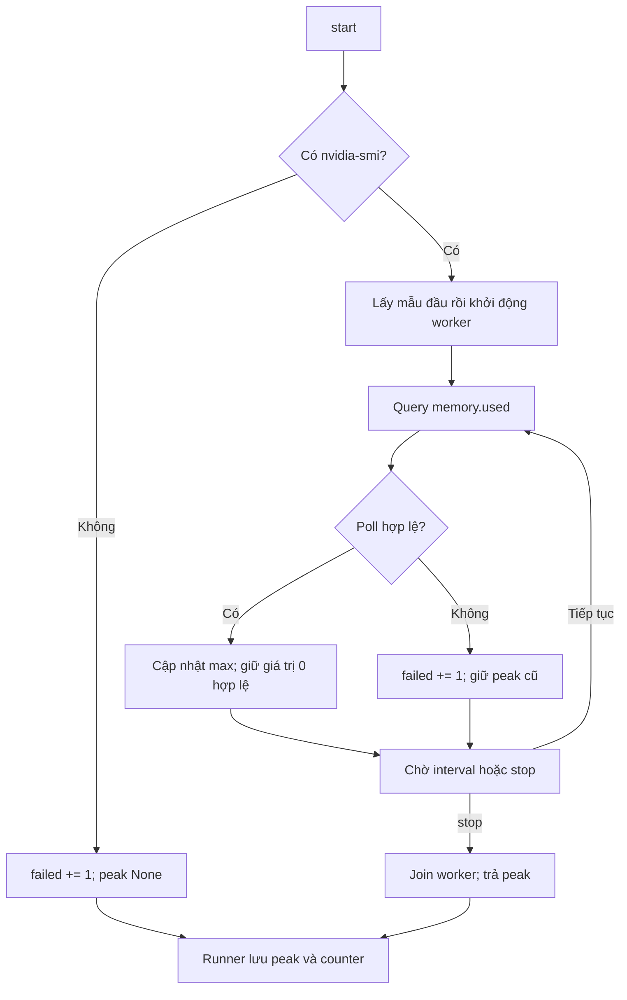

# C7/D14 — Hoàn thiện sampler VRAM

Base `22212454`, nhánh `m3/w11-day5`. Phạm vi M2: `gpu.py`, tests sampler và
tài liệu/trạng thái bàn giao. Runner M3 đã hỗ trợ counter, không cần thay đổi.

## Contract và hành vi

`GpuPeakSampler.stop() -> int | None` giữ nguyên. Kết quả là **max của các mẫu
thành công trên mọi GPU và mọi lần polling**, đơn vị MiB. Đây là memory.used
của thiết bị, gồm cả tiến trình khác; không phải VRAM riêng của model và không
phải tổng VRAM các GPU.

| Trường hợp | Peak | `samples_failed` |
|---|---|---|
| Mọi poll thành công | Max đã đo | 0 |
| Có poll lỗi, vẫn có poll thành công | Max của các poll thành công | Số poll lỗi |
| Tất cả poll lỗi | `None` | Số poll lỗi |
| Mẫu hợp lệ bằng 0 | 0, kể cả có poll lỗi khác | Số poll lỗi |
| Không tìm thấy `nvidia-smi` khi start | `None` | 1 |
| Chưa start, chưa thử lấy mẫu | `None` | 0 |

- `samples_failed` là integer, khởi tạo 0. Mỗi poll lỗi tăng đúng một lần, không
  tính theo số dòng/GPU bị lỗi. `stop()` không tự tăng counter.
- Exit code khác 0, output rỗng/không đọc được/không phải integer/giá trị âm,
  `OSError` hoặc subprocess error/timeout là poll lỗi. Output nhiều GPU có một
  dòng không hợp lệ thì toàn poll không được dùng để cập nhật peak.
- Query, polling interval mặc định 0,5 giây và timeout query 5 giây giữ nguyên.
  `stop()` signal worker dừng rồi join trước khi trả peak; không thêm retry/restart.
- Thuộc tính `ok` cũ vẫn phản ánh mọi poll có đọc được hay không; peak không còn
  bị xóa bởi flag này. Counter mới cho consumer biết kết quả có mất mẫu.
- `samples_failed=0` chỉ nói các lần đọc đã thử đều thành công. Polling không
  bảo đảm bắt được mọi đỉnh VRAM nằm giữa hai thời điểm lấy mẫu.

## Flow và consumer



Runner hiện có gọi `stop()` trong `finally`, sau đó lưu:

```python
gpu_peak_mib = sampler.stop()
gpu_samples_failed = getattr(sampler, 'samples_failed', None)
```

Đây là minh họa hai giá trị; runner thực chỉ gọi `stop()` một lần. Counter nằm
trong attribute, không đổi return value sang dict/tuple. Attempt cũ/sampler cũ
không hỗ trợ trường này vẫn là `None`; không backfill thành 0. `gpu_peak_scope`
giữ `device` khi peak là số, kể cả 0. Summary table và runner thuộc M3 giữ nguyên.

## Kiểm chứng

- TDD: **29 FAIL → 29 PASS**; gồm 26 case mới và 3 case cũ bổ sung counter.
- Test giá trị/counter dùng subprocess replies và worker có kiểm soát, không
  để polling thật chạy đua với manual `_sample()`.
- Một test worker thật dùng Event: đúng ba poll thành công/lỗi/thành công, worker
  tự signal dừng; main join rồi kiểm peak/counter. Không dùng sleep để đoán timing.
- Gate sampler + runner: **48 PASS**. Final gate gồm cả regression W11-1/2/3:
  **313 PASS, 0 SKIP/FAIL/ERROR**, 7,53 giây. Các gate chồng lặp, không cộng số test.
- Ruff hai file thay đổi và whitespace được kiểm; review tự động độc lập không
  phát hiện finding cần sửa. Review M3 của nhóm vẫn chờ, chưa tự ghi nhận merge.
- Gate offline toàn repo 1.795 PASS/18 SKIP/1 XFAIL của W11-3 là **baseline trước
  C7**, không được trình bày thành lần chạy mới của task này.

```powershell
Set-Location 'D:\Project\CAPSTONES\VGAR'
$vgarPython = 'D:\Project\CAPSTONES\environments\vgar-week78-cuda\Scripts\python.exe'
$env:PYTHONUTF8 = '1'
$env:PYTHONDONTWRITEBYTECODE = '1'
$env:VGAR_GRAPH_BACKEND = 'demo'
$runTemp = Join-Path $env:TEMP ('vg-c7-' + [guid]::NewGuid().ToString('N').Substring(0,8))
New-Item -ItemType Directory -Path $runTemp | Out-Null
& $vgarPython -B -m pytest tests/m3/test_gpu.py tests/m3/test_runner.py tests/m2/w1112 `
  -q -p no:cacheprovider --basetemp "$runTemp\pytest" --junitxml "$runTemp\gate.xml"
& $vgarPython -B -m ruff check --no-cache src/vgar/evaluation/repair/gpu.py tests/m3/test_gpu.py
git -c core.whitespace=cr-at-eol diff --check
```

Temp mới ngoài repo; `-B` và no-cache tránh bytecode/pytest cache. Các unit tests
mock `nvidia-smi`, không cần GPU, Docker hoặc model. Test runner chỉ dùng launch
giả và fixture; không launch repair/model thật. Không thêm skip/xfail/deselect.

Evidence: `results/m2/w1112/c7-d14-20261102-vram-sampler/`, gồm RED/GREEN/final
log + JUnit, review, commands, `sampler_demo.json`, attempt JSON từ demo, hashes
và preservation audit. Demo truyền output giả qua sampler thật rồi runner thật;
các số MiB trong demo là synthetic, **không phải số đo GPU máy này**.

## Bàn giao và điểm dừng

M3 review C7 trước cửa sổ GPU W12; xác nhận cách đọc `gpu_samples_failed > 0`
và peak `None` trong phân tích kết quả. Đo trên driver/GPU thật và experiment
W12 thuộc run của M3; task này không tự khởi chạy. Không đổi timeout/prompt/budget,
policy A0–A2 hoặc các phần M2-W11-1/2/3 đã hoàn thành.

Nguồn ràng buộc: [phân công C7/D14](superpowers/specs/2026-10-31-w11-w12-parallel-split-design.md),
[semantics runner M3](superpowers/specs/2026-11-02-m3-w11-day5-design.md).
**Dừng sau C7/D14; A3/pool/D15 cần lệnh triển khai riêng.**
