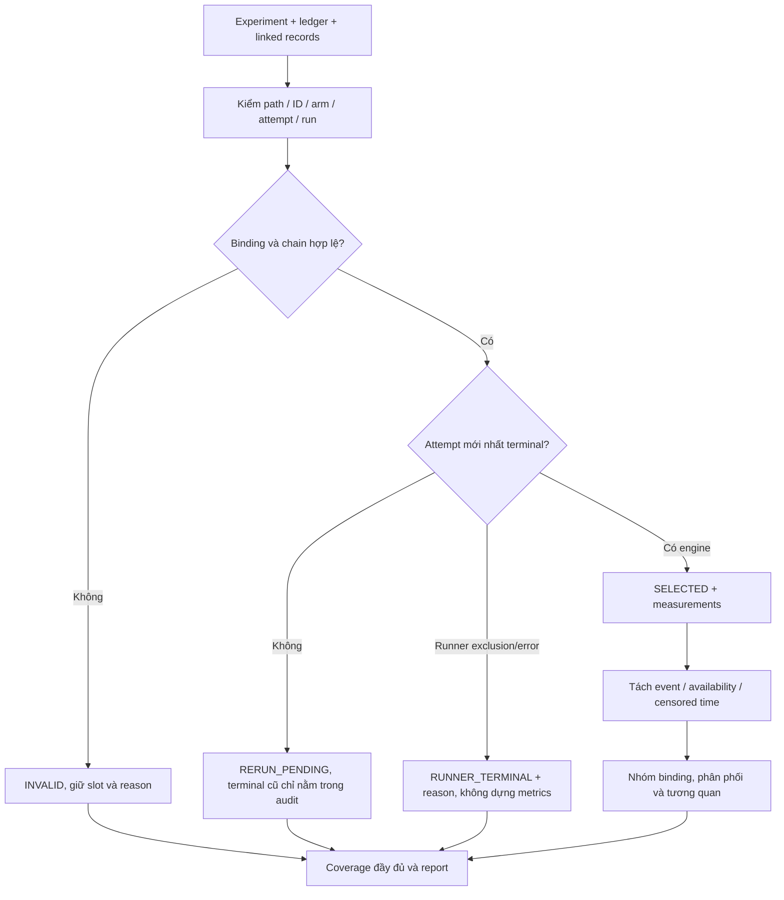

# D15 — công cụ phân tích timeout offline

## Phạm vi và trạng thái nghiệm thu

Công cụ: [`scripts/analyze_repair_timeouts.py`](../scripts/analyze_repair_timeouts.py).
Tests: [`tests/m2/w1112/test_timeout_analysis.py`](../tests/m2/w1112/test_timeout_analysis.py).
Chỉ dùng thư viện chuẩn Python; không gọi repair/harness, model, Docker hoặc
`load_experiment()`. Không cần source checkout, gold patch hay profile assets.

Đây là phần công cụ/fixture trước campaign. **D15 toàn bộ còn chờ record batch
W10/A3 thật và đề xuất timeout dựa trên dữ liệu thật, cùng review của nhóm.**
Fixture/demo không phải kết quả thực nghiệm. Không thay đổi timeout, engine,
runner, aggregate, policy hoặc áp dụng ĐX1–ĐX5.

## Input cần bàn giao từ M3

Export hai experiment W10 stage1 (11 task) và stage2 (14 task), mỗi task có
A0/A1/A2, cùng experiment A3 trên đúng population 25 task đó. Giữ cả task
excluded/input missing, các attempt cũ và attempt đang dang dở.

```text
<exported-experiment>/
  experiment.json
  attempts/
    <task_id>__<variant>/attempt-1.json
    <task_id>__<variant>/attempt-2.json
  engine/
    <task_id>__<variant>/attempt-1/<run_id>/run_record.json
    <task_id>__<variant>/attempt-2/<run_id>/run_record.json
```

Không dùng trace `solve --agent` thay record batch. Không cần export model,
checkout, workspace hoặc cache. Tool chỉ đọc experiment, ledger và linked
run records theo cấu trúc trên. Nếu ledger giữ đường dẫn Linux cũ, tool chỉ
lấy suffix `engine/<task>__<variant>/attempt-N/<run_id>` đã đối chiếu với
ledger rồi đọc **trong export hiện tại**; không truy cập prefix tuyệt đối cũ.
Tên export directory có thể khác experiment ID; ID được đọc từ metadata.

Population lấy từ `configs/m3/w10_dev_stage1.json` và
`configs/m3/w10_dev_stage2.json`, kiểm 11+14=25 unique, đồng thời seal hash hai
file. Không nạp đường dẫn policy/profile/model trong experiment.
A0 dùng arm bm25; A1/A2/A3 dùng graph. W12 export ở pha này chỉ nhận A3;
không gộp rerun A0–A2 của campaign khác vào W10 gốc.

## Cách chạy trên Windows

Đứng tại `D:\Project\CAPSTONES\VGAR`. Các đường dẫn bên dưới là ví dụ cần thay
bằng export thật; output phải là thư mục **chưa tồn tại** và ngoài mọi input.

```powershell
$vgarPython = 'D:\Project\CAPSTONES\environments\vgar-week78-cuda\Scripts\python.exe'
$env:PYTHONUTF8 = '1'
$env:PYTHONDONTWRITEBYTECODE = '1'

& $vgarPython -B scripts/analyze_repair_timeouts.py `
  --w10-experiment 'D:\exports\w10-stage1' `
  --w10-experiment 'D:\exports\w10-stage2' `
  --w12-experiment 'D:\exports\a3' `
  --output-root 'D:\exports\d15-analysis-new-01'
$LASTEXITCODE
```

- `-B`: không ghi bytecode Python.
- `--w10-experiment`: lặp lại cho hai stage W10; có thể chạy trước với một stage.
- `--w12-experiment`: optional khi chưa nhận A3; lặp được nếu export A3 chia stage.
- `--output-root`: thư mục kết quả mới, không chồng lấn input theo cả hai chiều.
- `$LASTEXITCODE`: 0 khi `READY_FOR_REVIEW`; 2 khi chờ/thiếu dữ liệu hoặc input lỗi.

Readiness không có raw (không sinh measurement giả):

```powershell
& $vgarPython -B scripts/analyze_repair_timeouts.py `
  --output-root 'D:\exports\d15-readiness-new-01'
```

Kết quả `WAITING_DATA`, exit 2 là hành vi dự kiến. Chỉ W10, thiếu record,
pending rerun, dữ liệu synthetic hoặc lỗi binding: `PARTIAL`, exit 2.
`READY_FOR_REVIEW` chỉ là trạng thái dữ liệu cho bước review, không phải
quyết định nhóm nghiệm thu D15.

## Chọn attempt và bảo toàn mẫu số



`parent_attempt` và `supersedes_run_id` phải trỏ attempt/run trước trong cùng
task/variant; kiểm duplicate và cycle. Terminal cũ không được coi là kết quả
cuối khi có rerun mới RESERVED/INTERRUPTED. Audit giữ lịch sử tham chiếu.
Nếu interruption chỉ lưu `engine_output_root`, tool kiểm suffix task/variant/
attempt rồi đọc run record ngay dưới attempt root trong export. Nhiều record
ứng viên là ambiguity; không tự chọn. Listing của root cũng được seal và kiểm
lại để phát hiện record mới xuất hiện khi đọc.

Mẫu số kỳ vọng cố định: **75 slot W10 + 25 slot A3**. Input thiếu vẫn có
placeholder `INPUT_MISSING`; malformed/linked record thiếu có `INVALID`.
Không thay task để đạt số run thành công. `rows` thực tế có thể lớn hơn mẫu
số nếu người dùng đưa các export population trùng; tool ghi lỗi overlap,
không tăng mẫu số unique hay tuyên bố complete.

## Metric và cách diễn giải

| Trường | Nguồn / ý nghĩa |
|---|---|
| `input_tokens`, `output_tokens` | Số token được record đo; input fallback sang prompt khi generation không có số đo; không suy từ ký tự |
| `generation_ms` | Thời gian generation được backend ghi; không thay bằng stage duration |
| `model_load_ms` | Thời gian load model riêng, không cộng vào generation |
| `generation_stage_ms` | `stages.generation.duration_ms`, có thể gồm overhead/load |
| `wall_ms` | Ledger wall time; nếu thiếu, dùng record duration có đo |
| `truncated` | Cờ output bị cap; unknown khác false |
| `availability` | `MEASURED`, `MISSING`, `INVALID_NUMBER`, `NOT_AVAILABLE`, `NOT_COMPLETED`, `CENSORED` |

Bool, số âm, NaN/Infinity hoặc chuỗi số không phải measurement hợp lệ.
Measured zero vẫn là 0. Giá trị chưa biết giữ trống/null và availability.
CSV lưu object/list bằng JSON để không mất evidence/availability.
`metric_refs` chỉ rõ pointer của phép đo. Nếu prompt và generation cùng có
input token count nhưng khác nhau: giá trị unknown, availability `CONFLICT`,
giữ hai reference và chặn readiness. Failure metadata hỏng được giữ bằng
`raw_failure_invalid` dạng chuỗi, đánh dấu INVALID thay vì làm cả report abort.

Các event có thể đồng thời xảy ra; giữ raw status/reason/failure:

- `GENERATION_TIMEOUT`: reason/cờ generation chứng minh timeout; không dùng
  measurement này trong phân phối **generation hoàn tất** hay correlation.
- `RUN_TIMEOUT`: global deadline; wall time bị kiểm duyệt, báo riêng như
  quan sát có giới hạn. Generation hoàn tất trước đó vẫn dùng được.
- `COMMAND_TIMEOUT`: phải có command object và cờ timed_out, không tin riêng
  cờ tổng `command_timed_out` của ledger hoặc cờ generation.
- `OUTPUT_CAP`: truncated, không đồng nghĩa generation timeout.
- `MODEL_ERROR`, `INFRASTRUCTURE_ERROR`: tách nguồn lỗi, giữ evidence để review.

Generation PASS vẫn được tính dù bước apply/verification/tests sau đó FAIL.
Không suy timeout bằng việc duration lớn hơn 900/1800 giây.

Phân phối có count/min/median/p95/max; p95 nội suy tuyến tính tại
`(n-1)*0.95`. Pearson dùng input tokens và generation ms hoàn tất có đủ cặp;
Spearman dùng rank trung bình cho ties. Dưới 3 cặp hoặc variance bằng 0:
null/N/A cùng reason, không trả correlation=0 giả.

Nhóm riêng theo cohort/experiment/variant/binding. Shared binding gồm model,
prompt template/tokenizer, budget/timeouts và source fingerprint code. Hash
prompt riêng từng task không dùng để giả thành config chung. Chỉ gộp hai
stage W10 khi đủ 25 unique measurements với binding xác định, đồng nhất;
unknown/mixed/missing được tách và cảnh báo. Tương quan không chứng minh
quan hệ nhân quả hay quyết định được timeout tối ưu.
Invalid numeric measurements, token conflicts, thiếu shared binding hoặc
thiếu input tokens/generation ms ở một generation đã hoàn tất đều chặn
`READY_FOR_REVIEW`; xem `data_quality_issues` trong summary. Measurement thực
sự không khả dụng ở timeout/pre-generation vẫn unknown, không bị dựng thành
zero hoặc giả thành generation hoàn tất.

## Output, integrity và bàn giao

| File | Nội dung |
|---|---|
| `inputs.json` | Tham số, SHA-256 experiment/ledger/linked record, inventory ledger và population configs |
| `selection_audit.json` | Toàn bộ attempts, selected/previous terminal, chain, references và lỗi |
| `rows.csv` | Task/variant, raw result, availability, measurement, event, evidence |
| `summary.json` | Coverage, counts, phân phối, tương quan, binding warnings và recommendation chưa chọn |
| `report.md` | Báo cáo tiếng Việt, số liệu và giới hạn dữ liệu |
| `artifact_hashes.json` | Hash năm file output trên; không tự hash chính nó |

Tool reject symlink/junction/reparse, traversal và output overlap. Input được
hash trước–sau; inventory ledger được kiểm lại để phát hiện attempt mới
trong lúc đọc. Nếu drift, không seal `artifact_hashes.json` như một run hợp lệ.
Output không chứa timestamp hoặc output path ngẫu nhiên: cùng input bất biến
cho output byte-identical tại hai directory mới. Không sửa/xóa dữ liệu input.

Hiện hành **900/1800 giây**; **1500/2700 giây** là ứng viên M3, chưa được tool
chọn hay áp dụng. `recommendation.selected_seconds` luôn để null trong pha
này. Bàn giao raw → chạy analyzer → review coverage/binding/censoring → M2 đề
xuất bằng dữ liệu thật → nhóm chốt trước freeze. Không tự chạy lại campaign.

## Kiểm thử có thể chạy lại

```powershell
$env:VGAR_GRAPH_BACKEND = 'demo'
& $vgarPython -B -m pytest tests/m2/w1112/test_timeout_analysis.py `
  tests/test_failure_class.py tests/m3/test_runner.py `
  tests/m3/test_runner_code_state.py tests/m3/test_aggregate_class.py `
  tests/m2/w910/test_failure.py -q -p no:cacheprovider `
  --basetemp "$env:TEMP\vgd15-reproduce-new-01" `
  --junitxml "$env:TEMP\vgd15-reproduce-new-01.xml"
& $vgarPython -B -m ruff check --no-cache `
  scripts/analyze_repair_timeouts.py tests/m2/w1112/test_timeout_analysis.py
git -c core.whitespace=cr-at-eol diff --check
```

`VGAR_GRAPH_BACKEND=demo` thiết lập trước collection; fixtures tự tạo JSON
batch export synthetic trong TEMP. `--basetemp` dùng tên mới, ngắn, ngoài repo;
`-p no:cacheprovider` không ghi pytest cache. JUnit ghi số test/thời gian/error.
Gate này tập trung D15/failure/runner, không thay cho full CI hoặc review người.

Evidence thực hiện, lệnh cụ thể và preservation được ghi ở checkpoint D15 và
`results/m2/w1112/d15/20261105-tool-fixture/`; raw results không commit.

## Nguồn yêu cầu

- Plan D15 được người dùng duyệt trong phiên 04/11/2026.
- `docs/superpowers/specs/2026-10-31-w11-w12-parallel-split-design.md` — D15/H5.
- `docs/superpowers/specs/2026-10-31-w11-w12-design.md` — thí nghiệm W11–W12.
- `D:/Project/CAPSTONES/New_task/VGAR_W9_W16_Deliverables.md` — phạm vi chính.
- Schema thực tế: `src/vgar/evaluation/repair/runner.py`, `launch.py`,
  `src/vgar/repair/session.py`, `src/vgar/models/huggingface/generator_hf.py`.

Không thêm nguồn/paper ngoài để suy diễn kết quả chưa đo.
