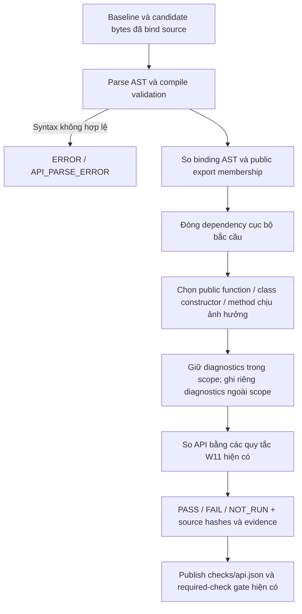

# T1 — Phân tích API theo public symbol chịu ảnh hưởng của patch

## Mục tiêu và giới hạn

T1 xử lý hạn chế scope của API checker: trước đây collector chọn file bị sửa,
nhưng checker kiểm mọi public symbol trong các file đó. Một import re-export,
decorator chưa hỗ trợ, inherited constructor hoặc conditional binding không đổi
ở chỗ khác vẫn có thể làm kết quả toàn check `NOT_RUN`.

Đây là bản sửa code/fixture local. Con số **133/133 vector hợp lệ có API NOT_RUN**
là phản ánh campaign cũ do nhóm cung cấp, không phải phép đo mới của T1.
Không sửa vectors/artifacts cũ, không chứng minh đã xử lý hết NOT_RUN trên dataset.

## Interface và flow

```python
check_api(before, after, *, callers_in_repo=None, changed_only=False)
```

- Mặc định `False`: giữ hành vi kiểm toàn bộ static public surface của caller cũ.
- Collector `run_compatibility_checks()` dùng `changed_only=True`, sau bước xác
  minh baseline/candidate/applied paths hiện có. Batch, direct verification,
  session/MCP và neutral evaluator tiếp tục dùng implementation chung.
- Không thay schema/policy/hash formula, required checks A3, timeout hoặc runner.



Không import/execute source đích. `symtable` chỉ phân tích lexical binding của
source được unparse từ AST, không thực thi target code.

## Cách xác định scope

1. Fingerprint AST bỏ line/column để comment, CRLF hoặc dịch dòng không tạo ra
   API change giả. Raw source hashes vẫn giữ đúng bytes từng phía.
2. Declaration thêm/xóa/thay đổi và thay đổi public export membership đều vào
   tập affected. File thêm/xóa không bị mất khỏi phạm vi.
3. Class header/constructor và từng member là unit riêng. Sửa method của class
   có inherited constructor không đòi suy diễn constructor chưa thay đổi.
4. Đóng dependency local bắc cầu, gồm alias public trỏ vào private callable/class.
   Thay method của private class phải giữ unknown cho public alias của class đó.
5. Conditional binding chỉ gắn với declaration và guards/branch chứa nó; không
   fingerprint cả các nhánh hoặc statement anh em không liên quan.
6. Phân biệt load lúc định nghĩa và global load trong function body; tham số,
   local variable hoặc nested local trùng tên biến module không tạo dependency giả.

Scope này không phải phân tích dataflow/runtime toàn repo, không resolve imported
re-export/MRO hoặc đánh giá biểu thức/decorator. Dynamic `__all__` vẫn `NOT_RUN`
vì không chứng minh được export membership. Unsupported binding chịu tác động,
alias bị tác động, owner/declaration mơ hồ vẫn unknown; parse lỗi vẫn ERROR.

## Evidence và ý nghĩa availability

Sidecar API giữ DTO `status/reasons/details_ref` hiện có. `details` bổ sung:

- `scope=static-python-changed-public-api`;
- `analysis_scope.mode=changed-public-symbols`;
- `analysis_scope.algorithm=ast-binding-dependencies-v1`;
- `analysis_scope.selected`: danh sách symbol theo path, thứ tự ổn định;
- `analysis_scope.excluded_diagnostics`: diagnostics của phần không chịu tác động,
  giữ nguyên reason/path/side/symbol để review, không biến thành phép đo thành công.

`coverage=COMPLETE` và signature measured zero chỉ nói đến scope được chọn.
Không có public binding bị ảnh hưởng là tập đo rỗng đã xác định, khác unknown
export membership hoặc không cung cấp source (`API_EMPTY_SCOPE`). `NOT_RUN/ERROR`
vẫn có feature `available=false`, `value=null`. `with_api_risk()` giữ interface cũ;
caller phải bind đúng scope/patch trước khi dùng feature.

Với A3: affected break vẫn dẫn đến `API_BREAK`; affected unknown vẫn dẫn đến
`VERIFICATION_INCOMPLETE`. A0–A2 vẫn xem API là supplemental theo policy cũ.

## File liên quan

| File | Thay đổi T1 |
|---|---|
| `src/vgar/repair/api_check.py` | Chế độ opt-in, projection/dependency/scope và evidence |
| `src/vgar/repair/verification_checks.py` | Collector chọn chế độ scoped |
| `tests/m2/w1112/test_api_impact_scope.py` | Regression mới cho scope và các ca biên review |
| `tests/m2/w1112/test_evidence_checks.py` | Collector thật và sidecar exclusions |
| `tests/m2/w1112/test_a3_verification.py` | Required A3: body-only PASS, breaking FAIL, affected unknown incomplete |
| `docs/status/m2.md`, `PROGRESS.md` | Trạng thái và điểm dừng |
| `docs/checkpoints/2026-11-07-t1-api-impact-scope.md` | Khôi phục phiên và bằng chứng |

## Kiểm chứng và bàn giao

Lệnh/log/JUnit, source fingerprints, demo **synthetic** và preservation nằm ở
`results/m2/w1112/t1/20261107T063335Z/`. Các lệnh thực nằm trong `commands.json`.

Không cần Docker/GPU/model. Không cập nhật bản code Linux đã seal ở chặng 2/3:
T1 phải được copy và kiểm hash trong **chặng 4 được giao riêng**, rồi freeze,
regression Linux và fresh tokenizer preflight trước batch.

T3 vẫn cần điều tra/kết luận hoặc giới hạn được nhóm chấp nhận. T1 local không
tự đóng T3/T10, chặng 4 hoặc M2-W12-1 thực nghiệm. Dừng sau T1, không commit/push.
