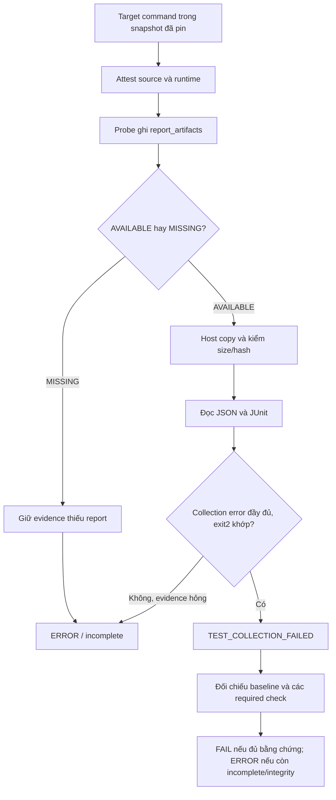

# T5 — Lỗi collection có bằng chứng và lỗi report/Docker

Ngày: 06/11/2026. **DONE code/fixture local; chưa nghiệm thu Docker thật hoặc các slot campaign cũ.**

## Quy tắc và kết quả

- Baseline đã qualified, post JSON/JUnit đầy đủ, collection_errors có nội dung, command/report cùng exit code 2 và source/runtime nguyên vẹn: tests FAIL với `TEST_COLLECTION_FAILED`.
- Mất/hỏng report, timeout, output truncated, exit code không khớp, internal/usage/interruption không có collection evidence: ERROR/incomplete. Không suy từ log hoặc mã thoát đơn lẻ.
- Baseline collection failure không qualified. Required check khác incomplete hoặc integrity failure luôn giữ ERROR; collection failure không che thiếu required test hoặc test regression chưa đo được.
- Public evidence dùng FailureCode cũ `TEST_FAILED`, message `TEST_COLLECTION_FAILED`; không thêm enum hoặc đổi vector schema/policy.
- Gate cuối: **264 PASS, 2 SKIP, 0 FAIL/ERROR**, 192.931s JUnit; Ruff/whitespace scoped PASS. SKIP đã có: POSIX modes trên Windows và thiếu optional vermin; không thêm skip/xfail/deselect ở gate cuối.
- RED đầu27 FAIL/31 PASS. Hai coverage cases baseline/public projection RED2→GREEN2; precedence RED4→GREEN4. Review độc lập có1 Important về precedence, đã mở rộng RED12→GREEN12; không finding hoãn.
- Demo synthetic dùng trusted fixture `single_file_login`: baseline collect PASS, post collect/tests FAIL vì đổi tên login làm test import lỗi; A0–A3 đều FAIL/REVISE. Đây là fixture đã chạy thật cục bộ, **không phải bằng chứng bốn slot Docker hoặc population25 task**.

## Flow



Test assertion bình thường vẫn theo quy tắc cũ. Không gán testcase giả cho test chưa chạy; các group test có thể ghi NOT_RUN vì collection đã dừng.

## Report transport

- Config mới có `report_names`, chỉ gồm `nodeids.json`, `junit.xml`. Probe xác minh snapshot sau command trước khi thống kê report.
- `report_artifacts[name]` là `{"state":"MISSING"}` hoặc AVAILABLE kèm `size_bytes` (integer không âm), `sha256`.
- Chỉ regular file được chấp nhận. Không copy report MISSING, không tạo JSON/JUnit thay thế.
- Host yêu cầu metadata khớp danh sách report, kiểm schema và bytes được copy trước khi ghi đích bằng chế độ không ghi đè. Copy thật bị lỗi/hash sai/metadata sai vẫn ERROR, không coi là patch failure.
- Operation không yêu cầu report giữ hành vi cũ. Host/probe mới đi cùng nhau qua control directory; reader artifact lịch sử không bị yêu cầu bổ sung metadata vào record cũ.
- Giữ container cleanup fatal và snapshot transport T6. Giữ thứ tự validation/output guard T7.

## File liên quan trong T5

| File | Thay đổi của T5 |
|---|---|
| `src/vgar/repair/docker_probe.py` | Thống kê report AVAILABLE/MISSING sau attestation, regular-file/allowlist/hash. |
| `src/vgar/repair/docker_executor.py` | Gửi tên report, kiểm metadata/copy hash, bỏ copy report đã xác nhận thiếu; giữ T6. |
| `src/vgar/repair/test_runner.py` | Validate report, giới hạn trường được đọc, predicate collection failure có evidence. |
| `src/vgar/repair/verification.py` | Qualification baseline, tiếp tục checks sau collection FAIL, giữ ERROR precedence. |
| `src/vgar/evaluation/repair/verifier_eval.py` | Suy verdict collection FAIL có bằng chứng; không sửa metrics hoặc guard T7. |
| `src/vgar/repair/pipeline.py` | Map detailed reason sang public TEST_FAILED, không đổi contract. |
| `tests/m2/w1112/test_collection_failure.py` | File mới: pytest subprocess thật import/syntax lỗi; malformed/missing evidence và probe inventory. |
| `tests/m2/w1112/test_verifier_eval.py` | A0–A3, baseline/integrity/required-unavailable và missing tests không được nâng ERROR thành FAIL; independent checks. |
| `tests/m2/w1112/test_a3_verification.py` | Đường trực tiếp, baseline và missing required/regression. |
| `tests/m2/w910/test_docker_admission.py` | Fixture mô phỏng metadata report, copy/MISSING/hash/runtime cases; giữ nguyên thân tests T6. |
| `tests/m2/w910/test_runner_contract.py` | Pipeline fixture thật và public evidence TEST_FAILED. |
| `PROGRESS.md`, `docs/status/m2.md` | Bổ sung trạng thái, giữ lịch sử. |
| `docs/checkpoints/2026-11-06-t5-collection-evidence.md`, tài liệu này | Điểm dừng và hướng dẫn/bàn giao. |

Các module khác nằm trong gate là regression, không có nghĩa chúng bị sửa trong T5. Đường dẫn tương đối tính từ `D:/Project/CAPSTONES/VGAR/`.

## Chạy kiểm thử và xem bằng chứng

Python: `D:/Project/CAPSTONES/environments/vgar-week78-cuda/Scripts/python.exe`.
Thiết lập `PYTHONUTF8=1`, `PYTHONDONTWRITEBYTECODE=1`, `VGAR_GRAPH_BACKEND=demo`.

Danh sách đầy đủ argv/env/exit code đã dùng nằm ở `results/m2/w1112/t5/20261106-collection-evidence/commands.json` và `commands.md`; wrapper thực thi là `gate.py`. Bao gồm RED, gate đầu, coverage RED/GREEN, precedence RED/GREEN, review RED/GREEN, final, Ruff, whitespace và demo. Không dùng các argv lọc RED để thay thế gate cuối.

Lệnh gate cuối (khi tự chạy lại, thay temp bằng thư mục mới):

```powershell
$vgarPython = 'D:/Project/CAPSTONES/environments/vgar-week78-cuda/Scripts/python.exe'
$env:PYTHONUTF8 = '1'
$env:PYTHONDONTWRITEBYTECODE = '1'
$env:VGAR_GRAPH_BACKEND = 'demo'
& $vgarPython -B -m pytest tests/m2/w910/test_docker_admission.py tests/m2/w910/test_static_tools.py tests/m2/w910/test_runner_contract.py tests/m2/w910/test_native_runner.py tests/m2/w78/test_w78_test_runner.py tests/m2/w78/test_w78_verification.py tests/m2/w78/test_verifier_eval_integration.py tests/m2/w1112/test_collection_failure.py tests/m2/w1112/test_verifier_eval.py tests/m2/w1112/test_verifier_campaign.py tests/m2/w1112/test_a3_verification.py -q -ra -p no:cacheprovider --basetemp '<NEW_TEMP>/tests' --junitxml '<NEW_TEMP>/final.xml'
```

`-B` tắt bytecode, `-p no:cacheprovider` tắt cache, `-ra` nêu lý do skip, basetemp ngoài repo, JUnit/log lưu kết quả. Ruff dùng `check --no-cache` trên6 source/5 test T5; whitespace chỉ các file T5/status, không chỉnh báo cáo Codex Diff đã dirty từ trước.

## Bàn giao và giới hạn

- Artifact `results/m2/w1112/t5/20261106-collection-evidence/`: logs/JUnit, commands, review, preservation, source snapshots, demo vector/baseline/post/report inventory/verdict và checksums. Demo luôn gắn `synthetic=true`, `real_docker=false`.
- M3 smoke: dùng image/profile đã qualify, output mới; kiểm AVAILABLE/MISSING, hash copy, attestation và cleanup; collection error có evidence phải là FAIL, report mất phải là incomplete. Không tự mở campaign hoặc thay image/profile.
- Cần raw evidence/run mới để kết luận4 slot được báo trước đây. Không sửa vector cũ hoặc tính lại FAR/FRR trong T5; T4 xử lý phần đó sau xác nhận riêng.
- Giữ timeout900/1800, không dùng model/gold hoặc held-out. Không commit/push. **Dừng sau T5, chờ xác nhận T4.**
