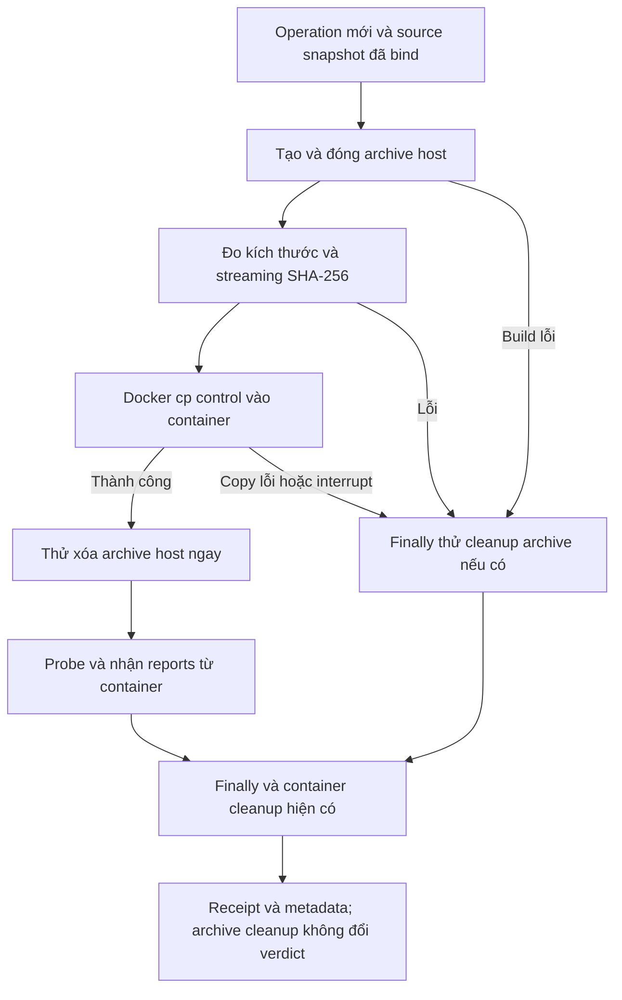

# T6 — lifecycle archive Docker transport

## Phạm vi và trạng thái

T6 chỉ giải phóng bản host `control/snapshot.tar` do operation hiện tại tạo.
Container dùng bản đã copy ở `/vgar/snapshot.tar`. Control config, helper
scripts, Docker command logs, target reports, vectors và sidecars giữ nguyên.

Nghiệm thu pha này: code/fixture trên Windows; chưa chạy Docker daemon thật.
Smoke trên image/profile đã qualify thuộc bàn giao M3. Không dọn archive cũ,
images, data, không cache baseline hoặc thực hiện T7/T5/T4/T2/T3/T1/T10.
Trạng thái gate cuối được ghi trong checkpoint và `docs/status/m2.md`.

Gate cuối06/11/2026: **144 PASS,1 SKIP,0 FAIL/ERROR,56,956s JUnit**;
Ruff/whitespace scoped PASS. Hai review findings đã RED2→GREEN2 và được chạy
regression sau sửa. Skip là POSIX modes có sẵn; junction Windows chạy thật PASS.
Fixture14 operation xóa143.360 logical archive bytes,0 archive host còn lại.
Evidence: `results/m2/w1112/t6/20261106-snapshot-transport/`.

## Lifecycle mới



Mỗi operation thử cleanup archive tối đa một lần. Sau copy thành công việc
cleanup diễn ra trước probe; `finally` xử lý những đường chưa đến bước đó.
Cleanup lặp không retry vô hạn hoặc xóa archive của operation khác.

Việc dọn container vẫn theo chính sách hiện có: failure chứng minh/xóa
container có thể làm operation lỗi. T6 chỉ áp dụng warning cho archive host
tạm, không nới source/runtime attestation hoặc container ownership.

## Guard và evidence

Trước unlink, kiểm đường dẫn thuộc đúng operation directory đã tạo; không
đi qua symlink/junction/reparse và archive phải là file thường. Nếu đường
dẫn bị thay bằng directory/link, giữ lại đối tượng đó và ghi lỗi cleanup.
Không recursive delete hoặc dò tìm archive trong campaign lịch sử.

Hash được đọc theo block1MiB; không nạp cả archive vào RAM. Partial archive
do build lỗi có thể có hash/kích thước nếu còn đọc được; `copy_status` phân
biệt nó với archive đã transport thành công.

Sidecar `snapshot_transport.json` nằm tại operation directory, cùng cấp
`command.json`/`cleanup.json`. Kết quả operation thêm `snapshot_transport`;
không đổi public method signatures, policy hash hoặc raw artifact lịch sử.

| Trường | Ý nghĩa |
|---|---|
| operation_id | ID của operation sở hữu archive |
| archive_path | `control/snapshot.tar`, tương đối với operation |
| archive_bytes / archive_sha256 | Kích thước/hash của bytes đo được, null nếu chưa đo được |
| copy_status | NOT_STARTED / PASS / ERROR; ERROR cũng có thể gồm interruption khi đang copy |
| cleanup_status | REMOVED / ABSENT / ERROR |
| retained_bytes | 0 khi removed/absent; kích thước nếu xác định được khi xóa lỗi, null nếu unknown |
| reason | Lý do cleanup lỗi nếu có |
| metadata_error / receipt_error | Trường bổ sung khi việc đọc metadata hoặc ghi sidecar gặp lỗi |

Cleanup archive thất bại: warning và receipt; kết quả check/exception chính
giữ nguyên. Ghi receipt lỗi: warning, metadata còn trong result nếu operation
có result. Không diễn giải cleanup warning thành phát hiện mutant hoặc patch
không đúng; M3 cần theo dõi retained_bytes để quyết định tài nguyên campaign.
Nếu filesystem không ghi được cả command log theo cơ chế cũ, T6 không bảo đảm
có thể xuất bản đầy đủ run record trong điều kiện hết đĩa.

## Kiểm chứng

Tests ở `tests/m2/w910/test_docker_admission.py` sử dụng archive thật trên TEMP
và Docker transport giả lập. Bản copy container giả lập được giữ độc lập để
chứng minh xóa bản host không làm mất payload. Tests kiểm failures, interruption,
receipt/hash, warning không đổi verdict, directory replacement và junction.

Fixture lặp14 operation ghi `transport-fixture-summary.json` trong pytest TEMP:
số archive host còn lại, tổng logical archive bytes được xóa và từng receipt.
Đây là phép đo fixture, không phải55GB được thu hồi từ campaign thật hoặc phép
đo dung lượng vật lý trống trên ổ đĩa. Các bản container giả lập cũng nằm trên
TEMP host và chỉ phục vụ chứng minh transport.

Các gate RED/GREEN, regression, Ruff và preservation thực tế được lưu dưới
`results/m2/w1112/t6/<run_id>/`; đọc checkpoint để biết run có thẩm quyền.

```powershell
$vgarPython = 'D:\Project\CAPSTONES\environments\vgar-week78-cuda\Scripts\python.exe'
$env:PYTHONUTF8 = '1'
$env:PYTHONDONTWRITEBYTECODE = '1'
$env:VGAR_GRAPH_BACKEND = 'demo'
$t6Temp = Join-Path $env:TEMP ('vgt6-' + [guid]::NewGuid().ToString('N').Substring(0,8))
& $vgarPython -B -m pytest tests/m2/w910/test_docker_admission.py `
  tests/m2/w910/test_static_tools.py tests/m2/w1112/test_verifier_campaign.py `
  tests/m2/w1112/test_verifier_eval.py tests/m2/w910/test_baseline_delta.py `
  -q -p no:cacheprovider --basetemp $t6Temp --junitxml "$t6Temp.xml"
& $vgarPython -B -m ruff check --no-cache `
  src/vgar/repair/docker_executor.py tests/m2/w910/test_docker_admission.py
```

`-B` và env tránh bytecode; pytest không cache; TEMP phải mới, ngắn, ngoài repo.
Các gate này không yêu cầu Docker/model hoặc thay cho qualification image thật.

## Bàn giao smoke M3 và điểm dừng

Trên môi trường đã qualify, chọn task/image/profile hiện có, giữ đúng code và
source/config pins. Thực hiện operation collection và một operation static
bằng DockerExecutor trong output mới, kiểm:

1. Payload container đọc được; target source/runtime attestation vẫn đạt.
2. Kết quả/report hợp lệ; container cleanup giữ behavior hiện có.
3. `snapshot_transport.json` có copy PASS, cleanup REMOVED, retained0; archive
   host không còn, control metadata và authoritative reports vẫn đọc được.
4. Lặp operation để xác nhận không tích lũy archive host; ghi kích thước thực.
5. Giữ mọi warning/error; không lấy fixture làm bằng chứng smoke Docker PASS.

Không tự pull/thay image hoặc dùng native fallback cho task thật. Không chạy
campaign GPU/pool để thay một smoke nhỏ. Sau T6 local dừng, chờ người dùng xác
nhận T7; real smoke pending không được tự đánh dấu đã hoàn tất.
