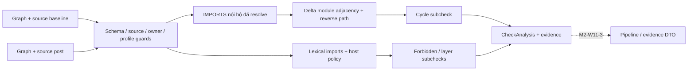

# M2-W11-2 — Structural check

Ngày: 02/11/2026. Base `d018cca5`, nhánh `m3/w11-day5`. Chỉ thực hiện task
M2-W11-2 theo plan đã duyệt; mọi thay đổi M2-W11-1 được giữ nguyên.

## Phạm vi và quyết định đã chốt

Checker so sánh graph baseline/post cùng repository, không import hoặc thực thi
code đích, không apply patch, dựng graph mới, chạy command hoặc ghi source.

- Rule chung: không thêm cycle **IMPORTS nội bộ đã resolve** so với baseline.
- Rule theo repo: forbidden imports và layer direction theo config do host cấp.
- Không đặt quy tắc CALLS acyclic, không biến mọi cycle cũ thành lỗi patch.
- **Thiếu config:** cycle vẫn quyết định kết quả tổng; forbidden/layer ghi
  `NOT_RUN` riêng. Đây là lựa chọn người dùng đã chốt khi duyệt plan, làm rõ
  khác biệt diễn đạt giữa deliverables và hai spec W11–W12. Không đổi NOT_RUN
  của hai subcheck này thành PASS.
- Chưa nối evidence/pipeline/A3/MCP; phần đó thuộc các task/owner tiếp theo.

## API và source binding

```python
from vgar.repair.structural_check import check_structure, load_structural_config

analysis = check_structure(
    before_graph, after_graph,
    before_sources=before_bytes,  # Mapping[str, bytes]
    after_sources=after_bytes,
    repo_config=load_structural_config(host_policy_path),
    min_confidence=0.60,
)
```

Hai source mapping phải là toàn bộ **File inventory của từng graph**, với path
POSIX normalized, relative và `.py`; không dùng tập file đọc được một phần để
giả thành snapshot. Không có filesystem discovery hay tự chọn latest version.
Caller phải giữ cùng cấu hình builder và bind graph từ nguồn tin cậy; hash trong
report là fingerprint của graph đã kiểm, không phải chữ ký xác thực producer.

Checker kiểm graph schema, repo identity trên mọi node, edge provenance revision,
resolver profile hiện tại `tree-sitter+python-static-v4-external-import`, File
inventory, raw byte hash, range/line/byte-column và hash của source-backed nodes.
File và internal Module phải bind toàn file. Partial parse, duplicate module
names hoặc ownership thiếu/mơ hồ/cross-path không được báo computed PASS.
Module/File ownership kiểm toàn bộ containment, kể cả confidence bằng 0.

`graph_version` có thể khác giữa hai phía, nhưng không thay thế resolver profile:
M1 đang giữ nhãn resolver v3 trong hash version và ghi profile v4 riêng để bảo
toàn context W10. Hai revision khác nhau được ghi nhận, không bị gộp thành một.

Sai call argument (mapping/path/bytes/threshold) raise `ValueError`. Snapshot
hoặc policy không hợp lệ trả `CheckAnalysis(status="ERROR", ...)`, kèm diagnostic;
không dùng graph rỗng để kết luận không có ảnh hưởng. Hai source scope đều rỗng
trả `NOT_RUN`.

## Cách kiểm và evidence



**Cycle:** cạnh gốc là Import → Module. Checker dùng containment để tìm owning
Module của Import, rồi tạo cặp `(source_module_path, target_module_path)`. Import
external cũng có thể mang `resolution="exact"`, confidence 1.0; chúng được lọc
bằng metadata Import và Module, không chỉ dựa vào confidence. Unresolved,
ambiguous và cạnh dưới ngưỡng được ghi diagnostic, không tạo dependency giả.

Mỗi cặp adjacency mới được kiểm có đường từ target về source trong graph post
hay không. Nếu có: `FAIL/NEW_IMPORT_CYCLE`, với shortest-path witness deterministic,
các module paths đóng vòng và nguyên bản các cạnh IMPORTS chứng minh từng hop.
Cách này bắt self-import và cycle mới bên trong SCC cũ; không enumerate mọi
simple cycle. Thêm alias/di chuyển dòng import mà không thêm adjacency không tự
tạo vi phạm mới.

**Forbidden:** kiểm lexical module và module.name lấy từ import source đã bind,
kể cả external/unresolved; không dùng threshold để bỏ qua import cấm đã quan sát.
Alias là tên local, không phải module target. `from pkg import sub` cung cấp lexical
`pkg` và `pkg.sub`; không suy ra cạnh cycle tới `pkg.sub` khi builder chỉ resolve
tới `pkg`. Vi phạm được deduplicate theo source path, lexical target và rule, rồi
so baseline để tránh coi ID/dòng import mới là violation mới.

**Layer:** xét các adjacency đã resolve, đủ confidence, có cả hai module được
classify bởi policy. Prefix dài nhất thắng; match theo ranh giới dấu chấm, không
match `a` với `abc`. Module không được policy classify được ghi ngoài scope, không
đoán layer. Chỉ direction vi phạm mới trả `LAYER_VIOLATION`.

Kết quả dùng lại `CheckAnalysis` nội bộ của W11-1, không sửa class/schema đó:

- `status`: PASS/FAIL/ERROR/NOT_RUN; `reasons` là tuple stable codes.
- `details.subchecks`: `cycles`, `forbidden_imports`, `layers`, có status/reasons,
  violations và số baseline/candidate liên quan.
- `details`: source hashes, canonical graph hashes (sort node/edge IDs), config
  hash, threshold, coverage limits và diagnostics. Input objects không bị mutate.
- Có bất kỳ applicable subcheck FAIL thì kết quả FAIL. Rule chưa cấu hình vẫn
  NOT_RUN; ERROR validation chặn computed verdict. `PASS` chỉ áp dụng cho static
  scope đã mô tả, không bảo đảm runtime dependency graph không có cycle.

## Config và giới hạn

Schema: `configs/m2/structural/schema.json`; fixture: `example.yaml` cùng thư mục.
README ở đó mô tả field và semantics. Không tạo rule kiến trúc cho repo thật khi
chưa có căn cứ. Không có wildcard/regex/eval, ngưỡng không được config tự đổi.
Loader dùng PyYAML sẵn có trong environment; task không cài package hoặc sửa
manifest dependency thuộc M3. M3 cần giữ dependency này khi tích hợp/đóng gói.

Giới hạn của graph builder được ghi thẳng trong coverage: chỉ module-level imports,
gồm imports dưới module-level condition; thiếu function/class-local và dynamic
imports. `from pkg import sub` target của graph là base package. Duplicate internal
module names có thể làm resolver mất cạnh, nên checker trả ERROR thay vì tự sửa
graph hoặc tính completeness từ số cạnh còn lại.

## Kiểm chứng, artifact và điểm dừng

```powershell
$vgarPython = 'D:\Project\CAPSTONES\environments\vgar-week78-cuda\Scripts\python.exe'
$env:PYTHONUTF8 = '1'
$env:PYTHONDONTWRITEBYTECODE = '1'
$env:VGAR_GRAPH_BACKEND = 'demo'
$vgarTemp = Join-Path $env:TEMP ('vg-struct-' + [guid]::NewGuid().ToString('N').Substring(0,8))
& $vgarPython -B -m pytest tests/m2/w1112/test_structural_check.py -q -p no:cacheprovider --basetemp $vgarTemp
```

Fixture tests dựng graph bằng PythonGraphBuilder hiện tại trong temp riêng, không
chạy code target. V6–V9, source/owner/profile/config guards và deterministic evidence
được kiểm ở file test trên. Không cần Docker/model. Regression chung dùng marker
`not hf and not docker`, temp ngoài repo; những tests tạo private Git workspace
cần môi trường cho phép subprocess Git. Không sửa executor legacy để vượt sandbox.

Số liệu PASS/SKIP, review và lệnh cuối cùng được ghi từ kết quả thực tế vào
`docs/status/m2.md` và evidence root:
`results/m2/w1112/m2-w11-2-20261102-structural-check/` (gitignored).
JSON minh họa là synthetic fixture chạy checker thật, không phải SWE-bench/model
measurement. M1 human review, CI/merge theo nhóm và runtime evidence integration
vẫn được phân biệt với DONE kỹ thuật của checker.

Giữ nguyên M2-W11-1, DB fixture, báo cáo Linux và file ngoài task bằng hash audit.
Không commit/push. **Dừng sau M2-W11-2**, không tự chuyển M2-W11-3.
