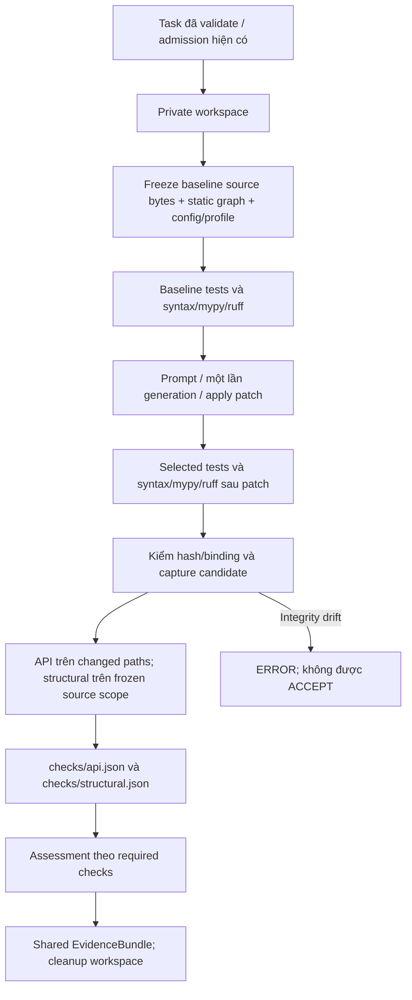

# M2-W11-3 — Evidence API/structural và verification chung

Base triển khai: `22212454`, sau merge nhánh `m2/w11-static-line-map`.
Phạm vi chỉ M2-W11-3 theo plan M2 W11–W12 đã duyệt. Hai checker W11-1/2
được tái sử dụng nguyên trạng. Không thêm policy A3 hoặc chạy model/Docker.

## Contract C1/C2

`src/vgar/contracts/evidence.py` thêm `AnalysisCheckResult` dành riêng cho
`VerificationResult.api_check` và `structural_check`:

```json
{
  "status": "FAIL",
  "reasons": ["API_SIGNATURE_INCOMPATIBLE"],
  "details_ref": "checks/api.json"
}
```

- Status chỉ `PASS`, `FAIL`, `NOT_RUN`, `ERROR`. Unknown/unavailable khác PASS.
- `reasons` là danh sách mã chi tiết; `details_ref` là đường dẫn POSIX tương đối
  từ thư mục run chứa `evidence_bundle.json`, không phải source/worktree.
- Reader nhận placeholder cũ `{status, reason: null}` và `{status, reason:
  {code, message}}`. Mã legacy được đưa vào `reasons`; message cũ không được
  giữ trong DTO C1. File evidence legacy gốc không bị viết lại.
- Default/legacy có thể có `details_ref: null`. Producer mới luôn ghi sidecar
  thật, kể cả `NOT_RUN` khi verification không hoàn tất.
- `CheckResult` cũ của typecheck/lint và contract repair không đổi.
- `reasons` cấp repair dùng `API_BREAK`, `STRUCTURAL_VIOLATION`,
  `VERIFICATION_INCOMPLETE`; mã chi tiết nằm trong kết quả từng checker.

## Flow và implementation



`repair/verification_checks.py` quản lý snapshot, hai checker, sidecars, assessment
và projection. `verification.py` nối baseline/post; `session.py` truyền thư mục
run và global-deadline guard; `pipeline._project_bundle()` chiếu DTO cho cả batch,
persisted session và MCP repair hiện có. Không sửa envelope/server/agent MCP.

Baseline `checks/baseline.json` lưu source bytes bằng base64, graph và inventory
đã chụp trong private workspace, repo/revision/scope, resolver profile, module
roots, config và hash. Session/run record giữ reference + SHA-256 + artifact root,
tránh lặp toàn graph/source vào JSON state. Baseline được chụp trước apply, không
đọc source gốc sau apply để giả baseline. Snapshot vẫn tồn tại sau cleanup.

Trước/sau graph/checker kiểm source inventory và `lease.assert_original()`; khi
post, delta ngoài `apply_result.changed_files` bị coi là integrity failure.
Baseline sidecar, scope, identity, resolver profile và config binding phải khớp.
Lỗi binding/hash/source không được hạ thành optional checker ERROR để ACCEPT.
Projection kiểm SHA-256 sidecar và status/reasons khớp DTO trước publish bundle.

Review còn tái hiện được test sửa source ngay trong file vừa apply. Vì vậy baseline
được kiểm inventory lại sau baseline tests/static và ngay trước apply. Patch engine
pin `applied_inventory_hash` sau khi xác minh applied bytes; session persist và
rehydrate pin này. Selected tests kiểm pin trước khi chạy và chuyển pin cho post
analysis; mọi thay đổi candidate, kể cả trong changed path, đều trả ERROR. Đây là
metadata nội bộ, không đổi `PatchApplyResult` hoặc policy. Low-level collector có
thể dùng với snapshot synthetic chưa pin; `candidate_binding_available` ghi rõ
trường hợp này. Entry points repair bình thường luôn có apply pin.

Hai sidecar kết quả chứa `status`, `reasons`, `details` từ checker W11-1/2:
source hashes baseline/candidate; API changes/coverage/diagnostics; structural
graph hashes/subchecks/witness/config hash. Binding bổ sung gồm scope paths,
changed API paths, resolver profile và module roots. Canonical verification
giữ `compatibility_hashes` để ràng buộc bytes của các sidecar kết quả.

Nếu run dừng trước khi verification hoàn tất, bundle ghi hai check `NOT_RUN`,
reason `VERIFICATION_NOT_COMPLETED`, coverage `NONE` và nguyên nhân dừng trong
sidecar. Không phân tích tiếp target sau khi hết deadline. Early ERROR của
verification cũ vẫn giữ nguyên; final projection tạo evidence chưa chạy.

## Phạm vi source và cấu hình

- Graph builder là static Tree-sitter/Python resolver hiện có; không SCIP/LSP,
  không import/thực thi source đích, không SQLite/MCP graph hoặc chạy target test
  để xây graph. Tests của repair vẫn chạy qua executor/admission cũ.
- Subclass thuộc M2 chỉ discover các file `.py` trong frozen
  `task.allowed_source_paths`. Không quét tests/docs/cache ngoài phạm vi đó.
  Bytes cung cấp cho structural khớp toàn bộ File inventory của graph này.
- Module naming giữ builder `source_roots=('src',)`. **Không** truyền production
  prefixes của admission thành module roots: ví dụ `requests` vẫn là package.
- API so riêng các changed paths từ applied result; export động ở file không
  liên quan không làm mất kết luận của file đang được sửa. Evidence ghi rõ scope.
- Trace no-op ngăn biến môi trường debug graph gây ghi log ra ngoài artifact root.
- Repo config do host sở hữu: `configs/m2/structural/<repo_key>.yaml`.
  Ví dụ repo key `pallets/flask` tương ứng `configs/m2/structural/pallets/flask.yaml`.
  Path được validate normalized; không đọc rule do target repo tự cung cấp.
- Thiếu config: cycle vẫn chạy; forbidden/layer `NOT_RUN` riêng theo quyết định
  đã duyệt. Config hỏng trả structural `ERROR`; config thay đổi giữa hai snapshot
  là integrity failure của run. Không tự tạo kiến trúc cho các repo thật.

Giới hạn: structural chỉ biết graph trong source scope đã cho phép, với các hạn
chế static imports của W11-2; import ngoài scope không chứng minh được cycle
xuyên scope. API chưa phân tích semantic/runtime/re-export/export động. Host AST
có thể không hỗ trợ cú pháp của target Python; trường hợp không phân tích được
phải được ghi ERROR/NOT_RUN, không coi là tương thích. Graph/checker chạy trong
process và tiêu thụ global deadline; guard kiểm trước/sau, không phải hard-kill
riêng cho từng vòng AST. Chi phí thật trên 25 task thuộc run/integration sau.

## Policy và V10/V11

Không sửa `repair/policy.py`, config A0–A2, required/recorded checks, cách serialize
hay công thức hash. API/structural được lưu dưới `compatibility` trong stage và
hai trường DTO trong bundle; không thêm vào serialized `recorded_checks` legacy.
Ordinary API/structural FAIL/ERROR/NOT_RUN không đổi verdict A0–A2.

`assess_compatibility()` nhận tập required names riêng, chuẩn bị semantics để
consumer A3 nối sau: required FAIL → FAIL với API_BREAK/STRUCTURAL_VIOLATION;
required ERROR/NOT_RUN → ERROR với VERIFICATION_INCOMPLETE. ERROR có ưu tiên cao
hơn FAIL. V10 kiểm helper này với tập `{api, structural}`; **chưa bật A3** trong
VariantPolicy/runner. V11 khóa 18 hash W9/W10 × A0/A1/A2 × unresolved/bm25/graph
bằng literals chụp trước thay đổi, không lấy kết quả sau triển khai làm expected.

## Tự chạy và evidence

```powershell
Set-Location 'D:\Project\CAPSTONES\VGAR'
$vgarPython = 'D:\Project\CAPSTONES\environments\vgar-week78-cuda\Scripts\python.exe'
$env:PYTHONUTF8 = '1'
$env:PYTHONDONTWRITEBYTECODE = '1'
$env:VGAR_GRAPH_BACKEND = 'demo'
$env:HF_HUB_OFFLINE = '1'
$env:TRANSFORMERS_OFFLINE = '1'
$env:HF_DATASETS_OFFLINE = '1'
Remove-Item Env:VGAR_DOCKER_TESTS -ErrorAction SilentlyContinue
Remove-Item Env:VGAR_W9_EVIDENCE_ROOT -ErrorAction SilentlyContinue

# Temp mới ngắn, ngoài repo; không dùng lại một basetemp đang có kết quả cần giữ.
$runTemp = Join-Path $env:TEMP ('vg-evidence-' + [guid]::NewGuid().ToString('N').Substring(0,8))
New-Item -ItemType Directory -Path $runTemp | Out-Null
& $vgarPython -B -m pytest tests/m2/w1112 -q -p no:cacheprovider `
  --basetemp "$runTemp\unit" --junitxml "$runTemp\unit.xml"
& $vgarPython -B -m pytest tests/m2/w78/test_w1112_evidence_integration.py -q `
  -p no:cacheprovider --basetemp "$runTemp\integration" --junitxml "$runTemp\integration.xml"

# Offline regression toàn repo; giữ nguyên marker skips của repo.
& $vgarPython -B -m pytest -m 'not hf and not docker' -q -p no:cacheprovider `
  -o faulthandler_timeout=180 --basetemp "$runTemp\offline" --junitxml "$runTemp\offline.xml"
```

`-B`/`PYTHONDONTWRITEBYTECODE` tránh bytecode; `no:cacheprovider` tránh pytest cache;
demo backend chọn trước collection. Integration dùng fixture trusted có thật,
private Git workspace và native executor, không model/Docker. Private Git fixtures
phải chạy ngoài sandbox nếu môi trường chặn Git workspace. Offline tests có thể
khởi tạo fixture SQLite tracked; cần chụp raw bytes/hash `sample_graph.db` trước
test và khôi phục đúng backup đã xác minh sau test, không reset/clean repo.

Evidence của lần triển khai: `results/m2/w1112/m2-w11-3-20261102-evidence/`.
Kết quả cuối, lệnh thực, log/JUnit, review, ví dụ JSON và preservation audit nằm
trong thư mục này; trạng thái nghiệm thu cập nhật tại `docs/status/m2.md`.
Các số liệu gate có thể chồng lặp, không cộng dồn số test giữa các gate.

Ruff phần DTO/collector/integration và tests mới được kiểm riêng. `repair/patch.py`
có E731 ở lambda `quote` từ trước task; baseline raw backup tái hiện cùng lỗi.
Task chỉ thêm apply pin, không đổi lambda này hoặc tắt rule. Báo cáo giữ nguyên
kết quả lint toàn file có lỗi baseline, không tuyên bố toàn repo đã sạch Ruff.
Whitespace check dùng `git -c core.whitespace=cr-at-eol diff --check` vì evidence.py
đã có CRLF trong blob HEAD; giữ format cũ, không normalize/reformat toàn file.

## Bàn giao và điểm dừng

M1/M2/M3 cần review contract C1/C2 và coverage thực tế; automated code review
không thay chữ ký/review của ba vai trò. M3 dùng DTO/sidecars chung qua engine hiện
có, không đọc `static['api']['report']`/`static['structural']['report']`.
M1 tiếp tục sở hữu đường impact/risk integration W11-1. A3/fairness, C7, pool và
D15 cần lệnh riêng. Không tự đánh dấu merge/CI/human review hoặc Task Status.md.
