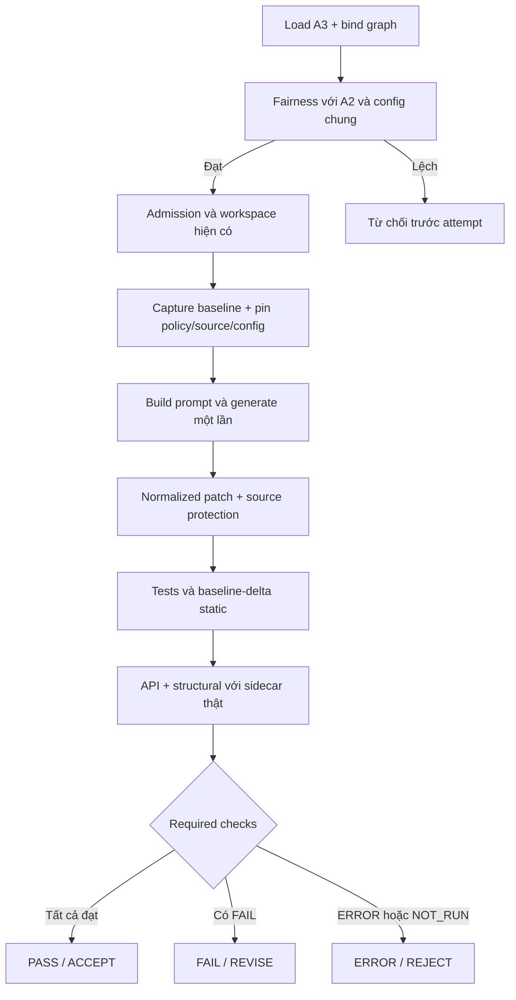

# M2-W12-1 — Policy A3 và fairness

Ngày triển khai: **04/11/2026**. Base: `32fd4723`; nhánh làm việc:
`m2/w11-checkers-evidence-c7-20261102`.

## 1. Phạm vi và trạng thái

**DONE kỹ thuật trên môi trường local; chờ M3 chạy/review và qualification CI.**
Gate offline: **1877 PASS, 18 SKIP, 1 XFAIL**, 0 FAIL/ERROR,
**2114.11 giây (35 phút 14 giây)** theo console pytest.
Chưa có kết quả model A3 trên SWE-bench và chưa đóng DONE thực nghiệm.

Chỉ thực hiện M2-W12-1 theo plan M2 W11–12 đã được người dùng duyệt:

- Cùng **25 dev task W10**: 11 task stage1 và 14 task stage2, 25 ID duy nhất.
- A3 dùng cách sinh **một lượt cho mỗi attempt** như A2, không thêm re-plan,
  retry hoặc lượt gọi model riêng khi API/structural không đạt.
- A3 kế thừa A2 **W10**, dùng `patch_mode="normalized"`,
  `path_listing="context"`, arm `graph`.
- M3 sở hữu experiment config, runner/launch/aggregate và chạy GPU/Docker thật.
  M2 bàn giao policy, fairness, tests và bằng chứng fixture.

Đây là các lựa chọn người dùng đã xác nhận, thay cho pilot 5 task/re-plan trong
bản deliverables gốc. Không triển khai E6, mutant pool, D15, held-out hoặc thay
population/budget/timeout trong task này.

## 2. Policy và tương thích

[`../configs/m2/variants/A3.json`](../configs/m2/variants/A3.json) được tạo từ
[`../configs/m2/variants/w10/A2.json`](../configs/m2/variants/w10/A2.json).

| Nội dung | A2 W10 | A3 |
|---|---|---|
| Required checks | tests, syntax, mypy, ruff | tests, syntax, mypy, ruff, api, structural |
| Serialized recorded checks | tests, syntax, mypy, ruff | Giữ nguyên bốn check này |
| Static mode | baseline_delta | baseline_delta |
| Diagnostic identity | m2-static-delta-v1 | m2-static-delta-v1 |
| Patch mode / path listing | normalized / context | normalized / context |
| Arm khi chạy | graph | graph |

`arm: null` trong file policy vẫn là trạng thái chưa bind giống file A2.
Experiment phải bind `arm="graph"`; validator từ chối bind A3 sang BM25,
kể cả đường gọi engine trực tiếp không qua experiment runner.

`recorded_checks` là danh sách legacy của bốn check cũ; API/structural đã có
đường supplemental evidence riêng từ W11-3. A3 làm chúng thành required checks
qua `required_checks`, không cần thêm tên vào serialized `recorded_checks`.

`policy.py` chỉ mở rộng tập variant/check hợp lệ và gate A3. Serializer, công
thức hash, default fields và policy/config A0–A2 giữ nguyên. Bộ regression W11-3
khóa **18 hash literal**: W9/W10 × A0/A1/A2 × unresolved/BM25/graph; đồng thời
đợt này chụp payload/hash trước sửa để so lại bytes và dữ liệu sau sửa.

## 3. Fairness

Gate `check_arm_fairness()` vẫn so các trường chung sau khi normalize policy,
cùng model ID/revision, tokenizer manifest hash, prompt template hash, repair
policy (budget, timeout, v.v.) và bundle profile hash giữa các experiment.

Bổ sung cho A3: khi tập experiment được so có A3, tất cả variant A2/A3 trong
tập đó phải dùng `graph`. Quy tắc áp dụng cả trong một experiment và khi so
experiment A2 với experiment A3. Các experiment chỉ có A0–A2 giữ hành vi cũ.

Thay đổi `patch_mode`, `path_listing` hoặc trường policy chung không được phép
đi qua gate. Tests CLI kiểm từ chối trước khi tạo attempt/output. Không đổi
công thức experiment ID, policy hash hay record W10. Không thêm E6 hoặc suy
diễn rằng những record W10 cũ đã dùng ranking W11.

Gate cần được gọi với toàn bộ experiment sẽ đem so sánh; một config đơn lẻ
không thể chứng minh đồng nhất với một config khác chưa được cung cấp. M3 cần
gọi cùng gate cho A2/A3 trước launch/aggregate theo đường hiện có.

## 4. Verification và evidence

Không sửa production code của verifier/session/pipeline: W11-3 đã đọc
`required_checks(variant)` và áp `assess_compatibility()` sau tests/static.

| API/structural bắt buộc | Kết quả verification khi các check khác đạt | Recommendation |
|---|---|---|
| Cả hai PASS | PASS | ACCEPT |
| Có FAIL, không có ERROR/NOT_RUN | FAIL; API_BREAK hoặc STRUCTURAL_VIOLATION | REVISE |
| Có ERROR hoặc NOT_RUN | ERROR; VERIFICATION_INCOMPLETE | REJECT |

Lỗi integrity luôn chặn run kể cả A0–A2; supplemental check không được che lỗi
hash/source/config binding. Với A0–A2, ordinary API/structural FAIL/ERROR/NOT_RUN
vẫn chỉ là evidence bổ sung và không tự đổi required-check verdict.

A3 giữ baseline-delta syntax/mypy/ruff giống A2, kể cả cách xử lý `UNAVAILABLE`
của tool đã có. Không mở rộng task sang thay qualification semantics cũ.

API và structural có sidecar `checks/api.json`, `checks/structural.json`, cùng
hash/binding trong canonical run record và DTO trong evidence bundle. Baseline
bind policy hash; không được dùng baseline A2 rồi đổi policy sang A3 ở post.

Thiếu structural YAML: cycle rule vẫn chạy; layer/forbidden-import ghi NOT_RUN
riêng theo quyết định đã duyệt. Tổng structural PASS có nghĩa các rule áp dụng
đã đạt, không có nghĩa đã kiểm layer/forbidden-import của repo. API động/không
phân tích được vẫn NOT_RUN và vì là required của A3 nên không ACCEPT.



Flow trên mô tả đường hoàn chỉnh; lỗi admission, baseline, patch, deadline hoặc
integrity có thể dừng sớm. Không tự chạy lại generation sau K/L.

## 5. Kiểm thử và artifact

Artifact: `results/m2/w1112/m2-w12-1-20261104-a3/`
(raw results gitignored).

| Gate | Kết quả thực tế |
|---|---|
| Baseline trước sửa | 354 PASS, 7.79 giây |
| RED ban đầu | 38 FAIL / 50 PASS: chưa có file/validator A3 |
| Sau policy/config | 85 PASS / 3 FAIL: hai lỗi fairness thật; một lỗi fixture dùng prompt v1 không còn đăng ký |
| Unit GREEN | 401 PASS, 8.63 giây |
| Integration + fairness | 25 PASS, 61.82 giây; gồm 6 native run và 19 fairness case |
| Toàn repo offline | 1877 PASS / 18 SKIP / 1 XFAIL, 0 FAIL/ERROR, 2114.11 giây |
| Ruff scoped / whitespace | PASS / PASS |
| Review code độc lập | Không có finding Critical/Important/Minor; không thay review M1/M3 |

Tăng ròng **56 test case**: 12 policy, 14 fairness, 24 verification, 6 native
integration. Thay tham số unknown variant A3 bằng A4 ở test cũ không làm tăng
số case (57 ID mới, một ID cũ được thay); `new_case_audit.json` ghi chi tiết.
Các gate chồng lặp; không cộng số PASS của nhiều gate thành số
case duy nhất. Lỗi fixture prompt v1 được sửa ở seam registry của test; không
đăng ký prompt mới hoặc sửa production prompt. Các case invalid-policy có
thể đã PASS ở RED vì validator cũ từ chối mọi A3; kiểm chứng chức năng dựa cả
vào positive/negative case sau khi A3 được chấp nhận.

| Patch fixture, tests đều PASS | A2 | A3 | API |
|---|---|---|---|
| Body fix tương thích | PASS / ACCEPT | PASS / ACCEPT | PASS |
| Chuyển `login(value)` sang positional-only, sửa body | PASS / ACCEPT | FAIL / REVISE | FAIL |
| Sửa body, thêm export động bằng comprehension | PASS / ACCEPT | ERROR / REJECT | NOT_RUN |

Cả sáu run đều sinh đúng **một lượt**, dùng normalized/context và graph,
structural tổng PASS (cycle có đo, layer/forbidden không có config được ghi
NOT_RUN riêng), source gốc giữ nguyên. Đây là fixture được cho phép chạy
native, fake generation, không phải 6 kết quả model trên SWE-bench.
Ba cặp có cùng prompt messages/hash và số token fixture; tokenizer của test
đếm UTF-8 bytes, không dùng số này làm chi phí token Qwen. Audit riêng ghi tại
`fixture_prompt_audit.json` và được kiểm lại trên record đã archive.

Artifact lưu `tests/*.command.json` (argv/env/exit code/thời gian), log/JUnit,
`before.json`, `legacy_policy_audit.json`, `new_case_audit.json`,
`fixture_prompt_audit.json`, `environment.json`,
`population_handoff.json`, `review.json`, `progress.md`, sáu thư mục
`fixture_runs/`, `consumer_audit.json`, `source_fingerprints.json`,
`task_changes.diff`, `closing_checks.json`, `summary.json` và
`artifact_hashes.json`. Audit đọc sidecar bytes thật, policy/canonical hashes
và source inventory; không chỉ tin cờ producer. `run_gate.py` và `finalize.py`
lưu cách chạy/tổng hợp riêng của đợt này, không phải script campaign dùng chung.
Raw results chỉ ở máy hiện tại, không tự được đưa lên GitHub.

Gate offline local **chưa đạt mục tiêu CI <10 phút trên máy này**; không thay
GitHub CI. Console và JUnit có sai khác nhỏ do thời điểm đóng báo cáo;
`tests/offline.command.json` còn lưu wall time của process wrapper.
Mẫu SKIP/XFAIL kế thừa repo, không
thêm marker, xfail hoặc deselect mới. Log/JUnit giữ tên và lý do chi tiết.

Môi trường: Windows, Python của venv `vgar-week78-cuda`; UTF-8, demo graph backend,
không ghi bytecode/cache pytest. Fixture dùng source copy/workspace riêng,
CharacterChatTokenizer hoặc tokenizer đã có, không nạp model weights.

Phiên này đo được Python **3.11.6**, pytest **8.4.2**, Pydantic **2.14.0**,
tree-sitter **0.25.2**, tree-sitter-python **0.25.0**, PyYAML **6.0.3**,
mypy **1.18.2**, Ruff **0.13.3**. Hai tool cuối khác dev pins trong
`pyproject.toml` (mypy 2.4.0/Ruff 0.17.0). Không cài lại hoặc đổi dependency
trong task này; kết quả là gate local trên venv hiện có, **chưa chứng nhận CI
hoặc qualification với tool versions đã pin**. M3/CI cần xác nhận môi trường
thật trước nghiệm thu. Các unit report điều khiển tool I/O không phải số đo
tool versions trên target image. File `environment.json` lưu phiên bản thực.

Lệnh chạy lại từ `D:\Project\CAPSTONES\VGAR`:

```powershell
$vgarPython = 'D:\Project\CAPSTONES\environments\vgar-week78-cuda\Scripts\python.exe'
$env:PYTHONUTF8 = '1'
$env:PYTHONDONTWRITEBYTECODE = '1'
$env:VGAR_GRAPH_BACKEND = 'demo'
$gateRoot = Join-Path $env:TEMP ('vg-a3-' + [guid]::NewGuid().ToString('N').Substring(0,8))
New-Item -ItemType Directory -Path $gateRoot | Out-Null
& $vgarPython -B -m pytest tests/m2/w910/test_policy.py tests/m2/w910/test_arm_fairness.py tests/m2/w1112 tests/m2/w78/test_a3_integration.py tests/m3/test_gpu.py tests/m3/test_runner.py -q -p no:cacheprovider --basetemp "$gateRoot\focused" --junitxml "$gateRoot\focused.xml"
& $vgarPython -B -m pytest -m 'not hf and not docker' -q -p no:cacheprovider --basetemp "$gateRoot\offline" --junitxml "$gateRoot\offline.xml"
& $vgarPython -B -m ruff check --no-cache src/vgar/repair/policy.py src/vgar/evaluation/repair/fairness.py tests/m2/w910/test_policy.py tests/m2/w910/test_arm_fairness.py tests/m2/w1112/test_a3_verification.py tests/m2/w78/test_a3_integration.py
git -c core.whitespace=cr-at-eol diff --check
```

`-B`/`PYTHONDONTWRITEBYTECODE` tránh tạo `.pyc`; `-p no:cacheprovider` tránh
`.pytest_cache`; `--basetemp` tạo vùng fixture tách biệt và phải là thư mục mới;
`--junitxml` lưu kết quả máy đọc được. Offline marker bỏ test đòi model/GPU hoặc
Docker theo marker sẵn có, không thêm deselect/skip/xfail để làm xanh test A3.
Ruff dùng `--no-cache` để không đụng cache cũ. CRLF-aware diff giữ line ending cũ.

Các integration fixture có thể cần quyền tạo Git worktree trong TEMP; chạy
ngoài sandbox nếu sandbox chặn private Git, không đổi source gốc để né lỗi.

Full offline suite có legacy test migrate fixture DB tracked. Trước chạy cần
chụp raw backup/hash `artifacts/sample_graph.db`; chỉ khôi phục đúng backup nếu
xác minh đúng thay đổi migration dự kiến. Không reset/clean toàn repo.

## 6. File và bàn giao

| File | Nội dung |
|---|---|
| `configs/m2/variants/A3.json` | Policy A3 |
| `src/vgar/repair/policy.py` | Validator A3/check names; giữ hash/legacy defaults |
| `src/vgar/evaluation/repair/fairness.py` | Gate A2/A3 graph arm |
| `tests/m2/w910/test_policy.py` | Contract, invalid policy, canonical ordering |
| `tests/m2/w910/test_arm_fairness.py` | V12, CLI refusal, graph/common-field/model/tokenizer drift |
| `tests/m2/w1112/test_a3_verification.py` | Verifier với policy A3 thật, AST/graph và availability |
| `tests/m2/w78/test_a3_integration.py` | Native fixture A2/A3, một generation, final verdict/sidecar |
| `docs/m2_w12_1_a3.md` | Tài liệu này |
| `docs/status/m2.md` | Trạng thái và dependency M2 |

M3 nhận policy và gate để tự tạo config experiment W12, bind graph và giữ
generation/model/prompt/budget/timeout chung với A2. Population lấy từ
`configs/m3/w10_dev_stage1.json:source.task_ids` (11) và
`configs/m3/w10_dev_stage2.json:source.task_ids` (14), không dùng dev-25 retrieval
tuning, không thay task excluded/input missing để đủ số run thành công.

M3 cần kiểm admission/profile/image/source/bundle/full-prompt preflight và
hash ranking/config đã freeze trước chạy thật; giữ mọi task/exclusion/error
trong ledger. Nếu ranking đổi, xử lý rerun A1/A2 theo quyết định nhóm; task này
không chạy lại và không áp E6. `aggregate.py` hiện nhóm variant theo ID nhưng
tiêu đề bảng vẫn ghi A0–A2; phần tích hợp/bảng W12 do M3 kiểm tra và cập nhật.

Trước launch, M3 gọi `check_arm_fairness([exp_A2, exp_A3])` với các config thực
sẽ đem so sánh (và cả hai stage nếu tách stage); không chỉ gọi gate riêng từng
config. Nếu dùng ranking/profile mới, comparator A2 cũng cần đáp ứng chính sách
rerun đã được nhóm chốt. CLI hiện có để M3 chuẩn bị:

```powershell
# TEMPLATE BÀN GIAO, CHƯA CHẠY: thay đường dẫn bằng config W12 do M3 tạo.
& $vgarPython -B scripts/run_repair_experiment.py preflight --config <M3_CONFIG_W12> --data-root <M3_DATA_ROOT> --output-root <M3_OUTPUT_ROOT>
& $vgarPython -B scripts/run_repair_experiment.py run --config <M3_CONFIG_W12> --data-root <M3_DATA_ROOT> --output-root <M3_OUTPUT_ROOT>
```

Kiểm `--help` của CLI trên máy M3 trước dùng template; paths chứa `<...>` là
placeholder, không phải lệnh đã thực thi. Cần đủ record của population 25 task,
bao gồm exclusions/lỗi, cùng review C1/C2/C3 và M3 review C7/CI/merge trước khi
đóng nghiệm thu theo deliverables. Không tự ký review hoặc sửa `Task Status.md`.

## 7. Nguồn ràng buộc

- `D:\Project\CAPSTONES\New_task\VGAR_W9_W16_Deliverables.md`, M2-W12-1.
- [Spec kỹ thuật](superpowers/specs/2026-10-31-w11-w12-design.md), §4.2.
- [Phân công](superpowers/specs/2026-10-31-w11-w12-parallel-split-design.md), C3/H3/V12.
- [Remediation](status/w11_w12_remediation_plan.md), V10–V12.
- [Evidence W11-3](m2_w11_3_evidence.md), [C7/D14](m2_c7_d14_vram_sampler.md).
- Plan và lựa chọn người dùng trong hội thoại: 25 task, không re-plan riêng,
  mỗi lần chỉ một task. Không phát sinh nguồn/paper bên ngoài trong đợt này.
