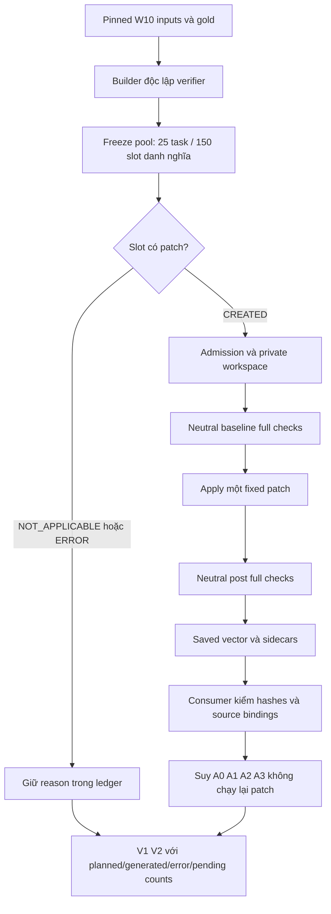

# M2-W12-2 — Mutant pool, verify-once và V1/V2

Ngày: **04/11/2026**. Base `32fd4723`, branch
`m2/w11-checkers-evidence-c7-20261102`. Chỉ triển khai task này; không D15,
E6, model run, thay môi trường/image hoặc sửa runner/aggregate của M3.

## 1. Trạng thái và giới hạn nghiệm thu

**DONE kỹ thuật local — code/fixture**, chờ M3 inputs/run/review và qualification CI.

Gate offline cuối: **1994 PASS, 18 SKIP, 1 XFAIL, 0 FAIL/ERROR, 2142.428 giây (JUnit)**.
**Chưa DONE thực nghiệm**: chưa có real campaign của 25 dev task trên Docker M3.

- Population thật giữ đúng **11 +14 =25 task W10**, không phải dev-25 tuning retrieval.
- Mục tiêu danh nghĩa **25 gold GOOD +125 mutant BAD =150 slot**.
- Operator không áp dụng được có `NOT_APPLICABLE/reason`; input/integrity lỗi có
  `ERROR`. Không tạo patch giả, đổi task hoặc chọn lại mutant sau khi xem verdict.
- Local input check: 25 task/150 slot được giữ, **0 patch tạo được/150 ERROR**
  vì pinned Parquet chưa có tại đường dẫn Windows đã kiểm. Đây là readiness
  ledger, không phải 150 lần verification.
- Repro input có **23/25**; thiếu `psf__requests-1724.json` và
  `pylint-dev__pylint-4970.json` trong `configs/m3/w10_dev/tasks/`.
- Data root M3 được mô tả là WSL `~/w10`; phiên này không khởi động/đọc WSL.
  Không kết luận dữ liệu thiếu trên mọi máy chỉ từ kiểm tra Windows.

## 2. Builder và boundary gold

Public API ở `src/vgar/evaluation/repair/mutant_pool.py`:

```python
PoolTask(task_id, repo, base_commit, source_repo, gold_patch, allowed_paths,
         protected_paths=('tests', 'pytest.ini'), source_inventory=None,
         fixture=False, unavailable_reason=None)
build_pool(tasks, output_root, *, seed=0, provenance=None)
load_pool(root, *, expected_pool_hash=None)
load_w10_tasks(parquet, data_root, *, repo_root=ROOT)
```

Real pool phải có đúng ordered IDs W10, seed 0, provenance `pinned_w10`, cùng:

| Pin | Giá trị |
|---|---|
| Dataset revision | `c104f840cc67f8b6eec6f759ebc8b2693d585d4a` |
| Parquet SHA-256 | `a45b1fe4e2f0c8390b2b2938ac83e92ed5979000856808f3679c07812e9e6dcd` |
| W10 manifest hash | `11e0b7b1168236e246dc8334db45ad932223a16ae7af0de149f30f25585f4177` |

Builder tái sử dụng boundary `gold_inputs.select_rows` để kiểm repo, commit,
query và dataset identity; không import `aggregate.load_gold`, vì import closure
của aggregate có thể dẫn tới verifier. Test V13 kiểm import closure gồm cả lazy
imports. Gold/test metadata chỉ nằm ở evaluation boundary, không đi vào
retrieval, context, prompt hoặc generator.

Source phải khớp Git base inventory và byte inventory trước/sau. Gold được bind
trong private TEMP, không apply lên checkout gốc. Mỗi mutant được xuất thành
**net patch từ base**, giữ các thay đổi gold còn lại. Không import/exec source,
không chạy pytest target hoặc gọi verifier trong builder.

Candidate được sort theo path/location; lựa chọn dùng seed cố định. Pool index
và patch bytes không có timestamp, random path hay absolute source path.
Cùng inputs/seed cho bytes giống nhau. Fixture pool được đánh dấu riêng;
không dùng fixture provenance thay cho real dataset qualification.

| Operator | Cách tạo | Không áp dụng khi |
|---|---|---|
| `condition_flip` | Đảo predicate của `if`/`while` trên production Python | Không có predicate hỗ trợ |
| `public_function_delete` | Xóa declaration public cấp module, theo export tĩnh | Không có public function xác định được |
| `signature_change` | Đổi signature ở declaration public | Không có candidate hỗ trợ |
| `import_cycle` | Thêm import nội bộ tạo cạnh ngược từ quan hệ module đã xác định | Không xác định được module/import nội bộ chính xác |
| `test_skip` | Thêm đường raise SkipTest trong production callable | Không có callable hỗ trợ |

Skip mutant không sửa protected tests. Public methods/nested functions,
dynamic exports, local/dynamic imports, from-alias/submodule suy đoán và syntax
ngoài khả năng AST host không được giả lập để đủ operator. Gold add/delete file,
protected-path hoặc patch policy không hỗ trợ được ghi lỗi rõ.
**BAD là nhãn kỳ vọng synthetic theo operator**, không chứng minh mọi mutant
đều sai hành vi trong thực tế.

`pool.json` giữ sáu slot mỗi task, labels/reasons/mutation location, patch refs,
patch hashes, source/predicted inventories và pool hash. `load_pool` đọc bytes
thật, kiểm schema/pins/counts/paths/hashes và predictions. Hash đảm bảo tính nhất
quán với pin từ caller, không phải chữ ký xác thực nguồn hoặc chứng minh execution.
Output không được trùng/nằm trong/bao chứa source, kiểm trước khi tạo thư mục.

## 3. Đo một patch, suy verdict bốn arm

API chính trong `src/vgar/evaluation/repair/verifier_eval.py`:

```python
verify_once(task, raw_patch, policy, output_root, *, admission=None,
            temp_root=None, pool_binding=None)
derive_verdict(vector, variant)
evaluate_pool(pool_root, output_root, task_provider, policy, variants, *,
              expected_pool_hash, temp_root=None, runtime_provenance=None,
              source_roots=())
report_campaign(pool_root, campaign_root, *, expected_pool_hash)
render_tables(summary)
```

Real execution tái sử dụng `validate_admission`, `prepare_admitted_workspace`,
`DockerExecutor`; không có native fallback cho target thật. Native chỉ dành
cho byte-verified fixture đã đăng ký trong repo. Không gọi repair generator,
không tạo fake repair run để chấm pool.

1. Freeze source/graph/config baseline trước apply; thu collection, tests và
   structured syntax/mypy/ruff, kể cả collection/tests trả FAIL/ERROR.
2. API/structural self-comparison baseline chỉ là evidence, không tự biến thành
   điều kiện qualification mới. Copy sidecar sang `baseline_checks/` để post
   không ghi đè bằng chứng baseline.
3. Bind/apply đúng một fixed patch trong workspace, pin applied inventory.
4. Thu collection/tests/static/API/structural post độc lập. Chỉ deadline,
   integrity hoặc exception cấp run mới có thể ngăn phần còn lại; phần chưa đo
   ghi NOT_RUN. Escaping config/Docker identity/source errors không được biến
   thành optional tool error cho A0.
5. Lưu neutral `vector.json`: source/scope, config/profile/overlay/policy runtime
   hashes, measurements và integrity. Không có variant policy hash ở raw static.
6. Qualification baseline và verdict được suy **riêng mỗi arm** bằng policy thật,
   trên bản sao measurements. Không chuyển binding A3 thành A0/A1. Derived result
   có `policy_hash` riêng, cùng `vector_hash` gốc.

`collect_static_measurements()` mới tái sử dụng structured collector mà không
gắn arm. Đường `run_static_checks(..., variant=...)` cũ giữ nguyên payload/hash
và semantics. Baseline qualification vẫn theo verifier hiện có: tests phải tái
hiện required failure, collection/scope đầy đủ; static debt có sẵn không tự làm
baseline A2 lỗi, profile-based UNAVAILABLE giữ cách xử lý cũ.

Post assessment tái sử dụng `assess_transition`, `_assess_w9_static`,
`assess_compatibility`. FAIL required API/structural → API_BREAK hoặc
STRUCTURAL_VIOLATION; ERROR/NOT_RUN → VERIFICATION_INCOMPLETE. A0/A1 cùng required
tests nên phải có cùng verdict verification trên cùng patch/vector.

Global integrity/source/config/profile failures chặn mọi arm. Interruption lưu
vector/ledger incomplete trước khi thoát; không coi patch chưa chạy là rejection.
Baseline/post source, scope, expected candidate, actual sidecar và static snapshot
được consumer đối chiếu lại với pool đã pin; không chỉ tin status hoặc self-hash.



## 4. Ledger, metric và bảng

Controller dùng một worker tuần tự; giữ mọi slot trước khi thực thi. Nó từ chối
output chồng lấn source/pool trước mkdir. CLI xuất bảng cũng bảo vệ các source
roots đã biết. Khi provider có thể lỗi trước khi trả task, caller cần truyền
`source_roots`; CLI M3 lấy chúng từ runtime configs. Không suy đoán paths bằng
cách quét máy.

Ba exclusion OVER_CAP của generation W10 không áp dụng cho fixed patch không
có prompt. Chỉ prefix OVER_CAP đã biết được bỏ trong bản config in-memory,
không sửa config M3; lý do gốc/config hash được lưu. Exclusion khác vẫn được
enforce và giữ lỗi/dependency, không tự chuyển thành runnable.

Positive = **BAD**:

| Patch | ACCEPT | Không ACCEPT |
|---|---|---|
| BAD | FN | TP |
| GOOD | TN | FP |

- `FAR = FN / generated BAD`, `FRR = FP / generated GOOD` khi label đó đã có đủ
  kết quả và không còn pool ERROR chưa sinh patch. Planned/NOT_APPLICABLE/error
  counts được báo riêng, không giả định 150 patch thật.
- ERROR terminal là không ACCEPT theo quyết định người dùng, nhưng tách khỏi
  FAIL rejection. Không gọi lỗi hạ tầng là mutant đã được phát hiện đúng.
- NOT_RUN không tự thành TP/FP. Mẫu số 0, pending hoặc unresolved pool ERROR của
  label tương ứng làm rate **N/A**. Các counts quan sát được vẫn công khai.
- `complete` chỉ nói ledger đã có terminal outcomes cho các patch sinh được và
  không còn pool ERROR; không có nghĩa tất cả patch được ACCEPT hay task đã được
  nhóm nghiệm thu. Human review/real-run acceptance là bước riêng.
- V2 có đủ năm operator, planned/generated/NOT_APPLICABLE/pool ERROR/FAIL/ERROR/
  pending. Tên rate là non-ACCEPT, không che ERROR thành detection.
- `verification_pool_counts.json` là số liệu pool; **không dùng làm cột P1 của
  repair dev runs**. P1 thật chờ record M3 và aggregate đúng population/attempt.

## 5. Kiểm chứng và review

Các gate đã lưu trước full offline cuối:

| Gate | Kết quả |
|---|---|
| Builder ban đầu | 38 PASS |
| Builder source/output overlap | 6 RED → 44 PASS/2 SKIP; hai alias case sau đó chạy thật bằng Windows junction: 2 PASS |
| Evaluator + policy regression ban đầu | 46 PASS |
| V16 và coverage | 52 PASS/2 RED → fix GREEN |
| Consumer/campaign gate trước review | 90 PASS |
| Scoped trước review fix cuối | 530 PASS |
| Scoped sau fix | 542 PASS/13.41 giây |
| Native sau review fix | 4 PASS/52.56 giây |
| Table output guard | 1 RED → 13 PASS |
| Full offline cuối | 1994 PASS, 18 SKIP, 1 XFAIL, 0 FAIL/ERROR, 2142.428 giây (JUnit) |

Các gate chồng lặp, không cộng số PASS thành population. Native gồm pass/skip
fixture, interruption persistence và frozen-pool consumer tampering. BAD fixture
không được dùng làm kết quả SWE-bench. Reviewer độc lập phát hiện bốn Important:
source/output overlap; source/candidate/policy proof; state/ref bypass; rates
khi pool ERROR. Mỗi finding có RED→GREEN; guard xuất bảng thuộc cùng lớp overlap.
Review tự động không thay human review M1/M3.

Demo native riêng đã hoàn tất: **6 slot, 4 patch được verify, 2 NOT_APPLICABLE**,
0 slot pending; hai lần sinh V1/V2 byte-identical, source gốc giữ nguyên.
Mỗi arm có GOOD=1/BAD=3 thực tạo; kết quả theo quy ước metric là TP=3, TN=1,
FP=FN=0. Trong ba BAD non-ACCEPT có **1 FAIL và 2 ERROR/incomplete**; không gọi
chúng là ba mutant được phát hiện đúng hành vi. FAR/FRR=0 trong demo nhỏ này
chỉ kiểm cách tổng hợp, không phải số liệu SWE-bench hoặc hiệu năng verifier.

Offline gate đầu bị dừng để chốt thêm table guard; `offline.log` không phải PASS.
Gate `offline-final` sau đó gặp giới hạn đường dẫn Windows: synthetic harness
cố ghi path dài263 ký tự. Test đó chạy riêng với TEMP ngắn PASS, không sửa code
harness. Run dài-path được dừng và giữ log; không gọi PASS.
Gate có thẩm quyền cuối là `offline-short.log/.xml/.command.json`, đi cùng
`before_full_final.json` và `short_temp_root.json`. Checkpoint duy trì trong PROGRESS.md và
`docs/checkpoints/2026-11-04-m2-w12-2-checkpoint.md`.

## 6. Chạy lại trên Windows

```powershell
Set-Location 'D:\Project\CAPSTONES\VGAR'
$vgarPython = 'D:\Project\CAPSTONES\environments\vgar-week78-cuda\Scripts\python.exe'
$env:PYTHONUTF8 = '1'
$env:PYTHONDONTWRITEBYTECODE = '1'
$env:VGAR_GRAPH_BACKEND = 'demo'
$gateRoot = Join-Path $env:TEMP ('vg-pool-' + [guid]::NewGuid().ToString('N').Substring(0,8))
New-Item -ItemType Directory -Path $gateRoot | Out-Null
Copy-Item -LiteralPath 'artifacts\sample_graph.db' -Destination "$gateRoot\sample_graph.db.before"
Get-FileHash -LiteralPath 'artifacts\sample_graph.db' -Algorithm SHA256
& $vgarPython -B -m pytest tests/m2/w1112/test_mutant_pool.py tests/m2/w1112/test_verifier_eval.py tests/m2/w1112/test_verifier_campaign.py tests/m2/w78/test_verifier_eval_integration.py -q -p no:cacheprovider --basetemp "$gateRoot\focused" --junitxml "$gateRoot\focused.xml"
& $vgarPython -B -m pytest -m 'not hf and not docker' -q -p no:cacheprovider -o faulthandler_timeout=180 --basetemp "$gateRoot\offline" --junitxml "$gateRoot\offline.xml"
& $vgarPython -B -m ruff check --no-cache src/vgar/evaluation/repair/mutant_pool.py src/vgar/evaluation/repair/verifier_eval.py src/vgar/repair/static_checks.py scripts/build_mutant_pool.py scripts/evaluate_mutant_pool.py tests/m2/w1112/test_mutant_pool.py tests/m2/w1112/test_verifier_eval.py tests/m2/w1112/test_verifier_campaign.py tests/m2/w78/test_verifier_eval_integration.py
git -c core.whitespace=cr-at-eol diff --check
```

`-B`/env tránh bytecode, `no:cacheprovider` tránh cache pytest; mỗi basetemp mới
giữ fixture riêng; JUnit lưu counts/reasons; marker offline loại hf/docker theo
quy tắc repo. Ruff no-cache tránh cache cũ; diff-check giữ CRLF sẵn có.
Full suite có test legacy migrate tracked DB: giữ backup/hash và chỉ restore
đúng raw backup sau khi xác minh migration, không reset/clean repo.

Venv local được đo ở task A3 là mypy 1.18.2/Ruff 0.13.3, khác pins dev
2.4.0/0.17.0; sẽ ghi metadata thực trong artifact. Local gate không chứng nhận
CI pinned-tools hoặc image M3. Không cài lại/đổi dependency trong task này.

## 7. Bàn giao M3 — template chưa chạy

M3 chạy trên Linux/WSL sau batch GPU và dry-run theo **phương án N**; pool không
gọi model. Cần cung cấp dataset/source/profile/repro/bundles/image đúng pins,
đặc biệt hai repro còn thiếu. Không pull/thay image để tự vượt dependency.

```bash
# TEMPLATE: thay các biến bằng paths/pins đã kiểm trên máy M3.
python -B scripts/build_mutant_pool.py --parquet "$PINNED_PARQUET" --data-root "$M3_DATA_ROOT" --output-root "$NEW_POOL_ROOT" --seed 0
# Đọc pool.json: chỉ tiếp tục khi inputs/ledger đã được review; pin pool_hash độc lập.
python -B scripts/evaluate_mutant_pool.py run --pool "$NEW_POOL_ROOT" --expected-pool-hash "$POOL_HASH" --data-root "$M3_DATA_ROOT" --config "$STAGE1_CONFIG" --config "$STAGE2_CONFIG" --output-root "$NEW_CAMPAIGN_ROOT" --table-root "$NEW_TABLE_ROOT" --temp-root "$PRIVATE_TEMP_ROOT"
python -B scripts/evaluate_mutant_pool.py report --pool "$NEW_POOL_ROOT" --expected-pool-hash "$POOL_HASH" --output-root "$NEW_CAMPAIGN_ROOT" --table-root "$SECOND_TABLE_ROOT"
```

Builder exit 2 nghĩa readiness/error ledger chưa đủ; run/report exit 2 có thể là
input/hash error hoặc incomplete campaign, phải đọc stderr/ledger; exit 130 là
interrupted. CLI report kiểm bytes đã lưu và tái sinh V1/V2 không re-run patch.
Exit 0 chỉ xác nhận ledger terminal/bảng đã sinh, không nói mọi check PASS;
vẫn phải đọc ERROR/incomplete/coverage trước nghiệm thu thực nghiệm.
Hai lần sinh bảng từ cùng input phải byte-identical. Đây là template, không
phải bằng chứng đã chạy trên Linux/Docker trong phiên này.

M2 nhận campaign/record gốc từ M3, kiểm hashes, sinh bảng thật và bàn giao cột
verification P1 từ repair records đúng population. Chưa có records thì giữ
dependency, không lấy fixture/pool counts thay thế hoặc mở D15 tự động.

## 8. File và artifact

| File | Vai trò |
|---|---|
| `src/vgar/evaluation/repair/mutant_pool.py` | Builder, population/pins và pool consumer |
| `scripts/build_mutant_pool.py` | CLI freeze gold/mutants |
| `src/vgar/evaluation/repair/verifier_eval.py` | Neutral collector, controller, consumer, verdict/metrics/tables |
| `scripts/evaluate_mutant_pool.py` | M3 run/report CLI, source/output guards |
| `src/vgar/repair/static_checks.py` | Neutral structured measurements, giữ legacy variant path |
| `tests/m2/w1112/test_mutant_pool.py` | V13/V14 và builder/source/pin tests |
| `tests/m2/w1112/test_verifier_eval.py` | V15/V16, qualification/availability/integrity/metrics |
| `tests/m2/w1112/test_verifier_campaign.py` | Ledger/state/ref/fairness/consumer/table tests |
| `tests/m2/w78/test_verifier_eval_integration.py` | Native fixture và consumer tampering |
| `docs/m2_w12_2_verifier_eval.md` | Tài liệu này |
| `docs/checkpoints/2026-11-04-m2-w12-2-checkpoint.md`, `PROGRESS.md` | Điểm dừng qua phiên |
| `docs/status/m2.md` | Trạng thái M2 và phần chờ M3 |

Artifact: `results/m2/w1112/m2-w12-2-20261104-verifier-eval/`.
Gồm log/JUnit/commands, review/fix RED/GREEN, source fingerprints,
preservation receipts, readiness ledger 150 ERROR, fixture demo/V1/V2, consumer
audit và artifact hashes. Raw results gitignored, không tự commit/push.

Nguồn ràng buộc: deliverables `D:\Project\CAPSTONES\New_task\VGAR_W9_W16_Deliverables.md`,
[spec kỹ thuật](superpowers/specs/2026-10-31-w11-w12-design.md),
[phân công](superpowers/specs/2026-10-31-w11-w12-parallel-split-design.md),
[V13–V16](status/w11_w12_remediation_plan.md), plan/decisions người dùng trong chat.
Không thêm paper hoặc nguồn ngoài không được dùng trong triển khai.

Thời gian gate local lớn hơn mục tiêu CI <10 phút; không suy thành GitHub CI PASS.
