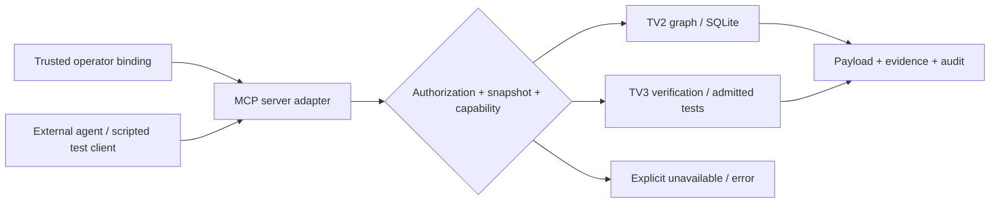

# Contract MCP server VGAR — hồ sơ H1

> **ACCEPTED_FOR_IMPLEMENTATION** — cập nhật 08/11/2026 theo xác nhận của người dùng: nhóm đã chốt các plan trong `Final_Task`, không yêu cầu thêm vòng review TV2/TV3 cho H1.
> H1 hoàn thành phần chuẩn bị contract. Oracle vẫn synthetic; xác nhận plan không đồng nghĩa schema/provider production đã được triển khai hoặc nghiệm thu.
> Mã công việc nội bộ: TV1-H1. H1 không triển khai server, DTO, provider, migration hoặc thí nghiệm mới.

## 1. Cơ sở và cách đọc

Plan thực hiện: [kế hoạch MCP server](D:/Project/CAPSTONES/Final_Task/2026-11-08-mcp-server-implementation-plan.md), §2.2–2.5 và H1. Nguồn phạm vi: [proposal](D:/Project/CAPSTONES/Final_Task/proposal_vgar_mcp_final_corrected.md), §4/§7/§10; [plan hai tuần](D:/Project/CAPSTONES/Final_Task/plan_2_weeks_mcp_server_2026-11-07.md). Bốn file `Final_Task/context/*.txt` chỉ giúp diễn giải; không dùng làm bằng chứng code đã có tính năng. Hash bảy tài liệu nằm trong `baseline.json` của artifact H1.

| Nhãn | Ý nghĩa |
|---|---|
| CURRENT | Có declaration/implementation trong checkout được chụp; H1 chỉ xác minh tĩnh, không chạy wire |
| PROPOSED | Interface/semantics theo plan đã chốt nhưng chưa triển khai; không có nghĩa đang chờ duyệt lại plan |
| WAITING_PROVIDER | Cần capability/dữ liệu từ provider; không được trả kết quả rỗng như PASS |
| ACCEPTED_FOR_IMPLEMENTATION | Theo xác nhận của người dùng về plan đã chốt; không cần thêm vòng review TV2/TV3 cho H1, không tạo chữ ký riêng của thành viên |

Baseline tại lúc tạo H1: branch `m2/w12-a3-verifier-d15-20261105`, HEAD `3f77fcf6ba68d7cfc6356dfe9757f6f53eed691b`; 20 tracked dirty, 23 untracked, không staged. Runtime Windows được kiểm kê lúc đó có MCP 1.30.0 và LangChain; đây là **legacy inventory**, không phải runtime SDK2. Trạng thái runtime sau H1 được ghi riêng trong [status](status.md). Phương án A: server độc lập không LangChain/LangGraph, SQLite production; backend khác có gate riêng. Không xây native agent host.

Fixture độc lập: [expected_contract.json](../../tests/fixtures/mcp_server/expected_contract.json). Tên fixture-local chỉ để định danh oracle; không đóng băng node namespace production.

## 2. Envelope, binding và quyền

### 2.1. Bảo toàn legacy

Nguồn: `src/vgar/mcp/schemas.py`, `tooling.py`, bốn `servers/*_server.py`, `contracts/graph.py`, `graph/port.py`, [contract cũ](../mcp_tool_contract.md).

Tool envelope giữ `{status, data, error, metadata}`. `metadata` bắt buộc `duration_ms >= 0`, `request_id`; extra metadata được phép. `error` có `{code,message,details,retryable}`. Wrapper graph hiện trả PASS/ERROR; FAIL/NOT_RUN dành cho verification-style tools, không tự đổi semantics wrapper. PASS nghĩa tool trả lời được; ví dụ repair `data.verdict=FAIL|ERROR` vẫn có envelope PASS.

Mã lỗi hiện có: `INVALID_ARGUMENT`, `INTERNAL_ERROR`, `INVALID_QUERY`, `INVALID_LIMIT`, `NODE_NOT_FOUND`, `GRAPH_ERROR`, `GRAPH_NOT_READY`, `PATH_OUTSIDE_ROOT`, `ROOT_NOT_LEASED`, `SELECTOR_REJECTED`, `TIMEOUT`, `TOOL_ORDER_VIOLATION`, `RUN_NOT_FOUND`, `MCP_TRANSPORT_ERROR`. Chỉ `GRAPH_NOT_READY` retryable với cùng arguments. Code chưa biết được map INTERNAL_ERROR. Không thêm mã lỗi runtime trong H1.

Fixture legacy `tests/fixtures/mcp/tool_success.json` và `tool_error.json` giữ nguyên bytes; canonical JSON được chụp thêm để làm oracle tương thích. Không chuyển đổi payload/hash dữ liệu cũ tại chỗ.

`GraphNodeRef` vẫn là wrapper `{repo: GraphNodeRepo}`, không phải raw node phẳng. `GraphNodeRepo` có node_id/type/path/range line-column/confidence/provenance/metadata; `GraphEdgeRef` giữ edge_id/edge_type/source_id/target_id/confidence/resolution/provenance/properties. Không thêm Component/Port vào validator legacy. Resource hiện trả raw JSON string, lỗi ở protocol level, không ép sang tool envelope.

### 2.2. Binding và DTO đề xuất — chưa tạo Python class

Mọi adapter mới dùng trusted `BoundContext` do operator bind: allowlisted repo, request/run/task identity, baseline snapshot/config identity, output root, authorization và deadline/limits. Model không được tự gửi dict context để cấp quyền. Identity mới phải bind source inventory hash, schema/profile, resolver, tokenizer/ranking khi áp dụng; `graph_version` cũ đứng riêng không đủ. No-latest: resource/task/evidence không tự chọn snapshot mới nhất.

DTO draft dưới đây là danh mục field tối thiểu làm đầu vào triển khai theo plan đã chốt, chưa phải class/wire schema production đã tồn tại. Production DTO dự kiến tập trung trong `mcp/proposal/contracts.py`, `extra='forbid'`; legacy DTO giữ nguyên. Giới hạn chưa có giá trị cụ thể phải được cấu hình khi triển khai trước khi expose, không tự dùng unlimited hoặc tự ghi là đã có cấu hình.

| DTO draft | Field/semantics cần thực hiện theo plan |
|---|---|
| BuildRequest / BuildResult | repo_path chỉ định danh repo đã allowlist; kết quả snapshot identity, capabilities, changed inventory, diagnostics; ghi store cần quyền |
| PathRequest / PathResult | source_id, target_id; typed witness gồm node/edge IDs, direction, confidence, provenance, truncation/unsupported; bound snapshot |
| ResourceRequest / ResourceResult | canonical URI + validated ID/query; bound task/run/snapshot; raw payload và availability, không lấy file path tùy ý |
| DiffRequest | diff bytes/text + SHA-256 đã xác minh; bound baseline/candidate state; không apply source gốc hoặc apply hai lần |
| CheckEvidence / TestEvidence | domain status, reasons, scope/coverage, evidence refs + hashes, snapshot/diff/config bindings; unknown khác measured zero |
| RankRequest / RankResult | candidates có stable ID/diff hash; điểm và evidence từng candidate, tie-break stable; score không vượt required FAIL/ERROR |

Port draft: `GraphProvider.build_or_update(request, context) -> BuildResult`, `.explain_path(...) -> PathResult`, `.snapshot_resource(...) -> ResourceResult`; `VerificationProvider.verify_graph(...) -> CheckEvidence`, `.rank_candidates(...) -> RankResult`; `TestProvider.run_diff_tests(...) -> TestEvidence`. TV2 cung cấp graph/schema; TV3 cung cấp verification/test evidence; Thành viên 1 sở hữu wrapper/binding. Không sửa `GraphService` để giả rằng provider mới đã tồn tại.

## 3. Đủ 11 core tools — CURRENT khác mục tiêu

Prefix dưới đây là tên client logic (`graph_`, `execution_`, ...), không phải đổi tên hàm server. Provider acceptance: input binding đúng, supported capability, output schema/evidence đúng, bounds/truncation rõ; gate runtime/wire thuộc task sau.

| Core name / client prefix | Input contract | Output, limits và trạng thái |
|---|---|---|
| `build_or_update_graph` / graph_ | PROPOSED `(repo_path: str)` + BoundContext | BuildResult; ghi graph store, host authorization; WAITING_PROVIDER TV2/L6-6; timeout/resource caps chờ operator |
| `search_symbols` / graph_ | CURRENT `(query: str, limit: int=20)` | envelope data `{query,limit,symbols:[SymbolRef]}`; giữ validation service, bound snapshot cho adapter mới |
| `find_task_anchors` / graph_ | CURRENT `(issue_text: str, graph_version: str, task_id: str, failing_tests: list[str] | None=None)` | envelope data dict của provider, `anchors`; required args legacy giữ nguyên; short proposal call phải bind qua adapter, không bỏ task/snapshot |
| `get_related_context` / graph_ | CURRENT `(anchor_ids: list[str], budget_tokens: int, graph_version: str, task_id: str, issue_text: str='', failing_tests: list[str] | None=None)` | context items/total_token_count và metadata của provider; budget theo tokenizer đã bind; rich ranking WAITING_PROVIDER TV2 |
| `get_callers` / graph_ | CURRENT `(symbol_id: str, depth: int=1)` | data `{symbol_id,depth,callers:[SymbolRef]}`; SQLite gồm Function/Method/Test caller, order qualified_name rồi ID; chỉ direct depth 1 dù echo depth; depth >1 chưa được claim supported |
| `get_callees` / graph_ | CURRENT `(symbol_id: str, depth: int=1)` | tương tự `{symbol_id,depth,callees}`; bounded multi-hop chờ provider, không đổi kết quả depth 1 |
| `explain_dependency_path` / graph_ | PROPOSED `(source_id: str, target_id: str)` + bound limits | PathResult, witness theo typed edges; TV2 cung cấp search direction/allowed relations/caps khi triển khai provider; không tự gọi CALLS là acyclic |
| `analyze_patch_impact` / graph_ | CURRENT `(diff: str, graph_version: str, max_hops: int=2, max_nodes: int=200)` | ImpactReport hiện có, reverse impact với evidence/availability; architecture/port WAITING_PROVIDER TV2; không apply source gốc |
| `verify_patch_graph_constraints` / graph_ | PROPOSED `(diff: str)` | CheckEvidence TV3; không finalize repair run; bounds/config theo bound context, unknown/incomplete phải lộ rõ |
| `run_relevant_tests` / execution_ | PROPOSED `(diff: str)` | TestEvidence; private admitted candidate workspace, diff hash/state match, executor allowlist, cleanup/receipt; TV3/test-provider thực hiện lease ownership theo contract |
| `rank_patch_candidates` / graph_ | PROPOSED `(candidates)` theo RankRequest | RankResult TV3; scoring/config/caps cần hiện thực/cấu hình theo plan; không dùng score để override required checks |

Các tool CURRENT có thể cần adapter cho rich graph nhưng không được sửa required args/payload legacy. Thiếu capability mới phải báo unavailable/error rõ theo contract, không dựng node/cạnh hoặc PASS giả. Danh mục lỗi runtime giữ bảng §2.1; reason/capability mới vẫn cần implementation/schema cụ thể trước khi công bố là khả dụng.

### 3.1. Tool legacy ngoài core và vòng đời repair

Hiện có **15 decorated tools**, 14 bare names duy nhất vì hai `health`, trên bốn server. Bảy graph tools hiện có gồm sáu core CURRENT và `get_related_tests`; tám tool còn lại là repository/execution/repair. Đếm 11 core mục tiêu không có nghĩa xóa tool khác.

| Server | Tool legacy bổ sung / signature |
|---|---|
| graph | `get_related_tests(symbol_ids, graph_version, changed_paths=None, failing_tests=None, selected_tests=None, max_hops=2, limit=50)` |
| repository | `health()`, `read_file(path: str)` |
| execution | `health()`, `run_pytest(selector: str)` |
| repair | `get_task_context(task_path, mode, output_root, work_root, config_path=None, keep_workspace=False, feedback=None, supersedes_run_id=None, rerun_reason=None, experiment=None, admission=None)` |
| repair | `apply_patch(run_dir: str, diff: str, generation=None)`, `run_relevant_tests(run_dir: str)`, `verify_patch(run_dir: str)` |

Exact typed signatures có trong fixture `legacy_surface`; được đối chiếu AST, không import module. `configs/mcp.yaml` mặc định cấu hình graph/repository/execution; repair được client gọi explicit, không tự coi mặc định bốn server đã cùng bật.

Legacy order: `get_task_context → apply_patch (một lần) → run_relevant_tests (optional) → verify_patch`. State trong session/run directory; `verify_patch` là finalizer một lần và cleanup. Tool execution mới không gọi finalizer chỉ để lấy test result. Hai `run_relevant_tests` có server prefix khác nhau, chưa đăng ký adapter execution trong H1.

Legacy roots: `VGAR_LEASE_ROOT`, `VGAR_RUN_ROOT`; resolve path phải ở trong lease. `read_file` cap 65.536 bytes. `run_pytest` selector allowlist, fixed argv/no shell, timeout 120s/output cap 12.000 theo `tooling.py`. Đây không phải ngân sách/timelimit được nhóm chốt cho thí nghiệm mới.

## 4. Tám canonical resources và một prompt

Tất cả resource thuộc graph server; identity lấy từ trusted binding. Không dùng request URI để đọc arbitrary file/secret hoặc vượt task isolation.

| Canonical URI | CURRENT / đề xuất response và dependency |
|---|---|
| `vgar://repo/summary` | CURRENT RepositorySummaryResult: graph/repo/revision identity, counts/statistics |
| `vgar://repo/schema` | PROPOSED schema/profile do TV2 cung cấp theo plan; WAITING_PROVIDER, không tạo schema giả |
| `vgar://graph/node/{node_id}` | CURRENT GraphNodeRef raw JSON string; ID percent-decode đúng một lần; unknown node lỗi |
| `vgar://graph/subgraph/{node_id}?k=2` | PROPOSED bounded query; canonical k/router/limits cần triển khai/cấu hình theo plan; legacy URI không query vẫn giữ |
| `vgar://component/{component_id}` | PROPOSED G_arch/Lift evidence, ports/dependencies/tests/availability; WAITING_PROVIDER TV2 |
| `vgar://task/{task_id}` | PROPOSED task/trace snapshot theo schema TV2 cung cấp, giữ legacy Test → Issue; task isolation |
| `vgar://evidence/baseline` | PROPOSED TV3/repair sidecar hash, task/run binding; không chọn latest |
| `vgar://audit/log` | PROPOSED bounded/redacted audit view theo run; request correlation, cap/pagination cần hiện thực/cấu hình |

Alias legacy riêng: `vgar://graph/subgraph/{node_id}` CURRENT, implementation gọi depth 2; không tính alias thành resource thứ chín. Hiện code có ba resource và **0 prompt**, không claim tám resource đã được expose.

Prompt PROPOSED: `repair_with_graph_context(issue_text, failing_tests, context_budget)`. Bảy bước: anchors → context → chỉ đọc file được chọn → minimal patch → impact → tests/verification → giải thích evidence. Repo/tool data untrusted, không đưa secret/env/gold; prompt không cấp quyền ghi và không chứng minh trace đã chạy. Không tạo prompt runtime ở H1.

## 5. Schema, oracle và giới hạn bằng chứng

Legacy schema: Repository/File/Module/Class/Function/Method/Import/CallSite/Test/Issue. `CALLS` là CallSite → callable; owner qua CONTAINS. `IMPORTS` là Import → Module. `TESTS` là Test → target; `REPRODUCES` hiện Test → Issue. Giữ provenance và confidence; thiếu evidence là unknown, không dùng confidence tự đoán.

Rich graph/profile riêng do TV2 cung cấp theo plan đã chốt. Không nới `contracts/schema.py`; legacy projection chỉ dùng facts hỗ trợ, giữ binding, không tạo cạnh giả để nối phần bị bỏ. Đồng nhất Module ở các graph, DEPENDS_ON theo endpoint profile, node namespace và Lift/Trace là trách nhiệm implementation/schema của provider; H1 không tự ghi các phần chưa có là đã triển khai.

Oracle JSON có các phần:

1. Exact legacy surface, error registry, constants, payload fingerprints để bắt drift.
2. 11 tool/8 resource/1 prompt descriptors liên kết tên ở §3/§4, tách state CURRENT/PROPOSED.
3. Small Python repository viết tay: parser → service → cli; test chọn lỗi username chứa `@`. Folded production CALLS đi cli → service → parser; evidence cạnh gốc giữ CallSite/CONTAINS. Test cũng CALLS service và có TESTS riêng. Oracle legacy `callers/callees` có caller Test đúng SQLite; `production_callers` tách riêng để kiểm phần production impact, không dùng nó thay oracle API legacy.
4. Callers/callees, dependency witness, anchors bắt buộc, impacted production symbols/affected test, GOOD/BAD diff và expected source. Không khẳng định ranking/top-k toàn cục hoặc checker semantics chưa review.
5. Component/Port/EXPOSES_PORT/CONSUMES_PORT/DEPENDS_ON dưới `draft_architecture`, `runtime_graph_document=false`, `review_status=NO_ADDITIONAL_REVIEW_REQUIRED`. Đây vẫn chỉ là ví dụ minh họa, không phải schema/provider production; không nạp vào legacy validator/store.

Kiểm GOOD/BAD là đối chiếu patch/source/AST và kỳ vọng viết tay, **không phải pytest target PASS hay đánh giá sửa lỗi thực nghiệm**. Fixture synthetic không thuộc 25 dev task hoặc held-out; không dùng làm số liệu paper.

## 6. Xác nhận plan và các yêu cầu còn phải triển khai/cung cấp

Ngày 08/11/2026, người dùng xác nhận nhóm đã chốt các plan trong `Final_Task` và không cần thêm vòng xác nhận TV2/TV3; sau đó yêu cầu cập nhật trạng thái file. H1 chuyển sang **ACCEPTED_FOR_IMPLEMENTATION**, không còn bị chặn bởi review lặp lại. Đây là ghi nhận chỉ dẫn của người dùng, không phải tạo chữ ký hoặc biên bản review riêng của TV2/TV3.

Giữ các ID dưới đây để theo dõi implementation và đầu vào. Chúng không còn là danh sách yêu cầu duyệt lại H1. Provider/config/giá trị thí nghiệm chưa có trong repo vẫn phải được cung cấp; không tự điền số hoặc chuyển unavailable thành PASS.

| ID | Yêu cầu implementation / đầu vào cần có | Phụ trách |
|---|---|---|
| C01 | Giữ Test → Issue cho view legacy; rich task schema phải có ánh xạ rõ khi hiện thực, không thay legacy theo ví dụ proposal đảo chiều | TV2 + TV3; rich task schema |
| C02 | Shared Module, DEPENDS_ON endpoint domains/profile, Lift/Trace và namespace node IDs | TV2; graph adapter/oracle rich |
| C03 | Provider DTO fields, ownership/path/range semantics, confidence/unknown, capabilities, snapshot identity | TV2 + TV3 + Thành viên 1; production ports |
| C04 | Port identity/caller updates; candidate workspace lease/admission/cleanup và evidence contract | TV2 + TV3; test/verification adapters |
| C05 | Bounds: traversal/path/ranking/audit/build, unavailable/error mappings và partial/truncation | TV2 + TV3 + Thành viên 1; expose tools/resources |
| E01 | Dev/held-out population và inclusion/exclusion | Nhóm; real experiment |
| E02 | Model/tokenizer/revision, baseline external agent/version/account | Nhóm; real experiment |
| E03 | Input/output/tool budgets, iterations/attempts, timeout, seed | Nhóm; real experiment |
| E04 | A4 required checks, allowed arm differences A0–A5 | Nhóm + TV3; fairness/protocol |
| M01 | Token usage gồm input/output/tool; missing giữ unknown; unit/aggregation và expected denominators | Nhóm; metrics freeze trước dev |
| M02 | Iteration là lượt generate/repair hay tool turn; attempt terminal/superseded và retry accounting | Nhóm; trace/protocol |
| M03 | Cold/warm boundary; generation/model/tool/run timing và censored timeout | Nhóm; timing metrics |
| M04 | Read proxy: cùng path + snapshot + byte range là duplicate candidate; unnecessary-read cần oracle độc lập, không kết luận từ việc không vào patch | Nhóm; proxy definition chỉ là draft |
| M05 | Audit completeness: request_id/tool/result/time/input hash + task/run/snapshot binding; denominator expected calls từ client trace, không lấy audit làm cả numerator và denominator | Nhóm; audit metrics |

Không freeze metric sau khi thấy kết quả. Cấu hình/định nghĩa đo thực tế phải ghi rõ version/hash/nguồn quyết định trước dry-run/dev; không yêu cầu duyệt lại plan H1. Không tự lấy old A0–A3 semantics làm new A0–A5 hoặc old timeout làm quyết định nhóm. Việc nhóm đã chốt plan không làm các giá trị chưa được cung cấp tự xuất hiện trong repo.

### 6.1. External-host capability matrix — chưa kiểm client/account

| Capability phải chứng minh | Hiện trạng H1 | Evidence/gate cần có |
|---|---|---|
| Client/version/account và pin model/tokenizer | UNVERIFIED | Operator cung cấp version, account availability, model selector/receipt; không lưu secret |
| Pin input/output budget, turns/iterations, tool limits | UNVERIFIED | CLI/config chính thức + receipt; thiếu control ghi limitation/WAITING_CLIENT_CAPABILITY |
| Export input/output/tool token usage và timing | UNVERIFIED | Raw trace/usage; thiếu field giữ unknown, không suy từ ký tự |
| Disable MCP cho A0; cô lập graph/context artifacts | UNVERIFIED | Per-arm config + trace + workspace visibility proof |
| Bind task/snapshot, correlation đầy đủ, terminal outcome | UNVERIFIED | Client trace đối chiếu server audit; supplemental tool calls không tự chứng minh agent success |
| Inspector modern/legacy và Claude Code smoke | NOT_RUN_H1 | Gate L6-8; scripted SDK client chỉ test server, không thay external-agent integration |

Nếu host thiếu control/evidence: ghi rõ thiếu capability; không tự đổi protocol, xây native host/agent loop hoặc báo experiment DONE. Đây là dependency thực tế, không phải yêu cầu review lại H1. Server functional PASS không đồng nghĩa Repair/MCP-success/Ablation/held-out DONE.

## 7. Security và state đề xuất

- STDIO stdout chỉ protocol; log đi stderr/file. Có gate subprocess/wire ở L6-1/L6-8, chưa chạy tại H1.
- Read-only mặc định; build/store/test workspace write cần operator authorization bind operation/repo/snapshot/diff/deadline. `confirmed=true` từ model không có hiệu lực.
- Lease/path jail trước read/write/spawn, fixed command allowlist, timeout/output/resource caps; không import/execute target code để lấy graph.
- Data từ repo untrusted; không làm theo yêu cầu bỏ policy trong docs; không log secrets/full diff tùy tiện. Correlation request/run/task và hashes cần kiểm.
- Snapshot mismatch/integrity lỗi không được che thành optional check PASS; unsupported/partial/unknown phải công khai.
- Candidate workspace thuộc admitted lease; apply/hash/state verify rồi execute/cleanup. Không ghi source gốc, không chạy gold/official tests từ retrieval context.
- Theo §2.5 plan: cancellation/timeout phải dừng worker/process tree và cleanup; CPU/blocking không cancellable dùng subprocess, không coi cancel coroutine là đã dừng thread. Đây là yêu cầu task sau, chưa được H1 kiểm runtime.
- SDK2 threads: SQLite connection không dùng xuyên thread; serialize build/update theo repo; session và snapshot publication có ownership/atomic writes. Audit JSONL append phải serialize giữa nhiều process. H1 chỉ ghi contract, chưa triển khai hoặc nghiệm thu concurrency này.

## 8. Nghiệm thu H1 và điểm dừng

H1 **DONE phần chuẩn bị contract / ACCEPTED_FOR_IMPLEMENTATION**: validation JSON/AST/patch consistency, đối chiếu legacy và preservation gate đã PASS; yêu cầu review lặp lại được bỏ theo xác nhận của người dùng. Validation H1 không test runtime SDK, graph builder/retrieval/risk, Docker, model hoặc external host. Những phần chưa triển khai giữ NOT_RUN/WAITING_PROVIDER và được nghiệm thu ở task tương ứng.

Artifact H1 gốc: `results/mcp_server/contract/20261108T100021Z-baseline/`, giữ nguyên trạng thái lịch sử lúc seal. Cập nhật xác nhận plan: `results/mcp_server/contract/20261108T130221Z-plan-confirmation/`; [status](status.md), [checkpoint](../checkpoints/2026-11-08-mcp-contract-baseline.md). Không sửa artifact cũ hoặc suy nghiệm thu implementation từ xác nhận plan. Lượt này chỉ sửa trạng thái, không tự triển khai task khác, không commit/push.

## 9. Quyết định triển khai L6-5 — 08/11/2026

Theo quyền người dùng đã được nhóm giao, foundation context/security đã được hiện thực; không cần review lặp TV2/TV3. [Security runbook](security.md) là mô tả chi tiết API, defaults, trust boundary và evidence.

- `BoundContext` immutable do host `ContextAuthority/bind_context` phát hành, HMAC bind toàn bộ identity/roots/hash/limits/deadline/grants. MCP JSON/confirmed flag không tạo quyền. Source/lease/output/state roots pairwise disjoint; host state không nằm trong vùng source/lease/output đọc được.
- `authorize_write` exact operation/input hash, expiry và consume một lần dưới OS lock; retry cần host grant mới. Legacy tiếp tục lease/admission, không tự có capability của adapter mới.
- New source binding dùng `vgar-bound-source-v1` canonical inventory mapping; legacy fingerprint/hash/artifact không đổi. Job/publication kiểm actual source trước/sau hoặc ngay trước commit, không chỉ tin context hash.
- `job_input_hash` bind fixed host argv; `manifest_input_hash` bind path/value/expected revision. Snapshot/config hashes do trusted bootstrap/provider cung cấp; L6-5 không tự tạo proof cho provider chưa có.
- Limits mặc định: read65.536B, worker120s, output12.000B/stream, lock10s, audit256KiB/200records. Không đổi repair900/1800.
- Session guard giữ khóa trước real load đến persist/finalizer; managed/commit sidecars phát hiện torn state. Audit append liên process có lock/fsync/tail/64KiB record checks; bounded reader riêng theo run/task.
- Publication ghi staging rồi recheck và atomic replace. Cancellation persistence và final check/replace chung request lock riêng: cancel trước thì không publish; commit giữ lock thì hoàn tất trước khi cancel trả về. Worker cancellation không chờ long-running repo lock.
- Sync/async wrappers giữ một terminal tool event; cancellation audit rồi re-raise; storage/integrity failure không thành PASS. Known secrets/capability material được redact, metrics được giữ.
- Foundation được kiểm bằng fixture synthetic/native worker; không đăng ký core tool/resource/prompt/provider mới. Integration bắt buộc còn thuộc L6-2/L6-6/L6-7. Native containment không là OS sandbox cho hostile code cùng tài khoản.

Artifact `results/mcp_server/security/20261108T131906Z-guards/`; checkpoint `docs/checkpoints/2026-11-08-mcp-security-concurrency.md`. H1 vẫn ACCEPTED_FOR_IMPLEMENTATION; L6-5 không tự hoàn thành các task khác.

## L6-2 — DONE kỹ thuật adapter / WAITING_PROVIDER — 08/11/2026

- 20 tools đăng ký, đủ 11 core names; giữ legacy required arguments/payload depth 1, 3 resources và 0 prompts.
- SDK2 final **139 PASS, 0 skip/fail/error**; legacy **100 PASS, 1 skip cũ** (Windows symlink unavailable), thêm scoped pin regression; các gate có overlap, không cộng thành unique tests.
- Legacy/runtime wire **16/16 PASS** (SDK2 modern/legacy và SDK1 cross/native). 4 synthetic core STDIO cases nằm trong SDK2 gate; simulated execution không phải task/model experiment.
- Đã kiểm context/grant/replay, source/provider/output binding, exact UTF-8 diff hash, persisted evidence, required-check ranking, multihop capability, async serialization/deadline/cancellation, full lease cleanup và pinned/no-latest bound legacy query.
- Independent review đã đóng cleanup false-PASS, source drift khi chờ lock, legacy host-factory bypass và event-loop blocking. Giữ RED/failed logs, không thêm skip/xfail để che lỗi.
- Production provider mới vẫn WAITING_PROVIDER (build/path/traversal/verification/ranking/tests); build orchestration thuộc L6-6. Không tự làm thuật toán TV2/TV3 hoặc tuyên bố 11 tool production READY.
- Runbook `docs/mcp_server/tools.md`; checkpoint `docs/checkpoints/2026-11-08-mcp-core-tools.md`; artifact `results/mcp_server/tools/20261108T141511Z-adapters/` chứa commands/logs/JUnit/wire/readiness/preservation/hashes.
- Bảo toàn thay đổi M2 và artifact H1/L6-1/L6-5; không cài package, đổi venv/DB, chạy Docker/model/campaign hoặc commit/push. **Dừng sau L6-2.**

## L6-3 — DONE kỹ thuật resource serving / WAITING_PROVIDER — 09/11/2026

- Graph server đăng ký8 canonical resources +1 alias legacy (4static/5templates); tools20 và prompts0 giữ nguyên. Ba legacy URI/raw JSON/MIME text/plain tiếp tục tương thích.
- SDK2 final **211 PASS,0skip/fail/error**, gồm72 resource cases mới và139 gates hiện có. Legacy **100 PASS +1skip cũ**; groups overlap, không cộng unique tests. Compatibility wire16/16 PASS; resource-positive synthetic wire3 sessions nằm trong SDK2 gate.
- Raw URI router decode ID đúng một lần, strict query k=2/cursor, bounded public JSON, pinned source/snapshot/task/run/config binding, evidence refs/hash, unavailable/error rõ. Audit resource cứng256KiB/200records, cursor chỉ tiến qua record đã trả; default caller read_audit cũ giữ nguyên.
- Đã đóng review findings về metadata/protocol secret redaction và high-host audit-record cap. SQLite temp-copy proof/source immutability, optimized-Python denial, legacy payload hashes, Ruff scoped/pip check và final preservation PASS. Không thêm skip/xfail, không đổi package/venv/DB tracked.
- Schema/component/task/baseline production **WAITING_PROVIDER**. Canonical subgraph/audit cần trusted host binding; synthetic fixture không chứng minh provider/experiment production hoàn thành.
- Runbook `docs/mcp_server/resources.md`; checkpoint `docs/checkpoints/2026-11-09-mcp-resource-serving.md`; artifacts UTC `results/mcp_server/resources/20261108T173125Z-serving/` có commands/log/JUnit/wire/review/readiness/preservation/hashes. Ngày local09/11, không đổi timestamp UTC.
- Bảo toàn dirty changes M2/L6-1/L6-2/L6-5 và sealed history. **Dừng sau L6-3**; không L6-4/L6-6/L6-7, Docker/model/campaign/commit/push.

## L6-4 — DONE kỹ thuật MCP prompt — 09/11/2026

- Graph server có1 prompt repair_with_graph_context,3 required string arguments; hai user messages, đúng7 bước proposal §10.4. Các server khác0 prompt; tools20/resources8 canonical+1alias không đổi.
- Pure deterministic renderer không source/env/gold/tokenizer/provider/tool/model/grant access; frozen lower-only65.536-byte caps, strict JSON/tests/positive ASCII budget, secret redaction và audit counts/templatehash. Không default budget mới hoặc sửa V11/policies.
- SDK2 final **266 PASS,0skip/fail/error**, gồm55 prompt/controller cases mới và211 gates hiện có; legacy **102 PASS +1skip cũ**. Groups overlap, không cộng unique tests. Wire compatibility16/16 PASS;4 graph lanes đều get_prompt/oracle PASS, không chỉ listing.
- Ba dedicated prompt wire sessions và hai raw-protocol cases thuộc SDK2 gate. Unknown/missing/extra/invalid dispatched requests được audit prompt_render và trả lỗi an toàn. SDK malformed params trước dispatch không phải render attempt: SDK1 warning generic +protocol_reject; SDK2 safe generic rejection, không fake prompt event/correlation. Review đã kiểm lại fixes và leading-zero normalization.
- Ruff scoped/pip check/preservation PASS; packages, V11, policies, DB, old dirty files và seals H1/L6-1/L6-2/L6-3/L6-5 giữ nguyên. PROGRESS/contract/status chỉ append; process cleanup inventory không có worker/server sót.
- Runbook docs/mcp_server/prompts.md; checkpoint docs/checkpoints/2026-11-09-mcp-repair-prompt.md; artifact UTC results/mcp_server/prompts/20261108T181049Z-template/ có commands/log/JUnit/template/hash/wire/review/preservation.
- Prompt PASS không chứng minh agent đã làm workflow, không đóng provider dependencies của L6-2/L6-3. Inspector/Claude Code thực thuộc L6-8. **Dừng sau L6-4**, không L6-7/L6-6/L6-8, Docker/model/campaign/commit/push.

## L6-7 — DONE kỹ thuật SQLite/legacy profile; WAITING_SCHEMA_PROVIDER — 09/11/2026

- Storage mới mỗi snapshot một DB/manifest, identity gồm graph version/source/schema/resolver/profile/canonical document. Không rewrite graph_version/node IDs hoặc migrate DB tracked/frozen; opt-in snapshot factory không đổi legacy defaults/launchers.
- Writer kiểm trusted context, exact single-use storage_ingest grant, repo/snapshot locks, source/deadline/cancellation; rows/full-document/identity/READY cùng SQL transaction. Close/round-trip/projection/hash trước atomic directory publication dưới request commit guard. Crash/orphan không là public READY, không tự adopt/xóa dữ liệu cũ.
- Reader explicit manifest/version và trusted profile fingerprints từ host, mode=ro/query_only/read transaction riêng mỗi operation/thread, không initialize/ALTER/latest/demo fallback/immutable=1. Canonical document giữ extensions; query vẫn SQL. Guard kiểm file identity và SQLite sidecars, schema/profile/DB/binding/projection consistency.
- Final SDK2 **328 PASS,0skip/fail/error**,69,48 giây: 52 storage cases (50 unit/process/worker-thread +2 real STDIO snapshot lanes),10 SQLite legacy cases và266 MCP gates đã có. Legacy **102 PASS +1skip cũ**,83,11 giây; groups overlap, không cộng unique total. Không thêm skip/xfail.
- Review 2 findings đã có7 RED regression và GREEN: không cho manifest tự đăng ký trusted profile; đối chiếu mọi SQL fact/scalar ranges/JSON với canonical document. Reviewer kiểm lại không còn finding quan trọng trong phạm vi. Source/deadline/cancel trong transaction, process crash trước/sau staging manifest, cross-process replay và coordinated forgery có evidence synthetic, không giả làm schema/provider production.
- Ruff phần mới/factory PASS; hook SQLite không có lint mới (3 findings cũ được so với HEAD); whitespace phần thay đổi/pip check/preservation PASS. DB/V11/policy/báo cáo Linux/M2 dirty files/seals H1/L6-1/2/3/4/5, index/HEAD/staged và hai package inventories giữ nguyên. Không có process test/server còn sót sau gate.
- Runbook/survey `docs/mcp_server/storage_backends.md`; checkpoint `docs/checkpoints/2026-11-09-mcp-snapshot-storage.md`; artifact UTC `results/mcp_server/storage/20261108T185307Z-snapshots/` có commands/log/JUnit, examples, crash/concurrency/review/preservation/checksums. SQLite3.42.0 chạy thật; Kùzu0.11.3 và Neo4jDriver6.4 chỉ khảo sát chính thức, **OPTIONAL_NOT_SELECTED**, không cài backend/đổi runtime.
- **L6-7 chưa DONE hoàn toàn:** schema Component/Port/layers và provider/SQL projection thật chưa bàn giao, round-trip mới còn WAITING_SCHEMA_PROVIDER. Không dùng synthetic validator/H1 để đóng dependency. Chưa nối build_or_update_graph hay incremental orchestration (L6-6), chưa integration external host (L6-8).
- Không model/Docker/campaign/commit/push; chỉ task L6-7. **Dừng sau L6-7.**

## L6-6 — DONE kỹ thuật build/update legacy; graph mới WAITING_PROVIDER — 09/11/2026

- Trusted controller nối build_or_update_graph với IncrementalGraphBuilder thật và SQLite snapshots L6-7. Một worker subprocess giữ cache extraction RAM theo phiên/repo, cold/warm/reuse rõ; relink vẫn toàn repo, không claim O(Δ+Fanout) hoặc benchmark production.
- Controller thread sở hữu validate/authorization/repo lock/copy/worker/storage/receipt; adapter không giữ OS lock ở thread khác. Build grant single-use trước staging/spawn; worker không authority/grants/DB và không import/execute target. Request-scoped registry/binding, opt-in bootstrap, default/legacy API/payload/inventory20tools/8canonical+alias/1prompt giữ nguyên.
- Source private copy/hash và worker job/instance/document/summary/ACK được kiểm trước publication. Repository metadata normalize về host repo sau proof, không để URI staging đã xóa. Effective profile bind operator profile/config/code; cache pin full identity/manifest/DB/original publication receipt, không latest/graph_version-only. Reuse snapshot cũ khác worker lineage reset worker; receipt ghi baseline thật hoặc cold-empty.
- Derived storage context dùng exact identity grant, cùng parent request scope; parent cancellation/operation deadline được kiểm cả trước/sau source scan và trong commit/publication guard. Timeout/cancel/error kill process tree và bỏ extraction cache; thiếu ACK không publish; native crash/orphan không tự adopt. Error khi source root biến mất vẫn cleanup worker, không che integrity thành PASS.
- Final SDK2 **399 PASS,0skip/fail/error**:45 cases L6-6 mới +354 regression MCP/storage/incremental/SQLite đã có. Legacy **102 PASS +1skip cũ**; các nhóm overlap, không cộng unique totals. Ba real STDIO lanes SDK2modern/legacy và SDK1server thực hiện cold→reuse→warm→read snapshot, nằm trong45 cases mới. Native process/cancellation/crash, optimized Python, config/source/schema/resolver/profile/code invalidation và semantic full-build equivalence có evidence.
- Review read-only đã đóng metadata staging, worker baseline và deadline sau source-scan; có RED→GREEN regressions. Intermediate gate từng phát hiện default expired-context exception bị đổi và lỗi fixture đăng ký lại authority; đã giữ ValueError legacy và sửa helper test, không nới grants/checks hoặc thêm skip/xfail.
- Ruff scoped/pip check/whitespace/preservation PASS. HEAD/branch/index/staged, package inventories, source plans, DB/V11/policies/M2/Linux reports và sealed artifacts trước giữ nguyên; PROGRESS/contract/status chỉ append. Process inventory sau gates không có server/worker còn sót.
- Runbook docs/mcp_server/graph_jobs.md; checkpoint docs/checkpoints/2026-11-09-mcp-graph-jobs.md; artifact results/mcp_server/graph_jobs/20261109T050523Z-incremental/ chứa actual commands/log/JUnit, worker/cache/equivalence/wire/crash/review, snapshot examples và checksums. Fixture source là synthetic, provider/builder/storage thật; không dùng làm bằng chứng dataset/model repair hoặc schema mới.
- **G_arch/G_task/Trace/Component/Port vẫn WAITING_SCHEMA_PROVIDER/WAITING_PROVIDER**. Chưa đóng toàn11 core tools production hoặc L6-8/external-host integration. Không model/Docker/campaign/install/commit/push. **Dừng sau L6-6.**

## L6-8 — DONE kỹ thuật preflight offline; PARTIAL/BLOCKED_DEPENDENCIES — 09/11/2026

- Chỉ preflight được yêu cầu: thêm CLI `scripts/mcp_server/smoke_mcp.py --preflight`, fixed helper `_preflight_worker.py`, consumer tests, ba config templates + metadata và runbook. Không sửa domain/runner/adapter production, cài/download, model/agent, login, Docker, global host settings hoặc commit/push.
- Lượt thật `campaign-02` **exit 2 / PARTIAL**, `preflight_completed=true`, `local_checks=PASS`; đây là hoàn thành công cụ và kiểm tra cục bộ, không phải DONE toàn L6-8. Inventory20 tools gồm11 core,8 canonical resources+1alias,1prompt. Bốn server × hai mode = **8/8 wire PASS**; protocol thực modern2026-07-28 và legacy2025-11-25.
- Real legacy builder/controller/SQLite trên source fixture: hai mode đều **COLD_BUILD → SNAPSHOT_REUSE → WARM_UPDATE → read PASS**, sáu build/reuse calls. Consumer kiểm job/evidence hash, trusted storage profile/identity, manifest/DB/source và resource binding; DB không đổi sau read. Fixture không phải provider schema mới hoặc repair campaign production.
- Final SDK2 **50 PASS**, gồm31 preflight cases; legacy compatibility **40 PASS +1skip cũ**. Các nhóm có overlap, không cộng thành unique total. Scoped Ruff/pip check PASS. Giữ15 trailing-whitespace findings cũ trong báo cáo M2 ngoài phạm vi; phần task mới kiểm riêng. Không thêm skip/xfail.
- Review đã đóng3 findings có RED→GREEN: await lazy SDK fixture initialization trước source fingerprint; consumer yêu cầu successful named calls/denials/resource data/legacy protocol, không chỉ listing/producer PASS; bảo vệ cả8 roots artifact cũ bị Git ignore. Lượt `campaign-01` ERROR và intermediate RED/GREEN logs giữ nguyên để audit, không tính thành nghiệm thu.
- CLI preservation **2.903 file PASS**; baseline task2.894 file được bảo vệ, chỉ ba tài liệu PROGRESS/contract/status được append. HEAD/index/staged/source plans/package inventories/DB/V11/policies/báo cáo Linux/M2 và mọi seal trước không đổi. Process receipt không còn server/worker của preflight.
- Ma trận **20 dòng** có owner/task/handoff/phần TV1 tích hợp/gate: TV1 còn trusted bootstrap/binding, rich-schema storage projection và external integration; TV2 còn SC-1, rich builder/query/path/architecture/task/trace/retrieval/impact; TV3 còn contract evidence/graph verification/ranking/admitted diff-tests/baseline. Legacy code đã có được ghi riêng, không coi là toàn bộ implementation chưa tồn tại.
- Node v22.22.2/npm10.9.7, Claude CLI2.1.193 đã đọc version/help; auth **NOT_CHECKED_OFFLINE**, session **NOT_RUN**. Inspector không tìm thấy tại các vị trí đã kiểm, không kết luận toàn máy. Templates **TEMPLATE_NOT_EXECUTED**; Inspector/Claude/full chain production đều **NOT_RUN**. SDK smoke không thay nghiệm thu external host.
- Artifact `results/mcp_server/preflight/20261109T055933Z-offline/`; báo cáo chính `campaign-02/report.md`, ma trận `campaign-02/dependencies.md`, checkpoint `docs/checkpoints/2026-11-09-mcp-preflight.md`, runbook `docs/mcp_server/runbook.md`. **Dừng sau preflight**, không tự triển khai dependency hoặc thực nghiệm tiếp theo.
