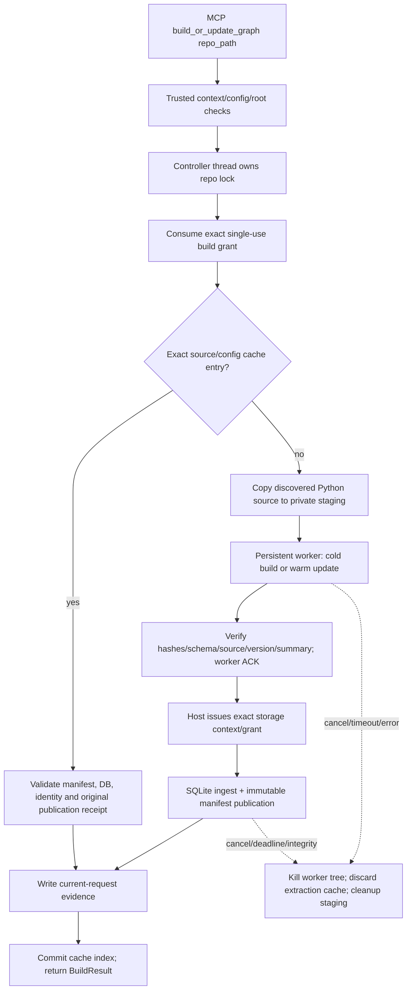

# L6-6 — Build/update graph qua MCP, cache theo phiên

Ngày: **09/11/2026, Asia/Saigon**. Artifact UTC:
`results/mcp_server/graph_jobs/20261109T050523Z-incremental/`.

## Phạm vi và mức nghiệm thu

Đường build mới dùng **IncrementalGraphBuilder thực**, resolver static Python legacy và SQLite snapshot storage L6-7. Đây là orchestration của TV1, không thêm thuật toán graph của TV2 hoặc verifier/ranking của TV3. Không chạy/import source đích, model, Docker hoặc campaign.

DONE kỹ thuật chỉ áp dụng **legacy static Python graph**. G_arch/G_task/Trace, schema Component/Port và các provider tương ứng vẫn `WAITING_SCHEMA_PROVIDER`/`WAITING_PROVIDER`. Khi host yêu cầu capability chưa hỗ trợ, controller từ chối trước authorization/spawn/publication. Không đưa layer cũ vào snapshot mới hoặc dùng fixture làm provider production.

Inventory/signatures không đổi: tổng20 tools,8 canonical resources+1alias,1 graph prompt. Backend mặc định/launchers và mọi API/payload legacy giữ nguyên. Task này chưa thực hiện Inspector/Claude Code/external host của L6-8.

## Thành phần và ownership

| Thành phần | Trách nhiệm |
|---|---|
| `proposal/graph_jobs.py` | GraphJobConfig/controller trusted; authorization, repo lock, source copy, IPC, validation, storage/cancellation, cache index và evidence |
| `proposal/_graph_worker.py` | Subprocess giữ IncrementalGraphBuilder trong RAM; build/update, ghi document/summary vào staging, ACK; không authority/grant/DB |
| `proposal/tools.py` | Opt-in controller bằng Python bootstrap; registry/binding immutable được tạo riêng từng signed request; đường provider cũ giữ nguyên |
| `graph/storage_capabilities.py` | Derived storage context/grant; dùng request context gốc và operation deadline thu hẹp khi commit/publication |
| `servers/graph_server.py` | Đóng controller trong finally khi server shutdown; không tự bật provider hoặc đổi global launcher |

Worker parse file đã copy bằng tree-sitter/AST/symtable. Nó không import module target; fixture wire có `raise RuntimeError('TARGET_MUST_NOT_EXECUTE')` ở top-level nhưng build vẫn thành công. Đây là kiểm chứng static parsing, không phải test sửa lỗi của repo đích.

## Luồng xử lý



Controller giữ một mutex trong process và OS repo lock theo L6-5 cho toàn chu kỳ write. Adapter không giữ một OS lock ở thread khác trong lúc chờ controller, tránh deadlock khóa reentrant theo thread. Hai server/process cùng repo dùng cùng trusted state root để được OS lock phối hợp.

Source/lease/output/state roots phải là roots đã được host cấp, tách biệt và không links/reparse. Tool argument chỉ định danh đúng repo đã bind; không chọn executable/provider/root/context. Source copy theo discovery policy của builder, đối chiếu hash với inventory; kiểm source trước/sau copy và trước publication. Lease không bị dùng làm nơi lưu cache hoặc sửa source gốc.

Worker chạy trong Windows Job/process-tree boundary hoặc process group trên POSIX. Environment được allowlist, không đưa authority key/grants/secrets vào argv, stdin hoặc env. JSON IPC đi qua pipe riêng của child; stdout MCP vẫn chỉ dùng cho protocol. Document/summary dùng files có hash trong private staging, không pickle cache hoặc gửi toàn graph qua STDIO.

Windows venv có redirector process: PID từ Popen khác PID Python chạy script. Controller kiểm nonce worker instance, job ID/fingerprint và PID dạng số hợp lệ; process-tree confinement bao phủ redirector, Python và descendants. Không so nhầm hai PID rồi báo integrity lỗi.

## Context, grants và publication

Build request cần single-use `build_or_update_graph` grant, input hash là hash BuildRequest, bind với signed context và source/config hiện hành. Kiểm dưới repo lock **trước khi** tạo staging hoặc spawn. Retry cần grant/request hợp lệ mới; đổi `confirmed=true` hoặc gửi dict không cấp quyền.

Sau khi worker hoàn tất, controller kiểm document và source hashes, graph_version dự tính, repo/revision, File inventory/content hashes, summary types/counts/durations và worker ACK. Repository.name/root_uri được kiểm trước ở private source rồi ánh xạ về host repo; không công bố đường dẫn staging đã bị xóa. Không đổi node IDs, graph_version hoặc các facts để thực hiện ánh xạ này.

`storage_issuer(parent_context, identity)` là callback **trusted bootstrap**, không phải tool argument. Callback tạo signed context mới bằng `bind_context()` với đúng roots/request/run/task/source/config/deadline/limits, đổi snapshot_hash thành storage identity ID và cấp grant `storage_ingest` đúng ID này. Không sửa trực tiếp context đã ký.

Storage kiểm hai context cùng authority/roots/scope, sử dụng request commit guard của parent và nhận `operation_deadline` chỉ được thu hẹp. Nó kiểm deadline cả trước **và sau** source inventory scan. Vì vậy deadline120 giây không bị thay bằng TTL dài hơn của context khi ingest/commit/publication.

Authorization/material không chuyển vào worker. Worker ACK xảy ra **trước** publication; thiếu ACK không tạo public snapshot. Worker chỉ được dùng lại khi controller xác nhận job thành công; failure hủy worker/cache. Native crash có thể để lại private staging/READY DB, nhưng thiếu public manifest hợp lệ không phải snapshot công bố; không tự adopt hoặc xóa orphan lịch sử.

Publication và request cancellation có thứ tự tuyến tính: snapshot đã công bố hợp lệ trước cancellation không bị thu hồi hoặc sửa tại chỗ. Nếu lỗi xảy ra ở bước receipt/index sau publication, job trả lỗi, không ghi cache hit hợp lệ; snapshot nhất quán nhưng chưa được nhận vào cache có thể còn lại để operator điều tra. Không dùng việc file tồn tại làm bằng chứng PASS.

## Cache và semantics báo cáo

- **COLD_BUILD:** worker chưa có extraction cache phù hợp; dùng `build()`. Change baseline rỗng, các file hiện có được ghi added; không giả đó là delta so với graph host chưa bàn giao.
- **WARM_UPDATE:** cùng worker/fingerprints, source thay đổi; dùng `update()`. Receipt ghi `changes_baseline_snapshot_hash` thật của worker.
- **SNAPSHOT_REUSE:** source/config/code/schema/resolver/profile không đổi, manifest/DB/identity và original publication receipt đều hợp lệ. Không rebuild hoặc thay build_time_ms/DB bytes; evidence mới bind task/run/request hiện tại.

Nếu reuse snapshot cũ khác source lineage đang giữ trong worker (A→B→reuse A), controller hủy worker để lần update kế tiếp cold build. Không báo warm delta của B như thể nó được tính từ A.

Extraction cache chỉ ở RAM theo phiên. Restart có thể reuse immutable snapshot qua exact durable index; source thay đổi sau restart phải cold build. Chưa có serialization cache extraction, không daemon hệ thống hoặc cache shared-memory liên process.

Cache key gồm canonical repo identity, builder options/revision/source_roots, source inventory, schema/resolver/profile/config và implementation fingerprint. Resolver fingerprint gồm code, resolver label, Python/tree-sitter versions. **Effective storage profile hash** bind operator profile hash + config hash + controller/worker code fingerprint; host đăng ký chính profile này qua `controller.profile()`. Không lấy hashes từ manifest làm đăng ký trusted.

Nhờ effective profile, config/code drift tạo storage identity mới kể cả khi document facts trùng nhau. Không dựa vào thời gian build hoặc staging UUID để tạo identity. Index pin manifest cụ thể và receipt/hash, không dò latest, không dùng riêng graph_version.

Graph version của result giữ nghĩa legacy; storage snapshot ID là identity hash riêng trong sidecar. Host phải dùng manifest và effective profile từ trusted controller/config để bind reader cho request tiếp theo, không tự thay reader đang hoạt động hoặc đọc latest. Đây là lựa chọn explicit của host, không cho model đổi context.

Khi cấp context cho read, host dùng source hash của manifest đã chọn và kiểm inventory hiện hành còn khớp; không ghép graph_version cũ với source_hash mới. Nếu source đã đổi thì cần build/update hoặc đọc một source snapshot riêng đã được bind, không tự cấp context để che stale graph. Chính sách host/external-host tổng thể vẫn phải được tích hợp và nghiệm thu ở L6-8.

Incremental hiện **parse changed files, relink toàn repo**. Cache hit/time đo trong receipts là diagnostics; task này không tuyên bố `O(Δ+Fanout)` hoặc đạt benchmark production của TV2.

## Bootstrap trusted

API mới chỉ dùng từ Python host:

```python
controller = GraphJobController(config, storage_issuer=issue_storage)
server.core_tools = CoreTools(
    ProviderRegistry(),
    graph_jobs=controller,
    context_factory=operator_context_factory,
)
server.main()  # finally closes controller
```

`config` pin repo/output/state roots, repo_key, repository_revision, source_roots và config/profile hashes. `operator_context_factory` phải trả context/grant đã được host authorize đúng operation/request/source. **Không** tự cấp quyền production chỉ vì model gọi tool hoặc cung cấp repo_path đúng.

`issue_storage` phải giữ deadline/limits và redaction settings của parent khi gọi `bind_context()`, rồi `authority.grant(derived, 'storage_ingest', identity.snapshot_id)`. Callback chỉ phục vụ job đã authorize. Không đưa callback/key vào config JSON hay arguments MCP.

Fixture server `tests/fixtures/mcp_server/graph_jobs_fixture_server.py` minh họa toàn bộ wiring; auto-grant trong file này chỉ là chính sách test được ghi rõ, không dùng nguyên làm chính sách production. Provider là static builder/storage thật, input là source fixture; không phải implementation trả graph viết sẵn.

## Chạy gate và đọc artifact

```powershell
$vgarPython = 'D:\Project\CAPSTONES\environments\vgar-mcp-server-sdk2\Scripts\python.exe'
$env:PYTHONUTF8 = '1'
$env:PYTHONDONTWRITEBYTECODE = '1'
$env:VGAR_GRAPH_BACKEND = 'demo'
$env:PYTHONPATH = "$PWD\src"
& $vgarPython -B -m pytest tests/mcp_server/test_graph_jobs.py tests/mcp_server/test_incremental_serving.py tests/mcp_server/test_storage_snapshots.py tests/test_incremental.py -q -p no:cacheprovider --basetemp "$env:TEMP\vg-graph-jobs-new-01"
```

Chọn temp mới mỗi lần. `-B` ngăn bytecode; `no:cacheprovider` không tạo pytest cache; demo chỉ phục vụ collection, fixtures tự inject snapshot backend/production controller. Không thử write/migrate trên DB tracked. Regression rộng dùng plugin sao chép sample DB sang temp riêng từng test.

Artifact lưu argv/exit/log/JUnit cho RED, intermediate failures, GREEN và release gates. Chỉ final gate mới dùng để xác nhận kết quả cuối. Test semantic so toàn document với full build trên host source, chỉ bỏ statistics.build_time_ms. Có native-process locking/crash, cancel process tree, deterministic deadline barriers, optimized-Python denial, và3 lanes SDK2 modern/legacy + SDK1 server qua official SDK client.

Không cộng các suite chồng lấn thành unique total. Raw results không commit. Source plans/báo cáo M2/Linux/V11/policy/DB và seals trước được bảo vệ bằng baseline hashes; PROGRESS/contract/status chỉ append.
