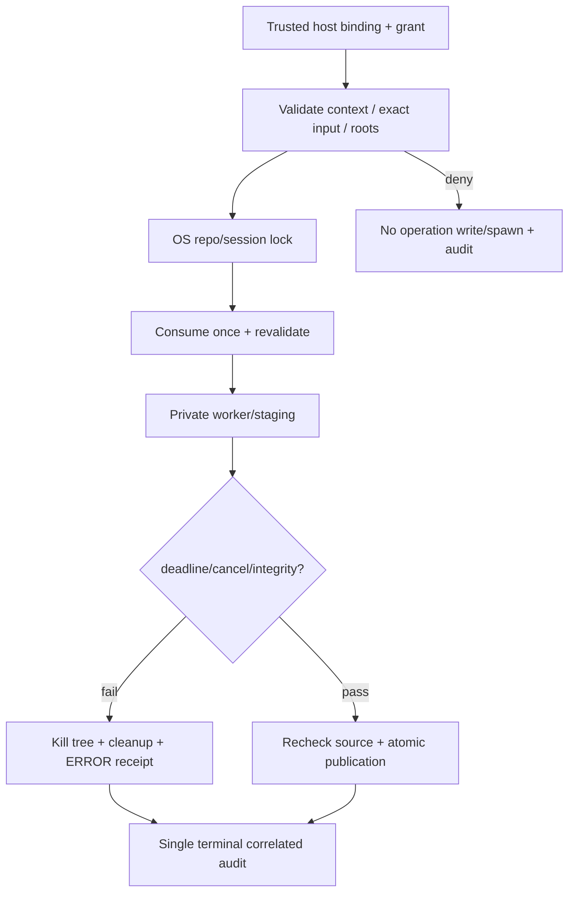

# Security và concurrency nền — L6-5

## Trạng thái và phạm vi

Triển khai nền cho adapter MCP mới và bảo vệ audit/session legacy. Không đăng ký tool/resource mới, không sửa graph algorithms, graph ingest, ranking/verifier providers, policy repair900/1800 hoặc schema legacy. H1 đã ACCEPTED_FOR_IMPLEMENTATION theo quyết định người dùng; không đòi review TV2/TV3 để tiếp tục.

Đường production adapter mới chỉ dùng các capability đã thực sự nối. Các primitives được kiểm bằng fixture SDK2 có `synthetic`; không dùng fixture để tuyên bố provider/L6-2/L6-6/L6-7 đã hoàn thành.

## Context và quyền host

Module `src/vgar/mcp/proposal/context.py` cung cấp `ContextAuthority`, `bind_context`, `authorize_write`, `request_scope`, `cancel_request` và source inventory binding.

Operator/bootstrap tạo authority trong **state root riêng**, nằm ngoài source/lease/output. Source, lease, output và state phải pairwise disjoint: không root nào chứa root khác. Không lấy các root hoặc authority từ MCP JSON, repository docs hay `confirmed=true`.

`BoundContext` frozen gồm authority ID, bốn roots, request/run/task IDs, snapshot/source/config SHA-256, deadline, limits, secret-redaction values và write grants. HMAC-SHA256 seal bao gồm toàn bộ fields; dataclass replace, context giả, dict hoặc grant khác scope không được chấp nhận. Secret32bytes do host tạo/lưu trong control root, không vào MCP payload/audit. State root cần quyền truy cập do operator quản lý; đây không phải cơ chế chống hostile Python cùng tài khoản OS.

Process bootstrap lại authority từ cùng trusted state root có thể kiểm context đã host phát hành. Không có MCP tool để tạo authority/grant. Context không có trong authority registry của process thì từ chối, không đọc một đường dẫn tự khai để tự cấp quyền.

Grant bind operation, input hash, repo/run/task/snapshot/config/source/deadline qua context seal. Mỗi grant có ID/expiry, consume bằng exclusive-create durable marker dưới OS repo lock; hai process dùng cùng grant chỉ một được phép. Grant đã dùng hoặc attempt thất bại cần host cấp grant mới, không tự retry write bằng quyền cũ.

Các hàm hash phải được host dùng đúng input:

- `job_input_hash(operation, argv)` bind fixed host argv. Không có generic shell/argv MCP tool. Payload/asset của provider phải được adapter kiểm/bind trước khi cấu thành job; phần integration thuộc task sau.
- `manifest_input_hash(relative, value, expected_revision)` bind đúng manifest payload/path/revision; publisher tự tính lại, không chỉ tin string hash được gửi vào.
- `source_inventory_hash(root)` dùng policy **vgar-bound-source-v1**: canonical JSON mapping relative paths → content hashes, kế thừa inventory size/link rules hiện có. Không dùng ambiguous path+content concatenation. Không thay hash/fingerprint legacy hoặc chuyển đổi artifact lịch sử.

Source inventory được kiểm khi bind và trước/sau job, trước publication. Snapshot/config hashes là trusted bootstrap/provider bindings; L6-5 không tự tạo graph/config proof giả cho provider chưa có.

## Limits và path/read policy

[security.json](../../configs/mcp_server/security.json) ghi defaults: read65.536bytes, worker120s, output12.000bytes/stream, lock10s, audit read256KiB/200records. Tất cả finite/positive; bool không phải integer hợp lệ. Deadline host là upper bound của worker/lock. Không đổi limits của experiment hoặc policy repair cũ.

Relative paths bị từ chối khi traversal, drive/UNC, ADS, Windows reserved device/trailing-dot/space aliases, NUL/control characters, symlink/junction/reparse-point hoặc vượt root. Secret/control files `.env*`, private keys, `.git/.aws/.ssh/.codex/.agents` bị chặn.

Read dùng opened-handle validation trước đọc bytes: Windows final-handle path/reparse attrs, POSIX dirfd/O_NOFOLLOW; cap áp dụng khi đọc, không load cả file rồi cắt. Legacy repository tool được nối guard này, giữ ordinary success shape/UTF-8/truncation semantics.

README chứa instruction độc hại vẫn chỉ là untrusted text; không cấp quyền đọc secret hoặc shell. Không có tuyên bố regex phát hiện được mọi prompt injection. Known secret values/sensitive keys được redact; token counts vẫn là metrics. Secrets không biết trước không được hứa sẽ tự phát hiện hoàn hảo.

Legacy client lọc credential-like env kể cả extra_env, chỉ miễn trừ token metric/config names cụ thể; child không reload `.env`. Guarded worker chỉ nhận system environment tối thiểu, không nhận authority roots/keys/secret env của host.

## Khóa, session và publication

`locking.py` dùng OS-backed `filelock` đúng version4.2.9 có sẵn trong locked runtime; nay được khai direct dependency, không cài/nâng packages. Cached lock hỗ trợ reentrant cùng thread và serialization giữa threads/processes; lockfile tồn tại sau crash không đồng nghĩa lock còn giữ, không xóa lockfile để vượt lock.

Legacy repair `_respond` giữ request-local ExitStack; `_load` validate root/files rồi acquire session lock **trước** `RepairSession.load`, vì load cũng có thể ghi record. Lock sống hết body đến persist/finalizer; không chỉ khóa riêng từng lần write. API/signatures/error mapping legacy giữ nguyên.

`mcp_state_managed.json` đánh dấu run đã được quản lý và `session_commit.json` bind SHA-256 của cặp session/run-record. Process crash giữa hai writes hoặc commit bị thiếu/mismatch → integrity error; không tự sửa state/claim PASS. Legacy run chưa có marker vẫn qua validation cũ, được nâng vào managed state khi đi qua guarded invocation; không migrate artifacts frozen.

`publish_manifest` là primitive, không phải graph ingest. Dưới repo lock: validate exact payload hash/grant, compare current revision, ghi/fsync staging riêng, kiểm lại cancellation/deadline/source/path rồi atomic replace. Cancellation và final check/replace cùng giữ một request commit lock riêng, không dùng long-running repo lock: cancel hoàn tất trước thì không publish; commit đang giữ lock thì hoàn tất trước khi cancel được trả về. Lỗi/stale revision giữ manifest cũ, staging chỉ cleanup trong vùng host sở hữu. READY DB transaction/graph invalidation do L6-6/L6-7 nối sau.

SQLite store hiện mở connection theo từng lần gọi. SDK2 thread test dùng temp copy đã `resolve_graph_version()` trước phục vụ, đúng startup barrier của factory. Test đầu đã phát hiện concurrent legacy migration trên DB chưa chuẩn bị có thể đụng ALTER; L6-5 không sửa schema/migration để che lỗi này. Serialized ingest/migration là phần L6-7; không dùng kết quả read-thread test làm bằng chứng migration concurrent an toàn.

## Audit và cancellation

Audit giữ `{timestamp,event_type,payload}` và một terminal `tool_call` mỗi lời gọi. OS lock serialize JSONL append, một serialized line được flush/fsync; record tối đa64KiB. Tail thiếu newline hoặc record quá lớn bị từ chối, không truncate/sửa log cũ. Nhiều process không được mất/trộn dòng.

Bound scope thêm request/run/task/snapshot correlation; response/audit share request ID. Sensitive keys/known values được redact; raw diff/patch/prompt/issue chỉ ghi hash/size. Không log grants/seals/authority material. Reader chỉ đọc fixed audit path của bound output/run/task, validate cursor record boundary và cap/page; không mở arbitrary path hoặc trả empty PASS khi log hỏng.

Sync `run_tool` và async `run_tool_async` normalize cùng terminal audit/envelope. Async duration tính từ trước await; SDK cancellation được audit ERROR rồi re-raise, không nuốt thành PASS. Audit persistence failure không cho trả PASS dù operation có thể đã chạy; caller phải xem là incomplete, không tự giả định rollback.

Guarded jobs chạy subprocess trong Windows Job hoặc POSIX process group; không chờ cancel coroutine tự dừng thread. Worker poll cả local event và shared durable request marker; timeout/cancel/output cap dừng cây process, chờ reap, cleanup staging và ghi receipt. Marker I/O error không được bỏ qua cleanup/wait. Publication kiểm marker trước replace; control storage lỗi không được dùng làm bằng chứng thành công.

Đây là native containment với trusted fixed argv, **không phải OS sandbox cho hostile code cùng user**. Full new-tool/provider orchestration chưa nối, không tuyên bố legacy synchronous tool bất kỳ đều có immediate SDK cancel; legacy command timeout/tree-kill vẫn giữ, adapter async mới dùng guarded job wrapper.

## Test/evidence và khôi phục

Artifact `results/mcp_server/security/20261108T131906Z-guards/` chứa exact commands/stdout/stderr/JUnit, RED reproducers, wire receipts, review, preservation và final summary/checksums. RED ban đầu tái hiện audit118/120 dòng; review bổ sung root overlap, source-hash discrimination và cross-process cancellation; staging-cancellation reproducer có RED→GREEN riêng.

Tests chia lane: SDK2 security/concurrency/native jobs/in-process fixture + old SDK2 runtime gates; legacy environment chạy MCP/security/repair regression và legacy client export. Các nhóm có overlap; không cộng thành số unique tests. DB tests dùng temp copy/plugin redirect, không thao tác tracked sample DB. Windows native junction được kiểm thật; symlink thiếu quyền được ghi riêng, không giả gọi mock là native OS PASS.

Các tests IPC dùng Events/Pipes/barriers; timeout test dùng deadline có chủ đích. Không model, generator, Docker hoặc campaign thật. H1/L6-1/plan-confirmation artifacts không ghi đè; các quyết định dưới đây thuộc phần nền L6-5 được người dùng ủy quyền.

Điểm dừng: DONE kỹ thuật L6-5 chỉ sau final gates/preservation; không tự chuyển L6-2/L6-6/L6-7 hoặc commit/push.
