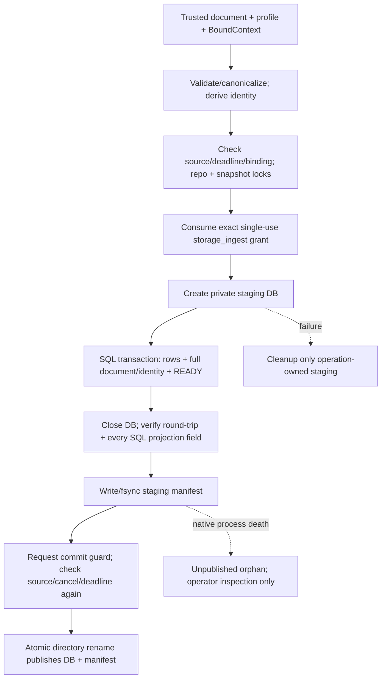

# L6-7 — SQLite snapshot storage và backend tùy chọn

Ngày kiểm tra: **09/11/2026 (Asia/Saigon)**. Artifact dùng UTC:
`results/mcp_server/storage/20261108T185307Z-snapshots/`.

## Trạng thái và phạm vi

SQLite là backend production được chọn, mỗi snapshot một DB riêng. Nghiệm thu L6-7 tách hai mức: phần SQLite/legacy profile có thể DONE kỹ thuật sau gate; round-trip schema graph mới là **WAITING_SCHEMA_PROVIDER**. Chưa có validator và SQL projection cho Component/Port, không dùng fixture H1 để thay thế.

Không đổi backend mặc định `demo`, cấu hình SQLite cũ, launchers/global host, DB tracked/frozen hoặc runtime. Không cài Kùzu/Neo4j. Storage chưa được nối với `build_or_update_graph`: orchestration thuộc L6-6.

## Disposition và nguồn kiểm chứng

| Backend | Phiên bản khảo sát/thực chạy | License | Python/Windows | Mô hình truy vấn | Kết luận |
|---|---|---|---|---|---|
| SQLite | **3.42.0**, thực chạy trong CPython **3.11.6**, MCP SDK **2.2.0** hiện có | Public domain | Module `sqlite3` có sẵn trong interpreter Windows x64 đang dùng | SQL, bảng nodes/edges, indexes; mỗi connection có read transaction | **SELECTED**, nghiệm thu bằng tests/runtime thật với legacy profile |
| Kùzu | **0.11.3**, khảo sát release/docs; không cài | MIT | Docs có Python trên Linux/macOS/Windows và CLI Windows x86-64; chưa kiểm wheel/runtime tại máy này | Embedded property graph, Cypher | **OPTIONAL_NOT_SELECTED**, không adapter/integration PASS |
| Neo4j | Docs Python Driver **6.4**, series **6.x**; khảo sát Community server **2026.01** cho license, không cài | Driver Apache 2.0, một số phần PSF v2; Community server GPLv3; các bản thương mại có điều khoản riêng | Driver Python ≥3.10; server có hướng dẫn Windows 11/JDK 21 hoặc 25, tùy bản | Client/server, Cypher qua Bolt; cần database instance đang chạy | **OPTIONAL_NOT_SELECTED**, không integration PASS |

SQLite có isolation giữa connections; reader dùng URI `mode=ro` cùng `query_only`, không dùng `immutable=1` vì tùy chọn đó bỏ locking/change detection. Giữ rollback-journal mặc định của writer, đóng DB rồi mới publication. Không có benchmark tải production lớn trong task này. Nguồn: [SQLite isolation](https://www.sqlite.org/isolation.html), [URI/read-only/immutable](https://www.sqlite.org/uri.html), [public domain](https://www.sqlite.org/copyright.html).

Kùzu chính thức đã archive/read-only từ **10/10/2025**. Dù bản phát hành cũ còn dùng được, maintenance và extension distribution là rủi ro khi chọn backend mới. Embedded không cần server riêng, nhưng vẫn dùng RAM/đĩa của host; chưa đo tài nguyên tại VGAR. Nguồn: [repository và thông báo archive/license](https://github.com/kuzudb/kuzu), [release 0.11.3](https://github.com/kuzudb/kuzu/releases/tag/v0.11.3), [installation và Python/Windows](https://kuzudb.github.io/docs/installation/).

Neo4j cần vận hành server, cấu hình auth/network, backup và bộ nhớ riêng. Docs nêu hướng dẫn phát triển cá nhân tối thiểu 2GB RAM/10GB storage, khuyến nghị RAM cao hơn; đây không phải phép đo VGAR hay cam kết máy hiện tại đủ tài nguyên. Driver 6.x hỗ trợ server 4.4/5/2025/2026 theo compatibility docs. Nguồn: [driver installation](https://neo4j.com/docs/python-manual/current/install/), [Driver 6.4 API](https://neo4j.com/docs/api/python-driver/current/), [server requirements](https://neo4j.com/docs/operations-manual/current/installation/requirements/), [driver license](https://raw.githubusercontent.com/neo4j/neo4j-python-driver/6.x/LICENSE.txt), [Community 2026.01 license](https://github.com/neo4j/neo4j/blob/2026.01/LICENSE.txt), [commercial terms](https://neo4j.com/legal-terms/).

Không sửa requirements/lock, cài package, khởi động server hay chứng minh integration bằng việc đọc tài liệu. Nếu sau này chọn backend khác, phải có gate riêng cho transaction/identity/round-trip/query compatibility/security và đo tài nguyên thực.

## Identity và layout

Implementation: `src/vgar/graph/storage_capabilities.py`.

`StorageIdentity` là frozen dataclass gồm:

1. `graph_version` nguyên gốc của document;
2. `source_inventory_hash` theo `vgar-bound-source-v1`;
3. `schema_hash` — legacy profile dùng SHA-256 bytes validator `contracts/schema.py`;
4. `resolver_hash` do producer/operator pin;
5. `profile_hash` do operator pin;
6. `canonical_document_hash` — JSON UTF-8, sorted keys, compact separators, không NaN/Infinity.

`snapshot_id = sha256(canonical JSON của sáu trường)`. Hash dùng prefix `sha256:`; tên thư mục lấy 64 ký tự hex. Không sửa graph_version hoặc node IDs để tạo cache identity. Hai documents cùng graph_version/node IDs nhưng khác facts hoặc fingerprints là hai snapshot riêng.

```text
<trusted-storage-root>/
  <snapshot-id-hex>/
    graph.db
    manifest.json
  .staging-<uuid>/          # private/incomplete; không phải public snapshot
```

Manifest `vgar-sqlite-snapshot-v1` giữ identity/snapshot_id, profile, DB reference `graph.db`, DB hash, trạng thái `READY`, binding run/task/config. DB giữ nguyên graph_metadata/nodes/edges/indexes legacy và thêm bảng **snapshot_binding** chỉ trong DB mới: full canonical document + identity. Unknown extension fields được giữ trong document đầy đủ; queries vẫn chạy SQL trên projection legacy.

Một validator mới chỉ được đăng ký bằng `StorageProfile` từ Python bootstrap trusted. Registry này không lấy từ model hoặc tự tạo từ manifest. Hiện SQL projection vẫn bắt buộc qua validator legacy; rich schema cần provider/projection thật, không chỉ một validator `lambda` trả thành công. Không widen schema legacy.

## Writer và publication



Root phải tồn tại, không link/reparse, nằm trong `context.output_root` và tách source/lease/state theo L6-5. Writer không nhận tên DB tùy ý, không mở hoặc overwrite file cũ. Grant operation **storage_ingest**, `input_hash=identity.snapshot_id` bao hàm exact document hash; context snapshot_hash cũng là **storage snapshot_id**. `source_hash` phải khớp identity và inventory thực. `config_hash` của context là binding host riêng; `profile_hash` là fingerprint profile, không tự giả định hai hash là cùng khái niệm.

Graph rows, full document/identity và DB `ready` cùng transaction. Hook `_before_ready()` là thay đổi duy nhất trong legacy ingest, mặc định no-op. Reader/publication không dùng hook này để migrate DB cũ.

Sau SQL commit vẫn chưa là public/cache READY: cần round-trip/hash và publication. Directory rename cùng volume công bố cặp DB/manifest; cả trước SQL commit và publication đều dùng request commit guard chung với cancellation. Cancel sau publication tuyến tính hóa thành công không thu hồi snapshot đã công bố. Không tuyên bố đây là OS sandbox chống plugin cùng user hoặc là benchmark durability khi mất điện.

Lỗi thông thường/KeyboardInterrupt cleanup staging thuộc chính operation. Process chết cứng có thể để orphan cả khi staging manifest đã ghi `READY`; reader từ chối parent `.staging-*`. `unpublished_staging()` chỉ liệt kê, không sửa/xóa/adopt. Operator phải điều tra riêng; không lấy DB tồn tại làm bằng chứng thành công hoặc dùng lại grant đã consume.

## Reader và lựa chọn backend

`SnapshotGraphStore(manifest, graph_version=..., profiles=(trusted_profile,))` bắt buộc manifest/version/profile cụ thể, không infer profile fingerprints từ manifest. Khi bind: kiểm parent snapshot ID, profile/schema hashes, DB hash, READY, identity, canonical document và **mọi field projection SQL**, gồm scalar ranges lẫn range_json. Không chỉ tin JSON metadata tự khai.

Mỗi operation tạo một connection `mode=ro`, `query_only`, `BEGIN`; các nested query trong operation dùng lại connection của **chính thread đó**. Connection được đóng trong finally, không chia sẻ xuyên SDK2 threads. Trước/sau reads kiểm file identity/size/mtime/ctime và từ chối SQLite WAL/SHM/journal sidecars. Hash full DB kiểm lúc bind; thay file sau bind gây lỗi, không tự rebind/latest/fallback demo. Read transaction dùng locking bình thường, không `immutable=1`.

`load_document()` phục vụ round-trip/retrieval đã dùng document theo legacy; `search_symbols`, relations, node, summary, subgraph, importers/reverse edges/range-by-line vẫn dùng SQL/indexes/order/limits legacy. Reader `initialize()`/`ingest()` luôn từ chối, không ALTER/schema migration hoặc tạo file thiếu.

Operator có thể chọn explicit backend trong **process riêng**, không cần đổi launcher/global settings:

```powershell
# Các giá trị dưới đây lấy từ receipt/config trusted, không lấy lại từ model.
$env:VGAR_GRAPH_BACKEND = 'snapshot'
$env:VGAR_GRAPH_SNAPSHOT_MANIFEST = '<absolute published manifest.json>'
$env:VGAR_GRAPH_VERSION = '<original document graph_version>'
$env:VGAR_GRAPH_RESOLVER_HASH = '<operator-pinned sha256:64hex>'
$env:VGAR_GRAPH_PROFILE_HASH = '<operator-pinned sha256:64hex>'
# Dùng runtime server hiện có; không cần cài backend mới.
& 'D:\Project\CAPSTONES\environments\vgar-mcp-server-sdk2\Scripts\python.exe' -B -m vgar.mcp.servers.graph_server
```

Factory hiện hỗ trợ legacy profile qua env này; custom profile dùng Python bootstrap explicit. `VGAR_REPOSITORY_ROOT`/tokenizer manifest nếu cần retrieval vẫn theo legacy. Không nhầm context snapshot_id của **storage write** với graph_version trả trong GraphService payload. Khi L6-6 nối build/provider, host phải bind rõ storage identity và snapshot graph view; L6-7 chưa tự đăng ký provider hay đổi MCP binding contract.

## Tự chạy gate và đọc evidence

```powershell
$vgarPython = 'D:\Project\CAPSTONES\environments\vgar-mcp-server-sdk2\Scripts\python.exe'
$env:PYTHONUTF8 = '1'
$env:PYTHONDONTWRITEBYTECODE = '1'
$env:PYTHONPATH = "$PWD\src"
$env:VGAR_GRAPH_BACKEND = 'demo' # collection; fixture tự chọn snapshot ở child process
& $vgarPython -B -m pytest tests/mcp_server/test_storage_snapshots.py tests/test_sqlite_graph_service.py -q -p no:cacheprovider --basetemp "$env:TEMP\vg-storage-new-01"
```

Chọn temp mới mỗi lần, không dùng DB tracked để thử query/migration. `-B` ngăn bytecode; `-p no:cacheprovider` không tạo pytest cache. Gate storage gồm fixture synthetic, native process crash/locks, cancellation, profile/hash/projection integrity, SDK2 worker thread và STDIO thật; không có model hoặc Docker. Toàn bộ argv/exit/log/JUnit của execution nằm trong command journal của artifact, các lượt RED giữ nguyên để chứng minh regression.

Preservation gate bao gồm dirty files, index, source plans, V11/policies, fixture DB và tất cả seal H1/L6-1/2/3/4/5. PROGRESS/contract/status chỉ append; không sửa lịch sử. Các suite chồng lấn không cộng thành unique test total. Không biến legacy skip có sẵn thành test mới PASS.
